| Document Title             | Guide to Mode Management   |
|----------------------------|----------------------------|
| Document Owner             | AUTOSAR                    |
| Document Responsibility    | AUTOSAR                    |
| Document Identification No | 440                        |

| Document Status          | published        |
|--------------------------|------------------|
| Part of AUTOSAR Standard | Classic Platform |
| Part of Standard Release | R23-11           |

| Document Change History   | Document Change History   | Document Change History    | Document Change History                                                                                                                               |
|---------------------------|---------------------------|----------------------------|-------------------------------------------------------------------------------------------------------------------------------------------------------|
| Date                      | Release                   | Changed by                 | Description                                                                                                                                           |
| 2023-11-23                | R23-11                    | AUTOSAR Release Management | • Service Discovery Control for Application Software • Provide Interface to Ecu Mode Handling via BswM                                                |
| 2022-11-24                | R22-11                    | AUTOSAR Release Management | • Added explanatory content for rework of PNC related ComM and NM handling • Editorial Changes                                                        |
| 2021-11-25                | R21-11                    | AUTOSAR Release Management | • Added chapter on PduR routing path group switching • Editorial Changes                                                                              |
| 2020-11-30                | R20-11                    | AUTOSAR Release Management | • Concept "EthernetWakeUpOnDataLine" incorporated • Updated PPorts, ProvidedModeDeclara- tionGroupPrototypes and Configurable ModeSwitchPorts section |
| 2019-11-28                | R19-11                    | AUTOSAR Release Management | • No content changes • Changed Document Status from Final to published                                                                                |
| 2018-10-31                | 4.4.0                     | AUTOSAR Release Management | • EcuMFixed removed                                                                                                                                   |
| 2017-12-08                | 4.3.1                     | AUTOSAR Release Management | • Clarified rules of initialization • Minor corrections / clarifications / editorial changes; For details please refer to the ChangeDocumentation     |

glyph[triangleinv]


## glyph[triangle]

| 2016-11-30   | 4.3.0   | AUTOSAR Release Management   | • Explanation of multicore BswM interaction • Minor corrections / clarifications / editorial changes; For details please refer to the ChangeDocumentation   |
|--------------|---------|------------------------------|-------------------------------------------------------------------------------------------------------------------------------------------------------------|
| 2015-07-31   | 4.2.2   | AUTOSAR Release Management   | • Description of wakeup handling on multiple cores • Description of inter-partition mode communication                                                      |
| 2014-10-31   | 4.2.1   | AUTOSAR Release Management   | • Incorporation of Concept "EcuMFixedMC" • Clarified LIN Schedule Table Switching                                                                           |
| 2014-03-31   | 4.1.3   | AUTOSAR Release Management   | • Clarified Wakeup Handling • Extended diagnostic related mode management • Fixed inconsistencies with BswM                                                 |
| 2013-10-31   | 4.1.2   | AUTOSAR Release Management   | • Added section about Pretended Networking                                                                                                                  |
| 2013-03-15   | 4.1.1   | AUTOSAR Release Management   | • Changes regarding J1939 Network Management • Introduction of J1939 Diagnostic Mode Management                                                             |
| 2011-12-22   | 4.0.3   | AUTOSAR Release Management   | • Initial release                                                                                                                                           |


3 of 81

Guide to Mode Management

AUTOSAR CP R23-11

Document ID 440: AUTOSAR\_CP\_EXP\_ModeManagementGuide


## Disclaimer

This work (specification and/or software implementation) and the material contained in it, as released by AUTOSAR, is for the purpose of information only. AUTOSAR and the companies that have contributed to it shall not be liable for any use of the work.

The material contained in this work is protected by copyright and other types of intellectual property rights. The commercial exploitation of the material contained in this work requires a license to such intellectual property rights.

This work may be utilized or reproduced without any modification, in any form or by any means, for informational purposes only. For any other purpose, no part of the work may be utilized or reproduced, in any form or by any means, without permission in writing from the publisher.

The work has been developed for automotive applications only. It has neither been developed, nor tested for non-automotive applications.

The word AUTOSAR and the AUTOSAR logo are registered trademarks.


## Contents

| Introduction                                                     |                                                                      |                                                                                                              | 8     |
|------------------------------------------------------------------|----------------------------------------------------------------------|--------------------------------------------------------------------------------------------------------------|-------|
| 1.1                                                              | Further Work . . . . . . . . . . . . . . . . . . . . . . . . . . .   | . . .                                                                                                        | 8     |
| Overall mechanisms and concepts                                  | Overall mechanisms and concepts                                      | Overall mechanisms and concepts                                                                              | 9     |
| 2.1                                                              | Declaration of modes . . . . . . .                                   | . . . . . . . . . . . . . . . . . . .                                                                        | 9     |
| 2.2                                                              | Mode managers and mode users . . . . .                               | . . . . . . . . . . . . . .                                                                                  | 10    |
| 2.3                                                              | Modes in the RTE . . . . . . . . . . . . . . . . . . . . . .         | . . . . . .                                                                                                  | 11    |
| 2.4                                                              | Modes in the Basic Software Scheduler . . . . . . . . .              | . . . . . .                                                                                                  | 12    |
| 2.5                                                              | Communication of modes . . . . .                                     | . . . . . . . . . . . . . . . . . .                                                                          | 12    |
|                                                                  | 2.5.1 .                                                              | Mode switch . . . . . . . . . . . . . . . . . . . . . . . .                                                  | 12    |
|                                                                  | 2.5.2 .                                                              | Mode request . . . . . . . . . . . . . . . . . . . . . . .                                                   | 13    |
|                                                                  | 2.5.3                                                                | Conformance of mode switches and mode requests . . .                                                         | 14    |
|                                                                  | 2.5.4                                                                | Mode proxies . . . . . . . . . . . . . . . . . . . . . . . . .                                               | 14    |
|                                                                  | 2.5.5                                                                | Mode communication on multi core ECUs . . . . . . . . .                                                      | 15    |
| Configuration of the Basic Software Modemanager                  | Configuration of the Basic Software Modemanager                      | Configuration of the Basic Software Modemanager                                                              | 17    |
| 3.1                                                              | Process how to configure and integrate a BswM . . . . . . . . .      | .                                                                                                            | 17    |
| 3.2                                                              | . Semantics of BswM Configuration: Interfaces and behavioral aspects | . Semantics of BswM Configuration: Interfaces and behavioral aspects                                         | 18    |
|                                                                  | 3.2.1 Interface of the BswM . . . . . . . . . . . . . .              | . . . . . .                                                                                                  | 18    |
|                                                                  | 3.2.1.1 3.2.1.2                                                      | Mode Requests . . . . . . . . . . . . . . . . . . . . . . . . . . . . . . .                                  | 18 19 |
|                                                                  |                                                                      | Available Actions . . . . . .                                                                                | 20    |
|                                                                  | 3.2.2 3.2.2.1                                                        | Definition of the interface in pseudo code . . . . . . . . . Mode switch and mode request interfaces . . . . | 20    |
|                                                                  | 3.2.2.2                                                              | ModeRequestPorts defined by the standardized                                                                 |       |
|                                                                  |                                                                      | terface of the BswM . . . . . . . . . . . . . . . .                                                          | 22    |
|                                                                  | 3.2.2.3                                                              | Configurable ModeRequestPorts . . . . . . . . .                                                              | 29    |
|                                                                  | 3.2.2.4                                                              | Configurable ModeSwitchPorts . . . . . . . . . .                                                             | 30    |
| 3.3                                                              | ECU state management . . . . . . . . . . . . . . . . . . . .         | . . . .                                                                                                      | 32    |
|                                                                  | 3.3.1 ECU Mode Handling . . . . . . . . . . . . . . .                | . . . . . .                                                                                                  | 32    |
|                                                                  | 3.3.1.1                                                              | Startup . . . . . . . . . . . . . . . . . . . . . . .                                                        | 33    |
|                                                                  | 3.3.1.2                                                              | Running . . . . . . . . . . . . . . . . . .                                                                  | 33    |
|                                                                  | 3.3.1.3                                                              | . . . . . Shutdown and Sleep . . . . . . . . . . . . . . . .                                                 | 34    |
|                                                                  | 3.3.2                                                                | Default States Of Ecu Mode Handling . . . . . . . . . . .                                                    | 34    |
|                                                                  | 3.3.2.1                                                              | Example for BswM Configuration . . . . . . . . .                                                             | 37    |
|                                                                  | 3.3.3 . .                                                            | Startup . . . . . . . . . . . . . . . . . . . . . . . . . .                                                  | 40    |
| 3.3.4                                                            | Run                                                                  | . . . . . . . . . . . . . . . . . . . . . . . . . . .                                                        | 42    |
| 3.3.5                                                            | Shutdown                                                             | . . . . . . . . . . . . . . . . . . . . . . . . . . . . . .                                                  | 42    |
|                                                                  | 3.3.6                                                                | Sleep . . . . . . . . . . . . . . . . . . . . . . . . . . . .                                                | 43    |
|                                                                  | 3.3.7 Wakeup . . . . . 3.3.8 Reset of partitions                     | . . . . . . . . . . . . . . . . . . . . . . . . . . . . . . . . . . . . . . . . . . . . . .                  | 43 44 |
| Communication Management . . . . . . . . . . . . . . . . . . . . | Communication Management . . . . . . . . . . . . . . . . . . . .     | .                                                                                                            | 44    |
| 3.4                                                              | 3.4.1                                                                | Startup and Shutdown . . . . . . . . . . . . . . . . . . . .                                                 | 45    |
| 3.4.2                                                            | Partial Network Cluster                                              | . . . . . . . . . . . . . . . . . . .                                                                        | 45    |


|                            | 3.4.2.1                                                                                                                                                    | Aggregation of internal and external Partial Network Cluster . . . . . . . . . . . . . . . . . . . . . . . . . . . 46               |
|----------------------------|------------------------------------------------------------------------------------------------------------------------------------------------------------|-------------------------------------------------------------------------------------------------------------------------------------|
|                            | 3.4.2.2                                                                                                                                                    | Aggregation of external Partial Network Cluster . . . . 47                                                                          |
|                            | 3.4.2.3                                                                                                                                                    | Synchronized PNC shutdown . . . . . . . . . . . . . . 47                                                                            |
| 3.4.3                      | Scheduling of main functions . . . . . . . . . . . . . .                                                                                                   | . . . . . 48                                                                                                                        |
| 3.4.4                      | I-PDU Group Switching                                                                                                                                      | . . . . . . . . . . . . . . . . . . . . . . 49                                                                                      |
|                            | 3.4.4.1                                                                                                                                                    | Channel related I-PDU Group Handling . . . . . . . . 49                                                                             |
|                            | 3.4.4.2                                                                                                                                                    | PNC related I-PDU Group Handling . . . . . . . . . . 51                                                                             |
| 3.4.5                      | J1939 Networkmanagement . . . . . . . . . . . . . .                                                                                                        | . . . . . 54                                                                                                                        |
|                            | 3.4.6                                                                                                                                                      | J1939 diagnostic mode management . . . . . . . . . . . . . . 56                                                                     |
|                            | 3.4.7                                                                                                                                                      | LIN Schedule Table Switch . . . . . . . . . . . . . . . . . . . . 56                                                                |
|                            | 3.4.8                                                                                                                                                      | . . . . . 58                                                                                                                        |
|                            |                                                                                                                                                            | Ethernet switch port group switching . . . . . . . . . . Ethernet switch port group switching with wake-up                          |
| 3.4.9                      | 3.4.8.1                                                                                                                                                    | request . . . . . . . . . . . . . . . . . . . . . . . . . . 59 PduR routing path group switching . . . . . . . . . . . . . . . . 61 |
| 3.5                        | 3.4.10 Service Discovery Control . . . . . . . . . . . . . . . . . . . . . Diagnostics . . . . . . . . . . . . . . . . . . . . . . . . . . . . . . . . . . | 67                                                                                                                                  |
|                            | 3.5.1                                                                                                                                                      | Diagnostic Session Control . . . . . . . . . . . . . . . . . . . .                                                                  |
|                            |                                                                                                                                                            | 68                                                                                                                                  |
|                            | 3.5.2                                                                                                                                                      | ECU Reset . . . . . . . . . . . . . . . . . . . . . . . . . . . . . 68 Rapid Power Shutdown                                         |
| 3.5.3                      | 3.5.4                                                                                                                                                      | . . . . . . . . . . . . . . . . . . . . . . 70 . . . . .                                                                            |
|                            |                                                                                                                                                            | Communciation Control diagnostic service . . . . . . 71                                                                             |
|                            | 3.5.5                                                                                                                                                      | Control DTC Setting . . . . . . . . . . . . . . . . . . . . . . . . 74                                                              |
|                            | 3.5.6                                                                                                                                                      | Roe Status . . . . . . . . . . . . . . . . . . . . . . . . . . . . . 75                                                             |
| 3.6                        | BswM to BswM interaction on multicore ECUs . . . . . . . . . . . . . . .                                                                                   | 75                                                                                                                                  |
| 3.7                        |                                                                                                                                                            | . . . . . . . . . 76                                                                                                                |
|                            | Inter-partition Actions . . . . . . . . . . . . . . . . .                                                                                                  | Inter-partition Actions . . . . . . . . . . . . . . . . .                                                                           |
| 3.8                        | . . . Inter-partition Requests/Indications . . . . . . . . . . . .                                                                                         | . . . . . . . . . 76                                                                                                                |
| Acronyms and abbreviations | Acronyms and abbreviations                                                                                                                                 | Acronyms and abbreviations                                                                                                          |
| 78                         | 78                                                                                                                                                         | 78                                                                                                                                  |


## References

- [1] Software Component Template AUTOSAR\_CP\_TPS\_SoftwareComponentTemplate
- [2] Meta Model AUTOSAR\_FO\_MMOD\_MetaModel
- [3] Basic Software Module Description Template AUTOSAR\_CP\_TPS\_BSWModuleDescriptionTemplate
- [4] Specification of Basic Software Mode Manager AUTOSAR\_CP\_SWS\_BSWModeManager
- [5] Specification of Diagnostic Communication Manager AUTOSAR\_CP\_SWS\_DiagnosticCommunicationManager
- [6] Glossary AUTOSAR\_FO\_TR\_Glossary


## 1 Introduction

This document is a general introduction to AUTOSAR mode management for the Release 4.0.3 onwards. Its main purpose is to give users as well as developers of AUTOSAR an detailed overview of the different aspects of AUTOSAR mode management based on examples, which are explained in context. The code listings in this document together form the configuration of a sample ECU.

Chapter 2 explains the basic mode management concepts e.g. modes in general, how mode switches are implemented, roles of mode managers and mode users etc. It secondly gives an introduction to Application Mode management and the dependencies to Basic Software Mode management, which are closely related.

The Basic Software Modemanager is the central mode management module in AUTOSAR R4.0. It is configurable to a high degree. How this configuration can be achieved is the topic of chapter 3.

## 1.1 Further Work

Due to complexity and broad scope of this topic there are still some uses cases which are not yet described here in full detail. These issues will be enhanced in further releases.

- ECUs as Gateways
- Communication management for FlexRay
- Communication management for Ethernet
- Communication management for Lin (including schedule table switching)
- DCM Routing path groups
- BSWM configuration for multicore ECUs


## 2 Overall mechanisms and concepts

This chapter gives an overview of the concept of modes and a short definition of states in AUTOSAR. Defintions of the terms mode and state can be found in chapter 4.1 A mode can be seen as the current state of an ECU 1 wide, global variable, which is maintained by the RTE respectively the Schedule Manager. The possible assignments of a mode are defined in ModeDeclarationGroup s, which are defined in the AUTOSAR Software Component Template [1]. Modes can be used for different purposes. First of all modes are used to synchronize Software Components and Basic Software Modules. Via modes specified triggers can be enabled and disabled, and consequently the activation of ExecutableEntity s can be prevented. Also ExecutableEntity s can be triggered explicitely during a Mode Switch. On the other hand mode switches can explicitly trigger executable entities during transition from one mode to another. For example the RTE can activate an OnEntry ExecutableEntity to initialize a certain resource before entering a specific mode. In this mode the triggers of this ExecutableEntity are activated. If the mode is left the OnExit ExecutableEntity is called, which could execute some cleanup code and the triggers would be deactivated.

## 2.1 Declaration of modes

The Software Component Template [1] defines a generic mechanism for describing modes in AUTOSAR. Modes are defined via ModeDeclaration s. A ModeDeclaration represents a possible assignment of the current state of a global variable. E.g in ECU state management there may exist the ModeDeclaration s STARTUP , RUN , POST\_RUN , SLEEP .

A ModeDeclarationGroup groups several ModeDeclaration s in a similar way as an enumeration groups literals. In the given example this could be the ModeDeclarationGroup ECUMODE. For each ModeDeclarationGroup an InitialMode has to be defined, which is assigned to the variable at startup. Figure 2.1 shows an excerpt of the AUTOSAR Metamodel [2] with the relationships of ModeDeclaration s, ModeDeclarationGroup s and ExecutableEntity s.

1 In R4.0 this is limited to a single partition


Figure 2.1: Excerpt of Metamodel regarding Modes

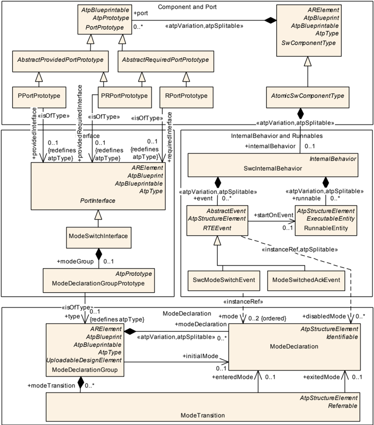

## 2.2 Mode managers and mode users

In mode management there are two parties involved: Mode managers and mode users . Responsible for switching modes are Mode managers , which are the only instances able to change the value of the global variable. A mode manager is either a Software Component, which provides a ModeRequestPort or a Basic Software Module , which either provides also a ModeRequestPort in its Software Component Description or a ModeDeclarationGroup in its Basic Software Module Description . Mode users are informed of Mode switches via well-defined mechanisms and have the possibility to read the currently active mode at any time. If a Mode user wants to change into a different mode it can request a Mode switch from the corresponding Mode manager .


## 2.3 Modes in the RTE

The AUTOSAR Runtime Environment implements the concept of modes. For this purposes it creates for each ModeDeclarationGroupPrototype of an Atomic Software Component a so called ModeMachineInstance . A ModeMachineInstance is a state machine whose states are defined by the ModeDeclaration s of the respective ModeDeclarationGroup .

Figure 2.2 depicts the interaction of ModeDeclarationGroupPrototype s Mode managers and Mode users. Note that the mode switch ports of the mode users are not directly connected to the corresponding PPortPrototype s of the mode managers but instead are connected to the mode machine instances of the RTE. This is important to understand the mechanism of mode switching inside the RTE.

Figure 2.2: The RTE instantiates for each ModeDeclarationGroupPrototype a ModemachineInstance

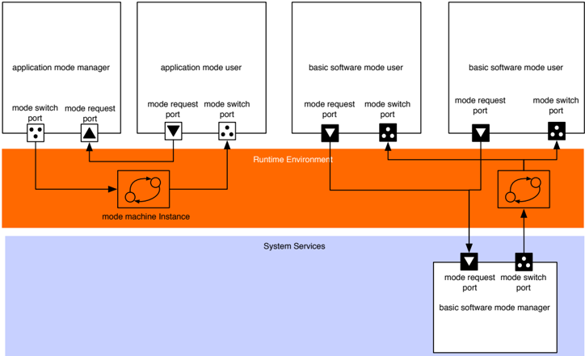

Previous versions of the Basic Software Modules especially the ECU state manager module have differentiated between ECU states and ECU modes. ECU modes were longer lasting operational ECU states that were visible to applications i.e. starting up, shutting down, going to sleep and waking up. The ECU Manager states were generally continuous sequences of ECU Manager module operations terminated by waiting until external conditions were fulfilled. Startup1, for example, contained all BSW initialization before the OS was started and terminated when the OS returned control to the ECU Manager module. With flexible ECU management the ECU state machine is implemented as general modes under the control of the BSW Mode Manager module. To overcame this terminology problem states are used only internally and are not visible to the application. For interaction with the application the basic software has to use modes.


## 2.4 Modes in the Basic Software Scheduler

The Basic Software Scheduler provides for Basic Software Modules a similar mechanism for mode communication as the RTE provides it for Software Components. If a Basic Software Module provides a ModeDeclarationGroupPrototype as providedModeGroup in its Basic Software Module Description the Basic Software Scheduler instatiates a ModeMachineInstance . Consequently for this Basic Software Module a SchM\_Switch API is provided, which enables this module to initiate a Mode switch . Mode users have to reference the ModeDeclarationGroupPrototype as requiredModeGroup and will get a SchM\_-Mode API to read the mode, which is currently active. Mode requests between Basic Software Modules can be comunicated directly via function calls, as Basic Software Modules .

Another possibility for a Basic Software Module acting as a Mode user to get informed about mode switches, is to register a BSW Module Entry , which is triggered by a Mode Switch Event (see also [3]).

## 2.5 Communication of modes

The Software Component Template differs the following distinctive types of mode communication between Mode managers and Mode users.

- Mode Switch: A Mode Switch is the communication of a current mode transition from one mode to another. Mode Switches are always initiated by Mode Managers.
- Mode Request: A Mode Request is the request of a mode user to the Mode Manager to enter a certain mode. Note that it is not guaranteed that the Mode Manager will enter this mode. Moreover he has to arbitrate all requests from the Mode Users and decide which mode he will enter.

Furthermore, the concept of Mode Proxies and information about communication of modes on multi core ECUs is given.

## 2.5.1 Mode switch

As every other communication between Software Components or between Software Components and Basic Software Modules, Modes are communicated via PortPrototype s. Each PortPrototype has to be typed by a PortInterface . In case of mode communication there exist so called mode switch interface s, which are PortInterface s. These are shown in Figure 2.3. Each ModeSwitchInterface has exactly one ModeDeclarationGroupPrototype which consists of multiple ModeDeclaration s. Any ModeDeclaration represents one mode of the ModeDeclarationGroup . One of these is defined as the initial mode.


Figure 2.3: mode switch interface

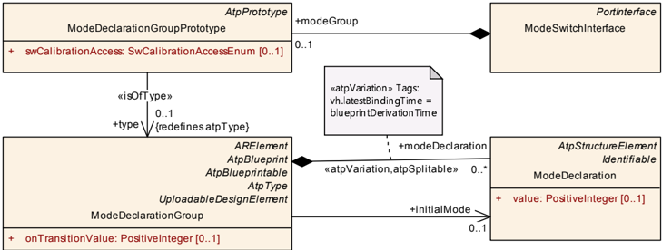

These Mode switches are necessary because Software Components need to be capable of reacting to state changes initiated by a ModeManager. Depending on the configuration there are two mechanisms available how a Software Component can react on a mode change.

1. A ModeSwitchEvent can trigger a OnExtry , OnTransition or OnEntryRunnable .
2. An RTEEvent can be disabled in a certain mode and consequently prevent the execution of accordant ExecutableEntities .

## 2.5.2 Mode request

Mode requests are distributed on the way from the mode requester (Mode Arbitration SWC or a generic SWC) to the mode manager . The mode manager s on each ECU then have to decide and initiate the local mode switch. Thus the arbitration result is communicated only locally on each ECU using RTE mode switch mechanism.

For mode request s, the communication of modes works slightly differently as for mode switches : without ModeDeclarationGroup s.

The request of modes is done via standard SenderReceiverInterface s. Contrarily to ModeSwitchInterface s the requested mode is not given by a ModeDeclarationGroup but by a VariableDataPrototype that has to contain an enumeration. This enumeration consists of a set which contains the modes that can be requested.

Mode requests can be distributed in the whole system. For application and vehicle modes, the requests of the mode requester have to be distributed to all affected ECUs. This implies a 1:n-connection between the mode requester and the mode Managers. In AUTOSAR this is only possible with Sender-Receiver Communication. The mode manager only requires the information about the requested mode and not the mode switch from the mode requester. The mode manager has one Sender-Receiver port for each mode requester. To actually transmit the signal, COM shall use a periodic signal with signal timeout notification to RTE. The mode manager will use the data element outdated event to release a mode request.


## 2.5.3 Conformance of mode switches and mode requests

As stated above, the ModeSwitchInterface s work with ModeDeclarationGroup s whereas mode request interface s takes parameters via VariableDataPrototype s containing enumerations.

The configuration utility is in duty to ensure with respect to consistency the equivalence of represented data in both representations. That means that the elements of the enumeration must precisely match the elements of the ModeDeclarationGroup . Or formulated another way: All modes available in one of the interfaces must also be available in the other one.

## 2.5.4 Mode proxies

Currently AUTOSAR has a constraint that only local software components are allowed to communicate with ServiceComponents. So it is not possible that a SoftwareComponent can request modes from a remote e.g Basic Software Mode Manager. To overcome this limitation so called ServiceProxySwComponentType were introduced in AUTOSAR Release 4.0. Figure 2.4 depicts this concept.

For the application software and the RTE a ServiceProxySoftwareComponentType behaves like a "normal" AtomicSwComponentType, but it is actually a proxy for an AUTOSAR Service. This means that on the one side it has to communicate over service ports with the ECU-local ServiceSwComponentType it represents. On the other side it has to offer the corresponding PortPrototype s to the ApplicationSwComponentType s. In the meta-model, the ServiceProxySwComponentType does not differ from an ApplicationSwComponentType except by its class. It is up to the implementer to meet the restrictions imposed by the semantics as a proxy. The main difference between a ServiceProxySwComponentType and an ApplicationSwComponentType is on system level: A prototype of a ServiceProxySwComponentType can be mapped to several ECUs even if it appears only once in the VFB system, because such a prototype is required on each ECU, where it has to address a local ServiceSwComponentType . As a result of this, a ServiceProxySwComponentType can only receive but not send signals over the network. (see also [1]).


Figure 2.4: Communication via ServiceProxySwComponents

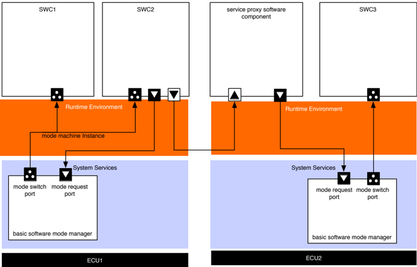

## 2.5.5 Mode communication on multi core ECUs

The RTE is able to synchronize ModeMachineInstances over different partitions of an ECU. This enables configurations where one ModeDeclarationGroupPrototype of a provide port is connected to ModeDeclarationGroupPrototypes of require ports from more than one partition. Consequently the ModeUsers of a ModeDeclarationGroupPrototype can be distributed on several partitions.

Figure 2.5: Example configuration

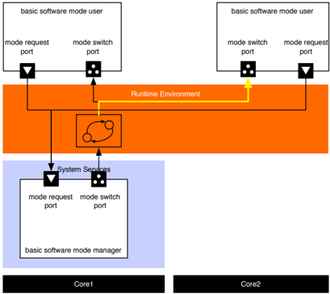

According to [SWS\_Rte\_02665] a ModeMachineInstance executes a sequence of 10 steps during a mode transition:

1. Activation of mode disablings


2. Wait until ExecutableEntities which are impacted by ModeDisablingDependencys of the next mode are terminated
3. Execution of OnExit ExecutableEntities
4. Wait until all OnExit ExecutableEntities are terminated
5. Execution of OnTransition ExecutableEntities
6. Wait until all OnTransition ExecutableEntities are terminated
7. Execution of OnEntry ExecutableEntities
8. Wait until all OnEntry ExecutableEntities are terminated
9. Deactivation of mode disabling of the previous and activation of the mode disabling of the current mode
10. Triggering of ModeSwitchAckEvents

The steps 1 to 9 can be executed in parallel on each CPU core, respectively for the mode users distributed on the corresponding core. Step 10 is only executed if the other steps have been finished for the whole ModeMachineInstance. Nevertheless some application-specific use cases might require a higher degree of synchronization w. r. t. steps 1 to 9, e. g. the execution of all OnExit ExecutableEntities before the OnTransition ExecutableEntities. For this reason the RTE offers the opportunity to configure synchronization points (see [ECUC\_Rte\_09127], [ECUC\_Rte\_09128] and [ECUC\_Rte\_09129] for further details).

ModeMachineInstances which has mode users on different partitions cannot be reinitialized to default mode in case of a partition restart. This would interfere with other still running partitions. Therefore the only applicable strategy to handle the restart of the partition is modeManagerErrorBehavior.errorReactionPolicy set to lastMode, which specifies that the mode users keep their last known mode.


## 3 Configuration of the Basic Software Modemanager

The BSW Mode Manager is the module that implements the part of the Vehicle Mode Management and Application Mode Management concept that resides in the BSW. Its responsibility is to arbitrate mode requests from application layer Software Components or other Basic Software Modules based on rules, and perform actions based on the arbitration result.

From an functional point view the BswM is responsible to put the Basic Software in a state so that the Basic Software can run properly and meet the functional requirements.

The configuration of the BswM is very project- and ECU- specific. Therefore it can not be standardized by AUTOSAR. Nevertheless it is expected that a BswM implementation behaves in specific situations in a certain way . This chapter starts with an introduction on the general concept of the BswM, which is more or less a execution environment for rules described by the user. Afterwards typical scenarios in the lifecycle of an ECU are described and examples are given how the BswM could be configured.

## 3.1 Process how to configure and integrate a BswM

The configuration and integration of a BswM into an ECU project consists of the same steps as for other Basic Software Modules. Nevertheless it is described for a better understanding of the next steps. In general the following actions have to be taken:

1. Create a ECUC configuration of the module. For the BswM this configuration contains:
2. (a) the necessary ModeRequestSources ,
3. (b) the provided ModeSwitchPorts ,
4. (c) a description of the Rules and ActionLists .
2. The configuration is used as input for the module generator, which creates
6. (a) a SoftwareComponentDescription of the AUTOSAR Interface,
7. (b) the implementation of the module 1 .
3. The last step is to integrate the Module into the ECU by connecting the ports of the Software Components with the corresponding ports of the BswM.

1 This documents assumes that the Implementation of the BswM is generated to a large extend.


## 3.2 Semantics of BswM Configuration: Interfaces and behavioral aspects

In general the BswM can be seen as a state machine, which is defined by its interface and a behavioral description. The input actions of this state machine are mode requests. Each mode request is described in the ECU configuration of the BswM as a BswMModeRequestSource . These mode requests can be of different types (C-API calls, mode requests via RTE, mode notifications via RTE, etc.) but internally they are treated in the same way.

If a mode is requested the internal mirror of this BswMModeRequestSource is updated and depending on the configuration a rule evaluation is triggered, which results in the execution of predefined action lists. Action lists group Actions. Typically an action is a triggering of a mode switch in the RTE or Schedule Manager, but there are also predefined actions which change the status of some Basic Software Module.

## 3.2.1 Interface of the BswM

The interface is defined by the BswMModeRequestSource and the BswMActionListItem containers.

## 3.2.1.1 Mode Requests

BswMModeRequestSource is a ChoiceContainer , which can be of the following kinds:

1. C-APIs, which are defined in the specification of the BswM. BasicSoftwareModules can directly call C-APIs from the BswM, who will translate them internally into a ModeRequest . For example a call to the API

```
BswM_CanSM_CurrentState( NetworkHandleType Network, CanSM_BswMCurrentStateType CurrentState )
```

is to be mapped to different ModeRequestPorts depending on the parameter Network , which identifies the channel on which the event occurred. The parameter CurrentState then contains the mode which is requested. The mode requests, which are defined by the standardized interface of the BswM are described in more detailed in 3.2.2.2

2. RPort s typed by a SenderReceiverInterface . BswMSwcModeRequest : For each container of this type the BswM has to create a corresponding RPort in its Service Component Description.
3. RPort s typed by a ModeSwitchInterface . BswMSwcModeNotification : For each container of this type the BswM has to create a corresponding RPort in


its Service Component Description. As it is typed by a ModeSwitchInterface the BswM acts as a mode user of this ModeMachineInstance and is informed if the mode manager performs an rte\_switch.

4. ModeDeclarationGroupPrototype s BswMBswModeNotification : For each container of this type the BswM has to create a corresponding ModeDeclarationGroupPrototype in the role ModeDeclarationGroupPrototype in its Basic Software Module Description. In this case the BswM also acts as a mode user, but the ModeMachineInstance is maintained by the Schedule Manager. The BswM therefore gets informed if the mode manager e.g. another Basic Software Module performs a SchM\_Switch call.

## 3.2.1.2 Available Actions

BswMActionListItem s can be of the following kinds:

1. C-APIs from other BswM Modules, which are called directly during the execution of an ActionList .
- BswMComMAllowCom
- BswMComMModeLimitation
- BswMComMModeSwitch
- BswMDeadlineMonitoringControl
- BswMEcuMGoDown
- BswMEcuMSelectShutdownTarget
- BswMEcuMStateSwitch
- BswMJ1939Rm
- BswMLinScheduleSwitch
- BswMNMControl
- BswMPduGroupSwitch
- BswMPduRouterControl
- BswMRteSwitch
- BswMSchMSwitch
- BswMSwitchIPduMode
- BswMTriggerIPduSend
- BswMUserCallout


2. PPort s typed by a ModeSwitchInterface . BswMSwitchPort : For each container of this type the BswM has to create a corresponding PPort in its Service Component Description if a certain configuration condition is met (see BswM SWS).
3. ModeDeclarationGroupPrototype s SwitchPort : For each container of this type the BswM has to create a corresponding ModeDeclarationGroupPrototype in the role providedModeGroup in its Basic Software Module Description if a certain configuration condition is met (see BswM SWS). In this case the BswM also acts as a mode manager, but the ModeMachineInstance is maintained by the Schedule Manager.

## 3.2.2 Definition of the interface in pseudo code

The following paragraphs define the interface of the BswM in pseudo code.

## 3.2.2.1 Mode switch and mode request interfaces

An example of the BswM configuration of ModeSwitchInterface s is shown in Listing 3.1. There is a ModeDeclarationGroup and a ModeSwitchInterface created. The ModeSwitchInterface uses the defined ModeDeclarationGroup as prototype where exampleModes is the short name of the ModeSwitchInterface .

```
modeGroup MDG_ApplicationModes { APP_ACTIVE, APP_STARTING, APP_INACTIVE } interface modeSwitch MSIF_ApplicationModes { mode MDG_ApplicationModes appMode }
```

Listing 3.1: Mode switch interface for the overall mode of a ECU

A configuration of a mode request interface that corresponds to the ModeSwitchInterface of Listing 3.1 is shown as example in Listing 3.2. Out of this BswM configuration an Arxml description will be created which includes the mode declarations and interfaces. An excerpt of that arxml is shown in 3.3.

```
enum ENUM_ApplicationModes{ ModeA, ModeB, ModeC } interface senderReceiver exampleModeRequestPort { data ENUM_ApplicationsModes exampleModeRequest }
```

Listing 3.2: Declaration of a mode request interface


```
<SENDER-RECEIVER-INTERFACE> <SHORT-NAME> exampleModeRequestPort </SHORT-NAME> <IS-SERVICE> false </IS-SERVICE> <DATA-ELEMENTS> <VARIABLE-DATA-PROTOTYPE> <SHORT-NAME> exampleModeRequest </SHORT-NAME> <! --... --> <TYPE-TREF DEST= "APPLICATION-PRIMITIVE-DATA-TYPE" > ENUM_ApplicationModes </TYPE-TREF> </VARIABLE-DATA-PROTOTYPE> </DATA-ELEMENTS> </SENDER-RECEIVER-INTERFACE> <! --... --> <APPLICATION-PRIMITIVE-DATA-TYPE> <SHORT-NAME> ENUM_ApplicationModes </SHORT-NAME> <CATEGORY> VALUE </CATEGORY> <SW-DATA-DEF-PROPS> <SW-DATA-DEF-PROPS-VARIANTS> <SW-DATA-DEF-PROPS-CONDITIONAL> <COMPU-METHOD-REF DEST= "COMPU-METHOD" > ENUM_ApplicationModes_def </ COMPU-METHOD-REF> </SW-DATA-DEF-PROPS-CONDITIONAL> </SW-DATA-DEF-PROPS-VARIANTS> </SW-DATA-DEF-PROPS> </APPLICATION-PRIMITIVE-DATA-TYPE> <! --... --> <COMPU-METHOD> <SHORT-NAME> ENUM_ApplicationModes_def </SHORT-NAME> <CATEGORY> TEXTTABLE </CATEGORY> <COMPU-INTERNAL-TO-PHYS> <COMPU-SCALES> <COMPU-SCALE> <LOWER-LIMIT INTERVAL-TYPE= "CLOSED" > 0 </LOWER-LIMIT> <UPPER-LIMIT INTERVAL-TYPE= "CLOSED" > 0 </UPPER-LIMIT> <COMPU-CONST> <VT> ModeA </VT> </COMPU-CONST> </COMPU-SCALE> <COMPU-SCALE> <LOWER-LIMIT INTERVAL-TYPE= "CLOSED" > 1 </LOWER-LIMIT> <UPPER-LIMIT INTERVAL-TYPE= "CLOSED" > 1 </UPPER-LIMIT> <COMPU-CONST> <VT> ModeB </VT> </COMPU-CONST> </COMPU-SCALE> <COMPU-SCALE> <LOWER-LIMIT INTERVAL-TYPE= "CLOSED" > 2 </LOWER-LIMIT> <UPPER-LIMIT INTERVAL-TYPE= "CLOSED" > 2 </UPPER-LIMIT> <COMPU-CONST> <VT> ModeC </VT> </COMPU-CONST> </COMPU-SCALE>
```


```
</COMPU-SCALES> </COMPU-INTERNAL-TO-PHYS> </COMPU-METHOD>
```

Listing 3.3: Excerpt of the mode request interface's ARXML description

Every mode request to the BswM has to be mapped to an restricted set of values, which allows the integrator the define the arbitration rules.

The ECU modes can be set by BswM using the EcuM\_SetState API.

```
Purpose: Via this interface BswM sets the current state of the EcuM. State)
```

```
Signature: Modes:
```

```
EcuM_SetState(EcuM_StateType modeGroup EcuM_StateType { ECUM_STATE_STARTUP, ECUM_STATE_APP_RUN, ECUM_STATE_APP_POST_RUN, ECUM_STATE_SHUTDOWN, ECUM_STATE_SLEEP }
```

## 3.2.2.2 ModeRequestPorts defined by the standardized interface of the BswM

In the BswM configuration, the mode request sources have to be defined. The following ModeRequestPorts are implicitly defined by API of the BswM. This subsection summarizes the port interface.

The following ModeDeclarationGroup s are defined in the particular SWS documents of the AUTOSAR specification as C-Enums. Nevertheless they are referenced here in form of BswM configurations which act as a base for the rest of this document. Refer to the definition of C-Enums in the SWS documents for the definition of modes.

## 3.2.2.2.1 BswMComMIndication

Purpose:

Function called by ComM to indicate its current state.

```
Signature: void BswM_ComM_CurrentMode( NetworkHandleType Network, ComM_ModeType RequestedMode ) Modes: modeGroup ComM_ModeType Example: request ComMIndication ComM_Mode_Channel1 { processing IMMEDIATE initialValue COMM_NO_COM_NO_PENDING_REQUEST source MyComM.ComMChannel1 }
```


Note:

This ModeRequestSource has to be created once for each ComM- Channel identified by the Network parameter.

## 3.2.2.2.2 BswMComMPncRequest

```
Purpose: Function called by ComM to indicate the current state of a partial network.
```

```
Signature: ComM_PncModeType CurrentPncMode Modes: Example:
```

```
void BswM_ComM_CurrentPNCMode( PNCHandleType PNC, ) modeGroup ComM_PncModeType request ComMPncRequest PNC1 { processing IMMEDIATE initialValue PNC_NO_COMMUNICATION source MyComM.ComMPnc1 } request ComMPncRequest PNC2 { processing IMMEDIATE initialValue PNC_NO_COMMUNICATION source MyComM.ComMPnc2 } request ComMPncRequest PNC3 { processing IMMEDIATE initialValue PNC_NO_COMMUNICATION source MyComM.ComMPnc3
```

```
}
```

Note:

This ModeRequestSource has to be created once for each partial network.

## 3.2.2.2.3 BswMDcmComModeRequest

Purpose:

Function called by DCM to indicate the current state of CommunicationControl.

```
Signature: void BswM_Dcm_CommunicationMode_CurrentState( NetworkHandleType Network, Dcm_CommunicationModeType RequestedMode ) Modes: modeGroup Dcm_CommunicationModeType Example: request DcmComModeRequest BswM_Dcm_CommunicationMode_CurrentState { processing IMMEDIATE initialValue DCM_ENABLE_RX_TX_NORM network "network1"
```


}

## 3.2.2.2.4 BswMCanSMIndication

Purpose:

```
Signature: Modes: Example:
```

Function called by CanSM to indicate its current state.

```
CanSM_BswMCurrentStateType CurrentState
```

```
void BswM_CanSM_CurrentState( NetworkHandleType Network, ) modeGroup CanSM_BswMCurrentStateType request CanSMIndication CanSM_Can1 { processing IMMEDIATE initialValue CANSM_BSWM_NO_COMMUNICATION source MyComM.CanNet1 } request CanSMIndication CanSM_Can2 { processing IMMEDIATE initialValue CANSM_BSWM_NO_COMMUNICATION source MyComM.CanNet2 }
```

Note:

This ModeRequestSource has to be created once for each CAN channel.

## 3.2.2.2.5 BswMEthSMIndication

Purpose:

Function called by EthSM to indicate its current state.

```
Signature: void BswM_EthSM_CurrentState( NetworkHandleType Network, EthSM_NetworkModeStateType CurrentState ) Modes: modeGroup EthSM_NetworkModeStateType Example: request EthSMIndication EthSM_Network1 { processing IMMEDIATE initialValue ETHSM_NO_COMMUNICATION source MyComM.EthSmNetwork
```

```
}
```

Note:

This ModeRequestSource has to be created once for each ethernet channel.

## 3.2.2.2.6 BswMFrSMIndication


Purpose:

Function called by FrSM to indicate its current state.

```
Signature: void BswM_FrSM_CurrentState( NetworkHandleType Network, FrSM_BswM_StateType CurrentState ) Modes: modeGroup FrSM_BswM_StateType Example: request FrSMIndication FrSM_BswM_StateType { processing IMMEDIATE initialValue FRSM_BSWM_READY source MyComM.EthSmNetwork }
```

Note:

This ModeRequestSource has to be created once for each FlexRay cluster.

## 3.2.2.2.7 BswMLinSMIndication

Purpose:

Function called by LinSM to indicate its current state.

```
Signature: void BswM_LinSM_CurrentState( NetworkHandleType Network, LinSM_ModeType CurrentState ) Modes: modeGroup LinSM_ModeType Example: request LinSMIndication LinSM_CurrentState { processing IMMEDIATE initialValue LINSM_NO_COM source MyComM.LinSMChannel }
```

Note:

This ModeRequestSource has to be created once for each Lin channel.

## 3.2.2.2.8 BswMEcuMRequestedState

Purpose:

Via this interface EcuM requests a state from BswM based on the

result of the RUN Request Protocol.

```
Signature: BswM_EcuM_RequestState( EcuM_StateType State, EcuM_RunStatusType CurrentStatus) Modes: modeGroup EcuM_StateType { ECUM_STATE_APP_RUN, ECUM_STATE_APP_POST_RUN }
```


```
Parameter:
```

```
EcuM_RunStatusType { ECUM_RUNSTATUS_UNKNOWN, ECUM_RUNSTATUS_REQUESTED, ECUM_RUNSTATUS_RELEASED }
```

## 3.2.2.2.9 BswMEcuMCurrentState

Signature:

BswM\_EcuM\_CurrentState(EcuM\_StateType CurrentState)

## 3.2.2.2.10 BswMEcuMWakeupSource

Purpose:

```
Signature: Modes: Example:
```

Note:

Function called by the ECUM to indicate the current state of the wakeup sources.

```
void BswM_EcuM_CurrentWakeup( EcuM_WakeupSourceType source, EcuM_WakeupStatusType state ) modeGroup EcuM_WakeupStatusType request EcuMWakeupSource EcuM_WakeupSource { processing IMMEDIATE initialValue ECUM_WKSTATUS_NONE source MyEcuM.EcuMWakeupSource1 }
```

This ModeRequestSource has to be created once for each Wakeup source.

## 3.2.2.2.11 BswMLinScheduleIndication

Purpose:

```
Signature:
```

Modes:

Function called by LinSM to indicate the currently active schedule table for a specific LIN channel.

```
void BswM_LinSM_CurrentSchedule( NetworkHandleType Network, LinIf_SchHandleType CurrentSchedule )
```

The reported modes depend on the configured schedules in the Lin Statemanager.

```
Example: LinScheduleIndication LinSM1_CurrentSchedule {
```

```
request processing IMMEDIATE initialValue TBD source MyLinSM.LinSMChannel }
```


## 3.2.2.2.12 BswMLinTpModeRequest

Purpose:

Function called by LinTP to request a mode for the corresponding LIN channel. The LinTp\_Mode mainly correlates to the LIN schedule table that should be used.

```
Signature: void BswM_LinTp_RequestMode( NetworkHandleType Network, LinTp_Mode LinTpRequestedMode ) Modes: modeGroup LinTp_Mode Example: request LinTpModeRequest LinTp_Mode { processing IMMEDIATE initialValue LINTP_APPLICATIVE_SCHEDULE source MyLinIF.config0.LinIFChannel }
```

## 3.2.2.2.13 BswMNvMJobModeIndication

Purpose:

Signature:

Modes:

Example:

Indicates the current status of the multiblock job. The job is identified via BswMNvmService, e.g. 0x0c for NvmReadAll, 0x0d for NvmWriteAll.

```
void BswM_NvM_CurrentJobMode( uint8 ServiceId, NvM_RequestResultType CurrentJobMode ) modeGroup NvM_RequestResultType request NvMJobModeIndication NvMWriteAllJobMode { service WriteAll initialValue NVM_BLK_NOT_OK processing IMMEDIATE } request NvMJobModeIndication NvMReadAllJobMode { service ReadAll initialValue NVM_BLK_NOT_OK processing IMMEDIATE }
```

## 3.2.2.2.14 BswMNvMRequest

Purpose:

Via this Mode Request Source the NvM indicates the current status of the specified block.

Signature:

void BswM\_NvM\_CurrentBlockMode( NvM\_BlockIdType Block,


Modes:

```
NvM_RequestResultType CurrentBlockMode ) modeGroup NvM_RequestResultType
```

## 3.2.2.2.15 BswMJ1939NmIndication

```
Signature: void BswM_J1939Nm_StateChangeNotification( NetworkHandleType nmNetworkHandle, uint8 Node, Nm_StateType nmCurrentState ) Modes: modeGroup Nm_StateType Example: request BswMJ1939NmIndication J1939NmState { network "Channel1" node "Node1" initialValue NM_STATE_UNINIT processing IMMEDIATE }
```

Note:

This ModeRequestSource has to be configured for each channel managed by J1939 network management. This type of Mode Request Source is currently not supported by ARText.

## 3.2.2.2.16 BswMWdgMRequestPartitionReset

```
Signature: void BswM_WdgM_RequestPartitionReset( ApplicationType Application ) Modes: modeGroup WdgM_PartitionResetType Example: request WdgMRequestPartitionReset WdgM_RequestResetPart1 { processing IMMEDIATE initialValue WDGM_PARTITION_RESET_NOTREQUESTED source MyEcuC.eCucPartition
```

```
}
```

This ModeRequestSource has to be created once for each partition for which a reset can be requested by the Watchdog Manager module.

Note:

## 3.2.2.2.17 BswMJ1939DcmBroadcastStatus


```
Signature: BswM_J1939DcmBroadcastStatus( Modes: Example:
```

Note:

```
void uint16 networkMask ) modeGroup J1939DcmBroadcastStatusType request BswMJ1939DcmBroadcastStatus J1939BroadcastStatusChannel1 { processing IMMEDIATE initialValue NETWORK_DISABLED source MyComM.CanNet1 }
```

This is a notification of the desired broadcast status per network, triggered via DM13.

## 3.2.2.3 Configurable ModeRequestPorts

Besides the interface, which is defined by the standardized interface of the BswM, additional mode request ports can be defined via the configuration parameters.

E.g it is necessary for the interaction with applications, that an application software component at least notifies the BswM about it's current state. This can be achieved by definition of a ModeRequestPort as shown in Listing 3.4. The BswM will than create a corresponding RPort typed by a SenderReceiverInterface .

```
request SwcModeRequest App1ModeRequest { source MSIF_ApplicationModes.appMode processing IMMEDIATE initialValue ModeA }
```

Listing 3.4: Application ModeRequestPort

Note that the reference to a ModeDeclarationGroupPrototype can be misleading. The meaning is that the BswM creates a SenderReceiverInterface containing a VariableDataPrototype . The SwDataDefProps of this VariableDataPrototype refer to a CompuMethod , which defines an enumeration corresponding die to the referred ModeDeclarationGroupPrototype .

```
request SwcModeNotification App1ModeNotification { source MSIF_ApplicationModes.appMode processing IMMEDIATE initialValue ModeA }
```

Listing 3.5: Application ModeNotification

Listing 3.5 shows the declaration of a mode notification port. Note that in contrast to 3.4 the BswM will generate a RPort typed by a ModeSwitchInterface in this case. The BswM then gets informed via a ModeSwitchNotification if the mode manager initiates a mode switch.


```
request BswModeNotification EcuMode { source MSIF_EcuMode.ecuMode processing IMMEDIATE initialValue ECU_STARTUP_ONE }
```

Listing 3.6: BasicSoftwareModeNotification

Listing 3.6 shows the declaration of a mode notification port. If such a port is configured, the BswM configuration tool will create a requiredModeGroup ModeDeclarationGroupPrototype , so that the BswM gets informed of mode switches via the Schedule Manager, if the corresponding mode manager initiates a mode switch with a call to SchM\_Switch API.

## 3.2.2.4 Configurable ModeSwitchPorts

The BswM can send mode switches through a configured BswMSwitchPort . For a configured BswMSwitchPort the BswM may generate a PPortPrototype , a providedModeGroups . ModeDeclarationGroupPrototype or both of them, depending on the configuration (see BswM SWS). 3.7 shows an example for a BswMSwitchPort .

```
switchport EcuMode { modeSwitchinterface MSIF_EcuMode }
```

Listing 3.7: Example for a configurable mode switch port

## 3.2.3 Configuration of the BswM behavior

The behavior of the BswM is specified via rules and action lists. A rule is a logical expression, which combines the current values of ModeRequestTypeMap s. The evaluation of each rule either results in the execution of its true or false action lists.

The ModeControlContainer contains these ActionLists . An ActionList can consist of a set of atomic actions, other 'nested' ActionLists or it can reference (nested) rules which are then evaluated in the context of this Actionlist .

The following example shows a simple rule, which activates the IPDU Groups of a dedicated CAN channel. According to this rule, the BswM has to provide a ModeRequestPort of type CanSMIndication named Can1\_Indication . This is a ModeRequest from a basic software module in this case from the Can State manager. In code this ModeRequestPorts corresponds to the API BswM\_CanSM\_CurrentState as described in [SWS\_BswM\_00049] in [4]. The source parameter identifies the network to which this ModeRequestSourcePort belongs to. It's up to the configuration tool of the BswM to allocate the right parameters for the API corresponding to the referenced ECUC Container.


The value of the ModeRequestSourcePort initially is CAN\_SM\_BswM\_NO\_COMMUNICATION .

processing immediate means that every evaluation rule, which refers to this ModeRequestSourcePort shall immediately be processed. Every immediate mode request will trigger the evaluation of the referring rules. If this parameter would be deferred in case of a mode request, the evaluation of rules would be delayed until the next run of the main function of the BSWM. The BSWM does not support queued evaluation of deferred mode requests. As a result, deferred mode requests will have "last-is-best" semantics. Only the last mode request made before the execution of the BSWM'S main function will be used.

The following example shows an arbitration rule called canIPDUActivation . The overall content is rather self explanatory. The initial parameters specifies that the initial result of the rule evaluation is false .

```
rule checkApp1Request initially false { if ( App1ModeRequest == MDG_ApplicationModes.ModeA && EcuMode == MDG_EcuMode.ECU_RUN) { actionlist checkApp1RequestTrueActions } } actions checkApp1RequestTrueActions on condition { ComMAllowCom MyComM.CanNet1 true SchMSwitch EcuMode : ECU_RUN }
```

Listing 3.8: Example for a rule

At which point in time a rule is executed, after an event has occurred depends on the parameter BswMActionListExecution . Either it is executed every time the rule is evaluated with the corresponding result, or only when the evaluation result has changed from the previous evaluation. This is called triggered respectively conditional execution.

Table 3.1 gives an overview in which situations an ActionList is executed or not. Triggered ActionLists are executed (triggered) if the result of the rule evaluation changes. Conditional ActionLists depend only on the current result (condition) of the evaluation independent if it has changed or not.

Table 3.1: Execution of Action Lists depending on parameter BswMActionListExecution

| eval. result ( old ) -> ( new )   | true -> true   | true -> false        | false false   | false -> true        |
|-----------------------------------|----------------|----------------------|---------------|----------------------|
| TrueActionList                    | CONDITION      | -                    | -             | TRIGGERED/ CONDITION |
| FalseActionList                   | -              | TRIGGERED/ CONDITION | CONDITION     | -                    |


## 3.3 ECU state management

During startup and shutdown the task of the BswM is to initialize all basic software modules in a similar way as it is done by the ECUM in older AUTOSAR releases. To achieve this the following ModeDeclarationGroup is defined, which indicates the overall state of the ECU to application software components and is used for internal rule arbitration.

```
modeGroup MDG_EcuMode { ECU_RUN, ECU_APP_RUN, ECU_APP_POST_RUN, ECU_GO_SLEEP, ECU_GO_OFF_ONE, ECU_SLEEP, ECU_GO_OFF_TWO, ECU_STARTUP_ONE, ECU_STARTUP_TWO, ECU_RESET_READY } interface modeSwitch MSIF_EcuMode { mode MDG_EcuMode ecuMode }
```

Listing 3.9: ModeDeclarationGroup for overall ECU state management

The initial mode of this ModeDeclarationGroup is ECU\_STARTUP\_ONE .

## 3.3.1 ECU Mode Handling

ECU Mode Handling is introduced with AUTOSAR 4.2.1 in BSW modules ECU State Manager with flexible state machine and BSW Mode Manager. ECU State Manager provides a common interface to SW-Cs to request and release the Modes RUN and POST\_RUN .

The ECU State Manager (EcuM) does not contain an own state machine. It shall receive state notifications from BswM and propagate these to the RTE.

The following API is provided for ECU Mode Handling:

Purpose:

Via this interface EcuM notifies BswM about the current Mode of ECU Mode.

```
Modes: modeGroup EcuM_StateType { ECUM_STATE_STARTUP, ECUM_STATE_APP_RUN, ECUM_STATE_APP_POST_RUN, ECUM_STATE_SHUTDOWN, ECUM_STATE_SLEEP }
```


EcuM\_CurrentState: Set by EcuM using the interface BswM\_EcuM\_CurrentState () . This state is set by EcuM when the RTE has given its feedback.

RUNRequested: Set by EcuM using the interface BswM\_EcuM\_RequestedState() depending on the result of the RUN Request Protocol.

POSTRUNRequested: Set by EcuM using the interface BswM\_EcuM\_Requested-State() depending on the result of the RUN Request Protocol.

The following BswM rules show an example regarding the interaction between EcuM and BswM for ECU Mode Handling. Note that the following BswM rules are not sufficient for a complete system. Further BswM rules will be needed to cover NvM, Wakeup Handling and Diagnostics for example. See chapter 3.3.2 for a complete example.

## 3.3.1.1 Startup

The Mode STARTUP is applied during startup of RTE. After all drivers are initialized, the RUN Mode is set:

```
rule SwitchToStartup initially false { if (EcuMode == ECUM_STARTUP) { actionlist SwitchToStartup } } actions SwitchToStartup on condition { custom "EcuM_DriverInitListTwo()" custom "Rte_Start()" custom "EcuM_DriverInitListThree()" custom "ComM_CommunicationAllowed(TRUE)" custom "EcuM_SetState(ECUM_STATE_APP_RUN)" }
```

## 3.3.1.2 Running

When all EcuM users have released the RUN Mode, EcuM sets the RUNRequested Mode to RELEASED .

```
Rule SwitchToPostRun initially false { if (EcuM_CurrentState==RUN && RUNRequested == RELEASED) { actionlist SwitchToPostRun } } actions SwitchToPostRun on condition { custom "CommunicationAllowed(FALSE)" custom "EcuM_SetState(ECUM_STATE_APP_POST_RUN)" }
```


SWCs can request RUN Mode during POST\_RUN . The following BswM rule switches back to RUN Mode in case at least one EcuM user has requested the RUN Mode.

```
rule SwitchBackToRunMode initially false { if (EcuM_CurrentState==POST_RUN && RUNRequested == REQUESTED && POSTRUNRequested == RELEASED) { actionlist SwitchBackToRunMode } actions SwitchBackToRunMode on condition { custom "ComM_CommunicationAllowed(TRUE)" custom "EcuM_SetState(ECUM_STATE_APP_RUN)" }
```

## 3.3.1.3 Shutdown and Sleep

The BswM rules below illustrate only the switch to SLEEP Mode.

```
rule SwitchToShutdownMode initially false { if (EcuM_CurrentState==POST_RUN && RUNRequested == RELEASED && POSTRUNRequested == RELEASED) { actionlist SwitchToShutdownMode } actions SwitchToShutdownMode on condition { custom "EcuM_SetState(ECUM_STATE_SLEEP)" }
```

Note that further BswM rules are needed for a complete running system.

## 3.3.2 Default States Of Ecu Mode Handling

This chapter describes a setup to use software components, which are designed to work with the "ECU State Manager (EcuM) with fixed state machine" which is not a part of current AUTOSAR specifications anymore. Anyhow this approach is still widely used and benefits from standard interfaces (e.g. RUN request protocol). This means that a setup based on EcuM with flexible state machines and the BswM is described which implements the behavior of the EcuM with a fixed state machine.

An overview of the architectural solution is shown in Figure 3.1. To use software components, which are designed to work with the "ECU State Manager with fixed state machine" the option "ECU Mode Handling" has to be activated. A so called Compatibility SWC is not necessary to realize this behavior.


Figure 3.1: Default States in EcuM Flex make it possible to reuse legacy SWCs

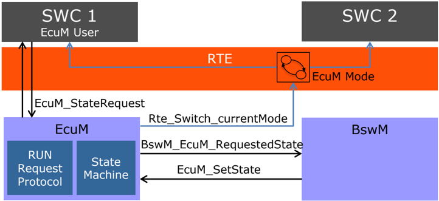

Figure 3.2 depicts the behavioral aspects of the proposal. The small boxes represent the states of fixed EcuM. The green boxes mark the phases of the EcuM flexible. Application software will only notice changes during the UP phase.

stm EcuM Flexible to Fixed Mapping

STARTUP PhaSE


V Drivers initialized

Startup II

OS &amp; Scheduler started

BswM, OS and SchM initialized

Startup I!!

RTE, SW-Cs started

/ NvM\_ReadAll finished

Run Il

EcuM\_Main runs

periodically

Run requested All RunRegests Released

V

Run Ill

Apps deinitialized,

NoCom

Communication in

V

Prep Shutdown

Shutdown DEM, ECU

Mode: SLEEP |

SHUTDOWN

Shutdown Off or

Target?

Reset./

Go Off l

Stop RTE &amp; ComM,

NVM\_ WriteAll,

Shutdown OS

SHUTDOVN Phase

Go Off Il

From Shutdown

Hook: Reset | Off

Off UP Phase Wakeup II

Initialize DEM

Figure 3.2: Mapping: Phases of fixed EcuM to flexible EcuM

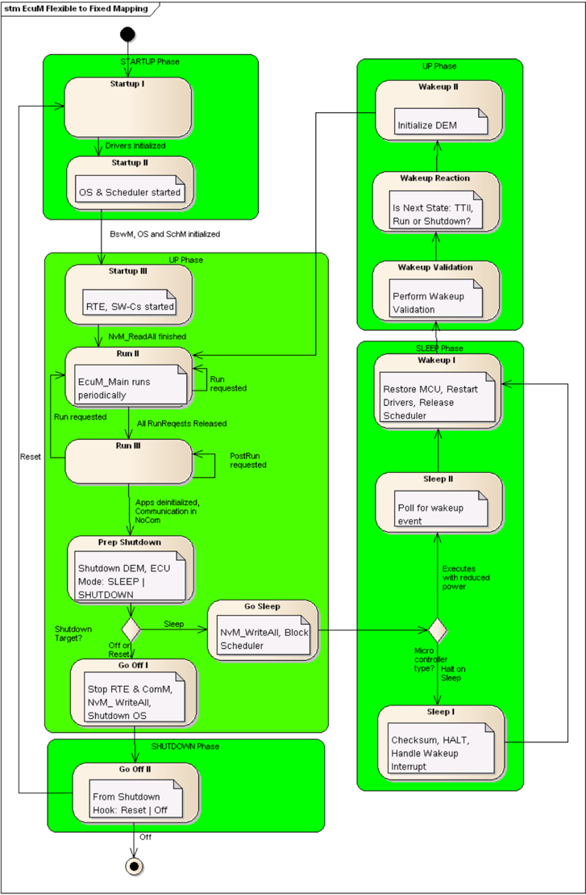

The result is that all states of the fixed EcuM in the UP phase have to be emulated using the BswM and the software component introduced for this scenario. This software component has to map modes reported by the BswM to modes defined in the interface of the EcuM with fixed statemachine.

Reset Sleep


## 3.3.2.1 Example for BswM Configuration

The system designer has to make sure that all pre- and post-conditions are met when setting a state of the ECU State Manager. As the EcuM shall remain flexible, there is no validation of the sequence the states are switched by BswM. When the sequence of states shall be compatible to the sequence of EcuMFixed, the system designer has to realize this behavior by BswM rules.

## 3.3.2.1.1 Startup

During startup phase the same BSW modules shall be initialized as the fixed EcuM does. This is implemented via BswM rules which are executed after initialization of EcuM and initialize these modules. The modules which are already initialized by flexible EcuM are omitted by BswM.

The changed BswM rules can be seen in Listing 3.10.

```
rule InitBlockII initially false { if ( EcuMode == MDG_EcuMode.ECU_STARTUP_ONE ) { actionlist InitBlockIITrueActions } } actions InitBlockIITrueActions on condition { custom "Port_Init(null)" custom "Dio_Init(null)" custom "Adc_Init(null)" custom "Spi_Init(null)" custom "Eep_Init(null)" custom "Fls_Init(null)" custom "NvM_Init(null)" custom "EcuM_SetState(ECU_STARTUP_TWO)" custom "NvM_ReadAll()" } rule NvMReadAllFinished initially false { if ( NvMReadAllJobMode != NVM_REQ_PENDING && EcuMode == MDG_EcuMode. ECU_STARTUP_TWO) { actionlist NvMReadAllFinishedTrueActions } } actions NvMReadAllFinishedTrueActions on condition { custom "CanTrcv_Init(null)" custom "Can_Init(null)" custom "CanIf_Init(null)" custom "CanSM_Init(null)" custom "CanTp_Init(null)" custom "Lin_Init(null)" custom "LinIf_Init(null)" custom "LinSM_Init(null)"
```


```
custom "LinTp_Init(null)" custom "FrTrcv_Init(null)" custom "Fr_Init(null)" custom "FrIf_Init(null)" custom "FrSM_Init(null)" custom "FrTp_Init(null)" custom "PduR_Init(null)" custom "CANNM_Init(null)" custom "FrNM_Init(null)" custom "NmIf_Init(null)" custom "IpduM_Init(null)" custom "COM_Init(null)" custom "DCM_Init(null)" custom "StartRte()" custom "ComM_Init(null)" custom "DEM_Init(null)" custom "FIM_Init(null)" custom "EcuM_SetState(ECU_RUN)" }
```

Listing 3.10: BswM configuration for fixed EcuM compatible startup

## 3.3.2.1.2 Shutdown

For that shutdown mechanism the BswM configuration of Listing 3.11 is responsible. The listed rules coordinate the post-run phase, deinitialize the modules and put the ECU into shut down or sleep. These rules execute the same callouts EcuM\_On&lt;Mode&gt;() as it would happen with a fixed EcuM.

```
rule checkEcuMCompatibilityModeRequest initially false { if ( EcuMode == MDG_EcuMode.ECU_APP_RUN) { actionlist checkEcuMCompatibilityModeRequestActions } } actions checkEcuMCompatibilityModeRequestActions on condition { ComMAllowCom MyComM.CanNet1 false custom "EcuM_SetState(ECU_APP_POST_RUN)" } rule GoBackToRun initially false { if ( EcuMode == MDG_EcuMode.ECU_APP_POST_RUN) { actionlist GoBackToRunActions } } actions GoBackToRunActions on condition { custom "EcuM_SetState(ECU_APP_RUN)" } rule PrepShutdown initially false { if ( ComM_Mode_Channel1 == COMM_NO_COM_REQUEST_PENDING && EcuMode == MDG_EcuMode.ECU_APP_POST_RUN) { actionlist PrepShutdownActions
```


```
} } actions PrepShutdownActions on condition { custom "Dem_Shutdown(null)" custom "EcuM_SetState(ECU_GO_SLEEP)" custom "EcuM_SetState(ECU_GO_OFF_ONE)" } rule GoSleep initially false { if ( ComM_Mode_Channel1 == COMM_NO_COM_REQUEST_PENDING && EcuMode == MDG_EcuMode.ECU_GO_SLEEP) { actionlist GoSleepActions } } actions GoSleepActions on condition { custom "EcuM_SetState(ECU_STARTUP_TWO)" custom "NvM_WriteAll()" } rule GoOff initially false { if ( ComM_Mode_Channel1 == COMM_NO_COM_REQUEST_PENDING && EcuMode == MDG_EcuMode.ECU_GO_OFF_ONE) { actionlist GoOffActions } } actions GoOffActions on condition { custom "Rte_stop(null)" custom "ComM_DeInit(null)" custom "EcuM_SetState(ECU_GO_OFF_TWO)" custom "NvM_WriteAll()" } rule GoSleepNvMWriteAllFinished initially false { if ( NvMWriteAllJobMode != NVM_REQ_PENDING && EcuMode == MDG_EcuMode. ECU_SLEEP) { actionlist GoSleepNvMWriteAllFinishedActions } } actions GoSleepNvMWriteAllFinishedActions on condition { custom "EcuM_GoHalt()" } rule GoOff2 initially false { if ( NvMWriteAllJobMode == NVM_BLK_OK && EcuMode == MDG_EcuMode. ECU_GO_OFF_TWO) { actionlist GoOff2Actions } } actions GoOff2Actions on condition {
```


```
custom "EcuM_GoDown()" }
```

Listing 3.11: BswM configuration for fixed EcuM compatible shutdown

## 3.3.2.1.3 Wakeup

The functionality for correct wakeup from sleep mode has to be fully configured in the BswM. But as it does not need any adjustments for backward compatibility, there are no modifications to be done.

## 3.3.3 Startup

The ECUM starts the operating system and afterwards its post OS sequence starts the Schedule Manager ( SchM\_Start() ), initializes the BswM ( BswM\_Init() ) and afterwards finishes the initilization of the SchM ( SchM\_Init() and SchM\_StartTiming() ). The BswM after its initialization has to take care, that all necessary init routines of the basic software modules are called and that the RTE is started (First Rte\_Start() , then Rte\_Init() and at last Rte\_StartTiming() ).

In this scenario it is expected that the BswM has the following ModeDeclarationGroup . The purpose of this modeGroup is to track the current state/mode of the ECU similar to the states of the ECU State manager in previous AUTOSAR releases.

Rule InitBlockII specifies the initialization of basic drivers to access the NVRAM and initiates NvM\_ReadAll . As the EcuMode source has the processing attribute set to DEFERRED this rule will be evaluated every time the main function of the BswM is called. After the first run it sets the EcuMode to ECU\_STARTUP\_TWO so that the action list will never be invoked again.

If the NvMReadAll job is finsihed the NvMReadAllFinished rule is triggered, which initiates the remaining initialization and switches the EcuMode to ECU\_RUN .

```
rule InitBlockII initially false { if ( EcuMode == MDG_EcuMode.ECU_STARTUP_ONE ) { actionlist InitBlockIIActions } } actions InitBlockIIActions on condition { custom "Spi_Init(null)" custom "Eep_Init(null)" custom "Fls_Init(null)" custom "NvM_Init(null)" SchMSwitch EcuMode : ECU_STARTUP_TWO custom "NvM_ReadAll()" }
```


```
rule NvMReadAllFinished initially false { if ( NvMReadAllJobMode == NVM_REQ_OK && EcuMode == MDG_EcuMode. ECU_STARTUP_TWO) { actionlist NvMReadAllFinishedActions } } actions NvMReadAllFinishedActions on condition { custom "Can_Init(null)" custom "CanIf_Init(null)" custom "CanSM_Init(null)" custom "CanTp_Init(null)" custom "Lin_Init(null)" custom "LinIf_Init(null)" custom "LinSM_Init(null)" custom "LinTp_Init(null)" custom "Fr_Init(null)" custom "FrIf_Init(null)" custom "FrSM_Init(null)" custom "FrTp_Init(null)" custom "PduR_Init(null)" custom "CANNM_Init(null)" custom "FrNM_Init(null)" custom "NmIf_Init(null)" custom "IpduM_Init(null)" custom "COM_Init(null)" custom "DCM_Init(null)" custom "ComM_Init(null)" custom "DEM_Init(null)" custom "StartRte()" SchMSwitch EcuMode : ECU_RUN }
```

Listing 3.12: Rules and ActionLists for Startup

In order to ensure that the RTE is properly initialized before runnables in service modules call RTE API functions, those runnables can be disabled by a mode disabling dependency deactivating the runnable in all modes except EcuM mode RUN. For server runnables - which cannot be disabled - the Rte will ignore incoming client server requests as long as it is not initialized.

When the RTE is started the runnables will be started. Now it is up to the application to keep the ECU running. To achieve this the BswM can for example provide a ModeRequestPort as depicted in example 3.4. For the further reading is is expected, that the application software requests the mode APP1\_ACTIVE from the BswM. If this mode is requested the BswM shall not shutdown the ECU.

```
rule checkApp1Request initially false { if ( App1ModeRequest == MDG_ApplicationModes.ModeA && EcuMode == MDG_EcuMode.ECU_RUN) { actionlist checkApp1RequestTrueActions } } actions checkApp1RequestTrueActions on condition {
```


```
ComMAllowCom MyComM.CanNet1 true SchMSwitch EcuMode : ECU_RUN }
```

Listing 3.13: Application runs, enable communication

## 3.3.4 Run

As the BswM is a highly flexible module it depends to a high extend to the integrator, how it is determined if an ECU shall shut down or not. Many different variants are conceivable. This document proposes an approach, which is quite similar to the concept of the ECUM in AUTOSAR R3.1. The general concept is, that a ECU keeps running as long as at least one application software component requests the run state.

The information if an application can be shut down in a certain mode has to be provided by the software component developer. Example 3.14 shows a simplified rule for an ECU with one software component. If switches its mode to INACTIVE the BswM initiates the shutdown sequence.

```
rule checkApp1Request initially false { if ( App1ModeRequest == MDG_ApplicationModes.APP_INACTIVE && EcuMode == MDG_EcuMode.ECU_RUN) { actionlist checkApp1RequestActions } } actions checkApp1RequestActions on condition { ComMAllowCom ArMmExample.EcuC.MyComM.ComMChannel1 false SchMSwitch EcuMode : ECU_APP_POST_RUN }
```

Listing 3.14: Initiate shutdown, if no application wants to run any more

## 3.3.5 Shutdown

In state ECU\_APP\_POST\_RUN the BswM waits until all channels report, that no requests are pending any more. The rule in listing 3.14 is triggered every time the mode of a ComM channel changes. If there are mmultiple ComM channels, they have to be combined to a single expression.

```
rule InitiateShutdown initially false { if ( ComM_Mode_Channel1 == COMM_NO_COM_REQUEST_PENDING && EcuMode == MDG_EcuMode.ECU_APP_POST_RUN) { actionlist InitiateShutdownActions } } actions InitiateShutdownActions on condition { custom "Dem_Shutdown(null)" custom "Rte_Stop()"
```


```
custom "ComM_DeInit()" SchMSwitch EcuMode : ECU_GO_OFF_ONE custom "NvM_WriteAll()" } rule NvMWriteAllFinished initially false { if ( NvMWriteAllJobMode == NVM_BLK_OK && EcuMode == MDG_EcuMode. ECU_GO_OFF_ONE) { actionlist NvMWriteAllFinishedTrueActions } } actions NvMWriteAllFinishedTrueActions on condition { custom "EcuM_SelectShutdownCause(ECUM_CAUSE_ECU_STATE)" custom "EcuM_GoDown(MODULE_ID)" }
```

Listing 3.15: Shutdown sequence

Note that the in the configuration of the ECUM the module id of the BswM has to be added as a valid user to EcuMFlexUserConfig .

===================================================

## 3.3.6 Sleep

Entering a sleep state is similar to the shutdown sequence 3.14 except that EcuM\_GoHalt resp. EcuM\_GoPoll is called instead of EcuM\_GoDown .

## 3.3.7 Wakeup

Example 3.16 shows a rule which starts the ECU only, if a certain wakeup event, identified by EcuM\_WakeupSource has occured. Otherwise the ECU will be immediately shut down.

```
rule InitBlockII initially false { if ( EcuMode == MDG_EcuMode.ECU_STARTUP_ONE && EcuM_WakeupSource == ECUM_WKSTATUS_VALIDATED) { actionlist InitBlockIITrueActions } else { actionlist InitBlockIIFalseActions } } actions InitBlockIITrueActions on condition { custom "Spi_Init(null)" custom "Eep_Init(null)" custom "Fls_Init(null)" custom "NvM_Init(null)" SchMSwitch EcuMode : ECU_STARTUP_TWO custom "NvM_ReadAll()" }
```


```
actions InitBlockIIFalseActions on condition { custom "EcuM_GoDown(MODULE_ID)" }
```

Listing 3.16: start sequence with wakeup check

## 3.3.8 Reset of partitions

In the case that an error occurred in a particular partition and it has to be restarted, the BSW Modules which are partitioned to the partition have to be reinitialized. In order to determine the partition which has been restarted, the Mode Request Source BswMPartitionRestarted can be utilized.

```
rule InitBlockII initially false { if ( EcuMode == MDG_EcuMode.ECU_STARTUP_ONE ) { actionlist InitBlockIIActions } } actions InitBlockIIActions on condition { custom "Spi_Init(null)" custom "Eep_Init(null)" custom "Fls_Init(null)" custom "NvM_Init(null)" custom "EcuM_SetState(ECU_STARTUP_TWO)" custom "NvM_ReadAll()" } rule NvMReadAllFinished initially false { if ( NvMReadAllJobMode == NVM_REQ_OK && EcuMode == MDG_EcuMode.ECU_STARTUP_TWO && BSWM_BSW_MODE_REQUEST_API_CALLED(BswMPartitionRestarted) ) { actionlist NvMReadAllFinished4PartitionActions } } actions NvMReadAllFinished4PartitionActions on condition { // Initialize only the modules partitioned to the corresponding core, e.g . custom "Can_Init(null)" custom "CanIf_Init(null)" custom "CanSM_Init(null)" custom "CanTp_Init(null)" ... }
```

Listing 3.17: reset sequence of partition

## 3.4 Communication Management

Besides parts of the ECU state management, the BswM is also responsible for parts of the communication management. This section describes the functionality of the BswM, which is related to the Communication Stack of AUTOSAR. This covers but is not restricted to the following uses cases.


- Starting and stopping of IPDU Groups in general
- Partial Networking
- Diagnostic use cases which influence the communication of an ECU. e.g. it might be necessary to set the FlexRay State manager to passive mode via FrSm\_SetEcuPassive() when requested by an application.
- Service Discovery Control for Appplication SWCs

To fulfill the requested functionality the BswM has ModeRequestSources to

- the Communication Manager
- the bus state managers
- AUTOSAR COM
- Service Discovery

## 3.4.1 Startup and Shutdown

Besides the initialization of the communication stack the BswM can be configured to initialize further modules or execute customs actions depending on the ECU's needs. Due to the flexibility of the BswM it is also possible, that after a wake up event only a part of the communication stack is started.

Analogue to Startup, it is possible to configure additional actions to be executed on shutdown.

## 3.4.2 Partial Network Cluster

A Partial Network Cluster (PNC) is a (logical) group of ECUs which have to be active at the same time to realize some distributed functionality. A PNC can be assigned to one or multiple users (configuration in ComM) and specific software components can request or release communication for a PNC by requesting the communication mode of a user mapped to the PNC. ComM implements a state machine for each partial network cluster (PNC) and each PNC has its own state. For a simple mapping, the PNC state definitions are related to the states of ComM.

The status of all PNCs on the nodes of a system channel is exchanged within the so-called PNC bit vector via a network management message (NM message).

Each PNC uses a dedicated bit position within a bit vector (PNC bit vector) transferred by a NM message on CAN, FlexRay and Ethernet. If a PNC is requested by a local ComMuser on the node, the node sets the corresponding PNC bit in the PNC bit vector to 1. If the PNC is not requested anymore; the node sets the corresponding PNC bit in the PNC bit vector to 0. (Please note: If the optional feature "Synchronized PNC shutdown" is used and a PN shutdown messages has to be transmitted, the PNC bits are set to 1 for the PNCs which are released and the remaining PNC bits are set to 0). The &lt;Bus&gt;Nm extract the PNC bit vector from a received NM-PDU and forward the PNC bit vector to the NM interface. The Nm interface module collects and aggregates PNC requests.


Each PNC uses the same bit position in the PNC bit vector on every system channel within the NM message. ComM uses 3 types of PNC bit vector named E xternal and I nternal R equest A rray (EIRA), E xternal R equest A rray (ERA) and I nternal R equest A rray (IRA) to exchange PNC status information with NM interface and &lt;Bus&gt;Nms.

Partial networking is supported on the bus types CAN, FlexRay and Ethernet. Activation and deactivation of the I-PDU groups of the PNCs on a CAN, FlexRay and Ethernet node is required to control the communication capabilities considering the current state of the PNC and to avoid false timeouts in the system. Starting and stopping of I-PDU groups in COM are handled in BswM. I-PDU-Groups shall be started if the corresponding PNC is internally or externally requested. As soon as a PNC is neither internally nor externally requested, the corresponding I-PDU-Group shall be stopped. Internal PNC requests indicate communication needs locally on the ECU and are also called "active PNC request". External PNC requests indicate communication needs of a remote ECU in the network and are also called "passive PNC request". The logic to control I-PDU-Groups is handled as interaction between ComM and BswM. ComM indicates the current state of a particular PNC state machine to BswM. The BswM controls the corresponding I-PDU groups by means of mode arbitration and mode control. Please note, deactivation of single FlexRay ECUs is not possible.

The PNC Gateway feature is used to span (logical) partial network clusters across bus / communication channel boundaries, "gatewaying" PNC requests from one bus/network to the others. The PNC Gateway collects PNC requests from all of its multiple active channels (which are called active since it actively keeps them awake, if required) and aggregates them. The PNC Gateway sends the aggregated PNC state in the network to all its active channels, which causes all nodes to have the same view on the global PNC request state as the gateway. If the PNC Gateway is not the topmost PNC Gateway in the network hierarchy, the PNC Gateway will also send the aggregated PNC request state of all subordinate nodes, plus its own internal request state, to its superior PNC coordinator, which is connected via the so-called connector type "passive". The superior PNC coordinators will aggregate the subordinate coordinators PNC request states, so the top-level coordinator will know about all active PNC requests in the network, and send that info to the subordinate nodes.

## 3.4.2.1 Aggregation of internal and external Partial Network Cluster

This feature is used by every ECU that is member of a Partial Network Cluster (PNC). Active PNC requests are forwarded by the ComM via the Nm to the &lt;Bus&gt;Nms. Pas- sive PNC requests are received by the &lt;Bus&gt;Nms and forwarded to the Nm. Nm handles received PNC request with respect to a so-called PN filter mask. The PN filter mask define which of the received PNC requests are relevant. Nm collects and maintains internal and external PNC requests. The aggregation of internal and external requested PNCs is called "External Internal Request Array (EIRA)". Changes of the EIRA are forwarded by Nm to ComM. ComM needs this information to handle changes in the corresponding PNC state machines.


The provided information of a request change (PNC request changed from requested to released and vice versa) to ComM at (almost) the same time on every ECU, results to switch the I-PDU-Groups synchronously on all direct connected ECUs. Therefore the Nm maintain timers (so-called PNC reset timer) of each PNC request in the EIRA. The PNC reset timer is restarted every time the corresponding PNC is requested within received PNC bit vector and every time the corresponding PNC request is transmitted.

## 3.4.2.2 Aggregation of external Partial Network Cluster

This feature is used by the ECUs where the PNC Gateway functionality is enabled to collect the external PNC requests per channel. The external PNC requests have to be coordinated across all affected channels. The logic of the PNC coordination is provided by ComM. There, for each channel it is configured if it is actively or passively coordinated. On actively coordinated channels, external PNC requests are mirrored back to the channel where the PNC request was received and also forwarded to all other coordinated channels (either passively or actively coordinated) where this PNC is assigned to. On passive coordinated channels external PNC requests are forwarded to other actively coordinated channels where this PNC is assigned to without mirroring back on the channel from where the external PNC request was received. This avoids endless mirroring of partial network cluster requests, if 2 ECUs have PNC Gateway functionality enabled and are connected to the same channel. The Nm module provides the information if PNCs are externally requested or released to ComM and manages the PNC timer handling for each relevant PNC and per channel. The aggregated state of the external requested PNCs is called "External Request Array" (ERA).

## 3.4.2.3 Synchronized PNC shutdown

In order to avoid timeout failure on application level, the PNC shall shutdown in a synchronized way (all nodes in the PNC will shutdown at the same point in time). The synchronized PNC shutdown is a functionality which is a cooperation of ComM, Nm and &lt;Bus&gt;Nm to ensure a synchronized PNC shutdown at almost the same point in time across the whole PN topology. A synchronized PNC shutdown is handled by ECUs in role of a top-level PNC coordinator or intermediate PNC coordinator if the PNC Gateway is enabled. If the ComM of an ECU in the role of a top-level PNC coordinator detects that a PNC is released (PNC is no longer internally or externally requested), the ComM requests a synchronized PNC shutdown. The Nm module stores all re- quests and handles them in the context of the Nm\_Mainfunction . The Nm module indicates the affected &lt;Bus&gt;Nms regarding an activated PNC shutdown process. The &lt;Bus&gt;Nms call the Nm module to provide the aggregated requests for a synchronized PNC shutdown as PNC bit vector per given NM-Channel. The &lt;Bus&gt;Nms use the provided PNC bit vector to assemble a NM-PDU as PN shutdown message and transmit this message on the according NM channel. If a PN shutdown message is received by an ECU in the role of an intermediate PNC coordinator, the &lt;Bus&gt;Nms extract the PNC bit vector from the received PN shutdown message and forwards the information by calling the callback function Nm\_ForwardSynchronizedPncShutdown . The callback function will immediately forward the indication to ComM by calling ComM\_Nm\_ForwardSynchronizedPncShutdown . ComM will immediately request a synchronized PNC shutdown of all actively PNC coordinated (coordinated by a PNC gateway) ComMChannels. The requests for a synchronized PNC shutdown are forwarded to the Nm module per NM-Channel and handled in the same way as described in the previous section. If a PNC leaf node receives a PN shutdown message, then it will handle the message as a usual NM message (update the local PN info and reset PN reset time).


## 3.4.3 Scheduling of main functions

Since state changes of communication channels or PNCs are generally processed in the context of the main processing functions, it is important to properly consider the scheduling and the order of execution for the main processing functions for the modules involved in the communication and network management (ComM, Nm, &lt;Bus&gt;Nms). ComM generally coordinates the activities considering the events in the system and triggers the required actions (by calling the relevant APIs) of the lower layers. Events in the system causing specific actions required to be triggered by ComM can be internal requests of users (internal requests for channels or PNCs), passive/external requests for channels or PNCs or synchronized PNC shutdown messages received on the bus. External events may be caused by wakeup events, reception of cyclic NM messages or synchronized shutdown messages. ComM receives and processes all internal and external requests and triggers required actions that will lead to state changes in the state machines for communication and network management modules and consequently the transmission of cyclic NM messages or synchronized shutdown messages on the bus. During integration of the modules, it must be considered that the processing of specific requests is done asynchronously in the basic software (e.g. transmission requests, some requests from the application) and also that specific actions may be processed decoupled in the context of the main processing cycle of the involved modules (e.g. transmission in the &lt;Bus&gt;Nms, processing of timers, state changes and notifications to upper layers).


## 3.4.4 I-PDU Group Switching

For the I-PDU group switching it is expected that dedicated I-PDU groups for outgoing and incoming I-PDUs in COM exist for each channel or partial network. AUTOSAR COMtakes care that an I-PDU is active (started) if at least one I-PDU group containing this I-PDU is active.

Please note that the handling of the I-PDU Groups is highly project specific and certain use cases must be considered in the scope of the project (e.g. usage of &lt;Bus&gt;Sm states instead of ComM modes or usage of both &lt;Bus&gt;Sm states AND ComM modes).

To illustrate how the I-PDUs of an ECU can be managed the following simplified scenario is created to describe the handling. The exemplary ECU shall have two CAN channels and three partial networks. The mode request ports for the channels are named ComM\_Mode\_Channel1 and ComM\_Mode\_Channel2 , the request sources for the partial networks are named PNC1 , PNC2 and PNC3 . I-PDUs of PNC1 shall be communicated only over Channel1. I-PDUs of PNC2 shall be communicated over Channel1 and Channel2 . I-PDUs of PNC3 shall be communicated only over Channel2 . I-PDU Groups used in this example are defined in the tables below.

Table 3.2: I-PDUGroupsPNC handling

| I-PDU Groups    | PNC   | Direction   | Channel   |
|-----------------|-------|-------------|-----------|
| PNC1PDUS_TX     | PNC1  | TX          | Channel1  |
| PNC1PDUS_RX     | PNC1  | RX          | Channel1  |
| PNC2PDUS_CH1_TX | PNC2  | TX          | Channel1  |
| PNC2PDUS_CH1_RX | PNC2  | RX          | Channel1  |
| PNC2PDUS_CH2_TX | PNC2  | TX          | Channel2  |
| PNC2PDUS_CH2_RX | PNC2  | RX          | Channel2  |
| PNC3PDUS_TX     | PNC3  | TX          | Channel2  |
| PNC3PDUS_RX     | PNC3  | RX          | Channel2  |

Table 3.3: I-PDU Groups controlled by Channel handling

| I-PDU Groups   | PNC   | Direction   | Channel   |
|----------------|-------|-------------|-----------|
| CAN1IPDUS_TX   | n/a   | TX          | Channel1  |
| CAN1IPDUS_RX   | n/a   | RX          | Channel1  |
| CAN2IPDUS_TX   | n/a   | TX          | Channel2  |
| CAN2IPDUS_RX   | n/a   | RX          | Channel2  |

## 3.4.4.1 Channel related I-PDU Group Handling

If a communication channel is requested, then the corresponding I-PDU Groups should be started.

rule channel1requested initially false {

if ( ComM\_Mode\_Channel1

actionlist

== COMM\_FULL\_COMMUNICATION ) {

channel1requestedActions


```
} } actions channel1requestedActions on condition { PduGroupSwitch { init true enable ArMmExample.EcuC.MyCom.CAN1IPDUS_TX, ArMmExample.EcuC.MyCom.CAN1IPDUS_RX } } rule channel2requested initially false { if ( ComM_Mode_Channel2 == COMM_FULL_COMMUNICATION ) { actionlist channel2requestedActions } } actions channel2requestedActions on condition { PduGroupSwitch { init true enable ArMmExample.EcuC.MyCom.CAN2IPDUS_TX, ArMmExample.EcuC.MyCom.CAN2IPDUS_RX } }
```

Listing 3.18: ComM reports FULL\_COMMUNICATION

If a communication channel is released and the channel state machine enters COMM\_SILENT\_COMMUNICATION , then the corresponding TX I-PDU Group should be stopped.

```
rule channel1silentcom initially false { if ( ComM_Mode_Channel1 == COMM_SILENT_COMMUNICATION ) { actionlist channel1silentcomActions } } actions channel1silentcomActions on condition { PduGroupSwitch { init true disable ArMmExample.EcuC.MyCom.CAN1IPDUS_TX } } rule channel2silentcom initially false { if ( ComM_Mode_Channel2 == COMM_SILENT_COMMUNICATION ) { actionlist channel2silentcomActions } } actions channel2silentcomActions on condition { PduGroupSwitch { init true disable ArMmExample.EcuC.MyCom.CAN2IPDUS_TX }
```


}

Listing 3.19: ComM reports SILENT\_COMMUNICATION

If a communication channel is released and the channel state machine enters COMM\_NO\_COMMUNICATION , then the corresponding RX I-PDU Group should be stopped.

```
rule channel1nocom initially false { if ( ComM_Mode_Channel1 == COMM_NO_COMMUNICATION ) { actionlist channel1nocomActions } } actions channel1nocomActions on condition { PduGroupSwitch { init true disable ArMmExample.EcuC.MyCom.CAN1IPDUS_RX } } rule channel2nocom initially false { if ( ComM_Mode_Channel2 == COMM_NO_COMMUNICATION ) { actionlist channel2nocomActions } } actions channel2nocomActions on condition { PduGroupSwitch { init true disable ArMmExample.EcuC.MyCom.CAN2IPDUS_RX } }
```

Listing 3.20: ComM reports NO\_COMMUNICATION

## 3.4.4.2 PNC related I-PDU Group Handling

If a partial network is requested, either actively or passively, then the corresponding I-PDU Group should be started.

```
rule pnc1requested initially false { if ( PNC1 == PNC_REQUESTED || PNC1 == PNC_READY_SLEEP ) { actionlist pnc1requestedActions } } actions pnc1requestedActions on condition { PduGroupSwitch { init true enable ArMmExample.EcuC.MyCom.PNC1IPDUS_TX, ArMmExample.EcuC.MyCom.PNC1IPDUS_RX } }
```


```
rule pnc2requested initially false { if ( PNC2 == PNC_REQUESTED || PNC2 == PNC_READY_SLEEP ) { actionlist pnc2requestedActions } } actions pnc2requestedActions on condition { PduGroupSwitch { init true enable ArMmExample.EcuC.MyCom.PNC2IPDUS_CH1_TX, ArMmExample.EcuC.MyCom.PNC2IPDUS_CH1_RX, ArMmExample.EcuC.MyCom.PNC2IPDUS_CH2_TX, ArMmExample.EcuC.MyCom.PNC2IPDUS_CH1_RX } } rule pnc3requested initially false { if ( PNC3 == PNC_REQUESTED || PNC3 == PNC_READY_SLEEP ) { actionlist pnc3requestedActions } } actions pnc3requestedActions on condition { PduGroupSwitch { init true enable ArMmExample.EcuC.MyCom.PNC3IPDUS_TX, ArMmExample.EcuC.MyCom.PNC3IPDUS_RX } }
```

Listing 3.21: ComM reports PNC\_REQUESTED or PNC\_READY\_SLEEP

If a partial network is released and the PNC state machine enters PNC\_PREPARE\_SLEEP, then the deadline monitoring of the corresponding PNC should be deactivated. I-PDUs are still transmitted until the state PNC\_NO\_COMMUNICATION is reached.

```
rule pnc1preparesleep initially false { if (PNC1 == PNC_PREPARE_SLEEP) { actionlist pnc1preparesleepActions } } actions pnc1preparesleepActions on condition { PduGroupSwitch { init true enable ArMmExample.EcuC.MyCom.PNC1IPDUS_TX, ArMmExample.EcuC.MyCom.PNC1IPDUS_RX } DeadlineMonitoring { disable ArMmExample.EcuC.MyCom.PNC1IPDUS_RX } } rule pnc2preparesleep initially false {
```


```
if (PNC2 == PNC_PREPARE_SLEEP ) { actionlist pnc2preparesleepActions } } actions pnc2preparesleepActions on condition { PduGroupSwitch { init true enable ArMmExample.EcuC.MyCom.PNC2IPDUS_CH1_TX, ArMmExample.EcuC.MyCom.PNC2IPDUS_CH2_RX, ArMmExample.EcuC.MyCom.PNC2IPDUS_CH2_TX, ArMmExample.EcuC.MyCom.PNC2IPDUS_CH2_RX } DeadlineMonitoring { disable ArMmExample.EcuC.MyCom.PNC2IPDUS_CH1_RX, ArMmExample.EcuC.MyCom.PNC2IPDUS_CH2_RX } } rule pnc3preparesleep initially false { if (PNC3 == PNC_PREPARE_SLEEP ) { actionlist pnc3preparesleepActions } } actions pnc3preparesleepActions on condition { PduGroupSwitch { init true enable ArMmExample.EcuC.MyCom.PNC3IPDUS_TX, ArMmExample.EcuC.MyCom.PNC3IPDUS_RX } DeadlineMonitoring { disable ArMmExample.EcuC.MyCom.PNC3IPDUS_RX } }
```

Listing 3.22: ComM reports PNC\_PREPARE\_SLEEP

If a partial network is released and the PNC state machine enters PNC\_NO\_COMMUNICATION, then the corresponding I-PDU Group should be stopped.

```
rule pnc1nocom initially false { if ( PNC1 == PNC_NO_COMMUNICATION ) { actionlist pnc1nocomTrueActions } } actions pnc1nocomTrueActions on condition { PduGroupSwitch { init true disable ArMmExample.EcuC.MyCom.PNC1IPDUS_TX, ArMmExample.EcuC.MyCom .PNC1IPDUS_RX } }
```


```
rule pnc2nocom initially false { if ( PNC2 == PNC_NO_COMMUNICATION ) { actionlist pnc2nocomTrueActions } } actions pnc2nocomTrueActions on condition { PduGroupSwitch { init true disable ArMmExample.EcuC.MyCom.PNC2IPDUS_CH1_TX, ArMmExample.EcuC.MyCom.PNC2IPDUS_CH1_RX, ArMmExample.EcuC.MyCom.PNC2IPDUS_CH2_TX, ArMmExample.EcuC.MyCom.PNC2IPDUS_CH2_RX } } rule pnc3nocom initially false { if ( PNC3 == PNC_NO_COMMUNICATION ) { actionlist pnc3nocomTrueActions } } actions pnc3nocomTrueActions on condition { PduGroupSwitch { init true disable ArMmExample.EcuC.MyCom.PNC3IPDUS_TX, ArMmExample.EcuC.MyCom .PNC3IPDUS_RX } }
```

Listing 3.23: ComM reports PNC\_NO\_COMMUNICATION

## 3.4.5 J1939 Networkmanagement

In contrast to current AUTOSAR network management, the task of J1939 network management is not to handle sleep and wake-up of ECUs, but to assign unique addresses to each node represented by an ECU.

This is achieved by sending the AddressClaimed (AC, 0x0EE00) parameter group at start-up, which announces the desired address. If another node claims the same address, and has higher priority, the node has to go silent after sending the CannotClaimAddress parameter group (AC with null address as SA), or try to use another address.

To support this use case the BswM is extended to accept state change indications from the J1939Nm via the API function BswM\_J1939Nm\_StateChangeNotification() (see also 3.2.2.2.15).

Depending on the state indicated by the network management the BswM needs to switch ComIPduGroups of COM, PduRRoutingPathGroups of PduR, and general request handling of the J1939Rm.


The first two actions are realized via BswMPduGroupSwitch - and BswMPduRouterControl -actions. The J1939 Request Manager shall be switched using the BswMJ1939Rm action.

COM is expected to have IPDU groups containing all locally received and transmitted I-PDUs for each network. The PduR shall be configured in the same way, having RoutingPathGroups for all locally received and transmitted IPDUs for each channel, excluding the received I-PDU for the Request message forwarded to the J1939Rm.

The BswM must then be configured to switch on and off the aforementioned IPDU groups and PduRRoutingPathGroups depending on the reported NM states, as well as general request handling of the J1939 Request Manager. The following rule shows the actions of the BswM depending on the NM states. 2

```
rule J1939_nm_normal_operation initially false { if ( J1939NmState == NM_STATE_NORMAL_OPERATION ) { actionlist J1939NormalOperationActions } } actions J1939NormalOperationActions on condition { PduGroupSwitch { init true enable ArMmExample.EcuC.MyCom.J1939IPDUS } PduRoute enable J1939_RoutingPath custom "J1939Rm_SetState(J1939RM_STATE_ONLINE)" custom "Xcp_SetTransmissionMode(CHANNEL1,XCP_TX_ON)" } rule J1939_nm_offline initially false { if ( J1939NmState != NM_STATE_NORMAL_OPERATION ) { actionlist J1939OfflineActions } } actions J1939OfflineActions on condition { PduGroupSwitch { disable ArMmExample.EcuC.MyCom.J1939IPDUS } PduRoute disable J1939_RoutingPath custom " J1939Rm_SetState(J1939RM_STATE_OFFLINE)" custom "Xcp_SetTransmissionMode(CHANNEL1,XCP_TX_OFF)" }
```

Listing 3.24: Rule to implement network management according to J1939

2 It is recommended to use the BswMJ1939Rm action instead of the custom calls. The custom calls are only used in this listing as they are not supported in the current ARText version.


## 3.4.6 J1939 diagnostic mode management

In addition to address assignment the BswM has also to supervise the sending of broadcast messages in a J1939 environment. Each IPDU group represents the broadcast messages (J1939 PGs with PDU2 format PGN or PDU1 format PGN and broadcast destination address) of one network.

For this purpose it is also expected that COM contains one IPDU group for each channel, which contains the broadcast messages of this ECU.

```
rule J1939_broadcast_management initially false { if ( BswMJ1939DcmBroadcastStatus == NETWORK_ENABLED) { actionlist J1939ActivateBroadcastActions } else { actionlist J1939DeactivateBroadcastActions } } actions J1939ActivateBroadcastActions on condition { PduGroupSwitch { init true enable ArMmExample.EcuC.MyCom.J1939BroadcastIPDUS } } actions J1939DeactivateBroadcastActions on condition { PduGroupSwitch { disable ArMmExample.EcuC.MyCom.J1939BroadcastIPDUS } }
```

Listing 3.25: Rule to implement broadcast management according to J1939

## 3.4.7 LIN Schedule Table Switch

The BswM is able to switch the schedule tables LIN channels based on requests from Application SWCs.

The SWC requests a LIN schedule table from the BswM in form of an application mode. After the successful switch the BswM switches to the requested mode.

In the following, an example for this behavior is shown. At first, a ModeDeclarationGroup is needed which is used by the Application SWCs to request a certain schedule to which the LIN channel shall be switched.

```
modeGroup MDG_LinScheduleTables { Schedule1, Schedule2 }
```

An enumeration containing the same values is needed for the SenderReceiverInterface between BswM and SWC.


```
enum ENUM_LinScheduleTables { Schedule1, Schedule2 }
```

A ModeSwitchInterface is necessary to switch the application mode after the LIN schedule table was set.

```
interface modeSwitch LinScheduleMode { mode MDG_LinScheduleTables LinScheduleMode }
```

Also a SenderReceiverInterface which uses the previously defined enumeration is needed. It can be used by the application SWC to request a mode that should lead to a LIN schedule table switch.

```
interface senderReceiver LinChannel1ScheduleTableRequestPort { data ENUM_LinScheduleTables LinScheduleMode }
```

The following BswM rule switches the schedule table of a LIN channel when the application SWC request another application mode.

```
rule LinChannel1Schedule1Request initially false { if (LinChannel1ScheduleTableRequestPort == Schedule1) { LinScheduleSwitch(LinSchedule1) } }
```

The following BswM rule switches the application mode to the mode which was previously requested by the application. It is triggered when the LinSM notifies the BswM that a LIN schedule table switch occurred.

```
rule LinChannel1Schedule1Switched initially false { if (LinSM_CurrentState == LinSchedule1) { RteSwitch(LinScheduleMode, Schedule1) } }
```

And finally the corresponding rules for the LIN schedule table LinSchedule2 :

```
rule LinChannel1Schedule2Request initially false { if (LinChannel1ScheduleTableRequestPort == Schedule2) { LinScheduleSwitch(LinSchedule2) } } rule LinChannel2Schedule1Switched initially false { if (LinSM_CurrentState == Schedule2) { RteSwitch(LinScheduleMode, LinSchedule2) } }
```


## 3.4.8 Ethernet switch port group switching

For Ethernet switch port switching it is expected that EthSwtPorts are condensed to EthIfSwitchPortGroup s. EthIfSwitchGroup s could be derived from the SystemDescriptionExtract. According to the modelling each EthSwitchPortGroup is mapped to at least one PNC. The switching of EthIfSwitchPortGroup is realized with particular BswM rules. Therefore, ComM reports the current mode of a PNC via BswM\_ComM\_CurrentPNCMode. The mapping between PNCs and EthSwitchPortGroup is known by the BswM. Thus, the BswM forward the reported current mode of a PNC to the EthIf by calling EthIf\_SwitchPortGroupRequestMode with corresponding EthIfSwitchPortGroup . According to the given PortMode (either ETH\_MODE\_DOWN or ETH\_MODE\_ACTIVE) the EthIf manages the requests for EthIfSwitchPortGroup s and decides to switch off or switch on EthSwtPorts. To illustrate how the switching of EthIfSwitchPortGroup s can be managed the following scenario is created. The exemplary ECU shall have two partial networks (named PNC1 and PNC2) and two according EthIfSwtPortGroups (named EthIfSwtPortGroup1 and EthIfSwtPortGroup2) configured:

- If PNC1 is requested,than EthIf\_SwitchPortGroupRequestMode is called with EthSwtPortGroup 1 and ETH\_MODE\_ACTIV
- If PNC1 is released, than EthIf\_SwitchPortGroupRequestMode is called with EthSwtPortGroup 1 and ETH\_MODE\_DOWN
- If PNC2 is requested, than EthIf\_SwitchPortGroupRequestMode is called with EthSwtPortGroup 2 and ETH\_MODE\_ACTIVE
- If PNC2 is released,than EthIf\_SwitchPortGroupRequestMode is called with EthSwtPortGroup 2 and ETH\_MODE\_DOWN

If a partial network is requested than the corresponding EthSwtPortGroup is switched on.

```
rule pnc1requested initially false { if ( PNC1 == COMM_PNC_REQUESTED || PNC1 == COMM_PNC_READY_SLEEP || PNC1 == COMM_PNC_PREPARE_SLEEP ){ actionlist pnc1requestedActions } } actions pnc1requestedActions on condition { EthIfSwitchPortGroupRequestMode { init false enable EthIfSwtPortGroup1 } } rule pnc2requested initially false { if ( PNC2 == COMM_PNC_REQUESTED || PNC2 == COMM_PNC_READY_SLEEP || PNC2 == COMM_PNC_PREPARE_SLEEP ){ actionlist pnc2requestedActions
```


```
} } actions pnc2requestedActions on condition { EthIfSwitchPortGroupRequestMode { init false enable EthIfSwtPortGroup2 } }
```

Listing 3.26: ComM reports the transition to COMM\_PNC\_FULL\_COMMUNICATION

If a partial network is released than the corresponding EthSwtPortGroup is switched off.

```
rule pnc1released initially false { if ( PNC1 == COMM_PNC_NO_COMMUNICATION) { actionlist pnc1releasedActions } } actions pnc1releasedActions on condition { EthIfSwitchPortGroupRequestMode { init true disable EthIfSwtPortGroup1 } } rule pnc2released initially false { if ( PNC2 == COMM_PNC_NO_COMMUNICATION) { actionlist pnc2releasedActions } } actions pnc2releasedActions on condition { EthIfSwitchPortGroupRequestMode { init true disable EthIfSwtPortGroup2 } }
```

Listing 3.27: ComM reports COMM\_PNC\_NO\_COMMUNICATION

## 3.4.8.1 Ethernet switch port group switching with wake-up request

AUTOSAR supports the handling for OA TC10 compatible Ethernet hardware to sleep/wake-up over dataline. In combination with PNC handling and the Ethernet switch port group switching, the ComM indicate the BswM for an active PNC request with a wake-up request by reporting COMM\_PNC\_REQUESTED\_WITH\_WAKEUP\_REQUEST. The BswM forwards the active PNC to the EthIf by calling EthIf\_SwitchPortGroupRequestMode with the corresponding EthIfSwtPortGroup and the corresponding Eth\_ModeType ETH\_MODE\_ACTIVE\_WITH\_WAKEUP\_REQUEST. Based on the exemplary configuration in chapter 3.4.8 Ethernet switch port group switching, the following example illustrates the Ethernet switch port switching with wake-up on dataline request:


- If PNC1 is requested, than EthIf\_SwitchPortGroupRequestMode is called with EthSwtPortGroup 1 and ETH\_MODE\_ACTIVE\_WITH\_WAKEUP\_REQUEST
- If PNC2 is requested, than EthIf\_SwitchPortGroupRequestMode is called with EthSwtPortGroup 2 and ETH\_MODE\_ACTIVE\_WITH\_WAKEUP\_REQUEST

If a partial network is requested and the Ethernet hardware supports and uses the wake-up on dataline, than the corresponding EthSwtPortGroup is switched on and the request for a wake-up over dataline is reported by the Eth\_ModeType ETH\_MODE\_ACTIVE\_WITH\_WAKEUP\_REQUEST.

```
rule pnc1requested_with_wakeup_request initially false { if ( PNC1 == COMM_PNC_REQUESTED_WITH_WAKEUP_REQUEST){ actionlist pnc1requested_with_wakeup_request_Actions } } actions pnc1requested_with_wakeup_request_Actions on condition { EthIfSwitchPortGroupRequestMode { init false enable EthIfSwtPortGroup1 } } rule pnc2requested_with_wakeup_request initially false { if ( PNC2 == COMM_PNC_REQUESTED_WITH_WAKEUP_REQUEST){ actionlist pnc2requested_with_wakeup_request_Actions } } actions pnc2requested_with_wakeup_request_Actions on condition { EthIfSwitchPortGroupRequestMode { init false enable EthIfSwtPortGroup1 } }
```

Listing 3.28: ComM reports the transition to COMM\_PNC\_FULL\_COMMUNICATION with wake-up request for wake-up over dataline

Besides the management of requests for EthIfSwitchPortGroup switching, the EthIf supervises the accumulated link state per EthSwitchPortGroup . If the EthIf detects an unexpected change of the accumulated link state of the EthIfSwitchPortGroup , the EthIf indicates this link state change by calling BswM\_EthIf\_PortGroupLinkStateChg of the affected EthIfSwitchPortGroup . This indication could be forwarded to the application via a ModeSwitch to react on such communication errors scenarios (e.g. Ethernet switch port hardware error, loose connection of the dataline,... a.s.o.).


## 3.4.9 PduR routing path group switching

PduR routing path group switching is used to switch routing path of I-PDUs which are not assigned to a Com I-PDU group (see chapter 3.4.4 I-PDU Group Switching), e.g. I-PDUs transmitted via LdCom. LdCom has not the capability to control I-PDU groups as it is provided by Com.

Therefore it is possible to control the affected PudR routing paths by configured PduR routing path groups (similar to I-PDU groups in Com).

The PduR routing path groups are controlled via the following API: PduR\_EnableRouting(&lt;routing path group id&gt;) and PduR\_DisableRouting(&lt;routing path group id&gt;).

The APIs could be called by BswM based on particular BswM rules. This enable the switching of PduR routing path groups in combination with partial networking, e.g. ComM indicate the current PNC state to BswM, BswM evaluate the trigger conditions of the dedicated BswM rules and trigger the BswM action (control the PduR routing path groups).

## Please note:

- If I-PDUs should be controlled, then it is recommended to control Com I-PDUs via Com I-PDU groups and the remaining I-PDUs via switching of PduR routing path groups.

The following scenarios illustrate how PduR routing path groups of an ECU can be managed. The exemplary ECU shall have one physical Ethernet channel with two VLANs and three partial network clusters.

The mode request ports for the VLANs are named EthSM\_Vlan1 and EthSM\_Vlan2, the request sources for the partial network clusters are named PNC1, PNC2 and PNC3. I-PDUs of PNC1 shall be communicated only over Vlan1. I-PDUs of PNC2 shall be communicated over Vlan1 and Vlan2. I-PDUs of PNC3 shall be communicated only over Vlan2. In case of an indication by a bus state manager the BswM shall check, which partial network clusters are requested.

```
rule activeWakeupVlan1 initially false { if ( EthSM_Vlan1 == ETHSM_BSWM_FULL_COMMUNICATION){ actionlist activeWakeupVlan1Actions } } actions activeWakeupVlan1Actions on condition{ rule pnc1requested rule pnc2requested } rule activeWakeupVlan2 initially false{ if ( EthSM_Vlan2 == ETHSM_BSWM_FULL_COMMUNICATION && PNC2 != PNC_REQUESTED && PNC3 != PNC_REQUESTED ) { actionlist activeWakeupVlan2Actions }
```


```
} actions activeWakeupVlan2Actions on condition{ rule pnc2requested rule pnc3requested }
```

Listing 3.29: Active wakeup on channel

If the bus state manager reports that a VLAN is going offline the BswM disable the corresponding I-PDU routing path groups. If the channel is part of a partial network the whole partial network has to be disabled.

```
rule offlineVlan1 initially false { if (EthSM_Vlan1 == ETHSM_BSWM_NO_COMMUNICATION){ actionlist offlineVlan1Actions } } actions offlineVlan1Actions on condition { PduRRoutingPathGroupSwitch{ init true disable ArMmExample.EcuC.MyPduR.VLAN1_IPDU_ROUTING_PATHS, ArMmExample.EcuC.MyPduR.PNC1_IPDU_ROUTING_PATHS, ArMmExample.EcuC.MyPduR .PNC2_IPDU_ROUTING_PATHS } } rule offlineVlan2 initially false { if ( EhtSM_Can2 == CANSM_BSWM_NO_COMMUNICATION ) { actionlist offlineVlan2Actions } } actions offlineVlan2Actions on condition { PduRRoutingPathGroupSwitch { init true disable ArMmExample.EcuC.MyPduR.VLAN2_IPDU_ROUTING_PATHS, ArMmExample.EcuC.MyPduR. PNC2_IPDU_ROUTING_PATHS, ArMmExample.EcuC. MyPduR.PNC3_IPDU_ROUTING_PATHS } }
```

Listing 3.30: EthSM reports NO\_COMMUNICATION

In case that a single partial network cluster is released the I-PDU routing path group representing this network has to be disabled.

```
rule pnc1nocom initially false { if ( PNC1 == PNC_NO_COMMUNICATION ) { actionlist pnc1nocomTrueActions } } actions pnc1nocomActions on condition { PduRRoutingPathGroupSwitch { init true disable ArMmExample.EcuC.MyPduR.PNC1_IPDU_ROUTING_PATHS } } rule pnc2nocom initially false {
```


```
if ( PNC2 == PNC_NO_COMMUNICATION ) { actionlist pnc2nocomTrueActions } } actions pnc2nocomActions on condition { PduRRoutingPathGroupSwitch { init true disable ArMmExample.EcuC.MyPduR.PNC2_IPDU_ROUTING_PATHS } } rule pnc3nocom initially false { if ( PNC3 == PNC_NO_COMMUNICATION ) { actionlist pnc3nocomActions } } actions pnc3nocomActions on condition { PduRRoutingPathGroupSwitch { init true disable ArMmExample.EcuC.MyPduR.PNC3_IPDU_ROUTING_PATHS } }
```

Listing 3.31: PNC reports NO\_COMMUNICATION

If a partial network cluster is requested the corresponding I-PDU routing path groups are enabled.

```
rule pnc1requested initially false { if ( PNC1 == PNC_REQUESTED || PNC1 == PNC_READY_SLEEP ) { actionlist pnc1requestedActions } } actions pnc1requestedActions on condition { PduRRoutingPathGroupSwitch { init true enable ArMmExample.EcuC.MyPduR.PNC1_IPDU_ROUTING_PATHS } } rule pnc2requested initially false { if ( PNC2 == PNC_REQUESTED || PNC2 == PNC_READY_SLEEP ) { actionlist pnc2requestedActions } } actions pnc2requestedActions on condition { PduRRoutingPathGroupSwitch { init true enable ArMmExample.EcuC.MyPduR.PNC2_IPDU_ROUTING_PATHS } } rule pnc3requested initially false { if ( PNC3 == PNC_REQUESTED || PNC3 == PNC_READY_SLEEP ) { actionlist pnc3requestedActions } } actions pnc3requestedActions on condition
```


```
{ PduRRoutingPathGroupSwitch { init true enable ArMmExample.EcuC.MyPduR.
```

Listing 3.32: PNC reports PNC\_REQUESTED or PNC\_READY\_SLEEP

```
PNC2_IPDU_ROUTING_PATHS } }
```

## 3.4.10 Service Discovery Control

AUTOSAR offers a standard mean to control Service Oriented Communication by Application Software Components. It makes use of the generic means to do mode management with BswM.

To achieve a standard interface and behavior, the Mode Request Ports and Mode Switch Interfaces are standardized together with a configuration description for the BswM (see [4] Specification of Basic Software Mode Manager, chapter 7.8). This way not only the interfaces but also the expected behavior is well defined.

The configuration description is meant to be used for the tooling to generate a matching set of rules and actionlists to provide the actual control of service discovery.

Both auto-offer/auto-subscribe as well as an own project-specific approach can be used in parallel. Only exception is, that if auto-offer/auto-subscribe is used, no applicative control is possible for the same service instance on the same ECU.

Figure 3.3 shows an overview of the entities involved in standardize Service Discovery Control.

ApplicationSwComponentType

Client\_SWC\_1

Event R

Swc1

EventSubscription\_ModeRequestPort P

ApplicationSwComponentType

Client\_5WC\_2

Mode Request Mode Request

Port Event R

Arbitration (highest wins)

EventSubscription\_ModeRequestPort P

SubscriptionStatus\_Events R

Actionlist

Clarama Swc2


Communication

ServiceSwComponentType

BswM

SWC\_1\_Subscribe\_ModeRequestPort

SWC\_1\_Subscription\_ModeSwitchPort

Figure 3.3: Service Discovery Control Flow Overview

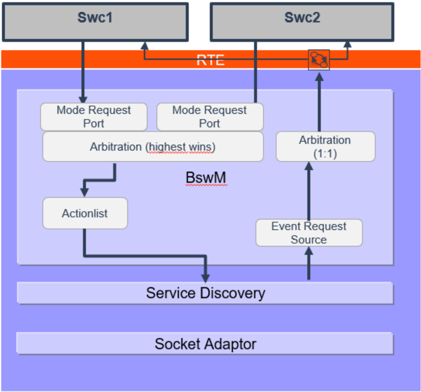

In order to be able to use the standard means for Service Discovery control, it has to be taken into account already at design time of the Application-SWCs.

While the fact that the use cases are required must be known at design time, the actual interfaces are completely agnostic to which SOA technology they will be applied.

Figure 3.4: Example Port Connections involved in the BswM interations

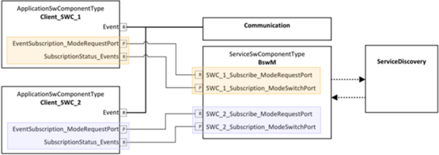

AppleatienSaCempenentType

Service sWC

PPortProsstype

PPortProsctype

Methed


Pollinoup

ServicePortGroup

SINT

For a SWC to be able to request the subscription to one or more events a corresponding S/R-port is needed.

The fact that this port shall be used to interact with ServiceDiscovery is expressed by setting ServiceNeedsKind to BswMgrNeeds .

isig Event

The kind of interaction is determined by the RoleBasedDataAssignment which could be one of

Signalifdu

#5gPdu\_Evont

SignalToPoMapping

HighduM\_Evont

- ClientEventSubscription

ServiceOffer ModeRequestPort F

- ClientEventSubscriptionStatus

Po/Trişgering

- ServerServiceOffer

Corsa ndlr

- ServerEventSubscriptionStatus

houderid

The mapping to the actual payload ports (i.e. events/methods) is provided by referencing all Event-/Method-Ports relevant for this request/notification in RepresentedPortGroup.

Figure 3.5: Mapping between ModeRequestPorts and corresponding Event/Method (payload data)

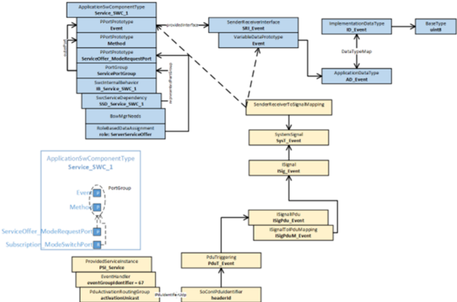

The mapping is done at design time. The granularity of the mapping can be chosen to be 1:1 or one request port for the whole service instance or anything in between. In case of Service Discovery with Some-IP it could for example be made to match the mapping of events to event groups. Therefore the BswM rules will cope with that and the corresponding rules and action lists will realize a highest wins (for requests) and

Mentade mplementationOetaType I0\_Eveat AD\_Event BaseType sints BswM

BowMConfig

BawMArbitration


BawMRule

Rule\_01

BawM RuleExpressionRef Application DataType

lowest wins (for the indications back) in case one port at the SWC maps to more than one event/method. BswMModeRequestPort

ModeRequest\_01

Since all informations necessary to build these BswM rules are available via EcuExtract and EcuC the configuration tool can generate the complete BswM configuration building up the respective request and notification behavior. For more details see [4] Specification of Basic Software Mode Manager. The generation of the necessary rules and action lists is described in chapter 7.8.2 - 7.8.5 of [4].

BswMActionListitemRef BowMAction

Figure 3.6 shows an example of how a generated configuration could look like. All white boxes are expected to be generated by the configuration tool.

BawMSdServerMethodsRef PSI\_Service

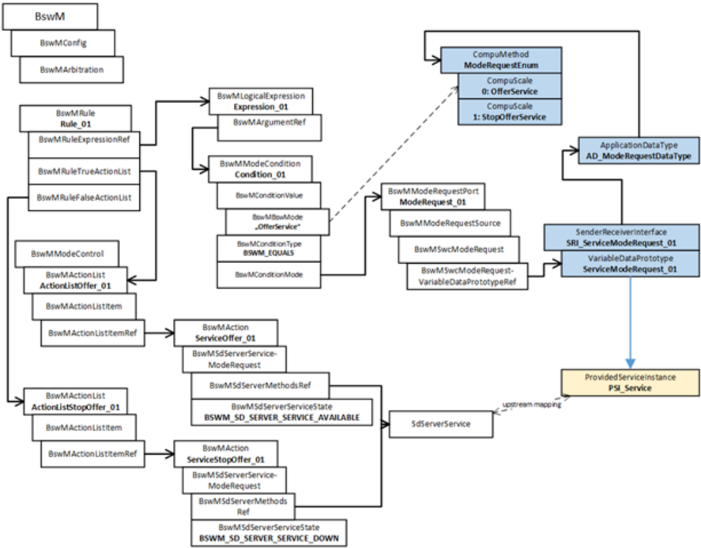

BawMActionList

ActionlistStopoffer\_01

BowMAction/Listitem

BowMActionListitemRef

Figure 3.6: Example for a generated BswM configuration

## 3.5 Diagnostics

In AUTOSAR release 4.0.3 onwards the DCM is the overall mode manager for all diagnostic use cases. The BswM is responsible to change the state of the other basic software modules accordingly.

BswMLogicalExpression

Expression\_01

BowMArgumentie!

CompuMeshod

ModeReque stEnum

CompuScale

0: OfferService

Compuscale

1: StopofferService


## 3.5.1 Diagnostic Session Control

For session control [SWS\_Dcm\_00777] in SWS\_DiagnosticCommunicationManager [5] defines the following ModeDeclarationGroup as providedModeGroup . Note: The mode names and values are derived from the Dcm configuration. This guide shows just an example.

```
modeGroup DcmDiagnosticSessionControl { DefaultSession, ProgrammingSession, ExtendedDiagnosticSession, SafetySystemDiagnosticSession, AllSessionLevel } interface modeSwitch MSIF_DcmDiagnosticSessionControl { mode DcmDiagnosticSessionControl diagnosticSessionControl }
```

Listing 3.33: ModeGroup for session control service of the DCM

The DCM acting as a mode manager can inform other BSW modules about the current mode of the session control service and if needed set the basic software in the corresponding mode. Listing 3.34 shows the corresponding mode switch interface.

Note that the same interface can also be used to inform the application software about the current diagnostic session.

```
request BswModeNotification DiagnosticSessionControl { source MSIF_DcmDiagnosticSessionControl.diagnosticSessionControl processing IMMEDIATE initialValue DefaultSession }
```

Listing 3.34: ModeRequestPort for session control service of the DCM

## 3.5.2 ECU Reset

In case of ECU Reset, the interaction between DCM and BswM is more complex. The Specification of the Diagnostic Communication Manager [5] specifies for this purpose the interface as described in listing 3.35. Via this interface the DCM signals the BswM to

1. prepare the ECU to execute a specific reset.
2. to explicitly execute this reset.

```
modeGroup DcmEcuReset{ NONE, HARD, KEYONOFF, SOFT, JUMPTOBOOTLOADER,
```


```
JUMPTOSYSSUPPLIERBOOTLOADER , EXECUTE } interface modeSwitch MSIF_DcmEcuReset { mode DcmEcuReset ecureset }
```

Listing 3.35: Mode switch interface for ECU reset diagnostic service

[SWS\_Dcm\_00373] states that on reception of a request for UDS Service with the sub functions other than enableRapidPowerShutDown (0x04) or disableRapidPowerShutDown (0x05), the DCM module shall switch the ModeDeclarationGroupPrototype DcmEcuReset to the received resetType. After the mode switch is requested the DCM triggers the start of the positive response message transmission.

According to [SWS\_Dcm\_00594] on the transmit confirmation (call to Dcm\_TpTxConfirmation) of the positive response, the DCM module shall trigger the mode switch of ModeDeclarationGroupPrototype DcmEcuReset to EXECUTE . By this final mode switch the DCM request the BswM to finally shutdown the ECU and to to perform the reset.

Listing 3.36 depicts how the different reset scenarios specified in the DCM can be configured in the DCM. Note that in the running example of this document the overall EcuMode is used to signal to the DCM that the ECU is ready to be reset. Depending on the diagnostic service the DCM shall wait for this acknowledgment or switch immediately to the EXECUTE mode, which will cause the BswM to invoke EcuM\_GoDown .

```
rule DcmEcuResetHard initially false { if ( DcmEcuResetMode == DcmEcuReset.HARD) { actionlist DcmEcuResetHardActions } } actions DcmEcuResetHardActions on condition { custom "EcuM_SelectShutdownTarget(ECU_RESET, ECUM_RESET_IO)" custom "EcuM_SelectShutdownCause(ECUM_CAUSE_DCM)" SchMSwitch EcuMode : ECU_RESET_READY } rule DcmEcuResetKeyOnOff initially false { if ( DcmEcuResetMode == DcmEcuReset.KEYONOFF) { actionlist DcmEcuResetKeyOnOffActions } } actions DcmEcuResetKeyOnOffActions on condition { custom "EcuM_SelectShutdownTarget(ECU_RESET,ECUM_RESET_IO)" custom "EcuM_SelectShutdownCause(ECUM_CAUSE_DCM)" SchMSwitch EcuMode : ECU_RESET_READY } rule DcmEcuResetSoft initially false {
```


```
if ( DcmEcuResetMode == DcmEcuReset.SOFT) { actionlist DcmEcuResetSoftActions } } actions DcmEcuResetSoftActions on condition { custom "EcuM_SelectShutdownTarget(ECU_RESET, ECUM_RESET_MCU)" custom "EcuM_SelectShutdownCause(ECUM_CAUSE_DCM)" SchMSwitch EcuMode : ECU_RESET_READY } rule DcmEcuResetBootLoader initially false { if ( DcmEcuResetMode == DcmEcuReset.JUMPTOBOOTLOADER) { actionlist DcmEcuResetBootLoaderActions } } actions DcmEcuResetBootLoaderActions on condition { custom "EcuM_SelectShutdownTarget(ECU_RESET, ECUM_RESET_MCU)" custom "EcuM_SelectShutdownCause(ECUM_CAUSE_DCM)" custom "EcuM_SelectBootTarget(ECUM_BOOT_TARGET_OEM_BOOTLOADER)" SchMSwitch EcuMode : ECU_RESET_READY } rule DcmEcuResetSupplierBootloader initially false { if ( DcmEcuResetMode == DcmEcuReset.JUMPTOSYSSUPPLIERBOOTLOADER ) { actionlist DcmEcuResetSupplierBootloaderActions } } actions DcmEcuResetSupplierBootloaderActions on condition { custom "EcuM_SelectShutdownTarget(ECU_RESET, ECUM_RESET_MCU)" custom "EcuM_SelectShutdownCause(ECUM_CAUSE_DCM)" custom "EcuM_SelectBootTarget(ECUM_BOOT_TARGET_SYS_BOOTLOADER)" SchMSwitch EcuMode : ECU_RESET_READY } rule DcmEcuReset initially false { if ( DcmEcuResetMode == DcmEcuReset.EXECUTE ) { actionlist DcmEcuResetActions } } actions DcmEcuResetActions on condition { custom "EcuM_GoDown(MODULE_ID)" }
```

Listing 3.36: Ruleset to implement different reset scenarios

## 3.5.3 Rapid Power Shutdown

On reception of a request for UDS Service with the sub functions enableRapidPowerShutdown (0x04) or disableRapidPowerShutdown (0x05), the DCM module triggers the mode switch of ModeDeclarationGroupPrototype DcmRapidPowerShutDown ENABLE\_RAPIDPOWERSHUTDOWN or DISABLE\_RAPIDPOWERSHUTDOWN .


In most use cases this is information is interpreted by the application to reduce overrun times. Nevertheless it also can be provided to the BswM (listing 3.37) if different shutdown sequences shall be realized by the BswM.

```
modeGroup DcmRapidPowerShutDown { ENABLE_RAPIDPOWERSHUTDOWN, DISABLE_RAPIDPOWERSHUTDOWN } interface modeSwitch MSIF_RapidPowerShutdown { mode DcmRapidPowerShutDown powerShutDown }
```

Listing 3.37: Mode switch interface for rapid power shutdown

## 3.5.4 Communciation Control diagnostic service

If the DCM reports to the BswM that a specified communication control mode is entered, the BswM has to enable resp. disable the corresponding IPDU groups as shown in listing 3.38.

```
rule communicationcontrol1 initially false on condition { if (Dcm_Communication_Control_CAN1 == DCM_ENABLE_RX_TX_NORM ) { actionlist communicationcontrol_DCM_ENABLE_RX_TX_NORM } } actions communicationcontrol_DCM_ENABLE_RX_TX_NORM on trigger { PduGroupSwitch { init true enable ArMmExample.EcuC.MyCom.CAN1IPDUS } } //----------------------------------------------------------------rule communicationcontrol2 initially false on condition { if (Dcm_Communication_Control_CAN1 == DCM_ENABLE_RX_DISABLE_TX_NORM ) { actionlist communicationcontrol_DCM_ENABLE_RX_DISABLE_TX_NORM } } actions communicationcontrol_DCM_ENABLE_RX_DISABLE_TX_NORM on trigger { PduGroupSwitch { init true enable ArMmExample.EcuC.MyCom.CAN1RXIPDUS disable ArMmExample.EcuC.MyCom.CAN1TXIPDUS } } //----------------------------------------------------------------rule communicationcontrol3 initially false on condition {
```


```
if (Dcm_Communication_Control_CAN1 == DCM_DISABLE_RX_ENABLE_TX_NORM ) { actionlist communicationcontrol_DCM_DISABLE_RX_ENABLE_TX_NORM } } actions communicationcontrol_DCM_DISABLE_RX_ENABLE_TX_NORM on trigger { PduGroupSwitch { init true enable ArMmExample.EcuC.MyCom.CAN1TXIPDUS disable ArMmExample.EcuC.MyCom.CAN1RXIPDUS } } //----------------------------------------------------------------rule communicationcontrol5 initially false on condition { if (Dcm_Communication_Control_CAN1 == DCM_DISABLE_RX_TX_NORMAL ) { actionlist communicationcontrol_DCM_DISABLE_RX_TX_NORMAL } } actions communicationcontrol_DCM_DISABLE_RX_TX_NORMAL on trigger { PduGroupSwitch { init true disable ArMmExample.EcuC.MyCom.CAN1IPDUS } } //----------------------------------------------------------------rule communicationcontrol6 initially false on condition { if (Dcm_Communication_Control_CAN1 == DCM_ENABLE_RX_TX_NM ) { actionlist communicationcontrol_DCM_ENABLE_RX_TX_NM } } actions communicationcontrol_DCM_ENABLE_RX_TX_NM on trigger { PduGroupSwitch { init true enable ArMmExample.EcuC.MyCom.CAN1NMIPDUS } } //----------------------------------------------------------------rule communicationcontrol7 initially false on condition { if (Dcm_Communication_Control_CAN1 == DCM_ENABLE_RX_DISABLE_TX_NM ) { actionlist communicationcontrol_DCM_ENABLE_RX_DISABLE_TX_NM } } actions communicationcontrol_DCM_ENABLE_RX_DISABLE_TX_NM on trigger { PduGroupSwitch { init true enable ArMmExample.EcuC.MyCom.CAN1NMRXIPDUS disable ArMmExample.EcuC.MyCom.CAN1NMTXIPDUS } } //----------------------------------------------------------------
```


```
rule communicationcontrol8 initially false on condition { if (Dcm_Communication_Control_CAN1 == DCM_DISABLE_RX_ENABLE_TX_NM ) { actionlist communicationcontrol_DCM_DISABLE_RX_ENABLE_TX_NM } } actions communicationcontrol_DCM_DISABLE_RX_ENABLE_TX_NM on trigger { PduGroupSwitch { init true enable ArMmExample.EcuC.MyCom.CAN1NMTXIPDUS disable ArMmExample.EcuC.MyCom.CAN1NMRXIPDUS } } //----------------------------------------------------------------rule communicationcontrol9 initially false on condition { if (Dcm_Communication_Control_CAN1 == DCM_DISABLE_RX_TX_NM ) { actionlist communicationcontrol_DCM_DISABLE_RX_TX_NM } } actions communicationcontrol_DCM_DISABLE_RX_TX_NM on trigger { PduGroupSwitch { init true disable ArMmExample.EcuC.MyCom.CAN1NMRXIPDUS, ArMmExample.EcuC.MyCom. CAN1NMTXIPDUS } } //----------------------------------------------------------------rule communicationcontrol10 initially false on condition { if (Dcm_Communication_Control_CAN1 == DCM_ENABLE_RX_TX_NORM_NM ) { actionlist communicationcontrol_DCM_ENABLE_RX_TX_NORM_NM } } actions communicationcontrol_DCM_ENABLE_RX_TX_NORM_NM on trigger { PduGroupSwitch { init true enable ArMmExample.EcuC.MyCom.CAN1NMRXIPDUS, ArMmExample.EcuC.MyCom. CAN1NMTXIPDUS } } //----------------------------------------------------------------rule communicationcontrol11 initially false on condition { if (Dcm_Communication_Control_CAN1 == DCM_ENABLE_RX_DISABLE_TX_NORM_NM ) { actionlist communicationcontrol_DCM_ENABLE_RX_DISABLE_TX_NORM_NM } } actions communicationcontrol_DCM_ENABLE_RX_DISABLE_TX_NORM_NM on trigger { PduGroupSwitch { init true
```


```
enable ArMmExample.EcuC.MyCom.CAN1NMRXIPDUS, ArMmExample.EcuC.MyCom. CAN1RXIPDUS disable ArMmExample.EcuC.MyCom.CAN1NMTXIPDUS, ArMmExample.EcuC.MyCom. CAN1TXIPDUS } } //----------------------------------------------------------------rule communicationcontrol12 initially false on condition { if (Dcm_Communication_Control_CAN1 == DCM_DISABLE_RX_ENABLE_TX_NORM_NM ) { actionlist communicationcontrol_DCM_DISABLE_RX_ENABLE_TX_NORM_NM } } actions communicationcontrol_DCM_DISABLE_RX_ENABLE_TX_NORM_NM on trigger { PduGroupSwitch { init true enable ArMmExample.EcuC.MyCom.CAN1NMTXIPDUS, ArMmExample.EcuC.MyCom. CAN1TXIPDUS disable ArMmExample.EcuC.MyCom.CAN1NMRXIPDUS, ArMmExample.EcuC.MyCom. CAN1RXIPDUS } } //----------------------------------------------------------------rule communicationcontrol13 initially false on condition { if (Dcm_Communication_Control_CAN1 == DCM_DISABLE_RX_TX_NORM_NM ) { actionlist communicationcontrol_DCM_DISABLE_RX_TX_NORM_NM } } actions communicationcontrol_DCM_DISABLE_RX_TX_NORM_NM on trigger { PduGroupSwitch { init true disable ArMmExample.EcuC.MyCom.CAN1NMTXIPDUS,ArMmExample.EcuC.MyCom. CAN1TXIPDUS, ArMmExample.EcuC.MyCom.CAN1NMRXIPDUS, ArMmExample.EcuC. MyCom.CAN1RXIPDUS } } //----------------------------------------------------------------
```

Listing 3.38: Ruleset for diagnostic communication control

## 3.5.5 Control DTC Setting

```
modeGroup DcmControlDTCSetting { ENABLEDTCSETTING, DISABLEDTCSETTING } interface modeSwitch MSIF_DcmControlDtcSetting { mode DcmControlDTCSetting dtcSetting }
```

Listing 3.39: Mode switch interface for Control of DTC setting


## 3.5.6 Roe Status

The Dcm will switch the current status of the Roe per configured Roe Event via a mode switch of ModeDeclarationGroupPrototype DcmResponseOnEvent\_&lt;RoeEventID&gt; switching the mode to EVENT\_STARTED , EVENT\_STOPPED and EVENT\_CLEARED . The information is necessary mainly for applications that need to interact with the Dcm if the events shall be triggered from external.

```
ModeGroup DcmResponseOnEvent_<RoeEventID> { EVENT_STARTED, EVENT_STOPPED, EVENT_CLEARED } interface modeSwitch MSIF_DcmResponseOnEvent{ mode DcmResponseOnEvent currentMode }
```

Listing 3.40: Mode switch interface for Roe Status

## 3.6 BswM to BswM interaction on multicore ECUs

This chapter describes configuration and integration guidelines related to BswM usage in multi partition ECUs.

The BswM mainly interacts with the state managers of the functional clusters, e.g. with the ComM, and should therefore be locally available on the same partition in order to limit inter-core communication as much as possible.

Therefore, the BswM can be distributed over multiple partitions containing BSW modules. These independent BswMs have partition specific configuration sets. The synchronization of the different partition local BswM instances can be accomplished by normal mode-communication (mode request, mode switch) between BswM service components.

If a partition of the ECU contains BSW modules running inside the partition, the partition would also have a partition local BswM.

A partition local BswM is responsible for the complete initialization of the BSW Modules within its partition. As the initialization sequence largely depends on the distribution of the modules in different partitions, this has a big impact on the configuration of all partition local BswMs.

Each partition local BswM has the job of coordinating the initialization of the BSW modules which are running in its partition.

Each instance of the BswM will then take care of the correct initialization and deinitialization of the partition local BSW modules, so that the following scenarios can be realized:


Startup up: After startup of the OS, each EcuM will hand over control to the partition local BswM, which then takes care of the initialization of the other partition local BSW Modules. Afterwards, the partition local BswM signals the readiness of the partition to the other BswM instances running in other partitions. This signalling is done using normal mode-communication between the BswM service components.

Shutdown: The partition local BswM determines via its ModeRequestSources, whether it can be shut down or not. If this is the case, it signals its current state to the other BswM instances running in other partitions. This signalling is done using normal modecommunication between the BswM service components. The BswM placed inside the partition of the Master EcuM can then decide on this information whether it initiates a shutdown of the ECU.

Deinitialization: The BswM (on the partition where the Master EcuM is running inside) can signal the other BswMs that it wants to shutdown the ECU. This signalling is done using normal mode-communication between the BswM service components. The other BwsMs can then deinitialize the modules running inside their partition in order to enable a clean shutdown.

Restart of a partition: If a partition is restarted, the local BswM signals to the other BswM instances that it is in a restart mode. This signalling is done using normal modecommunication between the BswM service components. Then, the other BswMs can determine if local applications need to be informed or potentially restarted, and how to synchronize them to the newly started partition.

## 3.7 Inter-partition Actions

The BswM does not implement mechanisms to prevent the execution of actions which affect modules residing on another partition. The configurator of the BswM needs to be aware of this during the configuration of BswM actions. Generally, the BswM can safely execute actions which affect its own partition, but special consideration on the part of the configurator must be given when configuring a BswM action which affects another partition. When configuring a cross-partition action, care must be taken to ensure that the cross-partition action (in implementation, a function call to another partition) can be executed safely and without endangering system performance or stability. If necessary, the implementor of a function needs to state limitations with respect to its usage(e.g. 'not prepared to be called cross-partition with memory protection enabled'). Among other things, the following issues need to be considered on the part of the configurator of cross-partition actions: memory protection, stopping/restarting of partitions, and proper preparation of the callee's (i.e. the recipient of the action) partition.

## 3.8 Inter-partition Requests/Indications

If the BswM is integrated in a multi-partition ECU, mode requests and/or mode indications could possibly be sent across partition boundaries to the BswM. In the case of a mode request/indication which crosses a partition via the Rte (e.g. BswMSwcModeRequest), the configurator does not need to take special considerations regarding system stability or data consistency, the Rte handles the communication of this type of cross-partition mode request/indication. However, if the cross-partition mode request/indication comes directly from a BSW module (e.g. BswMComMIndication) or from a generic source (e.g. BswMGenericRequest), the configurator must take special considerations, for example:


1. When the configurator uses memory protection, memory sections which are involved in cross-partition mode requests/indications (e.g. BswM-internal status flags) need to be configured to allow such cross-partition access.
2. Cross-partition Mode requests/indications which are configured with IMMEDIATE processing may also trigger an immediately executed actionlist. The resultant actions will be executed in the context of the caller (e.g. a BSW module in another partition). For these IMMEDIATE cross-partition mode requests/indication, the same issues as in chapter "Inter-partition Actions" also need to be considered.


## 4 Acronyms and abbreviations

## 4.1 Technical Terms

All technical terms used throughout this document - except the ones listed here - can be found in the official AUTOSAR glossary [6] or the Software Component Template Specification [1].

| Term                     | Description                                                                                                                                                                                                                                                                                                                                                                    |
|--------------------------|--------------------------------------------------------------------------------------------------------------------------------------------------------------------------------------------------------------------------------------------------------------------------------------------------------------------------------------------------------------------------------|
| mode                     | A Mode is a certain set of states of the various state machines (not only of the ECU State Manager) that are running in the ve- hicle and are relevant to a particular entity, an application or the whole vehicle                                                                                                                                                             |
| state                    | States are internal to their respective BSW component and thus not visible to the application. So they are only used by the BSW's internal state machine. The States inside the ECU State Man- ager build the phases and therefore handle the modes.                                                                                                                           |
| phase                    | A logical or temporal assembly of ECU Manager's actions and events, e.g. STARTUP, UP, SHUTDOWN, SLEEP, etc. Phases can consist of Sub-Phases which are often called Sequences if they above all exist to group sequences of executed actions into logical units. Phases in this context are not the phases of the AUTOSAR Methodology.                                         |
| mode switch port         | The port for receiving (or sending) a mode switch notification. For this purpose, a mode switch port is typed by a Mod- eSwitchInterface .                                                                                                                                                                                                                                     |
| mode request interface   | A AUTOSAR SenderReceiverInterface s, which carries the requested mode in a VariableDataPrototype..                                                                                                                                                                                                                                                                             |
| mode user                | An AUTOSAR SW-C or AUTOSAR Basic Software Module that depends on modes by SwcModeSwitchEvent , BswMod- eSwitchEvent , or simply by reading the current state of a mode is called a mode user . A mode user is defined by having a require mode switch port or a requiredModeGroup Mod- eDeclarationGroupPrototype . See also section 2.                                        |
| mode manager             | Entering and leaving modes is initiated by a mode manager . A mode manager is defined by having a provide mode switch port or a providedModeGroup ModeDeclarationGroup- Prototype . A mode manager might be either an appli- cation mode manager or a Basic Software Module that provides a service including mode switches, like the ECU State Manager. See also section 2.2. |
| application mode manager | An application mode manager is a AUTOSAR software- component that provides the service of switching modes. The modes of a application mode manager do not have to be standardized.                                                                                                                                                                                             |
| mode request             | The communication of a mode request from the mode user to the mode manager using either the SenderReceiverInter- face is called a mode request .                                                                                                                                                                                                                               |
| mode switch notification | The communication of a mode switch from the mode manager to the mode user using either the ModeSwitchInterface or providedModeGroup and requiredModeGroup ModeDec- larationGroupPrototype is called mode switch noti- fication .                                                                                                                                               |


| mode machine instance                       | The instances of mode machines or ModeDeclarationGroup s are defined by the ModeDeclarationGroupPrototype s of the mode manager Since a mode switch is not executed instantaneously, the RTE or Basic Software Scheduler has to maintain it's own states. For each mode manager s ModeDeclarationGroupPrototype, RTE or Basic Software Scheduler has one state machine. This state machine is called mode machine instance . For all mode user s of the same mode manager s ModeDeclara- tionGroupPrototype RTE and Basic Software Scheduler uses the same mode machine instance . See also section 2.2.   |
|---------------------------------------------|------------------------------------------------------------------------------------------------------------------------------------------------------------------------------------------------------------------------------------------------------------------------------------------------------------------------------------------------------------------------------------------------------------------------------------------------------------------------------------------------------------------------------------------------------------------------------------------------------------|
| common mode machine in- stance              | A 'common mode machine instance' is a special 'mode machine instance' shared by BSW Modules and SW-Cs: The RTE Gener- ator creates only one mode machine instance if a ModeDec- larationGroupPrototype instantiated in a port of a software- component is synchronized synchronizedModeGroup of a                                                                                                                                                                                                                                                                                                          |
| Mode Disabling Dependency                   | An RTEEvent and BswEvent that starts a RunnableEntity respectively a Basic Software Schedulable Entity can contain a disabledMode or disabledInMode association which references a ModeDeclaration . This association is called in this document.                                                                                                                                                                                                                                                                                                                                                          |
| mode disabling dependent Exe- cutableEntity | ModeDisablingDependency A mode disabling dependent RunnableEntity or a Ba- sic Software Schedulable Entity is triggered by an RTEEvent respectively a BswEvent with a ModeDis- ablingDependency . RTE and Basic Software Scheduler pre- vent the start of those RunnableEntity or Basic Software Schedulable Entity by the RTEEvent / BswEvent , when the corresponding mode disabling is active. See also section 2.2.                                                                                                                                                                                    |
| mode disabling                              | When a 'mode disabling' is active, RTE and Basic Software Scheduler disables the start of mode disabling depen- dent ExecutableEntitys . The 'mode disabling' is active during the mode that is referenced in the mode disabling depen- dency and during the transitions that enter and leave this mode. See also section 2.2.                                                                                                                                                                                                                                                                             |
| OnEntry ExecutableEntity                    | A RunnableEntity or a Basic Software Schedulable Entity that is triggered by a SwcModeSwitchEvent respec- tively a BswModeSwitchEvent with ModeActivationKind 'entry' is triggered on entering the mode. It is called OnEntry ExecutableEntity . See also section 2.2.                                                                                                                                                                                                                                                                                                                                     |
| OnExit ExecutableEntity                     | A RunnableEntity or a Basic Software Schedulable Entity that is triggered by a SwcModeSwitchEvent respec- tively a BswModeSwitchEvent with ModeActivationKind 'exit' is triggered on exiting the mode. It is called OnExit Exe- cutableEntity . See also section 2.2.                                                                                                                                                                                                                                                                                                                                      |
| OnTransition ExecutableEntity               | A RunnableEntity or a Basic Software Schedulable Entity that is triggered by a SwcModeSwitchEvent respec- tively a BswModeSwitchEvent with ModeActivationKind 'transition' is triggered on a transition between the two specified modes. It is called OnTransition ExecutableEntity . See also section 2.2.                                                                                                                                                                                                                                                                                                |


| mode switch acknowledge Exe- cutableEntity     | A RunnableEntity or a Basic Software Schedulable Entity that is triggered by a SwcModeSwitchEvent respec- tively a BswModeSwitchedAckEvent connected to the mode manager 's ModeDeclarationGroupPrototype . It is called mode switch acknowledge ExecutableEntity . See also section 2.2.                                                                           |
|------------------------------------------------|---------------------------------------------------------------------------------------------------------------------------------------------------------------------------------------------------------------------------------------------------------------------------------------------------------------------------------------------------------------------|
| server runnable                                | A server that is triggered by an OperationInvokedEvent . It has a mixed behavior between a runnable and a function call. In certain situations, RTE can implement the client server commu- nication as a simple function call.                                                                                                                                      |
| runnable activation                            | The activation of a runnable is linked to the RTEEvent that leads to the execution of the runnable. It is defined as the incident that is referred to by the RTEEvent . E.g., for a timing event, the corresponding runnable is acti- vated, when the timer expires, and for a data received event, the runnable is activated when the data is received by the RTE. |
| Basic Software Schedulable En- tity activation | The activation of a Basic Software Schedulable Entity is defined as the activation of the task that contains the Basic Software Schedulable Entity and eventually in- cludes setting a flag that tells the glue code in the task which Basic Software Schedulable Entity is to be executed.                                                                         |
| Runnable start                                 | A runnable is started by the calling the C-function that imple- ments the runnable from within a started task.                                                                                                                                                                                                                                                      |
| Basic Software Schedulable En- tity start      | A Basic Software Schedulable Entity is started by the calling the C-function that implements the Basic Software Schedulable Entity from within a started task.                                                                                                                                                                                                      |
| Trigger Source                                 | A Trigger Source administrate the particular Trigger and informs the RTE or Basic Software Scheduler if the Trig- ger is raised. A Trigger Source has dedicated provide trigger port s or / and releasedTrigger Trigger s to communicate to the Trigger Sink s.                                                                                                     |
| Trigger Sink                                   | A Trigger Sink relies on the activation of Runnable Enti- ties or Basic Software Schedulable Entities if a par- ticular Trigger is raised. A Trigger Sink has a dedicated re- quire trigger port s or / and requiredTrigger Trigger s                                                                                                                               |
| Trigger port                                   | to communicate to the Trigger Source s. A PortPrototype which is typed by an TriggerInterface A Runnable Entity or a Basic Software Schedulable Entity that is triggered at least by one ExternalTrigge- rOccurredEvent / BswExternalTriggerOccurredEvent or InternalTriggerOccurredEvent / BswInternalTrig-                                                        |
| triggered ExecutableEntity                     | gerOccurredEvent . In particular cases, the Trigger Event Communication or the Inter Runnable Triggering is im- plemented by RTE or Basic Software Scheduler as a di- rect function call of the triggered ExecutableEntity by the triggering .                                                                                                                      |
| triggered runnable                             | A Runnable Entity that is triggered at least by one Ex- ternalTriggerOccurredEvent or InternalTriggerOc- curredEvent . In particular cases, the Trigger Event Commu- nication or the Inter Runnable Triggering is implemented by RTE as a direct function call of the triggered runnable by the triggering runnable.                                                |


| triggered Basic Software Schedulable Entity   | A Basic Software Schedulable Entity that is triggered at least by one BswExternalTriggerOccurredEvent or BswInternalTriggerOccurredEvent . In particular cases, the Trigger Event Communication or the Inter Ba- sic Software Schedulable Entity Triggering is im- plemented by Basic Software Scheduler as a direct func- tion call of the triggered ExecutableEntity by the trigger- ing ExecutableEntity .   |
|-----------------------------------------------|-----------------------------------------------------------------------------------------------------------------------------------------------------------------------------------------------------------------------------------------------------------------------------------------------------------------------------------------------------------------------------------------------------------------|
| execution-instance                            | An execution-instance of a ExecutableEntity is one instance or call context of an ExecutableEntity with respect to con- current execution.                                                                                                                                                                                                                                                                      |
| inter-ECU communication                       | The communication between ECUs, typically using COMis called inter-ECU communication in this document.                                                                                                                                                                                                                                                                                                          |
| inter-partition communication                 | The communication within one ECU but between different par- titions, represented by different OS applications, is called in- ter-partition communication in this document. It typically involves the use of OS mechanisms like IOC or trusted function calls. The partitions can be located on different cores or use dif- ferent memory sections of the ECU.                                                   |
| intra-partition communication                 | The communication within one partition of one ECU is called intra-partition communication. In this case, RTE can make use of internal buffers and queues for communication.                                                                                                                                                                                                                                     |
| intra-ECU communication                       | The communication within one ECU is called intra-ECU com- munication in this document. It is a super set of inter-parti- tion communication and intra-partition communication.                                                                                                                                                                                                                                  |