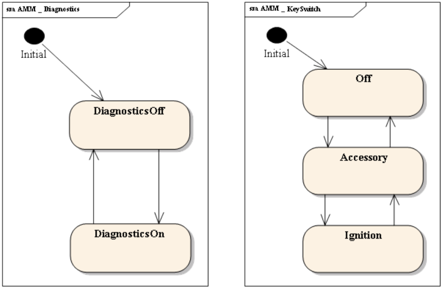
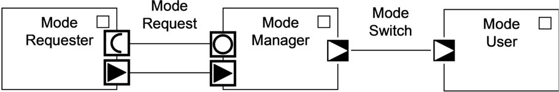
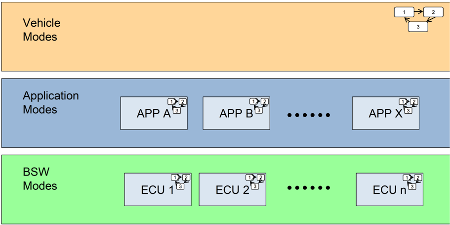
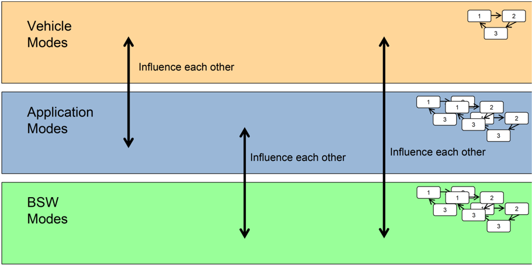
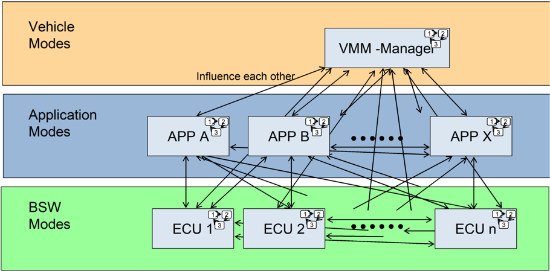
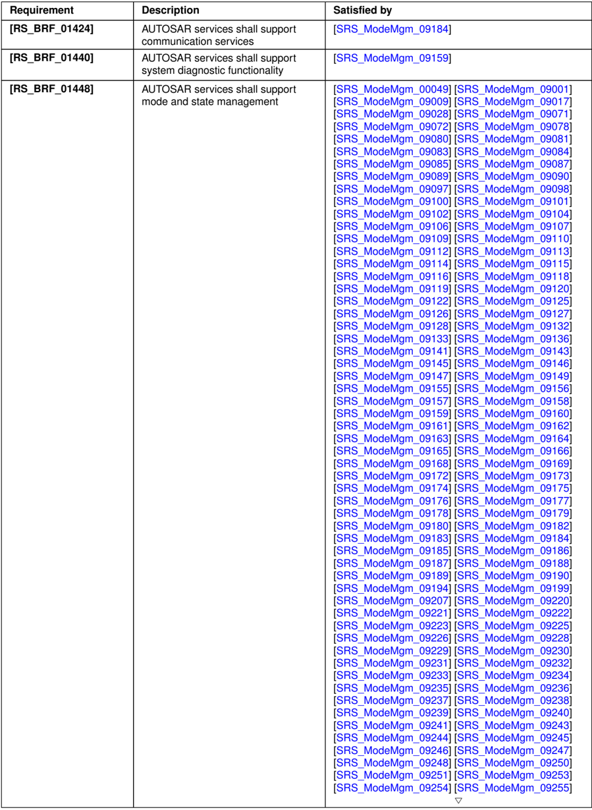

| Document Title             | Requirements on Mode Management   |
|----------------------------|-----------------------------------|
| Document Owner             | AUTOSAR                           |
| Document Responsibility    | AUTOSAR                           |
| Document Identification No | 69                                |

| Document Status          | published        |
|--------------------------|------------------|
| Part of AUTOSAR Standard | Classic Platform |
| Part of Standard Release | R23-11           |

| Document Change History   | Document Change History   | Document Change History    | Document Change History                                                                                                                                                                                                                                                       |
|---------------------------|---------------------------|----------------------------|-------------------------------------------------------------------------------------------------------------------------------------------------------------------------------------------------------------------------------------------------------------------------------|
| Date                      | Release                   | Changed by                 | Description                                                                                                                                                                                                                                                                   |
| 2023-11-23                | R23-11                    | AUTOSAR Release Management | • Added chapter Service Discovery Control for SWCs • Editorial Changes                                                                                                                                                                                                        |
| 2022-11-24                | R22-11                    | AUTOSAR Release Management | • Rework of PNC related ComM and NM handling • Removed "DRAFT"-tag from [SRS_ModeMgm_09249] • Editorial Changes                                                                                                                                                               |
| 2021-11-25                | R21-11                    | AUTOSAR Release Management | • Removed Draft from SRS_ModeMgm_09266 and SRS_ModeMgm_09268 • Removed SRS_ModeMgm_09252 (BswM shall be able to directly request communication modes for the available Partial Networks) • SRS_ModeMgm_09249 (PNC gateway and coordination functionality) • Editorial Changes |

glyph[triangleinv]

## glyph[triangle]

| 2020-11-30   | R20-11   | AUTOSAR Release Management   | • Concept "VNSM (Vehicle Network Stage Manager)" incorporated • Concept "EthernetWakeUpOnDataLine" incorporated • Concept "Rework of PNC related ComM and NM handling" incorporated   |
|--------------|----------|------------------------------|---------------------------------------------------------------------------------------------------------------------------------------------------------------------------------------|
| 2019-11-28   | R19-11   | AUTOSAR Release Management   | • No content changes • changed Document Status from Final to published                                                                                                                |
| 2018-10-31   | 4.4.0    | AUTOSAR Release Management   | • EcuMFixed is obsolete                                                                                                                                                               |
| 2017-12-08   | 4.3.1    | AUTOSAR Release Management   | • Editorial changes                                                                                                                                                                   |
| 2016-11-30   | 4.3.0    | AUTOSAR Release Management   | • Clarification of Network Management requirements • Introduced Requirements Tracing information                                                                                      |
| 2015-07-31   | 4.2.2    | AUTOSAR Release Management   | • Clarified post-build configurability of some requirements                                                                                                                           |
| 2014-10-31   | 4.2.1    | AUTOSAR Release Management   | • Moved former SWS EcuM item describing the handling of sleep modes / shutdown targets to SRS level • Removed Defensive Behavior                                                      |
| 2014-03-31   | 4.1.3    | AUTOSAR Release Management   | • Enhanced Traceability                                                                                                                                                               |
| 2013-03-31   | 4.1.2    | AUTOSAR Release Management   | • Editorial changes • Updated RS_BSWandFeature as RS_Feature                                                                                                                          |
| 2013-03-15   | 4.1.1    | AUTOSAR Administration       | • Introduced new requirement to implement ECU degradation and EnhancedBSWAllocation • Formal update to comply with the standard doc template • Introduced links to feature documents  |

glyph[triangleinv]

glyph[triangle]

| 2011-12-22   | 4.0.3   | AUTOSAR Administration   | • Extension of BswM in order to implement the mode management relevant parts of the Partial Networks concept. • Extension of ComM in order to implement the communication mode management relevant parts of the Partial                                                                                                                                                                                                                               |
|--------------|---------|--------------------------|-------------------------------------------------------------------------------------------------------------------------------------------------------------------------------------------------------------------------------------------------------------------------------------------------------------------------------------------------------------------------------------------------------------------------------------------------------|
| 2010-09-30   | 3.1.5   | AUTOSAR Administration   | Networks concept. • The new module BswM (BSW Mode Manager [1]). • The EcuM-Flex (ECU State Manager [2] Flexible) which has freely configurable states. • New functionality within the EcuM-Flex to support: Multi Core, Alarm Clocks and Defensive Behaviour of BSWMs • Extension of the WdgM (Watchdog Manager [3]) by: • SRS_ModeMgm_09173 added for clarification of ECU State Manager [2] behavior • program flow monitoring • windowed watchdogs |
| 2008-08-13   | 3.1.1   | AUTOSAR Administration   | • Legal disclaimer revised                                                                                                                                                                                                                                                                                                                                                                                                                            |
| 2007-12-21   | 3.0.1   | AUTOSAR Administration   | • BSW09088 removed due to introduction of Bus-specific State Managers below Communication Manager [4] • BSW09130 and BSW09131 removed due to direct initialization of the communication stack by the ECU State Manager [2] • BSW09170 and BSW09171 added for alive supervision during startup, shutdown, and sleep • SRS_ModeMgm_09172 added for clarification of Communication Manager [4] behavior                                                  |

glyph[triangleinv]

## glyph[triangle]

|            |        |                        | glyph[triangle] • SRS_ModeMgm_09173 added for clarification of ECU State Manager [2] behavior • Rephrased multiple requirements to clarify behavior and configuration classes • Document meta information extended                                                                                                                                                |
|------------|--------|------------------------|-------------------------------------------------------------------------------------------------------------------------------------------------------------------------------------------------------------------------------------------------------------------------------------------------------------------------------------------------------------------|
| 2007-01-24 | 2.1.15 | AUTOSAR Administration | • Small layout adaptations made • BSW09075 removed (moved to SRS General) • New requirements SRS_ModeMgm_09168 and SRS_ModeMgm_09169 created • References to OSEK OS replaced with references to AUTOSAR OS • Formal adjustments and glossary update • Legal disclaimer revised • Release Notes added • "Advice for users" revised • "Revision Information" added |
| 2006-05-16 | 2.0    | AUTOSAR Administration | • Initial Release                                                                                                                                                                                                                                                                                                                                                 |

## Disclaimer

This work (specification and/or software implementation) and the material contained in it, as released by AUTOSAR, is for the purpose of information only. AUTOSAR and the companies that have contributed to it shall not be liable for any use of the work.

The material contained in this work is protected by copyright and other types of intellectual property rights. The commercial exploitation of the material contained in this work requires a license to such intellectual property rights.

This work may be utilized or reproduced without any modification, in any form or by any means, for informational purposes only. For any other purpose, no part of the work may be utilized or reproduced, in any form or by any means, without permission in writing from the publisher.

The work has been developed for automotive applications only. It has neither been developed, nor tested for non-automotive applications.

The word AUTOSAR and the AUTOSAR logo are registered trademarks.

## Contents

| 1   | Scope of Document   |
|-----|---------------------|

| A.2   | A.1.3 Deleted Requirements in R22-11 . . . . . . . . . . . . . . . . . 82                                                                       |
|-------|-------------------------------------------------------------------------------------------------------------------------------------------------|
|       | Requirement History of this Document According to AUTOSAR Re- lease R23-11 . . . . . . . . . . . . . . . . . . . . . . . . . . . . . . . . . 82 |
| A.2.1 | Added Requirements in R23-11 . . . . . . . . . . . . . . . . . 82                                                                               |
| A.2.2 | Changed Requirements in R23-11 . . . . . . . . . . . . . . . . 82                                                                               |
| A.2.3 | Deleted Requirements in R23-11 . . . . . . . . . . . . . . . . . 82                                                                             |

## 1 Scope of Document

The goal of this document is to define the functional and non-functional requirements for all modules of the AUTOSAR mode management:

- ECU State Manager [2] (EcuM) which manages startup and shutdown of the ECU. This includes triggering the shutdown when all requests for run are released;
- Watchdog Manager [3] (WdgM) which collects the indications of aliveness and correct execution order from the independent applications and relays them to the hardware watchdog in a suitable way;
- Communication Manager [4] (ComM) which coordinates the communication of the independent applications.
- Basic Software Mode Manager (BswM) which organizes mode handling and mode related interaction of SW-Cs and the BSW modules.

All modules are needed if more than one independent software component resides on the ECU.

The location of these modules within the whole AUTOSAR ECU SW Architecture is defined in [REF].

## 2 Conventions to be used

The representation of requirements in AUTOSAR documents follows the table specified in [TPS\_STDT\_00078], see Standardization Template [5], chapter Support for Traceability.

The verbal forms for the expression of obligation specified in [TPS\_STDT\_00053] shall be used to indicate requirements, see Standardization Template [5], chapter Support for Traceability.

The key words "MUST", "MUST NOT", "REQUIRED", "SHALL", "SHALL NOT", "SHOULD", "SHOULD NOT", "RECOMMENDED", "MAY", and "OPTIONAL" in this document are to be interpreted as follows.

Note that the requirement level of the document in which they are used modifies the force of these words.

- MUST: This word, or the adjective "LEGALLY REQUIRED", means that the definition is an absolute requirement of the specification due to legal issues.
- MUST NOT: This phrase, or the phrase "MUST NOT", means that the definition is an absolute prohibition of the specification due to legal issues.
- SHALL: This phrase, or the adjective "REQUIRED", means that the definition is an absolute requirement of the specification.
- SHALL NOT: This phrase means that the definition is an absolute prohibition of the specification.
- SHOULD: This word, or the adjective "RECOMMENDED", means that there may exist valid reasons in particular circumstances to ignore a particular item, but the full implications must be understood and carefully weighed before choosing a different course.
- SHOULD NOT: This phrase, or the phrase "NOT RECOMMENDED", means that there may exist valid reasons in particular circumstances when the particular behavior is acceptable or even useful, but the full implications should be understood and the case carefully weighed before implementing any behavior described with this label.
- MAY: This word, or the adjective "OPTIONAL", means that an item is truly optional. One vendor may choose to include the item because a particular marketplace requires it or because the vendor feels that it enhances the product while another vendor may omit the same item.

An implementation, which does not include a particular option, SHALL be prepared to interoperate with another implementation, which does include the option, though perhaps with reduced functionality. In the same vein an implementation, which does include a particular option, SHALL be prepared to interoperate with another implementation, which does not include the option (except, of course, for the feature the option provides.)

## 3 Acronyms and abbreviations

The glossary below includes acronyms and abbreviations relevant to Mode Management that are not included in the AUTOSAR Glossary [6].

## Glossary

| Acronym:                 | Description:                                                                                                                                                                                                                                                                                                                                                                                                                                                         |
|--------------------------|----------------------------------------------------------------------------------------------------------------------------------------------------------------------------------------------------------------------------------------------------------------------------------------------------------------------------------------------------------------------------------------------------------------------------------------------------------------------|
| Active wake-up           | Wake-up caused by the ECU e.g. by a sensor.                                                                                                                                                                                                                                                                                                                                                                                                                          |
| Alive indication         | Indication that a supervised SW-C is alive - meaning active - provided from the SW-C itself to the Watchdog Manager [3].                                                                                                                                                                                                                                                                                                                                             |
| Application              | Applications are used synonymous to a SW-C. A SW-C may span several atomic SW-Cs. AUTOSAR provides the element of a "composition" to formally group several atomic SW-Cs of an application. A composition is used to structure the description and does not affect the generated code. Note: The atomic SW-Cs in a composition can still be mapped to different ECUs. Application Modes are therefore 'local' to an application but can be 'global' to several ECUs. |
| Application Mode         | An Application Mode is a mode that is not controlled and standardized by the Mode Managers in the BSW. The scope of an Application Mode is a limited number of SW-Cs that belongs to a logical Application. If a mode only affects one composition, it is an Application Mode. An Application Mode may be distributed across multiple ECUs or may be local to one ECU depending on the distribution of the SW-C belonging to that application.                       |
| Application Mode Manager | An Application Mode Manager is a SW-C therefore a priori not standardized. It collects environmental data and Mode Requests via application-specific (non-standardized) interfaces from other SW-Cs. It can switch Application Modes (that are not controlled and standardized by the Mode Managers in the BSW). It can also request modes from other Mode Managers, specifically from Mode Managers in the BSW.                                                     |
| BSW Mode                 | A BSW Mode is mode, which is controlled and standardized by the Mode Manager in the BSW. A BSW Mode is always local to one ECU.                                                                                                                                                                                                                                                                                                                                      |
| BSW Mode Manager [1]     | The BSW Mode Manager [1] is a BSW module that collects mode requests via a standardized interface and controls functionality of other BSW modules accordingly. Examples are: LIN Schedule Table Switching, Enabling/Disabling I-PDU Groups, ...                                                                                                                                                                                                                      |
| Communication mode       | Related to a physical channel or to a user, it indicates if it is possible to send/receive, only receive, neither send nor receive.                                                                                                                                                                                                                                                                                                                                  |
| Communication request    | A communication request indicates a demand for communication from a given user (e.g. a runnable requiring an operational communication stack). However, it can neither be assumed that the request will be fulfilled within a certain time nor that it will be fulfilled at all. The demander itself has to make sure that communication is indeed established, by using query functions or callbacks.                                                               |

glyph[triangleinv]

glyph[triangle]

| Acronym:               | Description:                                                                                                                                                                                                                                                                                                                                                                                                                                                                                                                                                                                                                                                                                                                                                                                                                                                                                                                                                                    |
|------------------------|---------------------------------------------------------------------------------------------------------------------------------------------------------------------------------------------------------------------------------------------------------------------------------------------------------------------------------------------------------------------------------------------------------------------------------------------------------------------------------------------------------------------------------------------------------------------------------------------------------------------------------------------------------------------------------------------------------------------------------------------------------------------------------------------------------------------------------------------------------------------------------------------------------------------------------------------------------------------------------|
| ECU state              | General term to indicate the states managed by the ECU State Manager [2]. They represent a structured model that extends the power modes of the ECU with states and transitions to support necessary activities of software to enter/leave these power modes.                                                                                                                                                                                                                                                                                                                                                                                                                                                                                                                                                                                                                                                                                                                   |
| Inoperation            | An artificial word to describe the ECU when it is not operational, i.e. not running. It comprises all meanings of off, sleeping, frozen, etc. Using this definition is beneficial since it has no predefined meaning.                                                                                                                                                                                                                                                                                                                                                                                                                                                                                                                                                                                                                                                                                                                                                           |
| Low-power mode         | All power modes except "on" (full power).                                                                                                                                                                                                                                                                                                                                                                                                                                                                                                                                                                                                                                                                                                                                                                                                                                                                                                                                       |
| Mode                   | A mode is a certain set of states of the various state machines that are running in the vehicle that are relevant to a particular entity, e.g. a SW-C, a BSW module, an application, a whole vehicle In its lifetime, an entity changes between a set of mutually exclusive modes. These changes are triggered by environmental data, e.g. signal reception, operation invocation.                                                                                                                                                                                                                                                                                                                                                                                                                                                                                                                                                                                              |
| Mode Declaration Group | A Mode Declaration Group is defined in the Software Component Template and implemented by the RTE [7]. A Mode Declaration Group defines a number of mutually exclusive modes. There is no hierarchy of modes within a Mode Declaration Group. Each Mode Declaration Group describes only one aspect of the whole system. All modes of all Mode Declaration Groups on an ECU describe the abstract mode of the ECU. Similarly, all modes of all Mode Declaration Groups in a system describe the abstract mode of all ECUs in the system. (The mode is abstract because it cannot be physically accessed, it just exists conceptually). There is a standardized set of Mode Declaration Groups defined in the BSW, e.g. ComM, WdgM, EcuM. Each system designer is free to extend the number of Mode Declaration Groups and define his/her own modes in there. Only one Mode Manager is allowed to switch the mode of an instance of a Mode Declaration Group. (Limitation in VFB |
| Mode Manager           | A Mode Manager is a role that can be taken by either a BSW module (and optionally additionally by an SW-C). The Mode Manager collects requests from Mode Requesters, arbitrates them and switches the mode of its Mode Declaration Group(s) accordingly. Examples of Mode Managers are: EcuM, ComM, WdgM and BswM Note: If a SW-C Mode Manager switches modes directly, the mode arbitration in the BSW Mode Manager [1] cannot resolve conflicts. Thus, it is recommended to use multi-level mode arbitration, of SW-C mode Manager and BSW Mode Manager [1]                                                                                                                                                                                                                                                                                                                                                                                                                   |
| Mode Port              | A Mode Port is port that has a Sender-Receiver Interface which contains a Mode Declaration Group. Note: This is called Mode Port in SWS RTE [7] -> To distinguish it from Mode Request Ports, we should call it Mode Switch Port                                                                                                                                                                                                                                                                                                                                                                                                                                                                                                                                                                                                                                                                                                                                                |

glyph[triangleinv]

glyph[triangle]

| Acronym:              | Description:                                                                                                                                                                                                                                                                                                                                                                                                                                                                                                                                                                                                                                                                                                                                                                                                                                                                                                                                                                                                                                                                                                                                                                                                                                                                                                                                                                                                                |
|-----------------------|-----------------------------------------------------------------------------------------------------------------------------------------------------------------------------------------------------------------------------------------------------------------------------------------------------------------------------------------------------------------------------------------------------------------------------------------------------------------------------------------------------------------------------------------------------------------------------------------------------------------------------------------------------------------------------------------------------------------------------------------------------------------------------------------------------------------------------------------------------------------------------------------------------------------------------------------------------------------------------------------------------------------------------------------------------------------------------------------------------------------------------------------------------------------------------------------------------------------------------------------------------------------------------------------------------------------------------------------------------------------------------------------------------------------------------|
| Mode Request          | A Mode Request is some information communicated to a Mode Manager that requests the Mode Manager to switch to a certain mode. For Mode Managers in the BSW the interface to send a Mode Request is a standardized client-server interface defined by the corresponding Mode Manager. Examples: Client-server interface ComM_UserRequest with operation RequestComMode(...). For Application Mode Managers the interface can be any client-server or sender-receiver interface defined by the Mode Manager.                                                                                                                                                                                                                                                                                                                                                                                                                                                                                                                                                                                                                                                                                                                                                                                                                                                                                                                  |
| Mode Request Port     | A Mode Request Port is a port with the special semantics of requesting a mode from a Mode Manager. It can be a Client-Server or a Sender-Receiver Port. For Mode Managers in the BSW the Mode Request Port is standardized. Note: For EcuM, ComM and WdgM it is always a Provided Client-Server Port. For BswM it is a Required Sender-Receiver Ports.                                                                                                                                                                                                                                                                                                                                                                                                                                                                                                                                                                                                                                                                                                                                                                                                                                                                                                                                                                                                                                                                      |
| Mode Requester        | A Mode Requester is an entity that requests modes from a Mode Manager.                                                                                                                                                                                                                                                                                                                                                                                                                                                                                                                                                                                                                                                                                                                                                                                                                                                                                                                                                                                                                                                                                                                                                                                                                                                                                                                                                      |
| Mode Switch Port      | Favored replacement of phrase Mode Port                                                                                                                                                                                                                                                                                                                                                                                                                                                                                                                                                                                                                                                                                                                                                                                                                                                                                                                                                                                                                                                                                                                                                                                                                                                                                                                                                                                     |
| Mode User             | A Mode User is an entity that reacts on mode changes.                                                                                                                                                                                                                                                                                                                                                                                                                                                                                                                                                                                                                                                                                                                                                                                                                                                                                                                                                                                                                                                                                                                                                                                                                                                                                                                                                                       |
| OFF state             | ECU state. It denotes the unpowered ECU. Depending on the hardware design, the ECU can or cannot react to passive wake-up in this state (wakeability is not required in this state).                                                                                                                                                                                                                                                                                                                                                                                                                                                                                                                                                                                                                                                                                                                                                                                                                                                                                                                                                                                                                                                                                                                                                                                                                                        |
| Passive wake-up       | Wakeup initiated by another ECU and propagated (e.g. by bus or wakeup-line) to the ECU currently in focus.                                                                                                                                                                                                                                                                                                                                                                                                                                                                                                                                                                                                                                                                                                                                                                                                                                                                                                                                                                                                                                                                                                                                                                                                                                                                                                                  |
| PNC bit vector length | Represent the length of a PNC bit vector in bytes.                                                                                                                                                                                                                                                                                                                                                                                                                                                                                                                                                                                                                                                                                                                                                                                                                                                                                                                                                                                                                                                                                                                                                                                                                                                                                                                                                                          |
| PNC bit vector        | Represent the Partial Network information in a NM frame.                                                                                                                                                                                                                                                                                                                                                                                                                                                                                                                                                                                                                                                                                                                                                                                                                                                                                                                                                                                                                                                                                                                                                                                                                                                                                                                                                                    |
| Port Group            | A Port Group is a logical group of ports that are needed to realize the same functionality in the Application. A port can be a member of multiple Port Groups. A Port Group can be used to request all associated communication resources and to inquire their state. Thereby, the Port Group also defines a mapping between Application Ports and Communication Resources. Thus, the purpose of a port group is to have an abstraction of the required communication resources of that functionality For example, an Application contains normal-operation functionality and limp-home functionality with reduced communication requirements. Then it is useful to define two Port Groups, A and B. A contains the ports that are necessary for the normal-operation functionality and B contains the ports for the limp-home functionality. Thereby, the Application can recognize the condition when the communication resources for normal operation are unavailable but are sufficient for limp home. Port Groups are defined on SW-C composition level, which means that they may be distributed on several ECUs. The requests and indications for the Port Groups shall however only affect the portion of the Port Group that is local to an ECU. If distributed control of Port Groups is needed it can be handled on "Application Mode Management" level (above the RTE [7]) using normal communication features. |

glyph[triangleinv]

## Abbreviations

glyph[triangle]

Table 3.1: Acronyms

| Acronym:                      | Description:                                                                                                                                                                                                                                                                                                                                                                    |
|-------------------------------|---------------------------------------------------------------------------------------------------------------------------------------------------------------------------------------------------------------------------------------------------------------------------------------------------------------------------------------------------------------------------------|
| Power mode                    | Hardware power mode of the ECU. Typically: on (full power), off, sleep, standby, etc... The last two items can take several forms depending on hardware capabilities (reduced clock, peripheral standby, etc.).                                                                                                                                                                 |
| Program flow monitoring       | Technique to detect errors that cause a divergence from the valid program sequence seen during valid execution of a program.                                                                                                                                                                                                                                                    |
| RUN state                     | ECU state. The ECU is fully functional, all BSW modules are initialized and application software components are able to run.                                                                                                                                                                                                                                                    |
| Shutdown target               | The chosen low-power state (OFF, SLEEP) for the next shutdown. If the SLEEP state supports several sleep modes, the shutdown target shall indicate the chosen sleep mode.                                                                                                                                                                                                       |
| Sleep mode                    | The term "mode" is related to the current availability of the ECU's capabilities. "Sleep mode" is the overall abstracted term for a variety of low-power modes that could exist at different CPU's, which have in common that they currently do not perform code-execution, but are still powered.                                                                              |
| SLEEP state                   | ECU state. It is an energy saving state: no code is executed but power is still supplied, and if configured correctly, the ECU is wakeable. The SLEEP state provides a configurable set of sleep modes which typically are a trade off between power consumption and time to restart the ECU.                                                                                   |
| State/communication requestor | See User.                                                                                                                                                                                                                                                                                                                                                                       |
| Supervised Entity             | A supervised entity is a software entity which is included in the monitoring of the Watchdog Manager [3]. Each supervised entity has exactly one identifier. A supervised entity denotes a collection of checkpoints within a software component or basic software module. There may be zero, one or more supervised entities in a software component or basic software module. |
| User                          | Concept for requestors of the ECU State Manager [2] and of the Communication Manager [4]. A user may be a runnable entity, a SW-C/BSW or even a group of SW-Cs/BSWs, which acts as a single unit towards the ECU State Manager [2] and the Communication Manager [4].                                                                                                           |
| Vehicle Mode                  | A Vehicle Mode is a mode that is not controlled and standardized by the Mode Managers in the BSW. The scope of a Vehicle Mode is the whole vehicle. If a mode affects multiple compositions, it is a Vehicle Mode. A Vehicle Mode is by definition distributed across the whole vehicle. Example: Transport Mode, Power Saving Mode, Ignition On, Ignition Off                  |
| Vehicle Mode Manager          | A Vehicle Mode Manager is a special kind of Application Mode Manager that switches Vehicle Modes.                                                                                                                                                                                                                                                                               |
| Wake-up event                 | A physical event which causes a wake-up. A CAN message or a toggling IO line can be wake-up events. Similarly, the internal SW representation, e.g. an interrupt, may also be called a wake-up event.                                                                                                                                                                           |
| Wake-up reason                | The wake-up event being actually the cause of the current/ last wake-up.                                                                                                                                                                                                                                                                                                        |
| Wake-up source                | The peripheral or ECU component which deals with wake-up events is called a wake-up source.                                                                                                                                                                                                                                                                                     |

Table 3.2: Abbreviations

| Abbreviation:   | Description:                         |
|-----------------|--------------------------------------|
| BSW             | Basic Software                       |
| BswM            | Basic Software Mode Manager          |
| ComM            | Communication Manager [4]            |
| DCM             | Diagnostic Communication Manager [4] |
| DEM             | Diagnostic Event Manager             |
| EcuM            | ECU State Manager [2]                |
| FiM             | Function Inhibition Manager          |
| RE              | Runnable Entity                      |
| SW-C            | Software Component                   |
| WdgM            | Watchdog Manager [3]                 |

## 4 Requirements Specification

This chapter describes all requirements driving the work to define the &lt;Name of Specification&gt;.

The Mode Management cluster is in charge of four Basic Software modules:

- the ECU State Manager [2], controlling the startup phase of AUTOSAR BSW modules including startup of the OS;
- the Communication Manager [4], in charge of the network resource management;
- the Watchdog Manager [3], responsible for triggering the watchdog based on the aliveness status and control flow status of application software.
- the Basic Software Mode Manager, responsible for supporting the mode handling.

In the following, requirements will be assigned to each of these modules.

## 4.1 ECU State Manager (EcuM)

The ECU State Manager [2] is a basic software module that manages the ECU states and the transitions between these states.

It manages all wake-up events and configures the ECU for SLEEP when requested.

The ECU State Manager [2] shall support individual preparation-activities and transitions to bring up the ECU or put it into a decreased power mode (low-power mode, e.g. sleep / standby). By a well defined usage of ECU State Manager [2] features and capabilities, this module can then be used to perform a pre-defined strategy of power-consumption, thus allowing efficient energy management for the ECU.

## 4.1.1 Common

## 4.1.1.1 Functional Requirements

## 4.1.1.1.1 Configuration (Common)

[SRS\_ModeMgm\_09122] Configuration of users of the ECU State Manager glyph[ceilingleft]

| Description:   | Users, indicating the operational needs of individual software components, shall be pre compile time configurable attributes of the ECU State Manager [2]. Requests from unknown sources are ignored.   |
|----------------|---------------------------------------------------------------------------------------------------------------------------------------------------------------------------------------------------------|

glyph[triangleinv]

glyph[triangle]

| Rationale:           | All users are known and configured at compile-time. This requirement supports static administration of (known) state requestors on the ECU; it supports also testing and documentation.   |
|----------------------|-------------------------------------------------------------------------------------------------------------------------------------------------------------------------------------------|
| Use Case:            | -                                                                                                                                                                                         |
| Dependencies:        | Requesting and releasing states.                                                                                                                                                          |
| Supporting Material: | -                                                                                                                                                                                         |

glyph[floorright] (RS\_BRF\_01488, RS\_BRF\_01448)

## [SRS\_ModeMgm\_09100] Selection of wake-up sources shall be configurable glyph[ceilingleft]

| Description:         | It shall be possible to configure in pre-compile time which wake-up sources are relevant in which sleep mode, provided that they can be actually assigned to a sleep mode (i.e. they will be enabled when the ECU enters that particular sleep mode).   |
|----------------------|---------------------------------------------------------------------------------------------------------------------------------------------------------------------------------------------------------------------------------------------------------|
| Rationale:           | Wake-up sources cannot be standardized in detail. Their mapping to use cases cannot be standardized neither. Therefore this flexibility is needed.                                                                                                      |
| Use Case:            | • reception of a CAN frame, • direct input(s), • either CAN frames or direct inputs, • etc. Which wake-up source has to be activated in which sleep mode, is then a configuration parameter.                                                            |
| Dependencies:        | -                                                                                                                                                                                                                                                       |
| Supporting Material: | -                                                                                                                                                                                                                                                       |

glyph[floorright] (RS\_BRF\_01496, RS\_BRF\_01104, RS\_BRF\_01448)

## 4.1.1.1.2 Normal Operation (Common)

## [SRS\_ModeMgm\_09104] ECU State Manager shall take over control after OS shutdown glyph[ceilingleft]

| Description:                                                       | After OS shutdown, additional shutdown activities shall be taken like preparing hardware for the next wake-up. Finally the ECU has to be switched off or put into a sleep mode. This shall be the task of the ECU State Manager [2].   |
|--------------------------------------------------------------------|----------------------------------------------------------------------------------------------------------------------------------------------------------------------------------------------------------------------------------------|
| - Provide services after OS-shutdown. - Startup/shutdown symmetry. | Rationale:                                                                                                                                                                                                                             |
| Use Case: -                                                        |                                                                                                                                                                                                                                        |

glyph[triangleinv]

glyph[triangle]

| Dependencies:        | -   |
|----------------------|-----|
| Supporting Material: | -   |

glyph[floorright] (RS\_BRF\_01096, RS\_BRF\_01448)

## [SRS\_ModeMgm\_09128] Several shutdown targets shall be supported glyph[ceilingleft]

| Description:         | The ECU State Manager [2] shall offer the following targets for shutting down the ECU: Power Off Reset of ECU Sleep Modes The default target shall be defined by configuration. It can be overridden by an API-service. Several Sleep Modes may be supported (SRS_ModeMgm_09119)   |
|----------------------|------------------------------------------------------------------------------------------------------------------------------------------------------------------------------------------------------------------------------------------------------------------------------------|
| Rationale:           | Allow trade off between energy consumption and time to wake-up/startup the ECU.                                                                                                                                                                                                    |
| Use Case:            | -                                                                                                                                                                                                                                                                                  |
| Dependencies:        | [SRS_ModeMgm_09119], [SRS_ModeMgm_09118]                                                                                                                                                                                                                                           |
| Supporting Material: | -                                                                                                                                                                                                                                                                                  |

glyph[floorright] (RS\_BRF\_01096, RS\_BRF\_01488, RS\_BRF\_01448)

## [SRS\_ModeMgm\_09270] The ECU State Manager shall provide a service for the selection of the shutdown target glyph[ceilingleft]

| Description:         | The ECU State Manager [2] shall provide a service for the selection of the shutdown target to the application.   |
|----------------------|------------------------------------------------------------------------------------------------------------------|
| Rationale:           | The application needs to control which shutdown target shall be used.                                            |
| Use Case:            | -                                                                                                                |
| Dependencies:        | -                                                                                                                |
| Supporting Material: | -                                                                                                                |

glyph[floorright] (RS\_BRF\_01096, RS\_BRF\_01488, RS\_BRF\_01448)

## [SRS\_ModeMgm\_09271] The ECU State Manager shall provide a service for the retrieval of the current shutdown target glyph[ceilingleft]

| Description:   | The ECU State Manager [2] shall provide a service for the retrieval of the current shutdown target to the application.   |
|----------------|--------------------------------------------------------------------------------------------------------------------------|
| Rationale:     | The application might need to check whether the appropriate shutdown target is selected                                  |

glyph[triangleinv]

glyph[triangle]

| Use Case:            | -   |
|----------------------|-----|
| Dependencies:        | -   |
| Supporting Material: | -   |

glyph[floorright] (RS\_BRF\_01096, RS\_BRF\_01488, RS\_BRF\_01448)

## [SRS\_ModeMgm\_09119] Several sleep modes shall be available

glyph[ceilingleft]

| Description:         | The ECU State Manager [2] shall be able to handle a pre-defined (either pre-compile or link-time configuration) set of sleep modes.   |
|----------------------|---------------------------------------------------------------------------------------------------------------------------------------|
| Rationale:           | Support portability of system-strategies according to increased inoperation mechanism.                                                |
| Use Case:            | -                                                                                                                                     |
| Dependencies:        | - The hardware has to support several sleep modes.                                                                                    |
| Supporting Material: | -                                                                                                                                     |

glyph[floorright] (RS\_BRF\_01488, RS\_BRF\_01448)

## [SRS\_ModeMgm\_09102] API for selecting the sleep mode shall be provided

glyph[ceilingleft]

| Description:         | The ECU State Manager [2] shall provide an API to select the sleep mode which will be chosen for next ECU shutdown. Whenever a decision to go to sleep is taken (which is independent from the use of this API; see rather SRS_ModeMgm_09072, SRS_ModeMgm_09115, SRS_ ModeMgm_09165, SRS_ModeMgm_09166, SRS_ModeMgm_09114 and SRS_ModeMgm_09116), the current active sleep mode selection shall be used to choose the actual target sleep mode of the shutdown process.   |
|----------------------|---------------------------------------------------------------------------------------------------------------------------------------------------------------------------------------------------------------------------------------------------------------------------------------------------------------------------------------------------------------------------------------------------------------------------------------------------------------------------|
| Rationale:           | Application needs a way to select the next shutdown target. However, the decision to start the shutdown process will be totally independent from the call of this API.                                                                                                                                                                                                                                                                                                    |
| Use Case:            | -                                                                                                                                                                                                                                                                                                                                                                                                                                                                         |
| Dependencies:        | -                                                                                                                                                                                                                                                                                                                                                                                                                                                                         |
| Supporting Material: | -                                                                                                                                                                                                                                                                                                                                                                                                                                                                         |

glyph[floorright] (RS\_BRF\_01488, RS\_BRF\_01448)

## [SRS\_ModeMgm\_09272] The ECU State Manager shall provide a service for the retrieval of the last sleep targets glyph[ceilingleft]

| Description:   | The ECU State Manager [2] shall provide a service for the retrieval of the last sleep targets to the application.   |
|----------------|---------------------------------------------------------------------------------------------------------------------|
| Rationale:     | The application might execute different actions depending on the last shutdown target.                              |

glyph[triangleinv]

glyph[triangle]

| Use Case:            | -   |
|----------------------|-----|
| Dependencies:        | -   |
| Supporting Material: | -   |

glyph[floorright] (RS\_BRF\_01488, RS\_BRF\_01448)

## [SRS\_ModeMgm\_09072] ECU shutdown shall be forced

glyph[ceilingleft]

| Description:         | The ECU State Manager [2] shall provide the means (explicit API or procedure) to force starting the shutdown process SRS_ModeMgm_09114. This feature shall not be available to the application, but only accessible by BSW.   |
|----------------------|-------------------------------------------------------------------------------------------------------------------------------------------------------------------------------------------------------------------------------|
| Rationale:           | Controlled de-initialization of basic software.                                                                                                                                                                               |
| Use Case:            | Force ECU to shutdown because it is assumed that this ECU does not work properly. Putting it into defined testing condition.                                                                                                  |
| Dependencies:        | [SRS_ModeMgm_09114] Starting/invoking the shutdown process.                                                                                                                                                                   |
| Supporting Material: | -                                                                                                                                                                                                                             |

glyph[floorright] (RS\_BRF\_01488, RS\_BRF\_01056, RS\_BRF\_01448)

## [SRS\_ModeMgm\_09017] The ECU State Manager shall provide an API to query the current ECU state glyph[ceilingleft]

| Description:         | The ECU State Manager [2] shall provide an API to query the current ECU state.   |
|----------------------|----------------------------------------------------------------------------------|
| Rationale:           | Basic functionality. SWmay behave differently depending on current ECU state.    |
| Use Case:            | -                                                                                |
| Dependencies:        | -                                                                                |
| Supporting Material: | -                                                                                |

glyph[floorright] (RS\_BRF\_01488, RS\_BRF\_01448)

## [SRS\_ModeMgm\_09136]The ECU State Manager shall be the receiver of all wakeup events glyph[ceilingleft]

| Description:         | The ECU State Manager [2] shall be the receiver of all wake-up events which occur on its ECU; it shall react appropriately (e.g. ECU wake-up) and propagate the information to other concerned components.   |
|----------------------|--------------------------------------------------------------------------------------------------------------------------------------------------------------------------------------------------------------|
| Rationale:           | Unambiguous and defined behavior at wake-up events.                                                                                                                                                          |
| Use Case:            | -                                                                                                                                                                                                            |
| Dependencies:        | [SRS_ModeMgm_09113], [SRS_ModeMgm_09097]                                                                                                                                                                     |
| Supporting Material: | -                                                                                                                                                                                                            |

glyph[floorright] (RS\_BRF\_01488, RS\_BRF\_01496, RS\_BRF\_01448)

## [SRS\_ModeMgm\_09098] Storing the wake-up reasons shall be available

glyph[ceilingleft]

| Description:                               | The ECU State Manager [2] shall be able to store the current wake-up reason.                                                |
|--------------------------------------------|-----------------------------------------------------------------------------------------------------------------------------|
| Rationale:                                 | Storing the wake-up reason in one module and give every module (BSWs and SWCs) the possibility to query the wake-up reason. |
| Use Case: Retrieve the last Some behaviors | wake-up reason by means of an external diagnostic tool. (Application mode management may be triggered by the wake           |
| Dependencies:                              | -                                                                                                                           |
| Supporting Material:                       | -                                                                                                                           |

## glyph[floorright] (RS\_BRF\_01448)

## [SRS\_ModeMgm\_09097] The ECU State Manager module shall start a timeout after receiving a wake-up indication glyph[ceilingleft]

| Description:   | The ECU State Manager [2] module shall start a timeout (T_wake_up_timeout greater than zero, statically configurable) after receiving a wake-up indication from the bus driver If a valid message is received before the timeout expires, the timer shall be stopped and the ECU State Manager [2] module indicates a system channel (ComMChannel) wake-up. ECU State Manager [2] shall enable the hardware devices (Controller, Transceiver) of the bus system by an extra callout function and shall poll the bus driver if a valid message is received. Messages shall be received by the bus driver but not forwarded to the upper layer before wakeup validation. The ECU State Manager [2] module shall indicate a system channel wake-up only if the first wake-up indication from the bus driver is confirmed by a subsequent valid message within T_wake_up_timeout. In case no validation is possible, ECU State Manager [2] module shall disable the hardware devices, which have been enabled for wake-up validation, again by an extra callout function. If T_wake_up_timeout is set to 0, validation process is disabled and the wake-up is immediately confirmed.   |
|----------------|------------------------------------------------------------------------------------------------------------------------------------------------------------------------------------------------------------------------------------------------------------------------------------------------------------------------------------------------------------------------------------------------------------------------------------------------------------------------------------------------------------------------------------------------------------------------------------------------------------------------------------------------------------------------------------------------------------------------------------------------------------------------------------------------------------------------------------------------------------------------------------------------------------------------------------------------------------------------------------------------------------------------------------------------------------------------------------------------------------------------------------------------------------------------------------|

glyph[triangleinv]

glyph[triangle]

| Rationale:           | Avoiding wake-up because of erroneous signals (e.g. spikes). If a wake-up occurs but no succeeding activity can be detected on the physical channel, the wake-up is not considered, in order to save power. Communication items are forwarded only after validation, in order not to forward inconsistent or meaningless signals   |
|----------------------|------------------------------------------------------------------------------------------------------------------------------------------------------------------------------------------------------------------------------------------------------------------------------------------------------------------------------------|
| Use Case:            | -                                                                                                                                                                                                                                                                                                                                  |
| Dependencies:        | -                                                                                                                                                                                                                                                                                                                                  |
| Supporting Material: | -                                                                                                                                                                                                                                                                                                                                  |

glyph[floorright] (RS\_BRF\_01104, RS\_BRF\_01448)

## [SRS\_ModeMgm\_09126] An API for querying the wake-up reason shall be provided glyph[ceilingleft]

| Description:         | The ECU State Manager [2] shall provide an API for querying the wake-up event causing the last ECU wake-up.   |
|----------------------|---------------------------------------------------------------------------------------------------------------|
| Rationale:           | For diagnostics purposes.                                                                                     |
| Use Case:            | At initialization, application needs to perform different treatments depending on the wake-up reason.         |
| Dependencies:        | -                                                                                                             |
| Supporting Material: | -                                                                                                             |

glyph[floorright] (RS\_BRF\_01056, RS\_BRF\_01448)

## [SRS\_ModeMgm\_09274] The ECU State Manager shall provide a service for the retrieval of the selected reset modality glyph[ceilingleft]

| Description:         | The ECU State Manager [2] shall provide a service for the retrieval of the selected reset modality to the application.   |
|----------------------|--------------------------------------------------------------------------------------------------------------------------|
| Rationale:           | The application might need to check if the appropriate shutdown target is selected                                       |
| Use Case:            | -                                                                                                                        |
| Dependencies:        | -                                                                                                                        |
| Supporting Material: | -                                                                                                                        |

glyph[floorright] (RS\_BRF\_01056, RS\_BRF\_01448)

## [SRS\_ModeMgm\_09101] An API to query the reset reason shall be provided glyph[ceilingleft]

| Description:   | The ECU State Manager [2] shall provide an API to query the reason of the last reset.                                      |
|----------------|----------------------------------------------------------------------------------------------------------------------------|
| Rationale:     | This feature is needed for setting up different startup scenarios depending if the reset was intentional or unintentional. |
| Use Case:      | Reset loop detection.                                                                                                      |

glyph[triangleinv]

glyph[triangle]

| Dependencies:        | -   |
|----------------------|-----|
| Supporting Material: | -   |

glyph[floorright] (RS\_BRF\_01056, RS\_BRF\_01448)

## [SRS\_ModeMgm\_09276]The ECU State Manager shall provide a service allowing the selection of the boot target glyph[ceilingleft]

| Description:         | The ECU State Manager [2] shall provide a service to the application allowing the selection of the boot target.   |
|----------------------|-------------------------------------------------------------------------------------------------------------------|
| Rationale:           | The application might need to initiate a reset and make the system branch into the bootloader.                    |
| Use Case:            | -                                                                                                                 |
| Dependencies:        | -                                                                                                                 |
| Supporting Material: | -                                                                                                                 |

glyph[floorright] (RS\_BRF\_01056, RS\_BRF\_01448)

## [SRS\_ModeMgm\_09275] The ECU State Manager shall provide a service for querying the time of previous resets glyph[ceilingleft]

| Description:         | The ECU State Manager [2] shall provide a service for querying the time of previous resets to the application.   |
|----------------------|------------------------------------------------------------------------------------------------------------------|
| Rationale:           | The application might need to track the reset time for diagnostic purposes.                                      |
| Use Case:            | -                                                                                                                |
| Dependencies:        | -                                                                                                                |
| Supporting Material: | -                                                                                                                |

glyph[floorright] (RS\_BRF\_01056, RS\_BRF\_01448)

## [SRS\_ModeMgm\_09127] The ECU State Manager shall de-initialize Basic Software modules where appropriate during the shutdown process glyph[ceilingleft]

| Description:         | The ECU State Manager [2] shall de-initialize Basic Software modules where appropriate during the shutdown process.   |
|----------------------|-----------------------------------------------------------------------------------------------------------------------|
| Rationale:           | Coordinated ECU shutdown.                                                                                             |
| Use Case:            | -                                                                                                                     |
| Dependencies:        | [SRS_ModeMgm_09147]                                                                                                   |
| Supporting Material: | -                                                                                                                     |

glyph[floorright] (RS\_BRF\_01096, RS\_BRF\_01448)

## [SRS\_ModeMgm\_09116] Requesting and releasing the RUN state shall be provided glyph[ceilingleft]

| Description:         | The ECU State Manager [2] shall provide services to request and release the RUN state.                                                                                                                                                                                                                                                                                                                                                                       |
|----------------------|--------------------------------------------------------------------------------------------------------------------------------------------------------------------------------------------------------------------------------------------------------------------------------------------------------------------------------------------------------------------------------------------------------------------------------------------------------------|
| Rationale:           | The decision to hold an ECU in the RUN state is always related to the application context, which cannot be standardized. Therefore the ECU State Manager [2] needs to get "user-requests" from application perspective to be aware of the current situation. It is recommended that independent applications (SWCs), having independent RUN state needs, shall control their "user request" by usage of the provided interface of the ECU State Manager [2]. |
| Use Case:            | A wake-up event the catalytic exhaust feature by software. on this ECU shall be established at the ECU State Manager [2]. As soon as the preheating is finished, the preheating functionality shall release its demand to stay in the ECU are requesting                                                                                                                                                                                                     |
| Dependencies:        | [SRS_ModeMgm_09115] Evaluate condition to stay in the RUN state.                                                                                                                                                                                                                                                                                                                                                                                             |
| Supporting Material: | -                                                                                                                                                                                                                                                                                                                                                                                                                                                            |

glyph[floorright] (RS\_BRF\_01096, RS\_BRF\_01488, RS\_BRF\_01448)

## 4.1.2 Fixed

Please note that the Specification of ECU State Manager [2] with fixed state machine is not part of this Release anymore.

The ECU State Manager [2] Fixed is a variant of the EcuM which has a fixed set of states: OFF, RUN, SLEEP and transient states: STARTUP , WAKEUP , SHUTDOWN).

In detail, the ECU State Manager [2] Fixed:

- is responsible for the initialization and de-initialization of all basic software modules, including OS and RTE [7];
- cooperates with the so-called Resource Managers (e.g. the Communication Manager [4]) to shut down the ECU when needed;
- Time triggered increased inoperation 1 .

1 This mechanism is intended to wake-up the ECU after a certain time-period automatically, if no other wake-up reasons have occurred, in order to transfer the ECU into another sleep mode, which may be related to further decreased capabilities and power-consumption.

## 4.1.2.1 Functional Requirements

## 4.1.2.1.1 Configuration (EcuM Fixed)

## [SRS\_ModeMgm\_09120]Configuration of initialization process of Basic Software modules shall be available glyph[ceilingleft]

| Description:         | The Basic Software modules with their initialization routines and their initialization order shall be pre-compile time configurable attributes of the ECU State Manager [2].                                                                                                                                                                                        |
|----------------------|---------------------------------------------------------------------------------------------------------------------------------------------------------------------------------------------------------------------------------------------------------------------------------------------------------------------------------------------------------------------|
| Rationale:           | The ECU State Manager [2] shall have knowledge about the initialization-routines from Basic Software modules and their predecessors and successor relationships. However, it shall be possible to adapt the concrete initialization process of the ECU State Manager [2] to the project specific initialization demands of the Basic Software modules.              |
| Use Case:            | System A requires the initialization of the watchdog driver as soon as possible to monitor the system startup whereas in system B the watchdog driver shall be initialized last, in order to avoid resets based on long lasting hardware initializations. Integration of supplier specific driver (complex driver), e.g. Display driver, into the startup sequence. |
| Dependencies:        | -                                                                                                                                                                                                                                                                                                                                                                   |
| Supporting Material: | -                                                                                                                                                                                                                                                                                                                                                                   |

glyph[floorright] (RS\_BRF\_01096, RS\_BRF\_01152, RS\_BRF\_01448)

## [SRS\_ModeMgm\_09147] Configuration of de-initialization process of Basic Software modules shall be provided glyph[ceilingleft]

| Description:         | The Basic Software modules with their de-initialization routines and their de-initialization order shall be pre-compile time configurable attributes of the ECU State Manager [2].                                                                                                                                                                              |
|----------------------|-----------------------------------------------------------------------------------------------------------------------------------------------------------------------------------------------------------------------------------------------------------------------------------------------------------------------------------------------------------------|
| Rationale:           | The ECU State Manager [2] shall have knowledge about the de-initialization-routines from Basic Software modules and their predecessors and successor relationships. However, it shall be possible to adapt the concrete de-initialization process of the ECU State Manager [2] to the project specific de-initialization demands of the Basic Software modules. |
| Use Case:            | -                                                                                                                                                                                                                                                                                                                                                               |
| Dependencies:        | -                                                                                                                                                                                                                                                                                                                                                               |
| Supporting Material: | -                                                                                                                                                                                                                                                                                                                                                               |

glyph[floorright] (RS\_BRF\_01152, RS\_BRF\_01448)

## [SRS\_ModeMgm\_09146] Configuration of time triggered increased inoperation shall be provided glyph[ceilingleft]

| Description:         | It shall be possible to enable or disable the time triggered increased inoperation at pre compile time. This feature shall stay of course disabled if the time triggered increased inoperation is not supported by the hardware (the wake-up/ sleep capability and several sleep modes should be available on the ECU; see SRS_ModeMgm_09118   |
|----------------------|------------------------------------------------------------------------------------------------------------------------------------------------------------------------------------------------------------------------------------------------------------------------------------------------------------------------------------------------|
| Rationale:           | Making this feature configurable will save resources on ECUs which do not need it.                                                                                                                                                                                                                                                             |
| Use Case:            | valid                                                                                                                                                                                                                                                                                                                                          |
| Dependencies:        | [SRS_ModeMgm_09119] ,[SRS_ModeMgm_09118]                                                                                                                                                                                                                                                                                                       |
| Supporting Material: | -                                                                                                                                                                                                                                                                                                                                              |

glyph[floorright] (RS\_BRF\_01448)

## 4.1.2.1.2 Normal Operation (EcuM Fixed)

## [SRS\_ModeMgm\_09001] The number and names of main states and the transitions between main states shall be standardized. glyph[ceilingleft]

| Description:         | The number and names of main states and the transitions between main states shall be standardized.   |
|----------------------|------------------------------------------------------------------------------------------------------|
| Rationale:           | The state machine is standardized.                                                                   |
| Use Case:            | Relocatability of software components.                                                               |
| Dependencies:        | -                                                                                                    |
| Supporting Material: | -                                                                                                    |

glyph[floorright] (RS\_BRF\_01488, RS\_BRF\_01448)

## [SRS\_ModeMgm\_09173] A Run State shall have a minimum duration

glyph[ceilingleft]

| Description:         | After entering the Run state, the ECU State Manager [2] shall maintain this state for a minimum amount of time. The minimum duration to stay in Run state shall be configurable.   |
|----------------------|------------------------------------------------------------------------------------------------------------------------------------------------------------------------------------|
| Rationale:           | The ECU State Manager [2] has to stay in Run state for a period of time in order to avoid immediate shutdown and to give users the chance/time to request RUN themselves           |
| Use Case:            | -                                                                                                                                                                                  |
| Dependencies:        | [SRS_ModeMgm_09113] ,[SRS_ModeMgm_09114]                                                                                                                                           |
| Supporting Material: | -                                                                                                                                                                                  |

glyph[floorright] (RS\_BRF\_01488, RS\_BRF\_01448)

## [SRS\_ModeMgm\_09114] Starting/invoking the shutdown process shall be provided glyph[ceilingleft]

| Description:         | After the release of the last request for RUN state OR if the BSW forces the shutdown, the ECU State Manager [2] shall leave the RUN state and start / invoke the shutdown process.                                           |
|----------------------|-------------------------------------------------------------------------------------------------------------------------------------------------------------------------------------------------------------------------------|
| Rationale:           | The ECU State Manager [2] is the BSW module controlling the states of the ECU. Therefore the ECU State Manager [2] is responsible to initiate the state transitions. Defined responsibility to initiate the shutdown process. |
| Use Case:            | -                                                                                                                                                                                                                             |
| Dependencies:        | [SRS_ModeMgm_09072] ,[SRS_ModeMgm_09173]                                                                                                                                                                                      |
| Supporting Material: | -                                                                                                                                                                                                                             |

glyph[floorright] (RS\_BRF\_01448)

## [SRS\_ModeMgm\_09113] Initialization of Basic Software modules shall be done glyph[ceilingleft]

| Description:         | The ECU State Manager [2] shall initialize the Basic Software modules. When the init process has finished, the RUN state shall be entered. Nevertheless, the ECU State Manager [2] is not responsible for the initialization of the application software components; this responsibility lies with the RTE [7].   |
|----------------------|-------------------------------------------------------------------------------------------------------------------------------------------------------------------------------------------------------------------------------------------------------------------------------------------------------------------|
| Rationale:           | Organize the initialization process of the BSW modules and give SWCs the possibility to request the RUN state.                                                                                                                                                                                                    |
| Use Case:            | Defined initialization process of the basic software architecture.                                                                                                                                                                                                                                                |
| Dependencies:        | [SRS_ModeMgm_09120], [SRS_ModeMgm_09173]                                                                                                                                                                                                                                                                          |
| Supporting Material: | -                                                                                                                                                                                                                                                                                                                 |

glyph[floorright] (RS\_BRF\_01096, RS\_BRF\_01448)

[SRS\_ModeMgm\_09009] The ECU State Manager shall provide the ability to execute external, statically-configured code at each transition between ECU states glyph[ceilingleft]

| Description:         | The ECU State Manager [2] shall provide the ability to execute external, statically-configured code at each transition between ECU states. This will be likely implemented by a callback when entering/leaving ECU states.   |
|----------------------|------------------------------------------------------------------------------------------------------------------------------------------------------------------------------------------------------------------------------|
| Rationale:           | Basic Functionality.                                                                                                                                                                                                         |
| Use Case:            | Launching initialization/de-initialization routines when entering/leaving the RUN state.                                                                                                                                     |
| Dependencies:        | -                                                                                                                                                                                                                            |
| Supporting Material: | -                                                                                                                                                                                                                            |

glyph[floorright] (RS\_BRF\_01488, RS\_BRF\_01448)

## [SRS\_ModeMgm\_09118] The ECU State Manager shall provide a mechanism to enter a step by step decreasing power mode glyph[ceilingleft]

| Description:         | The ECU State Manager [2] shall provide a mechanism to enter a step by step decreasing power mode (sleep modes), based on timeouts. This mechanism can only be available if the wake-up/sleep capability is available on the ECU; several sleep modes are available on the ECU. It shall be a configurable feature of the ECU State Manager [2]                                                                                                                                                                                                                                                                                                                                                                                                                                                                                                                                                                                                                                                                                              |
|----------------------|----------------------------------------------------------------------------------------------------------------------------------------------------------------------------------------------------------------------------------------------------------------------------------------------------------------------------------------------------------------------------------------------------------------------------------------------------------------------------------------------------------------------------------------------------------------------------------------------------------------------------------------------------------------------------------------------------------------------------------------------------------------------------------------------------------------------------------------------------------------------------------------------------------------------------------------------------------------------------------------------------------------------------------------------|
| Rationale:           | If the ECU provides a set of different sleep modes, it should be possible to define a time-triggered sequence to change the sleep modes without additional interaction from outside of the ECU. It is assumed that the different sleep modes represent a different level of low-power consumption. The change of sleep mode should lead into a step by step decreasing power-consumption of the ECU, while the ECU is not needed in the system.                                                                                                                                                                                                                                                                                                                                                                                                                                                                                                                                                                                              |
| Use Case:            | If the car is left for a longer time - e.g. 3 days typically - more and more systems are shut off to save energy. The saving effect can be increased by shutting off more and more resources of the ECU itself: PLLs, clocks, sensors, etc. The aliveness of a comfort-body unit (ECU), for example, is not needed the whole time, because the user doesn't place any requests on the functionality of this unit (e.g. pressing a button) while the system is running. After a (configurable) period of time this unit could reduce its power consumption by entering a given sleep mode. Further it goes down in power-consumption by using the time triggered increased inoperation mechanism, while no user-requests are detected on this unit. Build up a system strategy with shortened startup, if the system was in usage immediately before. The longer the system is not in usage, the power-consumption is reduced by means of the time triggered increased inoperation, but as a consequence also the time for startup increases. |
| Dependencies:        | [SRS_ModeMgm_09119] ,[SRS_ModeMgm_09146]                                                                                                                                                                                                                                                                                                                                                                                                                                                                                                                                                                                                                                                                                                                                                                                                                                                                                                                                                                                                     |
| Supporting Material: | -                                                                                                                                                                                                                                                                                                                                                                                                                                                                                                                                                                                                                                                                                                                                                                                                                                                                                                                                                                                                                                            |

glyph[floorright] (RS\_BRF\_01184, RS\_BRF\_01448)

## [SRS\_ModeMgm\_09115] The ECU State Manager shall include a mechanism to evaluate the condition to stay in the RUN state glyph[ceilingleft]

| Description:         | The ECU State Manager [2] shall include a mechanism to evaluate the condition to stay in the RUN state, derived from current demands of the application on the ECU.                                                                         |
|----------------------|---------------------------------------------------------------------------------------------------------------------------------------------------------------------------------------------------------------------------------------------|
| Rationale:           | The ECU State Manager [2] is responsible for managing the ECU states. Therefore, it is necessary to evaluate the condition to stay in the RUN state, which has to be in relationship with the needs of the application software components. |
| Use Case:            | -                                                                                                                                                                                                                                           |
| Dependencies:        | [SRS_ModeMgm_09116] Requesting and releasing the RUN state.                                                                                                                                                                                 |
| Supporting Material: | -                                                                                                                                                                                                                                           |

glyph[floorright] (RS\_BRF\_01488, RS\_BRF\_01448)

## [SRS\_ModeMgm\_09164] Shutdown synchronization for SW-Components shall be supported glyph[ceilingleft]

| Description:         | When leaving the RUN state, the ECU State Manager [2] shall provide a synchronization point for SWCs shutdown by defining a POST-RUN state. In this state, BSW and the underlying hardware are still fully functional. This state can only be entered when all users have released their RUN request. It is expected that the users release their POST-RUN request after finalization of their shutdown preparation activities, thus allowing the subsequent de-initialization of BSW.   |
|----------------------|------------------------------------------------------------------------------------------------------------------------------------------------------------------------------------------------------------------------------------------------------------------------------------------------------------------------------------------------------------------------------------------------------------------------------------------------------------------------------------------|
| Rationale:           | This state will be requested by SWCs needing shutdown synchronization to perform shutdown activities that are required before their access to resources is decreased (i.e. Stop of RTE [7]; Stop of OS).                                                                                                                                                                                                                                                                                 |
| Use Case:            | A digital filter algorithm that does not have the knowledge when its functionality is needed but needs to perform activities to prepare for shutdown.                                                                                                                                                                                                                                                                                                                                    |
| Dependencies:        | [SRS_ModeMgm_09001], [SRS_ModeMgm_09116], [SRS_ModeMgm_09165], [SRS_ModeMgm_09166]                                                                                                                                                                                                                                                                                                                                                                                                       |
| Supporting Material: | -                                                                                                                                                                                                                                                                                                                                                                                                                                                                                        |

glyph[floorright] (RS\_BRF\_01488, RS\_BRF\_01448)

## [SRS\_ModeMgm\_09165] The ECU State Manager shall provide services to request and release the POST-RUN state glyph[ceilingleft]

| Description:         | The ECU State Manager [2] shall provide services to request and release the POST-RUN state.                                                                                                                                                                                                                                                                                                                                                                            |
|----------------------|------------------------------------------------------------------------------------------------------------------------------------------------------------------------------------------------------------------------------------------------------------------------------------------------------------------------------------------------------------------------------------------------------------------------------------------------------------------------|
| Rationale:           | The decision to hold an ECU in the POST-RUN state is always related to the application context, which cannot be standardized. Therefore the ECU State Manager [2] needs to get "user-requests" from application perspective to be aware of the current situation. It is recommended that independent applications (SWCs), having independent POST-RUN state needs, shall control their "user request" by usage of the provided interface of the ECU State Manager [2]. |
| Use Case:            | -                                                                                                                                                                                                                                                                                                                                                                                                                                                                      |
| Dependencies:        | [SRS_ModeMgm_09164],[SRS_ModeMgm_09166]                                                                                                                                                                                                                                                                                                                                                                                                                                |
| Supporting Material: | -                                                                                                                                                                                                                                                                                                                                                                                                                                                                      |

glyph[floorright] (RS\_BRF\_01488, RS\_BRF\_01448)

## [SRS\_ModeMgm\_09166] The ECU State Manager shall evaluate the condition to stay in the POST-RUN state glyph[ceilingleft]

| Description:   | The ECU State Manager [2] shall include a mechanism to evaluate the condition to stay in the POST-RUN state, derived from current demands of the application on the ECU.   |
|----------------|----------------------------------------------------------------------------------------------------------------------------------------------------------------------------|

glyph[triangleinv]

glyph[triangle]

| Rationale:           | The ECU State Manager [2] is responsible for managing the ECU states. Therefore, it is necessary to evaluate the condition to stay in the POST-RUN state, which has to be in relationship with the needs of the application software components.   |
|----------------------|----------------------------------------------------------------------------------------------------------------------------------------------------------------------------------------------------------------------------------------------------|
| Use Case:            | -                                                                                                                                                                                                                                                  |
| Dependencies:        | [SRS_ModeMgm_09164] ,[SRS_ModeMgm_09116], [SRS_ModeMgm_09165]                                                                                                                                                                                      |
| Supporting Material: | -                                                                                                                                                                                                                                                  |

glyph[floorright] (RS\_BRF\_01488, RS\_BRF\_01448)

## [SRS\_ModeMgm\_09145] Wake-sleep operation shall be supported

glyph[ceilingleft]

| Description:         | The ECU State Manager [2] shall support a sequence consisting of: • partial startup • execution of limited jobs (see use case) • quick shutdown without OS context. This behaviour will be called "wake-sleep operation" in the context of the ECU State Manager [2].   |
|----------------------|-------------------------------------------------------------------------------------------------------------------------------------------------------------------------------------------------------------------------------------------------------------------------|
| Rationale:           | Energy saving.                                                                                                                                                                                                                                                          |
| Use Case:            | A cyclic wake-up by a timer-event, which should only do a short check of system wake-up conditions of non wakeable-sources (standard IO-ports) or execute a cyclic alive-feedback to customer, like i.e. a blinking LED.                                                |
| Dependencies:        | -                                                                                                                                                                                                                                                                       |
| Supporting Material: | -                                                                                                                                                                                                                                                                       |

glyph[floorright] (RS\_BRF\_01104, RS\_BRF\_01184, RS\_BRF\_01448)

## 4.1.3 Flex

The ECU State Manager [2] Flex is a variant of the EcuM which can control the ECUstates in a very flexible way (partial run of BSW and Applications). This provides the basis to implement project specific energy saving strategies. To do so, it make use of the BswM (Basic Software Mode Manager).

## 4.1.3.1 Functional Requirements

## 4.1.3.1.1 Normal Operation (EcuM Flexible)

## [SRS\_ModeMgm\_09234] The EcuM shall handle the initialization of Basic Software modules glyph[ceilingleft]

| Description:         | The EcuM handles initialization until the mode management by the BswM starts.   |
|----------------------|---------------------------------------------------------------------------------|
| Rationale:           | Organize the initialization process of the BSW.                                 |
| Use Case:            | Defined initialization process of the basic software architecture.              |
| Dependencies:        | [SRS_ModeMgm_09120]                                                             |
| Supporting Material: | -                                                                               |

glyph[floorright] (RS\_BRF\_01096, RS\_BRF\_01448)

## [SRS\_ModeMgm\_09235] The ECU State Manager shall offer two targets for shutting down the ECU glyph[ceilingleft]

| Description:         | The ECU State Manager [2] shall offer at least the following targets for shutting down the ECU: • Power Off • ECU Reset The default target shall be defined by configuration. There shall be an interface to change the target.   |
|----------------------|-----------------------------------------------------------------------------------------------------------------------------------------------------------------------------------------------------------------------------------|
| Rationale:           | Allow trade off between energy consumption and time to wake-up/startup the ECU.                                                                                                                                                   |
| Use Case:            | valid shutdown after error, valid shutdown for flashing                                                                                                                                                                           |
| Dependencies:        | -                                                                                                                                                                                                                                 |
| Supporting Material: | -                                                                                                                                                                                                                                 |

glyph[floorright] (RS\_BRF\_01488, RS\_BRF\_01448)

## 4.1.3.1.2 Alarm Clock

## [SRS\_ModeMgm\_09185] A persistent Alarm Clock used by local SW-Cs shall be provided glyph[ceilingleft]

| Description:         | The ECU State Manager [2] shall provide a persistent alarm clock that tracks time and remains "active" even during sleep and allows for wakeup services to be requested based on a future time to guarantee the ECU is in a RUN state if requested by a local SW-C.   |
|----------------------|-----------------------------------------------------------------------------------------------------------------------------------------------------------------------------------------------------------------------------------------------------------------------|
| Rationale:           | Allow internal wakeup requests based on time to leave a sleep state instead of only external I/O events.                                                                                                                                                              |
| Use Case:            | -                                                                                                                                                                                                                                                                     |
| Dependencies:        | SRS_ModeMgm_09186                                                                                                                                                                                                                                                     |
| Supporting Material: | Persistence does not mean non volatile during a powerless phase, but it shall be persistent while the ECU is in any sleep mode and still connected to a power supply. Covered feature request: • RS_BRF_00196 (Alarm Clock)                                           |

glyph[floorright] (RS\_BRF\_01448)

## [SRS\_ModeMgm\_09186] Alarm Clock shall be active while the ECU is powered

glyph[ceilingleft]

| Description:         | The used time base shall count time while the ECU is powered. Each (re-) connect to a power supply shall reset the internal time to Zero, cancel all former active alarms and restart the time counting immediately.   |
|----------------------|------------------------------------------------------------------------------------------------------------------------------------------------------------------------------------------------------------------------|
| Rationale:           | It is whether possible to estimate passed time while the ECU has been not powered nor to initiate any action in this case.                                                                                             |
| Use Case:            | -                                                                                                                                                                                                                      |
| Dependencies:        | -                                                                                                                                                                                                                      |
| Supporting Material: | It is not necessary to keep armed alarms in memory during a powerless phase.                                                                                                                                           |

glyph[floorright] (RS\_BRF\_01448)

## [SRS\_ModeMgm\_09187] In Case of wakeup, all the alarm clock shall be canceled glyph[ceilingleft]

| Description:         | When the ECU is waking up, all alarms of the alarm clock shall be canceled.                                                                                   |
|----------------------|---------------------------------------------------------------------------------------------------------------------------------------------------------------|
| Rationale:           | This avoids undesired behavior in case of unexpected events which wakes up the ECU. The SW-Cs are responsible to arm the alarm clock while they are executed. |
| Use Case:            | -                                                                                                                                                             |
| Dependencies:        | -                                                                                                                                                             |
| Supporting Material: | -                                                                                                                                                             |

glyph[floorright] (RS\_BRF\_01448)

## [SRS\_ModeMgm\_09188] In Case of startup, all the alarm clock shall be canceled glyph[ceilingleft]

| Description:         | When the ECU is going through a power on reset, all alarms of the alarm clock shall be canceled.                                                              |
|----------------------|---------------------------------------------------------------------------------------------------------------------------------------------------------------|
| Rationale:           | This avoids undesired behavior in case of unexpected events which wakes up the ECU. The SW-Cs are responsible to arm the alarm clock while they are executed. |
| Use Case:            | -                                                                                                                                                             |
| Dependencies:        | -                                                                                                                                                             |
| Supporting Material: | -                                                                                                                                                             |

## glyph[floorright] (RS\_BRF\_01448)

## [SRS\_ModeMgm\_09189] Consecutive requests shall honor the earliest expiring alarm only glyph[ceilingleft]

| Description:         | Consecutive requests shall honor the earliest expiring alarm only.                                                                                            |
|----------------------|---------------------------------------------------------------------------------------------------------------------------------------------------------------|
| Rationale:           | This avoids undesired behavior in case of unexpected events which wakes up the ECU. The SW-Cs are responsible to arm the alarm clock while they are executed. |
| Use Case:            | -                                                                                                                                                             |
| Dependencies:        | -                                                                                                                                                             |
| Supporting Material: | -                                                                                                                                                             |

## glyph[floorright] (RS\_BRF\_01448)

## [SRS\_ModeMgm\_09190] The alarm clock service shall allow setting an alarm relative to the current time using a time resolution of seconds glyph[ceilingleft]

| Description:         | The alarm clock service shall allow setting an alarm relative to the current time using a time resolution of seconds. There is no access restriction except that is allowed only to use this interface while the ECU is leaving the RUN mode (POSTRUN).   |
|----------------------|-----------------------------------------------------------------------------------------------------------------------------------------------------------------------------------------------------------------------------------------------------------|
| Rationale:           | The SW-Cs shall be able to set an alarm                                                                                                                                                                                                                   |
| Use Case:            | -                                                                                                                                                                                                                                                         |
| Dependencies:        | -                                                                                                                                                                                                                                                         |
| Supporting Material: | -                                                                                                                                                                                                                                                         |

glyph[floorright] (RS\_BRF\_01448)

## [SRS\_ModeMgm\_09199] The alarm clock service shall allow setting an alarm absolute by using an absolute time with a resolution of seconds glyph[ceilingleft]

| Description:         | The alarm clock service shall allow setting an alarm absolute by using an absolute time (but relative to start of the timer) with a resolution of seconds. There is no access restriction except that is allowed only to use this interface while the ECU is leaving the RUN mode (POSTRUN).   |
|----------------------|------------------------------------------------------------------------------------------------------------------------------------------------------------------------------------------------------------------------------------------------------------------------------------------------|
| Rationale:           | The SW-Cs shall be able to set an alarm                                                                                                                                                                                                                                                        |
| Use Case:            | -                                                                                                                                                                                                                                                                                              |
| Dependencies:        | -                                                                                                                                                                                                                                                                                              |
| Supporting Material: | -                                                                                                                                                                                                                                                                                              |

## glyph[floorright] (RS\_BRF\_01448)

## [SRS\_ModeMgm\_09194] The alarm clock service shall allow setting the clock glyph[ceilingleft]

| Description:         | The alarm clock service shall allow setting the clock. There is no access restriction. This could be used to synchronize the alarm clock with any other clocks (e.g. received by a GPS receiver).   |
|----------------------|-----------------------------------------------------------------------------------------------------------------------------------------------------------------------------------------------------|
| Rationale:           | The SW-Cs shall be able to synchronize the alarm clock with other time sources.                                                                                                                     |
| Use Case:            | -                                                                                                                                                                                                   |
| Dependencies:        | -                                                                                                                                                                                                   |
| Supporting Material: | -                                                                                                                                                                                                   |

## glyph[floorright] (RS\_BRF\_01448)

## [SRS\_ModeMgm\_09277] The ECU State Manager shall provide an alarm clock service which shall allow the retrieval of clock values glyph[ceilingleft]

| Description:         | The ECU State Manager [2] shall provide an alarm clock service to the application which shall allow the retrieval of clock values   |
|----------------------|-------------------------------------------------------------------------------------------------------------------------------------|
| Rationale:           | The application might need to read the current clock values.                                                                        |
| Use Case:            | -                                                                                                                                   |
| Dependencies:        | -                                                                                                                                   |
| Supporting Material: | -                                                                                                                                   |

glyph[floorright] (RS\_BRF\_01448)

## 4.1.3.1.3 Multi Core

## [SRS\_ModeMgm\_09236] There shall be one instance of the function EcuM\_Init that distinguishes between the different cores glyph[ceilingleft]

| Description:         | There shall be one instance of the function EcuM_Init that distinguishes between the different cores by means of the OS service "GetCoreID".             |
|----------------------|----------------------------------------------------------------------------------------------------------------------------------------------------------|
| Rationale:           | The "InitSequence 1" can be core specific. The philosophy of the Multi-Core architecture is to have one binary file, hence "EcuM_Init" exists only once. |
| Use Case:            | • Core specific hardware initialisation • One core starts the other cores while the other cores do not start further cores.                              |
| Dependencies:        | -                                                                                                                                                        |
| Supporting Material: | AUTOSAR Specification of Multi-Core OS Architecture                                                                                                      |

glyph[floorright] (RS\_BRF\_01160, RS\_BRF\_00206, RS\_BRF\_01448)

[SRS\_ModeMgm\_09237] RTE\_Start shall be called on each core. glyph[ceilingleft]

| Description:         | RTE [7]_Start shall be called locally on each core by means of tasks triggered by the BswM on the main core through dedicated available actions.   |
|----------------------|----------------------------------------------------------------------------------------------------------------------------------------------------|
| Rationale:           | not be initialised yet. All the same, it is necessary to avoid a cross core                                                                        |
| Use Case:            | earlier than on the main core, on which much more modules are running, each                                                                        |
| Dependencies:        | -                                                                                                                                                  |
| Supporting Material: | AUTOSAR Specification of Multi-Core OS Architecture                                                                                                |

glyph[floorright] (RS\_BRF\_01160, RS\_BRF\_00206, RS\_BRF\_01448)

[SRS\_ModeMgm\_09238] State changes shall be ECU global glyph[ceilingleft]

| Description:         | State changes shall be ECU global (all cores are switching into a validstate). Only the entire ECU changes into either "off", "fully functional" or "sleeping" (halted or set to poll)   |
|----------------------|------------------------------------------------------------------------------------------------------------------------------------------------------------------------------------------|
| Rationale:           | The complexity and problems that would be introduced with multiple parallel existing states shall be reduced/avoided. (at least for R 4.0)                                               |
| Use Case:            | Every state change                                                                                                                                                                       |
| Dependencies:        | -                                                                                                                                                                                        |
| Supporting Material: | AUTOSAR Specification of Multi-Core OS Architecture                                                                                                                                      |

glyph[floorright] (RS\_BRF\_01160, RS\_BRF\_00206, RS\_BRF\_01448)

## [SRS\_ModeMgm\_09239] To shutdown, ShutdownAllCores shall be called on the master core after synchronizing all cores glyph[ceilingleft]

| Description:         | To go Down (Shutdown the ECU) , ShutdownAllCores shall be called on the master core after synchronizing all cores                                                                                                                                                           |
|----------------------|-----------------------------------------------------------------------------------------------------------------------------------------------------------------------------------------------------------------------------------------------------------------------------|
| Rationale:           | It is in the responsibility of the application developer/system integrator to make sure that any preparations for shutdown on application and basic software level are completed before calling "ShutdownAllCores". Core individual shutdown not supportded by AUTOSAR R4.0 |
| Use Case:            | Synchronized shutdown of the whole ECU                                                                                                                                                                                                                                      |
| Dependencies:        | -                                                                                                                                                                                                                                                                           |
| Supporting Material: | AUTOSAR Specification of Multi-Core OS Architecture                                                                                                                                                                                                                         |

glyph[floorright] (RS\_BRF\_01160, RS\_BRF\_00206, RS\_BRF\_01448)

## [SRS\_ModeMgm\_09254]Validation and handling of a wakeup event shall be done locally glyph[ceilingleft]

| Description:         | Validation and handling of a wakeup event shall be done locally on the core where the wakeup is assigned per configuration.                                                      |
|----------------------|----------------------------------------------------------------------------------------------------------------------------------------------------------------------------------|
| Rationale:           | Each wakeup event is configured exactly in the EcuM instance of one specific core. The wakeup handling, including its validation, shall be done locally on that core.            |
| Use Case:            | Wakeup of a core and validation of wakeup event in a multicore architecture.                                                                                                     |
| Dependencies:        | Where the wakeup occurs typically depends on hardware. E.g. on the assignment of a specific interrupt source to a core, location of integration code which polls wakeup sources. |
| Supporting Material: | Concept EnhancedBSWAllocation                                                                                                                                                    |

glyph[floorright] (RS\_BRF\_01104, RS\_BRF\_01448)

## 4.2 Watchdog Manager

## 4.2.1 Functional Overview

The Watchdog Manager [3] is a basic software module of the standardized basic software architecture of AUTOSAR (service layer). It is intended to supervise the reliability of application execution with respect to timing constraints (temporal program flow monitoring) and with respect to the correct sequence of execution (logical program flow monitoring).

Derived from the layered architecture approach [9], a decoupling between application timing constraints and watchdog hardware timing constraints becomes possible. Based on this decoupling the Watchdog Manager [3] provides temporal program flow monitoring (alive-supervision) of several independent applications as well as logical program flow monitoring (the supervision of the correct execution order) while triggering the watchdog hardware.

The following features are provided by the Watchdog Manager [3]:

- Supervision of multiple individual applications located on the ECU, having independent timing constraints and requiring a special supervision of runtime behaviour and aliveness.
- Logical supervision of safety-related tasks and periodic functions (main functions).
- Fault-reaction mechanism for each independent supervised entity.
- Possibility to switch off supervision of individual applications, without violating the watchdog triggering (e.g. for inhibited applications).
- Triggering of internal or external, standard or window, watchdog, via a watchdog driver. The access to the internal or external watchdog will be handled by the Watchdog Interface.
- Selection of the watchdog mode (Off Mode, Slow Mode, Fast Mode) depending on the ECU state and the hardware capabilities.

Much more details about these functionalities can be found in the Watchdog Manager [3].

## 4.2.2 Functional Requirements

## 4.2.2.1 Initialization

## [SRS\_ModeMgm\_09107] The Watchdog Manager shall provide an initialization service glyph[ceilingleft]

| Description:         | The Watchdog Manager [3] shall provide an initialization service. This service allows the selection of one of the statically configured Watchdog Manager [3] modes.   |
|----------------------|-----------------------------------------------------------------------------------------------------------------------------------------------------------------------|
| Rationale:           | Basic functionality.                                                                                                                                                  |
| Use Case:            | -                                                                                                                                                                     |
| Dependencies:        | -                                                                                                                                                                     |
| Supporting Material: | -                                                                                                                                                                     |

glyph[floorright] (RS\_BRF\_01464, RS\_BRF\_01448)

## [SRS\_ModeMgm\_09109]It shall be possible to prohibit the disabling of watchdog glyph[ceilingleft]

| Description:         | It shall be possible to configure, by means of a pre-processor switch, whether the Watchdog Manager [3] initialization service and the Watchdog Manager [3] mode selection service allow the disabling of the watchdog or not.   |
|----------------------|----------------------------------------------------------------------------------------------------------------------------------------------------------------------------------------------------------------------------------|
| Rationale:           | Avoid the presence of code sequences in a safety relevant ECU that disable the watchdog.                                                                                                                                         |
| Use Case:            | Usage within safety relevant systems.                                                                                                                                                                                            |
| Dependencies:        | -                                                                                                                                                                                                                                |
| Supporting Material: | -                                                                                                                                                                                                                                |

glyph[floorright] (RS\_BRF\_01464, RS\_BRF\_01448)

## 4.2.2.2 Normal Operation

## [SRS\_ModeMgm\_09112] The Watchdog Manager shall cyclically check the periodicity of the supervised entities glyph[ceilingleft]

| Description:         | The Watchdog Manager [3] shall cyclically check the periodicity of the supervised entities, in order to detect aliveness of application.   |
|----------------------|--------------------------------------------------------------------------------------------------------------------------------------------|
| Rationale:           | This requirement is needed by AUTOSAR Software Components requiring a special supervision of runtime behavior and aliveness.               |
| Use Case:            | -                                                                                                                                          |
| Dependencies:        | -                                                                                                                                          |
| Supporting Material: | -                                                                                                                                          |

glyph[floorright] (RS\_BRF\_01464, RS\_BRF\_01448)

## [SRS\_ModeMgm\_09221] The Watchdog Manager shall check the correct sequence of code execution in supervised entities glyph[ceilingleft]

| Description:         | The Watchdog Manager [3] shall check the correct sequence of code execution in supervised entities.                           |
|----------------------|-------------------------------------------------------------------------------------------------------------------------------|
| Rationale:           | To enable to detect if a program runs in an incorrect sequence.                                                               |
| Use Case:            | SW-Cs and BSW modules call logical program flow monitoring in order detect the deviation from the correct execution sequence. |
| Dependencies:        | -                                                                                                                             |
| Supporting Material: | -                                                                                                                             |

glyph[floorright] (RS\_BRF\_00131, RS\_BRF\_01448)

## [SRS\_ModeMgm\_09125]The Watchdog Manager shall provide a service allowing the Update temporal program flow monitoring glyph[ceilingleft]

| Description:         | The Watchdog Manager [3] shall provide a service allowing supervised entities to forward an alive indication, thus updating the temporal program flow monitoring for the given entity.   |
|----------------------|------------------------------------------------------------------------------------------------------------------------------------------------------------------------------------------|
| Rationale:           | This requirement is needed by AUTOSAR Software Components requiring a special supervision of runtime behavior and aliveness                                                              |
| Use Case:            | -                                                                                                                                                                                        |
| Dependencies:        | This could also be done via the service in SRS_ModeMgm_09222                                                                                                                             |
| Supporting Material: | -                                                                                                                                                                                        |

glyph[floorright] (RS\_BRF\_00131, RS\_BRF\_01464, RS\_BRF\_01448)

## [SRS\_ModeMgm\_09222]The Watchdog Manager shall provide a service allowing the Update logical program flow monitoring glyph[ceilingleft]

| Description:         | The Watchdog Manager [3] shall provide a service allowing SW-Cs and BSW modules to indicate that they have reached a checkpoint in their code execution.   |
|----------------------|------------------------------------------------------------------------------------------------------------------------------------------------------------|
| Rationale:           | This requirement is needed by SW-Cs and BSW modules requiring a special supervision of execution sequence.                                                 |
| Use Case:            | -                                                                                                                                                          |
| Dependencies:        | -                                                                                                                                                          |
| Supporting Material: | -                                                                                                                                                          |

glyph[floorright] (RS\_BRF\_00131, RS\_BRF\_01464, RS\_BRF\_01448)

## [SRS\_ModeMgm\_09160] The Watchdog Manager shall provide the indication of failed temporal monitoring glyph[ceilingleft]

| Description:         | The Watchdog Manager [3] shall be able to notify the application when the monitoring of a supervised entity by temporal program flow monitoring fails. This information shall be forwarded through the RTE [7] in order to allow fault reaction by software. In this case, the information about which supervised entity has failed shall also be made available to the application.   |
|----------------------|----------------------------------------------------------------------------------------------------------------------------------------------------------------------------------------------------------------------------------------------------------------------------------------------------------------------------------------------------------------------------------------|
| Rationale:           | This gives the opportunity to establish some fault-reactions by software before a watchdog-reset occurs (fault recovery/reporting to the Diagnostic Event Manager).                                                                                                                                                                                                                    |
| Use Case:            | -                                                                                                                                                                                                                                                                                                                                                                                      |
| Dependencies:        | [SRS_ModeMgm_09112]                                                                                                                                                                                                                                                                                                                                                                    |
| Supporting Material: | -                                                                                                                                                                                                                                                                                                                                                                                      |

glyph[floorright] (RS\_BRF\_01464, RS\_BRF\_01448)

## [SRS\_ModeMgm\_09225] The Watchdog Manager shall provide the indication of failed logical monitoring glyph[ceilingleft]

| Description:         | The Watchdog Manager [3] shall be able to notify the application when the monitoring of a supervised entity by logical program flow monitoring fails. This information shall be forwarded through the RTE [7] in order to allow fault reaction by software. In this case, the information about which supervised entity ID and which check point has failed shall also be made available to the application.   |
|----------------------|----------------------------------------------------------------------------------------------------------------------------------------------------------------------------------------------------------------------------------------------------------------------------------------------------------------------------------------------------------------------------------------------------------------|
| Rationale:           | This gives the opportunity to establish some fault-reactions by software before a watchdog-reset occurs (fault recovery/reporting to the Diagnostic Event Manager).                                                                                                                                                                                                                                            |
| Use Case:            | -                                                                                                                                                                                                                                                                                                                                                                                                              |
| Dependencies:        | [SRS_ModeMgm_09221] Logical program flow monitoring                                                                                                                                                                                                                                                                                                                                                            |
| Supporting Material: | -                                                                                                                                                                                                                                                                                                                                                                                                              |

glyph[floorright] (RS\_BRF\_01464, RS\_BRF\_01448)

## [SRS\_ModeMgm\_09161] The Watchdog Manager shall reset the triggering condition in the Watchdog Driver in Case of temporal failure glyph[ceilingleft]

| Description:         | The Watchdog Manager [3] shall reset via the Watchdog Interface the triggering condition in the Watchdog Driver (to the value 0) if the temporal monitoring of a given supervised entity fails continuously during a configurable amount of time (this amount of time can be set to 0 by configuration, thus excluding any software recovery possibility).   |
|----------------------|--------------------------------------------------------------------------------------------------------------------------------------------------------------------------------------------------------------------------------------------------------------------------------------------------------------------------------------------------------------|
| Rationale:           | This means the monitoring failure is now considered unrecoverable. Then, a watchdog reset is the only solution.                                                                                                                                                                                                                                              |
| Use Case:            | -                                                                                                                                                                                                                                                                                                                                                            |
| Dependencies:        | [SRS_ModeMgm_09162] Indication of an upcoming watchdog reset.                                                                                                                                                                                                                                                                                                |
| Supporting Material: | -                                                                                                                                                                                                                                                                                                                                                            |

glyph[floorright] (RS\_BRF\_01464, RS\_BRF\_01448)

## [SRS\_ModeMgm\_09226] The Watchdog Manager shall reset reset the triggering condition in the Watchdog Driver in Case of logical program flow violation glyph[ceilingleft]

| Description:         | The Watchdog Manager [3] shall reset via the Watchdog Interface the triggering condition in the Watchdog Driver (to the value 0) if the monitoring of the execution sequence fails.   |
|----------------------|---------------------------------------------------------------------------------------------------------------------------------------------------------------------------------------|
| Rationale:           | This means the monitoring failure is now considered unrecoverable. Then, a watchdog reset is the only solution.                                                                       |
| Use Case:            | -                                                                                                                                                                                     |
| Dependencies:        | [SRS_ModeMgm_09162] Indication of an upcoming watchdog reset.                                                                                                                         |
| Supporting Material: | It shall not be possible to configure a number of times similar to SRS_Mode Mgm_09161.                                                                                                |

glyph[floorright] (RS\_BRF\_00131, RS\_BRF\_01464, RS\_BRF\_01448)

## [SRS\_ModeMgm\_09169] The Watchdog Manager shall be able to immediately reset the MCU glyph[ceilingleft]

| Description:         | The Watchdog Manager [3] shall be able to immediately reset the MCU when a temporal or logical program flow monitoring failure is detected, without waiting for the hardware watchdog to expire. This feature shall be configurable. If this feature is enabled, no notification will be sent to the application (see SRS_ModeMgm_09162).                                                                      |
|----------------------|----------------------------------------------------------------------------------------------------------------------------------------------------------------------------------------------------------------------------------------------------------------------------------------------------------------------------------------------------------------------------------------------------------------|
| Rationale:           | When the Watchdog Manager [3] has detected an unrecoverable fault it will simply reset the triggering condition of the watchdog(s). A reset will only occur when the first watchdog expires. In some use cases it is necessary to reset the ECU as soon as the unrecoverable fault has been detected. In these cases the WdgM shall perform a reset as soon as possible. This shall be a configurable feature. |
| Use Case:            | -                                                                                                                                                                                                                                                                                                                                                                                                              |
| Dependencies:        | [SRS_ModeMgm_09162] Indication of an upcoming watchdog reset.                                                                                                                                                                                                                                                                                                                                                  |
| Supporting Material: | -                                                                                                                                                                                                                                                                                                                                                                                                              |

glyph[floorright] (RS\_BRF\_00131, RS\_BRF\_02168, RS\_BRF\_01464, RS\_BRF\_01448)

## [SRS\_ModeMgm\_09162] The Watchdog Manager shall be able to notify the software of an upcoming watchdog reset glyph[ceilingleft]

| Description:         | The Watchdog Manager [3] shall be able to notify the software (BSW and SW-C) when the decision to reset the triggering condition has been taken due to a temporal or logical program flow monitoring failure. This information shall be forwarded through the RTE [7] in order to allow software preparing to the imminent reset.   |
|----------------------|-------------------------------------------------------------------------------------------------------------------------------------------------------------------------------------------------------------------------------------------------------------------------------------------------------------------------------------|
| Rationale:           | Some applications need to perform some activity before a reset.                                                                                                                                                                                                                                                                     |
| Use Case:            | Storing of persistent data in the NV-RAM.                                                                                                                                                                                                                                                                                           |
| Dependencies:        | [SRS_ModeMgm_09163] Delay before provoking a watchdog reset.                                                                                                                                                                                                                                                                        |
| Supporting Material: | -                                                                                                                                                                                                                                                                                                                                   |

glyph[floorright] (RS\_BRF\_01464, RS\_BRF\_01448)

## [SRS\_ModeMgm\_09163] It shall be possible to configure a delay before provoking a watchdog reset glyph[ceilingleft]

| Description:   | It shall be possible to configure a delay between the moment the decision has been taken to reset the triggering condition due to a temporal or logical program flow monitoring failure and the moment the Watchdog Manager [3] actually resets the triggering condition.   |
|----------------|-----------------------------------------------------------------------------------------------------------------------------------------------------------------------------------------------------------------------------------------------------------------------------|
| Rationale:     | Giving the time to the whole software to prepare properly to the upcoming reset.                                                                                                                                                                                            |
| Use Case:      | -                                                                                                                                                                                                                                                                           |
| Dependencies:  | [SRS_ModeMgm_09162] Indication of an upcoming watchdog reset                                                                                                                                                                                                                |

glyph[triangle]

| Supporting Material:   | -   |
|------------------------|-----|

glyph[floorright] (RS\_BRF\_01464, RS\_BRF\_01448)

## [SRS\_ModeMgm\_09143] The Watchdog Manager shall set the triggering condition during inactive monitoring glyph[ceilingleft]

| Description:         | The Watchdog Manager [3] set the triggering condition in the Watchdog Driver also when no monitoring is active/necessary.   |
|----------------------|-----------------------------------------------------------------------------------------------------------------------------|
| Rationale:           | Prevent unintended watchdog resets.                                                                                         |
| Use Case:            | There are no supervised entities or for all supervised entities monitoring is switched off.                                 |
| Dependencies:        | -                                                                                                                           |
| Supporting Material: | -                                                                                                                           |

glyph[floorright] (RS\_BRF\_01464, RS\_BRF\_01448)

[SRS\_ModeMgm\_09231] The Watchdog Manager shall periodically set the triggering condition in the Watchdog Driver as long as the monitoring has not failed glyph[ceilingleft]

| Description:         | The Watchdog Manager [3] shall periodically set the triggering condition in the Watchdog Driver (via the Watchdog Interface) as long as the monitoring of the supervised entities has not failed, thus preventing the hardware watchdog from expiring.                                                                                                                                                                                                                                                                                  |
|----------------------|-----------------------------------------------------------------------------------------------------------------------------------------------------------------------------------------------------------------------------------------------------------------------------------------------------------------------------------------------------------------------------------------------------------------------------------------------------------------------------------------------------------------------------------------|
| Rationale:           | Basic functionality.                                                                                                                                                                                                                                                                                                                                                                                                                                                                                                                    |
| Use Case:            | The Watchdog Manager [3] sets the triggering condition to a configured value. The Watchdog Driver triggers the hardware watchdog cyclically and decrements the triggering condition. If the triggering condition reaches zero, the Watchdog Driver stops triggering the hardware watchdog. If the Watchdog Manager [3] periodically sets the triggering condition, the hardware watchdog will never expire. Even if the Watchdog Manager [3] fails, it will also fail to set the triggering condition, and thus cause a watchdog reset. |
| Dependencies:        | -                                                                                                                                                                                                                                                                                                                                                                                                                                                                                                                                       |
| Supporting Material: | -                                                                                                                                                                                                                                                                                                                                                                                                                                                                                                                                       |

glyph[floorright] (RS\_BRF\_00131, RS\_BRF\_01448)

[SRS\_ModeMgm\_09110] The watchdog Manager shall provide a service interface, to select a mode of the Watchdog Manager glyph[ceilingleft]

| Description:   | The watchdog Manager shall provide a service interface, to select a mode of the Watchdog Manager [3]. Each mode corresponds to a watchdog driver mode.   |
|----------------|----------------------------------------------------------------------------------------------------------------------------------------------------------|

glyph[triangle]

| Rationale:           | The watchdog triggering will be provided by three modes of the watchdog driver (off, slow, fast), which will be related to the length of the time-period before the watchdog expires (no expiration, short time-period and long time-period). The decision about which mode is necessary could not be done internally by the Watchdog Manager [3]. Therefore, the Watchdog Manager [3] provides an interface to perform the watchdog driver mode selection.   |
|----------------------|---------------------------------------------------------------------------------------------------------------------------------------------------------------------------------------------------------------------------------------------------------------------------------------------------------------------------------------------------------------------------------------------------------------------------------------------------------------|
| Use Case:            | Appropriate modes of the watchdog are typically related to the current state of the ECU. The ECU State Manager [2] could forward a mode-selection from slow to fast, when initialization phase is finished.                                                                                                                                                                                                                                                   |
| Dependencies:        | -                                                                                                                                                                                                                                                                                                                                                                                                                                                             |
| Supporting Material: | -                                                                                                                                                                                                                                                                                                                                                                                                                                                             |

glyph[floorright] (RS\_BRF\_01056, RS\_BRF\_01464, RS\_BRF\_01448)

## [SRS\_ModeMgm\_09028] The Watchdog Manager shall support multiple watchdog instances glyph[ceilingleft]

| Description:         | The Watchdog Manager [3] shall support multiple watchdog instances.                           |
|----------------------|-----------------------------------------------------------------------------------------------|
| Rationale:           | There are ECUs including both an internal and an external watchdog for monitoring the system. |
| Use Case:            | the "hang-up" of a system. To achieve a higher robustness an external                         |
| Dependencies:        | -                                                                                             |
| Supporting Material: | -                                                                                             |

glyph[floorright] (RS\_BRF\_01464, RS\_BRF\_01296, RS\_BRF\_01448)

## [SRS\_ModeMgm\_09233] The Watchdog Manager shall support independent triggering condition values for each watchdog instance glyph[ceilingleft]

| Description:         | The Watchdog Manager [3] shall support independent triggering condition values for each watchdog instance under its control.                                                                                                                                                                       |
|----------------------|----------------------------------------------------------------------------------------------------------------------------------------------------------------------------------------------------------------------------------------------------------------------------------------------------|
| Rationale:           | If multiple watchdog instances exist on one platform (e.g. internal and external watchdog) it's very likely, that these watchdogs will come up with different timing constraints. Thus, the values of the triggering condition need to be adapted to the different cycles in the Watchdog Drivers. |
| Use Case:            | HW-platform with internal and external watchdog                                                                                                                                                                                                                                                    |
| Dependencies:        | [SRS_ModeMgm_09028] Support multiple watchdog instances                                                                                                                                                                                                                                            |
| Supporting Material: | -                                                                                                                                                                                                                                                                                                  |

glyph[floorright] (RS\_BRF\_01464, RS\_BRF\_01448)

## [SRS\_ModeMgm\_09232]The Watchdog Manager shall provide a service to cause a watchdog reset glyph[ceilingleft]

| Description:         | The Watchdog Manager [3] shall provide a service that can be used to cause a watchdog reset independent of the monitoring states of supervised entities.   |
|----------------------|------------------------------------------------------------------------------------------------------------------------------------------------------------|
| Rationale:           | DCM needs to cause a watchdog reset when it switches between application and boot loader mode.                                                             |
| Use Case:            | -                                                                                                                                                          |
| Dependencies:        | -                                                                                                                                                          |
| Supporting Material: | -                                                                                                                                                          |

glyph[floorright] (RS\_BRF\_01464, RS\_BRF\_01448)

## 4.2.2.3 Configuration

## [SRS\_ModeMgm\_09106]The list of entities supervised by the Watchdog Manager shall be configurable at pre-compile time glyph[ceilingleft]

| Description:         | The list of entities supervised by the Watchdog Manager [3] shall be configurable at pre-compile time. The usage of additional configuration classes is not restricted   |
|----------------------|--------------------------------------------------------------------------------------------------------------------------------------------------------------------------|
| Rationale:           | Application supervising.                                                                                                                                                 |
| Use Case:            | -                                                                                                                                                                        |
| Dependencies:        | -                                                                                                                                                                        |
| Supporting Material: | -                                                                                                                                                                        |

glyph[floorright] (RS\_BRF\_01464, RS\_BRF\_01448)

## [SRS\_ModeMgm\_09220] It shall be possible to configure all the transition relations glyph[ceilingleft]

| Description:         | It shall be possible to configure the transition relations for each supervised entity and global transitions between supervised entities.    |
|----------------------|----------------------------------------------------------------------------------------------------------------------------------------------|
| Rationale:           | There are two possibilities sequence: • One global transition relation for the whole ECU • One transition relation Both of the possibilities |
| Use Case:            | -                                                                                                                                            |
| Dependencies:        | -                                                                                                                                            |
| Supporting Material: | -                                                                                                                                            |

glyph[floorright] (RS\_BRF\_00131, RS\_BRF\_01464, RS\_BRF\_01448)

## [SRS\_ModeMgm\_09158] The Watchdog Manager shall support Post build time and mode dependent selectable configuration sets for the Watchdog Manager glyph[ceilingleft]

| Description:         | The Watchdog Manager [3] shall support several mode dependent selectable configuration sets on one ECU. These configuration sets shall be post build time configurable and shall include the individual timing constraints of each supervised entity. It shall also be possible to switch between these different configurations sets at runtime (e.g. depending on the current scheduling table).   |
|----------------------|------------------------------------------------------------------------------------------------------------------------------------------------------------------------------------------------------------------------------------------------------------------------------------------------------------------------------------------------------------------------------------------------------|
| Rationale:           | Adapting temporal monitoring to the current schedule.                                                                                                                                                                                                                                                                                                                                                |
| Use Case:            | Manager [2] SWS).                                                                                                                                                                                                                                                                                                                                                                                    |
| Dependencies:        | -                                                                                                                                                                                                                                                                                                                                                                                                    |
| Supporting Material: | -                                                                                                                                                                                                                                                                                                                                                                                                    |

glyph[floorright] (RS\_BRF\_01464, RS\_BRF\_01136, RS\_BRF\_01448)

## [SRS\_ModeMgm\_09223] The Watchdog Manager shall support Post build time and mode dependent selectable configuration of transition relations glyph[ceilingleft]

| Description:         | The Watchdog Manager [3] shall support several mode dependent selectable configuration sets on one ECU. These configuration sets shall be post build time configurable and shall include the transition relations of each supervised entity. It shall also be possible to switch between these different configurations sets at runtime (e.g. depending on the current scheduling table).   |
|----------------------|---------------------------------------------------------------------------------------------------------------------------------------------------------------------------------------------------------------------------------------------------------------------------------------------------------------------------------------------------------------------------------------------|
| Rationale:           | Adapting logical program flow monitoring to the current schedule.                                                                                                                                                                                                                                                                                                                           |
| Use Case:            | Manager [2] SWS).                                                                                                                                                                                                                                                                                                                                                                           |
| Dependencies:        | -                                                                                                                                                                                                                                                                                                                                                                                           |
| Supporting Material: | -                                                                                                                                                                                                                                                                                                                                                                                           |

glyph[floorright] (RS\_BRF\_01464, RS\_BRF\_01448)

## 4.2.3 Fault Operation

## [SRS\_ModeMgm\_09159] The Watchdog Manager shall report failure of temporal or program flow monitoring to DEM glyph[ceilingleft]

| Description:         | The Watchdog Manager [3] shall report to DEM the failure of temporal or program flow monitoring (When a failure is detected). The report to DEM shall be a configurable option of the Watchdog Manager [3].   |
|----------------------|---------------------------------------------------------------------------------------------------------------------------------------------------------------------------------------------------------------|
| Rationale:           | Error tracing, Diagnostics.                                                                                                                                                                                   |
| Use Case:            | -                                                                                                                                                                                                             |
| Dependencies:        | -                                                                                                                                                                                                             |
| Supporting Material: | -                                                                                                                                                                                                             |

glyph[floorright] (RS\_BRF\_01464, RS\_BRF\_01440, RS\_BRF\_01448)

,

## 4.3 Communication Manager

## 4.3.1 Functional Overview

The Communication Manager [4] collects and coordinates the communication access requests from communication requestors (users, see glossary).

The purpose of the Communication Manager [4] is:

- Simplifying the usage of the communication protocol stack for the user. This includes the starting and stopping physical channel communication and a simplified network management handling.
- Temporarily disabling sending of messages to prevent the ECU from (actively) waking up the physical channel(s).
- Controlling of more than one physical channels of an ECU by implementing a state machine for every physical channel.
- Requesting the appropriate communication state to the BusState Manager
- Simplifying the resource management by allocating all resources necessary for the requested communication mode.

In order to do so, the Communication Manager [4] defines "communication modes", indicating if a given physical channel is available for the application and how (send/ receive; only receive, neither send nor receive).

Much more details about these functionalities can be found in the Communication Manager [4].

## 4.3.2 Functional Requirements

## 4.3.2.1 Normal Operation

## [SRS\_ModeMgm\_09078] The Communication Manager shall coordinate multiple communication requests glyph[ceilingleft]

| Description:         | The Communication Manager [4] shall coordinate multiple communication requests for multiple physical channels independently. The rule for coordination is that the highest requested communication mode is the target state of the physical channel (see SRS_ModeMgm_09083 for a brief description of the communication modes).   |
|----------------------|-----------------------------------------------------------------------------------------------------------------------------------------------------------------------------------------------------------------------------------------------------------------------------------------------------------------------------------|
| Rationale:           | Main functionality of Communication Manager [4]. A SW-C cannot know with which other SW-C it will share an ECU in a particular configuration. Coordination of communication requests has to be provided by BSW.                                                                                                                   |
| Use Case:            | -                                                                                                                                                                                                                                                                                                                                 |
| Dependencies:        | -                                                                                                                                                                                                                                                                                                                                 |
| Supporting Material: | -                                                                                                                                                                                                                                                                                                                                 |

glyph[floorright] (RS\_BRF\_01512, RS\_BRF\_01448)

## [SRS\_ModeMgm\_09246] The communication manager shall arbitrate and coordinate requests from users on physical channel and users on PNCs glyph[ceilingleft]

| Description:         | The communication manager shall arbitrate and coordinate requests from users on physical channel and users on PNCs.                             |
|----------------------|-------------------------------------------------------------------------------------------------------------------------------------------------|
| Rationale:           | can be located on a single physical channel and the communication mode                                                                          |
| Use Case:            | users. The channel remains in Full Comm as long as the channel user remains in Full Comm, even in the case all the PNC user have released their |
| Dependencies:        | -                                                                                                                                               |
| Supporting Material: | -                                                                                                                                               |

glyph[floorright] (RS\_BRF\_01664, RS\_BRF\_01680, RS\_BRF\_01448)

## [SRS\_ModeMgm\_09247]For each configured PNC an independent state machine shall be instantiated glyph[ceilingleft]

| Description:   | For each configured PNC an independent state machine shall be instantiated, in order to keep track of the activation state of each PNC.        |
|----------------|------------------------------------------------------------------------------------------------------------------------------------------------|
| Rationale:     | PNC must be able to be activated and deactivated independently of each other, in the same way physical channels are independent of each other. |

glyph[triangle]

| Use Case:            | On a specific physical channel, three PNCs are mapped and each can have a different activation status at any given moment.   |
|----------------------|------------------------------------------------------------------------------------------------------------------------------|
| Dependencies:        | -                                                                                                                            |
| Supporting Material: | -                                                                                                                            |

glyph[floorright] (RS\_BRF\_01664, RS\_BRF\_01696, RS\_BRF\_01448)

## [SRS\_ModeMgm\_09248] it shall be possible to distinguish between internal and external PNC activation requests glyph[ceilingleft]

| Description:         | When a PNC is in full communication mode, there shall be substates indicating whether the activation request is originating from the ECU local applciation or from an external PNC activator.                         |
|----------------------|-----------------------------------------------------------------------------------------------------------------------------------------------------------------------------------------------------------------------|
| Rationale:           | Decision whether to release a PNC or not depends on the origin of the activation request and therefore it must be taken track of it.                                                                                  |
| Use Case:            | A PNC is requested from the ECU local application, as long as this is true, the PNC shall not be deactivated. In case it is required from outside, it shall only remain active as long as it is constantly requested. |
| Dependencies:        | -                                                                                                                                                                                                                     |
| Supporting Material: | -                                                                                                                                                                                                                     |

glyph[floorright] (RS\_BRF\_01664, RS\_BRF\_01448)

## [SRS\_ModeMgm\_00049] The Communication Manager shall initiate the wake-up and keep awake physical channels glyph[ceilingleft]

| Description:         | The Communication Manager [4] controls the Network Management modules assigned to the physical channels according to the target communication modes of these physical channels. As soon as a user requests communication, the Communication Manager [4] shall initiate the physical channel wake-up by switching the affected physical channel's NM to the AWAKE state (requesting communication for this physical channel).   |
|----------------------|--------------------------------------------------------------------------------------------------------------------------------------------------------------------------------------------------------------------------------------------------------------------------------------------------------------------------------------------------------------------------------------------------------------------------------|
| Rationale:           | ECU/Application requires physical channel communication.                                                                                                                                                                                                                                                                                                                                                                       |
| Use Case:            | -                                                                                                                                                                                                                                                                                                                                                                                                                              |
| Dependencies:        | [SRS_ModeMgm_09087]                                                                                                                                                                                                                                                                                                                                                                                                            |
| Supporting Material: | -                                                                                                                                                                                                                                                                                                                                                                                                                              |

glyph[floorright] (RS\_BRF\_01104, RS\_BRF\_01448)

## [SRS\_ModeMgm\_09080] Each physical channel shall be controlled by an independent communication mode glyph[ceilingleft]

| Description:         | Each physical channel shall be controlled by an independent communication mode.                                       |
|----------------------|-----------------------------------------------------------------------------------------------------------------------|
| Rationale:           | Possibility to have partial networks at physical channel level. Unnecessary physical channels shall not be activated. |
| Use Case:            | -                                                                                                                     |
| Dependencies:        | -                                                                                                                     |
| Supporting Material: | -                                                                                                                     |

glyph[floorright] (RS\_BRF\_01448)

## [SRS\_ModeMgm\_09081] The Communication Manager shall provide an API allowing collecting communication requests glyph[ceilingleft]

| Description:         | The Communication Manager [4] shall provide an API allowing collecting communication requests.   |
|----------------------|--------------------------------------------------------------------------------------------------|
| Rationale:           | Means of interaction necessary                                                                   |
| Use Case:            | -                                                                                                |
| Dependencies:        | -                                                                                                |
| Supporting Material: | -                                                                                                |

glyph[floorright] (RS\_BRF\_01056, RS\_BRF\_01448)

## [SRS\_ModeMgm\_09083] The Communication Manager shall support two communication modes for each physical channel glyph[ceilingleft]

| Description:         | The Communication Manager [4] shall support Two communication modes for each physical channel. Theses modes are: • full communication (send & receive operations) • no communication (neither send nor receive operations) The modes have an implicit order with full communication being the "highest" mode and no communication the "lowest" mode.   |
|----------------------|--------------------------------------------------------------------------------------------------------------------------------------------------------------------------------------------------------------------------------------------------------------------------------------------------------------------------------------------------------|
| Rationale:           | Full communication mode should be self explanatory, needed for normal operation of distributed functions.                                                                                                                                                                                                                                              |
| Use Case:            | -                                                                                                                                                                                                                                                                                                                                                      |
| Dependencies:        | -                                                                                                                                                                                                                                                                                                                                                      |
| Supporting Material: | -                                                                                                                                                                                                                                                                                                                                                      |

glyph[floorright] (RS\_BRF\_01664, RS\_BRF\_01448)

## [SRS\_ModeMgm\_09084] The Communication Manager shall provide an API which allows application to query the current communication mode glyph[ceilingleft]

| Description:         | The Communication Manager [4] shall provide an API which allows application to query the current communication mode.                                                                                         |
|----------------------|--------------------------------------------------------------------------------------------------------------------------------------------------------------------------------------------------------------|
| Rationale:           | SW-Cs shall have the possibility to query the real mode because it is unknown if and when a requested mode is reached. The querying of the requested mode is added for completeness (see SRS_ModeMgm_09149). |
| Use Case:            | -                                                                                                                                                                                                            |
| Dependencies:        | [SRS_ModeMgm_09149]                                                                                                                                                                                          |
| Supporting Material: | -                                                                                                                                                                                                            |

glyph[floorright] (RS\_BRF\_01056, RS\_BRF\_01448)

## [SRS\_ModeMgm\_09172] It shall be possible to evaluate the current communication mode glyph[ceilingleft]

| Description:         | If more than one channel is linked to one user request and the modes of the channels are different, the user shall get always the lowest mode indicated.   |
|----------------------|------------------------------------------------------------------------------------------------------------------------------------------------------------|
| Rationale:           | One user may request more than one communication Channel                                                                                                   |
| Use Case:            | -                                                                                                                                                          |
| Dependencies:        | [SRS_ModeMgm_09084] ,[SRS_ModeMgm_09149]                                                                                                                   |
| Supporting Material: | -                                                                                                                                                          |

glyph[floorright] (RS\_BRF\_01448)

## [SRS\_ModeMgm\_09149] The Communication Manager shall provide an API for querying the requested communication mode glyph[ceilingleft]

| Description:         | The Communication Manager [4] shall provide an API which allows application to query the requested (target) communication mode.                                                                              |
|----------------------|--------------------------------------------------------------------------------------------------------------------------------------------------------------------------------------------------------------|
| Rationale:           | SW-Cs shall have the possibility to query the real mode because it is unknown if and when a requested mode is reached (see SRS_ModeMgm_09084). The querying of the requested mode is added for completeness. |
| Use Case:            | -                                                                                                                                                                                                            |
| Dependencies:        | [SRS_ModeMgm_09084] API for querying the current communication mode                                                                                                                                          |
| Supporting Material: | -                                                                                                                                                                                                            |

glyph[floorright] (RS\_BRF\_01448, RS\_BRF\_01056)

## [SRS\_ModeMgm\_09085] The Communication Manager shall provide an indication of communication mode changes glyph[ceilingleft]

| Description:         | The Communication Manager [4] shall provide an indication in order to notify application and DCM when the communication mode of the user has changed.   |
|----------------------|---------------------------------------------------------------------------------------------------------------------------------------------------------|
| Rationale:           | State changes shall be communicated to affected entities, constant polling would hinder performance.                                                    |
| Use Case:            | -                                                                                                                                                       |
| Dependencies:        | -                                                                                                                                                       |
| Supporting Material: | -                                                                                                                                                       |

glyph[floorright] (RS\_BRF\_01448)

## [SRS\_ModeMgm\_09168] The Communication Manager shall support users that are connected to no physical channel glyph[ceilingleft]

| Description:         | The Communication Manager [4] shall support users that are connected to no physical channel. If one or more SW-Cs request communication and are connected to the pseudo-channel for local communication, the channel state shall be Full communication and Run shall be requested from EcuM.    |
|----------------------|-------------------------------------------------------------------------------------------------------------------------------------------------------------------------------------------------------------------------------------------------------------------------------------------------|
| Rationale:           | This requirement is necessary to support the AUTOSAR architecture. A SW-C description has to be independent of the mapping of SW-Cs to ECUs. Consequently, the service ports to the ComM have to be defined independent of the mapping of the SW-Cs connections being ECU internal or external. |
| Use Case:            | -                                                                                                                                                                                                                                                                                               |
| Dependencies:        | [SRS_ModeMgm_09090] User-to-channel relationship.                                                                                                                                                                                                                                               |
| Supporting Material: | -                                                                                                                                                                                                                                                                                               |

glyph[floorright] (RS\_BRF\_01088, RS\_BRF\_01448)

## [SRS\_ModeMgm\_09071] It shall be possible to limit communication modes independently for each physical channel glyph[ceilingleft]

| Description:   | It shall be possible to limit communication modes independently for each physical channel. An API shall be provided to set the highest available mode. Limiting communication modes takes effect immediately: • If the current mode of a physical channel exceeds the selected limit, the Communication Manager [4] shall take action to set down the communication mode to such limit, as soon as possible. This mode reduction will propagate to all users linked to the affected physical channel. • Requests for modes exceeding the selected limit are not satisfied until the limitation is revoked. Communication mode ordering is described in SRS_ModeMgm_09083. Passive wake-up shall always be possible, disregarding of the limitation.   |
|----------------|-------------------------------------------------------------------------------------------------------------------------------------------------------------------------------------------------------------------------------------------------------------------------------------------------------------------------------------------------------------------------------------------------------------------------------------------------------------------------------------------------------------------------------------------------------------------------------------------------------------------------------------------------------------------------------------------------------------------------------------------------------|

## glyph[triangle]

| Rationale:           | This feature is mainly to be used under error conditions, in order to force communication capabilities limitations.   |
|----------------------|-----------------------------------------------------------------------------------------------------------------------|
| Use Case:            | • Forcing into no communication mode. • Force ECU to sleep because reason, the physical channel                       |
| Dependencies:        | [SRS_ModeMgm_09083],[SRS_ModeMgm_09157]                                                                               |
| Supporting Material: | -                                                                                                                     |

glyph[floorright] (RS\_BRF\_01672, RS\_BRF\_01448)

## [SRS\_ModeMgm\_09157] It shall be possible to revoke a communication mode limitation, independently for each physical channel glyph[ceilingleft]

| Description:         | It shall be possible to revoke a communication mode limitation, independently for each physical channel. An API shall be provided.   |
|----------------------|--------------------------------------------------------------------------------------------------------------------------------------|
| Rationale:           | This feature is necessary to cancel the effects of the mode limitation service described in SRS_ModeMgm_09071.                       |
| Use Case:            | -                                                                                                                                    |
| Dependencies:        | [SRS_ModeMgm_09083],[SRS_ModeMgm_09071]                                                                                              |
| Supporting Material: | -                                                                                                                                    |

glyph[floorright] (RS\_BRF\_01672, RS\_BRF\_01448)

## [SRS\_ModeMgm\_09087] The Minimum duration of communication request after wakeup shall be configurable glyph[ceilingleft]

| Description:         | The Communication Manager [4] shall maintain the state Full com of a communication channel after communication request The minimum duration of the FullCom shall be configurable at pre build Time for each channel                                                                                                           |
|----------------------|-------------------------------------------------------------------------------------------------------------------------------------------------------------------------------------------------------------------------------------------------------------------------------------------------------------------------------|
| Rationale:           | Safeguard against possible irregularities caused by short time span with no communication request e.g. due to delayed functions.                                                                                                                                                                                              |
| Use Case:            | • Passive wake-up: keeping the communication stack awake until the application is able to forward the first user request. • Active wake-up: keeping the communication stack awake for a configured time after application has NoCom requested, to prevent toggling between COMM_NO_COMMUNICATION and COMM_FULL_COMMUNICATION. |
| Dependencies:        | -                                                                                                                                                                                                                                                                                                                             |
| Supporting Material: | -                                                                                                                                                                                                                                                                                                                             |

glyph[floorright] (RS\_BRF\_01512, RS\_BRF\_01448)

## [SRS\_ModeMgm\_09089] The Communication Manager shall be able to prevent waking up physical channels glyph[ceilingleft]

| Description:         | The Communication Manager [4] shall be able to prevent the host ECU from waking up physical channels. An API to set the wake-up prevention shall be provided.   |
|----------------------|-----------------------------------------------------------------------------------------------------------------------------------------------------------------|
| Rationale:           | Prevent constant wake-up from an ECU which is triggered by an error.                                                                                            |
| Use Case:            | -                                                                                                                                                               |
| Dependencies:        | [SRS_ModeMgm_09141]                                                                                                                                             |
| Supporting Material: | -                                                                                                                                                               |

glyph[floorright] (RS\_BRF\_01512, RS\_BRF\_01448)

## [SRS\_ModeMgm\_09155] The Communication Manager shall provide a counter for inhibited communication requests glyph[ceilingleft]

| Description:         | The Communication Manager [4] shall provide a counter for all rejected "Full Communication" mode requests, due to communication mode limitations. The counter shall be stored in non-volatile memory.   |
|----------------------|---------------------------------------------------------------------------------------------------------------------------------------------------------------------------------------------------------|
| Rationale:           | The counter is used for detecting latent software problems relating to unmotivated communication bus wake-up.                                                                                           |
| Use Case:            | -                                                                                                                                                                                                       |
| Dependencies:        | [SRS_ModeMgm_09071],[SRS_ModeMgm_09089]                                                                                                                                                                 |
| Supporting Material: | -                                                                                                                                                                                                       |

glyph[floorright] (RS\_BRF\_02168, RS\_BRF\_01448)

## [SRS\_ModeMgm\_09156] It shall be provided an API to retrieve the number of inhibited "Full Communication" mode requests glyph[ceilingleft]

| Description:         | It shall be possible to read out (and reset) the number of "Full Communication" mode requests that were inhibited due to communication mode limitations. This value shall be accessible via a Communication Manager [4] API.   |
|----------------------|--------------------------------------------------------------------------------------------------------------------------------------------------------------------------------------------------------------------------------|
| Rationale:           | -                                                                                                                                                                                                                              |
| Use Case:            | It shall be possible to read out and reset the current status of the counter by a diagnostic service.                                                                                                                          |
| Dependencies:        | [SRS_ModeMgm_09155] Counting of inhibited communication requests.                                                                                                                                                              |
| Supporting Material: | -                                                                                                                                                                                                                              |

glyph[floorright] (RS\_BRF\_02168, RS\_BRF\_01448)

## [SRS\_ModeMgm\_09249] {DRAFT} PNC gateway and coordination functionality glyph[ceilingleft]

| Description:         | Communication Manager [4] shall be aware of the distribution of each PNC over different ComM channels (where each channel represents a particular connection to a bus (e.g. CAN, FlexRay) or network (e.g. switched Ethernet network)) and shall take care to forward the activation requests from one channel to the other. The Communication Manager of a PNC gateway can either act per PNC as top-level PNC coordinator or as intermediate PNC coordinator. The top-level PNC coordinator is responsible for the coordinated shutdown of all PNC members, because it is the only node which has the full overview of the states of all PNCs. If the top-level PNC coordinator detects, that a PNC request has been released, then a NM message is transmitted where this PNC is indicated as released. The NM message is forwarded as usual NM message by the intermediate PNC coordinate to the PNC leaf nodes. If the optional feature "synchronized PNC shutdown" is enabled the top-level PNC coordinator transmits a NM message as PN shutdown message. The intermediate PNC coordinator is responsible to forward a PN shutdown message (request for a synchronized PNC shutdown) per channel has fast as possible.   |
|----------------------|---------------------------------------------------------------------------------------------------------------------------------------------------------------------------------------------------------------------------------------------------------------------------------------------------------------------------------------------------------------------------------------------------------------------------------------------------------------------------------------------------------------------------------------------------------------------------------------------------------------------------------------------------------------------------------------------------------------------------------------------------------------------------------------------------------------------------------------------------------------------------------------------------------------------------------------------------------------------------------------------------------------------------------------------------------------------------------------------------------------------------------------------------------------------------------------------------------------------------------|
| Rationale:           | A PNC can span over different buses which are not necessarily connected to each involved ECU. AUTOSAR supports Partial Network topologies, where different PNCs are coordinated by different ECUs in the role of a top-level PNC coordinator. Please note, a PNC can have only one top-level coordinator across a Partial Network. This has to be ensured by a proper Partial Network communication design.                                                                                                                                                                                                                                                                                                                                                                                                                                                                                                                                                                                                                                                                                                                                                                                                                     |
| Use Case:            | ECU A is connected to network 1 and 2, ECU B is connected to network 2 and 3, ECU C is connected to network 3; as PNC 1 involves SWCs on all these ECUs, the communication manager on each ECU must know where and how to forward the activation requests. ECU A is acting as top-level PNC coordinator for PNC1. If all ECUs have released PNC1 and optional feature "synchronized PNC shutdown" is enabled, then ECU A transmit a PN shutdown message on network 1 and 2 to start a synchronized PNC shutdown of PNC1. ECU B is acting as intermediate PNC coordinator and forwards the request for a synchronized PNC shutdown of PNC1 to network 3                                                                                                                                                                                                                                                                                                                                                                                                                                                                                                                                                                          |
| Dependencies:        | -                                                                                                                                                                                                                                                                                                                                                                                                                                                                                                                                                                                                                                                                                                                                                                                                                                                                                                                                                                                                                                                                                                                                                                                                                               |
| Supporting Material: | -                                                                                                                                                                                                                                                                                                                                                                                                                                                                                                                                                                                                                                                                                                                                                                                                                                                                                                                                                                                                                                                                                                                                                                                                                               |

glyph[floorright]

()

## [SRS\_ModeMgm\_09250] PNC activation requests shall be exchanged with the Network Management via a PNC bit vector glyph[ceilingleft]

| Description:   | Communication Manager [4] shall provide callback functions get external PNC activation requests as PNC bit vector and call functions of the Network Management in order to forward PNC activation requests as PNC bit vector according to the specified bit codes. The content of the PNC bit vector is provided/required by the Network Management.   |
|----------------|--------------------------------------------------------------------------------------------------------------------------------------------------------------------------------------------------------------------------------------------------------------------------------------------------------------------------------------------------------|

glyph[triangle]

| Rationale:           | Internal activation requests are encoded as PNC bit vector and exchanged between Communication Management and Network Management via dedicated APIs. External activation requests are received by the Network Management as encoded PNC bit vector and forwarded as PNC bit vector to Communication Manager. The Communication Management and Network Management decode the PNC bit vector for internal processing.   |
|----------------------|-----------------------------------------------------------------------------------------------------------------------------------------------------------------------------------------------------------------------------------------------------------------------------------------------------------------------------------------------------------------------------------------------------------------------|
| Use Case:            | ECU A is connected to CAN A and CAN B, ECU B is connected to CAN B and Flexray A, ECU C is connected to Flexray A; as PNC 1 involves SWCs on all these ECUs, the communication manager on each ECU must know where and how to forward the activation requests.                                                                                                                                                        |
| Dependencies:        | -                                                                                                                                                                                                                                                                                                                                                                                                                     |
| Supporting Material: | -                                                                                                                                                                                                                                                                                                                                                                                                                     |

glyph[floorright] (RS\_BRF\_01088, RS\_BRF\_01448)

## [SRS\_ModeMgm\_09278] {DRAFT} The Communication Manager shall support synchronous and asynchronous request upon a indicated wakeup glyph[ceilingleft]

| Description:         | ComM shall support to request its configured ComMChannels and / or PNC in a synchronous or asynchronous manner upon an indicated wakeup.                                                                                                                                                                                                                                                                            |
|----------------------|---------------------------------------------------------------------------------------------------------------------------------------------------------------------------------------------------------------------------------------------------------------------------------------------------------------------------------------------------------------------------------------------------------------------|
| Rationale:           | In dependency of the expected behavior upon a indicated wakeup, ComM may need to request all its configured ComMChannels and / or PNCs (synchronous wakeup) or only the given ComChannel or PNC (asynchronous wakeup).                                                                                                                                                                                              |
| Use Case:            | In some cases the network communication design may expect to start all configured PNCs and the affected TX paths to provide any data as soon as possible on the network. In some cases the network communication design may expect to start the affected channels and postpone the startup of the PNCs until a NM message is received which contain PNC request. Upon the reception, the affected PNCs are started. |
| Dependencies:        | -                                                                                                                                                                                                                                                                                                                                                                                                                   |
| Supporting Material: | -                                                                                                                                                                                                                                                                                                                                                                                                                   |

## glyph[floorright] (RS\_BRF\_01088)

## [SRS\_ModeMgm\_09279] {DRAFT} The Communication Manager shall support a coordinated release of PNCs glyph[ceilingleft]

| Description:   | ComM shall support to release its configured PNCs in a coordinated manner.                                                                                                                                      |
|----------------|-----------------------------------------------------------------------------------------------------------------------------------------------------------------------------------------------------------------|
| Rationale:     | A released PNC should stay for a configurable amount of time in active state to avoid toggling between requested and released state. This should support the robustness of PNC handling across the PN topology. |

glyph[triangle]

| Use Case:            | Reliable and predictable release process of a PNC   |
|----------------------|-----------------------------------------------------|
| Dependencies:        | -                                                   |
| Supporting Material: | -                                                   |

## glyph[floorright] (RS\_BRF\_01088)

## [SRS\_ModeMgm\_09251] PNC communication state shall be forwarded to the BswM glyph[ceilingleft]

| Description:         | BswM shall be notified of each change in the communication state of each configured PNC, meaning with this communication mode and relative substate.       |
|----------------------|------------------------------------------------------------------------------------------------------------------------------------------------------------|
| Rationale:           | This is needed in order to let BswM operate the necessary actions to allow an according operation mode change in the other BSM modules involved.           |
| Use Case:            | PNC A is deactivated, I-PDU group A, which contains the I-PDUs corresponding to this PNC, is disabled by a corresponding action in the BswM configuration. |
| Dependencies:        | -                                                                                                                                                          |
| Supporting Material: | -                                                                                                                                                          |

## glyph[floorright] (RS\_BRF\_01448)

## [SRS\_ModeMgm\_09256] {DRAFT} PNC Gateway Functionality shall consider systems with more than one gateways connected to the same network glyph[ceilingleft]

| Description:         | If there are multiple PNC Gateways within the system, then mirroring of cluster-requests need to be limited to avoid keeping awake each other (forwarding of cluster-requests is unaffected). For this, the following distinction shall be possible: Channel Connector of PNC Gateway is of type "active", then PNC requests are forwarded and mirrored on the channel Channel Connector of PNC Gateway is of type "passive", then PNC requests are only forwarded, but not mirrored on the channel Channel Connector of PNC Gateway is of type "none", then PNC requests are not forwarded and not mirrored back on the channel Constraint: If there are multiple PNC Gateways within the system, there shall always be one Gateway on top of the PNC Gateways hierarchical topology.   |
|----------------------|------------------------------------------------------------------------------------------------------------------------------------------------------------------------------------------------------------------------------------------------------------------------------------------------------------------------------------------------------------------------------------------------------------------------------------------------------------------------------------------------------------------------------------------------------------------------------------------------------------------------------------------------------------------------------------------------------------------------------------------------------------------------------------------|
| Rationale:           | -                                                                                                                                                                                                                                                                                                                                                                                                                                                                                                                                                                                                                                                                                                                                                                                        |
| Use Case:            | The concept shall be designed to avoid every deadlock situation where the system does not go to sleep (for instance by mirroring back PNC requests).                                                                                                                                                                                                                                                                                                                                                                                                                                                                                                                                                                                                                                     |
| Dependencies:        | [SRS_ModeMgm_09270]                                                                                                                                                                                                                                                                                                                                                                                                                                                                                                                                                                                                                                                                                                                                                                      |
| Supporting Material: | -                                                                                                                                                                                                                                                                                                                                                                                                                                                                                                                                                                                                                                                                                                                                                                                        |

glyph[floorright] (RS\_BRF\_01184, RS\_BRF\_01664)

## [SRS\_ModeMgm\_09257] {DRAFT} ComM shall forward PNC-Clusters also to busses that are currently not awake glyph[ceilingleft]

| Description:         | When PNCs need to be forwarded to busses that are currently not awake the ComM shall wakeup the according busses and forward the PNCs.   |
|----------------------|------------------------------------------------------------------------------------------------------------------------------------------|
| Rationale:           | -                                                                                                                                        |
| Use Case:            | -                                                                                                                                        |
| Dependencies:        | -                                                                                                                                        |
| Supporting Material: | -                                                                                                                                        |

glyph[floorright] (RS\_BRF\_01184, RS\_BRF\_01664)

## [SRS\_ModeMgm\_09258] {DRAFT} Optional Dynamic Extension of PNC Gateway glyph[ceilingleft]

| Description:         | The PNC Gateway shall be extended to support a dynamic PNC Learning mechanism so that new PNC routing rules can be learned during run-time. This feature shall be configurable and only available if enabled. For dynamic Extension of PNC Gateway, it shall be possible to have PN-Clusters available that are not mapped to any network   |
|----------------------|---------------------------------------------------------------------------------------------------------------------------------------------------------------------------------------------------------------------------------------------------------------------------------------------------------------------------------------------|
| Rationale:           | Dynamic entries to PNC-to-channel-mapping are needed when cluster members (ECUs) might change, for instance by install/uninstall/relocate software components on adaptive platforms.                                                                                                                                                        |
| Use Case:            | Dynamic PNC Mapping                                                                                                                                                                                                                                                                                                                         |
| Dependencies:        | -                                                                                                                                                                                                                                                                                                                                           |
| Supporting Material: | -                                                                                                                                                                                                                                                                                                                                           |

glyph[floorright] (RS\_BRF\_01184, RS\_BRF\_01664)

## [SRS\_ModeMgm\_09259] {DRAFT} ComM API shall provide interfaces to access PNC Mapping (optional) glyph[ceilingleft]

| Description:         | The API of the ComM shall provide interfaces for the configurable PNC Mapping stored in NVRAM: • to read out the current entries (includes "statically" entries) * • to update / add entries (optional) * • to reset all entries ("statically" entries will be unaffected) * for testing reasons only   |
|----------------------|---------------------------------------------------------------------------------------------------------------------------------------------------------------------------------------------------------------------------------------------------------------------------------------------------------|
| Rationale:           | Debug/Test and reset learning routine to default-values                                                                                                                                                                                                                                                 |
| Use Case:            | Dynamic PNC Mapping                                                                                                                                                                                                                                                                                     |
| Dependencies:        | [SRS_ModeMgm_09258]                                                                                                                                                                                                                                                                                     |
| Supporting Material: | -                                                                                                                                                                                                                                                                                                       |

glyph[floorright] (RS\_BRF\_01088, RS\_BRF\_01184)

## [SRS\_ModeMgm\_09260] {DRAFT} ComM API shall provide an interface to start PNC Learning mechanism for PNC Mapping (optional) glyph[ceilingleft]

| Description:         | The API of the ComM shall offer an interface to start the learning process, so that it can be triggered by any specific event.   |
|----------------------|----------------------------------------------------------------------------------------------------------------------------------|
| Rationale:           | -                                                                                                                                |
| Use Case:            | Dynamic PNC Mapping                                                                                                              |
| Dependencies:        | [SRS_ModeMgm_09258], [SRS_ModeMgm_09265]                                                                                         |
| Supporting Material: | -                                                                                                                                |

glyph[floorright] (RS\_BRF\_01088, RS\_BRF\_01184)

## [SRS\_ModeMgm\_09261] {DRAFT} ComM shall forward the information for Partial Networking Learning (optional) glyph[ceilingleft]

| Description:         | Gateways only: When the bit with value for partial networking learning is received by a PNC-Gateway on an actively coordinated channel, it shall forward this bit to all other coordinated channels. When the bit with value for partial networking learning is received by a PNC-Gateway on an passively coordinated channel, it shall forward this bit to all other actively coordinated channels. Hint: Partial network learning bit must be sent to all nodes in the network but it must not be mirrored back (this must also consider possible circles in the network topologies)."   |
|----------------------|--------------------------------------------------------------------------------------------------------------------------------------------------------------------------------------------------------------------------------------------------------------------------------------------------------------------------------------------------------------------------------------------------------------------------------------------------------------------------------------------------------------------------------------------------------------------------------------------|
| Rationale:           | -                                                                                                                                                                                                                                                                                                                                                                                                                                                                                                                                                                                          |
| Use Case:            | Dynamic PNC Mapping                                                                                                                                                                                                                                                                                                                                                                                                                                                                                                                                                                        |
| Dependencies:        | [SRS_ModeMgm_09258], [SRS_ModeMgm_09262], [SRS_ModeMgm_09265]                                                                                                                                                                                                                                                                                                                                                                                                                                                                                                                              |
| Supporting Material: | -                                                                                                                                                                                                                                                                                                                                                                                                                                                                                                                                                                                          |

glyph[floorright] (RS\_BRF\_01184)

## [SRS\_ModeMgm\_09262] {DRAFT} ComM shall set all its assigned PNCs when partial networking learning is requested (optional) glyph[ceilingleft]

| Description:         | When the bits for partial networking learning and Repeat Message Request bit are received with value set, ComM shall request internally the PNCs which it wants to communicate to the gateway and transmit them in its NM PDUs on all buses with NM until the bit is cleared. Within this response message the bit for partial networking learning shall be set, but the Repeat Message Request bit shall be cleared. Hint: Due to the activation of all its PNCs it is ensured that the PNC-membership will be provided on the bus by every ECU. Hint: Gateways can also be at the same time normal nodes providing PNC information and should therefore merge their received information with their provider information when sending NM messages.   |
|----------------------|--------------------------------------------------------------------------------------------------------------------------------------------------------------------------------------------------------------------------------------------------------------------------------------------------------------------------------------------------------------------------------------------------------------------------------------------------------------------------------------------------------------------------------------------------------------------------------------------------------------------------------------------------------------------------------------------------------------------------------------------------------|
| Rationale:           | -                                                                                                                                                                                                                                                                                                                                                                                                                                                                                                                                                                                                                                                                                                                                                      |
| Use Case:            | Dynamic PNC Mapping                                                                                                                                                                                                                                                                                                                                                                                                                                                                                                                                                                                                                                                                                                                                    |
| Dependencies:        | [SRS_ModeMgm_09258], [SRS_ModeMgm_09261]                                                                                                                                                                                                                                                                                                                                                                                                                                                                                                                                                                                                                                                                                                               |
| Supporting Material: | Partial Network learning differs between: • request NM PDU, where the bit for partial networking learning and Repeat Message Request bit, both are set • response NM PDU, where only the bit for partial networking learning is set (but Repeat Message Request bit stays unset)                                                                                                                                                                                                                                                                                                                                                                                                                                                                       |

glyph[floorright] (RS\_BRF\_01184)

## [SRS\_ModeMgm\_09263] {DRAFT} ComM API shall provide an interface to set PNC-membership on Host-ECU (optional) glyph[ceilingleft]

| Description:         | The API of the ComM shall offer an interface to set the PNC-membership of the Host-ECU in order to answer during PN learning phase.                                                                                                                                                                   |
|----------------------|-------------------------------------------------------------------------------------------------------------------------------------------------------------------------------------------------------------------------------------------------------------------------------------------------------|
| Rationale:           | -                                                                                                                                                                                                                                                                                                     |
| Use Case:            | Dynamic PNC Mapping: When the PN learning is requested, the ECU / Gateway shall be aware of all PNCs, of which itself is a member of. This might change dynamically, for example in the case of a Software Component being the only member of a specific PNC but might be de-/activated by diagnosis. |
| Dependencies:        | [SRS_ModeMgm_09258], [SRS_ModeMgm_09262]                                                                                                                                                                                                                                                              |
| Supporting Material: | -                                                                                                                                                                                                                                                                                                     |

glyph[floorright] (RS\_BRF\_01088, RS\_BRF\_01184)

## [SRS\_ModeMgm\_09264] {DRAFT} ComM API shall provide an interface to configure PN filter mask (optional) glyph[ceilingleft]

| Description:         | The API of the ComM shall offer an interface to update the PN filter mask.                                                                                                                                                  |
|----------------------|-----------------------------------------------------------------------------------------------------------------------------------------------------------------------------------------------------------------------------|
| Rationale:           | -                                                                                                                                                                                                                           |
| Use Case:            | Dynamic PNC Mapping: If the ECU belongs to multiple PNCs, and the only functionality that belongs to a specific PNC is disabled, then the PN filter mask shall be set accordingly in order to no longer wakeup on this PNC. |
| Dependencies:        | [SRS_ModeMgm_09258]                                                                                                                                                                                                         |
| Supporting Material: | -                                                                                                                                                                                                                           |

glyph[floorright] (RS\_BRF\_01088, RS\_BRF\_01184)

## [SRS\_ModeMgm\_09265] {DRAFT} ComM shall send the information for Partial Networking Learning (optional) glyph[ceilingleft]

| Description:         | When the start of PN learning procedure is requested ComM shall request to send the bit for partial networking learning via the <Bus>Nms for as long as it remains in NmRepeatMessageState.   |
|----------------------|-----------------------------------------------------------------------------------------------------------------------------------------------------------------------------------------------|
| Rationale:           | -                                                                                                                                                                                             |
| Use Case:            | Dynamic PNC Mapping                                                                                                                                                                           |
| Dependencies:        | [SRS_ModeMgm_09258]                                                                                                                                                                           |
| Supporting Material: | -                                                                                                                                                                                             |

glyph[floorright] (RS\_BRF\_01184, RS\_BRF\_01664)

## [SRS\_ModeMgm\_09266] ComM shall support communication channels that act as communication slaves with wake-up capability glyph[ceilingleft]

| Description:         | Communication channels which act as communication slaves with wake-up capability are in relation to a communication master. The communication channels which act as communication slaves with wake-up support are able to wake-up the communication master.   |
|----------------------|---------------------------------------------------------------------------------------------------------------------------------------------------------------------------------------------------------------------------------------------------------------|
| Rationale:           | A communication channel that acts as an communication slave with wake-up capability could be requested locally by a user                                                                                                                                      |
| Use Case:            | LIN slaves                                                                                                                                                                                                                                                    |
| Dependencies:        | -                                                                                                                                                                                                                                                             |
| Supporting Material: | ISO 17987-2:2016 Road vehicles - Local Interconnect Network (LIN) - Part 2: Transport protocol and network layer services ISO 17987-3:2016 Road vehicles - Local Interconnect Network (LIN) - Part 3: Protocol specification                                  |

glyph[floorright] (RS\_BRF\_01184)

## [SRS\_ModeMgm\_09267] {DRAFT} ComM shall support communication channels which act as communication slaves without wake-up capability glyph[ceilingleft]

| Description:         | Communication channels which act as communication slaves without wake-up capability in relation to a corresponding communication master. The communication channels which act as communication slaves without wake-up support are not able to wake-up the corresponding communication master. The communication slave will just follow and react on the wake-up request of the corresponding communication master.   |
|----------------------|----------------------------------------------------------------------------------------------------------------------------------------------------------------------------------------------------------------------------------------------------------------------------------------------------------------------------------------------------------------------------------------------------------------------|
| Rationale:           | A communication channel that acts as a communication slave without wake-up capability could only be requested remotely (passive wake-up) by its corresponding communication master.                                                                                                                                                                                                                                  |
| Use Case:            | Ethernet communication channels which use Ethernet hardware that support of OPEN ALLIANCE Sleep/Wake-up Specification Version 2.0 (Rel Feb 21, 2017) and do NOT using network management. Only single ECU which do NOT maintain an Ethernet switch could have a communication channels which act as communication                                                                                                    |
| Dependencies:        | -                                                                                                                                                                                                                                                                                                                                                                                                                    |
| Supporting Material: | OPEN ALLIANCE Sleep/Wake-up Specification Version 2.0 (Rel Feb 21, 2017)                                                                                                                                                                                                                                                                                                                                             |

## glyph[floorright] (RS\_BRF\_01184)

[SRS\_ModeMgm\_09268] ComM shall support the possibility to forward the information if the communication request is active or passive to it's lower layer layer glyph[ceilingleft]

| Description:         | It is necessary to distinguish between active and passive communication requests to the lower layers for communication channels that uses hardware which have the possibility to send wake-up requests on the network.   |
|----------------------|--------------------------------------------------------------------------------------------------------------------------------------------------------------------------------------------------------------------------|
| Rationale:           | network, while passive communication requests will end up without wake-up                                                                                                                                                |
| Use Case:            | Ethernet communication channels which comply to the OPEN ALLIANCE Sleep/Wake-up Specification Version 2.0 (Rel Feb 21, 2017)                                                                                             |
| Dependencies:        | -                                                                                                                                                                                                                        |
| Supporting Material: | OPEN ALLIANCE Sleep/Wake-up Specification Version 2.0 (Rel Feb 21, 2017)                                                                                                                                                 |

glyph[floorright] (RS\_BRF\_01184)

## [SRS\_ModeMgm\_09269] {DRAFT} The Communication Manager shall support synchronized PNC shutdown glyph[ceilingleft]

| Description:         | The ComM of a ECU in the role of a top-level PNC coordinator shall forward PNCs which are detected as released and forward the request to Nm per Com MChannel. The ComM of a ECU in the role of an intermediate PNC coordinator shall be able to react on received PN shutdown messages and forward the PNC bit vector to active coordinated ComMChannels   |
|----------------------|-------------------------------------------------------------------------------------------------------------------------------------------------------------------------------------------------------------------------------------------------------------------------------------------------------------------------------------------------------------|
| Rationale:           | An ECU in the role of a top-level PNC coordinator has to transmit a PN shutdown message. A receiving ECU in the role of an intermediate PNC coordinator shall react immediately and forward the received PNC bit vector of a PN shutdown message as fast as possible on the affected ComMChannels.                                                          |
| Use Case:            | Synchronized PNC shutdown of PNCs across the whole PN topology                                                                                                                                                                                                                                                                                              |
| Dependencies:        | [SRS_Nm_02517]                                                                                                                                                                                                                                                                                                                                              |
| Supporting Material: | -                                                                                                                                                                                                                                                                                                                                                           |

glyph[floorright] ()

## 4.3.2.2 Configuration

[SRS\_ModeMgm\_09090] Relationship between users and physical channels shall be configurable at pre compile time glyph[ceilingleft]

| Description:         | Relationship between users and physical channels (which user communicates on which physical channel) are configurable at pre compile time. The usage of additional configuration classes is not restricted.   |
|----------------------|---------------------------------------------------------------------------------------------------------------------------------------------------------------------------------------------------------------|
| Rationale:           | Necessary for physical channel independency; communication shall be only activated if communication is needed on this physical channel.                                                                       |
| Use Case:            | -                                                                                                                                                                                                             |
| Dependencies:        | -                                                                                                                                                                                                             |
| Supporting Material: | Note: A possible solution is a 2D matrix with users as rows and physical channels as columns; an entry in this matrix links the user (row) with the corresponding physical channel (column).                  |

glyph[floorright] (RS\_BRF\_01552, RS\_BRF\_01448)

[SRS\_ModeMgm\_09133] It shall be possible to assign physical channels to the Communication Manager glyph[ceilingleft]

| Description:   | Physical channels, which should be handled by the Communication Manager [4], shall be assigned to the module by pre compile time configuration. The usage of additional configuration classes is not restricted.   |
|----------------|--------------------------------------------------------------------------------------------------------------------------------------------------------------------------------------------------------------------|

glyph[triangle]

| Rationale:           | The ECU specific implementations of the Communication Manager [4] shall have knowledge about how many and which physical channels have to be treated by the Communication Manager [4] on the dedicated ECU. This knowledge is required to enhance the independency of the physical channel management within the Communication Manager [4]. Additionally, it gives flexibility to tailor required data-resources for the specific implementations.   |
|----------------------|------------------------------------------------------------------------------------------------------------------------------------------------------------------------------------------------------------------------------------------------------------------------------------------------------------------------------------------------------------------------------------------------------------------------------------------------------|
| Use Case:            | The Communication resources of ECU A : two FlexRay busses, one CAN bus ECU B : one                                                                                                                                                                                                                                                                                                                                                                   |
| Dependencies:        | -                                                                                                                                                                                                                                                                                                                                                                                                                                                    |
| Supporting Material: | -                                                                                                                                                                                                                                                                                                                                                                                                                                                    |

glyph[floorright] (RS\_BRF\_01552, RS\_BRF\_01448)

## [SRS\_ModeMgm\_09132] It shall be possible to assign Network Management to physical channels glyph[ceilingleft]

| Description:         | The usage of Network Management shall be assigned to the physical channels by pre compile time configuration. This option shall be provided independently for all physical channels, which are assigned to the Communication Manager [4]. The usage of additional configuration classes is not restricted.   |
|----------------------|--------------------------------------------------------------------------------------------------------------------------------------------------------------------------------------------------------------------------------------------------------------------------------------------------------------|
| Rationale:           | The Communication Management usage with the suitable (handling of additional Management). For physical channels Manager [4] has                                                                                                                                                                              |
| Use Case:            | An ECU with two physical channels (A, B): A is related to powertrain domains, B is related to comfort-components. - physical channel A does not use Network Management - physical channel B must use Network Management                                                                                      |
| Dependencies:        | -                                                                                                                                                                                                                                                                                                            |
| Supporting Material: | -                                                                                                                                                                                                                                                                                                            |

glyph[floorright] (RS\_BRF\_01552, RS\_BRF\_01448)

## [SRS\_ModeMgm\_09141] The Communication Manager shall be able to configure the physical channel wake-up prevention glyph[ceilingleft]

| Description:         | The Communication Manager [4] shall be able to prevent wake-up at the level of physical channels (SRS_ModeMgm_09089). This feature shall be configurable at pre compile time or post build time. The usage of additional configuration classes is not restricted.   |
|----------------------|---------------------------------------------------------------------------------------------------------------------------------------------------------------------------------------------------------------------------------------------------------------------|
| Rationale:           | This feature will not appear in all ECUs.                                                                                                                                                                                                                           |
| Use Case:            | -                                                                                                                                                                                                                                                                   |
| Dependencies:        | [SRS_ModeMgm_09089] Preventing waking up physical channels.                                                                                                                                                                                                         |
| Supporting Material: | -                                                                                                                                                                                                                                                                   |

glyph[floorright] (RS\_BRF\_01496, RS\_BRF\_01448)

## [SRS\_ModeMgm\_09243] The Communication Manager shall be able to handle the Partial Networks on Flexray, CAN and Ethernet glyph[ceilingleft]

| Description:         | The Communication Manager [4] shall be able to handle Partial Networks spanning on CAN, Flexray and Ethernet physical channels.   |
|----------------------|-----------------------------------------------------------------------------------------------------------------------------------|
| Rationale:           | Partial Network implementation is needed at least on these bus types.                                                             |
| Use Case:            | -                                                                                                                                 |
| Dependencies:        | -                                                                                                                                 |
| Supporting Material: | -                                                                                                                                 |

glyph[floorright] (RS\_BRF\_01680, RS\_BRF\_01704, RS\_BRF\_01752, RS\_BRF\_01448)

## [SRS\_ModeMgm\_09244] The number of supported PNCs shall be configurable strictly at pre-compile time glyph[ceilingleft]

| Description:         | The number of supported PNCs shall be configurable strictly at pre-compile time.                                                              |
|----------------------|-----------------------------------------------------------------------------------------------------------------------------------------------|
| Rationale:           | Letting complete freedom in configuring the number of PNCs also at Post-Build time would increase complexity in comparison to the advantages. |
| Use Case:            | -                                                                                                                                             |
| Dependencies:        | -                                                                                                                                             |
| Supporting Material: | -                                                                                                                                             |

glyph[floorright] (RS\_BRF\_01152, RS\_BRF\_01448)

## [SRS\_ModeMgm\_09245] Enabling or disabling the Partial Network Cluster management in ComM shall be post-build selectable. glyph[ceilingleft]

| Description:         | The management of the PNC states shall be post-build activatable.                            |
|----------------------|----------------------------------------------------------------------------------------------|
| Rationale:           | It has to be possible to disable or enable the management without having recompile the code. |
| Use Case:            | Activation and deactivation via diagnostic command                                           |
| Dependencies:        | -                                                                                            |
| Supporting Material: | -                                                                                            |

glyph[floorright] (RS\_BRF\_01680, RS\_BRF\_01696, RS\_BRF\_01152, RS\_BRF\_01448)

## [SRS\_ModeMgm\_09207] ComM shall allow for additional bus specific state managers glyph[ceilingleft]

| Description:         | ComM shall allow for additional bus specific state managers                                                                                                                                                                                                                                                                                   |
|----------------------|-----------------------------------------------------------------------------------------------------------------------------------------------------------------------------------------------------------------------------------------------------------------------------------------------------------------------------------------------|
| Rationale:           | Allow writing of CDDs as defined in the AUTOSAR architecture                                                                                                                                                                                                                                                                                  |
| Use Case:            | • CDDs accessing MCAL (e.g. PWM, but call back routines of MCAL only call IOHWA, not a CDD) • CDDs accessing PduR (e.g. Debugging; but PduR only interfaces to Com or Dcm), CDDs accessing CanIf (e.g. OSEK NM or XCP, but there exists a parameter to only select PduR, CanTp or CanNm in CanIf) • validI/O busses besides SPI like USB etc. |
| Dependencies:        | -                                                                                                                                                                                                                                                                                                                                             |
| Supporting Material: | Covered feature request: • RS_BRF_00225 (Enabling CDDs in the BSW architecture)                                                                                                                                                                                                                                                               |

glyph[floorright] (RS\_BRF\_02288, RS\_BRF\_01448)

## 4.4 Basic Software Mode Manager

## 4.4.1 Functional Overview

The VFB [8] defines and the RTE [7] implements the concept of Mode Declaration Groups.

There can be multiple Mode Declaration Groups that are independent of each other. E.g. in Figure 1 the Mode Declaration Group is "AMM\_KeySwitch" and the Modes in this group are "Off", "Accessory", "Ignition".

A Mode Declaration Group can not contain parallel Modes. Parallel Modes must be implemented by separate Mode Declaration Groups. E.g. diagnostic modes are independent of key switch modes, i.e., they go into a validMode Declaration Group "AMM\_ Diagnostics".

sm ANO\_ Diagnostirs

Mode

·

Requester Mode Request

Initial Mode Manager sm ANTT\_ Keyswiłch Mode Switch Initial Off There is no hierarchy of Modes within a Mode Group. E.g. "Diagnostics\_On" and "Diagnostics\_Off" cannot have sub-modes.

Figure 4.1: Mode Declaration Groups

## 4.4.1.1 Interfaces between Mode -Requester, -Manager and -User

As defined above there are three roles that an SW-C or a BSW module can take: Mode Requester, Mode Manager, and Mode User.

Figure 4.2: Mode Management Roles and Interfaces

The Mode Requester requests a Mode from a Mode Manager by sending some data via a port with a Mode Request interface. As shown in Figure 2, this port can be a Client or a Sender port, in case of a Mode Manager in the BSW even a C function call. This interface is not standardized.

The Mode Manager receives the incoming information via its Server or Receiver ports or C functions with Mode Request Interfaces, arbitrates the requests and decides upon

Mode

User Vehicle Modes Application Modes BSW

Modes a resulting mode. It uses a local Sender port with a Mode Switch Interface 2 to switch a Mode Declaration Group into the resulting mode.

To react upon mode changes, Mode Users have a local Receiver port where it receives Mode Switch Notifications. It can either read and evaluate the information directly or via its Software Component Description instruct the RTE [7] to start and stop some of its runnables. ECU 1 ECU 2 · · .·· ECU n

Note that in all cases there may be multiple ports with Mode Request and Mode Switch Interfaces attached to the corresponding roles. E.g., one Mode Requester may request Modes from multiple Mode Managers (This requires the use of a sender-receiverinterface). One Mode Manager may receive requests from multiple Mode Requesters. One Mode Manager may switch multiple Mode Declaration Groups each with multiple Mode Users. And one Mode User may receive Mode Switch Notifications from multiple Mode Managers, where one mode machine instance is switched by only one mode manager.

## 4.4.1.2 Relation of Modes

Every system contains modes at different levels of granularity. As shown in Figure 3, there are Vehicle Modes and several Applications with modes and ECUs with local BSW Modes.

Figure 4.3: Levels of Modes

But all these modes are not really independent: In reality, Modes at all levels influence each other.

2 A Mode Switch Interface is a special kind of Sender-Receiver Interface that is tagged as a local Service and contains a Mode Declaration Group Prototype as a data element.

Vehicle

Modes

Application

Modes

BSW

Modes

2

Figure 4.4: Influences between Mode Levels

Figure 4.4 shows the following relationships:

- Depending on Vehicle Modes, Applications may be active or inactive and thus be in different Application Modes.
- Vice versa, the operational state of certain Applications may cause Vehicle Mode changes.
- Depending on Vehicle and Application Modes, the BSW modes may change, e.g. the communication needs of an Application may cause a change in the BSW Mode of a communication network.
- Vice versa, BSW Modes may influence the Modes of Applications and even the whole vehicle, e.g. when a communication network is unavailable, Applications that depend on it may change into a Limp-Home Mode.

There are also cross-dependencies within all levels of Modes through mode relations. These get even more complicated because Applications can be distributed over several ECUs.

2

Vehicle

Modes

Application

Modes

BSW

Modes

Figure 4.5: Influences between Modes

Figure 4.5 gives an impression of the resulting network of complex dependencies.

## 4.4.2 Functional Requirements

## 4.4.2.1 Normal Operation

## [SRS\_ModeMgm\_09174] The BSW Mode Manager shall support the 'disable normal Communication' glyph[ceilingleft]

| Description:         | The BSW Mode Manager [1] shall provide the possibility to request modes, where all IPDU groups are disabled except a configurable set of IPDU groups.    |
|----------------------|----------------------------------------------------------------------------------------------------------------------------------------------------------|
| Rationale:           | It shall be possible to disable normal communication and at the same time keep a predefined set of PDU groups active including diagnostic communication. |
| Use Case:            | Disable normal com, but probably some 'normal' IPDUs shall be still enabled.                                                                             |
| Dependencies:        | [SRS_ModeMgm_09175], [SRS_ModeMgm_09177]                                                                                                                 |
| Supporting Material: | -                                                                                                                                                        |

## glyph[floorright] (RS\_BRF\_01448)

[SRS\_ModeMgm\_09179] The BSW Mode Manager shall provide an Interface to allow Mode Requests of SW-C's glyph[ceilingleft]

| Description:   | The BSW Mode Manager [1] shall provide an interface to the RTE [7]. This interface will be used to tell the BSW Mode Manager [1] mode requests which have been issued by a SW-C.   |
|----------------|------------------------------------------------------------------------------------------------------------------------------------------------------------------------------------|
| Rationale:     | SW-C's shall be able to request mode changes                                                                                                                                       |

3

VMM -Manager glyph[triangle]

| Use Case:            | A SW-C tries to Initiate a mode change by telling the request                                                                                                                                                |
|----------------------|--------------------------------------------------------------------------------------------------------------------------------------------------------------------------------------------------------------|
| Dependencies:        | SRS_ModeMgm_09177                                                                                                                                                                                            |
| Supporting Material: | Covered feature request: • RS_BRF_00189 (Enable SW-Cs to request dedicated Modes) This interface will be accessible by SW-C's of other ECU's (see concept requirements for System Template [10] and RTE [7]) |

glyph[floorright] (RS\_BRF\_01472, RS\_BRF\_01408, RS\_BRF\_01448)

## [SRS\_ModeMgm\_09228] The BSW Mode Manager shall provide an Interface to allow Mode Requests of BSW Modules glyph[ceilingleft]

| Description:         | The BSW Mode Manager [1] shall provide an interface to the BSW Modules and CDD's. This interface will be used to tell the BSW Mode Manager [1] mode requests.   |
|----------------------|-----------------------------------------------------------------------------------------------------------------------------------------------------------------|
| Rationale:           | BSW modules shall be able to request mode changes.                                                                                                              |
| Use Case:            | A LIN State Manager tells the switch of its schedule table.                                                                                                     |
| Dependencies:        | SRS_ModeMgm_09177                                                                                                                                               |
| Supporting Material: | Covered feature request: • RS_BRF_00168 (Support of SAE J1939 Protocol Features) • RS_BRF_00060 (Control Runtime Changeable LIN Schedule Tables)                |

glyph[floorright] (RS\_BRF\_01472, RS\_BRF\_01408, RS\_BRF\_01448)

## [SRS\_ModeMgm\_09180] The BSW Mode Manager shall evaluate the current mode requests glyph[ceilingleft]

| Description:         | The BSW Mode Manager [1] shall arbitrate (evaluate) the current mode requests and switch the modes dependant on the result.                                                                                                                                                                                                          |
|----------------------|--------------------------------------------------------------------------------------------------------------------------------------------------------------------------------------------------------------------------------------------------------------------------------------------------------------------------------------|
| Rationale:           | Each OEM applies specific rules for mode changes. The resulting state is hold in a state manager like the EcuM, in the RTE [7] or in a SW-C (the BSW Mode Manager [1] is stateless)                                                                                                                                                  |
| Use Case:            | -                                                                                                                                                                                                                                                                                                                                    |
| Dependencies:        | SRS_ModeMgm_09177                                                                                                                                                                                                                                                                                                                    |
| Supporting Material: | Covered feature request: • RS_BRF_00103 (The enabling of IPDU groups shall be done by calling an appropriate interface of COM) • RS_BRF_00060 (The control of the LIN Schedule tables shall be done by calling an appropriate interface of the LIN interface) • RS_BRF_00190 (Configurable BSW internal Evaluation of Mode Requests) |

glyph[floorright] (RS\_BRF\_01472, RS\_BRF\_01528, RS\_BRF\_01448)

## [SRS\_ModeMgm\_09182] The BSW Mode Manager shall propagate a performed mode change to all local SW-Cs glyph[ceilingleft]

| Description:         | The BSW Mode Manager [1] shall propagate a performed mode change to all local SW-Cs.                                                                                                                           |
|----------------------|----------------------------------------------------------------------------------------------------------------------------------------------------------------------------------------------------------------|
| Rationale:           | All local SW-C shall get the possibility to react on mode changes independent from its role be a dedicated mode change (it is the requester, it has requested an other mode, it has no mode change requested). |
| Use Case:            | -                                                                                                                                                                                                              |
| Dependencies:        | -                                                                                                                                                                                                              |
| Supporting Material: | Covered feature request: • RS_BRF_00191 (not really in its current version!)                                                                                                                                   |

glyph[floorright] (RS\_BRF\_01480, RS\_BRF\_01448)

## [SRS\_ModeMgm\_09184]The mode manager shall be able to use a COM interface to activate, respectively deactivate, I-PDU groups glyph[ceilingleft]

| Description:         | Depending on arbitration the mode manager shall be able to use a COM interface to activate respectively deactivate I-PDU groups.                                                                                                                                              |
|----------------------|-------------------------------------------------------------------------------------------------------------------------------------------------------------------------------------------------------------------------------------------------------------------------------|
| Rationale:           | To save resources, like network bandwidth and calculation power, only the minimal needed subset of I-PDU groups shall be active (transmitted and received).That means: there shall be no transmission (reception) of I-PDU groups which are not mandatory in the active mode. |
| Use Case:            | -                                                                                                                                                                                                                                                                             |
| Dependencies:        | -                                                                                                                                                                                                                                                                             |
| Supporting Material: | Covered feature request: • RS_BRF_00103 (Control of Mode dependent IPDU Groups)                                                                                                                                                                                               |

glyph[floorright] (RS\_BRF\_01680, RS\_BRF\_01408, RS\_BRF\_01424, RS\_BRF\_01448)

## [SRS\_ModeMgm\_09229] The mode manager shall be able to make generic, configured callouts of void functions to other BSW modules glyph[ceilingleft]

| Description:   | Depending on arbitration the mode manager shall be able to make generic, configured callouts of void functions to other BSW modules.   |
|----------------|----------------------------------------------------------------------------------------------------------------------------------------|
| Rationale:     | Dependent on OEM specific modes specific behavior in the BSW will be initiated.                                                        |
| Use Case:      | -                                                                                                                                      |
| Dependencies:  | -                                                                                                                                      |

glyph[triangleinv]

glyph[triangle]

| Supporting Material:   | Covered feature request: • RS_BRF_00045 (Support Disable 'normal' Communication) • RS_BRF_00060 (The control of the LIN Schedule tables shall be done by calling an appropriate interface of the LIN interface) • RS_BRF_00103 (Control of Mode dependent IPDU Groups) • RS_BRF_00104 (Mode Dependent Reset of Initial Values)   |
|------------------------|----------------------------------------------------------------------------------------------------------------------------------------------------------------------------------------------------------------------------------------------------------------------------------------------------------------------------------|

glyph[floorright] (RS\_BRF\_01072, RS\_BRF\_01448)

## [SRS\_ModeMgm\_09230] All actions shall only be performed on mode change

glyph[ceilingleft]

| Description:         | There shall be a mechanism which inhibits that the mode manager performs the configured actions repeatedly without any real change in the reconditions.   |
|----------------------|-----------------------------------------------------------------------------------------------------------------------------------------------------------|
| Rationale:           | A repeated execution of the same actions without a real mode change shall be avoided.                                                                     |
| Use Case:            | -                                                                                                                                                         |
| Dependencies:        | -                                                                                                                                                         |
| Supporting Material: | Technical reason to request that                                                                                                                          |

glyph[floorright] (RS\_BRF\_01528, RS\_BRF\_01448)

## [SRS\_ModeMgm\_09240] ComM shall notify BswM of any PNC communication state change glyph[ceilingleft]

| Description:         | ComM shall notify BswM, if the last is accordingly configured, of any PNC communication state change.                                                                                                        |
|----------------------|--------------------------------------------------------------------------------------------------------------------------------------------------------------------------------------------------------------|
| Rationale:           | BswM needs to know communication modes of the PNC in order to de-/activate I-PDU groups, issue mode switches etc.                                                                                            |
| Use Case:            | An SWC requests activation of a VFC which is mapped on a PNC spanning over three ECUs. The ECU not hosting the activator SWC receive a request and must activate locally the required I-PDUs, Runnables etc. |
| Dependencies:        | -                                                                                                                                                                                                            |
| Supporting Material: | -                                                                                                                                                                                                            |

glyph[floorright] (RS\_BRF\_01512, RS\_BRF\_01448)

## [SRS\_ModeMgm\_09241] BswM shall be able to request communication modes for existing CommUsers glyph[ceilingleft]

| Description:   | BswM shall be able to request communication modes for existing CommUsers (i.e. configured in ComM).   |
|----------------|-------------------------------------------------------------------------------------------------------|
| Rationale:     | BswM needs be able to modify communication modes of channels or PNCs (through their mapped users).    |
| Use Case:      | -                                                                                                     |

glyph[triangleinv]

glyph[triangle]

| Dependencies:        | -   |
|----------------------|-----|
| Supporting Material: | -   |

glyph[floorright] (RS\_BRF\_01512, RS\_BRF\_01448)

## [SRS\_ModeMgm\_09253] The BswM shall be able to set the halt mode for each single CPU Core independently glyph[ceilingleft]

| Description:         | The BswM shall be able to set for each core a specific halt mode among the ones supported by the OS, by requesting them to the OS.   |
|----------------------|--------------------------------------------------------------------------------------------------------------------------------------|
| Rationale:           | Depending on the operation mode, it could be necessary to privilege energy saving or reaction times.                                 |
| Use Case:            | -                                                                                                                                    |
| Dependencies:        | -                                                                                                                                    |
| Supporting Material: | -                                                                                                                                    |

glyph[floorright] (RS\_BRF\_01256, RS\_BRF\_01448)

## 4.4.2.2 Configuration

## [SRS\_ModeMgm\_09177] The rules of the mode arbitration shall be pre-compile and post-build configurable glyph[ceilingleft]

| Description:         | The rules of the mode arbitration shall be pre-compile and post-build configurable.                                                                    |
|----------------------|--------------------------------------------------------------------------------------------------------------------------------------------------------|
| Rationale:           | The BSW Mode Manager [1] shall arbitrate mode requests and grant the request only if it is desired and allowed in the current situation.               |
| Use Case:            | -                                                                                                                                                      |
| Dependencies:        | -                                                                                                                                                      |
| Supporting Material: | Covered feature request: • RS_BRF_00103 (Control of Mode dependent IPDU Groups) • RS_BRF_00190 (Configurable BSW internal Evaluation of Mode Requests) |

glyph[floorright] (RS\_BRF\_01528, RS\_BRF\_01152, RS\_BRF\_01448)

[SRS\_ModeMgm\_09178] The lists of mode transition specific actions shall be pre-compile and post-build configurable glyph[ceilingleft]

| Description:   | The lists of mode transition specific actions (including their parameterizations) shall be pre-compile and post-build configurable. The order of the listed actions shall cause the sequence of their execution.   |
|----------------|--------------------------------------------------------------------------------------------------------------------------------------------------------------------------------------------------------------------|

glyph[triangle]

| Rationale:           | Specific for each transition between two modes a specific set of actions shall be performed.                                                                                                                                                                                                                                                                                                                                                                  |
|----------------------|---------------------------------------------------------------------------------------------------------------------------------------------------------------------------------------------------------------------------------------------------------------------------------------------------------------------------------------------------------------------------------------------------------------------------------------------------------------|
| Use Case:            | Not until all the actions have been performed, a notification about the entered mode shall be sent (last function call in each transition specific list)                                                                                                                                                                                                                                                                                                      |
| Dependencies:        | -                                                                                                                                                                                                                                                                                                                                                                                                                                                             |
| Supporting Material: | Covered feature request: • RS_BRF_00045 (Support Disable 'normal' Communication) • RS_BRF_00060 (The control of the LIN Schedule tables shall be done by calling an appropriate interface of the LIN interface) • RS_BRF_00103 (Control of Mode dependent IPDU Groups) • RS_BRF_00104 (Mode Dependent Reset of Initial Values) • RS_BRF_00191 (Propagation of Mode Information) Actions here are: mode switches, activation/deactivation of I-PDU's, callouts |

glyph[floorright] (RS\_BRF\_01528, RS\_BRF\_01152, RS\_BRF\_01448)

## [SRS\_ModeMgm\_09175]A configurable Set of Mode dependent enabled and concomitant disabled IPDU groups shall be supported glyph[ceilingleft]

| Description:         | The configurable list of mode transition specific function calls shall support mode dependent enabled and concomitant disabled I-PDU groups. It shall be possible to pre-compile, link time and post-build configure a set of I-PDU groups to be enabled in a dedicated mode, while all other I-PDU groups will be disabled.   |
|----------------------|--------------------------------------------------------------------------------------------------------------------------------------------------------------------------------------------------------------------------------------------------------------------------------------------------------------------------------|
| Rationale:           | It shall be possible to disable normal communication and at the same time to keep a predefined set of I-PDUs active (including diagnostic communication).                                                                                                                                                                      |
| Use Case:            | Disable normal com, but probably some I-PDUs shall be still active (e.g. delivering the clamp state)                                                                                                                                                                                                                           |
| Dependencies:        | SRS_ModeMgm_09178                                                                                                                                                                                                                                                                                                              |
| Supporting Material: | Covered feature request: • RS_BRF_00045 (Support Disable 'normal' Communication)                                                                                                                                                                                                                                               |

glyph[floorright] (RS\_BRF\_01448)

## [SRS\_ModeMgm\_09176] Configurable Sets of Mode dependent enabled I-PDU Groups shall be supported glyph[ceilingleft]

| Description:   | The configurable list of mode transition specific function calls shall support mode dependent enabled I-PDU groups. It shall be possible to pre-compile, link time and post-build configure sets of I-PDU groups whose activation depends on the activation of dedicated modes.   |
|----------------|-----------------------------------------------------------------------------------------------------------------------------------------------------------------------------------------------------------------------------------------------------------------------------------|
| Rationale:     | It shall be possible to enable I-PDU groups dependant on the active mode.                                                                                                                                                                                                         |
| Use Case:      | • If the engine is on, a set of engine controlling I-PDU shall be active.                                                                                                                                                                                                         |

glyph[triangleinv]

glyph[triangle]

| Dependencies:        | SRS_ModeMgm_09178                                                               |
|----------------------|---------------------------------------------------------------------------------|
| Supporting Material: | Covered feature request: • RS_BRF_00103 (Control of Mode dependent IPDU Groups) |

glyph[floorright] (RS\_BRF\_01528, RS\_BRF\_01696, RS\_BRF\_01448)

## [SRS\_ModeMgm\_09183] Configurable Mode Activation initiated Reset of Signals to Initial Values shall be supported glyph[ceilingleft]

| Description:         | It shall be configurable to reset signal values to their initial values dependent on mode transitions.                                                            |
|----------------------|-------------------------------------------------------------------------------------------------------------------------------------------------------------------|
| Rationale:           | In certain power modes, a signal will not be available. To recover quickly, when the signal is available again, it shall be possible to restore an initial value. |
| Use Case:            | • A signal becomes available again after the transporting IPDU (group) has been disabled temporarily in a dedicated mode                                          |
| Dependencies:        | SRS_ModeMgm_09178                                                                                                                                                 |
| Supporting Material: | Covered feature request: • RS_BRF_00104 (Mode Dependent Reset of Initial Values)                                                                                  |

glyph[floorright] (RS\_BRF\_01616, RS\_BRF\_01696, RS\_BRF\_01448)

## [SRS\_ModeMgm\_09255] glyph[ceilingleft]

| Description:         | In any partition in which BSW modules are allocated, there shall be an instance of BswM offering all the needed interfaces to the core-locally allocated BSW modules.   |
|----------------------|-------------------------------------------------------------------------------------------------------------------------------------------------------------------------|
| Rationale:           | Allocating a single BswM instance instead one for each partition would cause a heavy inter-partition communication at BSW level and hence a big communication overload. |
| Use Case:            | -                                                                                                                                                                       |
| Dependencies:        | -                                                                                                                                                                       |
| Supporting Material: | Concept EnhancedBSWAllocation                                                                                                                                           |

glyph[floorright] (RS\_BRF\_01160, RS\_BRF\_01448)

## 4.5 Service Discovery Control for SWCs

## [SRS\_ModeMgm\_09281] {DRAFT} glyph[ceilingleft]

| Description:   | Service Discovery shall be controllable by a standardized interface towards Application SWCs both on server and client side.       |
|----------------|------------------------------------------------------------------------------------------------------------------------------------|
| Rationale:     | Lower complexity by providing a standardized interface instead of designing this interaction every time in a project specific way. |

glyph[triangleinv]

## glyph[triangle]

| Use Case:            | A server SWC wants to indicate the availability of the events it produces, a client SWC wants to indicate the need for events, Client or Server SWCs want to get informed about subscriptions/subscribers.   |
|----------------------|--------------------------------------------------------------------------------------------------------------------------------------------------------------------------------------------------------------|
| Dependencies:        | -                                                                                                                                                                                                            |
| Supporting Material: | -                                                                                                                                                                                                            |

glyph[floorright] (RS\_Main\_00460)

## 5 Requirements Tracing

The following table references the features specified in [11] and links to the fulfillments of these.

| Requirement    | Description                                                                                                | Satisfied by                                                                                                                                                                                                                                                                                                |
|----------------|------------------------------------------------------------------------------------------------------------|-------------------------------------------------------------------------------------------------------------------------------------------------------------------------------------------------------------------------------------------------------------------------------------------------------------|
| [RS_BRF_00131] | AUTOSAR shall support program flow monitoring                                                              | [SRS_ModeMgm_09125] [SRS_ModeMgm_09169] [SRS_ModeMgm_09220] [SRS_ModeMgm_09221] [SRS_ModeMgm_09222] [SRS_ModeMgm_09226] [SRS_ModeMgm_09231]                                                                                                                                                                 |
| [RS_BRF_00206] | AUTOSAR shall support multi-core MCUs                                                                      | [SRS_ModeMgm_09236] [SRS_ModeMgm_09237] [SRS_ModeMgm_09238] [SRS_ModeMgm_09239]                                                                                                                                                                                                                             |
| [RS_BRF_01056] | AUTOSAR BSW modules shall provide standardized interfaces                                                  | [SRS_ModeMgm_09072] [SRS_ModeMgm_09081] [SRS_ModeMgm_09084] [SRS_ModeMgm_09101] [SRS_ModeMgm_09110] [SRS_ModeMgm_09126] [SRS_ModeMgm_09149] [SRS_ModeMgm_09274] [SRS_ModeMgm_09275] [SRS_ModeMgm_09276]                                                                                                     |
| [RS_BRF_01072] | AUTOSAR BSW shall provide callout functions in order to implement certain functionality in integrator code | [SRS_ModeMgm_09229]                                                                                                                                                                                                                                                                                         |
| [RS_BRF_01088] | AUTOSAR shall offer interfaces which allow to express high level application communication needs           | [SRS_ModeMgm_09168] [SRS_ModeMgm_09250] [SRS_ModeMgm_09259] [SRS_ModeMgm_09260] [SRS_ModeMgm_09263] [SRS_ModeMgm_09264] [SRS_ModeMgm_09278] [SRS_ModeMgm_09279]                                                                                                                                             |
| [RS_BRF_01096] | AUTOSAR shall support start-up and shutdown of ECUs                                                        | [SRS_ModeMgm_09104] [SRS_ModeMgm_09113] [SRS_ModeMgm_09116] [SRS_ModeMgm_09120] [SRS_ModeMgm_09127] [SRS_ModeMgm_09128] [SRS_ModeMgm_09234] [SRS_ModeMgm_09270] [SRS_ModeMgm_09271]                                                                                                                         |
| [RS_BRF_01104] | AUTOSAR shall support sleep and wake-up of ECUs and buses                                                  | [SRS_ModeMgm_00049] [SRS_ModeMgm_09097] [SRS_ModeMgm_09100] [SRS_ModeMgm_09145] [SRS_ModeMgm_09254]                                                                                                                                                                                                         |
| [RS_BRF_01136] | AUTOSAR shall support variants of configured BSW data resolved after system start-up                       | [SRS_ModeMgm_09158]                                                                                                                                                                                                                                                                                         |
| [RS_BRF_01152] | AUTOSAR shall support limited dynamic reconfiguration                                                      | [SRS_ModeMgm_09120] [SRS_ModeMgm_09147] [SRS_ModeMgm_09177] [SRS_ModeMgm_09178] [SRS_ModeMgm_09244] [SRS_ModeMgm_09245]                                                                                                                                                                                     |
| [RS_BRF_01160] | AUTOSAR shall support BSW distribution on multi-core MCUs                                                  | [SRS_ModeMgm_09236] [SRS_ModeMgm_09237] [SRS_ModeMgm_09238] [SRS_ModeMgm_09239] [SRS_ModeMgm_09255]                                                                                                                                                                                                         |
| [RS_BRF_01184] | AUTOSAR shall support different methods of degradation                                                     | [SRS_ModeMgm_09118] [SRS_ModeMgm_09145] [SRS_ModeMgm_09256] [SRS_ModeMgm_09257] [SRS_ModeMgm_09258] [SRS_ModeMgm_09259] [SRS_ModeMgm_09260] [SRS_ModeMgm_09261] [SRS_ModeMgm_09262] [SRS_ModeMgm_09263] [SRS_ModeMgm_09264] [SRS_ModeMgm_09265] [SRS_ModeMgm_09266] [SRS_ModeMgm_09267] [SRS_ModeMgm_09268] |
| [RS_BRF_01256] | AUTOSAR OS shall offer support to switch off cores                                                         | [SRS_ModeMgm_09253]                                                                                                                                                                                                                                                                                         |
| [RS_BRF_01296] | AUTOSAR RTE shall support and handle single and multiple instantiation of Software Components              | [SRS_ModeMgm_09028]                                                                                                                                                                                                                                                                                         |
| [RS_BRF_01408] | AUTOSAR shall provide a service layer that is accessible from each basic software layer                    | [SRS_ModeMgm_09179] [SRS_ModeMgm_09184] [SRS_ModeMgm_09228]                                                                                                                                                                                                                                                 |

glyph[triangleinv]

## glyph[triangle]

| Requirement    | Description                                                    | Satisfied by                                                                                                                                                                                                                                                                                                                                                                                                                                                                                                                                                                                                                                                                                                                                                                                                                                                                                                                                                                                                                                                                                                                                                                                                                                                                                                                                                                                                                                                                                                                                                                                                                                                                                                                                                                                                                                                                                                                                                                                                                                                                                                                                                                                                                                                                                                                                                                               |
|----------------|----------------------------------------------------------------|--------------------------------------------------------------------------------------------------------------------------------------------------------------------------------------------------------------------------------------------------------------------------------------------------------------------------------------------------------------------------------------------------------------------------------------------------------------------------------------------------------------------------------------------------------------------------------------------------------------------------------------------------------------------------------------------------------------------------------------------------------------------------------------------------------------------------------------------------------------------------------------------------------------------------------------------------------------------------------------------------------------------------------------------------------------------------------------------------------------------------------------------------------------------------------------------------------------------------------------------------------------------------------------------------------------------------------------------------------------------------------------------------------------------------------------------------------------------------------------------------------------------------------------------------------------------------------------------------------------------------------------------------------------------------------------------------------------------------------------------------------------------------------------------------------------------------------------------------------------------------------------------------------------------------------------------------------------------------------------------------------------------------------------------------------------------------------------------------------------------------------------------------------------------------------------------------------------------------------------------------------------------------------------------------------------------------------------------------------------------------------------------|
| [RS_BRF_01424] | AUTOSAR services shall support communication services          | [SRS_ModeMgm_09184]                                                                                                                                                                                                                                                                                                                                                                                                                                                                                                                                                                                                                                                                                                                                                                                                                                                                                                                                                                                                                                                                                                                                                                                                                                                                                                                                                                                                                                                                                                                                                                                                                                                                                                                                                                                                                                                                                                                                                                                                                                                                                                                                                                                                                                                                                                                                                                        |
| [RS_BRF_01440] | AUTOSAR services shall support system diagnostic functionality | [SRS_ModeMgm_09159]                                                                                                                                                                                                                                                                                                                                                                                                                                                                                                                                                                                                                                                                                                                                                                                                                                                                                                                                                                                                                                                                                                                                                                                                                                                                                                                                                                                                                                                                                                                                                                                                                                                                                                                                                                                                                                                                                                                                                                                                                                                                                                                                                                                                                                                                                                                                                                        |
| [RS_BRF_01448] | AUTOSAR services shall support mode and state management       | [SRS_ModeMgm_00049] [SRS_ModeMgm_09001] [SRS_ModeMgm_09009] [SRS_ModeMgm_09017] [SRS_ModeMgm_09028] [SRS_ModeMgm_09071] [SRS_ModeMgm_09072] [SRS_ModeMgm_09078] [SRS_ModeMgm_09080] [SRS_ModeMgm_09081] [SRS_ModeMgm_09083] [SRS_ModeMgm_09084] [SRS_ModeMgm_09085] [SRS_ModeMgm_09087] [SRS_ModeMgm_09089] [SRS_ModeMgm_09090] [SRS_ModeMgm_09097] [SRS_ModeMgm_09098] [SRS_ModeMgm_09100] [SRS_ModeMgm_09101] [SRS_ModeMgm_09102] [SRS_ModeMgm_09104] [SRS_ModeMgm_09106] [SRS_ModeMgm_09107] [SRS_ModeMgm_09109] [SRS_ModeMgm_09110] [SRS_ModeMgm_09112] [SRS_ModeMgm_09113] [SRS_ModeMgm_09114] [SRS_ModeMgm_09115] [SRS_ModeMgm_09116] [SRS_ModeMgm_09118] [SRS_ModeMgm_09119] [SRS_ModeMgm_09120] [SRS_ModeMgm_09122] [SRS_ModeMgm_09125] [SRS_ModeMgm_09126] [SRS_ModeMgm_09127] [SRS_ModeMgm_09128] [SRS_ModeMgm_09132] [SRS_ModeMgm_09133] [SRS_ModeMgm_09136] [SRS_ModeMgm_09141] [SRS_ModeMgm_09143] [SRS_ModeMgm_09145] [SRS_ModeMgm_09146] [SRS_ModeMgm_09147] [SRS_ModeMgm_09149] [SRS_ModeMgm_09155] [SRS_ModeMgm_09156] [SRS_ModeMgm_09157] [SRS_ModeMgm_09158] [SRS_ModeMgm_09159] [SRS_ModeMgm_09160] [SRS_ModeMgm_09161] [SRS_ModeMgm_09162] [SRS_ModeMgm_09163] [SRS_ModeMgm_09164] [SRS_ModeMgm_09165] [SRS_ModeMgm_09166] [SRS_ModeMgm_09168] [SRS_ModeMgm_09169] [SRS_ModeMgm_09172] [SRS_ModeMgm_09173] [SRS_ModeMgm_09174] [SRS_ModeMgm_09175] [SRS_ModeMgm_09176] [SRS_ModeMgm_09177] [SRS_ModeMgm_09178] [SRS_ModeMgm_09179] [SRS_ModeMgm_09180] [SRS_ModeMgm_09182] [SRS_ModeMgm_09183] [SRS_ModeMgm_09184] [SRS_ModeMgm_09185] [SRS_ModeMgm_09186] [SRS_ModeMgm_09187] [SRS_ModeMgm_09188] [SRS_ModeMgm_09189] [SRS_ModeMgm_09190] [SRS_ModeMgm_09194] [SRS_ModeMgm_09199] [SRS_ModeMgm_09207] [SRS_ModeMgm_09220] [SRS_ModeMgm_09221] [SRS_ModeMgm_09222] [SRS_ModeMgm_09223] [SRS_ModeMgm_09225] [SRS_ModeMgm_09226] [SRS_ModeMgm_09228] [SRS_ModeMgm_09229] [SRS_ModeMgm_09230] [SRS_ModeMgm_09231] [SRS_ModeMgm_09232] [SRS_ModeMgm_09233] [SRS_ModeMgm_09234] [SRS_ModeMgm_09235] [SRS_ModeMgm_09236] [SRS_ModeMgm_09237] [SRS_ModeMgm_09238] [SRS_ModeMgm_09239] [SRS_ModeMgm_09240] [SRS_ModeMgm_09241] [SRS_ModeMgm_09243] [SRS_ModeMgm_09244] [SRS_ModeMgm_09245] [SRS_ModeMgm_09246] [SRS_ModeMgm_09247] [SRS_ModeMgm_09248] [SRS_ModeMgm_09250] [SRS_ModeMgm_09251] [SRS_ModeMgm_09253] [SRS_ModeMgm_09254] [SRS_ModeMgm_09255] glyph[triangleinv] |

glyph[triangleinv]

glyph[triangle]

| Requirement    | Description                                                                                                                        | Satisfied by                                                                                                                                                                                                                                                                                                                                                                                                                        |
|----------------|------------------------------------------------------------------------------------------------------------------------------------|-------------------------------------------------------------------------------------------------------------------------------------------------------------------------------------------------------------------------------------------------------------------------------------------------------------------------------------------------------------------------------------------------------------------------------------|
| [RS_BRF_01464] | AUTOSAR services shall support standardized handling of watchdogs                                                                  | [SRS_ModeMgm_09275] [SRS_ModeMgm_09276] [SRS_ModeMgm_09277] [SRS_ModeMgm_09028] [SRS_ModeMgm_09106] [SRS_ModeMgm_09107] [SRS_ModeMgm_09109] [SRS_ModeMgm_09110] [SRS_ModeMgm_09112] [SRS_ModeMgm_09125] [SRS_ModeMgm_09143] [SRS_ModeMgm_09158] [SRS_ModeMgm_09159] [SRS_ModeMgm_09160] [SRS_ModeMgm_09161] [SRS_ModeMgm_09162] [SRS_ModeMgm_09163] [SRS_ModeMgm_09169] [SRS_ModeMgm_09220] [SRS_ModeMgm_09222] [SRS_ModeMgm_09223] |
| [RS_BRF_01472] | AUTOSAR shall support modes                                                                                                        | [SRS_ModeMgm_09179] [SRS_ModeMgm_09180] [SRS_ModeMgm_09228]                                                                                                                                                                                                                                                                                                                                                                         |
| [RS_BRF_01480] | AUTOSAR shall support software component local modes, ECU global modes, and system wide modes                                      | [SRS_ModeMgm_09182]                                                                                                                                                                                                                                                                                                                                                                                                                 |
| [RS_BRF_01488] | AUTOSAR RTE and BSW shall support standardized modes for ECU start up, ECU shut down with restart, and for putting an ECU to sleep | [SRS_ModeMgm_09001] [SRS_ModeMgm_09009] [SRS_ModeMgm_09017] [SRS_ModeMgm_09072] [SRS_ModeMgm_09102] [SRS_ModeMgm_09115] [SRS_ModeMgm_09116] [SRS_ModeMgm_09119] [SRS_ModeMgm_09122] [SRS_ModeMgm_09128] [SRS_ModeMgm_09136] [SRS_ModeMgm_09164] [SRS_ModeMgm_09165] [SRS_ModeMgm_09166] [SRS_ModeMgm_09173] [SRS_ModeMgm_09235] [SRS_ModeMgm_09270] [SRS_ModeMgm_09271] [SRS_ModeMgm_09272]                                         |
| [RS_BRF_01496] | AUTOSAR shall standardize how events which move an ECU out of the SLEEP mode are handled                                           | [SRS_ModeMgm_09100] [SRS_ModeMgm_09136] [SRS_ModeMgm_09141]                                                                                                                                                                                                                                                                                                                                                                         |
| [RS_BRF_01512] | AUTOSAR mode management shall support standardized modes for handling of communication buses                                       | [SRS_ModeMgm_09078] [SRS_ModeMgm_09087] [SRS_ModeMgm_09089] [SRS_ModeMgm_09240] [SRS_ModeMgm_09241]                                                                                                                                                                                                                                                                                                                                 |
| [RS_BRF_01528] | AUTOSAR mode management shall perform actions based on the evaluation of configured rules                                          | [SRS_ModeMgm_09176] [SRS_ModeMgm_09177] [SRS_ModeMgm_09178] [SRS_ModeMgm_09180] [SRS_ModeMgm_09230]                                                                                                                                                                                                                                                                                                                                 |
| [RS_BRF_01552] | AUTOSAR communication shall separate bus independent functionality from bus dependent functionality                                | [SRS_ModeMgm_09090] [SRS_ModeMgm_09132] [SRS_ModeMgm_09133]                                                                                                                                                                                                                                                                                                                                                                         |
| [RS_BRF_01616] | AUTOSAR communication shall support initial values for signals                                                                     | [SRS_ModeMgm_09183]                                                                                                                                                                                                                                                                                                                                                                                                                 |
| [RS_BRF_01664] | AUTOSAR communication shall support a state management of buses                                                                    | [SRS_ModeMgm_09083] [SRS_ModeMgm_09246] [SRS_ModeMgm_09247] [SRS_ModeMgm_09248] [SRS_ModeMgm_09256] [SRS_ModeMgm_09257] [SRS_ModeMgm_09258] [SRS_ModeMgm_09265]                                                                                                                                                                                                                                                                     |
| [RS_BRF_01672] | AUTOSAR communication state management shall support dynamic bus access limitation                                                 | [SRS_ModeMgm_09071] [SRS_ModeMgm_09157]                                                                                                                                                                                                                                                                                                                                                                                             |
| [RS_BRF_01680] | AUTOSAR communication shall support mechanism to keep a bus awake, and to be kept awake by a bus                                   | [SRS_ModeMgm_09184] [SRS_ModeMgm_09243] [SRS_ModeMgm_09245] [SRS_ModeMgm_09246]                                                                                                                                                                                                                                                                                                                                                     |

glyph[triangle]

Table 5.1: RequirementsTracing

| Requirement     | Description                                                                                              | Satisfied by                                                                    |
|-----------------|----------------------------------------------------------------------------------------------------------|---------------------------------------------------------------------------------|
| [RS_BRF_01696]  | AUTOSAR communication shall support selective shutdown of nodes while bus communication is active        | [SRS_ModeMgm_09176] [SRS_ModeMgm_09183] [SRS_ModeMgm_09245] [SRS_ModeMgm_09247] |
| [RS_BRF_01704]  | AUTOSAR communication shall support the CAN communication bus                                            | [SRS_ModeMgm_09243]                                                             |
| [RS_BRF_01752]  | AUTOSAR communication shall support FlexRay                                                              | [SRS_ModeMgm_09243]                                                             |
| [RS_BRF_02168]  | AUTOSAR diagnostics shall provide a central classification and handling of abnormal operative conditions | [SRS_ModeMgm_09155] [SRS_ModeMgm_09156] [SRS_ModeMgm_09169]                     |
| [RS_BRF_02288]  | Generic interfaces in AUTOSAR shall support Complex Drivers                                              | [SRS_ModeMgm_09207]                                                             |
| [RS_Main_00460] | AUTOSAR shall standardize methods to organize mode management on Application, ECU and System level       | [SRS_ModeMgm_09281]                                                             |

## 6 References

- [1] Specification of Basic Software Mode Manager AUTOSAR\_CP\_SWS\_BSWModeManager
- [2] Specification of ECU State Manager AUTOSAR\_CP\_SWS\_ECUStateManager
- [3] Specification of Watchdog Manager AUTOSAR\_CP\_SWS\_WatchdogManager
- [4] Specification of Communication Manager AUTOSAR\_CP\_SWS\_COMManager
- [5] Standardization Template AUTOSAR\_FO\_TPS\_StandardizationTemplate
- [6] Glossary AUTOSAR\_FO\_TR\_Glossary
- [7] Specification of RTE Software AUTOSAR\_CP\_SWS\_RTE
- [8] Virtual Functional Bus AUTOSAR\_CP\_EXP\_VFB
- [9] Layered Software Architecture AUTOSAR\_CP\_EXP\_LayeredSoftwareArchitecture
- [10] System Template AUTOSAR\_CP\_TPS\_SystemTemplate
- [11] Requirements on AUTOSAR Features AUTOSAR\_CP\_RS\_Features

## A History of Requirements

Please note that the lists in this chapter also include requirements that have been removed from the specification in a later version. These requirements do not appear as hyperlinks in the document.

## A.1 Requirement History of this Document According to AUTOSAR Release R22-11

## A.1.1 Added Requirements in R22-11

none

## A.1.2 Changed Requirements in R22-11

| ModeMgm_09028]   | [SRS_ModeMgm_09078]   | [SRS_ModeMgm_09081]   | [SRS_-   |
|------------------|-----------------------|-----------------------|----------|
| ModeMgm_09083]   | [SRS_ModeMgm_09084]   | [SRS_ModeMgm_09085]   | [SRS_-   |
| ModeMgm_09089]   | [SRS_ModeMgm_09097]   | [SRS_ModeMgm_09098]   | [SRS_-   |
| ModeMgm_09101]   | [SRS_ModeMgm_09102]   | [SRS_ModeMgm_09104]   | [SRS_-   |
| ModeMgm_09106]   | [SRS_ModeMgm_09107]   | [SRS_ModeMgm_09110]   | [SRS_-   |
| ModeMgm_09112]   | [SRS_ModeMgm_09114]   | [SRS_ModeMgm_09115]   | [SRS_-   |
| ModeMgm_09118]   | [SRS_ModeMgm_09119]   | [SRS_ModeMgm_09120]   | [SRS_-   |
| ModeMgm_09122]   | [SRS_ModeMgm_09125]   | [SRS_ModeMgm_09127]   | [SRS_-   |
| ModeMgm_09128]   | [SRS_ModeMgm_09133]   | [SRS_ModeMgm_09136]   | [SRS_-   |
| ModeMgm_09141]   | [SRS_ModeMgm_09143]   | [SRS_ModeMgm_09149]   | [SRS_-   |
| ModeMgm_09155]   | [SRS_ModeMgm_09158]   | [SRS_ModeMgm_09159]   | [SRS_-   |
| ModeMgm_09160]   | [SRS_ModeMgm_09161]   | [SRS_ModeMgm_09162]   | [SRS_-   |
| ModeMgm_09165]   | [SRS_ModeMgm_09166]   | [SRS_ModeMgm_09168]   | [SRS_-   |
| ModeMgm_09169]   | [SRS_ModeMgm_09172]   | [SRS_ModeMgm_09174]   | [SRS_-   |
| ModeMgm_09179]   | [SRS_ModeMgm_09180]   | [SRS_ModeMgm_09182]   | [SRS_-   |
| ModeMgm_09185]   | [SRS_ModeMgm_09186]   | [SRS_ModeMgm_09187]   | [SRS_-   |
| ModeMgm_09188]   | [SRS_ModeMgm_09189]   | [SRS_ModeMgm_09190]   | [SRS_-   |
| ModeMgm_09194]   | [SRS_ModeMgm_09199]   | [SRS_ModeMgm_09221]   | [SRS_-   |
| ModeMgm_09222]   | [SRS_ModeMgm_09223]   | [SRS_ModeMgm_09225]   | [SRS_-   |
| ModeMgm_09226]   | [SRS_ModeMgm_09228]   | [SRS_ModeMgm_09231]   | [SRS_-   |
| ModeMgm_09232]   | [SRS_ModeMgm_09233]   | [SRS_ModeMgm_09235]   | [SRS_-   |
| ModeMgm_09237]   | [SRS_ModeMgm_09238]   | [SRS_ModeMgm_09239]   | [SRS_-   |
| ModeMgm_09243]   | [SRS_ModeMgm_09249]   | [SRS_ModeMgm_09254]   | [SRS_-   |
| ModeMgm_09269]   | [SRS_ModeMgm_09270]   | [SRS_ModeMgm_09271]   | [SRS_-   |
| ModeMgm_09272]   | [SRS_ModeMgm_09274]   | [SRS_ModeMgm_09275]   | [SRS_-   |

## A.1.3 Deleted Requirements in R22-11

[SRS\_ModeMgm\_09280]

## A.2 Requirement History of this Document According to AUTOSAR Release R23-11

## A.2.1 Added Requirements in R23-11

[SRS\_ModeMgm\_09281]

## A.2.2 Changed Requirements in R23-11

none

## A.2.3 Deleted Requirements in R23-11

none