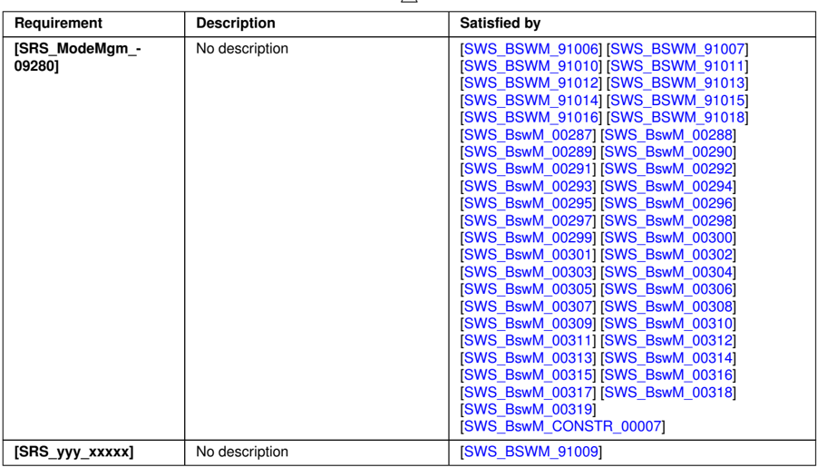
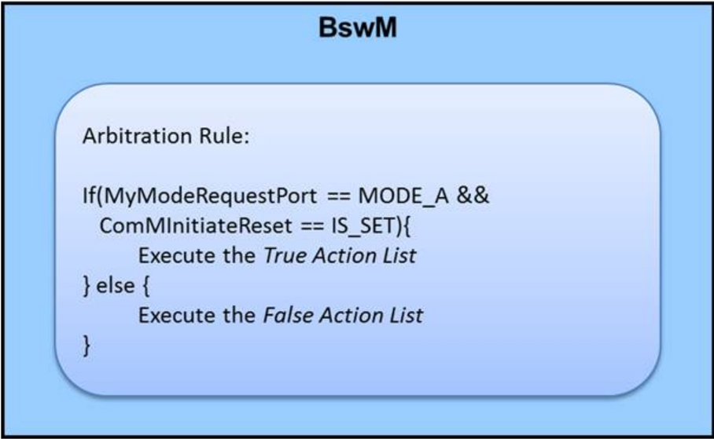
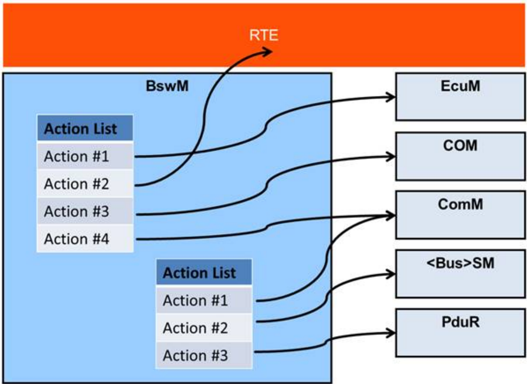
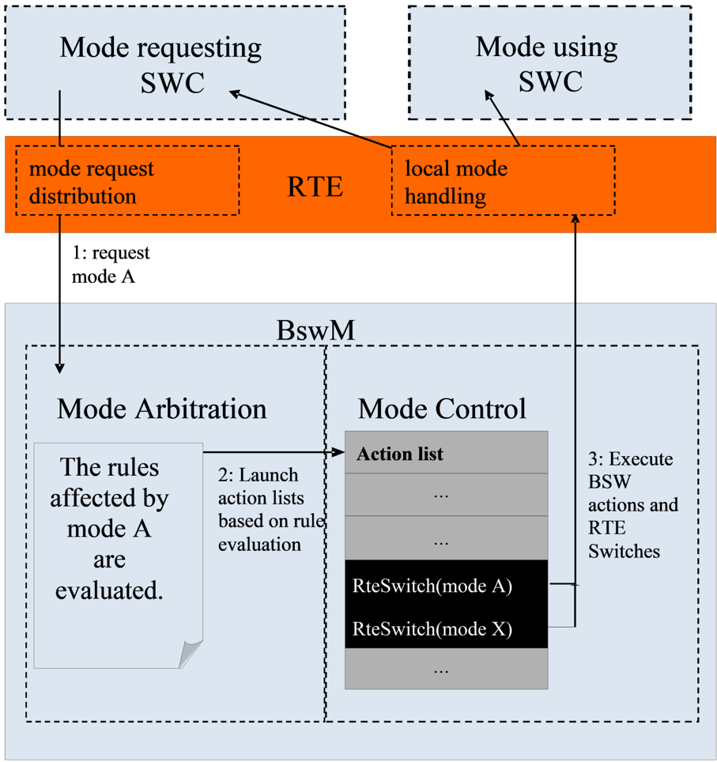
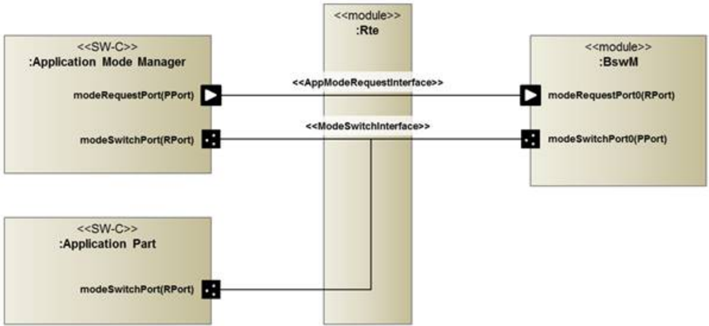
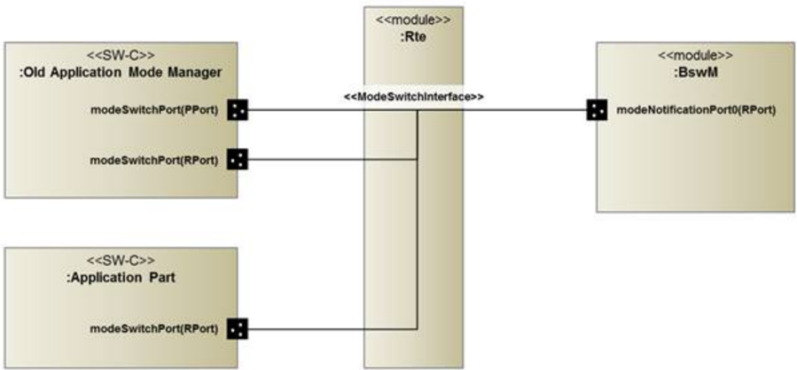
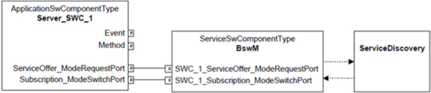
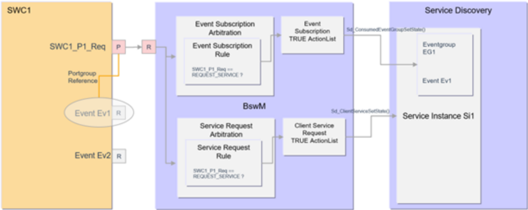
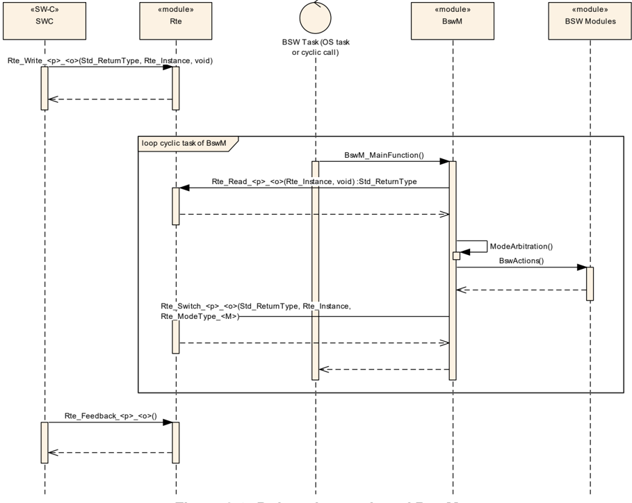
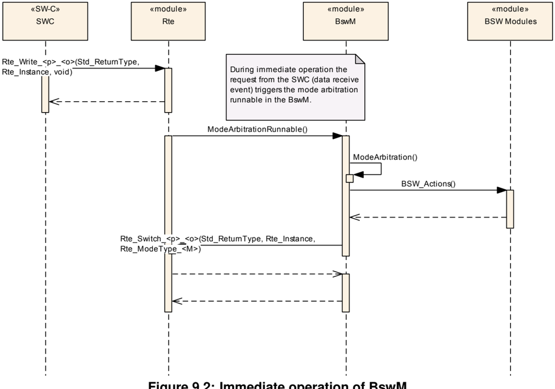

| Document Title             | Specification of Basic Software Mode Manager   |
|----------------------------|------------------------------------------------|
| Document Owner             | AUTOSAR                                        |
| Document Responsibility    | AUTOSAR                                        |
| Document Identification No | 313                                            |

| Document Status          | published        |
|--------------------------|------------------|
| Part of AUTOSAR Standard | Classic Platform |
| Part of Standard Release | R23-11           |

| Document Change History   | Document Change History   | Document Change History    | Document Change History                                                                                                                                     |
|---------------------------|---------------------------|----------------------------|-------------------------------------------------------------------------------------------------------------------------------------------------------------|
| Date                      | Release                   | Changed by                 | Description                                                                                                                                                 |
| 2023-11-23                | R23-11                    | AUTOSAR Release Management | • Added BswM support for Service Discovery Control for Application Software • Added new action to set firewall state • Editorial Changes                    |
| 2022-11-24                | R22-11                    | AUTOSAR Release Management | • Removal of obsolete event request BswMWdgMRequestPartitionReset • Editorial Changes                                                                       |
| 2021-11-25                | R21-11                    | AUTOSAR Release Management | • Adding new mode request for SoAd (BswM_SoAd_SoConModeChg) • Setting BswM_WdgM_RequestPartitionReset and its configuration to obsolete • Editorial Changes |

glyph[triangleinv]


## glyph[triangle]

| 2020-11-30   | R20-11   | AUTOSAR Release Management   | • Added new notifications BswMNmStateChangeNotification and BswMSwitchAckNotification; Added new action BswMEthIfStartAllPorts • Added support for Ethernet switch port group switching • Removed support for pretended networking • Reinstated the EcuM<->BswM APIs: BswM_EcuM_CurrentState and BswM_EcuM_RequestedState   |
|--------------|----------|------------------------------|-----------------------------------------------------------------------------------------------------------------------------------------------------------------------------------------------------------------------------------------------------------------------------------------------------------------------------|
| 2019-11-28   | R19-11   | AUTOSAR Release Management   | • Introduced action list priority parameter • Added configuration options for enabling/disabling SdServiceGroups • Removal of obsolete APIs: BswM_EcuM_CurrentState and BswM_EcuM_RequestedState • Editorial Changes • Changed Document Status from Final to published                                                      |
| 2018-10-31   | 4.4.0    | AUTOSAR Release Management   | • Reworked handling of EcuM API for shutdown (e.g. BswMEcuMGoDownHaltPoll) • Removed dependency to EcuM-fixed • Changes to BswM_NvM_CurrentJobMode, BswM_ModeType, BswM_UserType and Det error codes                                                                                                                        |
| 2017-12-08   | 4.3.1    | AUTOSAR Release Management   | • Rework of BswM-Com interaction for Pdu group switching and deadline monitoring control. BswM-internal group vectors no longer used • BswMNmIfCarWakeUpIndication reclassified as event request port • Added new dedicated actions for Rte Start/Stop                                                                      |


glyph[triangle]

| 2016-11-30   | 4.3.0   | AUTOSAR Release Management   | • Added some actions/indications to allow for more BswM interaction with following BSW Modules: EthIf, EcuM • Waiting functionality added using the BswMTimer mode request source • Some mode requests are now modeled using BswMEventRequestPort, instead of BswMModeRequestPort • Editorial changes, increased requirement traceability and minor changes to configuration containers/parameters   |
|--------------|---------|------------------------------|------------------------------------------------------------------------------------------------------------------------------------------------------------------------------------------------------------------------------------------------------------------------------------------------------------------------------------------------------------------------------------------------------|
| 2015-07-31   | 4.2.2   | AUTOSAR Release Management   | • Improved specification of service interfaces • Additional functional requirements for BswMPduGroupSwitch action • Added BswMNmIfCarWakeUpIndication as a new BswMModeRequestSource • Deprecated some spec. elements (marked with "obsolete"), editorial changes, increased requirement traceability and minor changes to configuration containers/parameters                                       |
| 2014-10-31   | 4.2.1   | AUTOSAR Release Management   | • New API and configuration containers to support EcuM Fixed for Multi Core • Addition of new container for defining mode values: BswMCompuScaleModeValue • New Action BswMFrSMAllSlots for invoking FrSM_AllSlots • New requirements for: Action list execution (SWS_BswM_00223) and Deadline Monitoring (SWS_BswM_00224,00225)                                                                     |

glyph[triangleinv]


## glyph[triangle]

| 2014-03-31   | 4.1.3   | AUTOSAR Release Management   | • Removal of several unnecessary parameter range checks in APIs • J1939 fix: added missing action, missing included header files • Corrections in Figures 1, 2, 3, 5 and 6 • Editorial changes                                                                                                                                                                                                                |
|--------------|---------|------------------------------|---------------------------------------------------------------------------------------------------------------------------------------------------------------------------------------------------------------------------------------------------------------------------------------------------------------------------------------------------------------------------------------------------------------|
| 2013-10-31   | 4.1.2   | AUTOSAR Release Management   | • Removal of several requirements from Pretended Networking chapter • Addition of new configuration parameters to several Sd related Bswm Actions • Addition of new BswM Mode Request: BswMCanSMIcomIndication • Addition of new BswM Action: BswMRteModeRequest                                                                                                                                              |
| 2013-03-15   | 4.1.1   | AUTOSAR Administration       | • Editorial changes • Extended to support Pretended Networking mode handling • Extended to support Heavy Duty Vehicles and J1939                                                                                                                                                                                                                                                                              |
| 2011-12-22   | 4.0.3   | AUTOSAR Administration       | • Support of Mode Machine Instances assigned to the SchM • Include of user defined header files • Possibility to provide an initial value for a BswMModeRequestPort                                                                                                                                                                                                                                           |
| 2009-12-18   | 4.0.1   | AUTOSAR Administration       | • Include file BswMUserCallout.h added. This user defined header file contains declarations of the call out functions. • Requirement that the BswM module shall perform inter module version checks added • Information added for each configurable action which API to call • Functions BswM_TriggerSlaveRTEStop and BswM_TriggerStartUpPhase2 added to control the start and stop of the RTE on slave cores |

glyph[triangleinv]


glyph[triangle]

| 2010-02-02   | 3.1.4   | AUTOSAR Administration   | • Initial release   |
|--------------|---------|--------------------------|---------------------|


## Disclaimer

This work (specification and/or software implementation) and the material contained in it, as released by AUTOSAR, is for the purpose of information only. AUTOSAR and the companies that have contributed to it shall not be liable for any use of the work.

The material contained in this work is protected by copyright and other types of intellectual property rights. The commercial exploitation of the material contained in this work requires a license to such intellectual property rights.

This work may be utilized or reproduced without any modification, in any form or by any means, for informational purposes only. For any other purpose, no part of the work may be utilized or reproduced, in any form or by any means, without permission in writing from the publisher.

The work has been developed for automotive applications only. It has neither been developed, nor tested for non-automotive applications.

The word AUTOSAR and the AUTOSAR logo are registered trademarks.


## Contents

| 1   |
|-----|


8

|     | 7.2.3                                                                    | Triggered and Conditional action lists . . . . . . . . . . . . .                                                                          |
|-----|--------------------------------------------------------------------------|-------------------------------------------------------------------------------------------------------------------------------------------|
|     | 7.2.4                                                                    | Available Actions . . . . . . . . . . . . . . . . . . . . . . . . .                                                                       |
| 7.3 | 7.2.5 Behavior of Mode Control Waiting Functionality . . . . . .         | after Initialization . . . . . . . . . . . . . . . . . . . . . . . . . . . . . . . .                                                      |
| 7.4 | Multi Partition Support . . . . . . . . . . . . . . .                    | . . . . . . . . . . . .                                                                                                                   |
| 7.5 | Error classification . . . . . . . . . . . . . . . . . .                 | . . . . . . . . . . .                                                                                                                     |
|     | 7.5.1                                                                    | Development Errors . . . . . . . . . . . . . . . . . . . . . . .                                                                          |
|     | 7.5.2                                                                    | Runtime Errors . . . . . . . . . . . . . . . . . . . . . . . . . .                                                                        |
|     | 7.5.3                                                                    | Transient Faults . . . . . . . . . . . . . . . . . . . . . . . . .                                                                        |
|     | 7.5.4                                                                    | Production Errors . . . . . . . . . . . . . . . . . . . . . . . .                                                                         |
|     | 7.5.5                                                                    | Extended Production Errors . . . . . . . . . . . . . . . . . . .                                                                          |
| 7.6 | BswM Interfaces and Ports . . . . . . . . . . .                          | . . . . . . . . . . . . . .                                                                                                               |
|     | 7.6.1                                                                    | Mode Request Ports . . . . . . . . . . . . . . . . . . . . . . .                                                                          |
|     | 7.6.2                                                                    | Mode Switch Ports . . . . . . . . . . . . . . . . . . . . . . . .                                                                         |
|     | 7.6.3                                                                    | Notifications of Mode Switches . . . . . . . . . . . . . . . . .                                                                          |
|     | 7.6.4                                                                    | Component Type and Internal Behavior . . . . . . . . . . . .                                                                              |
| 7.7 | Ethernet switch port group switching . . . . . . . . . .                 | . . . . . . . . .                                                                                                                         |
| 7.8 | Service 7.8.1                                                            | Discovery Control . . . . . . . . . . . . . . . . . . . . . . . . . General . . . . . . . . . . . . . . . . . . . . . . . . . . . . . .   |
|     | 7.8.2                                                                    | Client Service/Event Subscription Request . . . . . . . . . .                                                                             |
|     | 7.8.3                                                                    | Client Service/Event Subscription state notification . . . . . .                                                                          |
|     |                                                                          | Server Service Offer Request . . . . . . . . . . . . . . . . .                                                                            |
|     | 7.8.4                                                                    |                                                                                                                                           |
|     | 7.8.6                                                                    | Connecting ports at configuration time . . . . . . . . . . . . .                                                                          |
| API | specification                                                            | specification                                                                                                                             |
| 8.1 | Imported types . . . . . . . . . . . . . . . . . . . . . . . . . . . . . | Imported types . . . . . . . . . . . . . . . . . . . . . . . . . . . . .                                                                  |
| 8.2 | Type 8.2.1                                                               | definitions . . . . . . . . . . . . . . . . . . . . . . . . . . . . . . . BswM_ConfigType . . . . . . . . . . . . . . . . . . . . . . . . |
|     | 8.2.2                                                                    | BswM_ModeType . . . . . . . . . . . . . . . . . . . . . . . .                                                                             |
|     | 8.2.3                                                                    | BswM_UserType . . . . . . . . . . . . . . . . . . . . . . . . .                                                                           |
| 8.3 | Function definitions . . . . . . . . . . . . . . . . . . .               | . . . . . . . . . .                                                                                                                       |
|     | 8.3.1                                                                    | BswM_BswMPartitionRestarted . . . . . . . . . . . . . . . .                                                                               |
|     | 8.3.2                                                                    | BswM_CanSM_CurrentState . . . . . . . . . . . . . . . . . .                                                                               |
|     | 8.3.3                                                                    | BswM_ComM_CurrentMode . . . . . . . . . . . . . . . . . .                                                                                 |
|     |                                                                          | BswM_ComM_CurrentPNCMode . . . . . . . . . . . . . . .                                                                                    |
|     | 8.3.4                                                                    | .                                                                                                                                         |
|     | 8.3.5                                                                    | BswM_ComM_InitiateReset . . . . . . . . . . . . . . . . .                                                                                 |
|     | 8.3.6                                                                    | BswM_Dcm_ApplicationUpdated . . . . . . . . . . . . . . . .                                                                               |
|     | 8.3.7                                                                    | BswM_Dcm_CommunicationMode_CurrentState . . . . . . .                                                                                     |
|     | 8.3.8                                                                    | BswM_Deinit . . . . . . . . . . . . . . . . . . . . . . . . . . .                                                                         |
|     | 8.3.9                                                                    | BswM_EcuM_CurrentState . . . . . . . . . . . . . . . . . . .                                                                              |
|     | 8.3.10                                                                   | BswM_EcuM_CurrentWakeup . . . . . . . . . . . . . . . . .                                                                                 |
|     | 8.3.11                                                                   | BswM_EcuM_RequestedState . . . . . . . . . . . . . . . . .                                                                                |
|     | 8.3.12                                                                   | BswM_EthIf_PortGroupLinkStateChg . . . . . . . . . . . . .                                                                                |
|     |                                                                          | BswM_FrSM_CurrentState . . . . . . . . . . . . . . . . . . .                                                                              |
|     | 8.3.14                                                                   |                                                                                                                                           |


|         | 8.3.15 . .                                                                                                    | BswM_GetVersionInfo . . . . . . . . . . . . . . . . . . . . 65                                                      |
|---------|---------------------------------------------------------------------------------------------------------------|---------------------------------------------------------------------------------------------------------------------|
| 8.3.16  | BswM_Init . . . . . . . . .                                                                                   | . . . . . . . . . . . . . . . . . . . 66                                                                            |
| 8.3.17  | BswM_J1939DcmBroadcastStatus                                                                                  | . . . . . . . . . . . . . . . 67                                                                                    |
| 8.3.18  | BswM_J1939Nm_StateChangeNotification                                                                          | . . . . . . . . . . 67                                                                                              |
| 8.3.19  | BswM_LinSM_CurrentSchedule                                                                                    | . . . . . . . . . . . . . . . . 68                                                                                  |
| 8.3.20  | BswM_LinSM_CurrentState                                                                                       | . . . . . . . . . . . . . . . . 69                                                                                  |
| 8.3.21  | BswM_LinTp_RequestMode                                                                                        | . . . . . . . . . . . . . . . . . . . . 69                                                                          |
| 8.3.22  | BswM_Nm_CarWakeUpIndication                                                                                   | . . . . . . . . . . . . . . . 70                                                                                    |
| 8.3.23  | BswM_Nm_StateChangeNotification                                                                               | . . . . . . . . . . . . . . 71                                                                                      |
| 8.3.24  | BswM_NvM_CurrentBlockMode                                                                                     | . . . . . . . . . . . . . . . . 71                                                                                  |
| 8.3.25  | BswM_NvM_CurrentJobMode                                                                                       | . . . . . . . . . . . . . . . . . 72                                                                                |
| 8.3.26  | BswM_RequestMode . . .                                                                                        | . . 73                                                                                                              |
| 8.3.27  | BswM_Sd_ClientServiceCurrentState                                                                             | . . . . . . . . . . . . . . . . . . . . . . . . . . . . . . 73                                                      |
| 8.3.28  | BswM_Sd_ConsumedEventGroupCurrentState                                                                        | . . 74                                                                                                              |
| 8.3.29  | BswM_Sd_EventHandlerCurrentState                                                                              | . . . . . . . 75                                                                                                    |
|         | 8.3.30 BswM_SoAd_SoConModeChg                                                                                 | . . . . . . . . . . . . . . . . . . . . . . . . . . . . . 76                                                        |
| 8.4     | Call-back notifications . . . . . . . .                                                                       | . . . . . . . . . . . . . . . . . . . 76                                                                            |
| 8.5     | Scheduled functions . . . . . . . . . .                                                                       | . . . . . . . . . . . . . . . . . . 76                                                                              |
| 8.5.1   | BswM_MainFunction . . .                                                                                       | . . . . . . . . . . . . . . . . . . . 76                                                                            |
| 8.6     | Expected Interfaces . . . . . . . . .                                                                         | . . . . . . . . . . . . . . . . . . . 77 . . . . . . . . . . . . . . . . . . 77                                     |
| 8.6.1   | Mandatory Interfaces . . . . 8.6.2 Optional Interfaces . . . . . .                                            | . . . . . . . . . . . . . . . . . .                                                                                 |
| 8.7     | Interfaces . . . . . . . . . . .                                                                              | 77 . . . . . . . . . . . . . . . . . . . 80                                                                         |
| Service | 8.7.1 Scope of this Chapter . . . 8.7.2 .                                                                     | . . . . . . . . . . . . . . . . . . . 80 80                                                                         |
|         | Ports . . . . . . . . . . .                                                                                   | . . . . . . . . . . . . . . . . . . .                                                                               |
|         | 8.7.2.1 BswM_modeNotificationPort                                                                             | . . . . . . . . . . . . . . 80                                                                                      |
|         | 8.7.2.2                                                                                                       | BswM_modeRequestPort . . . . . . . . . . . . . . . 81                                                               |
|         | 8.7.2.3 BswM_modeSwitchPort                                                                                   | . . . . . . . . . . . . . . . . 81                                                                                  |
|         | 8.7.2.4 S/R Port                                                                                              | BswM_ClientServiceRequest . . . . . . . . 81                                                                        |
|         | 8.7.2.5                                                                                                       | S/R Port BswM_ServerServiceRequest . . . . . . . 82                                                                 |
|         | 8.7.2.6 Mode                                                                                                  | Switch Port BswM_ClientServiceSubscriptionState 82                                                                  |
| 8.7.3   | Mode Declaration                                                                                              | Groups . . . . . . . . . . . . . . . . . . . . 83                                                                   |
|         | 8.7.3.1 ModeDeclarationGroup MDG_ClientServiceSubscriptionState                                               | . . . . . . . . 83                                                                                                  |
|         | 8.7.3.2                                                                                                       | ModeDeclarationGroup MDG_ServerServiceSubscriptionState . . . . . . . . 83                                          |
|         | 8.7.4 ModeSwitchInterfaces . . . . . . . . . . . . 8.7.4.1 ModeSwitchInterface ClientServiceSubscriptionState | . . . . . . . . . . 83 83                                                                                           |
|         |                                                                                                               | 84                                                                                                                  |
|         | 8.7.4.2 ModeSwitchInterface 8.7.5 S/R Interfaces . . . . . . . . . . . .                                      | ServerServiceSubscriptionState . . . . . . . . . . . . . . 84                                                       |
|         | 8.7.5.1 S/R                                                                                                   | interface ClientServiceRequest . . . . . . . . . . 84 85                                                            |
| 8.7.6   | 8.7.5.2 ENUMs                                                                                                 | S/R interface ServerServiceRequest . . . . . . . . . . . . . . . . . . . . . . . . . . . . . . . . . . . . . . . 85 |
|         | 8.7.6.1                                                                                                       | BswM_ClientModeRequestEnum . . . . . . . 85                                                                         |
|         |                                                                                                               | . BswM_OfferModeEnum . . 85                                                                                         |
|         | 8.7.6.2                                                                                                       | . . . . . . . . . . . . . . . . .                                                                                   |


| 8.8                            | API                                                                           | to Request Port Mappings . . . . . . . . . . . . . . . . . . . . . . . 86                                        |
|--------------------------------|-------------------------------------------------------------------------------|------------------------------------------------------------------------------------------------------------------|
| Sequence diagrams 88           | Sequence diagrams 88                                                          | Sequence diagrams 88                                                                                             |
| 9.1                            | Deferred operation of BswM . . . . . . . . . . . . . . . . . . . . . . . . 88 | Deferred operation of BswM . . . . . . . . . . . . . . . . . . . . . . . . 88                                    |
| 9.2                            | Immediate operation of BswM . . . . . . . . . . . . . . . . . . . . . . .     | 89                                                                                                               |
| 10 Configuration specification | 10 Configuration specification                                                | 10 Configuration specification                                                                                   |
| 10.1                           | How to read this chapter . . . . . . . . . . . . . . . . .                    | . . . . . . . 90                                                                                                 |
| 10.2 Containers                | . . and                                                                       | . . . . 90                                                                                                       |
| 10.2.1                         | BswM . . . . . . .                                                            | configuration parameters . . . . . . . . . . . . . . . . . . . . . . . . . . . . . . . . . . .                   |
| 10.2.2                         | BswMConfig                                                                    | . . 90 . . . . . 91                                                                                              |
| 10.2.3                         | BswMArbitration                                                               | . . . . . . . . . . . . . . . . . . . . . . . . . . . . . . . . . . . . . . . . . . . . . . . 92                 |
| 10.2.4                         | BswMLogicalExpression                                                         | . . 92                                                                                                           |
| 10.2.5                         | BswMModeCondition                                                             | . . . . . . . . . . . . . . . . . . . . . . . . . . . . . . . . . . . . 94                                       |
| 10.2.6                         | BswMConditionValue                                                            | . . . . . . . . . . . . . . . . . . . . . . 96                                                                   |
| 10.2.7                         | BswMBswMode .                                                                 | . . . . . . . . . . . . . . . . . . . . . . . . . . .                                                            |
| 10.2.8                         | BswMModeDeclaration                                                           | . 96 . . . . . . . . . . . . . . . . . . . . . 97                                                                |
| 10.2.9                         | BswMEventRequestPort                                                          | . . . . . . . . . . . . . . . . . 97                                                                             |
| 10.2.10                        | BswMModeRequestPort                                                           | . . . . . . . . . . . . . . . . . . . . . . . . 98                                                               |
| 10.2.11                        |                                                                               | BswMModeInitValue . . . .                                                                                        |
| 10.2.12                        | BswMCompuScaleModeValue                                                       | . . . . . . . . . . . . . . . . . . . 99 . . . . . . . . . . . . . . . . . 100                                   |
| 10.2.13                        |                                                                               | BswMEventRequestSource . . . . . . . . . . . . . . . . . . . 101                                                 |
| 10.2.14                        | BswMModeRequestSource                                                         | . . . . . . . . . 102                                                                                            |
| 10.2.15                        | BswMBswModeNotification                                                       | . . . . . . . . . . . . . . . . . . . . . . . . . . . . . 103                                                    |
| 10.2.16                        |                                                                               | BswMCanSMIndication . . . . . . . . . . . . .                                                                    |
| 10.2.17                        | BswMComMIndication .                                                          | . . . . . . . . 104 . . . . . . . . . . . . . . . . . . . . . 104                                                |
| 10.2.18                        |                                                                               | BswMComMInitiateReset . . . . . . . . . . . .                                                                    |
| 10.2.19                        | BswMComMPncRequest                                                            | . . . . . . . . 105 . . . . . . . . . . . . . . . . . . . . 105                                                  |
| 10.2.20                        | BswMDcmApplicationUpdatedIndication                                           | . . . . . . . . . . . . 105                                                                                      |
| 10.2.21                        |                                                                               | BswMDcmComModeRequest . . . . . . . . . . .                                                                      |
| 10.2.22                        | BswMEcuMIndication                                                            | . . . . . . . 106 . . . . . . . . . . . . . . . . . . . . . . 106                                                |
| 10.2.23                        | BswMEcuMRUNRequestIndication                                                  | . . . . . . . . . . . . . . . 107                                                                                |
| 10.2.24                        | BswMEcuMWakeupSource . .                                                      | . . . . . . . . . . . . . . . .                                                                                  |
| 10.2.25                        | BswMEthIfPortGroupLinkStateChg                                                | . 107 . . . . . . . . . . . . 108                                                                                |
| 10.2.26                        |                                                                               | . . . BswMEthSMIndication . . . . . . . . . . . . . . . . . . . . . 108                                          |
| 10.2.27                        | BswMFrSMIndication                                                            | . . . . . . . . . . . . . . . . . . . 109                                                                        |
| 10.2.28                        | BswMGenericRequest                                                            | . . . . . . . . . . . . . . . . . . . . . . . . .                                                                |
| 10.2.29                        |                                                                               | 109 BswMJ1939DcmBroadcastStatus . . . . . . . . . . . . . . . 110                                                |
| 10.2.30                        | BswMJ1939NmIndication . .                                                     | . . . . . . . . . . . . . . . . . . 111                                                                          |
| 10.2.31                        |                                                                               | BswMLinSMIndication . . . . . . . . . . . . . . . . . . . . . . 111                                              |
| 10.2.32 10.2.33                | BswMLinScheduleIndication                                                     | . . . . . . . . . . . . . . . . . . 112 BswMLinTpModeRequest . . . . . . . . . . . . . . . . . . . . 113 . . 113 |
| 10.2.34                        | BswMModeSwitchErrorEvent                                                      | . . . . . . . . . . . . . . . .                                                                                  |
| 10.2.35                        | BswMNmCarWakeUpIndication                                                     | . . . . . . . . . . . . . . . . 114                                                                              |
| 10.2.36                        | BswMNmStateChangeNotification                                                 | . . . . . . . . . . . . . . . 115                                                                                |
| 10.2.37                        | BswMNvMJobModeIndication .                                                    | . . . . . . . . . . . . . . . . 115 . . . . . . . . . . . . . . . . . . . . . . . 116                            |
| 10.2.38                        |                                                                               | BswMNvMRequest                                                                                                   |


| 10.2.39   | BswMPartitionRestarted . . . . . . . . . . . . . . . . . . . . . 116         |
|-----------|------------------------------------------------------------------------------|
| 10.2.40   | BswMSdClientServiceCurrentState . . . . . . . . . . . . . . 117              |
| 10.2.41   | BswMSdConsumedEventGroupCurrentState . . . . . . . . . 117                   |
| 10.2.42   | BswMSdEventHandlerCurrentState . . . . . . . . . . . . . . 118               |
| 10.2.43   | BswMSoAdSoConModeChg . . . . . . . . . . . . . . . . . . 119                 |
| 10.2.44   | BswMSwcModeNotification . . . . . . . . . . . . . . . . . . . 119            |
| 10.2.45   | BswMSwcModeRequest . . . . . . . . . . . . . . . . . . . . 120               |
| 10.2.46   | BswMSwitchAckNotification . . . . . . . . . . . . . . . . . . . 120          |
| 10.2.47   | BswMTimer . . . . . . . . . . . . . . . . . . . . . . . . . . . . 121        |
| 10.2.48   | BswMRule . . . . . . . . . . . . . . . . . . . . . . . . . . . . 121         |
| 10.2.49   | BswMDataTypeMappingSets . . . . . . . . . . . . . . . . . . 124              |
| 10.2.50   | BswMModeControl . . . . . . . . . . . . . . . . . . . . . . . 124            |
| 10.2.51   | BswMAction . . . . . . . . . . . . . . . . . . . . . . . . . . . 125         |
| 10.2.52   | BswMAvailableActions . . . . . . . . . . . . . . . . . . . . . . 125         |
| 10.2.53   | BswMClearEventRequest . . . . . . . . . . . . . . . . . . . . 128            |
| 10.2.54   | BswMComMAllowCom . . . . . . . . . . . . . . . . . . . . . 128               |
| 10.2.55   | BswMComMModeLimitation . . . . . . . . . . . . . . . . . . 129               |
| 10.2.56   | BswMComMModeSwitch . . . . . . . . . . . . . . . . . . . . 130               |
| 10.2.57   | BswMCoreHaltMode . . . . . . . . . . . . . . . . . . . . . . . 131           |
| 10.2.58   | BswMDeadlineMonitoringControl . . . . . . . . . . . . . . . . 132            |
| 10.2.59   | BswMEcuMDriverInitListBswM . . . . . . . . . . . . . . . . . 133             |
| 10.2.60   | BswMEcuMGoDownHaltPoll . . . . . . . . . . . . . . . . . . 134               |
| 10.2.61   | BswMEcuMSelectShutdownTarget . . . . . . . . . . . . . . . 135               |
| 10.2.62   | BswMEcuMStateSwitch . . . . . . . . . . . . . . . . . . . . . 136            |
| 10.2.63   | BswMEthIfStartAllPorts . . . . . . . . . . . . . . . . . . . . . 137         |
| 10.2.64   | BswMEthIfSwitchPortGroupRequestMode . . . . . . . . . . . 137                |
| 10.2.65   | BswMFrSMAllSlots . . . . . . . . . . . . . . . . . . . . . . . 138           |
| 10.2.66   | BswMJ1939DcmStateSwitch . . . . . . . . . . . . . . . . . . 139              |
| 10.2.67   | BswMJ1939RmStateSwitch . . . . . . . . . . . . . . . . . . . 140             |
| 10.2.68   | BswMLinScheduleSwitch . . . . . . . . . . . . . . . . . . . . 141            |
| 10.2.69   | BswMNMControl . . . . . . . . . . . . . . . . . . . . . . . . . 142          |
| 10.2.70   | BswMPduGroupSwitch . . . . . . . . . . . . . . . . . . . . . 143             |
| 10.2.71   | BswMPduRouterControl . . . . . . . . . . . . . . . . . . . . . 144           |
| 10.2.72   | BswMRteModeRequest . . . . . . . . . . . . . . . . . . . . . 146             |
| 10.2.73   | BswMRteStart . . . . . . . . . . . . . . . . . . . . . . . . . . 147         |
| 10.2.74   | BswMRteStop . . . . . . . . . . . . . . . . . . . . . . . . . . 147          |
| 10.2.75   | BswMRteSwitch . . . . . . . . . . . . . . . . . . . . . . . . . 147          |
| 10.2.76   | BswMSchMSwitch . . . . . . . . . . . . . . . . . . . . . . . . 148           |
| 10.2.77   | BswMSdClientServiceModeRequest . . . . . . . . . . . . . . 149               |
|           | .                                                                            |
| 10.2.78   | BswMSdConsumedEventGroupModeRequest . . . . . . . 150                        |
| 10.2.80   | BswMSdServiceGroupSwitch . . . . . . . . . . . . . . 152                     |
| 10.2.81   | . . . . BswMSetFirewallState . . . . . . . . . . . . . . . . . . . . . . 153 |
| 10.2.82   | BswMSwitchIPduMode . . . . . . . . . . . . . . . . . . . . . 154             |
| 10.2.83   | BswMTimerControl . . . . . . . . . . . . . . . . . . . . . . . 154           |
|           | . . . . . . . . . . . . . . . . . . 156                                      |
| 10.2.84   | BswMTriggerIPduSend . . .                                                    |


|    | 10.2.85 BswMUserCallout . . . . . . . . . . . . . . . . . . . . . . . . 156                                                                       |
|----|---------------------------------------------------------------------------------------------------------------------------------------------------|
|    | 10.2.86 BswMActionList . . . . . . . . . . . . . . . . . . . . . . . . . 157                                                                      |
|    | 10.2.87 BswMActionListItem . . . . . . . . . . . . . . . . . . . . . . . 158                                                                      |
|    | 10.2.88 BswMRteModeRequestPort . . . . . . . . . . . . . . . . . . . 160                                                                          |
|    | 10.2.89 BswMSwitchPort . . . . . . . . . . . . . . . . . . . . . . . . . 161                                                                      |
|    | 10.2.90 BswMGeneral . . . . . . . . . . . . . . . . . . . . . . . . . . 162                                                                       |
|    | 10.2.91 BswMUserIncludeFiles . . . . . . . . . . . . . . . . . . . . . 168                                                                        |
|    | Published Information . . . . . . . . . . . . . . . . . . . . . . . . . . . 168                                                                   |
| A  | applicable requirements 169                                                                                                                       |
| B  | history of AUTOSAR traceable items 170                                                                                                            |
|    | Traceable item history of this document according to AUTOSAR Re- lease R23-11 . . . . . . . . . . . . . . . . . . . . . . . . . . . . . . . . 170 |
|    | Added Specification Items in R23-11 . . . . . . . . . . . . . . 170                                                                               |
|    | Changed Specification Items in R23-11 . . . . . . . . . . . . 171                                                                                 |
|    | Deleted Specification Items in R23-11 . . . . . . . . . . . . . 171                                                                               |
|    | Added Constraints in R23-11 . . . . . . . . . . . . . . . . . . 172                                                                               |
|    | Changed Constraints in R23-11 . . . . . . . . . . . . . . . . 172                                                                                 |
|    | Deleted Constraints in R23-11 . . . . . . . . . . . . . . . . . 172                                                                               |


## 1 Introduction and functional overview

This specification specifies the functionality, API and the configuration of the AUTOSAR Basic Software module BSW Mode Manager (BswM).

The BSW Mode Manager is the module that implements the part of the Vehicle Mode Management and Application Mode Management concept that resides in the BSW. Its responsibility is to arbitrate mode requests from application layer SW-Cs or other BSW modules based on simple rules, and perform actions based on the arbitration result.


## 2 Acronyms and abbreviations

Table 2.1: Table of acronyms and abbreviations

| Abbreviation / Acronym   | Description                       |
|--------------------------|-----------------------------------|
| BSW                      | Basic Software                    |
| BswM                     | BSW Mode Manager                  |
| BSWMD                    | Basic Software Module Description |
| CDD                      | Complex Driver                    |
| Dem                      | Diagnostic Event Manager          |
| Det                      | Default Error Tracer              |
| ECU                      | Electronic Control Unit           |
| RTE                      | Real Time Environment             |
| SWC / SW-C               | Software Component                |
| SWCD                     | Software Component Description    |


## 3 Related documentation

## 3.1 Input documents &amp; related standards and norms

- [1] General Specification of Basic Software Modules AUTOSAR\_CP\_SWS\_BSWGeneral
- [2] Guide to Mode Management AUTOSAR\_CP\_EXP\_ModeManagementGuide
- [3] General Requirements on Basic Software Modules AUTOSAR\_CP\_SRS\_BSWGeneral
- [4] Requirements on Mode Management AUTOSAR\_CP\_SRS\_ModeManagement
- [5] Specification of RTE Software AUTOSAR\_CP\_SWS\_RTE
- [6] Software Component Template AUTOSAR\_CP\_TPS\_SoftwareComponentTemplate

## 3.2 Related specification

AUTOSAR provides a General Specification on Basic Software modules (see [1]), which is also valid for BSW Mode Manager.

Thus, the specification [1] shall be considered as additional and required specification for BSW Mode Manager.

Information regarding the configuration and usage of the BSW Mode Manager is found in the auxillary document: Guide to Mode Management [2]


## 4 Constraints and assumptions

## 4.1 Limitations

Maximum one instance of the BSW Mode Manager may be used within a partition.

## 4.2 Applicability to car domains

The BSW Mode Manager is applicable to all car domains.


## 5 Dependencies to other modules

The BSW Mode Manager has interfaces to many of the BSW Modules in the AUTOSAR architecture. The majority of these interfaces are however optional and are used based on the needs of each ECU.

The dependencies listed in this chapter are intended to give an overview of some possible interactions between the BswM and other modules. The interactions and modules listed herein should not be considered an exhaustive list of all possibilities.

## 5.1 RTE

The BswM receives mode requests from the SW-Cs via the RTE. Mode Switch Notifications are also propagated to the SW-Cs via the RTE.

## 5.2 EcuM - Flex

EcuM Flex can indicate the state of its wakeup sources to BswM. When ECU Mode Handling is used, BswM can set the state of EcuM - Flex and receives status of certain modes based on the RUN Request Protocol.

## 5.3 ComM

Mode Switch Indications originating from the ComM go through the BswM for further propagation to the SW-Cs.

The BswM can request communication modes at the ComM by means of ComMUsers.

## 5.4 COM

The handling of I-PDU Groups in COM is performed by the BswM. As a part of IPDU group start/stop, it is possible to have the included signal values reset to their corresponding initialization values.

BswM handles the enabling and disabling of deadline monitoring of signals in COM.

BswM can also trigger transmission of an I-PDU.

## 5.5 PduR

The BswM can enable and disable routing groups of I-PDUs in the PDU router.


## 5.6 CanSM

Mode Switch Indications originating from the CanSM go through the BswM for further propagation to the SW-Cs.

## 5.7 LinSM

BswM coordinates switching of LIN Schedule Tables in the LinSM with starting and stopping of the corresponding I-PDU groups in COM.

Mode Switch Indications originating from the LinSM go through the BswM for further propagation to the SW-Cs.

## 5.8 LinTp

The LIN Transport Protocol that is a part of LinIf requests modes from BswM to make sure that the correct LIN Schedule Table is active during LinTp operation.

## 5.9 FrSM

Mode Switch Indications originating from the FrSM go through the BswM for further propagation to the SW-Cs.

The usage of "Single Slot Mode" on FlexRay is controlled by the FrSM by request of BswM. The send capability of the FlexRay stack can be controlled by the BswM via FrSM by calling the API FrSM\_SetEcuPassive .

## 5.10 EthSM

Mode Switch Indications originating from the EthSM go through the BswM for further propagation to the SW-Cs.

## 5.11 DCM

The DCM performs mode requests to the BswM based on the diagnostic requests it receives.

Example: DCM can request "Disable Normal Communication". During this mode BswM will turn off the corresponding I-PDU groups and NM PDUs.


## 5.12 J1939Dcm

The J1939Dcm reports communication state changes to the BswM for further propagation to the SW-Cs. BswM changes states of J1939Dcm via J1939Dcm\_SetState .

## 5.13 J1939Nm

The J1939Nm provides a state indication via BswM\_J1939Nm\_StateChangeNoti-fication .

## 5.14 J1939Rm

BswM changes states of J1939Rm via J1939Rm\_SetState .

## 5.15 NM Interface

BswM will use the Nm\_EnableCommunication and Nm\_DisableCommunication to control the NM communication based on the current mode.

Example: In "Disable Normal Communication" mode, the BswM needs to disable NM communication on the corresponding NM channel.

The Nm uses BswM\_Nm\_CarWakeUpIndication to indicate a CarWakeup.

## 5.16 NvM

The NvM module reports the state of its blocks to the BswM via "integration code" registered as NvM callbacks. BswM has actions causing the NvM to read and write all blocks during startup and shutdown.

## 5.17 OS

The features of OS that are required by BswM, are implementation specific.

## 5.18 Sd

The BswM receives status indications from Sd via several exported APIs (see chapter 8.3 for examples). These status indications from Sd can be configured as BswMModeRequestSource s.


## 5.19 File structure

The BswM may use interfaces in AUTOSAR BSW modules that are not explicitly defined within this specification.


## 6 Requirements Tracing

The following tables reference the requirements specified in [3] and [4] and links to the fulfillment of these. Please note that if column "Satisfied by" is empty for a specific requirement this means that this requirement is not fulfilled by this document.

| Requirement     | Description                                                                                                         | Satisfied by                                                                                                                                                                                                                                                                                                                                                         |
|-----------------|---------------------------------------------------------------------------------------------------------------------|----------------------------------------------------------------------------------------------------------------------------------------------------------------------------------------------------------------------------------------------------------------------------------------------------------------------------------------------------------------------|
| [SRS_BSW_00003] | All software modules shall provide version and identification information                                           | [SWS_BswM_00003]                                                                                                                                                                                                                                                                                                                                                     |
| [SRS_BSW_00101] | The Basic Software Module shall be able to initialize variables and hardware in a separate initialization function  | [SWS_BswM_00002] [SWS_BswM_00043] [SWS_BswM_00044] [SWS_BswM_00261]                                                                                                                                                                                                                                                                                                  |
| [SRS_BSW_00167] | All AUTOSAR Basic Software Modules shall provide configuration rules and constraints to enable plausibility checks  | [SWS_BswM_00240] [SWS_BswM_00242] [SWS_BswM_00243] [SWS_BswM_00256] [SWS_BswM_CONSTR_00001] [SWS_BswM_CONSTR_00002]                                                                                                                                                                                                                                                  |
| [SRS_BSW_00301] | All AUTOSAR Basic Software Modules shall only import the necessary information                                      | [SWS_BswM_00001] [SWS_BswM_00237] [SWS_BswM_00279]                                                                                                                                                                                                                                                                                                                   |
| [SRS_BSW_00305] | Data types naming convention                                                                                        | [SWS_BswM_00041]                                                                                                                                                                                                                                                                                                                                                     |
| [SRS_BSW_00323] | All AUTOSAR Basic Software Modules shall check passed API parameters for validity                                   | [SWS_BswM_00045] [SWS_BswM_00089] [SWS_BswM_00090] [SWS_BswM_00091] [SWS_BswM_00093] [SWS_BswM_00095] [SWS_BswM_00097] [SWS_BswM_00099] [SWS_BswM_00101] [SWS_BswM_00103] [SWS_BswM_00110] [SWS_BswM_00113] [SWS_BswM_00133] [SWS_BswM_00150] [SWS_BswM_00154] [SWS_BswM_00206] [SWS_BswM_00209] [SWS_BswM_00212] [SWS_BswM_00228] [SWS_BswM_00229] [SWS_BswM_00268] |
| [SRS_BSW_00336] | Basic SW module shall be able to shutdown                                                                           | [SWS_BswM_00119] [SWS_BswM_00120]                                                                                                                                                                                                                                                                                                                                    |
| [SRS_BSW_00344] | BSW Modules shall support link-time configuration                                                                   | [SWS_BswM_00002]                                                                                                                                                                                                                                                                                                                                                     |
| [SRS_BSW_00358] | The return type of init() functions implemented by AUTOSAR Basic Software Modules shall be void                     | [SWS_BswM_00002]                                                                                                                                                                                                                                                                                                                                                     |
| [SRS_BSW_00384] | The Basic Software Module specifications shall specify at least in the description which other modules they require | [SWS_BswM_00007] [SWS_BswM_00008]                                                                                                                                                                                                                                                                                                                                    |
| [SRS_BSW_00385] | List possible error notifications                                                                                   | [SWS_BswM_00230]                                                                                                                                                                                                                                                                                                                                                     |
| [SRS_BSW_00404] | BSW Modules shall support post-build configuration                                                                  | [SWS_BswM_00002] [SWS_BswM_00042] [SWS_BswM_00213]                                                                                                                                                                                                                                                                                                                   |
| [SRS_BSW_00405] | BSW Modules shall support multiple configuration sets                                                               | [SWS_BswM_00002]                                                                                                                                                                                                                                                                                                                                                     |


glyph[triangle]

| Requirement           | Description                                                                                                                                    | Satisfied by                                                                                                                                                                                                                                                                                                                                                         |
|-----------------------|------------------------------------------------------------------------------------------------------------------------------------------------|----------------------------------------------------------------------------------------------------------------------------------------------------------------------------------------------------------------------------------------------------------------------------------------------------------------------------------------------------------------------|
| [SRS_BSW_00406]       | A static status variable denoting if a BSW module is initialized shall be initialized with value 0 before any APIs of the BSW module is called | [SWS_BswM_00077] [SWS_BswM_00078] [SWS_BswM_00079] [SWS_BswM_00080] [SWS_BswM_00081] [SWS_BswM_00082] [SWS_BswM_00083] [SWS_BswM_00084] [SWS_BswM_00086] [SWS_BswM_00109] [SWS_BswM_00112] [SWS_BswM_00132] [SWS_BswM_00149] [SWS_BswM_00153] [SWS_BswM_00159] [SWS_BswM_00205] [SWS_BswM_00208] [SWS_BswM_00211] [SWS_BswM_00227] [SWS_BswM_00266] [SWS_BswM_00267] |
| [SRS_BSW_00407]       | Each BSW module shall provide a function to read out the version information of a dedicated module implementation                              | [SWS_BswM_00003]                                                                                                                                                                                                                                                                                                                                                     |
| [SRS_BSW_00414]       | Init functions shall have a pointer to a configuration structure as single parameter                                                           | [SWS_BswM_00002]                                                                                                                                                                                                                                                                                                                                                     |
| [SRS_BSW_00425]       | The BSW module description template shall provide means to model the defined trigger conditions of schedulable objects                         | [SWS_BswM_00053]                                                                                                                                                                                                                                                                                                                                                     |
| [SRS_BSW_00441]       | Naming convention for type, macro and function                                                                                                 | [SWS_BswM_00213] [SWS_BswM_00214] [SWS_BswM_00216]                                                                                                                                                                                                                                                                                                                   |
| [SRS_BSW_00452]       | Classification of runtime errors                                                                                                               | [SWS_BswM_00238] [SWS_BswM_00239]                                                                                                                                                                                                                                                                                                                                    |
| [SRS_BSW_00467]       | The init / deinit services shall only be called by BswM or EcuM                                                                                | [SWS_BswM_00118]                                                                                                                                                                                                                                                                                                                                                     |
| [SRS_ModeMgm_- 09116] | Requesting and releasing the RUN state shall be provided                                                                                       | [SWS_BswM_91004]                                                                                                                                                                                                                                                                                                                                                     |
| [SRS_ModeMgm_- 09174] | The BSW Mode Manager shall support the 'disable normal Communication'                                                                          | [SWS_BswM_00038]                                                                                                                                                                                                                                                                                                                                                     |
| [SRS_ModeMgm_- 09175] | A configurable Set of Mode dependent enabled and concomitant disabled IPDU groups shall be supported                                           | [SWS_BswM_00038]                                                                                                                                                                                                                                                                                                                                                     |
| [SRS_ModeMgm_- 09177] | The rules of the mode arbitration shall be pre-compile and post-build configurable                                                             | [SWS_BswM_00010] [SWS_BswM_00012] [SWS_BswM_00015] [SWS_BswM_00016] [SWS_BswM_00062] [SWS_BswM_00067] [SWS_BswM_00223] [SWS_BswM_00252] [SWS_BswM_00253] [SWS_BswM_00256]                                                                                                                                                                                            |
| [SRS_ModeMgm_- 09178] | The lists of mode transition specific actions shall be pre-compile and post-build configurable                                                 | [SWS_BswM_00017] [SWS_BswM_00018] [SWS_BswM_00019] [SWS_BswM_00037] [SWS_BswM_00054] [SWS_BswM_00055] [SWS_BswM_00062] [SWS_BswM_00067] [SWS_BswM_00147] [SWS_BswM_00223] [SWS_BswM_00271] [SWS_BswM_00272] [SWS_BswM_CONSTR_00001]                                                                                                                                  |
| [SRS_ModeMgm_- 09179] | The BSW Mode Manager shall provide an Interface to allow Mode Requests of SW-C's                                                               | [SWS_BswM_00046] [SWS_BswM_00064] [SWS_BswM_00201] [SWS_BswM_00203] [SWS_BswM_00236]                                                                                                                                                                                                                                                                                 |

glyph[triangleinv]


## glyph[triangle]

| Requirement           | Description                                                                                                | Satisfied by                                                                                                                                                                                                                                                                                                                                                                                                                                                                                                                                                                                                                                                          |
|-----------------------|------------------------------------------------------------------------------------------------------------|-----------------------------------------------------------------------------------------------------------------------------------------------------------------------------------------------------------------------------------------------------------------------------------------------------------------------------------------------------------------------------------------------------------------------------------------------------------------------------------------------------------------------------------------------------------------------------------------------------------------------------------------------------------------------|
| [SRS_ModeMgm_- 09180] | The BSW Mode Manager shall evaluate the current mode requests                                              | [SWS_BswM_00009] [SWS_BswM_00011] [SWS_BswM_00013] [SWS_BswM_00014] [SWS_BswM_00023] [SWS_BswM_00035] [SWS_BswM_00059] [SWS_BswM_00060] [SWS_BswM_00061] [SWS_BswM_00064] [SWS_BswM_00066] [SWS_BswM_00068] [SWS_BswM_00069] [SWS_BswM_00075] [SWS_BswM_00115] [SWS_BswM_00116] [SWS_BswM_00117] [SWS_BswM_00189] [SWS_BswM_00200] [SWS_BswM_00203] [SWS_BswM_00220] [SWS_BswM_00241] [SWS_BswM_00244] [SWS_BswM_00245] [SWS_BswM_00246] [SWS_BswM_00247] [SWS_BswM_00248] [SWS_BswM_00252] [SWS_BswM_00253] [SWS_BswM_00254] [SWS_BswM_00255] [SWS_BswM_00257] [SWS_BswM_00258] [SWS_BswM_00262] [SWS_BswM_00263] [SWS_BswM_00264] [SWS_BswM_00265] [SWS_BswM_00269] |
| [SRS_ModeMgm_- 09182] | The BSW Mode Manager shall propagate a performed mode change to all local SW-Cs                            | [SWS_BswM_00038] [SWS_BswM_00202] [SWS_BswM_00259]                                                                                                                                                                                                                                                                                                                                                                                                                                                                                                                                                                                                                    |
| [SRS_ModeMgm_- 09183] | Configurable Mode Activation initiated Reset of Signals to Initial Values shall be supported               | [SWS_BswM_00251]                                                                                                                                                                                                                                                                                                                                                                                                                                                                                                                                                                                                                                                      |
| [SRS_ModeMgm_- 09184] | The mode manager shall be able to use a COM interface to activate, respectively deactivate, I-PDU groups   | [SWS_BswM_00038]                                                                                                                                                                                                                                                                                                                                                                                                                                                                                                                                                                                                                                                      |
| [SRS_ModeMgm_- 09228] | The BSW Mode Manager shall provide an Interface to allow Mode Requests of BSW Modules                      | [SWS_BswM_00046] [SWS_BswM_00047] [SWS_BswM_00048] [SWS_BswM_00049] [SWS_BswM_00050] [SWS_BswM_00051] [SWS_BswM_00052] [SWS_BswM_00058] [SWS_BswM_00064] [SWS_BswM_00104] [SWS_BswM_00131] [SWS_BswM_00148] [SWS_BswM_00152] [SWS_BswM_00156] [SWS_BswM_00158] [SWS_BswM_00165] [SWS_BswM_00193] [SWS_BswM_00194] [SWS_BswM_00203] [SWS_BswM_00204] [SWS_BswM_00207] [SWS_BswM_00210] [SWS_BswM_00214] [SWS_BswM_00216] [SWS_BswM_00217] [SWS_BswM_00235] [SWS_BswM_00249] [SWS_BswM_00250] [SWS_BswM_00283] [SWS_BswM_91001] [SWS_BswM_91003] [SWS_BswM_91004]                                                                                                       |
| [SRS_ModeMgm_- 09229] | The mode manager shall be able to make generic, configured callouts of void functions to other BSW modules | [SWS_BswM_00039] [SWS_BswM_00040]                                                                                                                                                                                                                                                                                                                                                                                                                                                                                                                                                                                                                                     |
| [SRS_ModeMgm_- 09230] | All actions shall only be performed on mode change                                                         | [SWS_BswM_00011] [SWS_BswM_00023] [SWS_BswM_00066] [SWS_BswM_00260]                                                                                                                                                                                                                                                                                                                                                                                                                                                                                                                                                                                                   |
| [SRS_ModeMgm_- 09240] | ComM shall notify BswM of any PNC communication state change                                               | [SWS_BswM_00148]                                                                                                                                                                                                                                                                                                                                                                                                                                                                                                                                                                                                                                                      |


glyph[triangle]

Table 6.1: RequirementsTracing




## 7 Functional specification

This chapter specifies the functional behavior of the BSW Mode Manager. The operation of the BSW Mode Manager basic functionality can be described as two different tasks: Mode Arbitration and Mode Control.

The Mode Arbitration part initiates mode switches resulting from rule-based arbitration of mode requests and mode indications received from SW-Cs or other BSW modules.

The Mode Control part performs the mode switches by execution of action lists containing mode switch operations of other BSW modules.

The BswM should be seen as a mode management framework module in which behavior is completely defined by its configuration.

There may be different ways of implementing the BswM, such as generation of the complete BswM based on the configuration, or as a rule interpreter that parses an encoded configuration at run time.

However, this specification does not intend to specify any implementation details of the BSW Mode Manager. Hence, any examples stated in this document describing design details should be treated as explanatory text and not as requirements.

## 7.1 Mode Arbitration

The Mode Arbitration performed by the BswM is simple and rule-based. The rules used for mode arbitration are specified in the configuration of the BSW Mode Manager module.

The rules are composed of trivial Boolean expressions and the mode arbitration is thus expected to have a low runtime impact.

In order to know what action lists to execute, the BswM is required to detect changes in mode arbitration results from previous rule evaluation. How this is done, and the memory needed to store results, is implementation specific and not described in this document.

## 7.1.1 Arbitration Rules

A rule is a logical expression that is composed of a set of mode request conditions. The rules are evaluated when the input mode requests and mode indications are changed, or during the execution of the BswM main function. The result of the evaluation (True or False) is used to decide about execution of the corresponding mode control Action List.

}

RTE


## 7.1.2 Mode Conditions and Logical Expressions.

The logical expression that comprises a mode arbitration rule can use different operators such as AND, OR, XOR, NOT and NAND. Each term in the expression corresponds to a mode request condition. If the mode condition references a BswMModeRequestPort , the condition will verify if a requested or indicated mode is EQUAL or NOT\_ EQUAL to a certain mode. If the condition references a BswMEventRequestPort , the condition will verify if the request port is SET or CLEAR. BswMEventRequestPort events requests differ from mode requests in that the requester sends no requested mode/value to the BswM and as such, there is no mode condition for the BswM to evaluate. Rather, there is only the reception of the event for the BswM to evaluate. When the requester sends/calls the event, then the BswMEventRequestPort will be in a SET state. The BswM can then later place the BswMEventRequestPort into a CLEAR state by executing a BswMClearEventRequest action. An example rule with two conditions is shown in Figure 7.1. The rules and the set of available logical operations are defined as a part of the ECU configuration described in chapter 10.2.

Figure 7.1: Pseudocode representation of an example rule with two conditions.




[SWS\_BswM\_00252] glyph[ceilingleft] When a BswMModeCondition has BswMConditionType = BSWM\_EVENT\_IS\_SET and references a BswMEventRequestPort :

- if the BswMEventRequestPort is in a SET state, then the BswMModeCondition shall evaluate to TRUE
- if the BswMEventRequestPort is in a CLEAR state, then the BswMModeCondition shall evaluate to FALSE

glyph[floorright] (SRS\_ModeMgm\_09180, SRS\_ModeMgm\_09177)

[SWS\_BswM\_00253] glyph[ceilingleft] When a BswMModeCondition has BswMConditionType = BSWM\_EVENT\_IS\_CLEARED and references a BswMEventRequestPort :

- if the BswMEventRequestPort is in a SET state, then the BswMModeCondition shall evaluate to FALSE
- if the BswMEventRequestPort is in a CLEAR state, then the BswMModeCondition shall evaluate to TRUE

glyph[floorright] (SRS\_ModeMgm\_09180, SRS\_ModeMgm\_09177)

[SWS\_BswM\_00254] glyph[ceilingleft] Whenthe BswM receives an event on a configured BswMEventRequestPort (e.g. BswM\_ComM\_InitiateReset is called by the ComM), the BswMEventRequestPort shall be placed in a SET state. glyph[floorright] (SRS\_ModeMgm\_09180)

[SWS\_BswM\_00255] glyph[ceilingleft] When a BswMClearEventRequest action is executed on a BswMEventRequestPort , the BswMEventRequestPort shall be placed in a CLEAR state. glyph[floorright] (SRS\_ModeMgm\_09180)

## 7.1.3 Requirements of Mode Arbitration

As mentioned above, the BswM accepts mode requests and mode indications as input for the mode arbitration. Mode requests normally originate from the application SW-Cs but may also originate from other BSW modules such as the DCM. Mode indications are always issued by other BSW modules, such as the different bus specific State Managers and the EcuM. In this document, the generic term mode arbitration request corresponds either to a mode indication or to a mode request.

[SWS\_BswM\_00009] glyph[ceilingleft] The BswM shall perform mode arbitration based on incoming mode requests. glyph[floorright] (SRS\_ModeMgm\_09180)

[SWS\_BswM\_00035] glyph[ceilingleft] The BswM shall perform mode arbitration based on incoming mode indications. glyph[floorright] (SRS\_ModeMgm\_09180)

[SWS\_BswM\_00278] glyph[ceilingleft] The BswM shall perform mode arbitration based on event requests as well as the clearing of event requests. glyph[floorright] ()

Note: All mode arbitration requests (requests and indications) are handled in the same way by the BswM. They are configured by selection of the corresponding mode condition type in the BswMModeRequestSource configuration container.


[SWS\_BswM\_00010] glyph[ceilingleft] The BswM shall perform mode arbitration using configured rules. glyph[floorright] (SRS\_ModeMgm\_09177)

[SWS\_BswM\_00012] glyph[ceilingleft] The mode arbitration rules shall be configurable using the module configuration parameters. glyph[floorright] (SRS\_ModeMgm\_09177)

[SWS\_BswM\_00117] glyph[ceilingleft] BswM is not allowed to use results of previous arbitration rule evaluations as input for the logical expressions. glyph[floorright] (SRS\_ModeMgm\_09180)

Note: Requirement [SWS\_BswM\_00117] exists to prohibit using the results of rule evaluations as the input to other rule evaluations. It is largely satisfied by the existing structure of the BswM Configuration containers, because the configurable inputs for logical expressions excludes the results of previous rule evaluations.

[SWS\_BswM\_00147] glyph[ceilingleft] The action(s) invoked as a result of evaluating a BswM arbitration rule may be called only in the context of an action list. glyph[floorright] (SRS\_ModeMgm\_09178)

[SWS\_BswM\_00189] glyph[ceilingleft] The BswM shall perform mode arbitration based on incoming mode switch notifications. glyph[floorright] (SRS\_ModeMgm\_09180)

## 7.1.3.1 Immediate and Deferred Operation

There are two different ways to schedule the processing of the mode arbitration. It is either done immediately within the context of a mode request/indication, or deferred (cyclically) to the main function of the BswM.

An 'immediate' request is executed in the context of the caller. It is the responsibility of the system integrator to ensure that execution of the action list does not jeopardize system performance or consistency.

Especially, if the caller runs (or may run) in interrupt context, the restrictions concerning usage of system functions in interrupt context apply.

The difference between immediate and deferred operation is shown in the sequence diagrams in section 9.1 and 9.2.

[SWS\_BswM\_00061] glyph[ceilingleft] A mode arbitration rule may contain any combination of immediate and deferred mode arbitration requests. glyph[floorright] (SRS\_ModeMgm\_09180)

[SWS\_BswM\_00013] glyph[ceilingleft] It shall be possible to configure the BswM to execute the mode arbitration immediately upon a mode arbitration request. This is configured by setting the BswMRequestProcessing configuration parameter (within the BswMModeRequestPort container) to BSWM\_IMMEDIATE. glyph[floorright] (SRS\_ModeMgm\_09180)

[SWS\_BswM\_00059] glyph[ceilingleft] Only the mode arbitration rules that use a specific immediate mode condition shall be evaluated by the BswM within the context of that specific mode request/indication. glyph[floorright] (SRS\_ModeMgm\_09180)


[SWS\_BswM\_00014] glyph[ceilingleft] It shall (also) be possible to defer the mode arbitration until the execution of the main function of the BswM. This is configured by setting the BswMRequestProcessing configuration parameter (within the BswMModeRequestPort container) to BSWM\_DEFERRED. glyph[floorright] (SRS\_ModeMgm\_09180)

[SWS\_BswM\_00257] glyph[ceilingleft] It shall be possible to configure the BswM to execute the mode arbitration immediately when an event is set. This is configured by setting the BswMEventRequestProcessing configuration parameter (within the BswMEventRequestPort container) to BSWM\_IMMEDIATE. glyph[floorright] (SRS\_ModeMgm\_09180)

[SWS\_BswM\_00258] glyph[ceilingleft] It shall (also) be possible to defer the mode arbitration until the execution of the main function of the BswM. This is configured by setting the BswMEventRequestProcessing configuration parameter (within the BswMEventRequestPort container) to BSWM\_DEFERRED. glyph[floorright] (SRS\_ModeMgm\_09180)

[SWS\_BswM\_00060] glyph[ceilingleft] All rules that use at least one deferred mode condition shall be evaluated during every execution of the main function of BswM. glyph[floorright] (SRS\_ModeMgm\_-09180)

[SWS\_BswM\_00068] glyph[ceilingleft] BswM shall postpone mode arbitration requests received during the processing of its main function until it is finished. Any such postponed IMMEDIATE requests shall be processed directly before the BswM main function exits. Any such postponed DEFERRED requests shall be processed in the next subsequent BswM main function. glyph[floorright] (SRS\_ModeMgm\_09180)

[SWS\_BswM\_00069] glyph[ceilingleft] BswM shall postpone mode arbitration requests received during the processing of an IMMEDIATE request until it is finished. Any such postponed IMMEDIATE requests shall be processed directly after the processing of the original IMMEDIATE request. Any such postponed DEFERRED requests shall be processed in the next subsequent BswM main function. glyph[floorright] (SRS\_ModeMgm\_09180)

The BswM implementation can choose to use protection mechanisms (e.g. Exclusive Area) in order to guarantee that the execution of actions or of the BswM main function does not get interrupted by any other task (for example a higher-priority task).

Terminology clarification for port "updating": Any mode request port has an associated value\state. Updating a port would mean changing its value\state.

[SWS\_BswM\_00281] glyph[ceilingleft] BswM shall update the value of an IMMEDIATE mode request port directly before the arbitration actually takes place and not when the mode request port is triggered. glyph[floorright] ()

[SWS\_BswM\_00282] glyph[ceilingleft] BswM shall update the value of a DEFERRED mode request port when the mode request port is triggered. glyph[floorright] ()


## 7.1.4 Arbitration Behavior after Initialization

The behavior of the mode arbitration of BswM after initialization is controlled by the configuration container BswMModeInitValue . This parameter may be configured once for each BswMModeRequestPort in the configuration.

[SWS\_BswM\_00064] glyph[ceilingleft] If the container BswMModeInitValue does not exist or the ModeRequest does not already have an initial value, the BswM shall treat the corresponding mode condition as undefined and not use it for mode arbitration until the corresponding mode arbitration request has been updated for the first time. glyph[floorright] (SRS\_-ModeMgm\_09179, SRS\_ModeMgm\_09228, SRS\_ModeMgm\_09180)

[SWS\_BswM\_00241] glyph[ceilingleft] BswM shall only arbitrate rules that do not contain any undefined mode conditions within its logical expressions. glyph[floorright] (SRS\_ModeMgm\_09180)

The initial value of each BswMModeRequestPort after initialization may be controlled by the configuration container BswMModeInitValue .

[SWS\_BswM\_00203] glyph[ceilingleft] In case BswMModeInitValue is defined the BswM shall initialize the corresponding BswMModeRequestSource with either the BswMBswModeInitValue or the BswMCompuScaleModeValue while the BswM is initialized. The BswM shall reject configurations which contain both a BswMBswModeInitValue and a BswMCompuScaleModeValue for a single BswMModeInitValue . This initialization value shall be used for the arbitration rule until the corresponding mode arbitration request has been updated e.g. each call of BswM\_RequestMode shall update the GenericRequest mode. glyph[floorright] (SRS\_ModeMgm\_09179, SRS\_ModeMgm\_09228, SRS\_-ModeMgm\_09180)

Note: the Rte and SchM modes always have an intial value (see [SRS\_Rte\_00116])

[SWS\_BswM\_00251] glyph[ceilingleft] Upon initialization of the BswM, all BswMEventRequestPort s shall be initialized to a CLEAR state. glyph[floorright] (SRS\_ModeMgm\_09183)

## 7.2 Mode Control

The Mode Control part of BswM performs all required actions based on the results of the mode arbitration. This is done using Action Lists. An Action List is an ordered list of actions that the BswM executes when triggered by the Mode Arbitration.

The actions in an Action List can be of three types:

1. Calls to other BSW modules or the RTE. A set of pre-defined actions are listed in 7.2.4.
2. Links to other action lists to be included in the execution.
3. Mode arbitration rules. These rules will be evaluated when the corresponding action list is executed. In this way, a hierarchy of rules is obtained.

RTE


BswM

The BswM is not required to store or react on any BSW module specific return values on its performed actions. Due to this, the different state managers in the BSW indicate their current state to the BswM to be used as input for the mode arbitration.

However, if an error (E\_NOT\_OK) is returned, the BswM can issue a Det Runtime Error and/or cancel the currently executing action list. ComM

Action #4

Figure 7.2: Example showing two action lists



As shown in Figure 7.2, the BswM may contain multiple Action Lists, and a single Action List can hold multiple actions. To reduce the overall number of action lists, it shall be possible to cascade them. An element of an action list can either be a concrete action or a reference to another action list, or as stated above, a rule to be executed by the mode arbitration. There shall be a flag connected to every action list entry that states its type (action/reference/rule). There shall be no difference between the way a list with concrete actions and the way a list with references or even a mixed list, is activated.

## 7.2.1 Mode Processing Cycle

Figure 7.3 shows the minimal processing cycle for a Mode Request:

1. The Mode Requester SW-C requests mode A through its Sender Port. The RTE distributes the request and the BswM receives it through its Receiver Port.


2. The BswM evaluates its rules either as a result of a received mode arbitration request, or cyclically during the execution of the BswM main function.
3. The corresponding Action List is executed according to the selected execution method (see section "Triggered and Conditional action lists").
4. When executing the Action List, the BswM may issue one or several calls to the RTE Switch API [5] as actions to inform the affected SW-Cs about the arbitration result. Any SW-C, especially the mode requester can register to receive the mode switch indications.

Note that the mode requester can only receive the mode switch indications from the local BswM; this is true also for requests that originate from a different ECU that is made by a local proxy SW-C.

Mode requesting

SWC


mode request

distribution

1: request

mode A

Mode Arbitration

The rules

affected by

mode A

evaluated.

Figure 7.3: Mode Processing Cycle



## 7.2.2 Requirements on Mode Control

[SWS\_BswM\_00016] glyph[ceilingleft] The BswM shall perform mode control by means of action lists that are executed as a result of rule evaluation in the mode arbitration. glyph[floorright] (SRS\_-ModeMgm\_09177)

[SWS\_BswM\_00015] glyph[ceilingleft] For each rule of the mode arbitration, BswM shall be able to execute different action lists based on if the rule evaluates to True or False. glyph[floorright] (SRS\_-ModeMgm\_09177)

Mode using


[SWS\_BswM\_00017] glyph[ceilingleft] An action list comprises a set of actions that BswM shall execute in an ordered manner. glyph[floorright] (SRS\_ModeMgm\_09178)

[SWS\_BswM\_00018] glyph[ceilingleft] An action list may contain links to other action lists that BswM shall include in the execution. glyph[floorright] (SRS\_ModeMgm\_09178)

[SWS\_BswM\_00019] glyph[ceilingleft] An action list may also include links to mode arbitration rules that BswM shall evaluate within the scope of the execution of the current action list. glyph[floorright] (SRS\_ModeMgm\_09178)

[SWS\_BswM\_00067] glyph[ceilingleft] If a rule is included in an action list as specified in [SWS\_BswM\_00019], any action list execution resulting from that evaluation shall be executed by BswM before it continues to execute the original action list. glyph[floorright] (SRS\_-ModeMgm\_09177, SRS\_ModeMgm\_09178)

[SWS\_BswM\_00037] glyph[ceilingleft] If cascaded action lists are used (i.e. using references to other rules or action lists) the action list structure may contain up to seven (7) hierarchic levels.

Note: The purpose of this limit is to make testing of BswM implementations and generator tools possible. The limit must be checked by the generator tool. glyph[floorright] (SRS\_ModeMgm\_-09178)

[SWS\_BswM\_00062] glyph[ceilingleft] Action lists associated with rules evaluated in the context of the mode arbitration request shall be executed by BswM immediately when triggered by the mode arbitration, and not be deferred to the main function execution.

Rationale: This allows very short latencies on mode requests when necessary. glyph[floorright] (SRS\_-ModeMgm\_09177, SRS\_ModeMgm\_09178)

[SWS\_BswM\_00223] glyph[ceilingleft] If a top-level action list is triggered by multiple rules during mode arbitration, this shall result in a single trigger to execute the action list during mode control. glyph[floorright] (SRS\_ModeMgm\_09177, SRS\_ModeMgm\_09178)

A top-level action list is an action list which is directly executed by a top-level rule (i.e. a rule which is not nested within an action list), and which is not nested within another action list. [SWS\_BswM\_00223] only applies to top-level action lists. [SWS\_BswM\_00223] does not apply to nested rules and nested action lists, since their order within the parent action list is user-defined and should be respected.

[SWS\_BswM\_00275] glyph[ceilingleft] If more than one top-level Action List is to be executed during Mode Control, the order of execution shall start with the highest BswMActionListPriority and continue to the lowest. In cases where BswMActionListPriority are the same, the order of execution is arbitrary. glyph[floorright] ()

[SWS\_BswM\_00276] glyph[ceilingleft] The BswMActionListPriority shall be ignored for action lists which are not top-level action lists. glyph[floorright] ()

[SWS\_BswM\_00277] glyph[ceilingleft] An Action List with no BswMActionListPriority shall be interpreted as having a BswMActionListPriority equal to 0. glyph[floorright] ()


[SWS\_BswM\_CONSTR\_00001] glyph[ceilingleft] The BswM shall reject configurations where a BswMActionList contains BswMActionListItem s with same-valued BswMActionListItemIndex es. glyph[floorright] (SRS\_ModeMgm\_09178, SRS\_BSW\_00167)

[SWS\_BswM\_00260] glyph[ceilingleft] When executing a BswMActionList : the BswM shall start with the BswMActionListItem that has the lowest-valued BswMActionListItemIndex . Subsequent BswMActionListItem s shall be executed in increasing order of their BswMActionListItemIndex . glyph[floorright] (SRS\_ModeMgm\_09230)

Within an action list, the configured BswMActionListItemIndex es do not necessarily need to be contiguous or zero-based. The BswM will start execution of the action list item with the lowest index, and continue to the one with the highest. If the indexes have "gaps" (i.e. are not contiguous), these gaps will simply be ignored.

Because the action list is an ordered list, it is not allowed to configure BswMActionListItemIndex es of the same value within the context of an action list.

## 7.2.3 Triggered and Conditional action lists

There are two ways that an action list may be executed based on evaluation of rules. Either it is executed every time the rule is evaluated with the corresponding result, or only when the evaluation result has changed from the previous evaluation. The execution method for an action list is configured using the BswMActionListExecution parameter (within the BswMActionList container).

However, for a nested action list which is not directly referenced by rules, the BswMActionListExecution parameter (e.g. BSWM\_CONDITION or BSWM\_TRIGGER) has no meaning, and will have no effect on the way that the nested action list is executed. Such a nested action list (i.e. not directly referenced by rules) is accordingly executed whenever its parent action list is executed.

[SWS\_BswM\_00011] glyph[ceilingleft] If a True action list is configured for triggered execution, the BswM shall only execute it when the evaluation of the corresponding rule changes from False to True. glyph[floorright] (SRS\_ModeMgm\_09180, SRS\_ModeMgm\_09230)

[SWS\_BswM\_00023] glyph[ceilingleft] If a False action list is configured for triggered execution the BswM shall only execute it when the evaluation of the corresponding rule changes from True to False. glyph[floorright] (SRS\_ModeMgm\_09180, SRS\_ModeMgm\_09230)

[SWS\_BswM\_00115] glyph[ceilingleft] If a True action list is configured for conditional execution, the BswM shall execute it every time the corresponding rule is evaluated to True. glyph[floorright] (SRS\_-ModeMgm\_09180)

[SWS\_BswM\_00116] glyph[ceilingleft] If a False action list is configured for conditional execution, the BswM shall execute it every time the corresponding rule is evaluated to False. glyph[floorright] (SRS\_-ModeMgm\_09180)


[SWS\_BswM\_00055] glyph[ceilingleft] The BswM shall abort the execution of an action list if an action returns E\_NOT\_OK and the corresponding BswMAbortOnFail configuration parameter is set to "true". glyph[floorright] (SRS\_ModeMgm\_09178)

## 7.2.4 Available Actions

The set of actions that are available to use in an action list is predefined. The reason for this is to ease ECU configuration and generation of BswM configuration code.

[SWS\_BswM\_00038] glyph[ceilingleft] BswM shall be able to execute the predefined actions defined by configuration container BswMAvailableActions . glyph[floorright] (SRS\_ModeMgm\_09175, SRS\_ModeMgm\_09174, SRS\_ModeMgm\_09182, SRS\_ModeMgm\_09184)

[SWS\_BswM\_00039] glyph[ceilingleft] The BswM shall be able to call any function in the AUTOSAR BSW even though it is not among the standardized actions defined in BswMAvailableActions . glyph[floorright] (SRS\_ModeMgm\_09229)

[SWS\_BswM\_00040] glyph[ceilingleft] The BswM shall be able to call user defined functions. glyph[floorright] (SRS\_-ModeMgm\_09229)

[SWS\_BswM\_00054] glyph[ceilingleft] The parameters of the user defined functions, and their values, shall be defined at ECU configuration time using the BswMUserCallout configuration container. glyph[floorright] (SRS\_ModeMgm\_09178)

## 7.2.5 Behavior of Mode Control after Initialization

The behavior of the Mode Control after initialization of the BswM is configured by the BswMRuleInitState parameter (within the BswMRule container). It defines the "previous evaluation result" to be used when deciding on what action list to execute after the first evaluation of a rule after initialization. The configuration parameter BswMActionListExecution (within the BswMActionList container) also affects the action list execution after initialization.

## [SWS\_BswM\_00066] glyph[ceilingleft]

Table 7.1: The BswM shall act according to what is stated in this table when a rule is evaluated for the first time after initialization. Note: The "true" and "false" action lists are optional for each rule.

| BswMRuleInitState   | BswMActionListExecution   | Rule evaluated to true     | Rule evaluated to false     |
|---------------------|---------------------------|----------------------------|-----------------------------|
| BSWM_UNDEFINED      | BSWM_TRIGGER              | Execute "true" action list | Execute "false" action list |
| BSWM_TRUE           | BSWM_TRIGGER              | Do nothing                 | Execute "false" action list |
| BSWM_FALSE          | BSWM_TRIGGER              | Execute "true" action list | Do nothing                  |
| BSWM_UNDEFINED      | BSWM_CONDITION            | Execute "true" action list | Execute "false" action list |
| BSWM_TRUE           | BSWM_CONDITION            | Execute "true" action list | Execute "false" action list |
| BSWM_FALSE          | BSWM_CONDITION            | Execute "true" action list | Execute "false" action list |

glyph[floorright] (SRS\_ModeMgm\_09180, SRS\_ModeMgm\_09230)


## 7.3 Waiting Functionality

Sometimes it is necessary to delay specific actions or wait for further mode controls. For this reason a Timer handling was added to the BswM.

A Timer consists always of a BswMTimer as BswMModeRequestSource and corresponding actions (see BswMTimerControl ) controlling this BswMTimer i.e. the timer can only be controlled in the context of the action BswMTimerControl -&gt; BswMModeRequestSource / BswMTimer . The value of the BswMTimer (e.g. BSWM\_TIMER\_ STOPPED, BSWM\_TIMER\_STARTED, BSWM\_TIMER\_EXPIRED) can be evaluated by other rules configured in the BswM, in order to trigger action lists. There is no external interface to control or manipulate the timer.

[SWS\_BswM\_00261] glyph[ceilingleft] Each BswMTimer shall be stopped (BSWM\_TIMER\_ STOPPED) during initialization. glyph[floorright] (SRS\_BSW\_00101)

[SWS\_BswM\_00262] glyph[ceilingleft] The action BswMTimerAction BSWM\_TIMER\_START shall reload the referenced BswMTimer (via BswMTimerRef ) with the corresponding timer value (refer BswMTimerValue) and change the mode of the timer to BSWM\_TIMER\_ STARTED. glyph[floorright] (SRS\_ModeMgm\_09180)

Note: The timer can only reload by the BswMTimerAction action (no automatic reload possible).

[SWS\_BswM\_00263] glyph[ceilingleft] Each BswMTimer in mode BSWM\_TIMER\_STARTED shall decrement the timer during the BswM\_MainFunction (by the cycle time of the BswM\_MainFunction ). glyph[floorright] (SRS\_ModeMgm\_09180)

Note: The BswMTimer resolution is a multiple of the BswM\_MainFunction cycle. Also, the accuracy of the BswMTimer depends on the accuracy of the BswM\_Main-Function .

[SWS\_BswM\_00264] glyph[ceilingleft] In case a BswMTimer which is in mode BSWM\_TIMER\_ STARTED expires, its mode shall be changed to BSWM\_TIMER\_EXPIRED, and then the BswMTimer mode shall be arbitrated in the same BswM\_MainFunction cycle. glyph[floorright] (SRS\_ModeMgm\_09180)

[SWS\_BswM\_00265] glyph[ceilingleft] The action BswMTimerAction BSWM\_TIMER\_STOP shall stop the referenced BswMTimer (via BswMTimerRef ) immediately and change its' mode to BSWM\_TIMER\_STOPPED. glyph[floorright] (SRS\_ModeMgm\_09180)

[SWS\_BswM\_00220] glyph[ceilingleft] The BswMRequestProcessing (e.g. IMMEDIATE, DEFERRED) configuration associated with a BswMTimer shall be ignored by the BswM. The BswM shall treat the processing of a BswMTimer always as DEFERRED; the BswMTimer is arbitrated during the BswM main function. glyph[floorright] (SRS\_ModeMgm\_09180)

Note: A BswMTimer in mode BSWM\_TIMER\_EXPIRED will not automatically be set to BSWM\_TIMER\_STOPPED by the BswM. An action will need to be configured by the user in order to transition the BswMTimer from BSWM\_TIMER\_EXPIRED into another mode. If there is no action configured to transition the BswMTimer out of mode BSWM\_TIMER\_EXPIRED, then the BswMTimer will continue to be arbitrated as BSWM\_TIMER\_EXPIRED in the following BswM main function cycles.


## 7.4 Multi Partition Support

For multiple BswM instances, each BswM instance will generate its own separate service component description based on its own config set. The integrator will need to allocate these separate service components to the corresponding partition.

BswM is present in each partition with a partition specific configuration (separate instance of BswMConfig per partition). The contained action lists are executed partition locally.

## 7.5 Error classification

Section 7.2 "Error Handling" of the document "General Specification of Basic Software Modules" describes the error handling of the Basic Software in detail. Above all, it constitutes a classification scheme consisting of five error types which may occur in BSW modules.

Based on this foundation, the following section specifies particular errors arranged in the respective subsections below

## 7.5.1 Development Errors

## [SWS\_BswM\_00230] Definiton of development errors in module BswM glyph[ceilingleft]

| Type of error                                | Related error code           | Error value   |
|----------------------------------------------|------------------------------|---------------|
| A service was called prior to initialization | BSWM_E_UNINIT                | 0x01          |
| A null pointer was passed as an argument     | BSWM_E_NULL_POINTER          | 0x02          |
| A parameter was invalid (unspecific)         | BSWM_E_PARAM_INVALID         | 0x03          |
| A requesting user was out of range           | BSWM_E_REQ_USER_OUT_OF_RANGE | 0x04          |
| A requested mode was out of range            | BSWM_E_REQ_MODE_OUT_OF_RANGE | 0x05          |
| The provided configuration is inconsistent   | BSWM_E_PARAM_CONFIG          | 0x06          |
| A parameter pointer was invalid              | BSWM_E_PARAM_POINTER         | 0x07          |
| Invalid configuration set selection          | BSWM_E_INIT_FAILED           | 0x08          |

glyph[floorright] (SRS\_BSW\_00385)


## 7.5.2 Runtime Errors

[SWS\_BswM\_00238] Definiton of runtime errors in module BswM

glyph[ceilingleft]

| Type of error               | Related error code   | Error value                                                 |
|-----------------------------|----------------------|-------------------------------------------------------------|
| An action returned E_NOT_OK | BSWM_E_ACTION_FAILED | 0x80..0xFF (as configured in BswMReportFail RuntimeErrorId) |

glyph[floorright] (SRS\_BSW\_00452)

[SWS\_BswM\_00239] glyph[ceilingleft] If BswMReportFailRuntimeErrorId is configured for a BswMActionListItem , then the BswM shall report a BSWM\_E\_ACTION\_FAILED Runtime Error to Det if the action returns E\_NOT\_OK. The ErrorId reported in the BSWM\_E\_ACTION\_FAILED Runtime Error is given by the value configured in BswMReportFailRuntimeErrorId . glyph[floorright] (SRS\_BSW\_00452)

Since the calling context of the action depends on the configuration (e.g. DEFERRED or IMMEDIATE), the ApiId reported in the BSWM\_E\_ACTION\_FAILED Runtime Error is not defined in this specification and may be implementation specific.

The BSWM\_E\_ACTION\_FAILED Runtime Error represents a range of ErrorId values. The range of values is restricted to the values given in the table for Runtime Error Types.

[SWS\_BswM\_00240] glyph[ceilingleft] The BswM shall reject configurations where a BswMReportFailRuntimeErrorId does not lie within the range of values given for BSWM\_E\_ACTION\_FAILED in the Runtime Error Types table. glyph[floorright] (SRS\_BSW\_00167)

## 7.5.3 Transient Faults

There are no transient faults.

## 7.5.4 Production Errors

There are no production errors.

## 7.5.5 Extended Production Errors

There are no extended production errors.


## 7.6 BswM Interfaces and Ports

This chapter specifies the AUTOSAR Interfaces and Ports that are provided by the Basic Software Mode Manager. Note that ports on both sides of the RTE are required: The SW-C description of the Basic Software Mode Manager services will define the ports below the RTE. Each AUTOSAR SW-C, which uses the services, must contain service ports in its own SW-C description. These ports are typed with the same interfaces and have to be connected to the ports of the Basic Software Mode Manager, so that the RTE can generate the appropriate IDs and the required symbols.

SW-Cs request modes from the BSW Mode Manager. To that end, they provide a Sender Port that has a special Sender/Receiver Interface (Mode Request Interface) with one data element. The corresponding Receiver Port at the BSW Mode Manager is described in Chapter 7.6.1. The data element's type has the same values as the Mode Declarations in the Mode Declaration Group of the corresponding mode (since the ImplementationDataType of the data element is mapped to the ModeDeclaration Group).

The same SW-C that requests a mode may also be a mode user because it may also need to know the arbitration result of the BSW Mode Manager. The SW-C has a Mode Switch Port, which is a R-Port with a Mode Switch Interface with one data element. This data element's type is then the Mode Declaration Group itself. In addition, other SW-Cs that do not request modes, but depend on them, have such a Mode Switch Port. See Chapter 7.6.3 for a detailed description of the interface to mode users. Note that the BSW Mode Manager also needs a Mode Switch R-Port if it needs to know the current mode in addition to the requested one in its decisions.

Mode Notifications are dispatched by the RTE when a Mode Manager switches the corresponding mode. To do that, the BSW Mode Manager has a Provided type Mode Switch Port that the SW-Cs can connect to. See Chapter 7.6.2 for a detailed description of Mode Switch Ports.

In the context of the requesting SW-C, a Mode Request Port (Sender/Receiver) is defined. The configuration of BSW Mode Manager references this port definition. Let us assume that the SW-C defines an Application Mode AppModeType , a corresponding AppModeRequestType and an AppModeTypeMap that maps the two types to each other:

```
ModeDeclarationGroup AppModeType { { APP_MODE_A, APP_MODE_B, APP_MODE_C } initialMode = APP_MODE_A; }; ImplementationDataType AppModeRequestType { lowerLimit = 0; upperLimit = 2; };
```

&lt;&lt;SW-C&gt;&gt;

:Application Mode Manager


«ModeSwitchinterfaces»

modeRequestPortiPPort)

modeSwitchPort(RPort)

&lt;smodule&gt;&gt;

:BswM

mode SwitchPorto(PPort)

```
ModeRequestTypeMap AppModeTypeMap { modeGroup = AppModeType; implementationDataType = AppModeRequestType; };
```

In the context of the SW-C, two Interfaces are defined: the AppModeRequestInterface of Sender/Receiver type where the SW-C is sender, and the AppModeInterface of Mode Switch type where the SW-C can have P-Ports and R-Ports depending upon the usage:

Figure 7.4 shows how the ports of the application SW-Cs connect to the service ports of the BSW Mode Manager. The Application Mode Manager SW-C has a Mode Request Port and a Mode Switch R-port (named modeNotificationPort to distinguish it from the Mode Switch P-ports). The first port is to request changes in its application mode, the latter to receive notifications when the BswM has performed the mode change. The Mode Request Port of the Application Mode Manager ( modeRequest Port0 ) connects to the corresponding Mode Request Port of the BSW Mode Manager. Since this is normal Sender/Receiver communication, the Application Mode Manager may connect to multiple BSW Mode Managers even on remote ECUs.

Figure 7.4: Connections between Application Mode Manager, Application Parts and the BSW Mode Manager



In order to switch the application mode, the BSW Mode Manager has a Mode Switch Port ( modeSwitchPort\_{Name} ) that is implemented by the local RTE.

When the RTE performs the mode switch, it informs all connected entities (BSW Modules or SW-Cs) that are connected via Mode Switch R-Ports to the providing port. The following example presents the Application Mode Manager, the other mode-dependent Application Part and the BSW Mode Manager itself (Note that it's named modeNoti-ficationPort\_{Name} but the port type is Mode Switch Port). All of these connections are also local.

-modules

:Rte

&lt;&lt;SW-C&gt;&gt;

:Old Application Mode Manager


mode SwitchPort(RPort)

&lt;&lt;SW-C&gt;&gt;

:Application Part

Figure 7.5: Connections between SW-C based Application Mode Manager, Application Parts and the BSW Mode Manager



Figure 7.5 shows that SW-C based Application Mode Managers (as used in AUTOSAR R3.1 and earlier) switch the application mode directly and do not request it from the BSW Mode Manager. Therefore, they directly connect a Mode Switch Port to the local RTE. This implies that the application mode needs to be local to that ECU and that no arbitration in the BSW Mode Manager is possible. Nevertheless, the BSW Mode Manager may use the current application mode as an input for its rules because it can have a Mode Switch R-Port (named modeNotificationPort0 in the figure) for this application mode.

Note: To configure the BswM, knowledge of what mode request ports and ECU resources are needed/available for a specific ECU is needed. Therefore, the SW-C description of the BswM can only be completed during ECU configuration time.

From now on, all following interface definitions are interpreted to be in:

ARPackage AUTOSAR\_BswM/BswModuleDescription

Note that the pseudocode presented in this chapter is not exact, but provides a hint of how the corresponding model elements need to be defined.

## 7.6.1 Mode Request Ports

The BSW Mode Manager must declare a Receiver Port with the interface defined in the context of the SW-C:

RequirePort AppModeRequestInterface modeRequestPort\_{ArbName}\_{ReqName};-

To read the currently requested mode, the BSW Mode Manager implementation must call:

iRte comodule&gt;&gt;

:BswM


```
Rte_Read_modeRequestPort_{ArbName}_{ReqName}_requestedMode( & <variable> );
```

## 7.6.2 Mode Switch Ports

As with Mode Requests, the BSW Mode Manager only references the mode switch interfaces defined in the context of the corresponding SW-C Description in its Provide Ports for mode switches. For the above example the declaration for a mode switch is:

```
ProvidePort AppModeInterface modeSwitchPort_{ModConName} _{SwitchName};
```

The configuration parameter BswMModeSwitchInterfaceRef references this Mode Switch interface.

To switch the currently active mode, the BSW Mode Manager implementation must insert one of the following calls into its actions list:

```
Rte_Switch_modeSwitchPort_{ModConName}_{SwitchName}_currentMode ( <new_mode> ); SchM_Switch_modeSwitchPort_{ModConName}_{SwitchName}_current Mode( <new_mode> );
```

## 7.6.3 Notifications of Mode Switches

In addition to mode requests, the currently active modes can also be used as inputs to mode arbitration. For Application and Vehicle Modes, the BSW Mode Manager needs to register as a mode user. It then receives notifications about changed modes via a Mode Switch Port. For the above example the declaration for a mode notification is:

Note: In order to make it easier to distinguish between a RequirePort and ProvidePort of the ModeSwitchPort type, the RequirePorts are named mode notification port for the following example.

```
RequirePort AppModeInterface modeNotificationPort_{Arb Name}_{ModeName};
```

To read the currently active mode, the BSW Mode Manager implementation must call one of the following functions:

```
Rte_Mode_modeNotificationPort_{ArbName}_{ModeName}_currentMode( &<variable> ); SchM_Mode_modeNotificationPort_{ArbName}_{ModeName}_currentMode ( &<variable> );
```

In case the enhanced Rte\_Mode or SchM\_Mode is configured, the BSW Mode Manager implementation must call one of the following functions:


```
Rte_Mode_modeNotificationPort_{ArbName}_{ModeName}_currentMode( &<variable>, &<previousmode>, &<nextmode> ); SchM_Mode_modeNotificationPort_{ArbName}_{ModeName}_currentMode ( &<variable>, &<previosmode>, &<nextmode> );
```

## 7.6.4 Component Type and Internal Behavior

The BSW Mode Manager is a Service Component that serves Mode Requests local to the ECU. The ServiceComponentType for the BSW Mode Manager declares all of the above-mentioned ports, and some Internal Behavior.

```
ServiceComponentType BswM { ... InternalBehavior { ... }; };
```

The internal behavior depends on the parameter BswMRequestProcessing for the corresponding Mode Request Port. For BSWM\_DEFERRED, the RTE must not perform any special actions, as the BSWM Mode Manager reads the request cyclically in its BswM\_MainFunction . By contrast, for BSWM\_IMMEDIATE the RTE must trigger mode arbitration immediately. Therefore, the BSW Mode Manager needs to register a trigger function that triggers mode arbitration. For the above example, an immediate processing of the mode request would need the following declaration in the Internal Behavior of the BSW Mode Manager:

```
RunnableEntity ModeArbitrationRunnable { symbol = <mode_arbitration_function>; canBeInvokedConcurrently = TRUE; }; DataReceiveEvent AppModeRequestEvent { port = modeRequestPort0; dataElement = requestedMode; startOnEvent = ModeArbitrationRunnable; };
```

Note: To deal with Mode Requests that originate from other ECUs, another kind of service component is needed. On the VFB level it looks like one global Service Component, but actually it is instantiated as one Service Component that resides above the RTE for each ECU. To support that, the SW-C Template offers the ServiceProxy ComponentType instead of the normal ServiceComponentType.

ApplicationSwComponentType

Server\_SWC\_1

Event D


ServiceOffer\_ModeRequestPort D

Subscription\_ModeSwitchPort g BowM

L SWC\_1\_ServiceOffer\_ModeRequestPort

E SWC\_1\_Subscription\_ModeSwitchPort

The specification of the Mode Management Service Proxy Component is not described within this document since it is user specific.

## 7.7 Ethernet switch port group switching

The current version of the SWS BswM supports Ethernet switch port group switching. Based on the current requested PNC, BswM maps the PNC request to a configured Eth IfSwitchPortGroup and calls EthIf\_SwitchPortGroupRequestMode .The BswM is indicated by the EthIf, if the accumulated link state has changed. The accumulated link state could be used to inform an application. This could be used to cover error scenarios where the requested and the current accumulated link state of EthIfSwitch PortGroups are contradicting and error handling needs to be initiated.

The AUTOSAR\_EXP\_ModemanagementGuide document contains guidelines for the BswM configuration regarding Ethernet switch port group switching.

## 7.8 Service Discovery Control

## 7.8.1 General

Besides the generic means for requesting and querying modes, the BswM provides a standardized interface to control Service Discovery by Applicative SWCs.

Figure 7.6



Based on the input from SWC description and ECUC a configuration shall be generated as described in the following chapters.

Input for the generation are the ports with RoleBasedDataAssignment of ServerServiceOffer, ServerEventSubscriptionStatus, ClientEventSubscription and ClientEventSubscriptionStatus together with their RepresentedPortGroups.

See chapter 13.6.5 Service Oriented Use Cases in [6] for details on how to model neccessary ports and relations.

Following steps, fulfilled by configuration tools are neccessary:

1. Analyze SWC descriptions to find the affected ports

SWC1

SWC1\_P1\_Req

Portgroup

P

Event Subscription

Arbitration

Event Subscription


Reference REQUEST SERVCE F

BswM

R

2. Analyze the ECUC to deduce the related entities in Service Discovery

Arbitration

3. Create Rules and ActionLists to implement the desired behavior provided by BswM

REQUEST SERMCE ?

4. Create the BswMModeRequestSources for the notifications from Service Discovery Module(s)
5. Create the BswM side of the required S/R ports serving as input for the rules
6. Create the BswM side of the provided ModeSwitch ports for indications towards SWCs
7. Connect the ports between BswM Service SWC and Applications SWCs based on the well-defined naming schema

Naming patterns are used to facilitate the mapping of the ports between BswM and SWCs. They are designed in a way that a matching of (parts of the) names can be applied. By using the names of the SWCs ports where possible, a decoupling of the interface is achieved, keeping the SWCs agnostic from underlying communication details.

## 7.8.2 Client Service/Event Subscription Request

A software-component that implements the client functionality acts as a mode requester and exposes a PPortPrototype typed by a SenderReceiverInterface. By this means, the software-component can send mode requests towards the BswM in order to subscribe and stop subscribe of dedicated events and methods.

Figure 7.7: Chain of involved Entities building up an Event Subscription Request



Figure 7.7 shows the chain that builds up an event subscription request in case (SomeIP) Service Discovery is used. The elements in gray color are configured elements. The corresponding request port (SWC\_P1\_Req) can be deduced by evaluating the portgroup reference which references the application events (here Ev1). The relation

Event

Subsorption

TRUE ActionList Service Discovery Eventgroup between application events to the corresponding SD Events (here Ev1 in Eventgroup 1) is available by means of the Ecu Configuration.


[SWS\_BswM\_00287] {DRAFT} Event Subscription Rule Creation glyph[ceilingleft] For each event(group) of a service instance affected by a request port according to TPS\_SWCT\_03504 Software-component acts as a client and subscribe to events and methods a BswMRule shall be created. The shortname of this Rule shall be the shortname of the targeted event(-group) of the service instance prefixed by ESR\_. glyph[floorright] (SRS\_ModeMgm\_-09280)

Note: SomeIP Service Discovery does only support event groups. Therefore, in case SomeIP is used, this rule may cover more than one event.

[SWS\_BswM\_00288] {DRAFT} Service Request Rule Creation glyph[ceilingleft] For each service instance affected by a request port according to TPS\_SWCT\_03504 a BswMRule shall be created. The shortname of this Rule shall be the shortname of the targeted service instance prefixed by SRR\_. glyph[floorright] (SRS\_ModeMgm\_09280)

Note: Service Request rule collects all request ports targetting one service instance. This way a Client Service will be requested if any event or method is requested.

[SWS\_BswM\_00289] {DRAFT} Client Subscription SenderReceiver Interface glyph[ceilingleft] The SenderReceiverInterface shall look as as defined in [SWS\_BSWM\_91010]

Where {RuleName} is the name of the corresponding rule and {PortName} is the shortname of the corresponding SWC Port. glyph[floorright] (SRS\_ModeMgm\_09280)

Note: The {PortName} is sufficient to match the corresponding request ports.

Note: The same interface is used for both requesting events and requesting the client service.

[SWS\_BswM\_00290] {DRAFT} Client Subscription RPort glyph[ceilingleft] For each request port according to TPS\_SWCT\_03504 an RPortPrototype according to [SWS\_BSWM\_91007] shall be created. glyph[floorright] (SRS\_ModeMgm\_09280)

[SWS\_BswM\_00291] {DRAFT} Input for Event Subscription Rule glyph[ceilingleft] All request Ports [SWS\_BswM\_00290] belonging to the same event(-group) shall serve as input for the Event Subscription Rule as in [SWS\_BswM\_00287]. glyph[floorright] (SRS\_ModeMgm\_09280)

[SWS\_BswM\_00292] {DRAFT} Input for Service Request Rule glyph[ceilingleft] All request Ports [SWS\_BswM\_00290] belonging to the same service shall serve as input for the Service Request Rule as in [SWS\_BswM\_00288]. glyph[floorright] (SRS\_ModeMgm\_09280)

Note: It can be deduced from EcuC which ports belong to the same requestable entity (e.g. eventgroup and/or client service in case of SomeIP-SD).

[SWS\_BswM\_00293] {DRAFT} Content of Event Subscription rule glyph[ceilingleft] The Event Subscription Rule as of [SWS\_BswM\_00287] shall be created in the following way:

BswMRuleInitState = FALSE.


The rule shall evaluate to TRUE if at least one associated request port [SWS\_BswM\_00291] evaluates to REQUEST\_SERVICE. If all request ports evaluate to RELEASE\_SERVICE the rule shall evaluate to FALSE. glyph[floorright] (SRS\_ModeMgm\_09280)

[SWS\_BswM\_00294] {DRAFT} Content of Client Service request rule glyph[ceilingleft] The Service Request Rule as of [SWS\_BswM\_00288] shall be created in the following way:

BswMRuleInitState = FALSE.

The rule shall evaluate to TRUE if at least one associated request port [SWS\_BswM\_00291] evaluates to REQUEST\_SERVICE. If all request ports evaluate to RELEASE\_SERVICE the rule shall evaluate to FALSE. glyph[floorright] (SRS\_ModeMgm\_09280)

[SWS\_BswM\_00295] {DRAFT} Client Service Request TRUE ActionList glyph[ceilingleft] An Action List shall be created that requests the client service of the corresponding events/methods.

- In case (SomeIP-) Service Discovery is used SD\_CLIENT\_SERVICE\_REQUESTED shall be requested via Sd\_ClientServiceSetState() from the SD module.

This Action List shall be the TRUE Action List of the rule as of [SWS\_BswM\_00294]. glyph[floorright] (SRS\_ModeMgm\_09280)

[SWS\_BswM\_00296] {DRAFT} Client Service Request FALSE ActionList glyph[ceilingleft] An Action List shall be created that releases the request of the client service containing the corresponding events.

- In case (SomeIP-) Service Discovery is used SD\_CLIENT\_SERVICE\_RELEASED shall be requested Sd\_ClientServiceSetState() from the SD module.

This Action List shall be the FALSE Action List of the rule as of [SWS\_BswM\_00294]. glyph[floorright] (SRS\_ModeMgm\_09280)

[SWS\_BswM\_00297] {DRAFT} Order of ActionList Execution glyph[ceilingleft] The Event Subscription TRUE ActionLists [SWS\_BswM\_00298] of a Client Service shall always be executed after the Client Service Request TRUE ActionList [SWS\_BswM\_00295] of that Client Service. glyph[floorright] (SRS\_ModeMgm\_09280)

Note to [SWS\_BswM\_00297]: If an Eventgroup is requested before its Client Service is requested, Service Discovery will not request it. On the other hand releasing a Client Service implicitly leads to releasing all associated Eventgroups.

[SWS\_BswM\_00298] {DRAFT} Event Subscription TRUE ActionList glyph[ceilingleft] An Action List shall be created that requests the subscription of the corresponding events.

- In case (SomeIP-) Service Discovery is used SD\_CONSUMED\_EVENTGROUP\_REQUESTED shall be requested via Sd\_ConsumedEventGroupSetState() from the SD module.


This Action List shall be the TRUE Action List of the rule as of [SWS\_BswM\_00293]. glyph[floorright] (SRS\_ModeMgm\_09280)

[SWS\_BswM\_00299] {DRAFT} Event Subscription FALSE ActionList glyph[ceilingleft] An Action List shall be created that requests the unsubscription of the corresponding events.

- In case (SomeIP-) Service Discovery is used SD\_CONSUMED\_EVENTGROUP\_RELEASED shall be requested Sd\_ConsumedEventGroupSetState() from the SD module.

This Action List shall be the FALSE Action List of the rule as of [SWS\_BswM\_00293]. glyph[floorright] (SRS\_ModeMgm\_09280)

## 7.8.3 Client Service/Event Subscription state notification

A software-component that acts as a client and is interested in the subscription status for the events and methods exposes an RPortPrototype typed by a ModeSwitchInterface. By this means the software-component can be notified by the BswM whether a subscription is in place.

[SWS\_BswM\_00300] {DRAFT} Mode Switch Interface ClientServiceSubscriptionState glyph[ceilingleft] The Mode Switch Interface shall look as defined in [SWS\_BSWM\_91016],

Where {RuleName} shall be the of the corresponding rule [SWS\_BswM\_00301] and {SwcName\_PortName} shall be the shortName of the SWC and PortName of the corresponding SWC Port.

The initial mode shall be RELEASE\_SERVICE. glyph[floorright] (SRS\_ModeMgm\_09280)

Note: The same Interface is used for both notifying event subscriptions and/or indicating availability of the client service, depending on whether events are affected.

[SWS\_BswM\_00301] {DRAFT} Service Availability Notification Rule creation glyph[ceilingleft] For each portgroup being referenced by any RPortPrototype according to TPS\_SWCT\_03505 Software-component receives notification on client event and method subscription status changes a BswMRule shall be created. The shortname shall be SANR\_{shortName of the PortGroup}. glyph[floorright] (SRS\_ModeMgm\_09280)

[SWS\_BswM\_00302] {DRAFT} BswMModeRequestSource BswMSdConsumedEventGroup CurrentState glyph[ceilingleft] For each Consumed Eventgroup affected by a Service Availability Notification Rule [SWS\_BswM\_00301] a BswMModeRequestSource.BswMSdConsumedEventGroupCurrentState shall be created that serves as input for that rule. glyph[floorright] (SRS\_ModeMgm\_09280)

[SWS\_BswM\_00303] {DRAFT} BswMModeRequestSource BswMSdClientServiceCurrentState glyph[ceilingleft] For each Client Service affected by a Service Availability Notification Rule [SWS\_BswM\_00301] a BswMModeRequestSource.BswMSdClientServiceCurrentState shall be created that serves as input for that rule. glyph[floorright] (SRS\_ModeMgm\_09280)


[SWS\_BswM\_00304] {DRAFT} Client Event Subscription notification rule glyph[ceilingleft] For each portgroup being referenced by any RPortPrototype according to TPS\_SWCT\_03505 one BswMRule shall be created in the following way:

BswMRuleInitState = FALSE.

The rule shall evaluate to TRUE if all associated mode request sources [SWS\_BswM\_00303] evaluate to SD\_CLIENT\_SERVICE\_AVAILABLE and all associated mode request sources [SWS\_BswM\_00302] evaluate to SD\_CONSUMED\_EVENTGROUP\_AVAILABLE. Otherwise the rule shall evaluate to FALSE. glyph[floorright] (SRS\_ModeMgm\_09280)

Note: Highest wins, only if all Events and all Services associated to a port group are available, the availability of that portgroup is given.

[SWS\_BswM\_00305] {DRAFT} Client Subscription Notification PPort glyph[ceilingleft] For each portgroup being referenced by any RPortPrototype according to TPS\_SWCT\_03505 a PPortPrototype according to [SWS\_BSWM\_91015] shall be created. glyph[floorright] (SRS\_-ModeMgm\_09280)

[SWS\_BswM\_00306] {DRAFT} Client Service availability TRUE action list glyph[ceilingleft] An Action List shall be created that performs the notification of the corresponding SWCs by setting the current mode of Client Subscription Notification PPort [SWS\_BswM\_00305] to REQUEST\_SERVICE. This Action List shall be the TRUE Action List of the rule as of [SWS\_BswM\_00304]. glyph[floorright] (SRS\_ModeMgm\_09280)

[SWS\_BswM\_00307] {DRAFT} Client Service availability FALSE action list glyph[ceilingleft] An Action List shall be created that performs the notification of the corresponding SWCs by setting the current mode of Client Subscription Notification PPort [SWS\_BswM\_00305] to RELEASE\_SERVICE.

This Action List shall be the FALSE Action List of the rule as of [SWS\_BswM\_00304]. glyph[floorright] (SRS\_ModeMgm\_09280)

Note: In a typical scenario 1 event in 1 client service (or only client service in case of a method) will be affected. However, since it is possible to group an arbitrary number of events, methods and even different service (instances) [SWS\_BswM\_00304] leads to an indication only if all of them are available and subscribed.

## 7.8.4 Server Service Offer Request

A software-component that implements the server functionality acts as a mode requester and exposes a PPortPrototype typed by a SenderReceiverInterface. By this means, the software-component can send mode requests towards the BswM in order to offer and stop offer that service instance. On the side of the BswM, a RPortPrototype typed by the same SenderReceiver-Interface is used to requests for mode switches.

Unlike the client use cases, the server service offer is only allowed by one port, that means that per instance of a service only one single port is supported.


[SWS\_BswM\_CONSTR\_00007] {DRAFT} Unique port for offering a service instance glyph[ceilingleft] Per instance of a service only one port according to TPS\_SWCT\_03502 is allowed. glyph[floorright] (SRS\_ModeMgm\_09280)

[SWS\_BswM\_00308] {DRAFT} Sender Receiver Interface ServerServiceRequest glyph[ceilingleft] The SenderReceiverInterface shall look as defined in [SWS\_BSWM\_91009]

Where {RuleName} is the name of the corresponding rule and {PortName} is the shortname of the corresponding SWC Port of the Server SWC. glyph[floorright] (SRS\_ModeMgm\_09280)

Note: The {PortName} is sufficient to match the corresponding request ports.

[SWS\_BswM\_00309] {DRAFT} Service Offer Rule Creation glyph[ceilingleft] For each service instance affected by a request port according to TPS\_SWCT\_03502 a BswMRule shall be created. The shortname of this Rule shall be the shortname of the targeted service prefixed by SOR\_. glyph[floorright] (SRS\_ModeMgm\_09280)

[SWS\_BswM\_00310] {DRAFT} Service Offer Port Creation glyph[ceilingleft] For each request port according to TPS\_SWCT\_03502 an RPortPrototype according to [SWS\_BSWM\_91009] shall be created. glyph[floorright] (SRS\_ModeMgm\_09280)

[SWS\_BswM\_00311] {DRAFT} Service Offer Rule Input glyph[ceilingleft] The request Port [SWS\_BswM\_00301] belonging to the same service instance shall serve as input for the rule as in [SWS\_BswM\_00309]. glyph[floorright] (SRS\_ModeMgm\_09280)

Note: Due to [SWS\_BswM\_CONSTR\_00007] only one request port per rule will be created.

Note: It can be deduced from EcuC which port belong to the same service instance.

[SWS\_BswM\_00312] {DRAFT} Service Offer rule glyph[ceilingleft] The Service Offer Rule as of [SWS\_BswM\_00309] shall be created in the following way:

BswMRuleInitState = FALSE.

The rule shall evaluate to TRUE if all associated request ports [SWS\_BswM\_00311] evaluate to OFFER\_SERVICE. If at least one request port evaluate to STOPOF-FER\_SERVICE the rule shall evaluate to FALSE. glyph[floorright] (SRS\_ModeMgm\_09280)

[SWS\_BswM\_00313] {DRAFT} Service Offer TRUE ActionList glyph[ceilingleft] An Action List shall be created that requests the service offer of the corresponding service instance.

- In case (SomeIP-) Service Discovery is used SD\_SERVER\_SERVICE\_AVAILABLE shall be requested via Sd\_ServerServiceSetState() from the SD module.

This Action List shall be the TRUE Action List of the rule as of [SWS\_BswM\_00312]. glyph[floorright] (SRS\_ModeMgm\_09280)

[SWS\_BswM\_00314] {DRAFT} Service Offer FALSE ActionList glyph[ceilingleft] An Action List shall be created that requests the stop offer of the corresponding service instance.


- In case (SomeIP-) Service Discovery is used SD\_SERVER\_SERVICE\_DOWN shall be requested Sd\_ServerServiceSetState() from the SD module.

This Action List shall be the FALSE Action List of the rule as of [SWS\_BswM\_00312]. glyph[floorright] (SRS\_ModeMgm\_09280)

## 7.8.5 Server Service/Event Subscription State Notification

A server instance sending events or field notifications might not need to produce and send those events if there are no subscriptions for that server instance events.

In order to notify the server instance whether there is at least one subscriber interested in the server's events a ModeSwitchInterface is available to receive the subscription notifications.

A software-component that acts as a server and is interested in the subscription status for the service instance events exposes an RPortPrototype typed by a ModeSwitchInterface. By this means, the software-component can be notified by the BswM on subscription changes.

[SWS\_BswM\_00315] {DRAFT} MSIF ServerServiceSubscriptionState glyph[ceilingleft] The Mode Switch Interface shall look as defined in [SWS\_BSWM\_91013]

Where {RuleName} shall be the of the corresponding rule [SWS\_BswM\_00316] and {SwcName\_PortName} shall be the shortName of the SWC and PortName of the corresponding SWC Port.

The initial mode shall be RELEASE\_SERVICE. glyph[floorright] (SRS\_ModeMgm\_09280)

[SWS\_BswM\_00316] {DRAFT} Server Event Subscription Notification Rule creation glyph[ceilingleft] For each portgroup being referenced by any RPortPrototype according to TPS\_SWCT\_03503 Software-component receives notification on server event subscription status changes a BswMRule shall be created. The shortname shall be SESNR\_{shortName of the PortGroup}. glyph[floorright] (SRS\_ModeMgm\_09280)

[SWS\_BswM\_00317] {DRAFT} Server Subscription Notification PPort glyph[ceilingleft] For each notification port according to TPS\_SWCT\_03503 an PPortPrototype according to [SWS\_BSWM\_91012] shall be created. glyph[floorright] (SRS\_ModeMgm\_09280)

[SWS\_BswM\_00318] {DRAFT} BswMModeRequestSource BswMSdEventHandlerCurrentState glyph[ceilingleft] For each Event(-group) affected by a Server Event Subscription Notification Rule [SWS\_BswM\_00316] a BswMModeRequestSource.BswMSdEventHandlerCurrentState shall be created that serves as input for that rule. glyph[floorright] (SRS\_ModeMgm\_09280)

[SWS\_BswM\_00319] {DRAFT} Client Service availability notification rule content glyph[ceilingleft] If at least one BswMModeRequestSource [SWS\_BswM\_00318] belonging to a Server Event Subscription Notification Rule [SWS\_BswM\_00316] indicate SD\_EVENT\_HANDLER\_REQUESTED the corresponding ModeSwitchInterface


[SWS\_BswM\_00317] shall have the current mode REQUEST\_SERVICE. Otherwise it shall have the current mode RELEASE\_SERVICE. glyph[floorright] (SRS\_ModeMgm\_09280)

## 7.8.6 Connecting ports at configuration time

The definition of the actual type of the interfaces and especially the given naming convention facilitate the connection of ports. That means that a tooling can analyze them and automatically connect the ports based on their name. The neccessary attributes for doing so are provided at design time of the SWC-Description via ServiceDependency's.

This is true for ports with the following properties:

- SenderReceiverInterfaces having RoleBasedDataAssignment set to ClientEventSubscription
- ModeSwitchInterfaces having RoleBasedDataAssignment set to ClientEventSubscriptionStatus
- SenderReceiverInterfaces having RoleBasedDataAssignment set to ServerServiceOffer
- ModeSwitchInterfaces having RoleBasedDataAssignment set to ClientEventSubscriptionStatus


## 8 API specification

## 8.1 Imported types

[SWS\_BswM\_00237] glyph[ceilingleft] The BSW Mode Manager shall use only the imported types which are listed in SWS\_BswM\_00001. glyph[floorright] (SRS\_BSW\_00301)

[SWS\_BswM\_00001] Definition of imported datatypes of module BswM

glyph[ceilingleft]

| Module         | Header File          | Imported Type                    |
|----------------|----------------------|----------------------------------|
| CanSM          | CanSM.h              | CanSM_BswMCurrentStateType       |
| Com            | Com.h                | Com_IpduGroupIdType              |
| ComM           | ComM.h               | ComM_InitStatusType              |
| ComM           | ComM.h               | ComM_PncModeType                 |
| ComM           | Rte_ComM_Type.h      | ComM_InhibitionStatusType        |
| ComM           | Rte_ComM_Type.h      | ComM_ModeType                    |
| ComM           | Rte_ComM_Type.h      | ComM_UserHandleType              |
| ComStack_Types | ComStack_Types.h     | NetworkHandleType                |
| ComStack_Types | ComStack_Types.h     | PNCHandleType                    |
| ComStack_Types | ComStack_Types.h     | PduIdType                        |
| Dcm            | Dcm.h                | Dcm_CommunicationModeType        |
| EcuM           | EcuM.h               | EcuM_RunStatusType               |
| EcuM           | EcuM.h               | EcuM_StateType                   |
| EcuM           | EcuM.h               | EcuM_WakeupSourceType            |
| EcuM           | EcuM.h               | EcuM_WakeupStatusType            |
| EcuM           | Rte_EcuM_Type.h      | EcuM_UserType                    |
| Eth            | Eth_GeneralTypes.h   | Eth_ModeType                     |
| EthIf          | EthIf.h              | EthIf_SwitchPortGroupIdxType     |
| EthSM          | EthSM.h              | EthSM_NetworkModeStateType       |
| EthTrcv        | Eth_GeneralTypes.h   | EthTrcv_LinkStateType            |
| FrSM           | FrSM.h               | FrSM_BswM_StateType              |
| IdsM           | IdsM_Filters_Types.h | IdsM_Filters_BlockStateType      |
| J1939Dcm       | J1939Dcm.h           | J1939Dcm_StateType               |
| J1939Rm        | J1939Rm.h            | J1939Rm_StateType                |
| LinIf          | LinIf.h              | LinIf_SchHandleType              |
| LinIf          | LinIf.h              | LinTp_Mode                       |
| LinSM          | LinSM.h              | LinSM_ModeType                   |
| McOs           | Os.h                 | CoreIdType                       |
| Nm             | NmStack_types.h      | Nm_StateType                     |
| NvM            | NvM.h                | NvM_MultiBlockRequestType        |
| NvM            | Rte_NvM_Type.h       | NvM_BlockIdType                  |
| NvM            | Rte_NvM_Type.h       | NvM_RequestResultType            |
| Os             | Os.h                 | IdleModeType                     |
| Os             | Os.h                 | StatusType                       |
| Sd             | Sd.h                 | Sd_ClientServiceCurrentStateType |

glyph[triangleinv]


glyph[triangle]

| Module   | Header File   | Imported Type                         |
|----------|---------------|---------------------------------------|
|          | Sd.h          | Sd_ConsumedEventGroupCurrentStateType |
|          | Sd.h          | Sd_EventHandlerCurrentStateType       |
|          | Sd.h          | Sd_ServiceGroupIdType                 |
| SoAd     | SoAd.h        | SoAd_SoConIdType                      |
| SoAd     | SoAd.h        | SoAd_SoConModeType                    |
| Std      | Std_Types.h   | Std_ReturnType                        |
| Std      | Std_Types.h   | Std_VersionInfoType                   |

glyph[floorright] (SRS\_BSW\_00301)

## 8.2 Type definitions

[SWS\_BswM\_00041] glyph[ceilingleft] The following Data Types shall be used for the functions defined in this specification. glyph[floorright] (SRS\_BSW\_00305)

## 8.2.1 BswM\_ConfigType

[SWS\_BswM\_00213] Definition of datatype BswM\_ConfigType glyph[ceilingleft]

| Name          | BswM_ConfigType                                                                                                                                                                                  | BswM_ConfigType                                                                                                                                                                                  |
|---------------|--------------------------------------------------------------------------------------------------------------------------------------------------------------------------------------------------|--------------------------------------------------------------------------------------------------------------------------------------------------------------------------------------------------|
| Kind          | Structure                                                                                                                                                                                        | Structure                                                                                                                                                                                        |
| Elements      | -                                                                                                                                                                                                | -                                                                                                                                                                                                |
| Elements      | Type                                                                                                                                                                                             | -                                                                                                                                                                                                |
| Elements      | Comment                                                                                                                                                                                          | The contents of this structure depends on the configuration variant.                                                                                                                             |
| Description   | This structure contains all post-build configurable parameters of the BSW Mode Manager. A pointer to this structure is passed to the BSW Mode Manager initialization function for configuration. | This structure contains all post-build configurable parameters of the BSW Mode Manager. A pointer to this structure is passed to the BSW Mode Manager initialization function for configuration. |
| Available via | BswM.h                                                                                                                                                                                           | BswM.h                                                                                                                                                                                           |

glyph[floorright] (SRS\_BSW\_00404, SRS\_BSW\_00441)

[SWS\_BswM\_00042] glyph[ceilingleft] The structure BswM\_ConfigType shall contain all post-build configurable parameters of the BSW Mode Manager. The exact content of this structure depends on the selected configuration variant glyph[floorright] (SRS\_BSW\_00404)


## 8.2.2 BswM\_ModeType

[SWS\_BswM\_00214] Definition of datatype BswM\_ModeType glyph[ceilingleft]

| Name          | BswM_ModeType                                        | BswM_ModeType                                        | BswM_ModeType   |
|---------------|------------------------------------------------------|------------------------------------------------------|-----------------|
| Kind          | Type                                                 | Type                                                 | Type            |
| Derived from  | uint16                                               | uint16                                               | uint16          |
| Range         | 0-65535                                              | -                                                    | -               |
| Description   | This type identifies the modes that can be requested | This type identifies the modes that can be requested | Users.          |
| Available via | BswM.h                                               |                                                      |                 |

glyph[floorright] (SRS\_ModeMgm\_09228, SRS\_BSW\_00441)

## 8.2.3 BswM\_UserType

## [SWS\_BswM\_00216] Definition of datatype BswM\_UserType glyph[ceilingleft]

| Name          | BswM_UserType                                                          | BswM_UserType                                                          | BswM_UserType                                                          |
|---------------|------------------------------------------------------------------------|------------------------------------------------------------------------|------------------------------------------------------------------------|
| Kind          | Type                                                                   | Type                                                                   | Type                                                                   |
| Derived from  | uint16                                                                 | uint16                                                                 | uint16                                                                 |
| Range         | 0-65535                                                                | -                                                                      | -                                                                      |
| Description   | This type identifies a BswM User that makes mode requests to the BswM. | This type identifies a BswM User that makes mode requests to the BswM. | This type identifies a BswM User that makes mode requests to the BswM. |
| Available via | BswM.h                                                                 |                                                                        |                                                                        |

glyph[floorright] (SRS\_ModeMgm\_09228, SRS\_BSW\_00441)

## 8.3 Function definitions

## 8.3.1 BswM\_BswMPartitionRestarted

[SWS\_BswM\_00193] Definition of API function BswM\_BswMPartitionRestarted glyph[ceilingleft]

| Service Name       | BswM_BswMPartitionRestarted                                                              |
|--------------------|------------------------------------------------------------------------------------------|
| Syntax             | void BswM_BswMPartitionRestarted ( void )                                                |
| Service ID [hex]   | 0x1e                                                                                     |
| Sync/Async         | Synchronous                                                                              |
| Reentrancy         | Reentrant                                                                                |
| Parameters (in)    | None                                                                                     |
| Parameters (inout) | None                                                                                     |
| Parameters (out)   | None                                                                                     |
| Return value       | None                                                                                     |
| Description        | Function called by Restart Task if the partition containing the BswM has been restarted. |
| Available via      | BswM.h                                                                                   |

glyph[floorright] (SRS\_ModeMgm\_09228)


## 8.3.2 BswM\_CanSM\_CurrentState

## [SWS\_BswM\_00049] Definition of API function BswM\_CanSM\_CurrentState glyph[ceilingleft]

| Service Name       | BswM_CanSM_CurrentState                                                                             | BswM_CanSM_CurrentState                                                                             |
|--------------------|-----------------------------------------------------------------------------------------------------|-----------------------------------------------------------------------------------------------------|
| Syntax             | void BswM_CanSM_CurrentState ( NetworkHandleType Network, CanSM_BswMCurrentStateType CurrentState ) | void BswM_CanSM_CurrentState ( NetworkHandleType Network, CanSM_BswMCurrentStateType CurrentState ) |
| Service ID [hex]   | 0x05                                                                                                | 0x05                                                                                                |
| Sync/Async         | Synchronous                                                                                         | Synchronous                                                                                         |
| Reentrancy         | Reentrant                                                                                           | Reentrant                                                                                           |
| Parameters (in)    | Network                                                                                             | The CAN channel that the indicated state corresponds to.                                            |
| Parameters (in)    | CurrentState                                                                                        | The current state of the CAN channel.                                                               |
| Parameters (inout) | None                                                                                                | None                                                                                                |
| Parameters (out)   | None                                                                                                | None                                                                                                |
| Return value       | None                                                                                                | None                                                                                                |
| Description        | Function called by CanSM to indicate its current state.                                             | Function called by CanSM to indicate its current state.                                             |
| Available via      | BswM_CanSM.h                                                                                        | BswM_CanSM.h                                                                                        |

glyph[floorright] (SRS\_ModeMgm\_09228)

[SWS\_BswM\_00080] glyph[ceilingleft] If the BswMDevErrorDetect switch is enabled, the routine shall check if the BSW Mode Manager is initialized. In case of an error, the BswM shall ignore the state indication and report the error to the Default Error Tracer with the error code BSWM\_E\_UNINIT. glyph[floorright] (SRS\_BSW\_00406)

[SWS\_BswM\_00095] glyph[ceilingleft] If the BswMDevErrorDetect switch is enabled, the parameter CurrentState shall be checked for being in the allowed range. In case of an error, the BswM shall ignore the state indication and report the error to the Default Error Tracer with the value BSWM\_E\_REQ\_MODE\_OUT\_OF\_RANGE. glyph[floorright] (SRS\_BSW\_00323)

## 8.3.3 BswM\_ComM\_CurrentMode

## [SWS\_BswM\_00047] Definition of API function BswM\_ComM\_CurrentMode glyph[ceilingleft]

| Service Name       | BswM_ComM_CurrentMode                                                                 | BswM_ComM_CurrentMode                                                                 |
|--------------------|---------------------------------------------------------------------------------------|---------------------------------------------------------------------------------------|
| Syntax             | void BswM_ComM_CurrentMode ( NetworkHandleType Network, ComM_ModeType RequestedMode ) | void BswM_ComM_CurrentMode ( NetworkHandleType Network, ComM_ModeType RequestedMode ) |
| Service ID [hex]   | 0x0e                                                                                  | 0x0e                                                                                  |
| Sync/Async         | Synchronous                                                                           | Synchronous                                                                           |
| Reentrancy         | Reentrant                                                                             | Reentrant                                                                             |
| Parameters (in)    | Network                                                                               | The ComM communication channel that the indicated state corresponds to.               |
| Parameters (in)    | RequestedMode                                                                         | The current state of the ComM communication channel                                   |
| Parameters (inout) | None                                                                                  | None                                                                                  |

glyph[triangleinv]


glyph[triangle]

| Parameters (out)   | None                                                                                  |
|--------------------|---------------------------------------------------------------------------------------|
| Return value       | None                                                                                  |
| Description        | Function called by ComM to indicate the current communication mode of a ComM channel. |
| Available via      | BswM_ComM.h                                                                           |

glyph[floorright] (SRS\_ModeMgm\_09228)

[SWS\_BswM\_00078] glyph[ceilingleft] If the BswMDevErrorDetect switch is enabled, the routine shall check if the BSW Mode Manager is initialized. In case of an error, the BswM shall ignore the mode request and report the error to the Default Error Tracer with the error code BSWM\_E\_UNINIT. glyph[floorright] (SRS\_BSW\_00406)

[SWS\_BswM\_00091] glyph[ceilingleft] If the BswMDevErrorDetect switch is enabled, the parameter RequestedMode shall be checked for being in the allowed range. In case of an error, the BswM shall ignore the mode request and report the error to the Default Error Tracer with the value BSWM\_E\_REQ\_MODE\_OUT\_OF\_RANGE. glyph[floorright] (SRS\_BSW\_00323)

## 8.3.4 BswM\_ComM\_CurrentPNCMode

## [SWS\_BswM\_00148] Definition of API function BswM\_ComM\_CurrentPNCMode glyph[ceilingleft]

| Service Name       | BswM_ComM_CurrentPNCMode                                                             | BswM_ComM_CurrentPNCMode                                                             |
|--------------------|--------------------------------------------------------------------------------------|--------------------------------------------------------------------------------------|
| Syntax             | void BswM_ComM_CurrentPNCMode ( PNCHandleType PNC, ComM_PncModeType CurrentPncMode ) | void BswM_ComM_CurrentPNCMode ( PNCHandleType PNC, ComM_PncModeType CurrentPncMode ) |
| Service ID [hex]   | 0x15                                                                                 | 0x15                                                                                 |
| Sync/Async         | Synchronous                                                                          | Synchronous                                                                          |
| Reentrancy         | Reentrant                                                                            | Reentrant                                                                            |
| Parameters (in)    | PNC                                                                                  | The handle of the PNC for which the current state is reported.                       |
| Parameters (in)    | CurrentPncMode                                                                       | The current mode of the PNC.                                                         |
| Parameters (inout) | None                                                                                 | None                                                                                 |
| Parameters (out)   | None                                                                                 | None                                                                                 |
| Return value       | None                                                                                 | None                                                                                 |
| Description        | Function is called by ComM to indicate the current mode of the PNC.                  | Function is called by ComM to indicate the current mode of the PNC.                  |
| Available via      | BswM_ComM.h                                                                          | BswM_ComM.h                                                                          |

glyph[floorright] (SRS\_ModeMgm\_09228, SRS\_ModeMgm\_09240)

[SWS\_BswM\_00149] glyph[ceilingleft] If the BswMDevErrorDetect switch is enabled, the routine shall check if the BSW Mode Manager is initialized. In case of an error, the BswM shall ignore the mode request and report the error to the Default Error Tracer with the error code BSWM\_E\_UNINIT. glyph[floorright] (SRS\_BSW\_00406)

[SWS\_BswM\_00150] glyph[ceilingleft] If the BswMDevErrorDetect switch is enabled, the parameter CurrentPncMode shall be checked for being in the allowed range. In case of an error, the BswM shall ignore the mode request and report the error to the Default Error Tracer with the value BSWM\_E\_REQ\_MODE\_OUT\_OF\_RANGE. glyph[floorright] (SRS\_BSW\_00323)


## 8.3.5 BswM\_ComM\_InitiateReset

[SWS\_BswM\_00217] Definition of API function BswM\_ComM\_InitiateReset glyph[ceilingleft]

| Service Name       | BswM_ComM_InitiateReset                          |
|--------------------|--------------------------------------------------|
| Syntax             | void BswM_ComM_InitiateReset ( void )            |
| Service ID [hex]   | 0x22                                             |
| Sync/Async         | Synchronous                                      |
| Reentrancy         | Non Reentrant                                    |
| Parameters (in)    | None                                             |
| Parameters (inout) | None                                             |
| Parameters (out)   | None                                             |
| Return value       | None                                             |
| Description        | Function is called by ComM to signal a shutdown. |
| Available via      | BswM_ComM.h                                      |

glyph[floorright] (SRS\_ModeMgm\_09228)

## 8.3.6 BswM\_Dcm\_ApplicationUpdated

[SWS\_BswM\_00158] Definition of API function BswM\_Dcm\_ApplicationUpdated glyph[ceilingleft]

| Service Name       | BswM_Dcm_ApplicationUpdated                                                   |
|--------------------|-------------------------------------------------------------------------------|
| Syntax             | void BswM_Dcm_ApplicationUpdated ( void )                                     |
| Service ID [hex]   | 0x14                                                                          |
| Sync/Async         | Synchronous                                                                   |
| Reentrancy         | Reentrant                                                                     |
| Parameters (in)    | None                                                                          |
| Parameters (inout) | None                                                                          |
| Parameters (out)   | None                                                                          |
| Return value       | None                                                                          |
| Description        | This function is called by the DCM in order to report an updated application. |
| Available via      | BswM_Dcm.h                                                                    |

glyph[floorright] (SRS\_ModeMgm\_09228)

[SWS\_BswM\_00159] glyph[ceilingleft] If the BswMDevErrorDetect switch is enabled, the routine shall check if the BSW Mode Manager is initialized. In case of an error, the BswM shall ignore the mode request and report the error to the Default Error Tracer with the error code BSWM\_E\_UNINIT. glyph[floorright] (SRS\_BSW\_00406)


## 8.3.7 BswM\_Dcm\_CommunicationMode\_CurrentState

## [SWS\_BswM\_00048] Definition of API function BswM\_Dcm\_Communication Mode\_CurrentState glyph[ceilingleft]

| Service Name       | BswM_Dcm_CommunicationMode_CurrentState                                                                             | BswM_Dcm_CommunicationMode_CurrentState                                                                             |
|--------------------|---------------------------------------------------------------------------------------------------------------------|---------------------------------------------------------------------------------------------------------------------|
| Syntax             | void BswM_Dcm_CommunicationMode_CurrentState ( NetworkHandleType Network, Dcm_CommunicationModeType RequestedMode ) | void BswM_Dcm_CommunicationMode_CurrentState ( NetworkHandleType Network, Dcm_CommunicationModeType RequestedMode ) |
| Service ID [hex]   | 0x06                                                                                                                | 0x06                                                                                                                |
| Sync/Async         | Synchronous                                                                                                         | Synchronous                                                                                                         |
| Reentrancy         | Reentrant                                                                                                           | Reentrant                                                                                                           |
| Parameters (in)    | Network                                                                                                             | The communication channel that the diagnostic mode corresponds to.                                                  |
| Parameters (in)    | RequestedMode                                                                                                       | The requested diagnostic communication mode.                                                                        |
| Parameters (inout) | None                                                                                                                | None                                                                                                                |
| Parameters (out)   | None                                                                                                                | None                                                                                                                |
| Return value       | None                                                                                                                | None                                                                                                                |
| Description        | Function called by DCM to inform the BswM about the current state of the communication mode.                        | Function called by DCM to inform the BswM about the current state of the communication mode.                        |
| Available via      | BswM_Dcm.h                                                                                                          | BswM_Dcm.h                                                                                                          |

glyph[floorright] (SRS\_ModeMgm\_09228)

The behavior of this function shall be configured using the configuration container BswMDcmComModeRequest , wherein the configuration parameter BswMDcmComMChannelRef correlates to the argument Network of this function.

[SWS\_BswM\_00079] glyph[ceilingleft] If the BswMDevErrorDetect switch is enabled, the routine shall check if the BSW Mode Manager is initialized. In case of an error, the BswM shall ignore the mode request and report the error to the Default Error Tracer with the error code BSWM\_E\_UNINIT. glyph[floorright] (SRS\_BSW\_00406)

[SWS\_BswM\_00093] glyph[ceilingleft] If the BswMDevErrorDetect switch is enabled, the parameter RequestedMode shall be checked for being in the allowed range. In case of an error, the BswM shall ignore the mode request and report the error to the Default Error Tracer with the value BSWM\_E\_REQ\_MODE\_OUT\_OF\_RANGE. glyph[floorright] (SRS\_BSW\_00323)

CDD Implementation Hint: All AUTOSAR BSW modules that may trigger transmission of PDUs provide an API to enable/disable it. To e.g. disable the whole communication in a corresponding diagnostic request, it makes sense if CDD modules (which use communication protocols) provides such an API as well. These functions may be called in the configured action list which is linked to this function.


## 8.3.8 BswM\_Deinit

## [SWS\_BswM\_00119] Definition of API function BswM\_Deinit glyph[ceilingleft]

| Service Name       | BswM_Deinit                         |
|--------------------|-------------------------------------|
| Syntax             | void BswM_Deinit ( void )           |
| Service ID [hex]   | 0x04                                |
| Sync/Async         | Synchronous                         |
| Reentrancy         | Non Reentrant                       |
| Parameters (in)    | None                                |
| Parameters (inout) | None                                |
| Parameters (out)   | None                                |
| Return value       | None                                |
| Description        | Deinitializes the BSW Mode Manager. |
| Available via      | BswM.h                              |

glyph[floorright] (SRS\_BSW\_00336)

[SWS\_BswM\_00120] glyph[ceilingleft] After a call of BswM\_Deinit no mode processing shall be performed by BswM even if any mode requests are made or the BswM main function is called. glyph[floorright] (SRS\_BSW\_00336)

## 8.3.9 BswM\_EcuM\_CurrentState

## [SWS\_BswM\_91003] Definition of API function BswM\_EcuM\_CurrentState glyph[ceilingleft]

| Service Name       | BswM_EcuM_CurrentState                                           | BswM_EcuM_CurrentState                                           |
|--------------------|------------------------------------------------------------------|------------------------------------------------------------------|
| Syntax             | void BswM_EcuM_CurrentState ( EcuM_StateType CurrentState )      | void BswM_EcuM_CurrentState ( EcuM_StateType CurrentState )      |
| Service ID [hex]   | 0x28                                                             | 0x28                                                             |
| Sync/Async         | Synchronous                                                      | Synchronous                                                      |
| Reentrancy         | Reentrant                                                        | Reentrant                                                        |
| Parameters (in)    | CurrentState                                                     | The requested ECU Operation Mode                                 |
| Parameters (inout) | None                                                             | None                                                             |
| Parameters (out)   | None                                                             | None                                                             |
| Return value       | None                                                             | None                                                             |
| Description        | Function called EcuM to indicate the current ECU Operation Mode. | Function called EcuM to indicate the current ECU Operation Mode. |
| Available via      | BswM_EcuM.h                                                      | BswM_EcuM.h                                                      |

glyph[floorright] (SRS\_ModeMgm\_09228)

[SWS\_BswM\_00084] glyph[ceilingleft] If the BswMDevErrorDetect switch is enabled, the routine shall check if the BSW Mode Manager is initialized. In case of an error, the BswM shall ignore the mode request and report the error to the Default Error Tracer with the error code BSWM\_E\_UNINIT. glyph[floorright] (SRS\_BSW\_00406)


[SWS\_BswM\_00103] glyph[ceilingleft] If the BswMDevErrorDetect switch is enabled, the parameter CurrentState shall be checked for being in the allowed range. In case of an error, the BswM shall ignore the mode request and report the error to the Default Error Tracer with the value BSWM\_E\_REQ\_MODE\_OUT\_OF\_RANGE. glyph[floorright] (SRS\_BSW\_00323)

## 8.3.10 BswM\_EcuM\_CurrentWakeup

## [SWS\_BswM\_00131] Definition of API function BswM\_EcuM\_CurrentWakeup glyph[ceilingleft]

| Service Name       | BswM_EcuM_CurrentWakeup                                                                    | BswM_EcuM_CurrentWakeup                                                                    |
|--------------------|--------------------------------------------------------------------------------------------|--------------------------------------------------------------------------------------------|
| Syntax             | void BswM_EcuM_CurrentWakeup ( EcuM_WakeupSourceType source, EcuM_WakeupStatusType state ) | void BswM_EcuM_CurrentWakeup ( EcuM_WakeupSourceType source, EcuM_WakeupStatusType state ) |
| Service ID [hex]   | 0x10                                                                                       | 0x10                                                                                       |
| Sync/Async         | Synchronous                                                                                | Synchronous                                                                                |
| Reentrancy         | Reentrant                                                                                  | Reentrant                                                                                  |
| Parameters (in)    | source                                                                                     | Wakeup source(s) that changed state.                                                       |
| Parameters (in)    | state                                                                                      | The new state of the wakeup source(s)                                                      |
| Parameters (inout) | None                                                                                       | None                                                                                       |
| Parameters (out)   | None                                                                                       | None                                                                                       |
| Return value       | None                                                                                       | None                                                                                       |
| Description        | Function called by EcuM to indicate the current state of a wakeup source.                  | Function called by EcuM to indicate the current state of a wakeup source.                  |
| Available via      | BswM_EcuM.h                                                                                | BswM_EcuM.h                                                                                |

glyph[floorright] (SRS\_ModeMgm\_09228)

[SWS\_BswM\_00132] glyph[ceilingleft] If the BswMDevErrorDetect switch is enabled, the routine shall check if the BSW Mode Manager is initialized. In case of an error, the BswM shall ignore the mode request and report the error to the Default Error Tracer with the error code BSWM\_E\_UNINIT. glyph[floorright] (SRS\_BSW\_00406)

[SWS\_BswM\_00133] glyph[ceilingleft] If the BswMDevErrorDetect switch is enabled, the parameter state shall be checked for being in the allowed range. In case of an error, the BswM shall ignore the mode request and report the error to the Default Error Tracer with the value BSWM\_E\_REQ\_MODE\_OUT\_OF\_RANGE. glyph[floorright] (SRS\_BSW\_00323)

## 8.3.11 BswM\_EcuM\_RequestedState

## [SWS\_BswM\_91004] Definition of API function BswM\_EcuM\_RequestedState glyph[ceilingleft]

| Service Name   | BswM_EcuM_RequestedState                                                                |
|----------------|-----------------------------------------------------------------------------------------|
| Syntax         | void BswM_EcuM_RequestedState ( EcuM_StateType State, EcuM_RunStatusType CurrentState ) |

glyph[triangleinv]


glyph[triangle]

| Service ID [hex]   | 0x29                                                                             | 0x29                                                                             |
|--------------------|----------------------------------------------------------------------------------|----------------------------------------------------------------------------------|
| Sync/Async         | Synchronous                                                                      | Synchronous                                                                      |
| Reentrancy         | Reentrant                                                                        | Reentrant                                                                        |
| Parameters (in)    | State                                                                            | The requested state by EcuM                                                      |
| Parameters (in)    | CurrentState                                                                     | Result of the Run Request Protocol                                               |
| Parameters (inout) | None                                                                             | None                                                                             |
| Parameters (out)   | None                                                                             | None                                                                             |
| Return value       | None                                                                             | None                                                                             |
| Description        | Function called by EcuM notify about current Status of the Run Request Protocol. | Function called by EcuM notify about current Status of the Run Request Protocol. |
| Available via      | BswM_EcuM.h                                                                      | BswM_EcuM.h                                                                      |

glyph[floorright] (SRS\_ModeMgm\_09116, SRS\_ModeMgm\_09228)

[SWS\_BswM\_00227] glyph[ceilingleft] If the BswMDevErrorDetect switch is enabled, the routine shall check if the BSW Mode Manager is initialized. In case of an error, the BswM shall ignore the mode request and report the error to the Default Error Tracer with the error code BSWM\_E\_UNINIT. glyph[floorright] (SRS\_BSW\_00406)

[SWS\_BswM\_00228] glyph[ceilingleft] If the BswMDevErrorDetect switch is enabled, the parameter State shall be checked for being in the allowed range. In case of an error, the BswM shall ignore the mode request and report the error to the Default Error Tracer with the value BSWM\_E\_REQ\_MODE\_OUT\_OF\_RANGE. glyph[floorright] (SRS\_BSW\_00323)

[SWS\_BswM\_00229] glyph[ceilingleft] If the BswMDevErrorDetect switch is enabled, the parameter CurrentStatus shall be checked for being in the allowed range. In case of an error, the BswM shall ignore the mode request and report the error to the Default Error Tracer with the value BSWM\_E\_REQ\_MODE\_OUT\_OF\_RANGE. glyph[floorright] (SRS\_BSW\_00323)

## 8.3.12 BswM\_EthIf\_PortGroupLinkStateChg

## [SWS\_BswM\_91001] Definition of API function BswM\_EthIf\_PortGroupLinkState Chg glyph[ceilingleft]

| Service Name       | BswM_EthIf_PortGroupLinkStateChg                                                                                          | BswM_EthIf_PortGroupLinkStateChg                                                                                                                                                                            |
|--------------------|---------------------------------------------------------------------------------------------------------------------------|-------------------------------------------------------------------------------------------------------------------------------------------------------------------------------------------------------------|
| Syntax             | void BswM_EthIf_PortGroupLinkStateChg ( EthIf_SwitchPortGroupIdxType PortGroupIdx, EthTrcv_LinkStateType PortGroupState ) | void BswM_EthIf_PortGroupLinkStateChg ( EthIf_SwitchPortGroupIdxType PortGroupIdx, EthTrcv_LinkStateType PortGroupState )                                                                                   |
| Service ID [hex]   | 0x26                                                                                                                      | 0x26                                                                                                                                                                                                        |
| Sync/Async         | Synchronous                                                                                                               | Synchronous                                                                                                                                                                                                 |
| Reentrancy         | Reentrant                                                                                                                 | Reentrant                                                                                                                                                                                                   |
| Parameters (in)    | PortGroupIdx                                                                                                              | The port group index in the context of the Ethernet Interface                                                                                                                                               |
| Parameters (in)    | PortGroupState                                                                                                            | The state of the port group. State is derived from the physical link of the Ethernet Transceiver: ETHTRCV_LINK_STATE_DOWN == Port group has link down. ETHTRCV_LINK_STATE_ACTIVE == Port group has link up. |
| Parameters (inout) | None                                                                                                                      | None                                                                                                                                                                                                        |

glyph[triangleinv]


glyph[triangle]

| Parameters (out)   | None                                                                                                |
|--------------------|-----------------------------------------------------------------------------------------------------|
| Return value       | None                                                                                                |
| Description        | Function called by EthIf to indicate the link state change of a certain Ethernet switch port group. |
| Available via      | BswM_EthIf.h                                                                                        |

glyph[floorright] (SRS\_ModeMgm\_09228)

[SWS\_BswM\_00267] glyph[ceilingleft] If the BswMDevErrorDetect switch is enabled, the BswM\_-EthIf\_PortGroupLinkStateChg routine shall check if the BSW Mode Manager is initialized. In case the BswM is not initialized, the BswM shall ignore the mode request and report to the Default Error Tracer with the error code BSWM\_E\_UNINIT. glyph[floorright] (SRS\_-BSW\_00406)

[SWS\_BswM\_00268] glyph[ceilingleft] If the BswMDevErrorDetect switch is enabled, the BswM\_-EthIf\_PortGroupLinkStateChg parameters shall be checked for being in the allowed range. In case of an error, the BswM shall ignore the mode request and report to the Default Error Tracer with the value BSWM\_E\_REQ\_MODE\_OUT\_OF\_RANGE. glyph[floorright] (SRS\_BSW\_00323)

## 8.3.13 BswM\_EthSM\_CurrentState

## [SWS\_BswM\_00050] Definition of API function BswM\_EthSM\_CurrentState glyph[ceilingleft]

| Service Name       | BswM_EthSM_CurrentState                                                                             | BswM_EthSM_CurrentState                                                                             |
|--------------------|-----------------------------------------------------------------------------------------------------|-----------------------------------------------------------------------------------------------------|
| Syntax             | void BswM_EthSM_CurrentState ( NetworkHandleType Network, EthSM_NetworkModeStateType CurrentState ) | void BswM_EthSM_CurrentState ( NetworkHandleType Network, EthSM_NetworkModeStateType CurrentState ) |
| Service ID [hex]   | 0x0d                                                                                                | 0x0d                                                                                                |
| Sync/Async         | Synchronous                                                                                         | Synchronous                                                                                         |
| Reentrancy         | Reentrant                                                                                           | Reentrant                                                                                           |
| Parameters (in)    | Network                                                                                             | The Ethernet channel that the indicated state corresponds to.                                       |
| Parameters (in)    | CurrentState                                                                                        | The current state of the Ethernet channel.                                                          |
| Parameters (inout) | None                                                                                                | None                                                                                                |
| Parameters (out)   | None                                                                                                | None                                                                                                |
| Return value       | None                                                                                                | None                                                                                                |
| Description        | Function called by EthSM to indicate its current state.                                             | Function called by EthSM to indicate its current state.                                             |
| Available via      | BswM_EthSM.h                                                                                        | BswM_EthSM.h                                                                                        |

glyph[floorright] (SRS\_ModeMgm\_09228)

[SWS\_BswM\_00081] glyph[ceilingleft] If the BswMDevErrorDetect switch is enabled, the routine shall check if the BSW Mode Manager is initialized. In case of an error, the BswM shall ignore the state indication and report the error to the Default Error Tracer with the error code BSWM\_E\_UNINIT. glyph[floorright] (SRS\_BSW\_00406)

[SWS\_BswM\_00097] glyph[ceilingleft] If the BswMDevErrorDetect switch is enabled, the parameter CurrentState shall be checked for being in the allowed range. In case of an error, the BswM shall ignore the state indication and report the error to the Default Error Tracer with the value BSWM\_E\_REQ\_MODE\_OUT\_OF\_RANGE. glyph[floorright] (SRS\_BSW\_00323)


## 8.3.14 BswM\_FrSM\_CurrentState

## [SWS\_BswM\_00051] Definition of API function BswM\_FrSM\_CurrentState glyph[ceilingleft]

| Service Name       | BswM_FrSM_CurrentState                                                                      | BswM_FrSM_CurrentState                                                                      |
|--------------------|---------------------------------------------------------------------------------------------|---------------------------------------------------------------------------------------------|
| Syntax             | void BswM_FrSM_CurrentState ( NetworkHandleType Network, FrSM_BswM_StateType CurrentState ) | void BswM_FrSM_CurrentState ( NetworkHandleType Network, FrSM_BswM_StateType CurrentState ) |
| Service ID [hex]   | 0x0c                                                                                        | 0x0c                                                                                        |
| Sync/Async         | Synchronous                                                                                 | Synchronous                                                                                 |
| Reentrancy         | Reentrant                                                                                   | Reentrant                                                                                   |
| Parameters (in)    | Network                                                                                     | The FlexRay cluster that the indicated state corresponds to.                                |
| Parameters (in)    | CurrentState                                                                                | The corrent state of the FlexRay cluster.                                                   |
| Parameters (inout) | None                                                                                        | None                                                                                        |
| Parameters (out)   | None                                                                                        | None                                                                                        |
| Return value       | None                                                                                        | None                                                                                        |
| Description        | Function called by FrSM to indicate its current state.                                      | Function called by FrSM to indicate its current state.                                      |
| Available via      | BswM_FrSM.h                                                                                 | BswM_FrSM.h                                                                                 |

## glyph[floorright] (SRS\_ModeMgm\_09228)

[SWS\_BswM\_00082] glyph[ceilingleft] If the BswMDevErrorDetect switch is enabled, the routine shall check if the BSW Mode Manager is initialized. In case of an error, the BswM shall ignore the state indication and report the error to the Default Error Tracer with the error code BSWM\_E\_UNINIT. glyph[floorright] (SRS\_BSW\_00406)

[SWS\_BswM\_00099] glyph[ceilingleft] If the BswMDevErrorDetect switch is enabled, the parameter CurrentState shall be checked for being in the allowed range. In case of an error, the BswM shall ignore the state indication and report the error to the Default Error Tracer with the value BSWM\_E\_REQ\_MODE\_OUT\_OF\_RANGE. glyph[floorright] (SRS\_BSW\_00323)

## 8.3.15 BswM\_GetVersionInfo

## [SWS\_BswM\_00003] Definition of API function BswM\_GetVersionInfo glyph[ceilingleft]

| Service Name     | BswM_GetVersionInfo                                           |
|------------------|---------------------------------------------------------------|
| Syntax           | void BswM_GetVersionInfo ( Std_VersionInfoType* VersionInfo ) |
| Service ID [hex] | 0x01                                                          |
| Sync/Async       | Synchronous                                                   |
| Reentrancy       | Reentrant                                                     |


glyph[triangle]

| Parameters (in)    | None                                                                         |
|--------------------|------------------------------------------------------------------------------|
| Parameters (inout) | None                                                                         |
| Parameters (out)   | VersionInfo Pointer to where to store the version information of the module. |
| Return value       | None                                                                         |
| Description        | Returns the version information of this module.                              |
| Available via      | BswM.h                                                                       |

glyph[floorright] (SRS\_BSW\_00407, SRS\_BSW\_00003)

## 8.3.16 BswM\_Init

## [SWS\_BswM\_00002] Definition of API function BswM\_Init glyph[ceilingleft]

| Service Name       | BswM_Init                                            | BswM_Init                                            |
|--------------------|------------------------------------------------------|------------------------------------------------------|
| Syntax             | void BswM_Init ( const BswM_ConfigType * ConfigPtr ) | void BswM_Init ( const BswM_ConfigType * ConfigPtr ) |
| Service ID [hex]   | 0x00                                                 | 0x00                                                 |
| Sync/Async         | Synchronous                                          | Synchronous                                          |
| Reentrancy         | Conditionally Reentrant                              | Conditionally Reentrant                              |
| Parameters (in)    | ConfigPtr                                            | Pointer to post-build configuration data             |
| Parameters (inout) | None                                                 | None                                                 |
| Parameters (out)   | None                                                 | None                                                 |
| Return value       | None                                                 | None                                                 |
| Description        | Initializes the BSW Mode Manager.                    | Initializes the BSW Mode Manager.                    |
| Available via      | BswM.h                                               | BswM.h                                               |

glyph[floorright] (SRS\_BSW\_00344, SRS\_BSW\_00404, SRS\_BSW\_00405, SRS\_BSW\_00101, SRS\_BSW\_00358, SRS\_BSW\_00414)

The Reentrancy for the BswM\_Init API is set to "Conditionally reentrant" for support of implementations where the BswM is instantiated in multiple partitions (e.g. in single core systems using multiple BSW partitions OR in multi-core systems.

[SWS\_BswM\_00043] glyph[ceilingleft] This routine initializes the BSW Mode Manager. After execution of this routine the BSW Mode Manager is ready to arbitrate incoming mode requests. glyph[floorright] (SRS\_BSW\_00101)

[SWS\_BswM\_00044] glyph[ceilingleft] This routine shall initialize all module global variables of the BSW Mode Manager. glyph[floorright] (SRS\_BSW\_00101)

[SWS\_BswM\_00118] glyph[ceilingleft] BswM\_Init shall only require the OS and the SchM to be initialized before it can be called. glyph[floorright] (SRS\_BSW\_00467)

[SWS\_BswM\_00045] glyph[ceilingleft] If the BswMDevErrorDetect switch is enabled, the contents of the given configuration set shall be checked for being within the allowed boundaries. If an error is detected the initialization of the BSW Mode Manager shall not be executed and the error shall be reported to the Default Error Tracer with the value BSWM\_E\_PARAM\_CONFIG. glyph[floorright] (SRS\_BSW\_00323)


## 8.3.17 BswM\_J1939DcmBroadcastStatus

## [SWS\_BswM\_00165] Definition of API function BswM\_J1939DcmBroadcastSta-tus glyph[ceilingleft]

| Service Name       | BswM_J1939DcmBroadcastStatus                                                                                                                             | BswM_J1939DcmBroadcastStatus                                                                                                                                                                                                                                                                                                                                          |
|--------------------|----------------------------------------------------------------------------------------------------------------------------------------------------------|-----------------------------------------------------------------------------------------------------------------------------------------------------------------------------------------------------------------------------------------------------------------------------------------------------------------------------------------------------------------------|
| Syntax             | void BswM_J1939DcmBroadcastStatus ( uint16 NetworkMask )                                                                                                 | void BswM_J1939DcmBroadcastStatus ( uint16 NetworkMask )                                                                                                                                                                                                                                                                                                              |
| Service ID [hex]   | 0x1b                                                                                                                                                     | 0x1b                                                                                                                                                                                                                                                                                                                                                                  |
| Sync/Async         | Synchronous                                                                                                                                              | Synchronous                                                                                                                                                                                                                                                                                                                                                           |
| Reentrancy         | Reentrant                                                                                                                                                | Reentrant                                                                                                                                                                                                                                                                                                                                                             |
| Parameters (in)    | NetworkMask                                                                                                                                              | Mask containing one bit for each available network. The bit position within this mask corresponds to the ComMChannel.Com MChannelId for the communication channel (so ComMChannelID 0 is represented by bit 0). The meaning for each bit is: 1: Network enabled, 0: Network disabled. Note: only the first 16 communication channel IDs can be supported by this API. |
| Parameters (inout) | None                                                                                                                                                     | None                                                                                                                                                                                                                                                                                                                                                                  |
| Parameters (out)   | None                                                                                                                                                     | None                                                                                                                                                                                                                                                                                                                                                                  |
| Return value       | None                                                                                                                                                     | None                                                                                                                                                                                                                                                                                                                                                                  |
| Description        | This API tells the BswM the desired communication status of the available networks. The status will typically be activated via COM I-PDU group switches. | This API tells the BswM the desired communication status of the available networks. The status will typically be activated via COM I-PDU group switches.                                                                                                                                                                                                              |
| Available via      | BswM_J1939Dcm.h                                                                                                                                          | BswM_J1939Dcm.h                                                                                                                                                                                                                                                                                                                                                       |

glyph[floorright] (SRS\_ModeMgm\_09228)

[SWS\_BswM\_00249] glyph[ceilingleft] The BswM\_J1939DcmBroadcastStatus parameter NetworkMask is a bitmask where the bit position corresponds to the ComMChannel . ComMChannelId which is referenced by the BswMJ1939DcmBroadcastStatus . BswMJ1939DcmChannelRef parameter. For rule processing, the BswM shall use the value in NetworkMask of the bit (0 or 1) which lies in the position configured by the referenced ComMChannel . ComMChannelId . glyph[floorright] (SRS\_ModeMgm\_09228)

## 8.3.18 BswM\_J1939Nm\_StateChangeNotification

## [SWS\_BswM\_00194] Definition of API function BswM\_J1939Nm\_StateChange Notification glyph[ceilingleft]

| Service Name     | BswM_J1939Nm_StateChangeNotification                                                                      | BswM_J1939Nm_StateChangeNotification                                                                      |
|------------------|-----------------------------------------------------------------------------------------------------------|-----------------------------------------------------------------------------------------------------------|
| Syntax           | void BswM_J1939Nm_StateChangeNotification ( NetworkHandleType Network, uint8 Node, Nm_StateType NmState ) | void BswM_J1939Nm_StateChangeNotification ( NetworkHandleType Network, uint8 Node, Nm_StateType NmState ) |
| Service ID [hex] | 0x18                                                                                                      | 0x18                                                                                                      |
| Sync/Async       | Synchronous                                                                                               | Synchronous                                                                                               |
| Reentrancy       | Reentrant                                                                                                 | Reentrant                                                                                                 |
| Parameters (in)  | Network                                                                                                   | Identification of the J1939 channel                                                                       |
| Parameters (in)  | Node                                                                                                      | Identification of the J1939 node                                                                          |

glyph[triangleinv]


glyph[triangle]

|                    | NmState        | Current (new) state of the J1939 node   |
|--------------------|----------------|-----------------------------------------|
| Parameters (inout) | None           | None                                    |
| Parameters (out)   | None           | None                                    |
| Return value       | None           | None                                    |
| Description        | Notification   | J1939Nm state after state changes.      |
| Available via      | BswM_J1939Nm.h |                                         |

glyph[floorright] (SRS\_ModeMgm\_09228)

## 8.3.19 BswM\_LinSM\_CurrentSchedule

## [SWS\_BswM\_00058] Definition of API function BswM\_LinSM\_CurrentSchedule glyph[ceilingleft]

| Service Name       | BswM_LinSM_CurrentSchedule                                                                           | BswM_LinSM_CurrentSchedule                                                                           |
|--------------------|------------------------------------------------------------------------------------------------------|------------------------------------------------------------------------------------------------------|
| Syntax             | void BswM_LinSM_CurrentSchedule ( NetworkHandleType Network, LinIf_SchHandleType CurrentSchedule )   | void BswM_LinSM_CurrentSchedule ( NetworkHandleType Network, LinIf_SchHandleType CurrentSchedule )   |
| Service ID [hex]   | 0x0a                                                                                                 | 0x0a                                                                                                 |
| Sync/Async         | Synchronous                                                                                          | Synchronous                                                                                          |
| Reentrancy         | Reentrant                                                                                            | Reentrant                                                                                            |
| Parameters (in)    | Network                                                                                              | The LIN channel that the schedule table switch have occurred on.                                     |
| Parameters (in)    | CurrentSchedule                                                                                      | The currently active schedule table of the LIN channel.                                              |
| Parameters (inout) | None                                                                                                 | None                                                                                                 |
| Parameters (out)   | None                                                                                                 | None                                                                                                 |
| Return value       | None                                                                                                 | None                                                                                                 |
| Description        | Function called by LinSM to indicate the currently active schedule table for a specific LIN channel. | Function called by LinSM to indicate the currently active schedule table for a specific LIN channel. |
| Available via      | BswM_LinSM.h                                                                                         | BswM_LinSM.h                                                                                         |

glyph[floorright] (SRS\_ModeMgm\_09228)

[SWS\_BswM\_00086] glyph[ceilingleft] If the BswMDevErrorDetect switch is enabled, the routine shall check if the BSW Mode Manager is initialized. In case of an error the BswM shall ignore the schedule indication and report the error to the Default Error Tracer with the error code BSWM\_E\_UNINIT. glyph[floorright] (SRS\_BSW\_00406)


## 8.3.20 BswM\_LinSM\_CurrentState

## [SWS\_BswM\_00052] Definition of API function BswM\_LinSM\_CurrentState glyph[ceilingleft]

| Service Name       | BswM_LinSM_CurrentState                                                                 | BswM_LinSM_CurrentState                                                                 |
|--------------------|-----------------------------------------------------------------------------------------|-----------------------------------------------------------------------------------------|
| Syntax             | void BswM_LinSM_CurrentState ( NetworkHandleType Network, LinSM_ModeType CurrentState ) | void BswM_LinSM_CurrentState ( NetworkHandleType Network, LinSM_ModeType CurrentState ) |
| Service ID [hex]   | 0x09                                                                                    | 0x09                                                                                    |
| Sync/Async         | Synchronous                                                                             | Synchronous                                                                             |
| Reentrancy         | Reentrant                                                                               | Reentrant                                                                               |
| Parameters (in)    | Network                                                                                 | The LIN channel that the indicated state corresponds to.                                |
| Parameters (in)    | CurrentState                                                                            | The current state of the LIN channel.                                                   |
| Parameters (inout) | None                                                                                    | None                                                                                    |
| Parameters (out)   | None                                                                                    | None                                                                                    |
| Return value       | None                                                                                    | None                                                                                    |
| Description        | Function called by LinSM to indicate its current state.                                 | Function called by LinSM to indicate its current state.                                 |
| Available via      | BswM_LinSM.h                                                                            | BswM_LinSM.h                                                                            |

glyph[floorright] (SRS\_ModeMgm\_09228)

[SWS\_BswM\_00083] glyph[ceilingleft] If the BswMDevErrorDetect switch is enabled, the routine shall check if the BSW Mode Manager is initialized. In case of an error, the BswM shall ignore the state indication and report the error to the Default Error Tracer with the error code BSWM\_E\_UNINIT. glyph[floorright] (SRS\_BSW\_00406)

[SWS\_BswM\_00101] glyph[ceilingleft] If the BswMDevErrorDetect switch is enabled, the parameter CurrentState shall be checked for being in the allowed range. In case of an error, the BswM shall ignore the state indication and report the error to the Default Error Tracer with the value BSWM\_E\_REQ\_MODE\_OUT\_OF\_RANGE. glyph[floorright] (SRS\_BSW\_00323)

## 8.3.21 BswM\_LinTp\_RequestMode

## [SWS\_BswM\_00156] Definition of API function BswM\_LinTp\_RequestMode glyph[ceilingleft]

| Service Name       | BswM_LinTp_RequestMode                                                                   | BswM_LinTp_RequestMode                                                                   |
|--------------------|------------------------------------------------------------------------------------------|------------------------------------------------------------------------------------------|
| Syntax             | void BswM_LinTp_RequestMode ( NetworkHandleType Network, LinTp_Mode LinTpRequestedMode ) | void BswM_LinTp_RequestMode ( NetworkHandleType Network, LinTp_Mode LinTpRequestedMode ) |
| Service ID [hex]   | 0x0b                                                                                     | 0x0b                                                                                     |
| Sync/Async         | Synchronous                                                                              | Synchronous                                                                              |
| Reentrancy         | Reentrant                                                                                | Reentrant                                                                                |
| Parameters (in)    | Network                                                                                  | The LIN channel that the LinTp mode request relates to.                                  |
| Parameters (in)    | LinTpRequestedMode                                                                       | The requested LIN TP mode.                                                               |
| Parameters (inout) | None                                                                                     | None                                                                                     |
| Parameters (out)   | None                                                                                     | None                                                                                     |

glyph[triangleinv]


glyph[triangle]

| Return value   | None                                                                                                                                                    |
|----------------|---------------------------------------------------------------------------------------------------------------------------------------------------------|
| Description    | Function called by LinTP to request a mode for the corresponding LIN channel. The LinTp_ Mode correlates to the LIN schedule table that should be used. |
| Available via  | BswM_LinTp.h                                                                                                                                            |

glyph[floorright] (SRS\_ModeMgm\_09228)

[SWS\_BswM\_00112] glyph[ceilingleft] If the BswMDevErrorDetect switch is enabled, the routine shall check if the BSW Mode Manager is initialized. In case of an error, the BswM shall ignore the mode request and report the error to the Default Error Tracer with the error code BSWM\_E\_UNINIT. glyph[floorright] (SRS\_BSW\_00406)

[SWS\_BswM\_00113] glyph[ceilingleft] If the BswMDevErrorDetect switch is enabled, the parameter LinTpRequestedMode shall be checked for being in the allowed range. In case of an error the BswM shall ignore the mode request and report the error, to the Default Error Tracer with the value BSWM\_E\_REQ\_MODE\_OUT\_OF\_RANGE. glyph[floorright] (SRS\_BSW\_-00323)

## 8.3.22 BswM\_Nm\_CarWakeUpIndication

## [SWS\_BswM\_00235]Definition of API function BswM\_Nm\_CarWakeUpIndication glyph[ceilingleft]

| Service Name       | BswM_Nm_CarWakeUpIndication                                    | BswM_Nm_CarWakeUpIndication                                    |
|--------------------|----------------------------------------------------------------|----------------------------------------------------------------|
| Syntax             | void BswM_Nm_CarWakeUpIndication ( NetworkHandleType Network ) | void BswM_Nm_CarWakeUpIndication ( NetworkHandleType Network ) |
| Service ID [hex]   | 0x24                                                           | 0x24                                                           |
| Sync/Async         | Synchronous                                                    | Synchronous                                                    |
| Reentrancy         | Reentrant                                                      | Reentrant                                                      |
| Parameters (in)    | Network                                                        | Identification of the Nm-Channel                               |
| Parameters (inout) | None                                                           | None                                                           |
| Parameters (out)   | None                                                           | None                                                           |
| Return value       | None                                                           | None                                                           |
| Description        | Function called by Nm to indicate a CarWakeup.                 | Function called by Nm to indicate a CarWakeup.                 |
| Available via      | BswM_Nm.h                                                      | BswM_Nm.h                                                      |

glyph[floorright] (SRS\_ModeMgm\_09228)


## 8.3.23 BswM\_Nm\_StateChangeNotification

## [SWS\_BswM\_91002] Definition of API function BswM\_Nm\_StateChangeNotifica-tion glyph[ceilingleft]

| Service Name       | BswM_Nm_StateChangeNotification                                                               | BswM_Nm_StateChangeNotification                                                               |
|--------------------|-----------------------------------------------------------------------------------------------|-----------------------------------------------------------------------------------------------|
| Syntax             | void BswM_Nm_StateChangeNotification ( NetworkHandleType Network, Nm_StateType currentState ) | void BswM_Nm_StateChangeNotification ( NetworkHandleType Network, Nm_StateType currentState ) |
| Service ID [hex]   | 0x27                                                                                          | 0x27                                                                                          |
| Sync/Async         | Synchronous                                                                                   | Synchronous                                                                                   |
| Reentrancy         | Reentrant                                                                                     | Reentrant                                                                                     |
| Parameters (in)    | Network                                                                                       | Identification of the Nm-channel                                                              |
| Parameters (in)    | currentState                                                                                  | Current (new) state of the Nm-channel                                                         |
| Parameters (inout) | None                                                                                          | None                                                                                          |
| Parameters (out)   | None                                                                                          | None                                                                                          |
| Return value       | None                                                                                          | None                                                                                          |
| Description        | Notification of current Nm state after state changes.                                         | Notification of current Nm state after state changes.                                         |
| Available via      | BswM_Nm.h                                                                                     | BswM_Nm.h                                                                                     |

glyph[floorright] ()

## 8.3.24 BswM\_NvM\_CurrentBlockMode

## [SWS\_BswM\_00104] Definition of API function BswM\_NvM\_CurrentBlockMode

glyph[ceilingleft]

| Service Name       | BswM_NvM_CurrentBlockMode                                                                        | BswM_NvM_CurrentBlockMode                                                                        |
|--------------------|--------------------------------------------------------------------------------------------------|--------------------------------------------------------------------------------------------------|
| Syntax             | void BswM_NvM_CurrentBlockMode ( NvM_BlockIdType Block, NvM_RequestResultType CurrentBlockMode ) | void BswM_NvM_CurrentBlockMode ( NvM_BlockIdType Block, NvM_RequestResultType CurrentBlockMode ) |
| Service ID [hex]   | 0x16                                                                                             | 0x16                                                                                             |
| Sync/Async         | Synchronous                                                                                      | Synchronous                                                                                      |
| Reentrancy         | Reentrant                                                                                        | Reentrant                                                                                        |
| Parameters (in)    | Block                                                                                            | The Block that the new NvM Mode corresponds to.                                                  |
| Parameters (in)    | CurrentBlockMode                                                                                 | The current block mode of the NvM block.                                                         |
| Parameters (inout) | None                                                                                             | None                                                                                             |
| Parameters (out)   | None                                                                                             | None                                                                                             |
| Return value       | None                                                                                             | None                                                                                             |
| Description        | Function called by NvM to indicate the current block mode of an NvM block.                       | Function called by NvM to indicate the current block mode of an NvM block.                       |
| Available via      | BswM_NvM.h                                                                                       | BswM_NvM.h                                                                                       |

## glyph[floorright] (SRS\_ModeMgm\_09228)

[SWS\_BswM\_00109] glyph[ceilingleft] If the BswMDevErrorDetect switch is enabled, the routine shall check if the BSW Mode Manager is initialized. In case of an error, the BswM shall ignore the block mode indication and report the error to the Default Error Tracer with the error code BSWM\_E\_UNINIT. glyph[floorright] (SRS\_BSW\_00406)


[SWS\_BswM\_00110] glyph[ceilingleft] If the BswMDevErrorDetect switch is enabled, the parameter CurrentBlockMode shall be checked for being in the allowed range. In case of an error, the BswM shall ignore the block mode indication and report the error to the Default Error Tracer with the value BSWM\_E\_REQ\_MODE\_OUT\_OF\_RANGE. glyph[floorright] (SRS\_BSW\_-00323)

## 8.3.25 BswM\_NvM\_CurrentJobMode

## [SWS\_BswM\_00152] Definition of API function BswM\_NvM\_CurrentJobMode glyph[ceilingleft]

| Service Name       | BswM_NvM_CurrentJobMode                                                                                            | BswM_NvM_CurrentJobMode                                                                                            |
|--------------------|--------------------------------------------------------------------------------------------------------------------|--------------------------------------------------------------------------------------------------------------------|
| Syntax             | void BswM_NvM_CurrentJobMode ( NvM_MultiBlockRequestType MultiBlockRequest, NvM_RequestResultType CurrentJobMode ) | void BswM_NvM_CurrentJobMode ( NvM_MultiBlockRequestType MultiBlockRequest, NvM_RequestResultType CurrentJobMode ) |
| Service ID [hex]   | 0x17                                                                                                               | 0x17                                                                                                               |
| Sync/Async         | Synchronous                                                                                                        | Synchronous                                                                                                        |
| Reentrancy         | Reentrant                                                                                                          | Reentrant                                                                                                          |
| Parameters (in)    | MultiBlockRequest                                                                                                  | Indicates which multi block service this callback refers to.                                                       |
| Parameters (in)    | CurrentJobMode                                                                                                     | Current state of the multi block job indicated by parameter Multi BlockRequest                                     |
| Parameters (inout) | None                                                                                                               | None                                                                                                               |
| Parameters (out)   | None                                                                                                               | None                                                                                                               |
| Return value       | None                                                                                                               | None                                                                                                               |
| Description        | Function called by NvM to inform the BswM about the current state of a multi block job.                            | Function called by NvM to inform the BswM about the current state of a multi block job.                            |
| Available via      | BswM_NvM.h                                                                                                         | BswM_NvM.h                                                                                                         |

glyph[floorright] (SRS\_ModeMgm\_09228)

[SWS\_BswM\_00153] glyph[ceilingleft] If the BswMDevErrorDetect switch is enabled, the routine shall check if the BSW Mode Manager is initialized. In case of an error, the BswM shall ignore the job mode indication and report the error to the Default Error Tracer with the error code BSWM\_E\_UNINIT. glyph[floorright] (SRS\_BSW\_00406)

[SWS\_BswM\_00154] glyph[ceilingleft] If the BswMDevErrorDetect switch is enabled, the parameter MultiBlockRequest shall be checked for being in the allowed range. In case of an error, the BswM shall ignore the job mode indication and report the error to the Default Error Tracer with the value BSWM\_E\_REQ\_MODE\_OUT\_OF\_RANGE. glyph[floorright] (SRS\_BSW\_-00323)


## 8.3.26 BswM\_RequestMode

[SWS\_BswM\_00046] Definition of API function BswM\_RequestMode glyph[ceilingleft]

| Service Name       | BswM_RequestMode                                                                                                                                    | BswM_RequestMode                                                                                                                                    |
|--------------------|-----------------------------------------------------------------------------------------------------------------------------------------------------|-----------------------------------------------------------------------------------------------------------------------------------------------------|
| Syntax             | void BswM_RequestMode ( BswM_UserType requesting_user, BswM_ModeType requested_mode )                                                               | void BswM_RequestMode ( BswM_UserType requesting_user, BswM_ModeType requested_mode )                                                               |
| Service ID [hex]   | 0x02                                                                                                                                                | 0x02                                                                                                                                                |
| Sync/Async         | Synchronous                                                                                                                                         | Synchronous                                                                                                                                         |
| Reentrancy         | Reentrant                                                                                                                                           | Reentrant                                                                                                                                           |
| Parameters (in)    | requesting_user                                                                                                                                     | The user that requests the mode                                                                                                                     |
| Parameters (in)    | requested_mode                                                                                                                                      | The requested mode.                                                                                                                                 |
| Parameters (inout) | None                                                                                                                                                | None                                                                                                                                                |
| Parameters (out)   | None                                                                                                                                                | None                                                                                                                                                |
| Return value       | None                                                                                                                                                | None                                                                                                                                                |
| Description        | Generic function call to request modes. This function shall only be used by other BSW modules that does not have a specific mode request interface. | Generic function call to request modes. This function shall only be used by other BSW modules that does not have a specific mode request interface. |
| Available via      | BswM.h                                                                                                                                              | BswM.h                                                                                                                                              |

glyph[floorright] (SRS\_ModeMgm\_09179, SRS\_ModeMgm\_09228)

[SWS\_BswM\_00077] glyph[ceilingleft] If the BswMDevErrorDetect switch is enabled, the routine shall check if the BSW Mode Manager is initialized. In case of an error, the BswM shall ignore the mode request and report the error to the Default Error Tracer with the error code BSWM\_E\_UNINIT. glyph[floorright] (SRS\_BSW\_00406)

[SWS\_BswM\_00089] glyph[ceilingleft] If the BswMDevErrorDetect switch is enabled, the parameter requested\_mode shall be checked for being in the allowed range. In case of an error, the BswM shall ignore the mode request and report the error to the Default Error Tracer with the value BSWM\_E\_REQ\_MODE\_OUT\_OF\_RANGE. glyph[floorright] (SRS\_BSW\_00323)

[SWS\_BswM\_00090] glyph[ceilingleft] If the BswMDevErrorDetect switch is enabled, the parameter requesting\_user shall be checked for being in the allowed range. In case of an error, the BswM shall ignore the mode request and report the error to the Default Error Tracer with the value BSWM\_E\_REQ\_USER\_OUT\_OF\_RANGE. glyph[floorright] (SRS\_BSW\_00323)

## 8.3.27 BswM\_Sd\_ClientServiceCurrentState

## [SWS\_BswM\_00204] Definition of API function BswM\_Sd\_ClientServiceCurrent State glyph[ceilingleft]

| Service Name   | BswM_Sd_ClientServiceCurrentState                                                                                            |
|----------------|------------------------------------------------------------------------------------------------------------------------------|
| Syntax         | void BswM_Sd_ClientServiceCurrentState ( uint16 SdClientServiceHandleId, Sd_ClientServiceCurrentStateType CurrentClientState |

glyph[triangleinv]


glyph[triangle]

| Service ID [hex]   | 0x1f                                                                                                    | 0x1f                                                                                                    |
|--------------------|---------------------------------------------------------------------------------------------------------|---------------------------------------------------------------------------------------------------------|
| Sync/Async         | Synchronous                                                                                             | Synchronous                                                                                             |
| Reentrancy         | Reentrant                                                                                               | Reentrant                                                                                               |
| Parameters (in)    | SdClientServiceHandleId                                                                                 | HandleId to identify the ClientService                                                                  |
| Parameters (in)    | CurrentClientState                                                                                      | Current state of the ClientService                                                                      |
| Parameters (inout) | None                                                                                                    | None                                                                                                    |
| Parameters (out)   | None                                                                                                    | None                                                                                                    |
| Return value       | None                                                                                                    | None                                                                                                    |
| Description        | Function called by Service Discovery to indicate current state of the Client Service (available/ down). | Function called by Service Discovery to indicate current state of the Client Service (available/ down). |
| Available via      | BswM_Sd.h                                                                                               | BswM_Sd.h                                                                                               |

glyph[floorright] (SRS\_ModeMgm\_09228)

[SWS\_BswM\_00205] glyph[ceilingleft] If the BswMDevErrorDetect switch is enabled, the routine shall check if the BSW Mode Manager is initialized. In case of an error, the BswM shall ignore the mode request and report the error to the Default Error Tracer with the error code BSWM\_E\_UNINIT. glyph[floorright] (SRS\_BSW\_00406)

[SWS\_BswM\_00206] glyph[ceilingleft] If the BswMDevErrorDetect switch is enabled, the parameter CurrentClientState shall be checked for being in the allowed range. In case of an error the BswM shall ignore the mode request and report the error, to the Default Error Tracer with the value BSWM\_E\_REQ\_MODE\_OUT\_OF\_RANGE. glyph[floorright] (SRS\_BSW\_00323)

## 8.3.28 BswM\_Sd\_ConsumedEventGroupCurrentState

## [SWS\_BswM\_00207] Definition of API function BswM\_Sd\_ConsumedEvent GroupCurrentState glyph[ceilingleft]

| Service Name       | BswM_Sd_ConsumedEventGroupCurrentState                                                                                                             | BswM_Sd_ConsumedEventGroupCurrentState                                                                                                             |
|--------------------|----------------------------------------------------------------------------------------------------------------------------------------------------|----------------------------------------------------------------------------------------------------------------------------------------------------|
| Syntax             | void BswM_Sd_ConsumedEventGroupCurrentState ( uint16 SdConsumedEventGroupHandleId, Sd_ConsumedEventGroupCurrentStateType ConsumedEventGroupState ) | void BswM_Sd_ConsumedEventGroupCurrentState ( uint16 SdConsumedEventGroupHandleId, Sd_ConsumedEventGroupCurrentStateType ConsumedEventGroupState ) |
| Service ID [hex]   | 0x21                                                                                                                                               | 0x21                                                                                                                                               |
| Sync/Async         | Synchronous                                                                                                                                        | Synchronous                                                                                                                                        |
| Reentrancy         | Reentrant                                                                                                                                          | Reentrant                                                                                                                                          |
| Parameters (in)    | SdConsumedEventGroup HandleId                                                                                                                      | HandleId to identify the Consumed Eventgroup                                                                                                       |
| Parameters (in)    | ConsumedEventGroup State                                                                                                                           | Status of the Consumed Eventgroup                                                                                                                  |
| Parameters (inout) | None                                                                                                                                               | None                                                                                                                                               |
| Parameters (out)   | None                                                                                                                                               | None                                                                                                                                               |
| Return value       | None                                                                                                                                               | None                                                                                                                                               |
| Description        | Function called by Service Discovery to indicate current status of the Consumed Eventgroup (available/down).                                       | Function called by Service Discovery to indicate current status of the Consumed Eventgroup (available/down).                                       |
| Available via      | BswM_Sd.h                                                                                                                                          | BswM_Sd.h                                                                                                                                          |

glyph[floorright] (SRS\_ModeMgm\_09228)


[SWS\_BswM\_00208] glyph[ceilingleft] If the BswMDevErrorDetect switch is enabled, the routine shall check if the BSW Mode Manager is initialized. In case of an error, the BswM shall ignore the mode request and report the error to the Default Error Tracer with the error code BSWM\_E\_UNINIT. glyph[floorright] (SRS\_BSW\_00406)

[SWS\_BswM\_00209] glyph[ceilingleft] If the BswMDevErrorDetect switch is enabled, the parameter ConsumedEventGroupState shall be checked for being in the allowed range. In case of an error the BswM shall ignore the mode request and report the error, to the Default Error Tracer with the value BSWM\_E\_REQ\_MODE\_OUT\_OF\_RANGE. glyph[floorright] (SRS\_BSW\_-00323)

## 8.3.29 BswM\_Sd\_EventHandlerCurrentState

## [SWS\_BswM\_00210] Definition of API function BswM\_Sd\_EventHandlerCurrent State glyph[ceilingleft]

| Service Name       | BswM_Sd_EventHandlerCurrentState                                                                                            | BswM_Sd_EventHandlerCurrentState                                                                                            |
|--------------------|-----------------------------------------------------------------------------------------------------------------------------|-----------------------------------------------------------------------------------------------------------------------------|
| Syntax             | void BswM_Sd_EventHandlerCurrentState ( uint16 SdEventHandlerHandleId, Sd_EventHandlerCurrentStateType EventHandlerStatus ) | void BswM_Sd_EventHandlerCurrentState ( uint16 SdEventHandlerHandleId, Sd_EventHandlerCurrentStateType EventHandlerStatus ) |
| Service ID [hex]   | 0x20                                                                                                                        | 0x20                                                                                                                        |
| Sync/Async         | Synchronous                                                                                                                 | Synchronous                                                                                                                 |
| Reentrancy         | Reentrant                                                                                                                   | Reentrant                                                                                                                   |
| Parameters (in)    | SdEventHandlerHandleId                                                                                                      | HandleId to identify the EventHandler                                                                                       |
| Parameters (in)    | EventHandlerStatus                                                                                                          | Status of the EventHandler                                                                                                  |
| Parameters (inout) | None                                                                                                                        | None                                                                                                                        |
| Parameters (out)   | None                                                                                                                        | None                                                                                                                        |
| Return value       | None                                                                                                                        | None                                                                                                                        |
| Description        | Function called by Service Discovery to indicate current status of the EventHandler (requested/ released).                  | Function called by Service Discovery to indicate current status of the EventHandler (requested/ released).                  |
| Available via      | BswM_Sd.h                                                                                                                   | BswM_Sd.h                                                                                                                   |

## glyph[floorright] (SRS\_ModeMgm\_09228)

[SWS\_BswM\_00211] glyph[ceilingleft] If the BswMDevErrorDetect switch is enabled, the routine shall check if the BSW Mode Manager is initialized. In case of an error, the BswM shall ignore the mode request and report the error to the Default Error Tracer with the error code BSWM\_E\_UNINIT. glyph[floorright] (SRS\_BSW\_00406)

[SWS\_BswM\_00212] glyph[ceilingleft] If the BswMDevErrorDetect switch is enabled, the parameter EventHandlerStatus shall be checked for being in the allowed range. In case of an error the BswM shall ignore the mode request and report the error, to the Default Error Tracer with the value BSWM\_E\_REQ\_MODE\_OUT\_OF\_RANGE. glyph[floorright] (SRS\_BSW\_00323)


## 8.3.30 BswM\_SoAd\_SoConModeChg

## [SWS\_BswM\_91005] Definition of API function BswM\_SoAd\_SoConModeChg glyph[ceilingleft]

| Service Name       | BswM_SoAd_SoConModeChg                                                           | BswM_SoAd_SoConModeChg                                                           |
|--------------------|----------------------------------------------------------------------------------|----------------------------------------------------------------------------------|
| Syntax             | void BswM_SoAd_SoConModeChg ( SoAd_SoConIdType SoConId, SoAd_SoConModeType State | void BswM_SoAd_SoConModeChg ( SoAd_SoConIdType SoConId, SoAd_SoConModeType State |
| Service ID [hex]   | 0x2a                                                                             | 0x2a                                                                             |
| Sync/Async         | Synchronous                                                                      | Synchronous                                                                      |
| Reentrancy         | Reentrant for different SoConIds. Non reentrant for the same SoConId.            | Reentrant for different SoConIds. Non reentrant for the same SoConId.            |
| Parameters (in)    | SoConId                                                                          | The socket connection index.                                                     |
| Parameters (in)    | State                                                                            | The state of the SoAd socket connection.                                         |
| Parameters (inout) | None                                                                             | None                                                                             |
| Parameters (out)   | None                                                                             | None                                                                             |
| Return value       | None                                                                             | None                                                                             |
| Description        | Function called by SoAd to notify state changes of a socket connection.          | Function called by SoAd to notify state changes of a socket connection.          |
| Available via      | BswM_SoAd.h                                                                      | BswM_SoAd.h                                                                      |

glyph[floorright] ()

## 8.4 Call-back notifications

There are no call-back notifications in the BswM.

## 8.5 Scheduled functions

These functions are directly called by Basic Software Scheduler. The following functions shall have no return value and no parameter. All functions shall be non-reentrant.

## 8.5.1 BswM\_MainFunction

[SWS\_BswM\_00053] Definition of scheduled function BswM\_MainFunction glyph[ceilingleft]

| Service Name     | BswM_MainFunction               |
|------------------|---------------------------------|
| Syntax           | void BswM_MainFunction ( void ) |
| Service ID [hex] | 0x03                            |
| Description      | Main function of the BswM       |
| Available via    | SchM_BswM.h                     |

glyph[floorright] (SRS\_BSW\_00425)


[SWS\_BswM\_00075] glyph[ceilingleft] The BswM\_MainFunction shall perform evaluation of all rules that uses at least one mode request with configuration parameter BswMRequestProcessing set to BSWM\_DEFERRED as input. glyph[floorright] (SRS\_ModeMgm\_09180)

## 8.6 Expected Interfaces

In this chapter all external interfaces required from other modules are listed.

## 8.6.1 Mandatory Interfaces

This chapter defines all interfaces that are required to fulfill the core functionality of the module.

[SWS\_BswM\_00007] Definition of mandatory interfaces in module BswM glyph[ceilingleft]

| API Function                       | Header File   | Description   |
|------------------------------------|---------------|---------------|
| There are no mandatory interfaces. |               |               |

glyph[floorright] (SRS\_BSW\_00384)

## 8.6.2 Optional Interfaces

According to [SWS\_BswM\_00039], the BswM can call any function in the AUTOSAR BSW. The following table contains a list of specific functions which may be useful in implementing BswM functionality.

[SWS\_BswM\_00008] Definition of optional interfaces in module BswM glyph[ceilingleft]

| API Function           | Header File   | Description                                                                                                                                                                                                                                                                                                                                                                                                                  |
|------------------------|---------------|------------------------------------------------------------------------------------------------------------------------------------------------------------------------------------------------------------------------------------------------------------------------------------------------------------------------------------------------------------------------------------------------------------------------------|
| Com_DisableReceptionDM | Com.h         | Disables the reception deadline monitoring for the I-PDUs within the given I-PDU group.                                                                                                                                                                                                                                                                                                                                      |
| Com_EnableReceptionDM  | Com.h         | Enables the reception deadline monitoring for the I-PDUs within the given I-PDU group.                                                                                                                                                                                                                                                                                                                                       |
| Com_IpduGroupStart     | Com.h         | Starts a preconfigured I-PDU group. For example, cyclic I-PDUs will be sent out cyclically after the call of Com_IpduGroupStart(). If Initialize is true all I-PDUs of the I-PDU group shall be (re-)initialized before the I-PDU group is started. That is they shall behave like after a start-up of COM, for example the old_value of the filter objects and shadow buffers of signal groups have to be (re-)initialized. |
| Com_IpduGroupStop      | Com.h         | Stops a preconfigured I-PDU group. For example, cyclic I-PDUs will be stopped after the call of Com_ IpduGroupStop().                                                                                                                                                                                                                                                                                                        |

glyph[triangleinv]


## glyph[triangle]

| API Function                 | Header File   | Description                                                                                                                                                                                                                                                                                                                                                                                                                                                                                                                                                                         |
|------------------------------|---------------|-------------------------------------------------------------------------------------------------------------------------------------------------------------------------------------------------------------------------------------------------------------------------------------------------------------------------------------------------------------------------------------------------------------------------------------------------------------------------------------------------------------------------------------------------------------------------------------|
| Com_SwitchIpduTxMode         | Com.h         | The service Com_SwitchIpduTxMode sets the transmission mode of the I-PDU referenced by Pdu Id to Mode. In case the transmission mode changes, the new mode shall immediately be effective (see SWS_Com_00239). In case the requested transmission mode was already active for this I-PDU, the call will have no effect.                                                                                                                                                                                                                                                             |
| ComM_GetCurrentComMode       | ComM.h        | Function to query the current Communication Mode. ComM shall use the corresponding interfaces of the Bus State Managers to get the current Communication Mode of the network. (Call to Bus State Manager API: <Bus>SM _GetCurrentCom Mode(...))                                                                                                                                                                                                                                                                                                                                     |
| ComM_GetInhibitionStatus     | ComM.h        | Returns the inhibition status of a ComM channel.                                                                                                                                                                                                                                                                                                                                                                                                                                                                                                                                    |
| ComM_GetMaxComMode           | ComM.h        | Function to query the maximum allowed Communication Mode of the corresponding user.                                                                                                                                                                                                                                                                                                                                                                                                                                                                                                 |
| ComM_GetRequestedComMode     | ComM.h        | Function to query the currently requested Communication Mode of the corresponding user.                                                                                                                                                                                                                                                                                                                                                                                                                                                                                             |
| ComM_GetStatus               | ComM.h        | Returns the initialization status of the AUTOSAR Communication Manager. After a call to ComM_De Init() ComM should have status COMM_UNINIT, and a new call to ComM_Init needed to make sure Com M restart internal state machines to defailt values.                                                                                                                                                                                                                                                                                                                                |
| ComM_GetVersionInfo          | ComM.h        | This function returns the version information of this module                                                                                                                                                                                                                                                                                                                                                                                                                                                                                                                        |
| ComM_LimitChannelToNoComMode | ComM.h        | Changes the inhibition status for the channel for changing from COMM_NO_COMMUNICATION to a higher Communication Mode. (See also ComM_ LimitECUToNoComMode, same functionality but for all channels)                                                                                                                                                                                                                                                                                                                                                                                 |
| ComM_LimitECUToNoComMode     | ComM.h        | Changes the inhibition status for the ECU (=all channels) for changing from COMM_NO_ COMMUNICATION to a higher Communication Mode. (See also ComM_LimitChannelToNoCom Mode, same functionality but for a specific channels)                                                                                                                                                                                                                                                                                                                                                         |
| ComM_PreventWakeUp           | ComM.h        | Changes the inhibition status COMM_NO_WAKEUP for the corresponding channel.                                                                                                                                                                                                                                                                                                                                                                                                                                                                                                         |
| ComM_ReadInhibitCounter      | ComM.h        | This function returns the amount of rejected COMM_FULL_COMMUNICATION user requests.                                                                                                                                                                                                                                                                                                                                                                                                                                                                                                 |
| ComM_RequestComMode          | ComM.h        | Requesting of a Communication Mode by a user. Note: The following modes are no vaild user requests, since they are used as internal modes: - COMM_SILENT_COMMUNICATION (this mode is used for synchronization at shutdown) - COMM_FULL_COMMUNICATION_WITH_ WAKEUP_REQUEST (this mode is used internally within the ComM channel statemachine to trigger the lower layers to request a wakeup on the network if the used hardware support such a feature. (e.g. Ethernet hardware which is compatible with OA TC10). The following modes are valid user requests: glyph[triangleinv] |

glyph[triangleinv]


## glyph[triangle]

| API Function                     | Header File   | Description                                                                                                                                                                                                                                                                                               |
|----------------------------------|---------------|-----------------------------------------------------------------------------------------------------------------------------------------------------------------------------------------------------------------------------------------------------------------------------------------------------------|
|                                  |               | glyph[triangle] - COMM_NO_COMMUNICATION - COMM_FULL_COMMUNICATION. The communication request could also be released due to a ComM communication inhibition                                                                                                                                                |
| ComM_ResetInhibitCounter         | ComM.h        | This function resets the Inhibited COMM_FULL_ COMMUNICATION request Counter.                                                                                                                                                                                                                              |
| ComM_SetECUGroupClassification   | ComM.h        | Changes the ECU Group Classification status (see chapter 10.2.2)                                                                                                                                                                                                                                          |
| ControlIdle                      | Os.h          | This API allows the caller to select the idle mode action which is performed during idle time of the OS (e.g. if no Task/ISR is active). It can be used to implement energy savings. The real idle modes are hardware dependent and not standardized. The default idle mode on each core is IDLE_NO_HALT. |
| Det_ReportError                  | Det.h         | Service to report development errors.                                                                                                                                                                                                                                                                     |
| EcuM_AL_DriverInitBswM_<x>       | EcuM.h        | This callback shall provide BSW module initializations to be called by the BSW Mode Manager.                                                                                                                                                                                                              |
| EcuM_GoDownHaltPoll              | EcuM.h        | Instructs the ECU State Manager module to go into a sleep mode, Reset or OFF depending on the previously selected shutdown target.                                                                                                                                                                        |
| EcuM_SetState                    | EcuM.h        | Function called by BswM to notify about State Switch.                                                                                                                                                                                                                                                     |
| EthIf_StartAllPorts              | EthIf.h       | Request to set all configured and affected EthSwt Ports to ETH_MODE_ACTIVE                                                                                                                                                                                                                                |
| EthIf_SwitchPortGroupRequestMode | EthIf.h       | Request a mode for the EthIfSwtPortGroup. The call shall be forwarded to EthSwt by calling EthSwt_Set SwitchPortMode for all EthSwtPorts referenced by the port group.                                                                                                                                    |
| FrSM_AllSlots                    | FrSM.h        | This API function can be used to leave the KeySlot OnlyMode.                                                                                                                                                                                                                                              |
| FrSM_SetEcuPassive               | FrSM.h        | This API function can be used to set all FlexRay clusters of the ECU to a receive only mode.                                                                                                                                                                                                              |
| Fw_SetFirewallState (draft)      | Fw.h          | This function is invoked by the BswM to indicate ECU state changes. Tags: atp.Status=draft                                                                                                                                                                                                                |
| IdsM_BswM_StateChanged           | IdsM_Cbk.h    | This callback function is invoked by the BswM to indicate ECU state changes.                                                                                                                                                                                                                              |
| J1939Dcm_SetState                | J1939Dcm.h    | Changes the communication state of J1939Dcm to offline or online.                                                                                                                                                                                                                                         |
| J1939Rm_SetState                 | J1939Rm.h     | Changes the communication state of J1939Rm to offline (only Request for AC supported) or online.                                                                                                                                                                                                          |
| LinSM_ScheduleRequest            | LinSM.h       | The upper layer requests a schedule table to be changed on one LIN network.                                                                                                                                                                                                                               |
| Nm_DisableCommunication          | Nm.h          | Disables the NM PDU transmission ability. For that purpose <Bus>Nm_DisableCommunication shall be called in case NmBusType is not set to NM_ BUSNM_LOCALNM (e.g. CanNm_Disable Communication function is called if channel is configured as CAN).                                                          |

glyph[triangleinv]


glyph[triangle]

| API Function           | Header File   | Description                                                                                                                                                                                                                                    |
|------------------------|---------------|------------------------------------------------------------------------------------------------------------------------------------------------------------------------------------------------------------------------------------------------|
| Nm_EnableCommunication | Nm.h          | Enables the NM PDU transmission ability. For that purpose <Bus>Nm_EnableCommunication shall be called in case NmBusType is not set to NM_ BUSNM_LOCALNM. (e.g. CanNm_Enable Communication function is called if channel is configured as CAN). |
| Sd_ServiceGroupStart   | Sd.h          | Starts a preconfigured SdServiceGroup. For example, OfferService entries will be sent out after the call of Sd_ServiceGroupStart() for all Server Servives of a SdServiceGroup, which are not requested yet.                                   |
| Sd_ServiceGroupStop    | Sd.h          | Stops a preconfigured SdServiceGroup. For example, StopOfferService entries will be sent out after the call of Sd_ServiceGroupStop() for all ServerServices of a SdServiceGroup, which are not requested by another SdServiceGroup.            |

glyph[floorright] (SRS\_BSW\_00384)

## 8.7 Service Interfaces

## 8.7.1 Scope of this Chapter

This chapter defines the AUTOSAR Interfaces of the Basic Software Mode Manager Service (BswM). The definitions in this section are interpreted to be in ARPackage AUTOSAR/Services/BswM.

## 8.7.2 Ports

## 8.7.2.1 BswM\_modeNotificationPort

## [SWS\_BswM\_00200] Definition of Port modeNotificationPort\_{ArbName}\_{Mode Name} required by module BswM glyph[ceilingleft]

| Name          | modeNotificationPort_{ArbName}_{ModeName}                                                                                                                                                     |
|---------------|-----------------------------------------------------------------------------------------------------------------------------------------------------------------------------------------------|
| Kind          | RequiredPort                                                                                                                                                                                  |
| Interface-Ref | {ecuc(BswM/BswMConfig/BswMArbitration/BswMModeRequestPort/BswMModeRequestSource/ BswMSwcModeNotification.BswMSwcModeNotificationModeDeclarationGroupPrototype Ref)}.parent                    |
| Description   | -                                                                                                                                                                                             |
| Variation     | ArbName = {ecuc(BswM/BswMConfig/BswMArbitration.SHORT-NAME)} ModeName = {ecuc(BswM/BswMConfig/BswMArbitration/BswMModeRequestPort/BswMMode RequestSource/BswMSwcModeNotification.SHORT-NAME)} |

glyph[floorright] (SRS\_ModeMgm\_09180)

[SWS\_BswM\_00266] glyph[ceilingleft] If the BswMDevErrorDetect switch is enabled, BswM\_modeNotificationPort shall check if the BSW Mode Manager is initialized.


In case of an error, the BswM shall ignore the notification and report the error to the Default Error Tracer with the error code BSWM\_E\_UNINIT glyph[floorright] (SRS\_BSW\_00406)

## 8.7.2.2 BswM\_modeRequestPort

[SWS\_BswM\_00201] Definition of Port modeRequestPort\_{ArbName}\_{Req Name} required by module BswM glyph[ceilingleft]

| Name          | modeRequestPort_{ArbName}_{ReqName}                                                                                                                     |
|---------------|---------------------------------------------------------------------------------------------------------------------------------------------------------|
| Kind          | RequiredPort                                                                                                                                            |
| Interface-Ref | {ecuc(BswM/BswMConfig/BswMArbitration/BswMModeRequestPort.BswMModeRequest Source.BswMSwcModeRequest.BswMSwcModeRequestVariableDataPrototypeRef)}.parent |
| Description   | -                                                                                                                                                       |
| Variation     | ArbName = {ecuc(BswM/BswMConfig/BswMArbitration.SHORT-NAME)} ReqName = {ecuc(BswM/BswMConfig/BswMArbitration/BswMModeRequestPort.SHORT-NAME)}           |

glyph[floorright] (SRS\_ModeMgm\_09179)

## 8.7.2.3 BswM\_modeSwitchPort

## [SWS\_BswM\_00202] Definition of Port modeSwitchPort\_{ModCon Name}\_{SwitchName} provided by module BswM glyph[ceilingleft]

| Name          | modeSwitchPort_{ModConName}_{SwitchName}                                                                                                                                                                                                |
|---------------|-----------------------------------------------------------------------------------------------------------------------------------------------------------------------------------------------------------------------------------------|
| Kind          | ProvidedPort                                                                                                                                                                                                                            |
| Interface-Ref | {ecuc(BswM/BswMConfig/BswMModeControl/BswMSwitchPort.BswMModeSwitchInterfaceRef)}                                                                                                                                                       |
| Description   | -                                                                                                                                                                                                                                       |
| Variation     | {ecuc(BswM/BswMConfig/BswMModeControl/BswMSwitchPort.BswMModeSwitchInterfaceRef} != NULL ModConName = {ecuc(BswM/BswMConfig/BswMModeControl.SHORT-NAME)} SwitchName = {ecuc(BswM/BswMConfig/BswMModeControl/BswMSwitchPort.SHORT-NAME)} |

glyph[floorright] (SRS\_ModeMgm\_09182)

## 8.7.2.4 S/R Port BswM\_ClientServiceRequest

[SWS\_BSWM\_91007] {DRAFT} Definition of Port ClientServiceRequest\_{Arb Name}\_{PortName} required by module BswM glyph[ceilingleft]

| Name        | ClientServiceRequest_{ArbName}_{PortName} (draft)   | ClientServiceRequest_{ArbName}_{PortName} (draft)   | ClientServiceRequest_{ArbName}_{PortName} (draft)   |
|-------------|-----------------------------------------------------|-----------------------------------------------------|-----------------------------------------------------|
| Kind        | RequiredPort                                        | Interface                                           | ClientServiceRequest_{ArbName}_{PortName}           |
| Description | RPort as stated in SWS_BswM_00290                   | RPort as stated in SWS_BswM_00290                   | RPort as stated in SWS_BswM_00290                   |
| Variation   | -                                                   | -                                                   | -                                                   |

glyph[floorright] (SRS\_ModeMgm\_09280)


## 8.7.2.5 S/R Port BswM\_ServerServiceRequest

## [SWS\_BSWM\_91011] Definition of Port ServerServiceRequest\_{ArbName}\_{Port Name} required by module BswM glyph[ceilingleft]

| Name        | ServerServiceRequest_{ArbName}_{PortName}   | ServerServiceRequest_{ArbName}_{PortName}   | ServerServiceRequest_{ArbName}_{PortName}   |
|-------------|---------------------------------------------|---------------------------------------------|---------------------------------------------|
| Kind        | RequiredPort                                | Interface                                   | ServerServiceRequest_{ArbName}_{PortName}   |
| Description | RPort as stated in SWS_BswM_00310           | RPort as stated in SWS_BswM_00310           | RPort as stated in SWS_BswM_00310           |
| Variation   | -                                           | -                                           | -                                           |

glyph[floorright] (SRS\_ModeMgm\_09280)

## 8.7.2.6 Mode Switch Port BswM\_ClientServiceSubscriptionState

## [SWS\_BSWM\_91015] Definition of Port ClientServiceSubscriptionState\_{Rule Name}\_{SwcName\_PortName} provided by module BswM glyph[ceilingleft]

| Name        | ClientServiceSubscriptionState_{RuleName}_{SwcName_PortName}                                               | ClientServiceSubscriptionState_{RuleName}_{SwcName_PortName}                                               | ClientServiceSubscriptionState_{RuleName}_{SwcName_PortName}                                               |
|-------------|------------------------------------------------------------------------------------------------------------|------------------------------------------------------------------------------------------------------------|------------------------------------------------------------------------------------------------------------|
| Kind        | ProvidedPort                                                                                               | Interface                                                                                                  | ClientServiceSubscriptionState                                                                             |
| Description | Mode Switch Port indicating the subscription state to the client service offered by the given SWC and Port | Mode Switch Port indicating the subscription state to the client service offered by the given SWC and Port | Mode Switch Port indicating the subscription state to the client service offered by the given SWC and Port |
| Variation   | {RuleName} {SwcName_PortName}                                                                              | {RuleName} {SwcName_PortName}                                                                              | {RuleName} {SwcName_PortName}                                                                              |

glyph[floorright] (SRS\_ModeMgm\_09280)

## 8.7.2.7 Mode Switch Port BswM\_ServerServiceSubscriptionState

## [SWS\_BSWM\_91012] Definition of Port ServerServiceSubscriptionState\_{Rule Name}\_{SwcName\_PortName} provided by module BswM glyph[ceilingleft]

| Name        | ServerServiceSubscriptionState_{RuleName}_{SwcName_PortName}                                               | ServerServiceSubscriptionState_{RuleName}_{SwcName_PortName}                                               | ServerServiceSubscriptionState_{RuleName}_{SwcName_PortName}                                               |
|-------------|------------------------------------------------------------------------------------------------------------|------------------------------------------------------------------------------------------------------------|------------------------------------------------------------------------------------------------------------|
| Kind        | ProvidedPort                                                                                               | Interface                                                                                                  | ServerServiceSubscriptionState                                                                             |
| Description | Mode Switch Port indicating the subscription state to the server service offered by the given SWC and Port | Mode Switch Port indicating the subscription state to the server service offered by the given SWC and Port | Mode Switch Port indicating the subscription state to the server service offered by the given SWC and Port |
| Variation   | {RuleName} {SwcName_PortName}                                                                              | {RuleName} {SwcName_PortName}                                                                              | {RuleName} {SwcName_PortName}                                                                              |

glyph[floorright] (SRS\_ModeMgm\_09280)


## 8.7.3 Mode Declaration Groups

## 8.7.3.1 ModeDeclarationGroup MDG\_ClientServiceSubscriptionState

## [SWS\_BSWM\_91018] Definition of ModeDeclarationGroup MDG\_ClientService SubscriptionState glyph[ceilingleft]

| Name                | MDG_ClientServiceSubscriptionState   | MDG_ClientServiceSubscriptionState   |
|---------------------|--------------------------------------|--------------------------------------|
| Kind                | ModeDeclarationGroup                 | ModeDeclarationGroup                 |
| Category            | ALPHABETIC_ORDER                     | ALPHABETIC_ORDER                     |
| Initial mode        | RELEASE_SERVICE                      |                                      |
| On transition value | -                                    |                                      |
| Modes               | RELEASE_SERVICE                      | -                                    |
| Modes               | REQUEST_SERVICE                      | -                                    |
| Description         | -                                    | -                                    |

glyph[floorright] (SRS\_ModeMgm\_09280)

## 8.7.3.2 ModeDeclarationGroup MDG\_ServerServiceSubscriptionState

## [SWS\_BSWM\_91014] Definition of ModeDeclarationGroup MDG\_ServerService SubscriptionState glyph[ceilingleft]

| Name                | MDG_ServerServiceSubscriptionState   | MDG_ServerServiceSubscriptionState   |
|---------------------|--------------------------------------|--------------------------------------|
| Kind                | ModeDeclarationGroup                 | ModeDeclarationGroup                 |
| Category            | ALPHABETIC_ORDER                     | ALPHABETIC_ORDER                     |
| Initial mode        | RELEASE_SERVICE                      | RELEASE_SERVICE                      |
| On transition value | -                                    |                                      |
| Modes               | RELEASE_SERVICE                      | -                                    |
| Modes               | REQUEST_SERVICE                      | -                                    |
| Description         | -                                    | -                                    |

glyph[floorright] (SRS\_ModeMgm\_09280)

## 8.7.4 ModeSwitchInterfaces

## 8.7.4.1 ModeSwitchInterface ClientServiceSubscriptionState

## [SWS\_BSWM\_91016] Definition of ModeSwitchInterface ClientServiceSubscriptionState glyph[ceilingleft]

| Name      | ClientServiceSubscriptionState                  |
|-----------|-------------------------------------------------|
| Comment   | mode MDG_ClientServiceSubscriptionState appMode |
| IsService | true                                            |

glyph[triangleinv]


glyph[triangle]

| Variation   | -                                  | -                                  |
|-------------|------------------------------------|------------------------------------|
| ModeGroup   | MDG_ClientServiceSubscriptionState | MDG_ClientServiceSubscriptionState |

glyph[floorright] (SRS\_ModeMgm\_09280)

## 8.7.4.2 ModeSwitchInterface ServerServiceSubscriptionState

## [SWS\_BSWM\_91013] Definition of ModeSwitchInterface ServerServiceSubscriptionState glyph[ceilingleft]

| Name      | ServerServiceSubscriptionState                  | ServerServiceSubscriptionState                  |
|-----------|-------------------------------------------------|-------------------------------------------------|
| Comment   | mode MDG_ServerServiceSubscriptionState appMode | mode MDG_ServerServiceSubscriptionState appMode |
| IsService | true                                            | true                                            |
| Variation | -                                               | -                                               |
| ModeGroup | MDG_ServerServiceSubscriptionState              | MDG_ServerServiceSubscriptionState              |

glyph[floorright] (SRS\_ModeMgm\_09280)

## 8.7.5 S/R Interfaces

## 8.7.5.1 S/R interface ClientServiceRequest

## [SWS\_BSWM\_91010] {DRAFT} Definition of SenderReceiverInterface ClientSer-viceRequest\_{ArbName}\_{PortName} glyph[ceilingleft]

| Name          | ClientServiceRequest_{ArbName}_{PortName} (draft)            | ClientServiceRequest_{ArbName}_{PortName} (draft)            |
|---------------|--------------------------------------------------------------|--------------------------------------------------------------|
| Comment       | Interface for requesting a Service / Subcription to an Event | Interface for requesting a Service / Subcription to an Event |
| IsService     | true                                                         | true                                                         |
| Variation     | {ArbName}_{PortName}                                         | {ArbName}_{PortName}                                         |
| Data Elements | ClientServiceSetStateRequest                                 | ClientServiceSetStateRequest                                 |
| Data Elements | Type                                                         | BswM_ClientModeRequestEnum                                   |
| Data Elements | Variation                                                    | -                                                            |

glyph[floorright] (SRS\_ModeMgm\_09280)


## 8.7.5.2 S/R interface ServerServiceRequest

## [SWS\_BSWM\_91009] {DRAFT} Definition of SenderReceiverInterface ServerSer-viceRequest\_{ArbName}\_{PortName} glyph[ceilingleft]

| Name          | ServerServiceRequest_{ArbName}_{PortName} (draft)   | ServerServiceRequest_{ArbName}_{PortName} (draft)   |
|---------------|-----------------------------------------------------|-----------------------------------------------------|
| Comment       | Interface for offering a service                    | Interface for offering a service                    |
| IsService     | true                                                | true                                                |
| Variation     | {ArbName}_{PortName}                                | {ArbName}_{PortName}                                |
| Data Elements | ServerServiceSetStateRequest                        | ServerServiceSetStateRequest                        |
| Data Elements | Type                                                | BswM_OfferModeEnum                                  |
| Data Elements | Variation                                           | -                                                   |

glyph[floorright] (SRS\_yyy\_xxxxx)

## 8.7.6 ENUMs

## 8.7.6.1 BswM\_ClientModeRequestEnum

## [SWS\_BSWM\_91006] {DRAFT} Definition of ImplementationDataType BswM\_ ClientModeRequestEnum glyph[ceilingleft]

| Name          | BswM_ClientModeRequestEnum (draft)                                                 | BswM_ClientModeRequestEnum (draft)                                                 | BswM_ClientModeRequestEnum (draft)                                                 |
|---------------|------------------------------------------------------------------------------------|------------------------------------------------------------------------------------|------------------------------------------------------------------------------------|
| Kind          | Enumeration                                                                        | Enumeration                                                                        | Enumeration                                                                        |
| Range         | RELEASE_SERVICE                                                                    | 0x00                                                                               | Service/Subscription released                                                      |
| Range         | REQUEST_SERVICE                                                                    | 0x01                                                                               | Service/Subscription requested/active                                              |
| Description   | Enumeration for requesting subscription as well as querying the subscription state | Enumeration for requesting subscription as well as querying the subscription state | Enumeration for requesting subscription as well as querying the subscription state |
| Variation     | -                                                                                  | -                                                                                  | -                                                                                  |
| Available via | BswM.h                                                                             | BswM.h                                                                             | BswM.h                                                                             |

glyph[floorright] (SRS\_ModeMgm\_09280)

## 8.7.6.2 BswM\_OfferModeEnum

## [SWS\_BSWM\_91008] {DRAFT} Definition of ImplementationDataType BswM\_Of-ferModeEnum glyph[ceilingleft]

| Name   | BswM_OfferModeEnum (draft)   | BswM_OfferModeEnum (draft)   | BswM_OfferModeEnum (draft)   |
|--------|------------------------------|------------------------------|------------------------------|
| Kind   | Enumeration                  | Enumeration                  | Enumeration                  |
| Range  | STOPOFFER_SERVICE            | 0x00                         | Service shall not be offered |
|        | OFFER_SERVICE                | 0x01                         | Service shall be offered     |

glyph[triangleinv]


glyph[triangle]

| Description   | Enumeration for offering a service Tags: atp.Status=draft   |
|---------------|-------------------------------------------------------------|
| Variation     | -                                                           |
| Available via | BswM.h                                                      |

glyph[floorright] ()

## 8.8 API to Request Port Mappings

## [SWS\_BswM\_00283] glyph[ceilingleft]

| API                                       | Request Port                         | API / Config-parameter pairs                                  |
|-------------------------------------------|--------------------------------------|---------------------------------------------------------------|
| BswM_BswMPartitionRestarted               | BswMPartitionRestarted               | -                                                             |
| BswM_CanSM_CurrentState                   | BswMCanSMIndication                  | Network / BswMCanSMChan- nelRef                               |
| BswM_ComM_CurrentMode                     | BswMComMIndication                   | Network / BswMComMChannel- Ref                                |
| BswM_ComM_CurrentPNCMode                  | BswMComMPncRequest                   | PNC / BswMComMPncRef                                          |
| BswM_ComM_InitiateReset                   | BswMComMInitiateReset                | -                                                             |
| BswM_Dcm_ApplicationUpdated               | BswMDcmApplicationUpdated Indication | -                                                             |
| BswM_Dcm_Communication- Mode_CurrentState | BswMDcmComModeRequest                | Network / BswMDcmComM ChannelRef                              |
| BswM_EcuM_CurrentState                    | BswMEcuMIndication                   | -                                                             |
| BswM_EcuM_CurrentWakeup                   | BswMEcuMWakeupSource                 | source / BswMEcuMWakeupSr- cRef                               |
| BswM_EcuM_RequestedState                  | BswMEcuMRUNRequestIndica- tion       | State / BswMEcuMRUNRequest ProtocolPort                       |
| BswM_EthIf_PortGroupLink StateChg         | BswMEthIfPortGroupLinkState- Chg     | PortGroupIdx / BswMEthIf SwitchPortGroupRef                   |
| BswM_EthSM_CurrentState                   | BswMEthSMIndication                  | Network / BswMEthSMChannel- Ref                               |
| BswM_FrSM_CurrentState                    | BswMFrSMIndication                   | Network / BswMFrSMChannel- Ref                                |
| BswM_J1939DcmBroadcast Status             | BswMJ1939DcmBroadcast Status         | NetworkMask / BswMJ1939 DcmChannelRef                         |
| BswM_J1939Nm_StateChange Notification     | BswMJ1939NmIndication                | Network / BswMJ1939NmChan- nelRef, Node / BswMJ1939Nm NodeRef |
| BswM_LinSM_CurrentSchedule                | BswMLinScheduleIndication            | Network / BswMLinSMChannel Ref                                |
| BswM_LinSM_CurrentState                   | BswMLinSMIndication                  | Network / BswMLinSMChannel Ref                                |
| BswM_LinTp_RequestMode                    | BswMLinTpModeRequest                 | Network / BswMLinTpChannel Ref                                |
| BswM_Nm_CarWakeUpIndica- tion             | BswMNmCarWakeUpIndication            | -                                                             |
| BswM_Nm_StateChangeNotifi- cation         | BswMNmStateChangeNotifica- tion      | Network / BswMNmChannelRef                                    |
| BswM_NvM_CurrentBlockMode                 | BswMNvMRequest                       | Block / BswMNvMBlockRef                                       |


| API                                     | Request Port                          | API / Config-parameter pairs                                  |
|-----------------------------------------|---------------------------------------|---------------------------------------------------------------|
| BswM_NvM_CurrentJobMode                 | BswMNvMJobModeIndication              | MultiBlockRequest / BswMNvm Service                           |
| BswM_RequestMode                        | BswMGenericRequest                    | requesting_user / BswMMode RequesterId                        |
| BswM_Sd_ClientServiceCur- rentState     | BswMSdClientServiceCurrent State      | SdClientServiceHandleId / BswMSdClientMethodsRef              |
| BswM_Sd_ConsumedEvent GroupCurrentState | BswMSdConsumedEventGroup CurrentState | SdConsumedEventGroupHan- dleId / BswMSdConsumedEvent GroupRef |
| BswM_Sd_EventHandlerCur- rentState      | BswMSdEventHandlerCurrent State       | SdEventHandlerHandleId / BswMSdEventHandlerRef                |

Table 8.1: API to Request Port Mappings: This table describes which request port shall be triggered when an API is called. In addition, it describes which configuration parameter(s) correspond to which API parameter(s)

glyph[floorright] (SRS\_ModeMgm\_09228)


## 9 Sequence diagrams

## 9.1 Deferred operation of BswM

Figure 9.1: Deferred operation of BswM




## 9.2 Immediate operation of BswM

Figure 9.2: Immediate operation of BswM




## 10 Configuration specification

In general, this chapter defines configuration parameters and their clustering into containers. In order to support the specification Chapter 10.1 describes fundamentals. It also specifies a template (table) you shall use for the parameter specification. We intend to leave Chapter 10.1 in the specification to guarantee comprehension.

Chapter 10.2 specifies the structure (containers) and the parameters of the module BSW Mode Manager.

Chapter 10.3 specifies published information of the module BSW Mode Manager.

## 10.1 How to read this chapter

For details refer to the chapter 10.1 'Introduction to configuration specification' in SWS\_BSWGeneral.

## 10.2 Containers and configuration parameters

The following chapters summarize all configuration parameters. The detailed meanings of the parameters describe Chapter 7 and Chapter 8.

Note for implementers: For some BswMModeRequestSource s and BswMAvailableActions , a naming convention is used to map certain configuration parameter enumeration values with the underlying function parameter value used in the implementation. In this naming convention, the configuration parameter enumeration label is the same as the mapped function parameter enumeration label, but prefixed with "BSWM\_". For example: the BswMEthIfSwitchPortGroupRequestMode value BSWM\_ETH\_MODE\_ACTIVEcorresponds to the value of ETH\_MODE\_ACTIVE of the respective type.

## 10.2.1 BswM

| SWS Item                   | [ECUC_BswM_01063]                                          |
|----------------------------|------------------------------------------------------------|
| Module Name                | BswM                                                       |
| Description                | Configuration of the BswM (Basic SW Mode Manager) module.  |
| Post-Build Variant Support | true                                                       |
| Supported Config Variants  | VARIANT-LINK-TIME, VARIANT-POST-BUILD, VARIANT-PRE-COMPILE |


| Included Containers   | Included Containers   | Included Containers                                                                                                                           |
|-----------------------|-----------------------|-----------------------------------------------------------------------------------------------------------------------------------------------|
| Container Name        | Multiplicity          | Scope / Dependency                                                                                                                            |
| BswMConfig            | 1..*                  | This container contains the configuration parameters and sub containers of the AUTOSAR BswM module. This container exists once per partition. |
| BswMGeneral           | 1                     | General configuration parameters of the Basic SW Mode Manager.                                                                                |

## 10.2.2 BswMConfig

| SWS Item                 | [ECUC_BswM_00895]                                                                                                                             |
|--------------------------|-----------------------------------------------------------------------------------------------------------------------------------------------|
| Container Name           | BswMConfig                                                                                                                                    |
| Parent Container         | BswM                                                                                                                                          |
| Description              | This container contains the configuration parameters and sub containers of the AUTOSAR BswM module. This container exists once per partition. |
| Configuration Parameters | Configuration Parameters                                                                                                                      |

| SWS Item                         | [ECUC_BswM_00984]                                        | [ECUC_BswM_00984]                                        | [ECUC_BswM_00984]                                        |
|----------------------------------|----------------------------------------------------------|----------------------------------------------------------|----------------------------------------------------------|
| Parameter Name                   | BswMPartitionRef                                         | BswMPartitionRef                                         | BswMPartitionRef                                         |
| Parent Container                 | BswMConfig                                               | BswMConfig                                               | BswMConfig                                               |
| Description                      | This references the partition the BswM shall run inside. | This references the partition the BswM shall run inside. | This references the partition the BswM shall run inside. |
| Multiplicity                     | 0..1                                                     | 0..1                                                     | 0..1                                                     |
| Type                             | Reference to EcucPartition                               | Reference to EcucPartition                               | Reference to EcucPartition                               |
| Post-Build Variant Multiplicity  | false                                                    | false                                                    | false                                                    |
| Post-Build Variant Value         | false                                                    | false                                                    | false                                                    |
| Multiplicity Configuration Class | Pre-compile time                                         | All Variants                                             |                                                          |
| Multiplicity Configuration Class | Link time                                                | -                                                        |                                                          |
| Multiplicity Configuration Class | Post-build time                                          | -                                                        |                                                          |
| Value Configuration Class        | Pre-compile time                                         | All Variants                                             |                                                          |
| Value Configuration Class        | Link time                                                | -                                                        |                                                          |
| Value Configuration Class        | Post-build time                                          | -                                                        |                                                          |
| Scope / Dependency               | scope: local                                             | scope: local                                             | scope: local                                             |

| Included Containers     | Included Containers   | Included Containers                                                                                                                |
|-------------------------|-----------------------|------------------------------------------------------------------------------------------------------------------------------------|
| Container Name          | Multiplicity          | Scope / Dependency                                                                                                                 |
| BswMArbitration         | 1                     | This container includes all configuration sub-containers and parameters related to the mode arbitration functionality of the BswM. |
| BswMDataTypeMappingSets | 0..1                  | Collection of references to DataTypeMappingSet.                                                                                    |
| BswMModeControl         | 1                     | This container includes all configuration sub-containers and parameters related to the mode control functionality of the BswM.     |


## 10.2.3 BswMArbitration

| SWS Item                 | [ECUC_BswM_00801]                                                                                                                  |
|--------------------------|------------------------------------------------------------------------------------------------------------------------------------|
| Container Name           | BswMArbitration                                                                                                                    |
| Parent Container         | BswMConfig                                                                                                                         |
| Description              | This container includes all configuration sub-containers and parameters related to the mode arbitration functionality of the BswM. |
| Configuration Parameters | Configuration Parameters                                                                                                           |

| Included Containers   | Included Containers   | Included Containers                                                                                                                                                                                                                                                                                                                                                                                                                                                                                                                                                                      |
|-----------------------|-----------------------|------------------------------------------------------------------------------------------------------------------------------------------------------------------------------------------------------------------------------------------------------------------------------------------------------------------------------------------------------------------------------------------------------------------------------------------------------------------------------------------------------------------------------------------------------------------------------------------|
| Container Name        | Multiplicity          | Scope / Dependency                                                                                                                                                                                                                                                                                                                                                                                                                                                                                                                                                                       |
| BswMEventRequestPort  | 0..*                  | Each instance of this container defines an event which can be sent to the BswM. Basic Software Modules may send these events to the BswM by calling the corresponding BswM C-API (for example: BswM_ComM_InitiateReset()).                                                                                                                                                                                                                                                                                                                                                               |
| BswMLogicalExpression | 0..*                  | This container describes the logical expressions that can be used for the mode arbitration. The logical expressions are built of a set of arguments and a logical operator. Each argument can either be a mode condition or a sub-expression to allow definition of more complex logical expressions. There may be an unlimited number of arguments in each logical expression. Note that the order of evaluation of the expressions is not defined.                                                                                                                                     |
| BswMModeCondition     | 0..*                  | This container describes the BswM mode conditions that can be used either by itself to form a rule or as a part of a logical expression.                                                                                                                                                                                                                                                                                                                                                                                                                                                 |
| BswMModeRequestPort   | 0..*                  | Each instance of this container defines a mode request interface that is used to requests or indicate modes from/to the BswM. These interfaces are implemented as ports or as ordinary C-functions based upon if the request is made by an SW-C or a BSW module. There are different types of mode requests: 1. Mode requests from the SW-C:s 2. Mode Requests from other BSW modules such as the DCM. 3. State/mode indications from the RTE or other BSW modules such as the bus specific State Managers. Note that the BswM treats all request and indications in the exact same way. |
| BswMRule              | 0..*                  | Each instance of this container describes a BswM arbitration rule. The rule either consists of a simple mode condition or a more complex logical expression. This container also references the action lists that shall be invoked when the rule is evaluated to True or False.                                                                                                                                                                                                                                                                                                          |

## 10.2.4 BswMLogicalExpression

| SWS Item         | [ECUC_BswM_00808]                                                                                                                                                                                                                                                                                                                                                                                                                                    |
|------------------|------------------------------------------------------------------------------------------------------------------------------------------------------------------------------------------------------------------------------------------------------------------------------------------------------------------------------------------------------------------------------------------------------------------------------------------------------|
| Container Name   | BswMLogicalExpression                                                                                                                                                                                                                                                                                                                                                                                                                                |
| Parent Container | BswMArbitration                                                                                                                                                                                                                                                                                                                                                                                                                                      |
| Description      | This container describes the logical expressions that can be used for the mode arbitration. The logical expressions are built of a set of arguments and a logical operator. Each argument can either be a mode condition or a sub-expression to allow definition of more complex logical expressions. There may be an unlimited number of arguments in each logical expression. Note that the order of evaluation of the expressions is not defined. |

glyph[triangleinv]


## glyph[triangle]

| Post-Build Variant Multiplicity   | false                    | false                    | false                                                      |
|-----------------------------------|--------------------------|--------------------------|------------------------------------------------------------|
| Multiplicity Configuration Class  | Pre-compile time         | X                        | VARIANT-PRE-COMPILE, VARIANT-LINK-TIME, VARIANT-POST-BUILD |
| Multiplicity Configuration Class  | Link time                | -                        |                                                            |
| Multiplicity Configuration Class  | Post-build time          | -                        |                                                            |
| Configuration Parameters          | Configuration Parameters | Configuration Parameters | Configuration Parameters                                   |

| SWS Item                         | [ECUC_BswM_00814]                                                                                                                                                                                                                                     | [ECUC_BswM_00814]                                                                                                                                                                                                                                     | [ECUC_BswM_00814]                                                                                                                                                                                                                                     |
|----------------------------------|-------------------------------------------------------------------------------------------------------------------------------------------------------------------------------------------------------------------------------------------------------|-------------------------------------------------------------------------------------------------------------------------------------------------------------------------------------------------------------------------------------------------------|-------------------------------------------------------------------------------------------------------------------------------------------------------------------------------------------------------------------------------------------------------|
| Parameter Name                   | BswMLogicalOperator                                                                                                                                                                                                                                   | BswMLogicalOperator                                                                                                                                                                                                                                   | BswMLogicalOperator                                                                                                                                                                                                                                   |
| Parent Container                 | BswMLogicalExpression                                                                                                                                                                                                                                 | BswMLogicalExpression                                                                                                                                                                                                                                 | BswMLogicalExpression                                                                                                                                                                                                                                 |
| Description                      | This parameter specifies the logical operator to be used in the logical expression. If the logical operator is set to something other than BSWM_NOT, and the expression only consists of a single condition, then this parameter will have no effect. | This parameter specifies the logical operator to be used in the logical expression. If the logical operator is set to something other than BSWM_NOT, and the expression only consists of a single condition, then this parameter will have no effect. | This parameter specifies the logical operator to be used in the logical expression. If the logical operator is set to something other than BSWM_NOT, and the expression only consists of a single condition, then this parameter will have no effect. |
| Multiplicity                     | 0..1                                                                                                                                                                                                                                                  | 0..1                                                                                                                                                                                                                                                  | 0..1                                                                                                                                                                                                                                                  |
| Type                             | EcucEnumerationParamDef                                                                                                                                                                                                                               | EcucEnumerationParamDef                                                                                                                                                                                                                               | EcucEnumerationParamDef                                                                                                                                                                                                                               |
| Range                            | BSWM_AND                                                                                                                                                                                                                                              | -                                                                                                                                                                                                                                                     |                                                                                                                                                                                                                                                       |
| Range                            | BSWM_NAND                                                                                                                                                                                                                                             | -                                                                                                                                                                                                                                                     |                                                                                                                                                                                                                                                       |
| Range                            | BSWM_NOT                                                                                                                                                                                                                                              | -                                                                                                                                                                                                                                                     |                                                                                                                                                                                                                                                       |
| Range                            | BSWM_OR                                                                                                                                                                                                                                               | -                                                                                                                                                                                                                                                     |                                                                                                                                                                                                                                                       |
| Range                            | BSWM_XOR                                                                                                                                                                                                                                              | -                                                                                                                                                                                                                                                     |                                                                                                                                                                                                                                                       |
| Post-Build Variant Multiplicity  | false                                                                                                                                                                                                                                                 | false                                                                                                                                                                                                                                                 | false                                                                                                                                                                                                                                                 |
| Post-Build Variant Value         | false                                                                                                                                                                                                                                                 | false                                                                                                                                                                                                                                                 | false                                                                                                                                                                                                                                                 |
| Multiplicity Configuration Class | Pre-compile time                                                                                                                                                                                                                                      | X                                                                                                                                                                                                                                                     | VARIANT-PRE-COMPILE                                                                                                                                                                                                                                   |
| Multiplicity Configuration Class | Link time                                                                                                                                                                                                                                             | X                                                                                                                                                                                                                                                     | VARIANT-LINK-TIME, VARIANT-POST-BUILD                                                                                                                                                                                                                 |
| Multiplicity Configuration Class | Post-build time                                                                                                                                                                                                                                       | -                                                                                                                                                                                                                                                     |                                                                                                                                                                                                                                                       |
| Value Configuration Class        | Pre-compile time                                                                                                                                                                                                                                      | X                                                                                                                                                                                                                                                     | VARIANT-PRE-COMPILE                                                                                                                                                                                                                                   |
| Value Configuration Class        | Link time                                                                                                                                                                                                                                             | X                                                                                                                                                                                                                                                     | VARIANT-LINK-TIME, VARIANT-POST-BUILD                                                                                                                                                                                                                 |
| Value Configuration Class        | Post-build time                                                                                                                                                                                                                                       | -                                                                                                                                                                                                                                                     |                                                                                                                                                                                                                                                       |
| Scope / Dependency               | scope: local                                                                                                                                                                                                                                          | scope: local                                                                                                                                                                                                                                          | scope: local                                                                                                                                                                                                                                          |

| SWS Item                         | [ECUC_BswM_00820]                                                                                                                                                                                                                                                                        | [ECUC_BswM_00820]                                                                                                                                                                                                                                                                        | [ECUC_BswM_00820]                                                                                                                                                                                                                                                                        |
|----------------------------------|------------------------------------------------------------------------------------------------------------------------------------------------------------------------------------------------------------------------------------------------------------------------------------------|------------------------------------------------------------------------------------------------------------------------------------------------------------------------------------------------------------------------------------------------------------------------------------------|------------------------------------------------------------------------------------------------------------------------------------------------------------------------------------------------------------------------------------------------------------------------------------------|
| Parameter Name                   | BswMArgumentRef                                                                                                                                                                                                                                                                          | BswMArgumentRef                                                                                                                                                                                                                                                                          | BswMArgumentRef                                                                                                                                                                                                                                                                          |
| Parent Container                 | BswMLogicalExpression                                                                                                                                                                                                                                                                    | BswMLogicalExpression                                                                                                                                                                                                                                                                    | BswMLogicalExpression                                                                                                                                                                                                                                                                    |
| Description                      | This is a choice reference either to a mode condition or a sub-expression. In case the BswMLogicalExpression.BswMLogicalOperator equals BSWM_NAND only two operands are supported. In case the BswMLogicalExpression.BswMLogical Operator equals BSWM_NOT only one operand is supported. | This is a choice reference either to a mode condition or a sub-expression. In case the BswMLogicalExpression.BswMLogicalOperator equals BSWM_NAND only two operands are supported. In case the BswMLogicalExpression.BswMLogical Operator equals BSWM_NOT only one operand is supported. | This is a choice reference either to a mode condition or a sub-expression. In case the BswMLogicalExpression.BswMLogicalOperator equals BSWM_NAND only two operands are supported. In case the BswMLogicalExpression.BswMLogical Operator equals BSWM_NOT only one operand is supported. |
| Multiplicity                     | 1..*                                                                                                                                                                                                                                                                                     | 1..*                                                                                                                                                                                                                                                                                     | 1..*                                                                                                                                                                                                                                                                                     |
| Type                             | Choice reference to [ BswMLogicalExpression, BswMModeCondition ]                                                                                                                                                                                                                         | Choice reference to [ BswMLogicalExpression, BswMModeCondition ]                                                                                                                                                                                                                         | Choice reference to [ BswMLogicalExpression, BswMModeCondition ]                                                                                                                                                                                                                         |
| Post-Build Variant Multiplicity  | false                                                                                                                                                                                                                                                                                    | false                                                                                                                                                                                                                                                                                    | false                                                                                                                                                                                                                                                                                    |
| Post-Build Variant Value         | false                                                                                                                                                                                                                                                                                    | false                                                                                                                                                                                                                                                                                    | false                                                                                                                                                                                                                                                                                    |
| Multiplicity Configuration Class | Pre-compile time                                                                                                                                                                                                                                                                         | X                                                                                                                                                                                                                                                                                        | VARIANT-PRE-COMPILE                                                                                                                                                                                                                                                                      |
| Multiplicity Configuration Class | Link time                                                                                                                                                                                                                                                                                | X                                                                                                                                                                                                                                                                                        | VARIANT-LINK-TIME, VARIANT-POST-BUILD                                                                                                                                                                                                                                                    |
| Multiplicity Configuration Class | Post-build time                                                                                                                                                                                                                                                                          | -                                                                                                                                                                                                                                                                                        |                                                                                                                                                                                                                                                                                          |
| Value Configuration Class        | Pre-compile time                                                                                                                                                                                                                                                                         | X                                                                                                                                                                                                                                                                                        | VARIANT-PRE-COMPILE                                                                                                                                                                                                                                                                      |

glyph[triangleinv]


## glyph[triangle]

|                    | Link time       | X            | VARIANT-LINK-TIME, VARIANT-POST-BUILD   |
|--------------------|-----------------|--------------|-----------------------------------------|
|                    | Post-build time | -            |                                         |
| Scope / Dependency | scope: local    | scope: local | scope: local                            |

No Included Containers

[SWS\_BswM\_00242] glyph[ceilingleft] The BswM shall reject configurations where a BswMLogicalExpression has a BswMLogicalOperator equal to BSWM\_NAND and its number of BswMArgumentRef s is not two. glyph[floorright] (SRS\_BSW\_00167)

[SWS\_BswM\_00243] glyph[ceilingleft] The BswM shall reject configurations where a BswMLogicalExpression has a BswMLogicalOperator equal to BSWM\_NOT and its number of BswMArgumentRef s is not one. glyph[floorright] (SRS\_BSW\_00167)

[SWS\_BswM\_00244] glyph[ceilingleft] The BswM shall implement BSWM\_XOR to evaluate to TRUE if an odd number of its arguments is TRUE, and evaluate to FALSE if an even number of its arguments is TRUE. glyph[floorright] (SRS\_ModeMgm\_09180)

[SWS\_BswM\_00245] glyph[ceilingleft] The BswM shall implement BSWM\_AND to evaluate to TRUE if all of its arguments are TRUE, and evaluate to FALSE if at least one of its arguments is FALSE. glyph[floorright] (SRS\_ModeMgm\_09180)

[SWS\_BswM\_00246] glyph[ceilingleft] The BswM shall implement BSWM\_NAND to evaluate to FALSE if all of its arguments are TRUE, and evaluate to TRUE if at least one of its arguments is FALSE. glyph[floorright] (SRS\_ModeMgm\_09180)

[SWS\_BswM\_00247] glyph[ceilingleft] The BswM shall implement BSWM\_OR to evaluate to FALSE if all of its arguments are FALSE, and evaluate to TRUE if at least one of its arguments is TRUE. glyph[floorright] (SRS\_ModeMgm\_09180)

[SWS\_BswM\_00248] glyph[ceilingleft] The BswM shall implement BSWM\_NOT to evaluate to FALSE if its argument is TRUE, and evaluate to TRUE if its argument is FALSE. glyph[floorright] (SRS\_-ModeMgm\_09180)

## 10.2.5 BswMModeCondition

| SWS Item                         | [ECUC_BswM_00807]                                                                                                                        | [ECUC_BswM_00807]                                                                                                                        | [ECUC_BswM_00807]                                                                                                                        |
|----------------------------------|------------------------------------------------------------------------------------------------------------------------------------------|------------------------------------------------------------------------------------------------------------------------------------------|------------------------------------------------------------------------------------------------------------------------------------------|
| Container Name                   | BswMModeCondition                                                                                                                        | BswMModeCondition                                                                                                                        | BswMModeCondition                                                                                                                        |
| Parent Container                 | BswMArbitration                                                                                                                          | BswMArbitration                                                                                                                          | BswMArbitration                                                                                                                          |
| Description                      | This container describes the BswM mode conditions that can be used either by itself to form a rule or as a part of a logical expression. | This container describes the BswM mode conditions that can be used either by itself to form a rule or as a part of a logical expression. | This container describes the BswM mode conditions that can be used either by itself to form a rule or as a part of a logical expression. |
| Post-Build Variant Multiplicity  | false                                                                                                                                    | false                                                                                                                                    | false                                                                                                                                    |
| Multiplicity Configuration Class | Pre-compile time                                                                                                                         | X                                                                                                                                        | VARIANT-PRE-COMPILE, VARIANT-LINK-TIME, VARIANT-POST-BUILD                                                                               |
| Multiplicity Configuration Class | Link time                                                                                                                                | -                                                                                                                                        |                                                                                                                                          |

glyph[triangleinv]


glyph[triangle]

|                          | Post-build time   | -   |
|--------------------------|-------------------|-----|
| Configuration Parameters |                   |     |

| SWS Item                  | [ECUC_BswM_00815]                                                                                                                                                                                                                                                                                                                                                                                                                                                   | [ECUC_BswM_00815]                                                                                                                                                                                                                                                                                                                                                                                                                                                   | [ECUC_BswM_00815]                                                                                                                                                                                                                                                                                                                                                                                                                                                   |
|---------------------------|---------------------------------------------------------------------------------------------------------------------------------------------------------------------------------------------------------------------------------------------------------------------------------------------------------------------------------------------------------------------------------------------------------------------------------------------------------------------|---------------------------------------------------------------------------------------------------------------------------------------------------------------------------------------------------------------------------------------------------------------------------------------------------------------------------------------------------------------------------------------------------------------------------------------------------------------------|---------------------------------------------------------------------------------------------------------------------------------------------------------------------------------------------------------------------------------------------------------------------------------------------------------------------------------------------------------------------------------------------------------------------------------------------------------------------|
| Parameter Name            | BswMConditionType                                                                                                                                                                                                                                                                                                                                                                                                                                                   | BswMConditionType                                                                                                                                                                                                                                                                                                                                                                                                                                                   | BswMConditionType                                                                                                                                                                                                                                                                                                                                                                                                                                                   |
| Parent Container          | BswMModeCondition                                                                                                                                                                                                                                                                                                                                                                                                                                                   | BswMModeCondition                                                                                                                                                                                                                                                                                                                                                                                                                                                   | BswMModeCondition                                                                                                                                                                                                                                                                                                                                                                                                                                                   |
| Description               | This parameter specifies what kind of comparison that is made for the evaluation of the mode condition. For BSWM_EQUALS and BSWM_EQUALS_NOT, the BswMModeRequestPort port referenced by BswMConditionMode is compared with the value configured in Bsw MConditionValue for equality or not-equality. For BSWM_EVENT_IS_SET and BSWM_EVENT_IS_CLEARED, the BswMEvent RequestPort port referenced by BswMConditionMode is checked for being set or cleared (not-set). | This parameter specifies what kind of comparison that is made for the evaluation of the mode condition. For BSWM_EQUALS and BSWM_EQUALS_NOT, the BswMModeRequestPort port referenced by BswMConditionMode is compared with the value configured in Bsw MConditionValue for equality or not-equality. For BSWM_EVENT_IS_SET and BSWM_EVENT_IS_CLEARED, the BswMEvent RequestPort port referenced by BswMConditionMode is checked for being set or cleared (not-set). | This parameter specifies what kind of comparison that is made for the evaluation of the mode condition. For BSWM_EQUALS and BSWM_EQUALS_NOT, the BswMModeRequestPort port referenced by BswMConditionMode is compared with the value configured in Bsw MConditionValue for equality or not-equality. For BSWM_EVENT_IS_SET and BSWM_EVENT_IS_CLEARED, the BswMEvent RequestPort port referenced by BswMConditionMode is checked for being set or cleared (not-set). |
| Multiplicity              | 1                                                                                                                                                                                                                                                                                                                                                                                                                                                                   | 1                                                                                                                                                                                                                                                                                                                                                                                                                                                                   | 1                                                                                                                                                                                                                                                                                                                                                                                                                                                                   |
| Type                      | EcucEnumerationParamDef                                                                                                                                                                                                                                                                                                                                                                                                                                             | EcucEnumerationParamDef                                                                                                                                                                                                                                                                                                                                                                                                                                             | EcucEnumerationParamDef                                                                                                                                                                                                                                                                                                                                                                                                                                             |
| Range                     | BSWM_EQUALS                                                                                                                                                                                                                                                                                                                                                                                                                                                         | -                                                                                                                                                                                                                                                                                                                                                                                                                                                                   |                                                                                                                                                                                                                                                                                                                                                                                                                                                                     |
| Range                     | BSWM_EQUALS_NOT                                                                                                                                                                                                                                                                                                                                                                                                                                                     | -                                                                                                                                                                                                                                                                                                                                                                                                                                                                   |                                                                                                                                                                                                                                                                                                                                                                                                                                                                     |
| Range                     | BSWM_EVENT_IS_CLEARED                                                                                                                                                                                                                                                                                                                                                                                                                                               | -                                                                                                                                                                                                                                                                                                                                                                                                                                                                   |                                                                                                                                                                                                                                                                                                                                                                                                                                                                     |
| Range                     | BSWM_EVENT_IS_SET                                                                                                                                                                                                                                                                                                                                                                                                                                                   | -                                                                                                                                                                                                                                                                                                                                                                                                                                                                   |                                                                                                                                                                                                                                                                                                                                                                                                                                                                     |
| Post-Build Variant Value  | false                                                                                                                                                                                                                                                                                                                                                                                                                                                               | false                                                                                                                                                                                                                                                                                                                                                                                                                                                               | false                                                                                                                                                                                                                                                                                                                                                                                                                                                               |
| Value Configuration Class | Pre-compile time                                                                                                                                                                                                                                                                                                                                                                                                                                                    | X                                                                                                                                                                                                                                                                                                                                                                                                                                                                   | VARIANT-PRE-COMPILE                                                                                                                                                                                                                                                                                                                                                                                                                                                 |
| Value Configuration Class | Link time                                                                                                                                                                                                                                                                                                                                                                                                                                                           | X                                                                                                                                                                                                                                                                                                                                                                                                                                                                   | VARIANT-LINK-TIME, VARIANT-POST-BUILD                                                                                                                                                                                                                                                                                                                                                                                                                               |
| Value Configuration Class | Post-build time                                                                                                                                                                                                                                                                                                                                                                                                                                                     | -                                                                                                                                                                                                                                                                                                                                                                                                                                                                   |                                                                                                                                                                                                                                                                                                                                                                                                                                                                     |
| Scope / Dependency        | scope: local                                                                                                                                                                                                                                                                                                                                                                                                                                                        | scope: local                                                                                                                                                                                                                                                                                                                                                                                                                                                        | scope: local                                                                                                                                                                                                                                                                                                                                                                                                                                                        |

| SWS Item                  | [ECUC_BswM_00821]                                                              | [ECUC_BswM_00821]                                                              | [ECUC_BswM_00821]                                                              |
|---------------------------|--------------------------------------------------------------------------------|--------------------------------------------------------------------------------|--------------------------------------------------------------------------------|
| Parameter Name            | BswMConditionMode                                                              | BswMConditionMode                                                              | BswMConditionMode                                                              |
| Parent Container          | BswMModeCondition                                                              | BswMModeCondition                                                              | BswMModeCondition                                                              |
| Description               | This parameter references either a mode request port or an event request port. | This parameter references either a mode request port or an event request port. | This parameter references either a mode request port or an event request port. |
| Multiplicity              | 1                                                                              | 1                                                                              | 1                                                                              |
| Type                      | Choice reference to [ BswMEventRequestPort, BswMModeRequestPort ]              | Choice reference to [ BswMEventRequestPort, BswMModeRequestPort ]              | Choice reference to [ BswMEventRequestPort, BswMModeRequestPort ]              |
| Post-Build Variant Value  | false                                                                          | false                                                                          | false                                                                          |
| Value Configuration Class | Pre-compile time                                                               | X                                                                              | VARIANT-PRE-COMPILE                                                            |
| Value Configuration Class | Link time                                                                      | X                                                                              | VARIANT-LINK-TIME, VARIANT-POST-BUILD                                          |
| Value Configuration Class | Post-build time                                                                | -                                                                              |                                                                                |
| Scope / Dependency        | scope: local                                                                   | scope: local                                                                   | scope: local                                                                   |

| Included Containers   |      |                                                                                                                                            |
|-----------------------|------|--------------------------------------------------------------------------------------------------------------------------------------------|
| BswMConditionValue    | 0..1 | This container holds the parameters and references necessary to identify the mode type and the value that the mode request is compared to. |

[SWS\_BswM\_00256] Configuration constraint for mode request comparisons and event request checking glyph[ceilingleft] The BswM shall reject configurations where BswMConditionType BSWM\_EQUALS or BSWM\_EQUALS\_NOT are configured in conjunction with a BswMEventRequestPort port referenced by the BswMConditionMode . The BswM shall reject configurations where BswMConditionType BSWM\_EVENT\_IS\_SET or BSWM\_EVENT\_IS\_CLEARED are configured in conjunction with a BswMModeRequestPort port referenced by the BswMConditionMode . glyph[floorright] (SRS\_BSW\_00167, SRS\_ModeMgm\_09177)


## 10.2.6 BswMConditionValue

| SWS Item              | [ECUC_BswM_00816]                                                                                                                          |
|-----------------------|--------------------------------------------------------------------------------------------------------------------------------------------|
| Choice Container Name | BswMConditionValue                                                                                                                         |
| Parent Container      | BswMModeCondition                                                                                                                          |
| Description           | This container holds the parameters and references necessary to identify the mode type and the value that the mode request is compared to. |

| Container Choices       | Container Choices   | Container Choices                                                                                                                                                                                                                                       |
|-------------------------|---------------------|---------------------------------------------------------------------------------------------------------------------------------------------------------------------------------------------------------------------------------------------------------|
| Container Name          | Multiplicity        | Scope / Dependency                                                                                                                                                                                                                                      |
| BswMBswMode             | 0..1                | This container defines the value of a mode in the BSW.                                                                                                                                                                                                  |
| BswMCompuScaleModeValue | 0..1                | This container contains parameters used to define a mode value.                                                                                                                                                                                         |
| BswMModeDeclaration     | 0..1                | When the mode corresponds to a mode request or mode indication interface the mode is defined by a mode declaration. The mode declarations are defined in the SW-C Template and hence a foreign reference to the corresponding Mode Declaration is used. |

## 10.2.7 BswMBswMode

| SWS Item                 | [ECUC_BswM_00869]                                      |
|--------------------------|--------------------------------------------------------|
| Container Name           | BswMBswMode                                            |
| Parent Container         | BswMConditionValue                                     |
| Description              | This container defines the value of a mode in the BSW. |
| Configuration Parameters | Configuration Parameters                               |

| SWS Item                         | [ECUC_BswM_00866]                                                                                                                   | [ECUC_BswM_00866]                                                                                                                   | [ECUC_BswM_00866]                                                                                                                   |
|----------------------------------|-------------------------------------------------------------------------------------------------------------------------------------|-------------------------------------------------------------------------------------------------------------------------------------|-------------------------------------------------------------------------------------------------------------------------------------|
| Parameter Name                   | BswMBswRequestedMode                                                                                                                | BswMBswRequestedMode                                                                                                                | BswMBswRequestedMode                                                                                                                |
| Parent Container                 | BswMBswMode                                                                                                                         | BswMBswMode                                                                                                                         | BswMBswMode                                                                                                                         |
| Description                      | This parameter contains the symbolic name (as a string) of a certain mode/state that can be requested/indicated by the BSW modules. | This parameter contains the symbolic name (as a string) of a certain mode/state that can be requested/indicated by the BSW modules. | This parameter contains the symbolic name (as a string) of a certain mode/state that can be requested/indicated by the BSW modules. |
| Multiplicity                     | 1                                                                                                                                   | 1                                                                                                                                   | 1                                                                                                                                   |
| Type                             | EcucStringParamDef                                                                                                                  | EcucStringParamDef                                                                                                                  | EcucStringParamDef                                                                                                                  |
| Default value                    | -                                                                                                                                   | -                                                                                                                                   | -                                                                                                                                   |
| Regular Expression               | -                                                                                                                                   | -                                                                                                                                   | -                                                                                                                                   |
| Post-Build Variant Multiplicity  | false                                                                                                                               | false                                                                                                                               | false                                                                                                                               |
| Post-Build Variant Value         | false                                                                                                                               | false                                                                                                                               | false                                                                                                                               |
| Multiplicity Configuration Class | Pre-compile time                                                                                                                    | X                                                                                                                                   | All Variants                                                                                                                        |
| Multiplicity Configuration Class | Link time                                                                                                                           | -                                                                                                                                   |                                                                                                                                     |
| Multiplicity Configuration Class | Post-build time                                                                                                                     | -                                                                                                                                   |                                                                                                                                     |
| Value Configuration Class        | Pre-compile time                                                                                                                    | X                                                                                                                                   | All Variants                                                                                                                        |


glyph[triangle]

|                    | Link time       | -            |              |
|--------------------|-----------------|--------------|--------------|
|                    | Post-build time | -            |              |
| Scope / Dependency | scope: local    | scope: local | scope: local |

No Included Containers

## 10.2.8 BswMModeDeclaration

| SWS Item                 | [ECUC_BswM_00868]                                                                                                                                                                                                                                       |
|--------------------------|---------------------------------------------------------------------------------------------------------------------------------------------------------------------------------------------------------------------------------------------------------|
| Container Name           | BswMModeDeclaration                                                                                                                                                                                                                                     |
| Parent Container         | BswMConditionValue                                                                                                                                                                                                                                      |
| Description              | When the mode corresponds to a mode request or mode indication interface the mode is defined by a mode declaration. The mode declarations are defined in the SW-C Template and hence a foreign reference to the corresponding Mode Declaration is used. |
| Configuration Parameters | Configuration Parameters                                                                                                                                                                                                                                |

| SWS Item                  | [ECUC_BswM_00864]                                                                                               | [ECUC_BswM_00864]                                                                                               | [ECUC_BswM_00864]                                                                                               |
|---------------------------|-----------------------------------------------------------------------------------------------------------------|-----------------------------------------------------------------------------------------------------------------|-----------------------------------------------------------------------------------------------------------------|
| Parameter Name            | BswMModeValueRef                                                                                                | BswMModeValueRef                                                                                                | BswMModeValueRef                                                                                                |
| Parent Container          | BswMModeDeclaration                                                                                             | BswMModeDeclaration                                                                                             | BswMModeDeclaration                                                                                             |
| Description               | This is a foreign reference to the Mode Declaration used for the mode requests corresponding to this condition. | This is a foreign reference to the Mode Declaration used for the mode requests corresponding to this condition. | This is a foreign reference to the Mode Declaration used for the mode requests corresponding to this condition. |
| Multiplicity              | 1                                                                                                               | 1                                                                                                               | 1                                                                                                               |
| Type                      | Foreign reference to MODE-DECLARATION                                                                           | Foreign reference to MODE-DECLARATION                                                                           | Foreign reference to MODE-DECLARATION                                                                           |
| Post-Build Variant Value  | false                                                                                                           | false                                                                                                           | false                                                                                                           |
| Value Configuration Class | Pre-compile time                                                                                                | X                                                                                                               | VARIANT-PRE-COMPILE                                                                                             |
| Value Configuration Class | Link time                                                                                                       | X                                                                                                               | VARIANT-LINK-TIME, VARIANT-POST-BUILD                                                                           |
| Value Configuration Class | Post-build time                                                                                                 | -                                                                                                               |                                                                                                                 |
| Scope / Dependency        | scope: local                                                                                                    | scope: local                                                                                                    | scope: local                                                                                                    |

No Included Containers

## 10.2.9 BswMEventRequestPort

| SWS Item                        | [ECUC_BswM_01052]                                                                                                                                                                                                          |
|---------------------------------|----------------------------------------------------------------------------------------------------------------------------------------------------------------------------------------------------------------------------|
| Container Name                  | BswMEventRequestPort                                                                                                                                                                                                       |
| Parent Container                | BswMArbitration                                                                                                                                                                                                            |
| Description                     | Each instance of this container defines an event which can be sent to the BswM. Basic Software Modules may send these events to the BswM by calling the corresponding BswM C-API (for example: BswM_ComM_InitiateReset()). |
| Post-Build Variant Multiplicity | false                                                                                                                                                                                                                      |


## glyph[triangle]

| Multiplicity Configuration Class   | Pre-compile time         | X                        | VARIANT-PRE-COMPILE, VARIANT-LINK-TIME, VARIANT-POST-BUILD   |
|------------------------------------|--------------------------|--------------------------|--------------------------------------------------------------|
| Multiplicity Configuration Class   | Link time                | -                        |                                                              |
| Multiplicity Configuration Class   | Post-build time          | -                        |                                                              |
| Configuration Parameters           | Configuration Parameters | Configuration Parameters | Configuration Parameters                                     |

| SWS Item                  | [ECUC_BswM_01056]                                                                                                                                                                                       | [ECUC_BswM_01056]                                                                                                                                                                                       | [ECUC_BswM_01056]                                                                                                                                                                                       |
|---------------------------|---------------------------------------------------------------------------------------------------------------------------------------------------------------------------------------------------------|---------------------------------------------------------------------------------------------------------------------------------------------------------------------------------------------------------|---------------------------------------------------------------------------------------------------------------------------------------------------------------------------------------------------------|
| Parameter Name            | BswMEventRequestProcessing                                                                                                                                                                              | BswMEventRequestProcessing                                                                                                                                                                              | BswMEventRequestProcessing                                                                                                                                                                              |
| Parent Container          | BswMEventRequestPort                                                                                                                                                                                    | BswMEventRequestPort                                                                                                                                                                                    | BswMEventRequestPort                                                                                                                                                                                    |
| Description               | This parameter defines if the processing of the mode arbitration shall be done immediately when an event request is received or if it shall be deferred to the processing of the main function of BswM. | This parameter defines if the processing of the mode arbitration shall be done immediately when an event request is received or if it shall be deferred to the processing of the main function of BswM. | This parameter defines if the processing of the mode arbitration shall be done immediately when an event request is received or if it shall be deferred to the processing of the main function of BswM. |
| Multiplicity              | 1                                                                                                                                                                                                       | 1                                                                                                                                                                                                       | 1                                                                                                                                                                                                       |
| Type                      | EcucEnumerationParamDef                                                                                                                                                                                 | EcucEnumerationParamDef                                                                                                                                                                                 | EcucEnumerationParamDef                                                                                                                                                                                 |
| Range                     | BSWM_DEFERRED                                                                                                                                                                                           | -                                                                                                                                                                                                       |                                                                                                                                                                                                         |
| Range                     | BSWM_IMMEDIATE                                                                                                                                                                                          | -                                                                                                                                                                                                       |                                                                                                                                                                                                         |
| Post-Build Variant Value  | false                                                                                                                                                                                                   | false                                                                                                                                                                                                   | false                                                                                                                                                                                                   |
| Value Configuration Class | Pre-compile time                                                                                                                                                                                        | X                                                                                                                                                                                                       | VARIANT-PRE-COMPILE                                                                                                                                                                                     |
| Value Configuration Class | Link time                                                                                                                                                                                               | X                                                                                                                                                                                                       | VARIANT-LINK-TIME, VARIANT-POST-BUILD                                                                                                                                                                   |
| Value Configuration Class | Post-build time                                                                                                                                                                                         | -                                                                                                                                                                                                       |                                                                                                                                                                                                         |
| Scope / Dependency        | scope: local                                                                                                                                                                                            | scope: local                                                                                                                                                                                            | scope: local                                                                                                                                                                                            |

| Included Containers    | Included Containers   | Included Containers                                                                                                               |
|------------------------|-----------------------|-----------------------------------------------------------------------------------------------------------------------------------|
| Container Name         | Multiplicity          | Scope / Dependency                                                                                                                |
| BswMEventRequestSource | 1                     | This choice container specifies the source of the event request. The sender of the event can be another BSW Module, such as ComM. |

## 10.2.10 BswMModeRequestPort

| SWS Item                         | [ECUC_BswM_00805]                                                                                                                                                                                                                                                                                                                                                                                                                                                                                                                                                                        | [ECUC_BswM_00805]                                                                                                                                                                                                                                                                                                                                                                                                                                                                                                                                                                        | [ECUC_BswM_00805]                                                                                                                                                                                                                                                                                                                                                                                                                                                                                                                                                                        |
|----------------------------------|------------------------------------------------------------------------------------------------------------------------------------------------------------------------------------------------------------------------------------------------------------------------------------------------------------------------------------------------------------------------------------------------------------------------------------------------------------------------------------------------------------------------------------------------------------------------------------------|------------------------------------------------------------------------------------------------------------------------------------------------------------------------------------------------------------------------------------------------------------------------------------------------------------------------------------------------------------------------------------------------------------------------------------------------------------------------------------------------------------------------------------------------------------------------------------------|------------------------------------------------------------------------------------------------------------------------------------------------------------------------------------------------------------------------------------------------------------------------------------------------------------------------------------------------------------------------------------------------------------------------------------------------------------------------------------------------------------------------------------------------------------------------------------------|
| Container Name                   | BswMModeRequestPort                                                                                                                                                                                                                                                                                                                                                                                                                                                                                                                                                                      | BswMModeRequestPort                                                                                                                                                                                                                                                                                                                                                                                                                                                                                                                                                                      | BswMModeRequestPort                                                                                                                                                                                                                                                                                                                                                                                                                                                                                                                                                                      |
| Parent Container                 | BswMArbitration                                                                                                                                                                                                                                                                                                                                                                                                                                                                                                                                                                          | BswMArbitration                                                                                                                                                                                                                                                                                                                                                                                                                                                                                                                                                                          | BswMArbitration                                                                                                                                                                                                                                                                                                                                                                                                                                                                                                                                                                          |
| Description                      | Each instance of this container defines a mode request interface that is used to requests or indicate modes from/to the BswM. These interfaces are implemented as ports or as ordinary C-functions based upon if the request is made by an SW-C or a BSW module. There are different types of mode requests: 1. Mode requests from the SW-C:s 2. Mode Requests from other BSW modules such as the DCM. 3. State/mode indications from the RTE or other BSW modules such as the bus specific State Managers. Note that the BswM treats all request and indications in the exact same way. | Each instance of this container defines a mode request interface that is used to requests or indicate modes from/to the BswM. These interfaces are implemented as ports or as ordinary C-functions based upon if the request is made by an SW-C or a BSW module. There are different types of mode requests: 1. Mode requests from the SW-C:s 2. Mode Requests from other BSW modules such as the DCM. 3. State/mode indications from the RTE or other BSW modules such as the bus specific State Managers. Note that the BswM treats all request and indications in the exact same way. | Each instance of this container defines a mode request interface that is used to requests or indicate modes from/to the BswM. These interfaces are implemented as ports or as ordinary C-functions based upon if the request is made by an SW-C or a BSW module. There are different types of mode requests: 1. Mode requests from the SW-C:s 2. Mode Requests from other BSW modules such as the DCM. 3. State/mode indications from the RTE or other BSW modules such as the bus specific State Managers. Note that the BswM treats all request and indications in the exact same way. |
| Post-Build Variant Multiplicity  | false                                                                                                                                                                                                                                                                                                                                                                                                                                                                                                                                                                                    | false                                                                                                                                                                                                                                                                                                                                                                                                                                                                                                                                                                                    | false                                                                                                                                                                                                                                                                                                                                                                                                                                                                                                                                                                                    |
| Multiplicity Configuration Class | Pre-compile time                                                                                                                                                                                                                                                                                                                                                                                                                                                                                                                                                                         | X                                                                                                                                                                                                                                                                                                                                                                                                                                                                                                                                                                                        | VARIANT-PRE-COMPILE, VARIANT-LINK-TIME, VARIANT-POST-BUILD                                                                                                                                                                                                                                                                                                                                                                                                                                                                                                                               |
| Multiplicity Configuration Class | Link time                                                                                                                                                                                                                                                                                                                                                                                                                                                                                                                                                                                | -                                                                                                                                                                                                                                                                                                                                                                                                                                                                                                                                                                                        |                                                                                                                                                                                                                                                                                                                                                                                                                                                                                                                                                                                          |


glyph[triangle]

|                          | Post-build time   | -   |
|--------------------------|-------------------|-----|
| Configuration Parameters |                   |     |

| SWS Item                  | [ECUC_BswM_00822]                                                                                                                                                                                     | [ECUC_BswM_00822]                                                                                                                                                                                     | [ECUC_BswM_00822]                                                                                                                                                                                     |
|---------------------------|-------------------------------------------------------------------------------------------------------------------------------------------------------------------------------------------------------|-------------------------------------------------------------------------------------------------------------------------------------------------------------------------------------------------------|-------------------------------------------------------------------------------------------------------------------------------------------------------------------------------------------------------|
| Parameter Name            | BswMRequestProcessing                                                                                                                                                                                 | BswMRequestProcessing                                                                                                                                                                                 | BswMRequestProcessing                                                                                                                                                                                 |
| Parent Container          | BswMModeRequestPort                                                                                                                                                                                   | BswMModeRequestPort                                                                                                                                                                                   | BswMModeRequestPort                                                                                                                                                                                   |
| Description               | This parameter defines if the processing of the mode arbitration shall be done immediately when a mode request is received or if it shall be deferred to the processing of the main function of BswM. | This parameter defines if the processing of the mode arbitration shall be done immediately when a mode request is received or if it shall be deferred to the processing of the main function of BswM. | This parameter defines if the processing of the mode arbitration shall be done immediately when a mode request is received or if it shall be deferred to the processing of the main function of BswM. |
| Multiplicity              | 1                                                                                                                                                                                                     | 1                                                                                                                                                                                                     | 1                                                                                                                                                                                                     |
| Type                      | EcucEnumerationParamDef                                                                                                                                                                               | EcucEnumerationParamDef                                                                                                                                                                               | EcucEnumerationParamDef                                                                                                                                                                               |
| Range                     | BSWM_DEFERRED                                                                                                                                                                                         | -                                                                                                                                                                                                     | -                                                                                                                                                                                                     |
| Range                     | BSWM_IMMEDIATE                                                                                                                                                                                        | -                                                                                                                                                                                                     | -                                                                                                                                                                                                     |
| Post-Build Variant Value  | false                                                                                                                                                                                                 | false                                                                                                                                                                                                 | false                                                                                                                                                                                                 |
| Value Configuration Class | Pre-compile time                                                                                                                                                                                      | X                                                                                                                                                                                                     | VARIANT-PRE-COMPILE                                                                                                                                                                                   |
| Value Configuration Class | Link time                                                                                                                                                                                             | X                                                                                                                                                                                                     | VARIANT-LINK-TIME, VARIANT-POST-BUILD                                                                                                                                                                 |
| Value Configuration Class | Post-build time                                                                                                                                                                                       | -                                                                                                                                                                                                     |                                                                                                                                                                                                       |
| Scope / Dependency        | scope: local                                                                                                                                                                                          | scope: local                                                                                                                                                                                          | scope: local                                                                                                                                                                                          |

| Included Containers   | Included Containers   | Included Containers                                                                                                                                                                                                                                                |
|-----------------------|-----------------------|--------------------------------------------------------------------------------------------------------------------------------------------------------------------------------------------------------------------------------------------------------------------|
| Container Name        | Multiplicity          | Scope / Dependency                                                                                                                                                                                                                                                 |
| BswMModeInitValue     | 0..1                  | This container defines the initial mode value that is used by Bsw M for the corresponding mode request after initialization. The initial mode value is defined by configuring either BswMBsw ModeInitValue or BswMCompuScaleModeValue. This container is optional. |
| BswMModeRequestSource | 1                     | This choice container specifies the source of the mode request or state/mode indication. The requester of a mode can be both SW-C:s and other BSW Modules, such as the bus specific State Managers.                                                                |

## 10.2.11 BswMModeInitValue

| SWS Item                 | [ECUC_BswM_00928]                                                                                                                                                                                                                                                |
|--------------------------|------------------------------------------------------------------------------------------------------------------------------------------------------------------------------------------------------------------------------------------------------------------|
| Container Name           | BswMModeInitValue                                                                                                                                                                                                                                                |
| Parent Container         | BswMModeRequestPort                                                                                                                                                                                                                                              |
| Description              | This container defines the initial mode value that is used by BswM for the corresponding mode request after initialization. The initial mode value is defined by configuring either BswMBswModeInitValue or BswMCompuScaleModeValue. This container is optional. |
| Configuration Parameters | Configuration Parameters                                                                                                                                                                                                                                         |

| SWS Item         | [ECUC_BswM_00932]                                                                                                           |
|------------------|-----------------------------------------------------------------------------------------------------------------------------|
| Parameter Name   | BswMBswModeInitValue                                                                                                        |
| Parent Container | BswMModeInitValue                                                                                                           |
| Description      | This parameter defines the initial mode value that is used by BswM for the corresponding mode request after initialization. |
| Multiplicity     | 0..1                                                                                                                        |

glyph[triangleinv]


## glyph[triangle]

| Type                             | EcucStringParamDef   | EcucStringParamDef   | EcucStringParamDef   |
|----------------------------------|----------------------|----------------------|----------------------|
| Default value                    | -                    | -                    | -                    |
| Regular Expression               | -                    | -                    | -                    |
| Post-Build Variant Multiplicity  | false                | false                | false                |
| Post-Build Variant Value         | false                | false                | false                |
| Multiplicity Configuration Class | Pre-compile time     | X                    | All Variants         |
| Multiplicity Configuration Class | Link time            | -                    |                      |
| Multiplicity Configuration Class | Post-build time      | -                    |                      |
| Value Configuration Class        | Pre-compile time     | X                    | All Variants         |
| Value Configuration Class        | Link time            | -                    |                      |
| Value Configuration Class        | Post-build time      | -                    |                      |
| Scope / Dependency               | scope: local         | scope: local         | scope: local         |

| Included Containers     |      | Scope / Dependency                                              |
|-------------------------|------|-----------------------------------------------------------------|
| BswMCompuScaleModeValue | 0..1 | This container contains parameters used to define a mode value. |

## 10.2.12 BswMCompuScaleModeValue

| SWS Item                 | [ECUC_BswM_01039]                                               |
|--------------------------|-----------------------------------------------------------------|
| Container Name           | BswMCompuScaleModeValue                                         |
| Parent Container         | BswMConditionValue, BswMModeInitValue                           |
| Description              | This container contains parameters used to define a mode value. |
| Configuration Parameters | Configuration Parameters                                        |

| SWS Item                  | [ECUC_BswM_01041]                                                                                                                                                                                                                 | [ECUC_BswM_01041]                                                                                                                                                                                                                 | [ECUC_BswM_01041]                                                                                                                                                                                                                 |
|---------------------------|-----------------------------------------------------------------------------------------------------------------------------------------------------------------------------------------------------------------------------------|-----------------------------------------------------------------------------------------------------------------------------------------------------------------------------------------------------------------------------------|-----------------------------------------------------------------------------------------------------------------------------------------------------------------------------------------------------------------------------------|
| Parameter Name            | BswMCompuConstText                                                                                                                                                                                                                | BswMCompuConstText                                                                                                                                                                                                                | BswMCompuConstText                                                                                                                                                                                                                |
| Parent Container          | BswMCompuScaleModeValue                                                                                                                                                                                                           | BswMCompuScaleModeValue                                                                                                                                                                                                           | BswMCompuScaleModeValue                                                                                                                                                                                                           |
| Description               | The value of this parameter shall match the VT member of a CompuConst defined within the referenced CompuMethod (BswMCompuMethodRef). The interval value of the corresponding CompuScale shall be used as the mode request value. | The value of this parameter shall match the VT member of a CompuConst defined within the referenced CompuMethod (BswMCompuMethodRef). The interval value of the corresponding CompuScale shall be used as the mode request value. | The value of this parameter shall match the VT member of a CompuConst defined within the referenced CompuMethod (BswMCompuMethodRef). The interval value of the corresponding CompuScale shall be used as the mode request value. |
| Multiplicity              | 1                                                                                                                                                                                                                                 | 1                                                                                                                                                                                                                                 | 1                                                                                                                                                                                                                                 |
| Type                      | EcucStringParamDef                                                                                                                                                                                                                | EcucStringParamDef                                                                                                                                                                                                                | EcucStringParamDef                                                                                                                                                                                                                |
| Default value             | -                                                                                                                                                                                                                                 | -                                                                                                                                                                                                                                 | -                                                                                                                                                                                                                                 |
| Regular Expression        | -                                                                                                                                                                                                                                 | -                                                                                                                                                                                                                                 | -                                                                                                                                                                                                                                 |
| Post-Build Variant Value  | false                                                                                                                                                                                                                             | false                                                                                                                                                                                                                             | false                                                                                                                                                                                                                             |
| Value Configuration Class | Pre-compile time                                                                                                                                                                                                                  | X                                                                                                                                                                                                                                 | All Variants                                                                                                                                                                                                                      |
| Value Configuration Class | Link time                                                                                                                                                                                                                         | -                                                                                                                                                                                                                                 |                                                                                                                                                                                                                                   |
| Value Configuration Class | Post-build time                                                                                                                                                                                                                   | -                                                                                                                                                                                                                                 |                                                                                                                                                                                                                                   |
| Scope / Dependency        | scope: local                                                                                                                                                                                                                      | scope: local                                                                                                                                                                                                                      | scope: local                                                                                                                                                                                                                      |

| SWS Item         | [ECUC_BswM_01040]       |
|------------------|-------------------------|
| Parameter Name   | BswMCompuMethodRef      |
| Parent Container | BswMCompuScaleModeValue |

glyph[triangleinv]


glyph[triangle]

| Description               | This is a foreign reference to the CompuMethod used for mode requests.   | This is a foreign reference to the CompuMethod used for mode requests.   | This is a foreign reference to the CompuMethod used for mode requests.   |
|---------------------------|--------------------------------------------------------------------------|--------------------------------------------------------------------------|--------------------------------------------------------------------------|
| Multiplicity              | 1                                                                        | 1                                                                        | 1                                                                        |
| Type                      | Foreign reference to COMPU-METHOD                                        | Foreign reference to COMPU-METHOD                                        | Foreign reference to COMPU-METHOD                                        |
| Post-Build Variant Value  | false                                                                    | false                                                                    | false                                                                    |
| Value Configuration Class | Pre-compile time                                                         | X                                                                        | All Variants                                                             |
| Value Configuration Class | Link time                                                                | -                                                                        |                                                                          |
| Value Configuration Class | Post-build time                                                          | -                                                                        |                                                                          |
| Scope / Dependency        | scope: local                                                             | scope: local                                                             | scope: local                                                             |

No Included Containers

[SWS\_BswM\_CONSTR\_00002] glyph[ceilingleft] The value of CompuMethod.category referenced by the foreign reference of BswMCompuMethodRef shall be TEXTTABLE. glyph[floorright] (SRS\_BSW\_-00167)

## 10.2.13 BswMEventRequestSource

| SWS Item              | [ECUC_BswM_01053]                                                                                                                 |
|-----------------------|-----------------------------------------------------------------------------------------------------------------------------------|
| Choice Container Name | BswMEventRequestSource                                                                                                            |
| Parent Container      | BswMEventRequestPort                                                                                                              |
| Description           | This choice container specifies the source of the event request. The sender of the event can be another BSW Module, such as ComM. |

| Container Choices                    | Container Choices   | Container Choices                                                                                                                                                                                                                                                                                                                                                                                                                       |
|--------------------------------------|---------------------|-----------------------------------------------------------------------------------------------------------------------------------------------------------------------------------------------------------------------------------------------------------------------------------------------------------------------------------------------------------------------------------------------------------------------------------------|
| Container Name                       | Multiplicity        | Scope / Dependency                                                                                                                                                                                                                                                                                                                                                                                                                      |
| BswMComMInitiateReset                | 0..1                | This is an indication from the ComM to signal a shutdown.                                                                                                                                                                                                                                                                                                                                                                               |
| BswMDcmApplicationUpdated Indication | 0..1                | This is a request to update application data from the DCM. This container does not contain any parameters since there are no further configuration needed for this type of request.                                                                                                                                                                                                                                                     |
| BswMModeSwitchErrorEvent             | 0..1                | This is a notification that an error occurred because the partition containing mode users of the referenced PPort was restarted by the RTE. Because the Mode Machine Instance holding the current mode can reside on that terminated partition, the Mode Manager has to be informed about the loss of this partition.                                                                                                                   |
| BswMNmCarWakeUpIndication            | 0..1                | This is an indication of a CarWakeup from the Nm.                                                                                                                                                                                                                                                                                                                                                                                       |
| BswMPartitionRestarted               | 0..1                | This is a notification that an error occured because the partition containing the BswM was restarted by the RTE. The Mode Users may lie in another (still running) partition. So the BswM has to be informed that the start of its partition is no normal startup but a restart of a single partition. This information can be used inside the Rules. This notification has to be used by the Restart Task of the particular partition. |
| BswMSwitchAckNotification            | 0..1                | This is a notification that a mode transition has been completed.                                                                                                                                                                                                                                                                                                                                                                       |


## 10.2.14 BswMModeRequestSource

| SWS Item              | [ECUC_BswM_00856]                                                                                                                                                                                   |
|-----------------------|-----------------------------------------------------------------------------------------------------------------------------------------------------------------------------------------------------|
| Choice Container Name | BswMModeRequestSource                                                                                                                                                                               |
| Parent Container      | BswMModeRequestPort                                                                                                                                                                                 |
| Description           | This choice container specifies the source of the mode request or state/mode indication. The requester of a mode can be both SW-C:s and other BSW Modules, such as the bus specific State Managers. |

| Container Choices              | Container Choices   | Container Choices                                                                                                                                                                                       |
|--------------------------------|---------------------|---------------------------------------------------------------------------------------------------------------------------------------------------------------------------------------------------------|
| Container Name                 | Multiplicity        | Scope / Dependency                                                                                                                                                                                      |
| BswMBswModeNotification        | 0..1                | This is a mode request source emanating from another BSW Module.                                                                                                                                        |
| BswMCanSMIndication            | 0..1                | This is an indication of the current state of the CAN State Manager.                                                                                                                                    |
| BswMComMIndication             | 0..1                | This is an indication of the current communication mode of a channel in the Communication Manager.                                                                                                      |
| BswMComMPncRequest             | 0..1                | This is a request of the current communication mode of a Partial Network Cluster in the Communication Manager.                                                                                          |
| BswMDcmComModeRequest          | 0..1                | The source of the mode request is the Diagnostic Communication Manager.                                                                                                                                 |
| BswMEcuMIndication             | 0..1                | This is a notification of the current operation mode of the ECU State Manager. This container does not contain any parameters since there are no further configuration needed for this type of request. |
| BswMEcuMRUNRequestIndication   | 0..1                | This is an indication of the current State of the RUN Request Protocol.                                                                                                                                 |
| BswMEcuMWakeupSource           | 0..1                | This is a notification of the current state of an ECU State Manager wakeup source.                                                                                                                      |
| BswMEthIfPortGroupLinkStateChg | 0..1                | This is an indication from the EthIf if the link state of a Ethernet interface switch port group has changed.                                                                                           |
| BswMEthSMIndication            | 0..1                | This is an indication of the current state of the Ethernet State Manager.                                                                                                                               |
| BswMFrSMIndication             | 0..1                | This is an indication of the current state of the FlexRay State Manager.                                                                                                                                |
| BswMGenericRequest             | 0..1                | This mode request originates from a requester that is not among the list of standardized mode requesters (i.e. the different resource managers).                                                        |
| BswMJ1939DcmBroadcastStatus    | 0..1                | This is a notification of the desired broadcast status per network, triggered via DM13.                                                                                                                 |
| BswMJ1939NmIndication          | 0..1                | This is an indication of the current state of the J1939 network management module.                                                                                                                      |
| BswMLinSMIndication            | 0..1                | This is an indication of the current state of the LIN State Manager.                                                                                                                                    |
| BswMLinScheduleIndication      | 0..1                | This is an indication of the currently active LIN Schedule Table for a specific LIN Interface.                                                                                                          |
| BswMLinTpModeRequest           | 0..1                | This is a LinTp mode request from the LinIf. This port corresponds to a call of the BswM_LinTp_RequestMode API.                                                                                         |
| BswMNmStateChangeNotification  | 0..1                | This is a notification from the Nm module that its state has changed.                                                                                                                                   |
| BswMNvMJobModeIndication       | 0..1                | Indicates the current status of the multiblock job. The job is identified via BswMNvmService. Possible values for this indication are the possible values of NvM_RequestResultType.                     |

glyph[triangleinv]


## glyph[triangle]

| Container Choices                     | Container Choices   | Container Choices                                                                                                                                                                                                                                                                                                                          |
|---------------------------------------|---------------------|--------------------------------------------------------------------------------------------------------------------------------------------------------------------------------------------------------------------------------------------------------------------------------------------------------------------------------------------|
| Container Name                        | Multiplicity        | Scope / Dependency                                                                                                                                                                                                                                                                                                                         |
| BswMNvMRequest                        | 0..1                | Via this Mode Request Source the NvM indicates the current status of the specified block. Possible Values are: NvM_Request ResultType NVM_REQ_OK NVM_REQ_NOT_OK NVM_REQ_ PENDING NVM_REQ_INTEGRITY_FAILED NVM_REQ_ BLOCK_SKIPPED NVM_REQ_NV_INVALIDATED NVM_REQ_ CANCELED NVM_REQ_REDUNDANCY_FAILED NVM_REQ_ RESTORED_FROM_ROM             |
| BswMSdClientServiceCurrentState       | 0..1                | Used by Service Discovery module to indicate current state of the Client Service (available/down).                                                                                                                                                                                                                                         |
| BswMSdConsumedEventGroup CurrentState | 0..1                | Used by Service Discovery to indicate current status of the Event Handler (requested/released).                                                                                                                                                                                                                                            |
| BswMSdEventHandlerCurrentState        | 0..1                | Used by Service Discovery to indicate current status of the Event Handler (requested/released).                                                                                                                                                                                                                                            |
| BswMSoAdSoConModeChg                  | 0..1                | This is an indication of the current state of the SoAd.                                                                                                                                                                                                                                                                                    |
| BswMSwcModeNotification               | 0..1                | This is a mode switch notification associated with a RTE switch interface.                                                                                                                                                                                                                                                                 |
| BswMSwcModeRequest                    | 0..1                | The source of the mode request is a SW Component.                                                                                                                                                                                                                                                                                          |
| BswMTimer                             | 0..1                | This is a timer which can be used for time dependent rules. This mode request port can be in one of three modes (depending on the state of the timer): • BSWM_TIMER_STOPPED (intial) (The timer has been stopped by an action) • BSWM_TIMER_STARTED (The timer has been started by an action) • BSWM_TIMER_EXPIRED (The timer has expired) |

## 10.2.15 BswMBswModeNotification

| SWS Item                 | [ECUC_BswM_00926]                                                |
|--------------------------|------------------------------------------------------------------|
| Container Name           | BswMBswModeNotification                                          |
| Parent Container         | BswMModeRequestSource                                            |
| Description              | This is a mode request source emanating from another BSW Module. |
| Configuration Parameters | Configuration Parameters                                         |

| SWS Item                  | [ECUC_BswM_00927]                                                    | [ECUC_BswM_00927]                                                    | [ECUC_BswM_00927]                                                    |
|---------------------------|----------------------------------------------------------------------|----------------------------------------------------------------------|----------------------------------------------------------------------|
| Parameter Name            | BswMBswModeDeclarationGroupPrototypeRef                              | BswMBswModeDeclarationGroupPrototypeRef                              | BswMBswModeDeclarationGroupPrototypeRef                              |
| Parent Container          | BswMBswModeNotification                                              | BswMBswModeNotification                                              | BswMBswModeNotification                                              |
| Description               | This is a foreign reference to the Mode Declaration Group Prototype. | This is a foreign reference to the Mode Declaration Group Prototype. | This is a foreign reference to the Mode Declaration Group Prototype. |
| Multiplicity              | 1                                                                    | 1                                                                    | 1                                                                    |
| Type                      | Foreign reference to MODE-DECLARATION-GROUP-PROTOTYPE                | Foreign reference to MODE-DECLARATION-GROUP-PROTOTYPE                | Foreign reference to MODE-DECLARATION-GROUP-PROTOTYPE                |
| Post-Build Variant Value  | false                                                                | false                                                                | false                                                                |
| Value Configuration Class | Pre-compile time                                                     | X                                                                    | VARIANT-PRE-COMPILE                                                  |
| Value Configuration Class | Link time                                                            | X                                                                    | VARIANT-LINK-TIME, VARIANT-POST-BUILD                                |
| Value Configuration Class | Post-build time                                                      | -                                                                    |                                                                      |
| Scope / Dependency        | scope: local                                                         | scope: local                                                         | scope: local                                                         |

No Included Containers


## 10.2.16 BswMCanSMIndication

| SWS Item                 | [ECUC_BswM_00857]                                                    |
|--------------------------|----------------------------------------------------------------------|
| Container Name           | BswMCanSMIndication                                                  |
| Parent Container         | BswMModeRequestSource                                                |
| Description              | This is an indication of the current state of the CAN State Manager. |
| Configuration Parameters | Configuration Parameters                                             |

| SWS Item                  | [ECUC_BswM_00870]                                                                   | [ECUC_BswM_00870]                                                                   | [ECUC_BswM_00870]                                                                   |
|---------------------------|-------------------------------------------------------------------------------------|-------------------------------------------------------------------------------------|-------------------------------------------------------------------------------------|
| Parameter Name            | BswMCanSMChannelRef                                                                 | BswMCanSMChannelRef                                                                 | BswMCanSMChannelRef                                                                 |
| Parent Container          | BswMCanSMIndication                                                                 | BswMCanSMIndication                                                                 | BswMCanSMIndication                                                                 |
| Description               | This is a reference to the CAN channel handle that the mode request corresponds to. | This is a reference to the CAN channel handle that the mode request corresponds to. | This is a reference to the CAN channel handle that the mode request corresponds to. |
| Multiplicity              | 1                                                                                   | 1                                                                                   | 1                                                                                   |
| Type                      | Symbolic name reference to ComMChannel                                              | Symbolic name reference to ComMChannel                                              | Symbolic name reference to ComMChannel                                              |
| Post-Build Variant Value  | false                                                                               | false                                                                               | false                                                                               |
| Value Configuration Class | Pre-compile time                                                                    | X                                                                                   | VARIANT-PRE-COMPILE                                                                 |
| Value Configuration Class | Link time                                                                           | X                                                                                   | VARIANT-LINK-TIME, VARIANT-POST-BUILD                                               |
| Value Configuration Class | Post-build time                                                                     | -                                                                                   |                                                                                     |
| Scope / Dependency        | scope: local                                                                        | scope: local                                                                        | scope: local                                                                        |

No Included Containers

## 10.2.17 BswMComMIndication

| SWS Item                 | [ECUC_BswM_00880]                                                                                  |
|--------------------------|----------------------------------------------------------------------------------------------------|
| Container Name           | BswMComMIndication                                                                                 |
| Parent Container         | BswMModeRequestSource                                                                              |
| Description              | This is an indication of the current communication mode of a channel in the Communication Manager. |
| Configuration Parameters | Configuration Parameters                                                                           |

| SWS Item                  | [ECUC_BswM_00883]                                                                                   | [ECUC_BswM_00883]                                                                                   | [ECUC_BswM_00883]                                                                                   |
|---------------------------|-----------------------------------------------------------------------------------------------------|-----------------------------------------------------------------------------------------------------|-----------------------------------------------------------------------------------------------------|
| Parameter Name            | BswMComMChannelRef                                                                                  | BswMComMChannelRef                                                                                  | BswMComMChannelRef                                                                                  |
| Parent Container          | BswMComMIndication                                                                                  | BswMComMIndication                                                                                  | BswMComMIndication                                                                                  |
| Description               | This is a reference to the Communication Manager channel handle that the indication corresponds to. | This is a reference to the Communication Manager channel handle that the indication corresponds to. | This is a reference to the Communication Manager channel handle that the indication corresponds to. |
| Multiplicity              | 1                                                                                                   | 1                                                                                                   | 1                                                                                                   |
| Type                      | Symbolic name reference to ComMChannel                                                              | Symbolic name reference to ComMChannel                                                              | Symbolic name reference to ComMChannel                                                              |
| Post-Build Variant Value  | false                                                                                               | false                                                                                               | false                                                                                               |
| Value Configuration Class | Pre-compile time                                                                                    | X                                                                                                   | VARIANT-PRE-COMPILE                                                                                 |
| Value Configuration Class | Link time                                                                                           | X                                                                                                   | VARIANT-LINK-TIME, VARIANT-POST-BUILD                                                               |
| Value Configuration Class | Post-build time                                                                                     | -                                                                                                   |                                                                                                     |
| Scope / Dependency        | scope: local                                                                                        | scope: local                                                                                        | scope: local                                                                                        |

No Included Containers


## 10.2.18 BswMComMInitiateReset

| SWS Item                 | [ECUC_BswM_01014]                                         |
|--------------------------|-----------------------------------------------------------|
| Container Name           | BswMComMInitiateReset                                     |
| Parent Container         | BswMEventRequestSource                                    |
| Description              | This is an indication from the ComM to signal a shutdown. |
| Configuration Parameters | Configuration Parameters                                  |

No Included Containers

## 10.2.19 BswMComMPncRequest

| SWS Item                 | [ECUC_BswM_00922]                                                                                              |
|--------------------------|----------------------------------------------------------------------------------------------------------------|
| Container Name           | BswMComMPncRequest                                                                                             |
| Parent Container         | BswMModeRequestSource                                                                                          |
| Description              | This is a request of the current communication mode of a Partial Network Cluster in the Communication Manager. |
| Configuration Parameters | Configuration Parameters                                                                                       |

| SWS Item                  | [ECUC_BswM_00924]                                                                                                           | [ECUC_BswM_00924]                                                                                                           | [ECUC_BswM_00924]                                                                                                           |
|---------------------------|-----------------------------------------------------------------------------------------------------------------------------|-----------------------------------------------------------------------------------------------------------------------------|-----------------------------------------------------------------------------------------------------------------------------|
| Parameter Name            | BswMComMPncRef                                                                                                              | BswMComMPncRef                                                                                                              | BswMComMPncRef                                                                                                              |
| Parent Container          | BswMComMPncRequest                                                                                                          | BswMComMPncRequest                                                                                                          | BswMComMPncRequest                                                                                                          |
| Description               | This is a reference to the Communication Manager PNC handle of the Partial Network Cluster that the request corresponds to. | This is a reference to the Communication Manager PNC handle of the Partial Network Cluster that the request corresponds to. | This is a reference to the Communication Manager PNC handle of the Partial Network Cluster that the request corresponds to. |
| Multiplicity              | 1                                                                                                                           | 1                                                                                                                           | 1                                                                                                                           |
| Type                      | Symbolic name reference to ComMPnc                                                                                          | Symbolic name reference to ComMPnc                                                                                          | Symbolic name reference to ComMPnc                                                                                          |
| Post-Build Variant Value  | false                                                                                                                       | false                                                                                                                       | false                                                                                                                       |
| Value Configuration Class | Pre-compile time                                                                                                            | X                                                                                                                           | VARIANT-PRE-COMPILE                                                                                                         |
| Value Configuration Class | Link time                                                                                                                   | X                                                                                                                           | VARIANT-LINK-TIME, VARIANT-POST-BUILD                                                                                       |
| Value Configuration Class | Post-build time                                                                                                             | -                                                                                                                           |                                                                                                                             |
| Scope / Dependency        | scope: local                                                                                                                | scope: local                                                                                                                | scope: local                                                                                                                |

No Included Containers

## 10.2.20 BswMDcmApplicationUpdatedIndication

| SWS Item                 | [ECUC_BswM_00925]                                                                                                                                                                   |
|--------------------------|-------------------------------------------------------------------------------------------------------------------------------------------------------------------------------------|
| Container Name           | BswMDcmApplicationUpdatedIndication                                                                                                                                                 |
| Parent Container         | BswMEventRequestSource                                                                                                                                                              |
| Description              | This is a request to update application data from the DCM. This container does not contain any parameters since there are no further configuration needed for this type of request. |
| Configuration Parameters | Configuration Parameters                                                                                                                                                            |


No Included Containers

## 10.2.21 BswMDcmComModeRequest

| SWS Item                 | [ECUC_BswM_00863]                                                       |
|--------------------------|-------------------------------------------------------------------------|
| Container Name           | BswMDcmComModeRequest                                                   |
| Parent Container         | BswMModeRequestSource                                                   |
| Description              | The source of the mode request is the Diagnostic Communication Manager. |
| Configuration Parameters | Configuration Parameters                                                |

| SWS Item                  | [ECUC_BswM_00969]                                                                               | [ECUC_BswM_00969]                                                                               | [ECUC_BswM_00969]                                                                               |
|---------------------------|-------------------------------------------------------------------------------------------------|-------------------------------------------------------------------------------------------------|-------------------------------------------------------------------------------------------------|
| Parameter Name            | BswMDcmComMChannelRef                                                                           | BswMDcmComMChannelRef                                                                           | BswMDcmComMChannelRef                                                                           |
| Parent Container          | BswMDcmComModeRequest                                                                           | BswMDcmComModeRequest                                                                           | BswMDcmComModeRequest                                                                           |
| Description               | This is a reference from DcmModeRequest to the ComM channel that the indication corresponds to. | This is a reference from DcmModeRequest to the ComM channel that the indication corresponds to. | This is a reference from DcmModeRequest to the ComM channel that the indication corresponds to. |
| Multiplicity              | 1                                                                                               | 1                                                                                               | 1                                                                                               |
| Type                      | Symbolic name reference to ComMChannel                                                          | Symbolic name reference to ComMChannel                                                          | Symbolic name reference to ComMChannel                                                          |
| Post-Build Variant Value  | false                                                                                           | false                                                                                           | false                                                                                           |
| Value Configuration Class | Pre-compile time                                                                                | X                                                                                               | VARIANT-PRE-COMPILE                                                                             |
| Value Configuration Class | Link time                                                                                       | X                                                                                               | VARIANT-LINK-TIME, VARIANT-POST-BUILD                                                           |
| Value Configuration Class | Post-build time                                                                                 | -                                                                                               |                                                                                                 |
| Scope / Dependency        | scope: local                                                                                    | scope: local                                                                                    | scope: local                                                                                    |

No Included Containers

## 10.2.22 BswMEcuMIndication

| SWS Item                 | [ECUC_BswM_01085]                                                                                                                                                                                       |
|--------------------------|---------------------------------------------------------------------------------------------------------------------------------------------------------------------------------------------------------|
| Container Name           | BswMEcuMIndication                                                                                                                                                                                      |
| Parent Container         | BswMModeRequestSource                                                                                                                                                                                   |
| Description              | This is a notification of the current operation mode of the ECU State Manager. This container does not contain any parameters since there are no further configuration needed for this type of request. |
| Configuration Parameters | Configuration Parameters                                                                                                                                                                                |

| No Included Containers   |
|--------------------------|


## 10.2.23 BswMEcuMRUNRequestIndication

| SWS Item                 | [ECUC_BswM_01086]                                                       |
|--------------------------|-------------------------------------------------------------------------|
| Container Name           | BswMEcuMRUNRequestIndication                                            |
| Parent Container         | BswMModeRequestSource                                                   |
| Description              | This is an indication of the current State of the RUN Request Protocol. |
| Configuration Parameters | Configuration Parameters                                                |

| SWS Item                  | [ECUC_BswM_01087]                                               | [ECUC_BswM_01087]                                               | [ECUC_BswM_01087]                                               |
|---------------------------|-----------------------------------------------------------------|-----------------------------------------------------------------|-----------------------------------------------------------------|
| Parameter Name            | BswMEcuMRUNRequestProtocolPort                                  | BswMEcuMRUNRequestProtocolPort                                  | BswMEcuMRUNRequestProtocolPort                                  |
| Parent Container          | BswMEcuMRUNRequestIndication                                    | BswMEcuMRUNRequestIndication                                    | BswMEcuMRUNRequestIndication                                    |
| Description               | Identifies the EcuM State which is related to the mode request. | Identifies the EcuM State which is related to the mode request. | Identifies the EcuM State which is related to the mode request. |
| Multiplicity              | 1                                                               | 1                                                               | 1                                                               |
| Type                      | EcucEnumerationParamDef                                         | EcucEnumerationParamDef                                         | EcucEnumerationParamDef                                         |
| Range                     | BSWM_ECUM_STATE_POST_ RUN                                       | Port for POST_RUN State of EcuM.                                | Port for POST_RUN State of EcuM.                                |
| Range                     | BSWM_ECUM_STATE_RUN                                             | Port for RUN State of EcuM.                                     | Port for RUN State of EcuM.                                     |
| Post-Build Variant Value  | false                                                           | false                                                           | false                                                           |
| Value Configuration Class | Pre-compile time                                                | X                                                               | VARIANT-PRE-COMPILE                                             |
| Value Configuration Class | Link time                                                       | X                                                               | VARIANT-LINK-TIME, VARIANT-POST-BUILD                           |
| Value Configuration Class | Post-build time                                                 | -                                                               |                                                                 |
| Scope / Dependency        | scope: local                                                    | scope: local                                                    | scope: local                                                    |

No Included Containers

## 10.2.24 BswMEcuMWakeupSource

| SWS Item                 | [ECUC_BswM_00904]                                                                  |
|--------------------------|------------------------------------------------------------------------------------|
| Container Name           | BswMEcuMWakeupSource                                                               |
| Parent Container         | BswMModeRequestSource                                                              |
| Description              | This is a notification of the current state of an ECU State Manager wakeup source. |
| Configuration Parameters | Configuration Parameters                                                           |

| SWS Item                  | [ECUC_BswM_00905]                                                                              | [ECUC_BswM_00905]                                                                              | [ECUC_BswM_00905]                                                                              |
|---------------------------|------------------------------------------------------------------------------------------------|------------------------------------------------------------------------------------------------|------------------------------------------------------------------------------------------------|
| Parameter Name            | BswMEcuMWakeupSrcRef                                                                           | BswMEcuMWakeupSrcRef                                                                           | BswMEcuMWakeupSrcRef                                                                           |
| Parent Container          | BswMEcuMWakeupSource                                                                           | BswMEcuMWakeupSource                                                                           | BswMEcuMWakeupSource                                                                           |
| Description               | This is a reference to the ECU State Manager Wakeup Source that the indication corresponds to. | This is a reference to the ECU State Manager Wakeup Source that the indication corresponds to. | This is a reference to the ECU State Manager Wakeup Source that the indication corresponds to. |
| Multiplicity              | 1                                                                                              | 1                                                                                              | 1                                                                                              |
| Type                      | Symbolic name reference to EcuMWakeupSource                                                    | Symbolic name reference to EcuMWakeupSource                                                    | Symbolic name reference to EcuMWakeupSource                                                    |
| Post-Build Variant Value  | false                                                                                          | false                                                                                          | false                                                                                          |
| Value Configuration Class | Pre-compile time                                                                               | X                                                                                              | VARIANT-PRE-COMPILE                                                                            |
| Value Configuration Class | Link time                                                                                      | X                                                                                              | VARIANT-LINK-TIME, VARIANT-POST-BUILD                                                          |
| Value Configuration Class | Post-build time                                                                                | -                                                                                              |                                                                                                |

glyph[triangleinv]


glyph[triangle]

| Scope / Dependency   | scope: local   |
|----------------------|----------------|

No Included Containers

## 10.2.25 BswMEthIfPortGroupLinkStateChg

| SWS Item                 | [ECUC_BswM_01066]                                                                                             |
|--------------------------|---------------------------------------------------------------------------------------------------------------|
| Container Name           | BswMEthIfPortGroupLinkStateChg                                                                                |
| Parent Container         | BswMModeRequestSource                                                                                         |
| Description              | This is an indication from the EthIf if the link state of a Ethernet interface switch port group has changed. |
| Configuration Parameters | Configuration Parameters                                                                                      |

| SWS Item                  | [ECUC_BswM_01067]                                                                                   | [ECUC_BswM_01067]                                                                                   | [ECUC_BswM_01067]                                                                                   |
|---------------------------|-----------------------------------------------------------------------------------------------------|-----------------------------------------------------------------------------------------------------|-----------------------------------------------------------------------------------------------------|
| Parameter Name            | BswMEthIfSwitchPortGroupRef                                                                         | BswMEthIfSwitchPortGroupRef                                                                         | BswMEthIfSwitchPortGroupRef                                                                         |
| Parent Container          | BswMEthIfPortGroupLinkStateChg                                                                      | BswMEthIfPortGroupLinkStateChg                                                                      | BswMEthIfPortGroupLinkStateChg                                                                      |
| Description               | This is a reference to the Ethernet Interface Switch Port Group that the indication corresponds to. | This is a reference to the Ethernet Interface Switch Port Group that the indication corresponds to. | This is a reference to the Ethernet Interface Switch Port Group that the indication corresponds to. |
| Multiplicity              | 1                                                                                                   | 1                                                                                                   | 1                                                                                                   |
| Type                      | Symbolic name reference to EthIfSwitchPortGroup                                                     | Symbolic name reference to EthIfSwitchPortGroup                                                     | Symbolic name reference to EthIfSwitchPortGroup                                                     |
| Post-Build Variant Value  | true                                                                                                | true                                                                                                | true                                                                                                |
| Value Configuration Class | Pre-compile time                                                                                    | X                                                                                                   | VARIANT-PRE-COMPILE                                                                                 |
| Value Configuration Class | Link time                                                                                           | X                                                                                                   | VARIANT-LINK-TIME, VARIANT-POST-BUILD                                                               |
| Value Configuration Class | Post-build time                                                                                     | -                                                                                                   |                                                                                                     |
| Scope / Dependency        | scope: local                                                                                        | scope: local                                                                                        | scope: local                                                                                        |

## No Included Containers

## 10.2.26 BswMEthSMIndication

| SWS Item                 | [ECUC_BswM_00860]                                                         |
|--------------------------|---------------------------------------------------------------------------|
| Container Name           | BswMEthSMIndication                                                       |
| Parent Container         | BswMModeRequestSource                                                     |
| Description              | This is an indication of the current state of the Ethernet State Manager. |
| Configuration Parameters | Configuration Parameters                                                  |

| SWS Item         | [ECUC_BswM_00873]                                                                        |
|------------------|------------------------------------------------------------------------------------------|
| Parameter Name   | BswMEthSMChannelRef                                                                      |
| Parent Container | BswMEthSMIndication                                                                      |
| Description      | This is a reference to the Ethernet channel handle that the mode request corresponds to. |


glyph[triangle]

| Multiplicity              | 1                                      | 1                                      | 1                                      |
|---------------------------|----------------------------------------|----------------------------------------|----------------------------------------|
| Type                      | Symbolic name reference to ComMChannel | Symbolic name reference to ComMChannel | Symbolic name reference to ComMChannel |
| Post-Build Variant Value  | false                                  | false                                  | false                                  |
| Value Configuration Class | Pre-compile time                       | X                                      | VARIANT-PRE-COMPILE                    |
| Value Configuration Class | Link time                              | X                                      | VARIANT-LINK-TIME, VARIANT-POST-BUILD  |
| Value Configuration Class | Post-build time                        | -                                      |                                        |
| Scope / Dependency        | scope: local                           | scope: local                           | scope: local                           |

No Included Containers

## 10.2.27 BswMFrSMIndication

| SWS Item                 | [ECUC_BswM_00858]                                                        |
|--------------------------|--------------------------------------------------------------------------|
| Container Name           | BswMFrSMIndication                                                       |
| Parent Container         | BswMModeRequestSource                                                    |
| Description              | This is an indication of the current state of the FlexRay State Manager. |
| Configuration Parameters | Configuration Parameters                                                 |

| SWS Item                  | [ECUC_BswM_00872]                                                                       | [ECUC_BswM_00872]                                                                       | [ECUC_BswM_00872]                                                                       |
|---------------------------|-----------------------------------------------------------------------------------------|-----------------------------------------------------------------------------------------|-----------------------------------------------------------------------------------------|
| Parameter Name            | BswMFrSMChannelRef                                                                      | BswMFrSMChannelRef                                                                      | BswMFrSMChannelRef                                                                      |
| Parent Container          | BswMFrSMIndication                                                                      | BswMFrSMIndication                                                                      | BswMFrSMIndication                                                                      |
| Description               | This is a reference to the FlexRay Cluster handle that the mode request corresponds to. | This is a reference to the FlexRay Cluster handle that the mode request corresponds to. | This is a reference to the FlexRay Cluster handle that the mode request corresponds to. |
| Multiplicity              | 1                                                                                       | 1                                                                                       | 1                                                                                       |
| Type                      | Symbolic name reference to ComMChannel                                                  | Symbolic name reference to ComMChannel                                                  | Symbolic name reference to ComMChannel                                                  |
| Post-Build Variant Value  | false                                                                                   | false                                                                                   | false                                                                                   |
| Value Configuration Class | Pre-compile time                                                                        | X                                                                                       | VARIANT-PRE-COMPILE                                                                     |
| Value Configuration Class | Link time                                                                               | X                                                                                       | VARIANT-LINK-TIME, VARIANT-POST-BUILD                                                   |
| Value Configuration Class | Post-build time                                                                         | -                                                                                       |                                                                                         |
| Scope / Dependency        | scope: local                                                                            | scope: local                                                                            | scope: local                                                                            |

No Included Containers

## 10.2.28 BswMGenericRequest

| SWS Item                 | [ECUC_BswM_00861]                                                                                                                                |
|--------------------------|--------------------------------------------------------------------------------------------------------------------------------------------------|
| Container Name           | BswMGenericRequest                                                                                                                               |
| Parent Container         | BswMModeRequestSource                                                                                                                            |
| Description              | This mode request originates from a requester that is not among the list of standardized mode requesters (i.e. the different resource managers). |
| Configuration Parameters | Configuration Parameters                                                                                                                         |


| SWS Item                  | [ECUC_BswM_00874]                                                                     | [ECUC_BswM_00874]                                                                     | [ECUC_BswM_00874]                                                                     |
|---------------------------|---------------------------------------------------------------------------------------|---------------------------------------------------------------------------------------|---------------------------------------------------------------------------------------|
| Parameter Name            | BswMModeRequesterId                                                                   | BswMModeRequesterId                                                                   | BswMModeRequesterId                                                                   |
| Parent Container          | BswMGenericRequest                                                                    | BswMGenericRequest                                                                    | BswMGenericRequest                                                                    |
| Description               | This parameters identifies the different users of the generic mode request interface. | This parameters identifies the different users of the generic mode request interface. | This parameters identifies the different users of the generic mode request interface. |
| Multiplicity              | 1                                                                                     | 1                                                                                     | 1                                                                                     |
| Type                      | EcucIntegerParamDef (Symbolic Name generated for this parameter)                      | EcucIntegerParamDef (Symbolic Name generated for this parameter)                      | EcucIntegerParamDef (Symbolic Name generated for this parameter)                      |
| Range                     | 0 .. 65535                                                                            |                                                                                       |                                                                                       |
| Default value             | -                                                                                     | -                                                                                     | -                                                                                     |
| Post-Build Variant Value  | false                                                                                 | false                                                                                 | false                                                                                 |
| Value Configuration Class | Pre-compile time                                                                      | X                                                                                     | All Variants                                                                          |
| Value Configuration Class | Link time                                                                             | -                                                                                     |                                                                                       |
| Value Configuration Class | Post-build time                                                                       | -                                                                                     |                                                                                       |
| Scope / Dependency        | scope: local                                                                          | scope: local                                                                          | scope: local                                                                          |

No Included Containers

## 10.2.29 BswMJ1939DcmBroadcastStatus

| SWS Item                 | [ECUC_BswM_00985]                                                                       |
|--------------------------|-----------------------------------------------------------------------------------------|
| Container Name           | BswMJ1939DcmBroadcastStatus                                                             |
| Parent Container         | BswMModeRequestSource                                                                   |
| Description              | This is a notification of the desired broadcast status per network, triggered via DM13. |
| Configuration Parameters | Configuration Parameters                                                                |

| SWS Item                  | [ECUC_BswM_00988]                                                              | [ECUC_BswM_00988]                                                              | [ECUC_BswM_00988]                                                              |
|---------------------------|--------------------------------------------------------------------------------|--------------------------------------------------------------------------------|--------------------------------------------------------------------------------|
| Parameter Name            | BswMJ1939DcmChannelRef                                                         | BswMJ1939DcmChannelRef                                                         | BswMJ1939DcmChannelRef                                                         |
| Parent Container          | BswMJ1939DcmBroadcastStatus                                                    | BswMJ1939DcmBroadcastStatus                                                    | BswMJ1939DcmBroadcastStatus                                                    |
| Description               | Reference to the communication channel which is affected by this mode request. | Reference to the communication channel which is affected by this mode request. | Reference to the communication channel which is affected by this mode request. |
| Multiplicity              | 1                                                                              | 1                                                                              | 1                                                                              |
| Type                      | Symbolic name reference to ComMChannel                                         | Symbolic name reference to ComMChannel                                         | Symbolic name reference to ComMChannel                                         |
| Post-Build Variant Value  | false                                                                          | false                                                                          | false                                                                          |
| Value Configuration Class | Pre-compile time                                                               | X                                                                              | VARIANT-PRE-COMPILE                                                            |
| Value Configuration Class | Link time                                                                      | X                                                                              | VARIANT-LINK-TIME, VARIANT-POST-BUILD                                          |
| Value Configuration Class | Post-build time                                                                | -                                                                              |                                                                                |
| Scope / Dependency        | scope: local                                                                   | scope: local                                                                   | scope: local                                                                   |

No Included Containers

[SWS\_BswM\_00250] glyph[ceilingleft] Since NetworkMask (in the BswM\_-J1939DcmBroadcastStatus API) is 16 bits wide, the BswM shall reject configurations where the ComMChannel . ComMChannelId referenced by a BswMJ1939DcmBroadcastStatus . BswMJ1939DcmChannelRef parameter is greater than 15. glyph[floorright] (SRS\_ModeMgm\_09228)


## 10.2.30 BswMJ1939NmIndication

| SWS Item                 | [ECUC_BswM_00966]                                                                  |
|--------------------------|------------------------------------------------------------------------------------|
| Container Name           | BswMJ1939NmIndication                                                              |
| Parent Container         | BswMModeRequestSource                                                              |
| Description              | This is an indication of the current state of the J1939 network management module. |
| Configuration Parameters | Configuration Parameters                                                           |

| SWS Item                  | [ECUC_BswM_00967]                                                                       | [ECUC_BswM_00967]                                                                       | [ECUC_BswM_00967]                                                                       |
|---------------------------|-----------------------------------------------------------------------------------------|-----------------------------------------------------------------------------------------|-----------------------------------------------------------------------------------------|
| Parameter Name            | BswMJ1939NmChannelRef                                                                   | BswMJ1939NmChannelRef                                                                   | BswMJ1939NmChannelRef                                                                   |
| Parent Container          | BswMJ1939NmIndication                                                                   | BswMJ1939NmIndication                                                                   | BswMJ1939NmIndication                                                                   |
| Description               | This is a reference to the J1939Nm channel handle that the mode request corresponds to. | This is a reference to the J1939Nm channel handle that the mode request corresponds to. | This is a reference to the J1939Nm channel handle that the mode request corresponds to. |
| Multiplicity              | 1                                                                                       | 1                                                                                       | 1                                                                                       |
| Type                      | Symbolic name reference to ComMChannel                                                  | Symbolic name reference to ComMChannel                                                  | Symbolic name reference to ComMChannel                                                  |
| Post-Build Variant Value  | false                                                                                   | false                                                                                   | false                                                                                   |
| Value Configuration Class | Pre-compile time                                                                        | X                                                                                       | VARIANT-PRE-COMPILE                                                                     |
| Value Configuration Class | Link time                                                                               | X                                                                                       | VARIANT-LINK-TIME, VARIANT-POST-BUILD                                                   |
| Value Configuration Class | Post-build time                                                                         | -                                                                                       |                                                                                         |
| Scope / Dependency        | scope: local                                                                            | scope: local                                                                            | scope: local                                                                            |

| SWS Item                  | [ECUC_BswM_00997]                                                     | [ECUC_BswM_00997]                                                     | [ECUC_BswM_00997]                                                     |
|---------------------------|-----------------------------------------------------------------------|-----------------------------------------------------------------------|-----------------------------------------------------------------------|
| Parameter Name            | BswMJ1939NmNodeRef                                                    | BswMJ1939NmNodeRef                                                    | BswMJ1939NmNodeRef                                                    |
| Parent Container          | BswMJ1939NmIndication                                                 | BswMJ1939NmIndication                                                 | BswMJ1939NmIndication                                                 |
| Description               | This is a reference to the node that the mode request corresponds to. | This is a reference to the node that the mode request corresponds to. | This is a reference to the node that the mode request corresponds to. |
| Multiplicity              | 1                                                                     | 1                                                                     | 1                                                                     |
| Type                      | Symbolic name reference to J1939NmNode                                | Symbolic name reference to J1939NmNode                                | Symbolic name reference to J1939NmNode                                |
| Post-Build Variant Value  | false                                                                 | false                                                                 | false                                                                 |
| Value Configuration Class | Pre-compile time                                                      | X                                                                     | VARIANT-PRE-COMPILE                                                   |
| Value Configuration Class | Link time                                                             | X                                                                     | VARIANT-LINK-TIME, VARIANT-POST-BUILD                                 |
| Value Configuration Class | Post-build time                                                       | -                                                                     |                                                                       |
| Scope / Dependency        | scope: local                                                          | scope: local                                                          | scope: local                                                          |

No Included Containers

## 10.2.31 BswMLinSMIndication

| SWS Item                 | [ECUC_BswM_00859]                                                    |
|--------------------------|----------------------------------------------------------------------|
| Container Name           | BswMLinSMIndication                                                  |
| Parent Container         | BswMModeRequestSource                                                |
| Description              | This is an indication of the current state of the LIN State Manager. |
| Configuration Parameters | Configuration Parameters                                             |


| SWS Item                  | [ECUC_BswM_00871]                                                                   | [ECUC_BswM_00871]                                                                   | [ECUC_BswM_00871]                                                                   |
|---------------------------|-------------------------------------------------------------------------------------|-------------------------------------------------------------------------------------|-------------------------------------------------------------------------------------|
| Parameter Name            | BswMLinSMChannelRef                                                                 | BswMLinSMChannelRef                                                                 | BswMLinSMChannelRef                                                                 |
| Parent Container          | BswMLinSMIndication                                                                 | BswMLinSMIndication                                                                 | BswMLinSMIndication                                                                 |
| Description               | This is a reference to the LIN channel handle that the mode request corresponds to. | This is a reference to the LIN channel handle that the mode request corresponds to. | This is a reference to the LIN channel handle that the mode request corresponds to. |
| Multiplicity              | 1                                                                                   | 1                                                                                   | 1                                                                                   |
| Type                      | Symbolic name reference to ComMChannel                                              | Symbolic name reference to ComMChannel                                              | Symbolic name reference to ComMChannel                                              |
| Post-Build Variant Value  | false                                                                               | false                                                                               | false                                                                               |
| Value Configuration Class | Pre-compile time                                                                    | X                                                                                   | VARIANT-PRE-COMPILE                                                                 |
| Value Configuration Class | Link time                                                                           | X                                                                                   | VARIANT-LINK-TIME, VARIANT-POST-BUILD                                               |
| Value Configuration Class | Post-build time                                                                     | -                                                                                   |                                                                                     |
| Scope / Dependency        | scope: local                                                                        | scope: local                                                                        | scope: local                                                                        |

No Included Containers

## 10.2.32 BswMLinScheduleIndication

| SWS Item                 | [ECUC_BswM_00885]                                                                              |
|--------------------------|------------------------------------------------------------------------------------------------|
| Container Name           | BswMLinScheduleIndication                                                                      |
| Parent Container         | BswMModeRequestSource                                                                          |
| Description              | This is an indication of the currently active LIN Schedule Table for a specific LIN Interface. |
| Configuration Parameters | Configuration Parameters                                                                       |

| SWS Item                  | [ECUC_BswM_00886]                                                                          | [ECUC_BswM_00886]                                                                          | [ECUC_BswM_00886]                                                                          |
|---------------------------|--------------------------------------------------------------------------------------------|--------------------------------------------------------------------------------------------|--------------------------------------------------------------------------------------------|
| Parameter Name            | BswMLinScheduleRef                                                                         | BswMLinScheduleRef                                                                         | BswMLinScheduleRef                                                                         |
| Parent Container          | BswMLinScheduleIndication                                                                  | BswMLinScheduleIndication                                                                  | BswMLinScheduleIndication                                                                  |
| Description               | This is a reference to the LIN Schedule Table handle that the mode request corresponds to. | This is a reference to the LIN Schedule Table handle that the mode request corresponds to. | This is a reference to the LIN Schedule Table handle that the mode request corresponds to. |
| Multiplicity              | 1                                                                                          | 1                                                                                          | 1                                                                                          |
| Type                      | Symbolic name reference to LinSMSchedule                                                   | Symbolic name reference to LinSMSchedule                                                   | Symbolic name reference to LinSMSchedule                                                   |
| Post-Build Variant Value  | true                                                                                       | true                                                                                       | true                                                                                       |
| Value Configuration Class | Pre-compile time                                                                           | X                                                                                          | VARIANT-PRE-COMPILE                                                                        |
| Value Configuration Class | Link time                                                                                  | X                                                                                          | VARIANT-LINK-TIME                                                                          |
| Value Configuration Class | Post-build time                                                                            | X                                                                                          | VARIANT-POST-BUILD                                                                         |
| Scope / Dependency        | scope: local                                                                               | scope: local                                                                               | scope: local                                                                               |

| SWS Item                  | [ECUC_BswM_01028]                                                                   | [ECUC_BswM_01028]                                                                   | [ECUC_BswM_01028]                                                                   |
|---------------------------|-------------------------------------------------------------------------------------|-------------------------------------------------------------------------------------|-------------------------------------------------------------------------------------|
| Parameter Name            | BswMLinSMChannelRef                                                                 | BswMLinSMChannelRef                                                                 | BswMLinSMChannelRef                                                                 |
| Parent Container          | BswMLinScheduleIndication                                                           | BswMLinScheduleIndication                                                           | BswMLinScheduleIndication                                                           |
| Description               | This is a reference to the LIN channel handle that the mode request corresponds to. | This is a reference to the LIN channel handle that the mode request corresponds to. | This is a reference to the LIN channel handle that the mode request corresponds to. |
| Multiplicity              | 1                                                                                   | 1                                                                                   | 1                                                                                   |
| Type                      | Symbolic name reference to ComMChannel                                              | Symbolic name reference to ComMChannel                                              | Symbolic name reference to ComMChannel                                              |
| Post-Build Variant Value  | true                                                                                | true                                                                                | true                                                                                |
| Value Configuration Class | Pre-compile time                                                                    | X                                                                                   | VARIANT-PRE-COMPILE                                                                 |
| Value Configuration Class | Link time                                                                           | X                                                                                   | VARIANT-LINK-TIME                                                                   |

glyph[triangleinv]


glyph[triangle]

|                    | Post-build time   | X   | VARIANT-POST-BUILD   |
|--------------------|-------------------|-----|----------------------|
| Scope / Dependency | scope: local      |     |                      |

No Included Containers

## 10.2.33 BswMLinTpModeRequest

| SWS Item                 | [ECUC_BswM_00914]                                                                                                |
|--------------------------|------------------------------------------------------------------------------------------------------------------|
| Container Name           | BswMLinTpModeRequest                                                                                             |
| Parent Container         | BswMModeRequestSource                                                                                            |
| Description              | This is a LinTp mode request from the LinIf. This port corresponds to a call of the Bsw M_LinTp_RequestMode API. |
| Configuration Parameters | Configuration Parameters                                                                                         |

| SWS Item                  | [ECUC_BswM_00915]                                                                      | [ECUC_BswM_00915]                                                                      | [ECUC_BswM_00915]                                                                      |
|---------------------------|----------------------------------------------------------------------------------------|----------------------------------------------------------------------------------------|----------------------------------------------------------------------------------------|
| Parameter Name            | BswMLinTpChannelRef                                                                    | BswMLinTpChannelRef                                                                    | BswMLinTpChannelRef                                                                    |
| Parent Container          | BswMLinTpModeRequest                                                                   | BswMLinTpModeRequest                                                                   | BswMLinTpModeRequest                                                                   |
| Description               | This is a reference to the LIN Interface Channel that the mode request corresponds to. | This is a reference to the LIN Interface Channel that the mode request corresponds to. | This is a reference to the LIN Interface Channel that the mode request corresponds to. |
| Multiplicity              | 1                                                                                      | 1                                                                                      | 1                                                                                      |
| Type                      | Symbolic name reference to ComMChannel                                                 | Symbolic name reference to ComMChannel                                                 | Symbolic name reference to ComMChannel                                                 |
| Post-Build Variant Value  | false                                                                                  | false                                                                                  | false                                                                                  |
| Value Configuration Class | Pre-compile time                                                                       | X                                                                                      | VARIANT-PRE-COMPILE                                                                    |
| Value Configuration Class | Link time                                                                              | X                                                                                      | VARIANT-LINK-TIME, VARIANT-POST-BUILD                                                  |
| Value Configuration Class | Post-build time                                                                        | -                                                                                      |                                                                                        |
| Scope / Dependency        | scope: local                                                                           | scope: local                                                                           | scope: local                                                                           |

No Included Containers

## 10.2.34 BswMModeSwitchErrorEvent

| SWS Item                 | [ECUC_BswM_00990]                                                                                                                                                                                                                                                                                                     |
|--------------------------|-----------------------------------------------------------------------------------------------------------------------------------------------------------------------------------------------------------------------------------------------------------------------------------------------------------------------|
| Container Name           | BswMModeSwitchErrorEvent                                                                                                                                                                                                                                                                                              |
| Parent Container         | BswMEventRequestSource                                                                                                                                                                                                                                                                                                |
| Description              | This is a notification that an error occurred because the partition containing mode users of the referenced PPort was restarted by the RTE. Because the Mode Machine Instance holding the current mode can reside on that terminated partition, the Mode Manager has to be informed about the loss of this partition. |
| Configuration Parameters | Configuration Parameters                                                                                                                                                                                                                                                                                              |

| SWS Item         | [ECUC_BswM_01030]        |
|------------------|--------------------------|
| Parameter Name   | BswMRteSwitchPortRef     |
| Parent Container | BswMModeSwitchErrorEvent |

glyph[triangleinv]


glyph[triangle]

| Description               | This is a reference to the BswMSwitchPort.   | This is a reference to the BswMSwitchPort.   | This is a reference to the BswMSwitchPort.   |
|---------------------------|----------------------------------------------|----------------------------------------------|----------------------------------------------|
| Multiplicity              | 1                                            | 1                                            | 1                                            |
| Type                      | Reference to BswMSwitchPort                  | Reference to BswMSwitchPort                  | Reference to BswMSwitchPort                  |
| Post-Build Variant Value  | false                                        | false                                        | false                                        |
| Value Configuration Class | Pre-compile time                             | X                                            | VARIANT-PRE-COMPILE                          |
| Value Configuration Class | Link time                                    | X                                            | VARIANT-LINK-TIME, VARIANT-POST-BUILD        |
| Value Configuration Class | Post-build time                              | -                                            |                                              |
| Scope / Dependency        | scope: local                                 | scope: local                                 | scope: local                                 |

No Included Containers

[SWS\_BswM\_00259] glyph[ceilingleft] BswMModeSwitchErrorEvent specifies a SwcModeManagerErrorEvent, which the BswM shall create in its SWCD. The ModeDeclarationGroupPrototype which is referenced by the SwcModeManagerErrorEvent.modeGroup shall correspond to the one used by the ModeSwitchInterface which is referenced by the BswMSwitchPort that is configured by the BswMRteSwitchPortRef in BswMModeSwitchErrorEvent . The BswM shall create an associated runnable which will arbitrate the SwcModeManagerErrorEvent. glyph[floorright] (SRS\_ModeMgm\_09182)

## 10.2.35 BswMNmCarWakeUpIndication

| SWS Item                 | [ECUC_BswM_01075]                                 |
|--------------------------|---------------------------------------------------|
| Container Name           | BswMNmCarWakeUpIndication                         |
| Parent Container         | BswMEventRequestSource                            |
| Description              | This is an indication of a CarWakeup from the Nm. |
| Configuration Parameters | Configuration Parameters                          |

| SWS Item                  | [ECUC_BswM_01049]                                                             | [ECUC_BswM_01049]                                                             | [ECUC_BswM_01049]                                                             |
|---------------------------|-------------------------------------------------------------------------------|-------------------------------------------------------------------------------|-------------------------------------------------------------------------------|
| Parameter Name            | BswMNmChannelRef                                                              | BswMNmChannelRef                                                              | BswMNmChannelRef                                                              |
| Parent Container          | BswMNmCarWakeUpIndication                                                     | BswMNmCarWakeUpIndication                                                     | BswMNmCarWakeUpIndication                                                     |
| Description               | This is a reference to the channel handle that the indication corresponds to. | This is a reference to the channel handle that the indication corresponds to. | This is a reference to the channel handle that the indication corresponds to. |
| Multiplicity              | 1                                                                             | 1                                                                             | 1                                                                             |
| Type                      | Symbolic name reference to ComMChannel                                        | Symbolic name reference to ComMChannel                                        | Symbolic name reference to ComMChannel                                        |
| Post-Build Variant Value  | false                                                                         | false                                                                         | false                                                                         |
| Value Configuration Class | Pre-compile time                                                              | X                                                                             | VARIANT-PRE-COMPILE                                                           |
| Value Configuration Class | Link time                                                                     | X                                                                             | VARIANT-LINK-TIME, VARIANT-POST-BUILD                                         |
| Value Configuration Class | Post-build time                                                               | -                                                                             |                                                                               |
| Scope / Dependency        | scope: local                                                                  | scope: local                                                                  | scope: local                                                                  |

No Included Containers


## 10.2.36 BswMNmStateChangeNotification

| SWS Item                 | [ECUC_BswM_01081]                                                     |
|--------------------------|-----------------------------------------------------------------------|
| Container Name           | BswMNmStateChangeNotification                                         |
| Parent Container         | BswMModeRequestSource                                                 |
| Description              | This is a notification from the Nm module that its state has changed. |
| Configuration Parameters | Configuration Parameters                                              |

| SWS Item                  | [ECUC_BswM_01082]                                                                | [ECUC_BswM_01082]                                                                | [ECUC_BswM_01082]                                                                |
|---------------------------|----------------------------------------------------------------------------------|----------------------------------------------------------------------------------|----------------------------------------------------------------------------------|
| Parameter Name            | BswMNmChannelRef                                                                 | BswMNmChannelRef                                                                 | BswMNmChannelRef                                                                 |
| Parent Container          | BswMNmStateChangeNotification                                                    | BswMNmStateChangeNotification                                                    | BswMNmStateChangeNotification                                                    |
| Description               | This is a reference to the channel handle that this notification corresponds to. | This is a reference to the channel handle that this notification corresponds to. | This is a reference to the channel handle that this notification corresponds to. |
| Multiplicity              | 1                                                                                | 1                                                                                | 1                                                                                |
| Type                      | Symbolic name reference to ComMChannel                                           | Symbolic name reference to ComMChannel                                           | Symbolic name reference to ComMChannel                                           |
| Post-Build Variant Value  | false                                                                            | false                                                                            | false                                                                            |
| Value Configuration Class | Pre-compile time                                                                 | X                                                                                | VARIANT-PRE-COMPILE                                                              |
| Value Configuration Class | Link time                                                                        | X                                                                                | VARIANT-LINK-TIME, VARIANT-POST-BUILD                                            |
| Value Configuration Class | Post-build time                                                                  | -                                                                                |                                                                                  |
| Scope / Dependency        | scope: local                                                                     | scope: local                                                                     | scope: local                                                                     |

No Included Containers

## 10.2.37 BswMNvMJobModeIndication

| SWS Item                 | [ECUC_BswM_00956]                                                                                                                                                                     |
|--------------------------|---------------------------------------------------------------------------------------------------------------------------------------------------------------------------------------|
| Container Name           | BswMNvMJobModeIndication                                                                                                                                                              |
| Parent Container         | BswMModeRequestSource                                                                                                                                                                 |
| Description              | Indicates the current status of the multiblock job. The job is identified via BswMNvm Service. Possible values for this indication are the possible values of NvM_Request ResultType. |
| Configuration Parameters | Configuration Parameters                                                                                                                                                              |

| SWS Item         | [ECUC_BswM_00957]                                            | [ECUC_BswM_00957]                                            |
|------------------|--------------------------------------------------------------|--------------------------------------------------------------|
| Parameter Name   | BswMNvmService                                               | BswMNvmService                                               |
| Parent Container | BswMNvMJobModeIndication                                     | BswMNvMJobModeIndication                                     |
| Description      | Identifies the Nvm job which is related to the mode request. | Identifies the Nvm job which is related to the mode request. |
| Multiplicity     | 1                                                            | 1                                                            |
| Type             | EcucEnumerationParamDef                                      | EcucEnumerationParamDef                                      |
| Range            | NvmCancelWriteAll                                            | corresponds to multi block service NvM_Cancel WriteAll       |
| Range            | NvmFirstInitAll                                              | corresponds to multi block service NvM_FirstInit All         |
| Range            | NvmReadAll                                                   | corresponds to multi block service NvM_ReadAll               |
| Range            | NvmValidateAll                                               | corresponds to multi block service NvM_Validate All          |


glyph[triangle]

|                           | NvmWriteAll      | corresponds to multi block service NvM_WriteAll   | corresponds to multi block service NvM_WriteAll   |
|---------------------------|------------------|---------------------------------------------------|---------------------------------------------------|
| Post-Build Variant Value  | false            | false                                             | false                                             |
| Value Configuration Class | Pre-compile time | X                                                 | VARIANT-PRE-COMPILE                               |
| Value Configuration Class | Link time        | X                                                 | VARIANT-LINK-TIME, VARIANT-POST-BUILD             |
| Value Configuration Class | Post-build time  | -                                                 |                                                   |
| Scope / Dependency        | scope: local     | scope: local                                      | scope: local                                      |

No Included Containers

## 10.2.38 BswMNvMRequest

| SWS Item                 | [ECUC_BswM_00890]                                                                                                                                                                                                                                                                                                            |
|--------------------------|------------------------------------------------------------------------------------------------------------------------------------------------------------------------------------------------------------------------------------------------------------------------------------------------------------------------------|
| Container Name           | BswMNvMRequest                                                                                                                                                                                                                                                                                                               |
| Parent Container         | BswMModeRequestSource                                                                                                                                                                                                                                                                                                        |
| Description              | Via this Mode Request Source the NvM indicates the current status of the specified block. Possible Values are: NvM_RequestResultType NVM_REQ_OK NVM_REQ_ NOT_OK NVM_REQ_PENDING NVM_REQ_INTEGRITY_FAILED NVM_REQ_ BLOCK_SKIPPED NVM_REQ_NV_INVALIDATED NVM_REQ_CANCELED NVM_ REQ_REDUNDANCY_FAILED NVM_REQ_RESTORED_FROM_ROM |
| Configuration Parameters | Configuration Parameters                                                                                                                                                                                                                                                                                                     |

| SWS Item                  | [ECUC_BswM_00891]                                                                | [ECUC_BswM_00891]                                                                | [ECUC_BswM_00891]                                                                |
|---------------------------|----------------------------------------------------------------------------------|----------------------------------------------------------------------------------|----------------------------------------------------------------------------------|
| Parameter Name            | BswMNvMBlockRef                                                                  | BswMNvMBlockRef                                                                  | BswMNvMBlockRef                                                                  |
| Parent Container          | BswMNvMRequest                                                                   | BswMNvMRequest                                                                   | BswMNvMRequest                                                                   |
| Description               | This is a reference to the NvM Block Descriptor that the request corresponds to. | This is a reference to the NvM Block Descriptor that the request corresponds to. | This is a reference to the NvM Block Descriptor that the request corresponds to. |
| Multiplicity              | 1                                                                                | 1                                                                                | 1                                                                                |
| Type                      | Symbolic name reference to NvMBlockDescriptor                                    | Symbolic name reference to NvMBlockDescriptor                                    | Symbolic name reference to NvMBlockDescriptor                                    |
| Post-Build Variant Value  | false                                                                            | false                                                                            | false                                                                            |
| Value Configuration Class | Pre-compile time                                                                 | X                                                                                | VARIANT-PRE-COMPILE                                                              |
| Value Configuration Class | Link time                                                                        | X                                                                                | VARIANT-LINK-TIME, VARIANT-POST-BUILD                                            |
| Value Configuration Class | Post-build time                                                                  | -                                                                                |                                                                                  |
| Scope / Dependency        | scope: local                                                                     | scope: local                                                                     | scope: local                                                                     |

No Included Containers

## 10.2.39 BswMPartitionRestarted

| SWS Item         | [ECUC_BswM_00989]      |
|------------------|------------------------|
| Container Name   | BswMPartitionRestarted |
| Parent Container | BswMEventRequestSource |

glyph[triangleinv]


## glyph[triangle]

| Description              | This is a notification that an error occured because the partition containing the BswM was restarted by the RTE. The Mode Users may lie in another (still running) partition. So the BswM has to be informed that the start of its partition is no normal startup but a restart of a single partition. This information can be used inside the Rules. This notification has to be used by the Restart Task of the particular partition.   |
|--------------------------|-------------------------------------------------------------------------------------------------------------------------------------------------------------------------------------------------------------------------------------------------------------------------------------------------------------------------------------------------------------------------------------------------------------------------------------------|
| Configuration Parameters | Configuration Parameters                                                                                                                                                                                                                                                                                                                                                                                                                  |

No Included Containers

## 10.2.40 BswMSdClientServiceCurrentState

| SWS Item                 | [ECUC_BswM_01011]                                                                                  |
|--------------------------|----------------------------------------------------------------------------------------------------|
| Container Name           | BswMSdClientServiceCurrentState                                                                    |
| Parent Container         | BswMModeRequestSource                                                                              |
| Description              | Used by Service Discovery module to indicate current state of the Client Service (available/down). |
| Configuration Parameters | Configuration Parameters                                                                           |

| SWS Item                  | [ECUC_BswM_01009]                                         | [ECUC_BswM_01009]                                         | [ECUC_BswM_01009]                                         |
|---------------------------|-----------------------------------------------------------|-----------------------------------------------------------|-----------------------------------------------------------|
| Parameter Name            | BswMSdClientMethodsRef                                    | BswMSdClientMethodsRef                                    | BswMSdClientMethodsRef                                    |
| Parent Container          | BswMSdClientServiceCurrentState                           | BswMSdClientServiceCurrentState                           | BswMSdClientServiceCurrentState                           |
| Description               | This is a reference to a client service in the Sd module. | This is a reference to a client service in the Sd module. | This is a reference to a client service in the Sd module. |
| Multiplicity              | 1                                                         | 1                                                         | 1                                                         |
| Type                      | Symbolic name reference to SdClientService                | Symbolic name reference to SdClientService                | Symbolic name reference to SdClientService                |
| Post-Build Variant Value  | false                                                     | false                                                     | false                                                     |
| Value Configuration Class | Pre-compile time                                          | X                                                         | VARIANT-PRE-COMPILE                                       |
| Value Configuration Class | Link time                                                 | X                                                         | VARIANT-LINK-TIME, VARIANT-POST-BUILD                     |
| Value Configuration Class | Post-build time                                           | -                                                         |                                                           |
| Scope / Dependency        | scope: local                                              | scope: local                                              | scope: local                                              |

No Included Containers

## 10.2.41 BswMSdConsumedEventGroupCurrentState

| SWS Item                 | [ECUC_BswM_01012]                                                                               |
|--------------------------|-------------------------------------------------------------------------------------------------|
| Container Name           | BswMSdConsumedEventGroupCurrentState                                                            |
| Parent Container         | BswMModeRequestSource                                                                           |
| Description              | Used by Service Discovery to indicate current status of the EventHandler (requested/ released). |
| Configuration Parameters | Configuration Parameters                                                                        |


| SWS Item                  | [ECUC_BswM_01010]                                                                              | [ECUC_BswM_01010]                                                                              | [ECUC_BswM_01010]                                                                              |
|---------------------------|------------------------------------------------------------------------------------------------|------------------------------------------------------------------------------------------------|------------------------------------------------------------------------------------------------|
| Parameter Name            | BswMSdConsumedEventGroupRef                                                                    | BswMSdConsumedEventGroupRef                                                                    | BswMSdConsumedEventGroupRef                                                                    |
| Parent Container          | BswMSdConsumedEventGroupCurrentState                                                           | BswMSdConsumedEventGroupCurrentState                                                           | BswMSdConsumedEventGroupCurrentState                                                           |
| Description               | This is a reference to an eventGroup that is defined within a client service in the Sd module. | This is a reference to an eventGroup that is defined within a client service in the Sd module. | This is a reference to an eventGroup that is defined within a client service in the Sd module. |
| Multiplicity              | 1                                                                                              | 1                                                                                              | 1                                                                                              |
| Type                      | Symbolic name reference to SdConsumedEventGroup                                                | Symbolic name reference to SdConsumedEventGroup                                                | Symbolic name reference to SdConsumedEventGroup                                                |
| Post-Build Variant Value  | false                                                                                          | false                                                                                          | false                                                                                          |
| Value Configuration Class | Pre-compile time                                                                               | X                                                                                              | VARIANT-PRE-COMPILE                                                                            |
| Value Configuration Class | Link time                                                                                      | X                                                                                              | VARIANT-LINK-TIME, VARIANT-POST-BUILD                                                          |
| Value Configuration Class | Post-build time                                                                                | -                                                                                              |                                                                                                |
| Scope / Dependency        | scope: local                                                                                   | scope: local                                                                                   | scope: local                                                                                   |

No Included Containers

## 10.2.42 BswMSdEventHandlerCurrentState

| SWS Item                 | [ECUC_BswM_01013]                                                                               |
|--------------------------|-------------------------------------------------------------------------------------------------|
| Container Name           | BswMSdEventHandlerCurrentState                                                                  |
| Parent Container         | BswMModeRequestSource                                                                           |
| Description              | Used by Service Discovery to indicate current status of the EventHandler (requested/ released). |
| Configuration Parameters | Configuration Parameters                                                                        |

| SWS Item                  | [ECUC_BswM_01008]                                                                                 | [ECUC_BswM_01008]                                                                                 | [ECUC_BswM_01008]                                                                                 |
|---------------------------|---------------------------------------------------------------------------------------------------|---------------------------------------------------------------------------------------------------|---------------------------------------------------------------------------------------------------|
| Parameter Name            | BswMSdEventHandlerRef                                                                             | BswMSdEventHandlerRef                                                                             | BswMSdEventHandlerRef                                                                             |
| Parent Container          | BswMSdEventHandlerCurrentState                                                                    | BswMSdEventHandlerCurrentState                                                                    | BswMSdEventHandlerCurrentState                                                                    |
| Description               | This is a reference to an event handler that is defined within a server service in the Sd module. | This is a reference to an event handler that is defined within a server service in the Sd module. | This is a reference to an event handler that is defined within a server service in the Sd module. |
| Multiplicity              | 1                                                                                                 | 1                                                                                                 | 1                                                                                                 |
| Type                      | Symbolic name reference to SdEventHandler                                                         | Symbolic name reference to SdEventHandler                                                         | Symbolic name reference to SdEventHandler                                                         |
| Post-Build Variant Value  | false                                                                                             | false                                                                                             | false                                                                                             |
| Value Configuration Class | Pre-compile time                                                                                  | X                                                                                                 | VARIANT-PRE-COMPILE                                                                               |
| Value Configuration Class | Link time                                                                                         | X                                                                                                 | VARIANT-LINK-TIME, VARIANT-POST-BUILD                                                             |
| Value Configuration Class | Post-build time                                                                                   | -                                                                                                 |                                                                                                   |
| Scope / Dependency        | scope: local                                                                                      | scope: local                                                                                      | scope: local                                                                                      |

No Included Containers


## 10.2.43 BswMSoAdSoConModeChg

| SWS Item                        | [ECUC_BswM_01091]                                       |
|---------------------------------|---------------------------------------------------------|
| Container Name                  | BswMSoAdSoConModeChg                                    |
| Parent Container                | BswMModeRequestSource                                   |
| Description                     | This is an indication of the current state of the SoAd. |
| Post-Build Variant Multiplicity | false                                                   |
| Configuration Parameters        | Configuration Parameters                                |

| SWS Item                  | [ECUC_BswM_01092]                                                                      | [ECUC_BswM_01092]                                                                      | [ECUC_BswM_01092]                                                                      |
|---------------------------|----------------------------------------------------------------------------------------|----------------------------------------------------------------------------------------|----------------------------------------------------------------------------------------|
| Parameter Name            | BswMSoAdSocketIdRef                                                                    | BswMSoAdSocketIdRef                                                                    | BswMSoAdSocketIdRef                                                                    |
| Parent Container          | BswMSoAdSoConModeChg                                                                   | BswMSoAdSoConModeChg                                                                   | BswMSoAdSoConModeChg                                                                   |
| Description               | This is a reference to the SoAd socket ID handle that the mode request corresponds to. | This is a reference to the SoAd socket ID handle that the mode request corresponds to. | This is a reference to the SoAd socket ID handle that the mode request corresponds to. |
| Multiplicity              | 1                                                                                      | 1                                                                                      | 1                                                                                      |
| Type                      | Symbolic name reference to SoAdSocketConnection                                        | Symbolic name reference to SoAdSocketConnection                                        | Symbolic name reference to SoAdSocketConnection                                        |
| Post-Build Variant Value  | false                                                                                  | false                                                                                  | false                                                                                  |
| Value Configuration Class | Pre-compile time                                                                       | X                                                                                      | VARIANT-PRE-COMPILE                                                                    |
| Value Configuration Class | Link time                                                                              | X                                                                                      | VARIANT-LINK-TIME, VARIANT-POST-BUILD                                                  |
| Value Configuration Class | Post-build time                                                                        | -                                                                                      |                                                                                        |
| Scope / Dependency        | scope: local                                                                           | scope: local                                                                           | scope: local                                                                           |

No Included Containers

## 10.2.44 BswMSwcModeNotification

| SWS Item                 | [ECUC_BswM_00892]                                                          |
|--------------------------|----------------------------------------------------------------------------|
| Container Name           | BswMSwcModeNotification                                                    |
| Parent Container         | BswMModeRequestSource                                                      |
| Description              | This is a mode switch notification associated with a RTE switch interface. |
| Configuration Parameters | Configuration Parameters                                                   |

| SWS Item                  | [ECUC_BswM_00893]                                                 | [ECUC_BswM_00893]                                                 | [ECUC_BswM_00893]                                                 |
|---------------------------|-------------------------------------------------------------------|-------------------------------------------------------------------|-------------------------------------------------------------------|
| Parameter Name            | BswMSwcModeNotificationModeDeclarationGroupPrototypeRef           | BswMSwcModeNotificationModeDeclarationGroupPrototypeRef           | BswMSwcModeNotificationModeDeclarationGroupPrototypeRef           |
| Parent Container          | BswMSwcModeNotification                                           | BswMSwcModeNotification                                           | BswMSwcModeNotification                                           |
| Description               | This is a foreign reference to the ModeDeclarationGroupPrototype. | This is a foreign reference to the ModeDeclarationGroupPrototype. | This is a foreign reference to the ModeDeclarationGroupPrototype. |
| Multiplicity              | 1                                                                 | 1                                                                 | 1                                                                 |
| Type                      | Foreign reference to MODE-DECLARATION-GROUP-PROTOTYPE             | Foreign reference to MODE-DECLARATION-GROUP-PROTOTYPE             | Foreign reference to MODE-DECLARATION-GROUP-PROTOTYPE             |
| Post-Build Variant Value  | false                                                             | false                                                             | false                                                             |
| Value Configuration Class | Pre-compile time                                                  | X                                                                 | VARIANT-PRE-COMPILE                                               |
| Value Configuration Class | Link time                                                         | X                                                                 | VARIANT-LINK-TIME, VARIANT-POST-BUILD                             |
| Value Configuration Class | Post-build time                                                   | -                                                                 |                                                                   |
| Scope / Dependency        | scope: local                                                      | scope: local                                                      | scope: local                                                      |

No Included Containers


## 10.2.45 BswMSwcModeRequest

| SWS Item                 | [ECUC_BswM_00862]                                 |
|--------------------------|---------------------------------------------------|
| Container Name           | BswMSwcModeRequest                                |
| Parent Container         | BswMModeRequestSource                             |
| Description              | The source of the mode request is a SW Component. |
| Configuration Parameters | Configuration Parameters                          |

| SWS Item                  | [ECUC_BswM_01046]                                 | [ECUC_BswM_01046]                                 | [ECUC_BswM_01046]                                 |
|---------------------------|---------------------------------------------------|---------------------------------------------------|---------------------------------------------------|
| Parameter Name            | BswMSwcModeRequestVariableDataPrototypeRef        | BswMSwcModeRequestVariableDataPrototypeRef        | BswMSwcModeRequestVariableDataPrototypeRef        |
| Parent Container          | BswMSwcModeRequest                                | BswMSwcModeRequest                                | BswMSwcModeRequest                                |
| Description               | This is a reference to the VariableDataPrototype. | This is a reference to the VariableDataPrototype. | This is a reference to the VariableDataPrototype. |
| Multiplicity              | 1                                                 | 1                                                 | 1                                                 |
| Type                      | Foreign reference to VARIABLE-DATA-PROTOTYPE      | Foreign reference to VARIABLE-DATA-PROTOTYPE      | Foreign reference to VARIABLE-DATA-PROTOTYPE      |
| Post-Build Variant Value  | true                                              | true                                              | true                                              |
| Value Configuration Class | Pre-compile time                                  | X                                                 | VARIANT-PRE-COMPILE                               |
| Value Configuration Class | Link time                                         | X                                                 | VARIANT-LINK-TIME                                 |
| Value Configuration Class | Post-build time                                   | X                                                 | VARIANT-POST-BUILD                                |
| Scope / Dependency        | scope: local                                      | scope: local                                      | scope: local                                      |

No Included Containers

[SWS\_BswM\_00236] glyph[ceilingleft] The BswM shall only accept configurations where the VariableDataPrototype, which is referenced by a BswMSwcModeRequest , belongs to a SenderReceiverInterface. glyph[floorright] (SRS\_ModeMgm\_09179)

## 10.2.46 BswMSwitchAckNotification

| SWS Item                 | [ECUC_BswM_01083]                                                 |
|--------------------------|-------------------------------------------------------------------|
| Container Name           | BswMSwitchAckNotification                                         |
| Parent Container         | BswMEventRequestSource                                            |
| Description              | This is a notification that a mode transition has been completed. |
| Configuration Parameters | Configuration Parameters                                          |

| SWS Item                  | [ECUC_BswM_01084]                                               | [ECUC_BswM_01084]                                               | [ECUC_BswM_01084]                                               |
|---------------------------|-----------------------------------------------------------------|-----------------------------------------------------------------|-----------------------------------------------------------------|
| Parameter Name            | BswMSwitchPortRef                                               | BswMSwitchPortRef                                               | BswMSwitchPortRef                                               |
| Parent Container          | BswMSwitchAckNotification                                       | BswMSwitchAckNotification                                       | BswMSwitchAckNotification                                       |
| Description               | References the switch port which will receive the notification. | References the switch port which will receive the notification. | References the switch port which will receive the notification. |
| Multiplicity              | 1                                                               | 1                                                               | 1                                                               |
| Type                      | Reference to BswMSwitchPort                                     | Reference to BswMSwitchPort                                     | Reference to BswMSwitchPort                                     |
| Post-Build Variant Value  | false                                                           | false                                                           | false                                                           |
| Value Configuration Class | Pre-compile time                                                | X                                                               | VARIANT-PRE-COMPILE                                             |
| Value Configuration Class | Link time                                                       | X                                                               | VARIANT-LINK-TIME, VARIANT-POST-BUILD                           |
| Value Configuration Class | Post-build time                                                 | -                                                               |                                                                 |


Scope / Dependency

scope: local

No Included Containers

glyph[triangle]

| Scope / Dependency   | scope: local   |
|----------------------|----------------|

[SWS\_BswM\_00284] glyph[ceilingleft] For BswMSwitchAckNotification , if the referenced BswMSwitchPort is configured with BswMModeSwitchInterfaceRef without a BswMSchMModeDeclarationGroupRef : This specifies a ModeSwitchedAckEvent, which the BswM shall create in its SWCD. The BswM shall create an associated runnable; the C definition of this runnable/schedulable entity shall arbitrate the ModeSwitchedAckEvent. glyph[floorright] ()

[SWS\_BswM\_00285] glyph[ceilingleft] For BswMSwitchAckNotification , if the referenced BswMSwitchPort is configured with BswMSchMModeDeclarationGroupRef : This specifies a BswModeSwitchedAckEvent, which the BswM shall create in its BSWMD. The BswM shall create an associated runnable; the C definition of this runnable/schedulable entity shall arbitrate the BswModeSwitchedAckEvent. glyph[floorright] ()

## 10.2.47 BswMTimer

| SWS Item                 | [ECUC_BswM_01058]                                                                                                                                                                                                                                                                                                                          |
|--------------------------|--------------------------------------------------------------------------------------------------------------------------------------------------------------------------------------------------------------------------------------------------------------------------------------------------------------------------------------------|
| Container Name           | BswMTimer                                                                                                                                                                                                                                                                                                                                  |
| Parent Container         | BswMModeRequestSource                                                                                                                                                                                                                                                                                                                      |
| Description              | This is a timer which can be used for time dependent rules. This mode request port can be in one of three modes (depending on the state of the timer): • BSWM_TIMER_STOPPED (intial) (The timer has been stopped by an action) • BSWM_TIMER_STARTED (The timer has been started by an action) • BSWM_TIMER_EXPIRED (The timer has expired) |
| Configuration Parameters | Configuration Parameters                                                                                                                                                                                                                                                                                                                   |

No Included Containers

## 10.2.48 BswMRule

| SWS Item                         | [ECUC_BswM_00806]                                                                                                                                                                                                                                                               | [ECUC_BswM_00806]                                                                                                                                                                                                                                                               | [ECUC_BswM_00806]                                                                                                                                                                                                                                                               |
|----------------------------------|---------------------------------------------------------------------------------------------------------------------------------------------------------------------------------------------------------------------------------------------------------------------------------|---------------------------------------------------------------------------------------------------------------------------------------------------------------------------------------------------------------------------------------------------------------------------------|---------------------------------------------------------------------------------------------------------------------------------------------------------------------------------------------------------------------------------------------------------------------------------|
| Container Name                   | BswMRule                                                                                                                                                                                                                                                                        | BswMRule                                                                                                                                                                                                                                                                        | BswMRule                                                                                                                                                                                                                                                                        |
| Parent Container                 | BswMArbitration                                                                                                                                                                                                                                                                 | BswMArbitration                                                                                                                                                                                                                                                                 | BswMArbitration                                                                                                                                                                                                                                                                 |
| Description                      | Each instance of this container describes a BswM arbitration rule. The rule either consists of a simple mode condition or a more complex logical expression. This container also references the action lists that shall be invoked when the rule is evaluated to True or False. | Each instance of this container describes a BswM arbitration rule. The rule either consists of a simple mode condition or a more complex logical expression. This container also references the action lists that shall be invoked when the rule is evaluated to True or False. | Each instance of this container describes a BswM arbitration rule. The rule either consists of a simple mode condition or a more complex logical expression. This container also references the action lists that shall be invoked when the rule is evaluated to True or False. |
| Post-Build Variant Multiplicity  | true                                                                                                                                                                                                                                                                            | true                                                                                                                                                                                                                                                                            | true                                                                                                                                                                                                                                                                            |
| Multiplicity Configuration Class | Pre-compile time                                                                                                                                                                                                                                                                | X                                                                                                                                                                                                                                                                               | VARIANT-PRE-COMPILE                                                                                                                                                                                                                                                             |
| Multiplicity Configuration Class | Link time                                                                                                                                                                                                                                                                       | X                                                                                                                                                                                                                                                                               | VARIANT-LINK-TIME                                                                                                                                                                                                                                                               |

glyph[triangleinv]


glyph[triangle]

|                          | Post-build time   | X   | VARIANT-POST-BUILD   |
|--------------------------|-------------------|-----|----------------------|
| Configuration Parameters |                   |     |                      |

| SWS Item                  | [ECUC_BswM_00935]                                                                                                                                                                                                                                                                                                                                                                               | [ECUC_BswM_00935]                                                                                                                                                                                                                                                                                                                                                                               | [ECUC_BswM_00935]                                                                                                                                                                                                                                                                                                                                                                               |
|---------------------------|-------------------------------------------------------------------------------------------------------------------------------------------------------------------------------------------------------------------------------------------------------------------------------------------------------------------------------------------------------------------------------------------------|-------------------------------------------------------------------------------------------------------------------------------------------------------------------------------------------------------------------------------------------------------------------------------------------------------------------------------------------------------------------------------------------------|-------------------------------------------------------------------------------------------------------------------------------------------------------------------------------------------------------------------------------------------------------------------------------------------------------------------------------------------------------------------------------------------------|
| Parameter Name            | BswMNestedExecutionOnly                                                                                                                                                                                                                                                                                                                                                                         | BswMNestedExecutionOnly                                                                                                                                                                                                                                                                                                                                                                         | BswMNestedExecutionOnly                                                                                                                                                                                                                                                                                                                                                                         |
| Parent Container          | BswMRule                                                                                                                                                                                                                                                                                                                                                                                        | BswMRule                                                                                                                                                                                                                                                                                                                                                                                        | BswMRule                                                                                                                                                                                                                                                                                                                                                                                        |
| Description               | This parameter defines for its related Rule if the Rule is an Independent rule or a Subordinate rule; false: an Independent rule, i.e. to be evaluated each time applicable (both as standalone Rule driven by its own BswMModeRequestSource and when referenced by another Rule). true: a Subordinated rule, to be evaluated ONLY as a result of being referenced in one or more Action Lists. | This parameter defines for its related Rule if the Rule is an Independent rule or a Subordinate rule; false: an Independent rule, i.e. to be evaluated each time applicable (both as standalone Rule driven by its own BswMModeRequestSource and when referenced by another Rule). true: a Subordinated rule, to be evaluated ONLY as a result of being referenced in one or more Action Lists. | This parameter defines for its related Rule if the Rule is an Independent rule or a Subordinate rule; false: an Independent rule, i.e. to be evaluated each time applicable (both as standalone Rule driven by its own BswMModeRequestSource and when referenced by another Rule). true: a Subordinated rule, to be evaluated ONLY as a result of being referenced in one or more Action Lists. |
| Multiplicity              | 1                                                                                                                                                                                                                                                                                                                                                                                               | 1                                                                                                                                                                                                                                                                                                                                                                                               | 1                                                                                                                                                                                                                                                                                                                                                                                               |
| Type                      | EcucBooleanParamDef                                                                                                                                                                                                                                                                                                                                                                             | EcucBooleanParamDef                                                                                                                                                                                                                                                                                                                                                                             | EcucBooleanParamDef                                                                                                                                                                                                                                                                                                                                                                             |
| Default value             | false                                                                                                                                                                                                                                                                                                                                                                                           | false                                                                                                                                                                                                                                                                                                                                                                                           | false                                                                                                                                                                                                                                                                                                                                                                                           |
| Post-Build Variant Value  | false                                                                                                                                                                                                                                                                                                                                                                                           | false                                                                                                                                                                                                                                                                                                                                                                                           | false                                                                                                                                                                                                                                                                                                                                                                                           |
| Value Configuration Class | Pre-compile time                                                                                                                                                                                                                                                                                                                                                                                | X                                                                                                                                                                                                                                                                                                                                                                                               | VARIANT-PRE-COMPILE                                                                                                                                                                                                                                                                                                                                                                             |
| Value Configuration Class | Link time                                                                                                                                                                                                                                                                                                                                                                                       | X                                                                                                                                                                                                                                                                                                                                                                                               | VARIANT-LINK-TIME, VARIANT-POST-BUILD                                                                                                                                                                                                                                                                                                                                                           |
| Value Configuration Class | Post-build time                                                                                                                                                                                                                                                                                                                                                                                 | -                                                                                                                                                                                                                                                                                                                                                                                               |                                                                                                                                                                                                                                                                                                                                                                                                 |
| Scope / Dependency        | scope: local                                                                                                                                                                                                                                                                                                                                                                                    | scope: local                                                                                                                                                                                                                                                                                                                                                                                    | scope: local                                                                                                                                                                                                                                                                                                                                                                                    |

| SWS Item                  | [ECUC_BswM_00888]                                                                                                                                                                                                                                                                                                                                                                                                                                                                                                                                                                                                                                                                                 | [ECUC_BswM_00888]                                                                                                                                                                                                                                                                                                                                                                                                                                                                                                                                                                                                                                                                                 | [ECUC_BswM_00888]                                                                                                                                                                                                                                                                                                                                                                                                                                                                                                                                                                                                                                                                                 |
|---------------------------|---------------------------------------------------------------------------------------------------------------------------------------------------------------------------------------------------------------------------------------------------------------------------------------------------------------------------------------------------------------------------------------------------------------------------------------------------------------------------------------------------------------------------------------------------------------------------------------------------------------------------------------------------------------------------------------------------|---------------------------------------------------------------------------------------------------------------------------------------------------------------------------------------------------------------------------------------------------------------------------------------------------------------------------------------------------------------------------------------------------------------------------------------------------------------------------------------------------------------------------------------------------------------------------------------------------------------------------------------------------------------------------------------------------|---------------------------------------------------------------------------------------------------------------------------------------------------------------------------------------------------------------------------------------------------------------------------------------------------------------------------------------------------------------------------------------------------------------------------------------------------------------------------------------------------------------------------------------------------------------------------------------------------------------------------------------------------------------------------------------------------|
| Parameter Name            | BswMRuleInitState                                                                                                                                                                                                                                                                                                                                                                                                                                                                                                                                                                                                                                                                                 | BswMRuleInitState                                                                                                                                                                                                                                                                                                                                                                                                                                                                                                                                                                                                                                                                                 | BswMRuleInitState                                                                                                                                                                                                                                                                                                                                                                                                                                                                                                                                                                                                                                                                                 |
| Parent Container          | BswMRule                                                                                                                                                                                                                                                                                                                                                                                                                                                                                                                                                                                                                                                                                          | BswMRule                                                                                                                                                                                                                                                                                                                                                                                                                                                                                                                                                                                                                                                                                          | BswMRule                                                                                                                                                                                                                                                                                                                                                                                                                                                                                                                                                                                                                                                                                          |
| Description               | This parameter is a part of the reset/initialization behavior of BswM. Action lists are executed when the result of a rule evaluation have changed since the last evaluation. This parameter defines the "previous evaluation result" of a rule to be used after initialization of the BswM. If this parameter is set to BSWM_UNDEFINED, the evaluation result is always treated as changed at the first evaluation of the rule after initialization. If this parameter is set to BSWM_TRUE, the evaluation result is treated as changed if the rule is evaluated to false. If this parameter is set to BSWM_FALSE, the evaluation result is treated as changed if the rule is evaluated to true. | This parameter is a part of the reset/initialization behavior of BswM. Action lists are executed when the result of a rule evaluation have changed since the last evaluation. This parameter defines the "previous evaluation result" of a rule to be used after initialization of the BswM. If this parameter is set to BSWM_UNDEFINED, the evaluation result is always treated as changed at the first evaluation of the rule after initialization. If this parameter is set to BSWM_TRUE, the evaluation result is treated as changed if the rule is evaluated to false. If this parameter is set to BSWM_FALSE, the evaluation result is treated as changed if the rule is evaluated to true. | This parameter is a part of the reset/initialization behavior of BswM. Action lists are executed when the result of a rule evaluation have changed since the last evaluation. This parameter defines the "previous evaluation result" of a rule to be used after initialization of the BswM. If this parameter is set to BSWM_UNDEFINED, the evaluation result is always treated as changed at the first evaluation of the rule after initialization. If this parameter is set to BSWM_TRUE, the evaluation result is treated as changed if the rule is evaluated to false. If this parameter is set to BSWM_FALSE, the evaluation result is treated as changed if the rule is evaluated to true. |
| Multiplicity              | 1                                                                                                                                                                                                                                                                                                                                                                                                                                                                                                                                                                                                                                                                                                 | 1                                                                                                                                                                                                                                                                                                                                                                                                                                                                                                                                                                                                                                                                                                 | 1                                                                                                                                                                                                                                                                                                                                                                                                                                                                                                                                                                                                                                                                                                 |
| Type                      | EcucEnumerationParamDef                                                                                                                                                                                                                                                                                                                                                                                                                                                                                                                                                                                                                                                                           | EcucEnumerationParamDef                                                                                                                                                                                                                                                                                                                                                                                                                                                                                                                                                                                                                                                                           | EcucEnumerationParamDef                                                                                                                                                                                                                                                                                                                                                                                                                                                                                                                                                                                                                                                                           |
| Range                     | BSWM_FALSE                                                                                                                                                                                                                                                                                                                                                                                                                                                                                                                                                                                                                                                                                        | -                                                                                                                                                                                                                                                                                                                                                                                                                                                                                                                                                                                                                                                                                                 |                                                                                                                                                                                                                                                                                                                                                                                                                                                                                                                                                                                                                                                                                                   |
| Range                     | BSWM_TRUE                                                                                                                                                                                                                                                                                                                                                                                                                                                                                                                                                                                                                                                                                         | -                                                                                                                                                                                                                                                                                                                                                                                                                                                                                                                                                                                                                                                                                                 |                                                                                                                                                                                                                                                                                                                                                                                                                                                                                                                                                                                                                                                                                                   |
| Range                     | BSWM_UNDEFINED                                                                                                                                                                                                                                                                                                                                                                                                                                                                                                                                                                                                                                                                                    | -                                                                                                                                                                                                                                                                                                                                                                                                                                                                                                                                                                                                                                                                                                 |                                                                                                                                                                                                                                                                                                                                                                                                                                                                                                                                                                                                                                                                                                   |
| Post-Build Variant Value  | false                                                                                                                                                                                                                                                                                                                                                                                                                                                                                                                                                                                                                                                                                             | false                                                                                                                                                                                                                                                                                                                                                                                                                                                                                                                                                                                                                                                                                             | false                                                                                                                                                                                                                                                                                                                                                                                                                                                                                                                                                                                                                                                                                             |
| Value Configuration Class | Pre-compile time                                                                                                                                                                                                                                                                                                                                                                                                                                                                                                                                                                                                                                                                                  | X                                                                                                                                                                                                                                                                                                                                                                                                                                                                                                                                                                                                                                                                                                 | VARIANT-PRE-COMPILE                                                                                                                                                                                                                                                                                                                                                                                                                                                                                                                                                                                                                                                                               |
| Value Configuration Class | Link time                                                                                                                                                                                                                                                                                                                                                                                                                                                                                                                                                                                                                                                                                         | X                                                                                                                                                                                                                                                                                                                                                                                                                                                                                                                                                                                                                                                                                                 | VARIANT-LINK-TIME, VARIANT-POST-BUILD                                                                                                                                                                                                                                                                                                                                                                                                                                                                                                                                                                                                                                                             |
| Value Configuration Class | Post-build time                                                                                                                                                                                                                                                                                                                                                                                                                                                                                                                                                                                                                                                                                   | -                                                                                                                                                                                                                                                                                                                                                                                                                                                                                                                                                                                                                                                                                                 |                                                                                                                                                                                                                                                                                                                                                                                                                                                                                                                                                                                                                                                                                                   |
| Scope / Dependency        | scope: local                                                                                                                                                                                                                                                                                                                                                                                                                                                                                                                                                                                                                                                                                      | scope: local                                                                                                                                                                                                                                                                                                                                                                                                                                                                                                                                                                                                                                                                                      | scope: local                                                                                                                                                                                                                                                                                                                                                                                                                                                                                                                                                                                                                                                                                      |


| SWS Item                  | [ECUC_BswM_00819]                                                              | [ECUC_BswM_00819]                                                              | [ECUC_BswM_00819]                                                              |
|---------------------------|--------------------------------------------------------------------------------|--------------------------------------------------------------------------------|--------------------------------------------------------------------------------|
| Parameter Name            | BswMRuleExpressionRef                                                          | BswMRuleExpressionRef                                                          | BswMRuleExpressionRef                                                          |
| Parent Container          | BswMRule                                                                       | BswMRule                                                                       | BswMRule                                                                       |
| Description               | This is a reference to the logical expression that is evaluated for each rule. | This is a reference to the logical expression that is evaluated for each rule. | This is a reference to the logical expression that is evaluated for each rule. |
| Multiplicity              | 1                                                                              | 1                                                                              | 1                                                                              |
| Type                      | Reference to BswMLogicalExpression                                             | Reference to BswMLogicalExpression                                             | Reference to BswMLogicalExpression                                             |
| Post-Build Variant Value  | false                                                                          | false                                                                          | false                                                                          |
| Value Configuration Class | Pre-compile time                                                               | X                                                                              | VARIANT-PRE-COMPILE                                                            |
| Value Configuration Class | Link time                                                                      | X                                                                              | VARIANT-LINK-TIME, VARIANT-POST-BUILD                                          |
| Value Configuration Class | Post-build time                                                                | -                                                                              |                                                                                |
| Scope / Dependency        | scope: local                                                                   | scope: local                                                                   | scope: local                                                                   |

| SWS Item                         | [ECUC_BswM_00818]                                                                                 | [ECUC_BswM_00818]                                                                                 | [ECUC_BswM_00818]                                                                                 |
|----------------------------------|---------------------------------------------------------------------------------------------------|---------------------------------------------------------------------------------------------------|---------------------------------------------------------------------------------------------------|
| Parameter Name                   | BswMRuleFalseActionList                                                                           | BswMRuleFalseActionList                                                                           | BswMRuleFalseActionList                                                                           |
| Parent Container                 | BswMRule                                                                                          | BswMRule                                                                                          | BswMRule                                                                                          |
| Description                      | This is a reference to the action list that shall be executed when the rule is evaluated to False | This is a reference to the action list that shall be executed when the rule is evaluated to False | This is a reference to the action list that shall be executed when the rule is evaluated to False |
| Multiplicity                     | 0..1                                                                                              | 0..1                                                                                              | 0..1                                                                                              |
| Type                             | Reference to BswMActionList                                                                       | Reference to BswMActionList                                                                       | Reference to BswMActionList                                                                       |
| Post-Build Variant Multiplicity  | true                                                                                              | true                                                                                              | true                                                                                              |
| Post-Build Variant Value         | true                                                                                              | true                                                                                              | true                                                                                              |
| Multiplicity Configuration Class | Pre-compile time                                                                                  | X                                                                                                 | VARIANT-PRE-COMPILE                                                                               |
| Multiplicity Configuration Class | Link time                                                                                         | X                                                                                                 | VARIANT-LINK-TIME                                                                                 |
| Multiplicity Configuration Class | Post-build time                                                                                   | X                                                                                                 | VARIANT-POST-BUILD                                                                                |
| Value Configuration Class        | Pre-compile time                                                                                  | X                                                                                                 | VARIANT-PRE-COMPILE                                                                               |
| Value Configuration Class        | Link time                                                                                         | X                                                                                                 | VARIANT-LINK-TIME                                                                                 |
| Value Configuration Class        | Post-build time                                                                                   | X                                                                                                 | VARIANT-POST-BUILD                                                                                |
| Scope / Dependency               | scope: local                                                                                      | scope: local                                                                                      | scope: local                                                                                      |

| SWS Item                         | [ECUC_BswM_00817]                                                                                | [ECUC_BswM_00817]                                                                                | [ECUC_BswM_00817]                                                                                |
|----------------------------------|--------------------------------------------------------------------------------------------------|--------------------------------------------------------------------------------------------------|--------------------------------------------------------------------------------------------------|
| Parameter Name                   | BswMRuleTrueActionList                                                                           | BswMRuleTrueActionList                                                                           | BswMRuleTrueActionList                                                                           |
| Parent Container                 | BswMRule                                                                                         | BswMRule                                                                                         | BswMRule                                                                                         |
| Description                      | This is a reference to the action list that shall be executed when the rule is evaluated to True | This is a reference to the action list that shall be executed when the rule is evaluated to True | This is a reference to the action list that shall be executed when the rule is evaluated to True |
| Multiplicity                     | 0..1                                                                                             | 0..1                                                                                             | 0..1                                                                                             |
| Type                             | Reference to BswMActionList                                                                      | Reference to BswMActionList                                                                      | Reference to BswMActionList                                                                      |
| Post-Build Variant Multiplicity  | true                                                                                             | true                                                                                             | true                                                                                             |
| Post-Build Variant Value         | true                                                                                             | true                                                                                             | true                                                                                             |
| Multiplicity Configuration Class | Pre-compile time                                                                                 | X                                                                                                | VARIANT-PRE-COMPILE                                                                              |
| Multiplicity Configuration Class | Link time                                                                                        | X                                                                                                | VARIANT-LINK-TIME                                                                                |
| Multiplicity Configuration Class | Post-build time                                                                                  | X                                                                                                | VARIANT-POST-BUILD                                                                               |
| Value Configuration Class        | Pre-compile time                                                                                 | X                                                                                                | VARIANT-PRE-COMPILE                                                                              |
| Value Configuration Class        | Link time                                                                                        | X                                                                                                | VARIANT-LINK-TIME                                                                                |
| Value Configuration Class        | Post-build time                                                                                  | X                                                                                                | VARIANT-POST-BUILD                                                                               |
| Scope / Dependency               | scope: local                                                                                     | scope: local                                                                                     | scope: local                                                                                     |

## No Included Containers


## 10.2.49 BswMDataTypeMappingSets

| SWS Item                 | [ECUC_BswM_00936]                               |
|--------------------------|-------------------------------------------------|
| Container Name           | BswMDataTypeMappingSets                         |
| Parent Container         | BswMConfig                                      |
| Description              | Collection of references to DataTypeMappingSet. |
| Configuration Parameters | Configuration Parameters                        |

| SWS Item                         | [ECUC_BswM_00937]                          | [ECUC_BswM_00937]                          | [ECUC_BswM_00937]                          |
|----------------------------------|--------------------------------------------|--------------------------------------------|--------------------------------------------|
| Parameter Name                   | BswMDataTypeMappingSetRef                  | BswMDataTypeMappingSetRef                  | BswMDataTypeMappingSetRef                  |
| Parent Container                 | BswMDataTypeMappingSets                    | BswMDataTypeMappingSets                    | BswMDataTypeMappingSets                    |
| Description                      | Reference to DataTypeMappingSet.           | Reference to DataTypeMappingSet.           | Reference to DataTypeMappingSet.           |
| Multiplicity                     | 1..*                                       | 1..*                                       | 1..*                                       |
| Type                             | Foreign reference to DATA-TYPE-MAPPING-SET | Foreign reference to DATA-TYPE-MAPPING-SET | Foreign reference to DATA-TYPE-MAPPING-SET |
| Post-Build Variant Multiplicity  | false                                      | false                                      | false                                      |
| Post-Build Variant Value         | false                                      | false                                      | false                                      |
| Multiplicity Configuration Class | Pre-compile time                           | X                                          | VARIANT-PRE-COMPILE                        |
| Multiplicity Configuration Class | Link time                                  | X                                          | VARIANT-LINK-TIME, VARIANT-POST-BUILD      |
| Multiplicity Configuration Class | Post-build time                            | -                                          |                                            |
| Value Configuration Class        | Pre-compile time                           | X                                          | VARIANT-PRE-COMPILE                        |
| Value Configuration Class        | Link time                                  | X                                          | VARIANT-LINK-TIME, VARIANT-POST-BUILD      |
| Value Configuration Class        | Post-build time                            | -                                          |                                            |
| Scope / Dependency               | scope: local                               | scope: local                               | scope: local                               |

No Included Containers

## 10.2.50 BswMModeControl

| SWS Item                 | [ECUC_BswM_00802]                                                                                                              |
|--------------------------|--------------------------------------------------------------------------------------------------------------------------------|
| Container Name           | BswMModeControl                                                                                                                |
| Parent Container         | BswMConfig                                                                                                                     |
| Description              | This container includes all configuration sub-containers and parameters related to the mode control functionality of the BswM. |
| Configuration Parameters | Configuration Parameters                                                                                                       |

| Included Containers   | Included Containers   | Included Containers                                                                                                                                                                                                          |
|-----------------------|-----------------------|------------------------------------------------------------------------------------------------------------------------------------------------------------------------------------------------------------------------------|
| Container Name        | Multiplicity          | Scope / Dependency                                                                                                                                                                                                           |
| BswMAction            | 0..*                  | Each container of this type defines an action. These actions can be part of one or several action lists.                                                                                                                     |
| BswMActionList        | 0..*                  | Each instance of this container defines an action list that is invoked based on the BswM Rules. An action list contains a list of numbered action items to be processed. An action list can also include other action lists. |


## glyph[triangle]

| Included Containers    | Included Containers   | Included Containers                                                                                                                                                                                                                                                                                                                                                                                                                                                                                                                                                         |
|------------------------|-----------------------|-----------------------------------------------------------------------------------------------------------------------------------------------------------------------------------------------------------------------------------------------------------------------------------------------------------------------------------------------------------------------------------------------------------------------------------------------------------------------------------------------------------------------------------------------------------------------------|
| Container Name         | Multiplicity          | Scope / Dependency                                                                                                                                                                                                                                                                                                                                                                                                                                                                                                                                                          |
| BswMRteModeRequestPort | 0..*                  | This container defines a mode request port which the BswM may utilize to send a mode request to a SW-C which is acting as a mode-manager. If this container is referenced by a BswMRte ModeRequest, the BswM shall create a corresponding PPort in its service description.                                                                                                                                                                                                                                                                                                 |
| BswMSwitchPort         | 0..*                  | Represents an output mode-switch port to be generated by the BswM. If BswMModeSwitchInterfaceRef is configured then a PPortPrototype is generated in the SWCD. If BswMSchMMode DeclarationGroupRef is configured then a ModeDeclaration GroupPrototype is generated in the ProvidedModeGroups of the BSWMD. If both BswMModeSwitchInterfaceRef and BswMSch MModeDeclarationGroupRef are configured then an SwcBsw SynchronizedModeGroupPrototype is also generated in the BSWMD (see Chapter 6.11 of the BSW Module Description Template SWS and EXP ModemanagementGuide).. |

## 10.2.51 BswMAction

| SWS Item                         | [ECUC_BswM_00810]                                                                                        | [ECUC_BswM_00810]                                                                                        | [ECUC_BswM_00810]                                                                                        |
|----------------------------------|----------------------------------------------------------------------------------------------------------|----------------------------------------------------------------------------------------------------------|----------------------------------------------------------------------------------------------------------|
| Container Name                   | BswMAction                                                                                               | BswMAction                                                                                               | BswMAction                                                                                               |
| Parent Container                 | BswMModeControl                                                                                          | BswMModeControl                                                                                          | BswMModeControl                                                                                          |
| Description                      | Each container of this type defines an action. These actions can be part of one or several action lists. | Each container of this type defines an action. These actions can be part of one or several action lists. | Each container of this type defines an action. These actions can be part of one or several action lists. |
| Post-Build Variant Multiplicity  | false                                                                                                    | false                                                                                                    | false                                                                                                    |
| Multiplicity Configuration Class | Pre-compile time                                                                                         | X                                                                                                        | VARIANT-PRE-COMPILE, VARIANT-LINK-TIME, VARIANT-POST-BUILD                                               |
| Multiplicity Configuration Class | Link time                                                                                                | -                                                                                                        |                                                                                                          |
| Multiplicity Configuration Class | Post-build time                                                                                          | -                                                                                                        |                                                                                                          |
| Configuration Parameters         | Configuration Parameters                                                                                 | Configuration Parameters                                                                                 | Configuration Parameters                                                                                 |

| Included Containers   |    |                                                                                  |
|-----------------------|----|----------------------------------------------------------------------------------|
| BswMAvailableActions  |  1 | Choice container including the available actions to be used in the action lists. |

## 10.2.52 BswMAvailableActions

| SWS Item              | [ECUC_BswM_00826]                                                                |
|-----------------------|----------------------------------------------------------------------------------|
| Choice Container Name | BswMAvailableActions                                                             |
| Parent Container      | BswMAction                                                                       |
| Description           | Choice container including the available actions to be used in the action lists. |


| Container Choices Container Name     | Multiplicity   | Scope / Dependency                                                                                                                                                                                                                                                                                                                                            |
|--------------------------------------|----------------|---------------------------------------------------------------------------------------------------------------------------------------------------------------------------------------------------------------------------------------------------------------------------------------------------------------------------------------------------------------|
| BswMClearEventRequest                | 0..1           | This container contains a reference to a BswMEventRequestPort which will be cleared (i.e. set to CLEAR state) when this action is executed.                                                                                                                                                                                                                   |
| BswMComMAllowCom                     | 0..1           | This container includes all parameters for the action to allow or to block communication for a ComM Channel. ComM_ CommunicationAllowed is called when this action is configured.                                                                                                                                                                             |
| BswMComMModeLimitation               | 0..1           | This container includes all parameters related to a limitation of communication mode for a ComM Channel. ComM_Limit ChannelToNoComMode is called when this action is configured.                                                                                                                                                                              |
| BswMComMModeSwitch                   | 0..1           | This container includes all parameters related to a switch of communication mode for a ComM User. ComM_RequestCom Mode is called when this action is configured.                                                                                                                                                                                              |
| BswMCoreHaltMode                     | 0..1           | This container includes all parameters related to a switch of the activation state of core Halt.                                                                                                                                                                                                                                                              |
| BswMDeadlineMonitoringControl        | 0..1           | This container includes all parameters related to enabling and disabling of deadline monitoring for one or several PDUs in COM.                                                                                                                                                                                                                               |
| BswMEcuMDriverInitListBswM           | 0..1           | This container defines the action to trigger an EcuM driver initialization list.                                                                                                                                                                                                                                                                              |
| BswMEcuMGoDownHaltPoll               | 0..1           | This container defines the action to trigger the EcuM_GoDown HaltPoll from BswM.                                                                                                                                                                                                                                                                              |
| BswMEcuMSelectShutdownTarget         | 0..1           | This container defines the shutdown target.                                                                                                                                                                                                                                                                                                                   |
| BswMEcuMStateSwitch                  | 0..1           | This container defines the action to switch a State of the ECU State Manager.                                                                                                                                                                                                                                                                                 |
| BswMEthIfStartAllPorts               | 0..1           | This container defines the action to call EthIf_StartAllPorts from BswM and thus to start all affected EthSwtPorts.                                                                                                                                                                                                                                           |
| BswMEthIfSwitchPortGroup RequestMode | 0..1           | This container includes all parameters related to requesting a mode for the EthIfSwtPortGroup. The EthIf_SwitchPortGroupRequestMode API is called when this action is executed.                                                                                                                                                                               |
| BswMFrSMAllSlots                     | 0..1           | This container includes all parameter(s) for the action to request an exit from Flexray KeySlotOnlyMode. FrSM_AllSlots is called when this action is executed.                                                                                                                                                                                                |
| BswMIdsMBlockStateChange Request     | 0..1           | This container defines the action to switch a BlockState of the IdsM. Tags: atp.Status=draft                                                                                                                                                                                                                                                                  |
| BswMJ1939DcmStateSwitch              | 0..1           | This container includes all parameters related to a switch of the J1939 Diagnostic Communication Managers network state for a J1939 node. J1939Dcm_SetState is called when this action is configured.                                                                                                                                                         |
| BswMJ1939RmStateSwitch               | 0..1           | This container includes all parameters related to a switch of the J1939 Request Managers network state for a J1939 node. J1939Rm_SetState is called when this action is configured.                                                                                                                                                                           |
| BswMLinScheduleSwitch                | 0..1           | This container includes all parameters related to a switch of LIN schedule table. LinSM_ScheduleRequest is called when this action is configured. The configuration for the "network" parameter can be accessed via the reference LinSMComMNetworkHandleRef contained in the parent container LinSMChannel of the container referenced by BswMLinScheduleRef. |
| BswMNMControl                        | 0..1           | This container includes all parameters related to enabling and disabling of Network Management communication. Disabling of NM communication can be requested by DCM. Nm_Enable Communication or Nm_DisableCommunication is called when this action is configured.                                                                                             |


## glyph[triangle]

| Container Choices                    | Container Choices   | Container Choices                                                                                                                                                                                                 |
|--------------------------------------|---------------------|-------------------------------------------------------------------------------------------------------------------------------------------------------------------------------------------------------------------|
| Container Name                       | Multiplicity        | Scope / Dependency                                                                                                                                                                                                |
| BswMPduGroupSwitch                   | 0..1                | This container includes references to the PDU groups that shall be enabled and disabled.                                                                                                                          |
| BswMPduRouterControl                 | 0..1                | This container includes all parameters related to enabling and disabling of routing of Routing Path Groups in the PDU Router. PduR_EnableRouting or PduR_DisableRouting is called when this action is configured. |
| BswMRteModeRequest                   | 0..1                | This container defines a mode request that the BswM may send to a SW-C which is acting as a mode-manager. RTE_Write is called when this action is configured.                                                     |
| BswMRteStart                         | 0..1                | This container defines the action to call the Rte_Start from Bsw M.                                                                                                                                               |
| BswMRteStop                          | 0..1                | This container defines the action to call the Rte_Stop from Bsw M.                                                                                                                                                |
| BswMRteSwitch                        | 0..1                | This container defines a mode switch indication that the BswM provides to the SW-C that need to be notified about the mode switch. RTE_Switch is called when this action is configured.                           |
| BswMSchMSwitch                       | 0..1                | This container defines a mode switch indication that the BswM provides to the SW-C that need to be notified about the mode switch. SchM_Switch is called when this action is configured.                          |
| BswMSdClientServiceMode Request      | 0..1                | This container includes all parameters related to the selection of an client service of Sd. Sd_ClientServiceSetState is called when this action is configured.                                                    |
| BswMSdConsumedEventGroup ModeRequest | 0..1                | This container includes all parameters related to the selection of a consumed EventGroup of Sd. Sd_ConsumedEventGroupSet State is called when this action is configured.                                          |
| BswMSdServerServiceMode Request      | 0..1                | This container includes all parameters related to the selection of a server service of Sd. Sd_ServerServiceSetState is called when this action is configured.                                                     |
| BswMSdServiceGroupSwitch             | 0..1                | This container includes references to the SdServiceGroups that shall be enabled and disabled.                                                                                                                     |
| BswMSetFirewallState                 | 0..1                | This container includes parameters for switching the state of the Firewall. The BswM will call Fw_SetFirewallState() when this action is executed. Tags: atp.Status=draft                                         |
| BswMSwitchIPduMode                   | 0..1                | This container includes all parameters related to the selection of the transmission mode an I-PDU to be sent by COM. Com_ SwitchIpduTxMode is called when this action is configured.                              |
| BswMTimerControl                     | 0..1                | This container includes all parameters for the action to start or to stop a timer.                                                                                                                                |
| BswMTriggerIPduSend                  | 0..1                | This container includes all parameters related to the triggering of an I-PDU to be sent by COM. Com_TriggerIPDUSend is called when this action is configured.                                                     |
| BswMUserCallout                      | 0..1                | This container includes all details needed for a user defined function call.                                                                                                                                      |


## 10.2.53 BswMClearEventRequest

| SWS Item                 | [ECUC_BswM_01054]                                                                                                                           |
|--------------------------|---------------------------------------------------------------------------------------------------------------------------------------------|
| Container Name           | BswMClearEventRequest                                                                                                                       |
| Parent Container         | BswMAvailableActions                                                                                                                        |
| Description              | This container contains a reference to a BswMEventRequestPort which will be cleared (i.e. set to CLEAR state) when this action is executed. |
| Configuration Parameters | Configuration Parameters                                                                                                                    |

| SWS Item                  | [ECUC_BswM_01055]                                                         | [ECUC_BswM_01055]                                                         | [ECUC_BswM_01055]                                                         |
|---------------------------|---------------------------------------------------------------------------|---------------------------------------------------------------------------|---------------------------------------------------------------------------|
| Parameter Name            | BswMClearEventRequestPortRef                                              | BswMClearEventRequestPortRef                                              | BswMClearEventRequestPortRef                                              |
| Parent Container          | BswMClearEventRequest                                                     | BswMClearEventRequest                                                     | BswMClearEventRequest                                                     |
| Description               | This parameter references the BswMEventRequestPort which will be cleared. | This parameter references the BswMEventRequestPort which will be cleared. | This parameter references the BswMEventRequestPort which will be cleared. |
| Multiplicity              | 1                                                                         | 1                                                                         | 1                                                                         |
| Type                      | Reference to BswMEventRequestPort                                         | Reference to BswMEventRequestPort                                         | Reference to BswMEventRequestPort                                         |
| Post-Build Variant Value  | false                                                                     | false                                                                     | false                                                                     |
| Value Configuration Class | Pre-compile time                                                          | X                                                                         | VARIANT-PRE-COMPILE                                                       |
| Value Configuration Class | Link time                                                                 | X                                                                         | VARIANT-LINK-TIME, VARIANT-POST-BUILD                                     |
| Value Configuration Class | Post-build time                                                           | -                                                                         |                                                                           |
| Scope / Dependency        | scope: local                                                              | scope: local                                                              | scope: local                                                              |

No Included Containers

## 10.2.54 BswMComMAllowCom

| SWS Item                 | [ECUC_BswM_00909]                                                                                                                                                                |
|--------------------------|----------------------------------------------------------------------------------------------------------------------------------------------------------------------------------|
| Container Name           | BswMComMAllowCom                                                                                                                                                                 |
| Parent Container         | BswMAvailableActions                                                                                                                                                             |
| Description              | This container includes all parameters for the action to allow or to block communication for a ComM Channel. ComM_CommunicationAllowed is called when this action is configured. |
| Configuration Parameters | Configuration Parameters                                                                                                                                                         |

| SWS Item                  | [ECUC_BswM_00918]                                                                                                                                                                                                                                     | [ECUC_BswM_00918]                                                                                                                                                                                                                                     | [ECUC_BswM_00918]                                                                                                                                                                                                                                     |
|---------------------------|-------------------------------------------------------------------------------------------------------------------------------------------------------------------------------------------------------------------------------------------------------|-------------------------------------------------------------------------------------------------------------------------------------------------------------------------------------------------------------------------------------------------------|-------------------------------------------------------------------------------------------------------------------------------------------------------------------------------------------------------------------------------------------------------|
| Parameter Name            | BswMComAllowed                                                                                                                                                                                                                                        | BswMComAllowed                                                                                                                                                                                                                                        | BswMComAllowed                                                                                                                                                                                                                                        |
| Parent Container          | BswMComMAllowCom                                                                                                                                                                                                                                      | BswMComMAllowCom                                                                                                                                                                                                                                      | BswMComMAllowCom                                                                                                                                                                                                                                      |
| Description               | The parameter BswMComMAllowChannelRef refers to a channel which will allow or block communication using the function ComM_CommunicationAllowed(). This parameter corresponds to the parameter "Allowed" of the function ComM_ CommunicationAllowed(). | The parameter BswMComMAllowChannelRef refers to a channel which will allow or block communication using the function ComM_CommunicationAllowed(). This parameter corresponds to the parameter "Allowed" of the function ComM_ CommunicationAllowed(). | The parameter BswMComMAllowChannelRef refers to a channel which will allow or block communication using the function ComM_CommunicationAllowed(). This parameter corresponds to the parameter "Allowed" of the function ComM_ CommunicationAllowed(). |
| Multiplicity              | 1                                                                                                                                                                                                                                                     | 1                                                                                                                                                                                                                                                     | 1                                                                                                                                                                                                                                                     |
| Type                      | EcucBooleanParamDef                                                                                                                                                                                                                                   | EcucBooleanParamDef                                                                                                                                                                                                                                   | EcucBooleanParamDef                                                                                                                                                                                                                                   |
| Default value             | -                                                                                                                                                                                                                                                     | -                                                                                                                                                                                                                                                     | -                                                                                                                                                                                                                                                     |
| Post-Build Variant Value  | false                                                                                                                                                                                                                                                 | false                                                                                                                                                                                                                                                 | false                                                                                                                                                                                                                                                 |
| Value Configuration Class | Pre-compile time                                                                                                                                                                                                                                      | X                                                                                                                                                                                                                                                     | VARIANT-PRE-COMPILE                                                                                                                                                                                                                                   |


## glyph[triangle]

|                    | Link time       | X            | VARIANT-LINK-TIME, VARIANT-POST-BUILD   |
|--------------------|-----------------|--------------|-----------------------------------------|
|                    | Post-build time | -            |                                         |
| Scope / Dependency | scope: local    | scope: local | scope: local                            |

| SWS Item                  | [ECUC_BswM_00912]                                                                                                                                                                                | [ECUC_BswM_00912]                                                                                                                                                                                | [ECUC_BswM_00912]                                                                                                                                                                                |
|---------------------------|--------------------------------------------------------------------------------------------------------------------------------------------------------------------------------------------------|--------------------------------------------------------------------------------------------------------------------------------------------------------------------------------------------------|--------------------------------------------------------------------------------------------------------------------------------------------------------------------------------------------------|
| Parameter Name            | BswMComMAllowChannelRef                                                                                                                                                                          | BswMComMAllowChannelRef                                                                                                                                                                          | BswMComMAllowChannelRef                                                                                                                                                                          |
| Parent Container          | BswMComMAllowCom                                                                                                                                                                                 | BswMComMAllowCom                                                                                                                                                                                 | BswMComMAllowCom                                                                                                                                                                                 |
| Description               | This is a reference to the ComM Channel for which communication shall be allowed or blocked. This reference corresponds to the parameter "Channel" of the function ComM_ CommunicationAllowed(). | This is a reference to the ComM Channel for which communication shall be allowed or blocked. This reference corresponds to the parameter "Channel" of the function ComM_ CommunicationAllowed(). | This is a reference to the ComM Channel for which communication shall be allowed or blocked. This reference corresponds to the parameter "Channel" of the function ComM_ CommunicationAllowed(). |
| Multiplicity              | 1                                                                                                                                                                                                | 1                                                                                                                                                                                                | 1                                                                                                                                                                                                |
| Type                      | Symbolic name reference to ComMChannel                                                                                                                                                           | Symbolic name reference to ComMChannel                                                                                                                                                           | Symbolic name reference to ComMChannel                                                                                                                                                           |
| Post-Build Variant Value  | false                                                                                                                                                                                            | false                                                                                                                                                                                            | false                                                                                                                                                                                            |
| Value Configuration Class | Pre-compile time                                                                                                                                                                                 | X                                                                                                                                                                                                | VARIANT-PRE-COMPILE                                                                                                                                                                              |
| Value Configuration Class | Link time                                                                                                                                                                                        | X                                                                                                                                                                                                | VARIANT-LINK-TIME, VARIANT-POST-BUILD                                                                                                                                                            |
| Value Configuration Class | Post-build time                                                                                                                                                                                  | -                                                                                                                                                                                                |                                                                                                                                                                                                  |
| Scope / Dependency        | scope: local                                                                                                                                                                                     | scope: local                                                                                                                                                                                     | scope: local                                                                                                                                                                                     |

No Included Containers

## 10.2.55 BswMComMModeLimitation

| SWS Item                 | [ECUC_BswM_00908]                                                                                                                                                               |
|--------------------------|---------------------------------------------------------------------------------------------------------------------------------------------------------------------------------|
| Container Name           | BswMComMModeLimitation                                                                                                                                                          |
| Parent Container         | BswMAvailableActions                                                                                                                                                            |
| Description              | This container includes all parameters related to a limitation of communication mode for a ComM Channel. ComM_LimitChannelToNoComMode is called when this action is configured. |
| Configuration Parameters | Configuration Parameters                                                                                                                                                        |

| SWS Item                  | [ECUC_BswM_00910]                                                                                                                                                                                                               | [ECUC_BswM_00910]                                                                                                                                                                                                               | [ECUC_BswM_00910]                                                                                                                                                                                                               |
|---------------------------|---------------------------------------------------------------------------------------------------------------------------------------------------------------------------------------------------------------------------------|---------------------------------------------------------------------------------------------------------------------------------------------------------------------------------------------------------------------------------|---------------------------------------------------------------------------------------------------------------------------------------------------------------------------------------------------------------------------------|
| Parameter Name            | BswMComMLimitMode                                                                                                                                                                                                               | BswMComMLimitMode                                                                                                                                                                                                               | BswMComMLimitMode                                                                                                                                                                                                               |
| Parent Container          | BswMComMModeLimitation                                                                                                                                                                                                          | BswMComMModeLimitation                                                                                                                                                                                                          | BswMComMModeLimitation                                                                                                                                                                                                          |
| Description               | The function ComM_LimitChannelToNoComMode() takes in this boolean parameter to limit the channel's com mode to no-com mode. This parameter corresponds to the parameter "Status" of the function ComM_Limit ChannelToNoComMode. | The function ComM_LimitChannelToNoComMode() takes in this boolean parameter to limit the channel's com mode to no-com mode. This parameter corresponds to the parameter "Status" of the function ComM_Limit ChannelToNoComMode. | The function ComM_LimitChannelToNoComMode() takes in this boolean parameter to limit the channel's com mode to no-com mode. This parameter corresponds to the parameter "Status" of the function ComM_Limit ChannelToNoComMode. |
| Multiplicity              | 1                                                                                                                                                                                                                               | 1                                                                                                                                                                                                                               | 1                                                                                                                                                                                                                               |
| Type                      | EcucBooleanParamDef                                                                                                                                                                                                             | EcucBooleanParamDef                                                                                                                                                                                                             | EcucBooleanParamDef                                                                                                                                                                                                             |
| Default value             | -                                                                                                                                                                                                                               | -                                                                                                                                                                                                                               | -                                                                                                                                                                                                                               |
| Post-Build Variant Value  | false                                                                                                                                                                                                                           | false                                                                                                                                                                                                                           | false                                                                                                                                                                                                                           |
| Value Configuration Class | Pre-compile time                                                                                                                                                                                                                | X                                                                                                                                                                                                                               | VARIANT-PRE-COMPILE                                                                                                                                                                                                             |
| Value Configuration Class | Link time                                                                                                                                                                                                                       | X                                                                                                                                                                                                                               | VARIANT-LINK-TIME, VARIANT-POST-BUILD                                                                                                                                                                                           |


glyph[triangle]

|                    | Post-build time   | -   |
|--------------------|-------------------|-----|
| Scope / Dependency | scope: local      |     |

| SWS Item                  | [ECUC_BswM_00911]                                                                                                                                                                                | [ECUC_BswM_00911]                                                                                                                                                                                | [ECUC_BswM_00911]                                                                                                                                                                                |
|---------------------------|--------------------------------------------------------------------------------------------------------------------------------------------------------------------------------------------------|--------------------------------------------------------------------------------------------------------------------------------------------------------------------------------------------------|--------------------------------------------------------------------------------------------------------------------------------------------------------------------------------------------------|
| Parameter Name            | BswMComMLimitChannelRef                                                                                                                                                                          | BswMComMLimitChannelRef                                                                                                                                                                          | BswMComMLimitChannelRef                                                                                                                                                                          |
| Parent Container          | BswMComMModeLimitation                                                                                                                                                                           | BswMComMModeLimitation                                                                                                                                                                           | BswMComMModeLimitation                                                                                                                                                                           |
| Description               | This is a reference to the ComM channel for which the communication mode should be limited. This reference corresponds to the parameter "Channel" of the function ComM_Limit ChannelToNoComMode. | This is a reference to the ComM channel for which the communication mode should be limited. This reference corresponds to the parameter "Channel" of the function ComM_Limit ChannelToNoComMode. | This is a reference to the ComM channel for which the communication mode should be limited. This reference corresponds to the parameter "Channel" of the function ComM_Limit ChannelToNoComMode. |
| Multiplicity              | 1                                                                                                                                                                                                | 1                                                                                                                                                                                                | 1                                                                                                                                                                                                |
| Type                      | Symbolic name reference to ComMChannel                                                                                                                                                           | Symbolic name reference to ComMChannel                                                                                                                                                           | Symbolic name reference to ComMChannel                                                                                                                                                           |
| Post-Build Variant Value  | false                                                                                                                                                                                            | false                                                                                                                                                                                            | false                                                                                                                                                                                            |
| Value Configuration Class | Pre-compile time                                                                                                                                                                                 | X                                                                                                                                                                                                | VARIANT-PRE-COMPILE                                                                                                                                                                              |
| Value Configuration Class | Link time                                                                                                                                                                                        | X                                                                                                                                                                                                | VARIANT-LINK-TIME, VARIANT-POST-BUILD                                                                                                                                                            |
| Value Configuration Class | Post-build time                                                                                                                                                                                  | -                                                                                                                                                                                                |                                                                                                                                                                                                  |
| Scope / Dependency        | scope: local                                                                                                                                                                                     | scope: local                                                                                                                                                                                     | scope: local                                                                                                                                                                                     |

## No Included Containers

## 10.2.56 BswMComMModeSwitch

| SWS Item                 | [ECUC_BswM_00831]                                                                                                                                               |
|--------------------------|-----------------------------------------------------------------------------------------------------------------------------------------------------------------|
| Container Name           | BswMComMModeSwitch                                                                                                                                              |
| Parent Container         | BswMAvailableActions                                                                                                                                            |
| Description              | This container includes all parameters related to a switch of communication mode for a ComM User. ComM_RequestComMode is called when this action is configured. |
| Configuration Parameters | Configuration Parameters                                                                                                                                        |

| SWS Item                  | [ECUC_BswM_00840]                                                                                                                                         | [ECUC_BswM_00840]                                                                                                                                         | [ECUC_BswM_00840]                                                                                                                                         |
|---------------------------|-----------------------------------------------------------------------------------------------------------------------------------------------------------|-----------------------------------------------------------------------------------------------------------------------------------------------------------|-----------------------------------------------------------------------------------------------------------------------------------------------------------|
| Parameter Name            | BswMComMRequestedMode                                                                                                                                     | BswMComMRequestedMode                                                                                                                                     | BswMComMRequestedMode                                                                                                                                     |
| Parent Container          | BswMComMModeSwitch                                                                                                                                        | BswMComMModeSwitch                                                                                                                                        | BswMComMModeSwitch                                                                                                                                        |
| Description               | This parameter specifies if the requested communication mode. This parameter corresponds to the parameter "ComMode" of the function ComM_ RequestComMode. | This parameter specifies if the requested communication mode. This parameter corresponds to the parameter "ComMode" of the function ComM_ RequestComMode. | This parameter specifies if the requested communication mode. This parameter corresponds to the parameter "ComMode" of the function ComM_ RequestComMode. |
| Multiplicity              | 1                                                                                                                                                         | 1                                                                                                                                                         | 1                                                                                                                                                         |
| Type                      | EcucEnumerationParamDef                                                                                                                                   | EcucEnumerationParamDef                                                                                                                                   | EcucEnumerationParamDef                                                                                                                                   |
| Range                     | BSWM_COMM_FULL_ COMMUNICATION                                                                                                                             | -                                                                                                                                                         | -                                                                                                                                                         |
| Range                     | BSWM_COMM_NO_ COMMUNICATION                                                                                                                               | -                                                                                                                                                         | -                                                                                                                                                         |
| Post-Build Variant Value  | false                                                                                                                                                     | false                                                                                                                                                     | false                                                                                                                                                     |
| Value Configuration Class | Pre-compile time                                                                                                                                          | X                                                                                                                                                         | VARIANT-PRE-COMPILE                                                                                                                                       |
| Value Configuration Class | Link time                                                                                                                                                 | X                                                                                                                                                         | VARIANT-LINK-TIME, VARIANT-POST-BUILD                                                                                                                     |
| Value Configuration Class | Post-build time                                                                                                                                           | -                                                                                                                                                         |                                                                                                                                                           |

glyph[triangleinv]


glyph[triangle]

| Scope / Dependency   | scope: local   |
|----------------------|----------------|

| SWS Item                  | [ECUC_BswM_00841]                                                                                                                                                                                                                   | [ECUC_BswM_00841]                                                                                                                                                                                                                   | [ECUC_BswM_00841]                                                                                                                                                                                                                   |
|---------------------------|-------------------------------------------------------------------------------------------------------------------------------------------------------------------------------------------------------------------------------------|-------------------------------------------------------------------------------------------------------------------------------------------------------------------------------------------------------------------------------------|-------------------------------------------------------------------------------------------------------------------------------------------------------------------------------------------------------------------------------------|
| Parameter Name            | BswMComMUserRef                                                                                                                                                                                                                     | BswMComMUserRef                                                                                                                                                                                                                     | BswMComMUserRef                                                                                                                                                                                                                     |
| Parent Container          | BswMComMModeSwitch                                                                                                                                                                                                                  | BswMComMModeSwitch                                                                                                                                                                                                                  | BswMComMModeSwitch                                                                                                                                                                                                                  |
| Description               | This is a reference to the ComM User that is associated to the Communication channel for which the communication mode should be requested. This reference corresponds to the parameter "User" of the function ComM_Request ComMode. | This is a reference to the ComM User that is associated to the Communication channel for which the communication mode should be requested. This reference corresponds to the parameter "User" of the function ComM_Request ComMode. | This is a reference to the ComM User that is associated to the Communication channel for which the communication mode should be requested. This reference corresponds to the parameter "User" of the function ComM_Request ComMode. |
| Multiplicity              | 1                                                                                                                                                                                                                                   | 1                                                                                                                                                                                                                                   | 1                                                                                                                                                                                                                                   |
| Type                      | Symbolic name reference to ComMUser                                                                                                                                                                                                 | Symbolic name reference to ComMUser                                                                                                                                                                                                 | Symbolic name reference to ComMUser                                                                                                                                                                                                 |
| Post-Build Variant Value  | false                                                                                                                                                                                                                               | false                                                                                                                                                                                                                               | false                                                                                                                                                                                                                               |
| Value Configuration Class | Pre-compile time                                                                                                                                                                                                                    | X                                                                                                                                                                                                                                   | VARIANT-PRE-COMPILE                                                                                                                                                                                                                 |
| Value Configuration Class | Link time                                                                                                                                                                                                                           | X                                                                                                                                                                                                                                   | VARIANT-LINK-TIME, VARIANT-POST-BUILD                                                                                                                                                                                               |
| Value Configuration Class | Post-build time                                                                                                                                                                                                                     | -                                                                                                                                                                                                                                   |                                                                                                                                                                                                                                     |
| Scope / Dependency        | scope: local                                                                                                                                                                                                                        | scope: local                                                                                                                                                                                                                        | scope: local                                                                                                                                                                                                                        |

No Included Containers

## 10.2.57 BswMCoreHaltMode

| SWS Item                 | [ECUC_BswM_00970]                                                                                |
|--------------------------|--------------------------------------------------------------------------------------------------|
| Container Name           | BswMCoreHaltMode                                                                                 |
| Parent Container         | BswMAvailableActions                                                                             |
| Description              | This container includes all parameters related to a switch of the activation state of core Halt. |
| Configuration Parameters | Configuration Parameters                                                                         |

| SWS Item                  | [ECUC_BswM_00972]                                                                                                                                                                                                                                                                        | [ECUC_BswM_00972]                                                                                                                                                                                                                                                                        | [ECUC_BswM_00972]                                                                                                                                                                                                                                                                        |
|---------------------------|------------------------------------------------------------------------------------------------------------------------------------------------------------------------------------------------------------------------------------------------------------------------------------------|------------------------------------------------------------------------------------------------------------------------------------------------------------------------------------------------------------------------------------------------------------------------------------------|------------------------------------------------------------------------------------------------------------------------------------------------------------------------------------------------------------------------------------------------------------------------------------------|
| Parameter Name            | BswMCoreHaltActivationState                                                                                                                                                                                                                                                              | BswMCoreHaltActivationState                                                                                                                                                                                                                                                              | BswMCoreHaltActivationState                                                                                                                                                                                                                                                              |
| Parent Container          | BswMCoreHaltMode                                                                                                                                                                                                                                                                         | BswMCoreHaltMode                                                                                                                                                                                                                                                                         | BswMCoreHaltMode                                                                                                                                                                                                                                                                         |
| Description               | Different possibilities are offered depending on the OS implementation and the CPU HW. The HALT modes addressed by this parameter are defined as names (strings) in the OS implementation. Different implementation may implement different HALT modes and subsequently different names. | Different possibilities are offered depending on the OS implementation and the CPU HW. The HALT modes addressed by this parameter are defined as names (strings) in the OS implementation. Different implementation may implement different HALT modes and subsequently different names. | Different possibilities are offered depending on the OS implementation and the CPU HW. The HALT modes addressed by this parameter are defined as names (strings) in the OS implementation. Different implementation may implement different HALT modes and subsequently different names. |
| Multiplicity              | 1                                                                                                                                                                                                                                                                                        | 1                                                                                                                                                                                                                                                                                        | 1                                                                                                                                                                                                                                                                                        |
| Type                      | EcucStringParamDef                                                                                                                                                                                                                                                                       | EcucStringParamDef                                                                                                                                                                                                                                                                       | EcucStringParamDef                                                                                                                                                                                                                                                                       |
| Default value             | -                                                                                                                                                                                                                                                                                        | -                                                                                                                                                                                                                                                                                        | -                                                                                                                                                                                                                                                                                        |
| Regular Expression        | -                                                                                                                                                                                                                                                                                        | -                                                                                                                                                                                                                                                                                        | -                                                                                                                                                                                                                                                                                        |
| Post-Build Variant Value  | false                                                                                                                                                                                                                                                                                    | false                                                                                                                                                                                                                                                                                    | false                                                                                                                                                                                                                                                                                    |
| Value Configuration Class | Pre-compile time                                                                                                                                                                                                                                                                         | X                                                                                                                                                                                                                                                                                        | All Variants                                                                                                                                                                                                                                                                             |
| Value Configuration Class | Link time                                                                                                                                                                                                                                                                                | -                                                                                                                                                                                                                                                                                        |                                                                                                                                                                                                                                                                                          |
| Value Configuration Class | Post-build time                                                                                                                                                                                                                                                                          | -                                                                                                                                                                                                                                                                                        |                                                                                                                                                                                                                                                                                          |
| Scope / Dependency        | scope: local                                                                                                                                                                                                                                                                             | scope: local                                                                                                                                                                                                                                                                             | scope: local                                                                                                                                                                                                                                                                             |


| SWS Item                  | [ECUC_BswM_00971]                                                                  | [ECUC_BswM_00971]                                                                  | [ECUC_BswM_00971]                                                                  |
|---------------------------|------------------------------------------------------------------------------------|------------------------------------------------------------------------------------|------------------------------------------------------------------------------------|
| Parameter Name            | BswMTargetCoreRef                                                                  | BswMTargetCoreRef                                                                  | BswMTargetCoreRef                                                                  |
| Parent Container          | BswMCoreHaltMode                                                                   | BswMCoreHaltMode                                                                   | BswMCoreHaltMode                                                                   |
| Description               | This is a reference to the core on which the Core Halt process must be influenced. | This is a reference to the core on which the Core Halt process must be influenced. | This is a reference to the core on which the Core Halt process must be influenced. |
| Multiplicity              | 1                                                                                  | 1                                                                                  | 1                                                                                  |
| Type                      | Reference to EcucCoreDefinition                                                    | Reference to EcucCoreDefinition                                                    | Reference to EcucCoreDefinition                                                    |
| Post-Build Variant Value  | false                                                                              | false                                                                              | false                                                                              |
| Value Configuration Class | Pre-compile time                                                                   | X                                                                                  | VARIANT-PRE-COMPILE                                                                |
| Value Configuration Class | Link time                                                                          | X                                                                                  | VARIANT-LINK-TIME, VARIANT-POST-BUILD                                              |
| Value Configuration Class | Post-build time                                                                    | -                                                                                  |                                                                                    |
| Scope / Dependency        | scope: local                                                                       | scope: local                                                                       | scope: local                                                                       |

No Included Containers

## 10.2.58 BswMDeadlineMonitoringControl

| SWS Item                 | [ECUC_BswM_00830]                                                                                                               |
|--------------------------|---------------------------------------------------------------------------------------------------------------------------------|
| Container Name           | BswMDeadlineMonitoringControl                                                                                                   |
| Parent Container         | BswMAvailableActions                                                                                                            |
| Description              | This container includes all parameters related to enabling and disabling of deadline monitoring for one or several PDUs in COM. |
| Configuration Parameters | Configuration Parameters                                                                                                        |

| SWS Item                         | [ECUC_BswM_00852]                                                                                                                                                                          | [ECUC_BswM_00852]                                                                                                                                                                          | [ECUC_BswM_00852]                                                                                                                                                                          |
|----------------------------------|--------------------------------------------------------------------------------------------------------------------------------------------------------------------------------------------|--------------------------------------------------------------------------------------------------------------------------------------------------------------------------------------------|--------------------------------------------------------------------------------------------------------------------------------------------------------------------------------------------|
| Parameter Name                   | BswMDisabledDMPduGroupRef                                                                                                                                                                  | BswMDisabledDMPduGroupRef                                                                                                                                                                  | BswMDisabledDMPduGroupRef                                                                                                                                                                  |
| Parent Container                 | BswMDeadlineMonitoringControl                                                                                                                                                              | BswMDeadlineMonitoringControl                                                                                                                                                              | BswMDeadlineMonitoringControl                                                                                                                                                              |
| Description                      | This is a reference to a PDU Group for which the Deadline Monitoring should be disabled. This reference corresponds to the parameter "IpduGroupId" of the function Com_DisableReceptionDM. | This is a reference to a PDU Group for which the Deadline Monitoring should be disabled. This reference corresponds to the parameter "IpduGroupId" of the function Com_DisableReceptionDM. | This is a reference to a PDU Group for which the Deadline Monitoring should be disabled. This reference corresponds to the parameter "IpduGroupId" of the function Com_DisableReceptionDM. |
| Multiplicity                     | 0..*                                                                                                                                                                                       | 0..*                                                                                                                                                                                       | 0..*                                                                                                                                                                                       |
| Type                             | Symbolic name reference to ComIPduGroup                                                                                                                                                    | Symbolic name reference to ComIPduGroup                                                                                                                                                    | Symbolic name reference to ComIPduGroup                                                                                                                                                    |
| Post-Build Variant Multiplicity  | true                                                                                                                                                                                       | true                                                                                                                                                                                       | true                                                                                                                                                                                       |
| Post-Build Variant Value         | true                                                                                                                                                                                       | true                                                                                                                                                                                       | true                                                                                                                                                                                       |
| Multiplicity Configuration Class | Pre-compile time                                                                                                                                                                           | X                                                                                                                                                                                          | VARIANT-PRE-COMPILE                                                                                                                                                                        |
| Multiplicity Configuration Class | Link time                                                                                                                                                                                  | X                                                                                                                                                                                          | VARIANT-LINK-TIME                                                                                                                                                                          |
| Multiplicity Configuration Class | Post-build time                                                                                                                                                                            | X                                                                                                                                                                                          | VARIANT-POST-BUILD                                                                                                                                                                         |
| Value Configuration Class        | Pre-compile time                                                                                                                                                                           | X                                                                                                                                                                                          | VARIANT-PRE-COMPILE                                                                                                                                                                        |
| Value Configuration Class        | Link time                                                                                                                                                                                  | X                                                                                                                                                                                          | VARIANT-LINK-TIME                                                                                                                                                                          |
| Value Configuration Class        | Post-build time                                                                                                                                                                            | X                                                                                                                                                                                          | VARIANT-POST-BUILD                                                                                                                                                                         |
| Scope / Dependency               | scope: local                                                                                                                                                                               | scope: local                                                                                                                                                                               | scope: local                                                                                                                                                                               |

| SWS Item         | [ECUC_BswM_00851]             |
|------------------|-------------------------------|
| Parameter Name   | BswMEnabledDMPduGroupRef      |
| Parent Container | BswMDeadlineMonitoringControl |


glyph[triangle]

| Description                      | This is a reference to a PDU Group for which the Deadline Monitoring should be enabled. This reference corresponds to the parameter "IpduGroupId" of the function Com_EnableReceptionDM.   | This is a reference to a PDU Group for which the Deadline Monitoring should be enabled. This reference corresponds to the parameter "IpduGroupId" of the function Com_EnableReceptionDM.   | This is a reference to a PDU Group for which the Deadline Monitoring should be enabled. This reference corresponds to the parameter "IpduGroupId" of the function Com_EnableReceptionDM.   |
|----------------------------------|--------------------------------------------------------------------------------------------------------------------------------------------------------------------------------------------|--------------------------------------------------------------------------------------------------------------------------------------------------------------------------------------------|--------------------------------------------------------------------------------------------------------------------------------------------------------------------------------------------|
| Multiplicity                     | 0..*                                                                                                                                                                                       | 0..*                                                                                                                                                                                       | 0..*                                                                                                                                                                                       |
| Type                             | Symbolic name reference to ComIPduGroup                                                                                                                                                    | Symbolic name reference to ComIPduGroup                                                                                                                                                    | Symbolic name reference to ComIPduGroup                                                                                                                                                    |
| Post-Build Variant Multiplicity  | true                                                                                                                                                                                       | true                                                                                                                                                                                       | true                                                                                                                                                                                       |
| Post-Build Variant Value         | true                                                                                                                                                                                       | true                                                                                                                                                                                       | true                                                                                                                                                                                       |
| Multiplicity Configuration Class | Pre-compile time                                                                                                                                                                           | X                                                                                                                                                                                          | VARIANT-PRE-COMPILE                                                                                                                                                                        |
| Multiplicity Configuration Class | Link time                                                                                                                                                                                  | X                                                                                                                                                                                          | VARIANT-LINK-TIME                                                                                                                                                                          |
| Multiplicity Configuration Class | Post-build time                                                                                                                                                                            | X                                                                                                                                                                                          | VARIANT-POST-BUILD                                                                                                                                                                         |
| Value Configuration Class        | Pre-compile time                                                                                                                                                                           | X                                                                                                                                                                                          | VARIANT-PRE-COMPILE                                                                                                                                                                        |
| Value Configuration Class        | Link time                                                                                                                                                                                  | X                                                                                                                                                                                          | VARIANT-LINK-TIME                                                                                                                                                                          |
| Value Configuration Class        | Post-build time                                                                                                                                                                            | X                                                                                                                                                                                          | VARIANT-POST-BUILD                                                                                                                                                                         |
| Scope / Dependency               | scope: local                                                                                                                                                                               | scope: local                                                                                                                                                                               | scope: local                                                                                                                                                                               |

No Included Containers

[SWS\_BswM\_CONSTR\_00003] glyph[ceilingleft] The BswM shall reject configurations where a BswMDeadlineMonitoringControl container has a BswMDisabledDMPduGroupRef and a BswMEnabledDMPduGroupRef which reference the same PDU Group. glyph[floorright] ()

[SWS\_BswM\_00274] glyph[ceilingleft] When a BswMDeadlineMonitoringControl action is executed, the BswM shall call Com\_EnableReceptionDM for each BswMEnabledDMPduGroupRef , and call Com\_DisableReceptionDM for each BswMDisabledDMPduGroupRef . The ordering of these calls to Com is undefined. glyph[floorright] ()

Note: If a strict ordering of the calls to Com\_EnableReceptionDM , or Com\_-DisableReceptionDM is required, then this can be achieved by configuring individual actions ( BswMDeadlineMonitoringControl , each with just a single BswM*PduGroupRef) within an ordered action list.

## 10.2.59 BswMEcuMDriverInitListBswM

| SWS Item                 | [ECUC_BswM_01064]                                                                |
|--------------------------|----------------------------------------------------------------------------------|
| Container Name           | BswMEcuMDriverInitListBswM                                                       |
| Parent Container         | BswMAvailableActions                                                             |
| Description              | This container defines the action to trigger an EcuM driver initialization list. |
| Configuration Parameters | Configuration Parameters                                                         |

| SWS Item         | [ECUC_BswM_01065]                                                                                                       |
|------------------|-------------------------------------------------------------------------------------------------------------------------|
| Parameter Name   | BswMEcuMDriverInitListBswMRef                                                                                           |
| Parent Container | BswMEcuMDriverInitListBswM                                                                                              |
| Description      | This is a reference to the EcuM EcuMDriverInitListBswM container which represents the driver init list to be triggered. |


## glyph[triangle]

| Multiplicity              | 1                                   | 1                                   | 1                                     |
|---------------------------|-------------------------------------|-------------------------------------|---------------------------------------|
| Type                      | Reference to EcuMDriverInitListBswM | Reference to EcuMDriverInitListBswM | Reference to EcuMDriverInitListBswM   |
| Post-Build Variant Value  | false                               | false                               | false                                 |
| Value Configuration Class | Pre-compile time                    | X                                   | VARIANT-PRE-COMPILE                   |
| Value Configuration Class | Link time                           | X                                   | VARIANT-LINK-TIME, VARIANT-POST-BUILD |
| Value Configuration Class | Post-build time                     | -                                   |                                       |
| Scope / Dependency        | scope: local                        | scope: local                        | scope: local                          |

No Included Containers

The EcuM (flex) can be configured with driver initialization lists (EcuMDriverInitListBswM) which may then be called by the BswM.

[SWS\_BswM\_00269] glyph[ceilingleft] When a BswMEcuMDriverInitListBswM action is executed, the BswM shall call the EcuM\_AL\_DriverInitBswM\_&lt;EcuMDriverInitListBswM.shortName&gt;(void) function which is provided by the EcuM. glyph[floorright] (SRS\_ModeMgm\_09180)

## 10.2.60 BswMEcuMGoDownHaltPoll

| SWS Item                 | [ECUC_BswM_00963]                                                               |
|--------------------------|---------------------------------------------------------------------------------|
| Container Name           | BswMEcuMGoDownHaltPoll                                                          |
| Parent Container         | BswMAvailableActions                                                            |
| Description              | This container defines the action to trigger the EcuM_GoDownHaltPoll from BswM. |
| Configuration Parameters | Configuration Parameters                                                        |

| SWS Item                  | [ECUC_BswM_00964]                             | [ECUC_BswM_00964]                             | [ECUC_BswM_00964]                             |
|---------------------------|-----------------------------------------------|-----------------------------------------------|-----------------------------------------------|
| Parameter Name            | BswMEcuMUserIdRef                             | BswMEcuMUserIdRef                             | BswMEcuMUserIdRef                             |
| Parent Container          | BswMEcuMGoDownHaltPoll                        | BswMEcuMGoDownHaltPoll                        | BswMEcuMGoDownHaltPoll                        |
| Description               | This is a reference to a EcuM UserId.         | This is a reference to a EcuM UserId.         | This is a reference to a EcuM UserId.         |
| Multiplicity              | 1                                             | 1                                             | 1                                             |
| Type                      | Symbolic name reference to EcuMFlexUserConfig | Symbolic name reference to EcuMFlexUserConfig | Symbolic name reference to EcuMFlexUserConfig |
| Post-Build Variant Value  | false                                         | false                                         | false                                         |
| Value Configuration Class | Pre-compile time                              | X                                             | VARIANT-PRE-COMPILE                           |
| Value Configuration Class | Link time                                     | X                                             | VARIANT-LINK-TIME, VARIANT-POST-BUILD         |
| Value Configuration Class | Post-build time                               | -                                             |                                               |
| Scope / Dependency        | scope: local                                  | scope: local                                  | scope: local                                  |

No Included Containers


## 10.2.61 BswMEcuMSelectShutdownTarget

| SWS Item                 | [ECUC_BswM_00961]                           |
|--------------------------|---------------------------------------------|
| Container Name           | BswMEcuMSelectShutdownTarget                |
| Parent Container         | BswMAvailableActions                        |
| Description              | This container defines the shutdown target. |
| Configuration Parameters | Configuration Parameters                    |

| SWS Item                  | [ECUC_BswM_00993]                                                              | [ECUC_BswM_00993]                                                                                                                                                                                                        | [ECUC_BswM_00993]                                                                                                                                                                                                        |
|---------------------------|--------------------------------------------------------------------------------|--------------------------------------------------------------------------------------------------------------------------------------------------------------------------------------------------------------------------|--------------------------------------------------------------------------------------------------------------------------------------------------------------------------------------------------------------------------|
| Parameter Name            | BswMEcuMShutdownTarget                                                         | BswMEcuMShutdownTarget                                                                                                                                                                                                   | BswMEcuMShutdownTarget                                                                                                                                                                                                   |
| Parent Container          | BswMEcuMSelectShutdownTarget                                                   | BswMEcuMSelectShutdownTarget                                                                                                                                                                                             | BswMEcuMSelectShutdownTarget                                                                                                                                                                                             |
| Description               | This parameter contains the shutdown target that the BswM selects at the EcuM. | This parameter contains the shutdown target that the BswM selects at the EcuM.                                                                                                                                           | This parameter contains the shutdown target that the BswM selects at the EcuM.                                                                                                                                           |
| Multiplicity              | 1                                                                              | 1                                                                                                                                                                                                                        | 1                                                                                                                                                                                                                        |
| Type                      | EcucEnumerationParamDef                                                        | EcucEnumerationParamDef                                                                                                                                                                                                  | EcucEnumerationParamDef                                                                                                                                                                                                  |
| Range                     | BSWM_ECUM_SHUTDOWN_ TARGET_OFF                                                 | -                                                                                                                                                                                                                        | -                                                                                                                                                                                                                        |
| Range                     | BSWM_ECUM_SHUTDOWN_ TARGET_RESET                                               | In case the configuration parameter BswMEcu MShutdownTarget is set to BSWM_ECUM_ SHUTDOWN_TARGET_RESET the configuration parameter BswMEcuMResetMode Ref shall exist and contain a valid reference to a EcuM reset mode. | In case the configuration parameter BswMEcu MShutdownTarget is set to BSWM_ECUM_ SHUTDOWN_TARGET_RESET the configuration parameter BswMEcuMResetMode Ref shall exist and contain a valid reference to a EcuM reset mode. |
| Range                     | BSWM_ECUM_SHUTDOWN_ TARGET_SLEEP                                               | In case the configuration parameter BswMEcu MShutdownTarget is set to BSWM_ECUM_ SHUTDOWN_TARGET_SLEEP the configuration parameter BswMEcuMSleepModeRef shall exist and contain a valid reference to a EcuM sleep        | In case the configuration parameter BswMEcu MShutdownTarget is set to BSWM_ECUM_ SHUTDOWN_TARGET_SLEEP the configuration parameter BswMEcuMSleepModeRef shall exist and contain a valid reference to a EcuM sleep        |
| Post-Build Variant Value  | false                                                                          | false                                                                                                                                                                                                                    | false                                                                                                                                                                                                                    |
| Value Configuration Class | Pre-compile time                                                               | X                                                                                                                                                                                                                        | VARIANT-PRE-COMPILE                                                                                                                                                                                                      |
| Value Configuration Class | Link time                                                                      | X                                                                                                                                                                                                                        | VARIANT-LINK-TIME, VARIANT-POST-BUILD                                                                                                                                                                                    |
| Value Configuration Class | Post-build time                                                                | -                                                                                                                                                                                                                        |                                                                                                                                                                                                                          |
| Scope / Dependency        | scope: local                                                                   | scope: local                                                                                                                                                                                                             | scope: local                                                                                                                                                                                                             |

| SWS Item                         | [ECUC_BswM_00994]                        | [ECUC_BswM_00994]                        | [ECUC_BswM_00994]                        |
|----------------------------------|------------------------------------------|------------------------------------------|------------------------------------------|
| Parameter Name                   | BswMEcuMResetModeRef                     | BswMEcuMResetModeRef                     | BswMEcuMResetModeRef                     |
| Parent Container                 | BswMEcuMSelectShutdownTarget             | BswMEcuMSelectShutdownTarget             | BswMEcuMSelectShutdownTarget             |
| Description                      | This is a reference to a reset mode.     | This is a reference to a reset mode.     | This is a reference to a reset mode.     |
| Multiplicity                     | 0..1                                     | 0..1                                     | 0..1                                     |
| Type                             | Symbolic name reference to EcuMResetMode | Symbolic name reference to EcuMResetMode | Symbolic name reference to EcuMResetMode |
| Post-Build Variant Multiplicity  | false                                    | false                                    | false                                    |
| Post-Build Variant Value         | false                                    | false                                    | false                                    |
| Multiplicity Configuration Class | Pre-compile time                         | X                                        | VARIANT-PRE-COMPILE                      |
| Multiplicity Configuration Class | Link time                                | X                                        | VARIANT-LINK-TIME, VARIANT-POST-BUILD    |
| Multiplicity Configuration Class | Post-build time                          | -                                        |                                          |
| Value Configuration Class        | Pre-compile time                         | X                                        | VARIANT-PRE-COMPILE                      |
| Value Configuration Class        | Link time                                | X                                        | VARIANT-LINK-TIME, VARIANT-POST-BUILD    |
| Value Configuration Class        | Post-build time                          | -                                        |                                          |


glyph[triangle]

| Scope / Dependency   | scope: local   |
|----------------------|----------------|

| SWS Item                         | [ECUC_BswM_00962]                        | [ECUC_BswM_00962]                        | [ECUC_BswM_00962]                        |
|----------------------------------|------------------------------------------|------------------------------------------|------------------------------------------|
| Parameter Name                   | BswMEcuMSleepModeRef                     | BswMEcuMSleepModeRef                     | BswMEcuMSleepModeRef                     |
| Parent Container                 | BswMEcuMSelectShutdownTarget             | BswMEcuMSelectShutdownTarget             | BswMEcuMSelectShutdownTarget             |
| Description                      | This is a reference to a sleep mode.     | This is a reference to a sleep mode.     | This is a reference to a sleep mode.     |
| Multiplicity                     | 0..1                                     | 0..1                                     | 0..1                                     |
| Type                             | Symbolic name reference to EcuMSleepMode | Symbolic name reference to EcuMSleepMode | Symbolic name reference to EcuMSleepMode |
| Post-Build Variant Multiplicity  | false                                    | false                                    | false                                    |
| Post-Build Variant Value         | false                                    | false                                    | false                                    |
| Multiplicity Configuration Class | Pre-compile time                         | X                                        | VARIANT-PRE-COMPILE                      |
| Multiplicity Configuration Class | Link time                                | X                                        | VARIANT-LINK-TIME, VARIANT-POST-BUILD    |
| Multiplicity Configuration Class | Post-build time                          | -                                        |                                          |
| Value Configuration Class        | Pre-compile time                         | X                                        | VARIANT-PRE-COMPILE                      |
| Value Configuration Class        | Link time                                | X                                        | VARIANT-LINK-TIME, VARIANT-POST-BUILD    |
| Value Configuration Class        | Post-build time                          | -                                        |                                          |
| Scope / Dependency               | scope: local                             | scope: local                             | scope: local                             |

No Included Containers

## 10.2.62 BswMEcuMStateSwitch

| SWS Item                 | [ECUC_BswM_01045]                                                             |
|--------------------------|-------------------------------------------------------------------------------|
| Container Name           | BswMEcuMStateSwitch                                                           |
| Parent Container         | BswMAvailableActions                                                          |
| Description              | This container defines the action to switch a State of the ECU State Manager. |
| Configuration Parameters | Configuration Parameters                                                      |

| SWS Item                 | [ECUC_BswM_01044]                                                                      | [ECUC_BswM_01044]                                                                      |
|--------------------------|----------------------------------------------------------------------------------------|----------------------------------------------------------------------------------------|
| Parameter Name           | BswMEcuMState                                                                          | BswMEcuMState                                                                          |
| Parent Container         | BswMEcuMStateSwitch                                                                    | BswMEcuMStateSwitch                                                                    |
| Description              | This parameter corresponds to the parameter "State" of the function EcuM_ SetState (). | This parameter corresponds to the parameter "State" of the function EcuM_ SetState (). |
| Multiplicity             | 1                                                                                      | 1                                                                                      |
| Type                     | EcucEnumerationParamDef                                                                | EcucEnumerationParamDef                                                                |
| Range                    | BSWM_ECUM_STATE_POST_ RUN                                                              | -                                                                                      |
| Range                    | BSWM_ECUM_STATE_RUN                                                                    | -                                                                                      |
| Range                    | BSWM_ECUM_STATE_ SHUTDOWN                                                              | -                                                                                      |
| Range                    | BSWM_ECUM_STATE_SLEEP                                                                  | -                                                                                      |
| Range                    | BSWM_ECUM_STATE_ STARTUP                                                               | -                                                                                      |
| Post-Build Variant Value | false                                                                                  | false                                                                                  |


glyph[triangle]

| Value Configuration Class   | Pre-compile time   | X            | VARIANT-PRE-COMPILE                   |
|-----------------------------|--------------------|--------------|---------------------------------------|
| Value Configuration Class   | Link time          | X            | VARIANT-LINK-TIME, VARIANT-POST-BUILD |
| Value Configuration Class   | Post-build time    | -            |                                       |
| Scope / Dependency          | scope: local       | scope: local | scope: local                          |

No Included Containers

## 10.2.63 BswMEthIfStartAllPorts

| SWS Item                 | [ECUC_BswM_01088]                                                                                                   |
|--------------------------|---------------------------------------------------------------------------------------------------------------------|
| Container Name           | BswMEthIfStartAllPorts                                                                                              |
| Parent Container         | BswMAvailableActions                                                                                                |
| Description              | This container defines the action to call EthIf_StartAllPorts from BswM and thus to start all affected EthSwtPorts. |
| Configuration Parameters | Configuration Parameters                                                                                            |

No Included Containers

[SWS\_BswM\_00286] glyph[ceilingleft] If the action BswMEthIfStartAllPorts is configured, the function EthIf\_StartAllPorts(void) shall be called by the BswM when the action is executed. glyph[floorright] ()

## 10.2.64 BswMEthIfSwitchPortGroupRequestMode

| SWS Item                 | [ECUC_BswM_01068]                                                                                                                                                                |
|--------------------------|----------------------------------------------------------------------------------------------------------------------------------------------------------------------------------|
| Container Name           | BswMEthIfSwitchPortGroupRequestMode                                                                                                                                              |
| Parent Container         | BswMAvailableActions                                                                                                                                                             |
| Description              | This container includes all parameters related to requesting a mode for the EthIfSwt PortGroup. The EthIf_SwitchPortGroupRequestMode API is called when this action is executed. |
| Configuration Parameters | Configuration Parameters                                                                                                                                                         |

| SWS Item         | [ECUC_BswM_01070]                                         | [ECUC_BswM_01070]                                                      |
|------------------|-----------------------------------------------------------|------------------------------------------------------------------------|
| Parameter Name   | BswMEthTrcvMode                                           | BswMEthTrcvMode                                                        |
| Parent Container | BswMEthIfSwitchPortGroupRequestMode                       | BswMEthIfSwitchPortGroupRequestMode                                    |
| Description      | This parameter contains the mode which will be requested. | This parameter contains the mode which will be requested.              |
| Multiplicity     | 1                                                         | 1                                                                      |
| Type             | EcucEnumerationParamDef                                   | EcucEnumerationParamDef                                                |
| Range            | BSWM_ETH_MODE_ACTIVE                                      | enable the port group                                                  |
| Range            | BSWM_ETH_MODE_ACTIVE_ WITH_WAKEUP_REQUEST                 | Enable the port group and request to trigger a wake-up on the network. |
| Range            | BSWM_ETH_MODE_DOWN                                        | disable the port group                                                 |

glyph[triangleinv]


## glyph[triangle]

| Post-Build Variant Value   | true             | true         | true                                  |
|----------------------------|------------------|--------------|---------------------------------------|
| Value Configuration Class  | Pre-compile time | X            | VARIANT-PRE-COMPILE                   |
| Value Configuration Class  | Link time        | X            | VARIANT-LINK-TIME, VARIANT-POST-BUILD |
| Value Configuration Class  | Post-build time  | -            |                                       |
| Scope / Dependency         | scope: local     | scope: local | scope: local                          |

| SWS Item                  | [ECUC_BswM_01069]                                                                               | [ECUC_BswM_01069]                                                                               | [ECUC_BswM_01069]                                                                               |
|---------------------------|-------------------------------------------------------------------------------------------------|-------------------------------------------------------------------------------------------------|-------------------------------------------------------------------------------------------------|
| Parameter Name            | BswMEthIfSwitchPortGroupRef                                                                     | BswMEthIfSwitchPortGroupRef                                                                     | BswMEthIfSwitchPortGroupRef                                                                     |
| Parent Container          | BswMEthIfSwitchPortGroupRequestMode                                                             | BswMEthIfSwitchPortGroupRequestMode                                                             | BswMEthIfSwitchPortGroupRequestMode                                                             |
| Description               | This is a reference to the Ethernet Interface Switch Port Group which will receive the request. | This is a reference to the Ethernet Interface Switch Port Group which will receive the request. | This is a reference to the Ethernet Interface Switch Port Group which will receive the request. |
| Multiplicity              | 1                                                                                               | 1                                                                                               | 1                                                                                               |
| Type                      | Symbolic name reference to EthIfSwitchPortGroup                                                 | Symbolic name reference to EthIfSwitchPortGroup                                                 | Symbolic name reference to EthIfSwitchPortGroup                                                 |
| Post-Build Variant Value  | true                                                                                            | true                                                                                            | true                                                                                            |
| Value Configuration Class | Pre-compile time                                                                                | X                                                                                               | VARIANT-PRE-COMPILE                                                                             |
| Value Configuration Class | Link time                                                                                       | X                                                                                               | VARIANT-LINK-TIME, VARIANT-POST-BUILD                                                           |
| Value Configuration Class | Post-build time                                                                                 | -                                                                                               |                                                                                                 |
| Scope / Dependency        | scope: local                                                                                    | scope: local                                                                                    | scope: local                                                                                    |

No Included Containers

## 10.2.65 BswMFrSMAllSlots

| SWS Item                 | [ECUC_BswM_01037]                                                                                                                                              |
|--------------------------|----------------------------------------------------------------------------------------------------------------------------------------------------------------|
| Container Name           | BswMFrSMAllSlots                                                                                                                                               |
| Parent Container         | BswMAvailableActions                                                                                                                                           |
| Description              | This container includes all parameter(s) for the action to request an exit from Flexray KeySlotOnlyMode. FrSM_AllSlots is called when this action is executed. |
| Configuration Parameters | Configuration Parameters                                                                                                                                       |

| SWS Item                  | [ECUC_BswM_01038]                                                                                                              | [ECUC_BswM_01038]                                                                                                              | [ECUC_BswM_01038]                                                                                                              |
|---------------------------|--------------------------------------------------------------------------------------------------------------------------------|--------------------------------------------------------------------------------------------------------------------------------|--------------------------------------------------------------------------------------------------------------------------------|
| Parameter Name            | BswMFrSMAllSlotsNetworkHandleRef                                                                                               | BswMFrSMAllSlotsNetworkHandleRef                                                                                               | BswMFrSMAllSlotsNetworkHandleRef                                                                                               |
| Parent Container          | BswMFrSMAllSlots                                                                                                               | BswMFrSMAllSlots                                                                                                               | BswMFrSMAllSlots                                                                                                               |
| Description               | This references the FlexRay cluster. The reference corresponds to the parameter "NetworkHandle" of the function FrSM_AllSlots. | This references the FlexRay cluster. The reference corresponds to the parameter "NetworkHandle" of the function FrSM_AllSlots. | This references the FlexRay cluster. The reference corresponds to the parameter "NetworkHandle" of the function FrSM_AllSlots. |
| Multiplicity              | 1                                                                                                                              | 1                                                                                                                              | 1                                                                                                                              |
| Type                      | Symbolic name reference to ComMChannel                                                                                         | Symbolic name reference to ComMChannel                                                                                         | Symbolic name reference to ComMChannel                                                                                         |
| Post-Build Variant Value  | false                                                                                                                          | false                                                                                                                          | false                                                                                                                          |
| Value Configuration Class | Pre-compile time                                                                                                               | X                                                                                                                              | VARIANT-PRE-COMPILE                                                                                                            |
| Value Configuration Class | Link time                                                                                                                      | X                                                                                                                              | VARIANT-LINK-TIME, VARIANT-POST-BUILD                                                                                          |
| Value Configuration Class | Post-build time                                                                                                                | -                                                                                                                              |                                                                                                                                |
| Scope / Dependency        | scope: local                                                                                                                   | scope: local                                                                                                                   | scope: local                                                                                                                   |

No Included Containers


## 10.2.66 BswMJ1939DcmStateSwitch

| SWS Item                 | [ECUC_BswM_01032]                                                                                                                                                                                     |
|--------------------------|-------------------------------------------------------------------------------------------------------------------------------------------------------------------------------------------------------|
| Container Name           | BswMJ1939DcmStateSwitch                                                                                                                                                                               |
| Parent Container         | BswMAvailableActions                                                                                                                                                                                  |
| Description              | This container includes all parameters related to a switch of the J1939 Diagnostic Communication Managers network state for a J1939 node. J1939Dcm_SetState is called when this action is configured. |
| Configuration Parameters | Configuration Parameters                                                                                                                                                                              |

| SWS Item                  | [ECUC_BswM_01035]                                                                                                                                                             | [ECUC_BswM_01035]                                                                                                                                                             | [ECUC_BswM_01035]                                                                                                                                                             |
|---------------------------|-------------------------------------------------------------------------------------------------------------------------------------------------------------------------------|-------------------------------------------------------------------------------------------------------------------------------------------------------------------------------|-------------------------------------------------------------------------------------------------------------------------------------------------------------------------------|
| Parameter Name            | BswMJ1939DcmRequestedState                                                                                                                                                    | BswMJ1939DcmRequestedState                                                                                                                                                    | BswMJ1939DcmRequestedState                                                                                                                                                    |
| Parent Container          | BswMJ1939DcmStateSwitch                                                                                                                                                       | BswMJ1939DcmStateSwitch                                                                                                                                                       | BswMJ1939DcmStateSwitch                                                                                                                                                       |
| Description               | This parameter describes the communication state of the J1939 Diagnostic Communication Manager and corresponds to the parameter "newState" of the function J1939Dcm_SetState. | This parameter describes the communication state of the J1939 Diagnostic Communication Manager and corresponds to the parameter "newState" of the function J1939Dcm_SetState. | This parameter describes the communication state of the J1939 Diagnostic Communication Manager and corresponds to the parameter "newState" of the function J1939Dcm_SetState. |
| Multiplicity              | 1                                                                                                                                                                             | 1                                                                                                                                                                             | 1                                                                                                                                                                             |
| Type                      | EcucEnumerationParamDef                                                                                                                                                       | EcucEnumerationParamDef                                                                                                                                                       | EcucEnumerationParamDef                                                                                                                                                       |
| Range                     | BSWM_J1939DCM_STATE_ OFFLINE                                                                                                                                                  | -                                                                                                                                                                             | -                                                                                                                                                                             |
| Range                     | BSWM_J1939DCM_STATE_ ONLINE                                                                                                                                                   | -                                                                                                                                                                             | -                                                                                                                                                                             |
| Post-Build Variant Value  | false                                                                                                                                                                         | false                                                                                                                                                                         | false                                                                                                                                                                         |
| Value Configuration Class | Pre-compile time                                                                                                                                                              | X                                                                                                                                                                             | VARIANT-PRE-COMPILE                                                                                                                                                           |
| Value Configuration Class | Link time                                                                                                                                                                     | X                                                                                                                                                                             | VARIANT-LINK-TIME, VARIANT-POST-BUILD                                                                                                                                         |
| Value Configuration Class | Post-build time                                                                                                                                                               | -                                                                                                                                                                             |                                                                                                                                                                               |
| Scope / Dependency        | scope: local                                                                                                                                                                  | scope: local                                                                                                                                                                  | scope: local                                                                                                                                                                  |

| SWS Item                  | [ECUC_BswM_01033]                                                                                                                                                                                                                        | [ECUC_BswM_01033]                                                                                                                                                                                                                        | [ECUC_BswM_01033]                                                                                                                                                                                                                        |
|---------------------------|------------------------------------------------------------------------------------------------------------------------------------------------------------------------------------------------------------------------------------------|------------------------------------------------------------------------------------------------------------------------------------------------------------------------------------------------------------------------------------------|------------------------------------------------------------------------------------------------------------------------------------------------------------------------------------------------------------------------------------------|
| Parameter Name            | BswMJ1939DcmChannelRef                                                                                                                                                                                                                   | BswMJ1939DcmChannelRef                                                                                                                                                                                                                   | BswMJ1939DcmChannelRef                                                                                                                                                                                                                   |
| Parent Container          | BswMJ1939DcmStateSwitch                                                                                                                                                                                                                  | BswMJ1939DcmStateSwitch                                                                                                                                                                                                                  | BswMJ1939DcmStateSwitch                                                                                                                                                                                                                  |
| Description               | This reference points to the unique channel defined by the ComMChannel and provides access to the unique channel index value in ComMChannelId. This reference corresponds to the parameter "channel" of the function J1939Dcm_Set State. | This reference points to the unique channel defined by the ComMChannel and provides access to the unique channel index value in ComMChannelId. This reference corresponds to the parameter "channel" of the function J1939Dcm_Set State. | This reference points to the unique channel defined by the ComMChannel and provides access to the unique channel index value in ComMChannelId. This reference corresponds to the parameter "channel" of the function J1939Dcm_Set State. |
| Multiplicity              | 1                                                                                                                                                                                                                                        | 1                                                                                                                                                                                                                                        | 1                                                                                                                                                                                                                                        |
| Type                      | Symbolic name reference to ComMChannel                                                                                                                                                                                                   | Symbolic name reference to ComMChannel                                                                                                                                                                                                   | Symbolic name reference to ComMChannel                                                                                                                                                                                                   |
| Post-Build Variant Value  | false                                                                                                                                                                                                                                    | false                                                                                                                                                                                                                                    | false                                                                                                                                                                                                                                    |
| Value Configuration Class | Pre-compile time                                                                                                                                                                                                                         | X                                                                                                                                                                                                                                        | VARIANT-PRE-COMPILE                                                                                                                                                                                                                      |
| Value Configuration Class | Link time                                                                                                                                                                                                                                | X                                                                                                                                                                                                                                        | VARIANT-LINK-TIME, VARIANT-POST-BUILD                                                                                                                                                                                                    |
| Value Configuration Class | Post-build time                                                                                                                                                                                                                          | -                                                                                                                                                                                                                                        |                                                                                                                                                                                                                                          |
| Scope / Dependency        | scope: local                                                                                                                                                                                                                             | scope: local                                                                                                                                                                                                                             | scope: local                                                                                                                                                                                                                             |

| SWS Item         | [ECUC_BswM_01034]                                                                                                                                                             |
|------------------|-------------------------------------------------------------------------------------------------------------------------------------------------------------------------------|
| Parameter Name   | BswMJ1939DcmNodeRef                                                                                                                                                           |
| Parent Container | BswMJ1939DcmStateSwitch                                                                                                                                                       |
| Description      | This reference points to a J1939NmNode and provides access to the unique J1939Nm NodeId.This reference corresponds to the parameter "node" of the function J1939Dcm_SetState. |


## glyph[triangle]

| Multiplicity              | 1                                      | 1                                      | 1                                      |
|---------------------------|----------------------------------------|----------------------------------------|----------------------------------------|
| Type                      | Symbolic name reference to J1939NmNode | Symbolic name reference to J1939NmNode | Symbolic name reference to J1939NmNode |
| Post-Build Variant Value  | false                                  | false                                  | false                                  |
| Value Configuration Class | Pre-compile time                       | X                                      | VARIANT-PRE-COMPILE                    |
| Value Configuration Class | Link time                              | X                                      | VARIANT-LINK-TIME, VARIANT-POST-BUILD  |
| Value Configuration Class | Post-build time                        | -                                      |                                        |
| Scope / Dependency        | scope: local                           | scope: local                           | scope: local                           |

No Included Containers

## 10.2.67 BswMJ1939RmStateSwitch

| SWS Item                 | [ECUC_BswM_00998]                                                                                                                                                                   |
|--------------------------|-------------------------------------------------------------------------------------------------------------------------------------------------------------------------------------|
| Container Name           | BswMJ1939RmStateSwitch                                                                                                                                                              |
| Parent Container         | BswMAvailableActions                                                                                                                                                                |
| Description              | This container includes all parameters related to a switch of the J1939 Request Managers network state for a J1939 node. J1939Rm_SetState is called when this action is configured. |
| Configuration Parameters | Configuration Parameters                                                                                                                                                            |

| SWS Item                  | [ECUC_BswM_01002]                                                                                                                                            | [ECUC_BswM_01002]                                                                                                                                            | [ECUC_BswM_01002]                                                                                                                                            |
|---------------------------|--------------------------------------------------------------------------------------------------------------------------------------------------------------|--------------------------------------------------------------------------------------------------------------------------------------------------------------|--------------------------------------------------------------------------------------------------------------------------------------------------------------|
| Parameter Name            | BswMJ1939RmRequestedState                                                                                                                                    | BswMJ1939RmRequestedState                                                                                                                                    | BswMJ1939RmRequestedState                                                                                                                                    |
| Parent Container          | BswMJ1939RmStateSwitch                                                                                                                                       | BswMJ1939RmStateSwitch                                                                                                                                       | BswMJ1939RmStateSwitch                                                                                                                                       |
| Description               | This parameter describes the communication state of the J1939 Request Manager and corresponds to the parameter "new state" of the function J1939Rm_SetState. | This parameter describes the communication state of the J1939 Request Manager and corresponds to the parameter "new state" of the function J1939Rm_SetState. | This parameter describes the communication state of the J1939 Request Manager and corresponds to the parameter "new state" of the function J1939Rm_SetState. |
| Multiplicity              | 1                                                                                                                                                            | 1                                                                                                                                                            | 1                                                                                                                                                            |
| Type                      | EcucEnumerationParamDef                                                                                                                                      | EcucEnumerationParamDef                                                                                                                                      | EcucEnumerationParamDef                                                                                                                                      |
| Range                     | BSWM_J1939RM_STATE_ OFFLINE                                                                                                                                  | -                                                                                                                                                            | -                                                                                                                                                            |
| Range                     | BSWM_J1939RM_STATE_ ONLINE                                                                                                                                   | -                                                                                                                                                            | -                                                                                                                                                            |
| Post-Build Variant Value  | false                                                                                                                                                        | false                                                                                                                                                        | false                                                                                                                                                        |
| Value Configuration Class | Pre-compile time                                                                                                                                             | X                                                                                                                                                            | VARIANT-PRE-COMPILE                                                                                                                                          |
| Value Configuration Class | Link time                                                                                                                                                    | X                                                                                                                                                            | VARIANT-LINK-TIME, VARIANT-POST-BUILD                                                                                                                        |
| Value Configuration Class | Post-build time                                                                                                                                              | -                                                                                                                                                            |                                                                                                                                                              |
| Scope / Dependency        | scope: local                                                                                                                                                 | scope: local                                                                                                                                                 | scope: local                                                                                                                                                 |

| SWS Item         | [ECUC_BswM_01000]                                                                                                                                                                                                                       |
|------------------|-----------------------------------------------------------------------------------------------------------------------------------------------------------------------------------------------------------------------------------------|
| Parameter Name   | BswMJ1939RmChannelRef                                                                                                                                                                                                                   |
| Parent Container | BswMJ1939RmStateSwitch                                                                                                                                                                                                                  |
| Description      | This reference points to the unique channel defined by the ComMChannel and provides access to the unique channel index value in ComMChannelId. This reference corresponds to the parameter "channel" of the function J1939Rm_Set State. |
| Multiplicity     | 1                                                                                                                                                                                                                                       |


| Type                      | Symbolic name reference to ComMChannel   | Symbolic name reference to ComMChannel   | Symbolic name reference to ComMChannel   |
|---------------------------|------------------------------------------|------------------------------------------|------------------------------------------|
| Post-Build Variant Value  | false                                    |                                          |                                          |
| Value Configuration Class | Link time                                | X                                        | VARIANT-LINK-TIME, VARIANT-POST-BUILD    |
| Value Configuration Class | Post-build time                          | -                                        |                                          |
| Scope / Dependency        | scope: local                             | scope: local                             | scope: local                             |

| SWS Item                  | [ECUC_BswM_01001]                                                                                                                                                              | [ECUC_BswM_01001]                                                                                                                                                              | [ECUC_BswM_01001]                                                                                                                                                              |
|---------------------------|--------------------------------------------------------------------------------------------------------------------------------------------------------------------------------|--------------------------------------------------------------------------------------------------------------------------------------------------------------------------------|--------------------------------------------------------------------------------------------------------------------------------------------------------------------------------|
| Parameter Name            | BswMJ1939RmNodeRef                                                                                                                                                             | BswMJ1939RmNodeRef                                                                                                                                                             | BswMJ1939RmNodeRef                                                                                                                                                             |
| Parent Container          | BswMJ1939RmStateSwitch                                                                                                                                                         | BswMJ1939RmStateSwitch                                                                                                                                                         | BswMJ1939RmStateSwitch                                                                                                                                                         |
| Description               | This reference points to a J1939NmNode and provides access to the unique J1939Nm NodeId. This reference corresponds to the parameter "node" of the function J1939Rm_Set State. | This reference points to a J1939NmNode and provides access to the unique J1939Nm NodeId. This reference corresponds to the parameter "node" of the function J1939Rm_Set State. | This reference points to a J1939NmNode and provides access to the unique J1939Nm NodeId. This reference corresponds to the parameter "node" of the function J1939Rm_Set State. |
| Multiplicity              | 1                                                                                                                                                                              | 1                                                                                                                                                                              | 1                                                                                                                                                                              |
| Type                      | Symbolic name reference to J1939NmNode                                                                                                                                         | Symbolic name reference to J1939NmNode                                                                                                                                         | Symbolic name reference to J1939NmNode                                                                                                                                         |
| Post-Build Variant Value  | false                                                                                                                                                                          | false                                                                                                                                                                          | false                                                                                                                                                                          |
| Value Configuration Class | Pre-compile time                                                                                                                                                               | X                                                                                                                                                                              | VARIANT-PRE-COMPILE                                                                                                                                                            |
| Value Configuration Class | Link time                                                                                                                                                                      | X                                                                                                                                                                              | VARIANT-LINK-TIME, VARIANT-POST-BUILD                                                                                                                                          |
| Value Configuration Class | Post-build time                                                                                                                                                                | -                                                                                                                                                                              |                                                                                                                                                                                |
| Scope / Dependency        | scope: local                                                                                                                                                                   | scope: local                                                                                                                                                                   | scope: local                                                                                                                                                                   |

## No Included Containers

## 10.2.68 BswMLinScheduleSwitch

| SWS Item                 | [ECUC_BswM_00827]                                                                                                                                                                                                                                                                                                                                               |
|--------------------------|-----------------------------------------------------------------------------------------------------------------------------------------------------------------------------------------------------------------------------------------------------------------------------------------------------------------------------------------------------------------|
| Container Name           | BswMLinScheduleSwitch                                                                                                                                                                                                                                                                                                                                           |
| Parent Container         | BswMAvailableActions                                                                                                                                                                                                                                                                                                                                            |
| Description              | This container includes all parameters related to a switch of LIN schedule table. Lin SM_ScheduleRequest is called when this action is configured. The configuration for the "network" parameter can be accessed via the reference Lin SMComMNetworkHandleRef contained in the parent container LinSMChannel of the container referenced by BswMLinScheduleRef. |
| Configuration Parameters | Configuration Parameters                                                                                                                                                                                                                                                                                                                                        |

| SWS Item         | [ECUC_BswM_00842]                                                                                                                                                             |
|------------------|-------------------------------------------------------------------------------------------------------------------------------------------------------------------------------|
| Parameter Name   | BswMLinScheduleRef                                                                                                                                                            |
| Parent Container | BswMLinScheduleSwitch                                                                                                                                                         |
| Description      | This is a reference to the LIN schedule table that the LIN SM shall change to. This reference corresponds to the parameter "schedule" of the function LinSM_ ScheduleRequest. |
| Multiplicity     | 1                                                                                                                                                                             |
| Type             | Symbolic name reference to LinSMSchedule                                                                                                                                      |


## glyph[triangle]

| Post-Build Variant Value   | true             | true         | true                |
|----------------------------|------------------|--------------|---------------------|
| Value Configuration Class  | Pre-compile time | X            | VARIANT-PRE-COMPILE |
| Value Configuration Class  | Link time        | X            | VARIANT-LINK-TIME   |
| Value Configuration Class  | Post-build time  | X            | VARIANT-POST-BUILD  |
| Scope / Dependency         | scope: local     | scope: local | scope: local        |

No Included Containers

## 10.2.69 BswMNMControl

| SWS Item                 | [ECUC_BswM_00837]                                                                                                                                                                                                                                                |
|--------------------------|------------------------------------------------------------------------------------------------------------------------------------------------------------------------------------------------------------------------------------------------------------------|
| Container Name           | BswMNMControl                                                                                                                                                                                                                                                    |
| Parent Container         | BswMAvailableActions                                                                                                                                                                                                                                             |
| Description              | This container includes all parameters related to enabling and disabling of Network Management communication. Disabling of NM communication can be requested by DCM. Nm_EnableCommunication or Nm_DisableCommunication is called when this action is configured. |
| Configuration Parameters | Configuration Parameters                                                                                                                                                                                                                                         |

| SWS Item                  | [ECUC_BswM_00838]                                                                                            | [ECUC_BswM_00838]                                                                                            | [ECUC_BswM_00838]                                                                                            |
|---------------------------|--------------------------------------------------------------------------------------------------------------|--------------------------------------------------------------------------------------------------------------|--------------------------------------------------------------------------------------------------------------|
| Parameter Name            | BswMNMAction                                                                                                 | BswMNMAction                                                                                                 | BswMNMAction                                                                                                 |
| Parent Container          | BswMNMControl                                                                                                | BswMNMControl                                                                                                | BswMNMControl                                                                                                |
| Description               | This parameter specifies if the communication of the corresponding NM channel should be enabled or disabled. | This parameter specifies if the communication of the corresponding NM channel should be enabled or disabled. | This parameter specifies if the communication of the corresponding NM channel should be enabled or disabled. |
| Multiplicity              | 1                                                                                                            | 1                                                                                                            | 1                                                                                                            |
| Type                      | EcucEnumerationParamDef                                                                                      | EcucEnumerationParamDef                                                                                      | EcucEnumerationParamDef                                                                                      |
| Range                     | BSWM_NM_DISABLE                                                                                              | -                                                                                                            |                                                                                                              |
| Range                     | BSWM_NM_ENABLE                                                                                               | -                                                                                                            |                                                                                                              |
| Post-Build Variant Value  | false                                                                                                        | false                                                                                                        | false                                                                                                        |
| Value Configuration Class | Pre-compile time                                                                                             | X                                                                                                            | VARIANT-PRE-COMPILE                                                                                          |
| Value Configuration Class | Link time                                                                                                    | X                                                                                                            | VARIANT-LINK-TIME, VARIANT-POST-BUILD                                                                        |
| Value Configuration Class | Post-build time                                                                                              | -                                                                                                            |                                                                                                              |
| Scope / Dependency        | scope: local                                                                                                 | scope: local                                                                                                 | scope: local                                                                                                 |

| SWS Item                  | [ECUC_BswM_00999]                                                                                                                                                                                                                                                               | [ECUC_BswM_00999]                                                                                                                                                                                                                                                               | [ECUC_BswM_00999]                                                                                                                                                                                                                                                               |
|---------------------------|---------------------------------------------------------------------------------------------------------------------------------------------------------------------------------------------------------------------------------------------------------------------------------|---------------------------------------------------------------------------------------------------------------------------------------------------------------------------------------------------------------------------------------------------------------------------------|---------------------------------------------------------------------------------------------------------------------------------------------------------------------------------------------------------------------------------------------------------------------------------|
| Parameter Name            | BswMComMNetworkHandleRef                                                                                                                                                                                                                                                        | BswMComMNetworkHandleRef                                                                                                                                                                                                                                                        | BswMComMNetworkHandleRef                                                                                                                                                                                                                                                        |
| Parent Container          | BswMNMControl                                                                                                                                                                                                                                                                   | BswMNMControl                                                                                                                                                                                                                                                                   | BswMNMControl                                                                                                                                                                                                                                                                   |
| Description               | This reference points to the unique channel defined by the ComMChannel and provides access to the unique channel index value in ComMChannelId. This reference corresponds to the parameter "NetworkHandle" of the function Nm_ EnableCommunication and Nm_DisableCommunication. | This reference points to the unique channel defined by the ComMChannel and provides access to the unique channel index value in ComMChannelId. This reference corresponds to the parameter "NetworkHandle" of the function Nm_ EnableCommunication and Nm_DisableCommunication. | This reference points to the unique channel defined by the ComMChannel and provides access to the unique channel index value in ComMChannelId. This reference corresponds to the parameter "NetworkHandle" of the function Nm_ EnableCommunication and Nm_DisableCommunication. |
| Multiplicity              | 1                                                                                                                                                                                                                                                                               | 1                                                                                                                                                                                                                                                                               | 1                                                                                                                                                                                                                                                                               |
| Type                      | Symbolic name reference to ComMChannel                                                                                                                                                                                                                                          | Symbolic name reference to ComMChannel                                                                                                                                                                                                                                          | Symbolic name reference to ComMChannel                                                                                                                                                                                                                                          |
| Post-Build Variant Value  | false                                                                                                                                                                                                                                                                           | false                                                                                                                                                                                                                                                                           | false                                                                                                                                                                                                                                                                           |
| Value Configuration Class | Pre-compile time                                                                                                                                                                                                                                                                | X                                                                                                                                                                                                                                                                               | VARIANT-PRE-COMPILE                                                                                                                                                                                                                                                             |


## glyph[triangle]

|                    | Link time       | X            | VARIANT-LINK-TIME, VARIANT-POST-BUILD   |
|--------------------|-----------------|--------------|-----------------------------------------|
|                    | Post-build time | -            |                                         |
| Scope / Dependency | scope: local    | scope: local | scope: local                            |

No Included Containers

## 10.2.70 BswMPduGroupSwitch

| SWS Item                 | [ECUC_BswM_00828]                                                                        |
|--------------------------|------------------------------------------------------------------------------------------|
| Container Name           | BswMPduGroupSwitch                                                                       |
| Parent Container         | BswMAvailableActions                                                                     |
| Description              | This container includes references to the PDU groups that shall be enabled and disabled. |
| Configuration Parameters | Configuration Parameters                                                                 |

| SWS Item                         | [ECUC_BswM_00913]                                                                                                                                                                                                                               | [ECUC_BswM_00913]                                                                                                                                                                                                                               | [ECUC_BswM_00913]                                                                                                                                                                                                                               |
|----------------------------------|-------------------------------------------------------------------------------------------------------------------------------------------------------------------------------------------------------------------------------------------------|-------------------------------------------------------------------------------------------------------------------------------------------------------------------------------------------------------------------------------------------------|-------------------------------------------------------------------------------------------------------------------------------------------------------------------------------------------------------------------------------------------------|
| Parameter Name                   | BswMPduGroupSwitchReinit                                                                                                                                                                                                                        | BswMPduGroupSwitchReinit                                                                                                                                                                                                                        | BswMPduGroupSwitchReinit                                                                                                                                                                                                                        |
| Parent Container                 | BswMPduGroupSwitch                                                                                                                                                                                                                              | BswMPduGroupSwitch                                                                                                                                                                                                                              | BswMPduGroupSwitch                                                                                                                                                                                                                              |
| Description                      | This parameter defines if the data of the I-PDU, the shadow buffers of included signal groups, etc. are reinitialized when a PDU Group is started. This parameter corresponds to the parameter "initialize" of the function Com_IpduGroupStart. | This parameter defines if the data of the I-PDU, the shadow buffers of included signal groups, etc. are reinitialized when a PDU Group is started. This parameter corresponds to the parameter "initialize" of the function Com_IpduGroupStart. | This parameter defines if the data of the I-PDU, the shadow buffers of included signal groups, etc. are reinitialized when a PDU Group is started. This parameter corresponds to the parameter "initialize" of the function Com_IpduGroupStart. |
| Multiplicity                     | 0..1                                                                                                                                                                                                                                            | 0..1                                                                                                                                                                                                                                            | 0..1                                                                                                                                                                                                                                            |
| Type                             | EcucBooleanParamDef                                                                                                                                                                                                                             | EcucBooleanParamDef                                                                                                                                                                                                                             | EcucBooleanParamDef                                                                                                                                                                                                                             |
| Default value                    | false                                                                                                                                                                                                                                           | false                                                                                                                                                                                                                                           | false                                                                                                                                                                                                                                           |
| Post-Build Variant Multiplicity  | true                                                                                                                                                                                                                                            | true                                                                                                                                                                                                                                            | true                                                                                                                                                                                                                                            |
| Post-Build Variant Value         | true                                                                                                                                                                                                                                            | true                                                                                                                                                                                                                                            | true                                                                                                                                                                                                                                            |
| Multiplicity Configuration Class | Pre-compile time                                                                                                                                                                                                                                | X                                                                                                                                                                                                                                               | VARIANT-PRE-COMPILE                                                                                                                                                                                                                             |
| Multiplicity Configuration Class | Link time                                                                                                                                                                                                                                       | X                                                                                                                                                                                                                                               | VARIANT-LINK-TIME                                                                                                                                                                                                                               |
| Multiplicity Configuration Class | Post-build time                                                                                                                                                                                                                                 | X                                                                                                                                                                                                                                               | VARIANT-POST-BUILD                                                                                                                                                                                                                              |
| Value Configuration Class        | Pre-compile time                                                                                                                                                                                                                                | X                                                                                                                                                                                                                                               | VARIANT-PRE-COMPILE                                                                                                                                                                                                                             |
| Value Configuration Class        | Link time                                                                                                                                                                                                                                       | X                                                                                                                                                                                                                                               | VARIANT-LINK-TIME                                                                                                                                                                                                                               |
| Value Configuration Class        | Post-build time                                                                                                                                                                                                                                 | X                                                                                                                                                                                                                                               | VARIANT-POST-BUILD                                                                                                                                                                                                                              |
| Scope / Dependency               | scope: local                                                                                                                                                                                                                                    | scope: local                                                                                                                                                                                                                                    | scope: local                                                                                                                                                                                                                                    |

| SWS Item                         | [ECUC_BswM_00850]                                                                                                                                        | [ECUC_BswM_00850]                                                                                                                                        | [ECUC_BswM_00850]                                                                                                                                        |
|----------------------------------|----------------------------------------------------------------------------------------------------------------------------------------------------------|----------------------------------------------------------------------------------------------------------------------------------------------------------|----------------------------------------------------------------------------------------------------------------------------------------------------------|
| Parameter Name                   | BswMDisabledPduGroupRef                                                                                                                                  | BswMDisabledPduGroupRef                                                                                                                                  | BswMDisabledPduGroupRef                                                                                                                                  |
| Parent Container                 | BswMPduGroupSwitch                                                                                                                                       | BswMPduGroupSwitch                                                                                                                                       | BswMPduGroupSwitch                                                                                                                                       |
| Description                      | This is a reference to a PDU Group that should be disabled. This reference corresponds to the parameter "IpduGroupId" of the function Com_IpduGroupStop. | This is a reference to a PDU Group that should be disabled. This reference corresponds to the parameter "IpduGroupId" of the function Com_IpduGroupStop. | This is a reference to a PDU Group that should be disabled. This reference corresponds to the parameter "IpduGroupId" of the function Com_IpduGroupStop. |
| Multiplicity                     | 0..*                                                                                                                                                     | 0..*                                                                                                                                                     | 0..*                                                                                                                                                     |
| Type                             | Symbolic name reference to ComIPduGroup                                                                                                                  | Symbolic name reference to ComIPduGroup                                                                                                                  | Symbolic name reference to ComIPduGroup                                                                                                                  |
| Post-Build Variant Multiplicity  | true                                                                                                                                                     | true                                                                                                                                                     | true                                                                                                                                                     |
| Post-Build Variant Value         | true                                                                                                                                                     | true                                                                                                                                                     | true                                                                                                                                                     |
| Multiplicity Configuration Class | Pre-compile time                                                                                                                                         | X                                                                                                                                                        | VARIANT-PRE-COMPILE                                                                                                                                      |
| Multiplicity Configuration Class | Link time                                                                                                                                                | X                                                                                                                                                        | VARIANT-LINK-TIME                                                                                                                                        |

glyph[triangleinv]


## glyph[triangle]

|                           | Post-build time   | X            | VARIANT-POST-BUILD   |
|---------------------------|-------------------|--------------|----------------------|
| Value Configuration Class | Pre-compile time  | X            | VARIANT-PRE-COMPILE  |
| Value Configuration Class | Link time         | X            | VARIANT-LINK-TIME    |
| Value Configuration Class | Post-build time   | X            | VARIANT-POST-BUILD   |
| Scope / Dependency        | scope: local      | scope: local | scope: local         |

| SWS Item                         | [ECUC_BswM_00849]                                                                                                                                        | [ECUC_BswM_00849]                                                                                                                                        | [ECUC_BswM_00849]                                                                                                                                        |
|----------------------------------|----------------------------------------------------------------------------------------------------------------------------------------------------------|----------------------------------------------------------------------------------------------------------------------------------------------------------|----------------------------------------------------------------------------------------------------------------------------------------------------------|
| Parameter Name                   | BswMEnabledPduGroupRef                                                                                                                                   | BswMEnabledPduGroupRef                                                                                                                                   | BswMEnabledPduGroupRef                                                                                                                                   |
| Parent Container                 | BswMPduGroupSwitch                                                                                                                                       | BswMPduGroupSwitch                                                                                                                                       | BswMPduGroupSwitch                                                                                                                                       |
| Description                      | This is a reference to a PDU Group that should be enabled. This reference corresponds to the parameter "IpduGroupId" of the function Com_IpduGroupStart. | This is a reference to a PDU Group that should be enabled. This reference corresponds to the parameter "IpduGroupId" of the function Com_IpduGroupStart. | This is a reference to a PDU Group that should be enabled. This reference corresponds to the parameter "IpduGroupId" of the function Com_IpduGroupStart. |
| Multiplicity                     | 0..*                                                                                                                                                     | 0..*                                                                                                                                                     | 0..*                                                                                                                                                     |
| Type                             | Symbolic name reference to ComIPduGroup                                                                                                                  | Symbolic name reference to ComIPduGroup                                                                                                                  | Symbolic name reference to ComIPduGroup                                                                                                                  |
| Post-Build Variant Multiplicity  | true                                                                                                                                                     | true                                                                                                                                                     | true                                                                                                                                                     |
| Post-Build Variant Value         | true                                                                                                                                                     | true                                                                                                                                                     | true                                                                                                                                                     |
| Multiplicity Configuration Class | Pre-compile time                                                                                                                                         | X                                                                                                                                                        | VARIANT-PRE-COMPILE                                                                                                                                      |
| Multiplicity Configuration Class | Link time                                                                                                                                                | X                                                                                                                                                        | VARIANT-LINK-TIME                                                                                                                                        |
| Multiplicity Configuration Class | Post-build time                                                                                                                                          | X                                                                                                                                                        | VARIANT-POST-BUILD                                                                                                                                       |
| Value Configuration Class        | Pre-compile time                                                                                                                                         | X                                                                                                                                                        | VARIANT-PRE-COMPILE                                                                                                                                      |
| Value Configuration Class        | Link time                                                                                                                                                | X                                                                                                                                                        | VARIANT-LINK-TIME                                                                                                                                        |
| Value Configuration Class        | Post-build time                                                                                                                                          | X                                                                                                                                                        | VARIANT-POST-BUILD                                                                                                                                       |
| Scope / Dependency               | scope: local                                                                                                                                             | scope: local                                                                                                                                             | scope: local                                                                                                                                             |

No Included Containers

[SWS\_BswM\_CONSTR\_00004] glyph[ceilingleft] The BswM shall reject configurations where a BswMPduGroupSwitch container has a BswMDisabledPduGroupRef and a BswMEnabledPduGroupRef which reference the same PDU Group. glyph[floorright] ()

[SWS\_BswM\_00273] glyph[ceilingleft] When a BswMPduGroupSwitch action is executed, the BswM shall call Com\_IpduGroupStart for each BswMEnabledPduGroupRef , and call Com\_IpduGroupStop for each BswMDisabledPduGroupRef . The ordering of these calls to Com is undefined. glyph[floorright] ()

Note: If a strict ordering of the calls to Com\_IpduGroupStart , or Com\_IpduGroup-Stop is required, then this can be achieved by configuring individual actions ( BswMPduGroupSwitch , each with just a single BswM*PduGroupRef) within an ordered action list.

## 10.2.71 BswMPduRouterControl

| SWS Item         | [ECUC_BswM_00853]    |
|------------------|----------------------|
| Container Name   | BswMPduRouterControl |
| Parent Container | BswMAvailableActions |

glyph[triangleinv]


glyph[triangle]

| Description              | This container includes all parameters related to enabling and disabling of routing of Routing Path Groups in the PDU Router. PduR_EnableRouting or PduR_Disable Routing is called when this action is configured.   |
|--------------------------|----------------------------------------------------------------------------------------------------------------------------------------------------------------------------------------------------------------------|
| Configuration Parameters | Configuration Parameters                                                                                                                                                                                             |

| SWS Item                  | [ECUC_BswM_00854]                                                                               | [ECUC_BswM_00854]                                                                               | [ECUC_BswM_00854]                                                                               |
|---------------------------|-------------------------------------------------------------------------------------------------|-------------------------------------------------------------------------------------------------|-------------------------------------------------------------------------------------------------|
| Parameter Name            | BswMPduRouterAction                                                                             | BswMPduRouterAction                                                                             | BswMPduRouterAction                                                                             |
| Parent Container          | BswMPduRouterControl                                                                            | BswMPduRouterControl                                                                            | BswMPduRouterControl                                                                            |
| Description               | This parameter specifies if the routing of the corresponding PDU should be enabled or disabled. | This parameter specifies if the routing of the corresponding PDU should be enabled or disabled. | This parameter specifies if the routing of the corresponding PDU should be enabled or disabled. |
| Multiplicity              | 1                                                                                               | 1                                                                                               | 1                                                                                               |
| Type                      | EcucEnumerationParamDef                                                                         | EcucEnumerationParamDef                                                                         | EcucEnumerationParamDef                                                                         |
| Range                     | BSWM_PDUR_DISABLE                                                                               | -                                                                                               | -                                                                                               |
| Range                     | BSWM_PDUR_ENABLE                                                                                | -                                                                                               | -                                                                                               |
| Post-Build Variant Value  | true                                                                                            | true                                                                                            | true                                                                                            |
| Value Configuration Class | Pre-compile time                                                                                | X                                                                                               | VARIANT-PRE-COMPILE                                                                             |
| Value Configuration Class | Link time                                                                                       | X                                                                                               | VARIANT-LINK-TIME                                                                               |
| Value Configuration Class | Post-build time                                                                                 | X                                                                                               | VARIANT-POST-BUILD                                                                              |
| Scope / Dependency        | scope: local                                                                                    | scope: local                                                                                    | scope: local                                                                                    |

| SWS Item                         | [ECUC_BswM_01036]                                                                                                                                                                                     | [ECUC_BswM_01036]                                                                                                                                                                                     | [ECUC_BswM_01036]                                                                                                                                                                                     |
|----------------------------------|-------------------------------------------------------------------------------------------------------------------------------------------------------------------------------------------------------|-------------------------------------------------------------------------------------------------------------------------------------------------------------------------------------------------------|-------------------------------------------------------------------------------------------------------------------------------------------------------------------------------------------------------|
| Parameter Name                   | BswMPduRouterDisableInitBuffer                                                                                                                                                                        | BswMPduRouterDisableInitBuffer                                                                                                                                                                        | BswMPduRouterDisableInitBuffer                                                                                                                                                                        |
| Parent Container                 | BswMPduRouterControl                                                                                                                                                                                  | BswMPduRouterControl                                                                                                                                                                                  | BswMPduRouterControl                                                                                                                                                                                  |
| Description                      | When BswPduRouterAction is set to BSWM_PDUR_DISABLE and this parameter is set to true, then the call to PduR_DisableRouting will be invoked with parameter "initialize" set to true, otherwise false. | When BswPduRouterAction is set to BSWM_PDUR_DISABLE and this parameter is set to true, then the call to PduR_DisableRouting will be invoked with parameter "initialize" set to true, otherwise false. | When BswPduRouterAction is set to BSWM_PDUR_DISABLE and this parameter is set to true, then the call to PduR_DisableRouting will be invoked with parameter "initialize" set to true, otherwise false. |
| Multiplicity                     | 0..1                                                                                                                                                                                                  | 0..1                                                                                                                                                                                                  | 0..1                                                                                                                                                                                                  |
| Type                             | EcucBooleanParamDef                                                                                                                                                                                   | EcucBooleanParamDef                                                                                                                                                                                   | EcucBooleanParamDef                                                                                                                                                                                   |
| Default value                    | -                                                                                                                                                                                                     | -                                                                                                                                                                                                     | -                                                                                                                                                                                                     |
| Post-Build Variant Multiplicity  | true                                                                                                                                                                                                  | true                                                                                                                                                                                                  | true                                                                                                                                                                                                  |
| Post-Build Variant Value         | true                                                                                                                                                                                                  | true                                                                                                                                                                                                  | true                                                                                                                                                                                                  |
| Multiplicity Configuration Class | Pre-compile time                                                                                                                                                                                      | X                                                                                                                                                                                                     | VARIANT-PRE-COMPILE                                                                                                                                                                                   |
| Multiplicity Configuration Class | Link time                                                                                                                                                                                             | X                                                                                                                                                                                                     | VARIANT-LINK-TIME                                                                                                                                                                                     |
| Multiplicity Configuration Class | Post-build time                                                                                                                                                                                       | X                                                                                                                                                                                                     | VARIANT-POST-BUILD                                                                                                                                                                                    |
| Value Configuration Class        | Pre-compile time                                                                                                                                                                                      | X                                                                                                                                                                                                     | VARIANT-PRE-COMPILE                                                                                                                                                                                   |
| Value Configuration Class        | Link time                                                                                                                                                                                             | X                                                                                                                                                                                                     | VARIANT-LINK-TIME                                                                                                                                                                                     |
| Value Configuration Class        | Post-build time                                                                                                                                                                                       | X                                                                                                                                                                                                     | VARIANT-POST-BUILD                                                                                                                                                                                    |
| Scope / Dependency               | scope: local                                                                                                                                                                                          | scope: local                                                                                                                                                                                          | scope: local                                                                                                                                                                                          |

| SWS Item                        | [ECUC_BswM_00855]                                                                                                                                                                                                                     |
|---------------------------------|---------------------------------------------------------------------------------------------------------------------------------------------------------------------------------------------------------------------------------------|
| Parameter Name                  | BswMPduRoutingPathGroupRef                                                                                                                                                                                                            |
| Parent Container                | BswMPduRouterControl                                                                                                                                                                                                                  |
| Description                     | This is a reference to the PDU Routing Path Group for which the routing in the PDU Router should be enabled or disabled. This reference corresponds to the parameter "id" of the function PduR_EnableRouting and PduR_DisableRouting. |
| Multiplicity                    | 1..*                                                                                                                                                                                                                                  |
| Type                            | Symbolic name reference to PduRRoutingPathGroup                                                                                                                                                                                       |
| Post-Build Variant Multiplicity | true                                                                                                                                                                                                                                  |


## glyph[triangle]

| Post-Build Variant Value         | true             | true         | true                |
|----------------------------------|------------------|--------------|---------------------|
| Multiplicity Configuration Class | Pre-compile time | X            | VARIANT-PRE-COMPILE |
| Multiplicity Configuration Class | Link time        | X            | VARIANT-LINK-TIME   |
| Multiplicity Configuration Class | Post-build time  | X            | VARIANT-POST-BUILD  |
| Value Configuration Class        | Pre-compile time | X            | VARIANT-PRE-COMPILE |
| Value Configuration Class        | Link time        | X            | VARIANT-LINK-TIME   |
| Value Configuration Class        | Post-build time  | X            | VARIANT-POST-BUILD  |
| Scope / Dependency               | scope: local     | scope: local | scope: local        |

No Included Containers

## 10.2.72 BswMRteModeRequest

| SWS Item                 | [ECUC_BswM_01021]                                                                                                                                             |
|--------------------------|---------------------------------------------------------------------------------------------------------------------------------------------------------------|
| Container Name           | BswMRteModeRequest                                                                                                                                            |
| Parent Container         | BswMAvailableActions                                                                                                                                          |
| Description              | This container defines a mode request that the BswM may send to a SW-C which is acting as a mode-manager. RTE_Write is called when this action is configured. |
| Configuration Parameters | Configuration Parameters                                                                                                                                      |

| SWS Item                  | [ECUC_BswM_01024]                                                             | [ECUC_BswM_01024]                                                             | [ECUC_BswM_01024]                                                             |
|---------------------------|-------------------------------------------------------------------------------|-------------------------------------------------------------------------------|-------------------------------------------------------------------------------|
| Parameter Name            | BswMRequestedModeRef                                                          | BswMRequestedModeRef                                                          | BswMRequestedModeRef                                                          |
| Parent Container          | BswMRteModeRequest                                                            | BswMRteModeRequest                                                            | BswMRteModeRequest                                                            |
| Description               | This is a foreign reference to the Mode Declaration used for the mode request | This is a foreign reference to the Mode Declaration used for the mode request | This is a foreign reference to the Mode Declaration used for the mode request |
| Multiplicity              | 1                                                                             | 1                                                                             | 1                                                                             |
| Type                      | Foreign reference to MODE-DECLARATION                                         | Foreign reference to MODE-DECLARATION                                         | Foreign reference to MODE-DECLARATION                                         |
| Post-Build Variant Value  | false                                                                         | false                                                                         | false                                                                         |
| Value Configuration Class | Pre-compile time                                                              | X                                                                             | VARIANT-PRE-COMPILE                                                           |
| Value Configuration Class | Link time                                                                     | X                                                                             | VARIANT-LINK-TIME, VARIANT-POST-BUILD                                         |
| Value Configuration Class | Post-build time                                                               | -                                                                             |                                                                               |
| Scope / Dependency        | scope: local                                                                  | scope: local                                                                  | scope: local                                                                  |

| SWS Item                  | [ECUC_BswM_01023]                                | [ECUC_BswM_01023]                                | [ECUC_BswM_01023]                                |
|---------------------------|--------------------------------------------------|--------------------------------------------------|--------------------------------------------------|
| Parameter Name            | BswMRteModeRequestPortRef                        | BswMRteModeRequestPortRef                        | BswMRteModeRequestPortRef                        |
| Parent Container          | BswMRteModeRequest                               | BswMRteModeRequest                               | BswMRteModeRequest                               |
| Description               | This is a reference to a BswMRteModeRequestPort. | This is a reference to a BswMRteModeRequestPort. | This is a reference to a BswMRteModeRequestPort. |
| Multiplicity              | 1                                                | 1                                                | 1                                                |
| Type                      | Reference to BswMRteModeRequestPort              | Reference to BswMRteModeRequestPort              | Reference to BswMRteModeRequestPort              |
| Post-Build Variant Value  | false                                            | false                                            | false                                            |
| Value Configuration Class | Pre-compile time                                 | X                                                | VARIANT-PRE-COMPILE                              |
| Value Configuration Class | Link time                                        | X                                                | VARIANT-LINK-TIME, VARIANT-POST-BUILD            |
| Value Configuration Class | Post-build time                                  | -                                                |                                                  |
| Scope / Dependency        | scope: local                                     | scope: local                                     | scope: local                                     |

No Included Containers


## 10.2.73 BswMRteStart

| SWS Item                 | [ECUC_BswM_01073]                                             |
|--------------------------|---------------------------------------------------------------|
| Container Name           | BswMRteStart                                                  |
| Parent Container         | BswMAvailableActions                                          |
| Description              | This container defines the action to start the Rte from BswM. |
| Configuration Parameters | Configuration Parameters                                      |

No Included Containers

[SWS\_BswM\_00271] glyph[ceilingleft] If the action BswMRteStart is configured, the function Rte\_-Start(void) shall be called by the BswM when the action is executed. glyph[floorright] (SRS\_-ModeMgm\_09178)

## 10.2.74 BswMRteStop

| SWS Item                 | [ECUC_BswM_01074]                                           |
|--------------------------|-------------------------------------------------------------|
| Container Name           | BswMRteStop                                                 |
| Parent Container         | BswMAvailableActions                                        |
| Description              | This container defines the action to stop the Rte from BswM |
| Configuration Parameters | Configuration Parameters                                    |

No Included Containers

[SWS\_BswM\_00272] glyph[ceilingleft] If the action BswMRteStop is configured, the function Rte\_-Stop(void) shall be called by the BswM when the action is executed. glyph[floorright] (SRS\_-ModeMgm\_09178)

## 10.2.75 BswMRteSwitch

| SWS Item                 | [ECUC_BswM_00803]                                                                                                                                                                       |
|--------------------------|-----------------------------------------------------------------------------------------------------------------------------------------------------------------------------------------|
| Container Name           | BswMRteSwitch                                                                                                                                                                           |
| Parent Container         | BswMAvailableActions                                                                                                                                                                    |
| Description              | This container defines a mode switch indication that the BswM provides to the SW-C that need to be notified about the mode switch. RTE_Switch is called when this action is configured. |
| Configuration Parameters | Configuration Parameters                                                                                                                                                                |

| SWS Item         | [ECUC_BswM_00952]                          |
|------------------|--------------------------------------------|
| Parameter Name   | BswMRteSwitchPortRef                       |
| Parent Container | BswMRteSwitch                              |
| Description      | This is a reference to the BswMSwitchPort. |
| Multiplicity     | 1                                          |


| Type                      | Reference to BswMSwitchPort   | Reference to BswMSwitchPort   | Reference to BswMSwitchPort           |
|---------------------------|-------------------------------|-------------------------------|---------------------------------------|
| Post-Build Variant Value  | false                         | false                         | false                                 |
| Value Configuration Class | Pre-compile time              | X                             | VARIANT-PRE-COMPILE                   |
| Value Configuration Class | Link time                     | X                             | VARIANT-LINK-TIME, VARIANT-POST-BUILD |
| Value Configuration Class | Post-build time               | -                             |                                       |
| Scope / Dependency        | scope: local                  | scope: local                  | scope: local                          |

| SWS Item                  | [ECUC_BswM_00896]                                                                                         | [ECUC_BswM_00896]                                                                                         | [ECUC_BswM_00896]                                                                                         |
|---------------------------|-----------------------------------------------------------------------------------------------------------|-----------------------------------------------------------------------------------------------------------|-----------------------------------------------------------------------------------------------------------|
| Parameter Name            | BswMSwitchedMode                                                                                          | BswMSwitchedMode                                                                                          | BswMSwitchedMode                                                                                          |
| Parent Container          | BswMRteSwitch                                                                                             | BswMRteSwitch                                                                                             | BswMRteSwitch                                                                                             |
| Description               | This parameter contains the integer value that corresponds to a certain mode in a Mode Declaration Group. | This parameter contains the integer value that corresponds to a certain mode in a Mode Declaration Group. | This parameter contains the integer value that corresponds to a certain mode in a Mode Declaration Group. |
| Multiplicity              | 1                                                                                                         | 1                                                                                                         | 1                                                                                                         |
| Type                      | Foreign reference to MODE-DECLARATION                                                                     | Foreign reference to MODE-DECLARATION                                                                     | Foreign reference to MODE-DECLARATION                                                                     |
| Post-Build Variant Value  | false                                                                                                     | false                                                                                                     | false                                                                                                     |
| Value Configuration Class | Pre-compile time                                                                                          | X                                                                                                         | VARIANT-PRE-COMPILE                                                                                       |
| Value Configuration Class | Link time                                                                                                 | X                                                                                                         | VARIANT-LINK-TIME, VARIANT-POST-BUILD                                                                     |
| Value Configuration Class | Post-build time                                                                                           | -                                                                                                         |                                                                                                           |
| Scope / Dependency        | scope: local                                                                                              | scope: local                                                                                              | scope: local                                                                                              |

## No Included Containers

## 10.2.76 BswMSchMSwitch

| SWS Item                 | [ECUC_BswM_00899]                                                                                                                                                                        |
|--------------------------|------------------------------------------------------------------------------------------------------------------------------------------------------------------------------------------|
| Container Name           | BswMSchMSwitch                                                                                                                                                                           |
| Parent Container         | BswMAvailableActions                                                                                                                                                                     |
| Description              | This container defines a mode switch indication that the BswM provides to the SW-C that need to be notified about the mode switch. SchM_Switch is called when this action is configured. |
| Configuration Parameters | Configuration Parameters                                                                                                                                                                 |

| SWS Item                  | [ECUC_BswM_00901]                                                                                         | [ECUC_BswM_00901]                                                                                         | [ECUC_BswM_00901]                                                                                         |
|---------------------------|-----------------------------------------------------------------------------------------------------------|-----------------------------------------------------------------------------------------------------------|-----------------------------------------------------------------------------------------------------------|
| Parameter Name            | BswMSchMSwitchedMode                                                                                      | BswMSchMSwitchedMode                                                                                      | BswMSchMSwitchedMode                                                                                      |
| Parent Container          | BswMSchMSwitch                                                                                            | BswMSchMSwitch                                                                                            | BswMSchMSwitch                                                                                            |
| Description               | This parameter contains the integer value that corresponds to a certain mode in a Mode Declaration Group. | This parameter contains the integer value that corresponds to a certain mode in a Mode Declaration Group. | This parameter contains the integer value that corresponds to a certain mode in a Mode Declaration Group. |
| Multiplicity              | 1                                                                                                         | 1                                                                                                         | 1                                                                                                         |
| Type                      | Foreign reference to MODE-DECLARATION                                                                     | Foreign reference to MODE-DECLARATION                                                                     | Foreign reference to MODE-DECLARATION                                                                     |
| Post-Build Variant Value  | false                                                                                                     | false                                                                                                     | false                                                                                                     |
| Value Configuration Class | Pre-compile time                                                                                          | X                                                                                                         | VARIANT-PRE-COMPILE                                                                                       |
| Value Configuration Class | Link time                                                                                                 | X                                                                                                         | VARIANT-LINK-TIME, VARIANT-POST-BUILD                                                                     |
| Value Configuration Class | Post-build time                                                                                           | -                                                                                                         |                                                                                                           |
| Scope / Dependency        | scope: local                                                                                              | scope: local                                                                                              | scope: local                                                                                              |


| SWS Item                  | [ECUC_BswM_01080]                          | [ECUC_BswM_01080]                          | [ECUC_BswM_01080]                          |
|---------------------------|--------------------------------------------|--------------------------------------------|--------------------------------------------|
| Parameter Name            | BswMSchMSwitchPortRef                      | BswMSchMSwitchPortRef                      | BswMSchMSwitchPortRef                      |
| Parent Container          | BswMSchMSwitch                             | BswMSchMSwitch                             | BswMSchMSwitch                             |
| Description               | This is a reference to the BswMSwitchPort. | This is a reference to the BswMSwitchPort. | This is a reference to the BswMSwitchPort. |
| Multiplicity              | 1                                          | 1                                          | 1                                          |
| Type                      | Reference to BswMSwitchPort                | Reference to BswMSwitchPort                | Reference to BswMSwitchPort                |
| Post-Build Variant Value  | false                                      | false                                      | false                                      |
| Value Configuration Class | Pre-compile time                           | X                                          | VARIANT-PRE-COMPILE                        |
| Value Configuration Class | Link time                                  | X                                          | VARIANT-LINK-TIME, VARIANT-POST-BUILD      |
| Value Configuration Class | Post-build time                            | -                                          |                                            |
| Scope / Dependency        | scope: local                               | scope: local                               | scope: local                               |

No Included Containers

## 10.2.77 BswMSdClientServiceModeRequest

| SWS Item                 | [ECUC_BswM_00974]                                                                                                                                              |
|--------------------------|----------------------------------------------------------------------------------------------------------------------------------------------------------------|
| Container Name           | BswMSdClientServiceModeRequest                                                                                                                                 |
| Parent Container         | BswMAvailableActions                                                                                                                                           |
| Description              | This container includes all parameters related to the selection of an client service of Sd. Sd_ClientServiceSetState is called when this action is configured. |
| Configuration Parameters | Configuration Parameters                                                                                                                                       |

| SWS Item                  | [ECUC_BswM_01016]                                                                            | [ECUC_BswM_01016]                                                                            | [ECUC_BswM_01016]                                                                            |
|---------------------------|----------------------------------------------------------------------------------------------|----------------------------------------------------------------------------------------------|----------------------------------------------------------------------------------------------|
| Parameter Name            | BswMSdClientServiceState                                                                     | BswMSdClientServiceState                                                                     | BswMSdClientServiceState                                                                     |
| Parent Container          | BswMSdClientServiceModeRequest                                                               | BswMSdClientServiceModeRequest                                                               | BswMSdClientServiceModeRequest                                                               |
| Description               | This parameter specifies if the corresponding client service shall be released or requested. | This parameter specifies if the corresponding client service shall be released or requested. | This parameter specifies if the corresponding client service shall be released or requested. |
| Multiplicity              | 1                                                                                            | 1                                                                                            | 1                                                                                            |
| Type                      | EcucEnumerationParamDef                                                                      | EcucEnumerationParamDef                                                                      | EcucEnumerationParamDef                                                                      |
| Range                     | BSWM_SD_CLIENT_SERVICE_ RELEASED                                                             | Client service shall be released                                                             | Client service shall be released                                                             |
| Range                     | BSWM_SD_CLIENT_SERVICE_ REQUESTED                                                            | Client service shall be requested                                                            | Client service shall be requested                                                            |
| Post-Build Variant Value  | false                                                                                        | false                                                                                        | false                                                                                        |
| Value Configuration Class | Pre-compile time                                                                             | X                                                                                            | VARIANT-PRE-COMPILE                                                                          |
| Value Configuration Class | Link time                                                                                    | X                                                                                            | VARIANT-LINK-TIME, VARIANT-POST-BUILD                                                        |
| Value Configuration Class | Post-build time                                                                              | -                                                                                            |                                                                                              |
| Scope / Dependency        | scope: local                                                                                 | scope: local                                                                                 | scope: local                                                                                 |

| SWS Item         | [ECUC_BswM_01009]                                         |
|------------------|-----------------------------------------------------------|
| Parameter Name   | BswMSdClientMethodsRef                                    |
| Parent Container | BswMSdClientServiceModeRequest                            |
| Description      | This is a reference to a client service in the Sd module. |


## glyph[triangle]

| Multiplicity              | 1                                          | 1                                          | 1                                          |
|---------------------------|--------------------------------------------|--------------------------------------------|--------------------------------------------|
| Type                      | Symbolic name reference to SdClientService | Symbolic name reference to SdClientService | Symbolic name reference to SdClientService |
| Post-Build Variant Value  | false                                      | false                                      | false                                      |
| Value Configuration Class | Pre-compile time                           | X                                          | VARIANT-PRE-COMPILE                        |
| Value Configuration Class | Link time                                  | X                                          | VARIANT-LINK-TIME, VARIANT-POST-BUILD      |
| Value Configuration Class | Post-build time                            | -                                          |                                            |
| Scope / Dependency        | scope: local                               | scope: local                               | scope: local                               |

No Included Containers

## 10.2.78 BswMSdConsumedEventGroupModeRequest

| SWS Item                 | [ECUC_BswM_01004]                                                                                                                                                        |
|--------------------------|--------------------------------------------------------------------------------------------------------------------------------------------------------------------------|
| Container Name           | BswMSdConsumedEventGroupModeRequest                                                                                                                                      |
| Parent Container         | BswMAvailableActions                                                                                                                                                     |
| Description              | This container includes all parameters related to the selection of a consumed Event Group of Sd. Sd_ConsumedEventGroupSetState is called when this action is configured. |
| Configuration Parameters | Configuration Parameters                                                                                                                                                 |

| SWS Item                  | [ECUC_BswM_01017]                                                                                  | [ECUC_BswM_01017]                                                                                  | [ECUC_BswM_01017]                                                                                  |
|---------------------------|----------------------------------------------------------------------------------------------------|----------------------------------------------------------------------------------------------------|----------------------------------------------------------------------------------------------------|
| Parameter Name            | BswMSdConsumedEventGroupState                                                                      | BswMSdConsumedEventGroupState                                                                      | BswMSdConsumedEventGroupState                                                                      |
| Parent Container          | BswMSdConsumedEventGroupModeRequest                                                                | BswMSdConsumedEventGroupModeRequest                                                                | BswMSdConsumedEventGroupModeRequest                                                                |
| Description               | This parameter specifies if the corresponding consumed event group shall be released or requested. | This parameter specifies if the corresponding consumed event group shall be released or requested. | This parameter specifies if the corresponding consumed event group shall be released or requested. |
| Multiplicity              | 1                                                                                                  | 1                                                                                                  | 1                                                                                                  |
| Type                      | EcucEnumerationParamDef                                                                            | EcucEnumerationParamDef                                                                            | EcucEnumerationParamDef                                                                            |
| Range                     | BSWM_SD_CONSUMED_ EVENTGROUP_RELEASED                                                              | Event group shall be released.                                                                     | Event group shall be released.                                                                     |
| Range                     | BSWM_SD_CONSUMED_ EVENTGROUP_REQUESTED                                                             | Event group shall be requested.                                                                    | Event group shall be requested.                                                                    |
| Post-Build Variant Value  | false                                                                                              | false                                                                                              | false                                                                                              |
| Value Configuration Class | Pre-compile time                                                                                   | X                                                                                                  | VARIANT-PRE-COMPILE                                                                                |
| Value Configuration Class | Link time                                                                                          | X                                                                                                  | VARIANT-LINK-TIME, VARIANT-POST-BUILD                                                              |
| Value Configuration Class | Post-build time                                                                                    | -                                                                                                  |                                                                                                    |
| Scope / Dependency        | scope: local                                                                                       | scope: local                                                                                       | scope: local                                                                                       |

| SWS Item         | [ECUC_BswM_01010]                                                                              |
|------------------|------------------------------------------------------------------------------------------------|
| Parameter Name   | BswMSdConsumedEventGroupRef                                                                    |
| Parent Container | BswMSdConsumedEventGroupModeRequest                                                            |
| Description      | This is a reference to an eventGroup that is defined within a client service in the Sd module. |
| Multiplicity     | 1                                                                                              |
| Type             | Symbolic name reference to SdConsumedEventGroup                                                |


## glyph[triangle]

| Post-Build Variant Value   | false            | false        | false                                 |
|----------------------------|------------------|--------------|---------------------------------------|
| Value Configuration Class  | Pre-compile time | X            | VARIANT-PRE-COMPILE                   |
| Value Configuration Class  | Link time        | X            | VARIANT-LINK-TIME, VARIANT-POST-BUILD |
| Value Configuration Class  | Post-build time  | -            |                                       |
| Scope / Dependency         | scope: local     | scope: local | scope: local                          |

No Included Containers

## 10.2.79 BswMSdServerServiceModeRequest

| SWS Item                 | [ECUC_BswM_01005]                                                                                                                                             |
|--------------------------|---------------------------------------------------------------------------------------------------------------------------------------------------------------|
| Container Name           | BswMSdServerServiceModeRequest                                                                                                                                |
| Parent Container         | BswMAvailableActions                                                                                                                                          |
| Description              | This container includes all parameters related to the selection of a server service of Sd. Sd_ServerServiceSetState is called when this action is configured. |
| Configuration Parameters | Configuration Parameters                                                                                                                                      |

| SWS Item                  | [ECUC_BswM_01015]                                                                        | [ECUC_BswM_01015]                                                                        | [ECUC_BswM_01015]                                                                        |
|---------------------------|------------------------------------------------------------------------------------------|------------------------------------------------------------------------------------------|------------------------------------------------------------------------------------------|
| Parameter Name            | BswMSdServerServiceState                                                                 | BswMSdServerServiceState                                                                 | BswMSdServerServiceState                                                                 |
| Parent Container          | BswMSdServerServiceModeRequest                                                           | BswMSdServerServiceModeRequest                                                           | BswMSdServerServiceModeRequest                                                           |
| Description               | This parameter specifies if the corresponding server service shall be down or available. | This parameter specifies if the corresponding server service shall be down or available. | This parameter specifies if the corresponding server service shall be down or available. |
| Multiplicity              | 1                                                                                        | 1                                                                                        | 1                                                                                        |
| Type                      | EcucEnumerationParamDef                                                                  | EcucEnumerationParamDef                                                                  | EcucEnumerationParamDef                                                                  |
| Range                     | BSWM_SD_SERVER_SERVICE_ AVAILABLE                                                        | Server service shall be available.                                                       | Server service shall be available.                                                       |
| Range                     | BSWM_SD_SERVER_SERVICE_ DOWN                                                             | Server service shall be down.                                                            | Server service shall be down.                                                            |
| Post-Build Variant Value  | false                                                                                    | false                                                                                    | false                                                                                    |
| Value Configuration Class | Pre-compile time                                                                         | X                                                                                        | VARIANT-PRE-COMPILE                                                                      |
| Value Configuration Class | Link time                                                                                | X                                                                                        | VARIANT-LINK-TIME, VARIANT-POST-BUILD                                                    |
| Value Configuration Class | Post-build time                                                                          | -                                                                                        |                                                                                          |
| Scope / Dependency        | scope: local                                                                             | scope: local                                                                             | scope: local                                                                             |

| SWS Item                  | [ECUC_BswM_01007]                                         | [ECUC_BswM_01007]                                         | [ECUC_BswM_01007]                                         |
|---------------------------|-----------------------------------------------------------|-----------------------------------------------------------|-----------------------------------------------------------|
| Parameter Name            | BswMSdServerMethodsRef                                    | BswMSdServerMethodsRef                                    | BswMSdServerMethodsRef                                    |
| Parent Container          | BswMSdServerServiceModeRequest                            | BswMSdServerServiceModeRequest                            | BswMSdServerServiceModeRequest                            |
| Description               | This is a reference to a server service in the Sd module. | This is a reference to a server service in the Sd module. | This is a reference to a server service in the Sd module. |
| Multiplicity              | 1                                                         | 1                                                         | 1                                                         |
| Type                      | Symbolic name reference to SdServerService                | Symbolic name reference to SdServerService                | Symbolic name reference to SdServerService                |
| Post-Build Variant Value  | false                                                     | false                                                     | false                                                     |
| Value Configuration Class | Pre-compile time                                          | X                                                         | VARIANT-PRE-COMPILE                                       |
| Value Configuration Class | Link time                                                 | X                                                         | VARIANT-LINK-TIME, VARIANT-POST-BUILD                     |
| Value Configuration Class | Post-build time                                           | -                                                         |                                                           |


glyph[triangle]

| Scope / Dependency   | scope: local   |
|----------------------|----------------|

| No Included Containers   |
|--------------------------|

## 10.2.80 BswMSdServiceGroupSwitch

| SWS Item                 | [ECUC_BswM_01077]                                                                             |
|--------------------------|-----------------------------------------------------------------------------------------------|
| Container Name           | BswMSdServiceGroupSwitch                                                                      |
| Parent Container         | BswMAvailableActions                                                                          |
| Description              | This container includes references to the SdServiceGroups that shall be enabled and disabled. |
| Configuration Parameters | Configuration Parameters                                                                      |

| SWS Item                         | [ECUC_BswM_01078]                                                                                                                                                  | [ECUC_BswM_01078]                                                                                                                                                  | [ECUC_BswM_01078]                                                                                                                                                  |
|----------------------------------|--------------------------------------------------------------------------------------------------------------------------------------------------------------------|--------------------------------------------------------------------------------------------------------------------------------------------------------------------|--------------------------------------------------------------------------------------------------------------------------------------------------------------------|
| Parameter Name                   | BswMDisabledSdServiceGroupRef                                                                                                                                      | BswMDisabledSdServiceGroupRef                                                                                                                                      | BswMDisabledSdServiceGroupRef                                                                                                                                      |
| Parent Container                 | BswMSdServiceGroupSwitch                                                                                                                                           | BswMSdServiceGroupSwitch                                                                                                                                           | BswMSdServiceGroupSwitch                                                                                                                                           |
| Description                      | This is a reference to a SdServiceGroup that should be disabled. This reference corresponds to the parameter "ServiceGroupId" of the function Sd_ServiceGroupStop. | This is a reference to a SdServiceGroup that should be disabled. This reference corresponds to the parameter "ServiceGroupId" of the function Sd_ServiceGroupStop. | This is a reference to a SdServiceGroup that should be disabled. This reference corresponds to the parameter "ServiceGroupId" of the function Sd_ServiceGroupStop. |
| Multiplicity                     | 0..*                                                                                                                                                               | 0..*                                                                                                                                                               | 0..*                                                                                                                                                               |
| Type                             | Symbolic name reference to SdServiceGroup                                                                                                                          | Symbolic name reference to SdServiceGroup                                                                                                                          | Symbolic name reference to SdServiceGroup                                                                                                                          |
| Post-Build Variant Multiplicity  | true                                                                                                                                                               | true                                                                                                                                                               | true                                                                                                                                                               |
| Post-Build Variant Value         | true                                                                                                                                                               | true                                                                                                                                                               | true                                                                                                                                                               |
| Multiplicity Configuration Class | Pre-compile time                                                                                                                                                   | X                                                                                                                                                                  | VARIANT-PRE-COMPILE                                                                                                                                                |
| Multiplicity Configuration Class | Link time                                                                                                                                                          | X                                                                                                                                                                  | VARIANT-LINK-TIME                                                                                                                                                  |
| Multiplicity Configuration Class | Post-build time                                                                                                                                                    | X                                                                                                                                                                  | VARIANT-POST-BUILD                                                                                                                                                 |
| Value Configuration Class        | Pre-compile time                                                                                                                                                   | X                                                                                                                                                                  | VARIANT-PRE-COMPILE                                                                                                                                                |
| Value Configuration Class        | Link time                                                                                                                                                          | X                                                                                                                                                                  | VARIANT-LINK-TIME                                                                                                                                                  |
| Value Configuration Class        | Post-build time                                                                                                                                                    | X                                                                                                                                                                  | VARIANT-POST-BUILD                                                                                                                                                 |
| Scope / Dependency               | scope: local                                                                                                                                                       | scope: local                                                                                                                                                       | scope: local                                                                                                                                                       |

| SWS Item                         | [ECUC_BswM_01079]                                                                                                                                                  | [ECUC_BswM_01079]                                                                                                                                                  | [ECUC_BswM_01079]                                                                                                                                                  |
|----------------------------------|--------------------------------------------------------------------------------------------------------------------------------------------------------------------|--------------------------------------------------------------------------------------------------------------------------------------------------------------------|--------------------------------------------------------------------------------------------------------------------------------------------------------------------|
| Parameter Name                   | BswMEnabledSdServiceGroupRef                                                                                                                                       | BswMEnabledSdServiceGroupRef                                                                                                                                       | BswMEnabledSdServiceGroupRef                                                                                                                                       |
| Parent Container                 | BswMSdServiceGroupSwitch                                                                                                                                           | BswMSdServiceGroupSwitch                                                                                                                                           | BswMSdServiceGroupSwitch                                                                                                                                           |
| Description                      | This is a reference to a SdServiceGroup that should be enabled. This reference corresponds to the parameter "ServiceGroupId" of the function Sd_ServiceGroupStart. | This is a reference to a SdServiceGroup that should be enabled. This reference corresponds to the parameter "ServiceGroupId" of the function Sd_ServiceGroupStart. | This is a reference to a SdServiceGroup that should be enabled. This reference corresponds to the parameter "ServiceGroupId" of the function Sd_ServiceGroupStart. |
| Multiplicity                     | 0..*                                                                                                                                                               | 0..*                                                                                                                                                               | 0..*                                                                                                                                                               |
| Type                             | Symbolic name reference to SdServiceGroup                                                                                                                          | Symbolic name reference to SdServiceGroup                                                                                                                          | Symbolic name reference to SdServiceGroup                                                                                                                          |
| Post-Build Variant Multiplicity  | true                                                                                                                                                               | true                                                                                                                                                               | true                                                                                                                                                               |
| Post-Build Variant Value         | true                                                                                                                                                               | true                                                                                                                                                               | true                                                                                                                                                               |
| Multiplicity Configuration Class | Pre-compile time                                                                                                                                                   | X                                                                                                                                                                  | VARIANT-PRE-COMPILE                                                                                                                                                |
| Multiplicity Configuration Class | Link time                                                                                                                                                          | X                                                                                                                                                                  | VARIANT-LINK-TIME                                                                                                                                                  |
| Multiplicity Configuration Class | Post-build time                                                                                                                                                    | X                                                                                                                                                                  | VARIANT-POST-BUILD                                                                                                                                                 |
| Value Configuration Class        | Pre-compile time                                                                                                                                                   | X                                                                                                                                                                  | VARIANT-PRE-COMPILE                                                                                                                                                |
| Value Configuration Class        | Link time                                                                                                                                                          | X                                                                                                                                                                  | VARIANT-LINK-TIME                                                                                                                                                  |
| Value Configuration Class        | Post-build time                                                                                                                                                    | X                                                                                                                                                                  | VARIANT-POST-BUILD                                                                                                                                                 |

glyph[triangleinv]


glyph[triangle]

| Scope / Dependency   | scope: local   |
|----------------------|----------------|

No Included Containers

[SWS\_BswM\_CONSTR\_00005] glyph[ceilingleft] The BswM shall reject configurations where a BswMSdServiceGroupSwitch container has a BswMDisabledSdServiceGroupRef and a BswMEnabledSdServiceGroupRef which reference the same SdServiceGroup. glyph[floorright] ()

[SWS\_BswM\_00280] glyph[ceilingleft] When a BswMSdServiceGroupSwitch action is executed, the BswM shall call Sd\_ServiceGroupStart for each BswMEnabledSdServiceGroupRef , and call Sd\_ServiceGroupStop for each BswMDisabledSdServiceGroupRef . The ordering of these calls to Sd is undefined.

Note: If a strict ordering of the calls to Sd\_ServiceGroupStart or Sd\_Service-GroupStop is required, then this can be achieved by configuring individual actions ( BswMSdServiceGroupSwitch , each with just a single BswM*ServiceGroupRef) within an ordered action list. glyph[floorright] ()

## 10.2.81 BswMSetFirewallState

| SWS Item                 | [ECUC_BswM_01094]                                                                                                                                                         |
|--------------------------|---------------------------------------------------------------------------------------------------------------------------------------------------------------------------|
| Container Name           | BswMSetFirewallState                                                                                                                                                      |
| Parent Container         | BswMAvailableActions                                                                                                                                                      |
| Description              | This container includes parameters for switching the state of the Firewall. The BswM will call Fw_SetFirewallState() when this action is executed. Tags: atp.Status=draft |
| Configuration Parameters | Configuration Parameters                                                                                                                                                  |

| SWS Item                  | [ECUC_BswM_00145]                                                         | [ECUC_BswM_00145]                                                         | [ECUC_BswM_00145]                                                         |
|---------------------------|---------------------------------------------------------------------------|---------------------------------------------------------------------------|---------------------------------------------------------------------------|
| Parameter Name            | BswMFirewallStateRef                                                      | BswMFirewallStateRef                                                      | BswMFirewallStateRef                                                      |
| Parent Container          | BswMSetFirewallState                                                      | BswMSetFirewallState                                                      | BswMSetFirewallState                                                      |
| Description               | Reference to the Firewall State that is activated. Tags: atp.Status=draft | Reference to the Firewall State that is activated. Tags: atp.Status=draft | Reference to the Firewall State that is activated. Tags: atp.Status=draft |
| Multiplicity              | 1                                                                         | 1                                                                         | 1                                                                         |
| Type                      | Symbolic name reference to FirewallState                                  | Symbolic name reference to FirewallState                                  | Symbolic name reference to FirewallState                                  |
| Post-Build Variant Value  | true                                                                      | true                                                                      | true                                                                      |
| Value Configuration Class | Pre-compile time                                                          | X                                                                         | VARIANT-PRE-COMPILE                                                       |
| Value Configuration Class | Link time                                                                 | X                                                                         | VARIANT-LINK-TIME                                                         |
| Value Configuration Class | Post-build time                                                           | X                                                                         | VARIANT-POST-BUILD                                                        |
| Scope / Dependency        | scope: local                                                              | scope: local                                                              | scope: local                                                              |

No Included Containers


## 10.2.82 BswMSwitchIPduMode

| SWS Item                 | [ECUC_BswM_00958]                                                                                                                                                                   |
|--------------------------|-------------------------------------------------------------------------------------------------------------------------------------------------------------------------------------|
| Container Name           | BswMSwitchIPduMode                                                                                                                                                                  |
| Parent Container         | BswMAvailableActions                                                                                                                                                                |
| Description              | This container includes all parameters related to the selection of the transmission mode an I-PDU to be sent by COM. Com_SwitchIpduTxMode is called when this action is configured. |
| Configuration Parameters | Configuration Parameters                                                                                                                                                            |

| SWS Item                  | [ECUC_BswM_00960]                                                                                                                                                            | [ECUC_BswM_00960]                                                                                                                                                            | [ECUC_BswM_00960]                                                                                                                                                            |
|---------------------------|------------------------------------------------------------------------------------------------------------------------------------------------------------------------------|------------------------------------------------------------------------------------------------------------------------------------------------------------------------------|------------------------------------------------------------------------------------------------------------------------------------------------------------------------------|
| Parameter Name            | BswMSwitchIPduModeValue                                                                                                                                                      | BswMSwitchIPduModeValue                                                                                                                                                      | BswMSwitchIPduModeValue                                                                                                                                                      |
| Parent Container          | BswMSwitchIPduMode                                                                                                                                                           | BswMSwitchIPduMode                                                                                                                                                           | BswMSwitchIPduMode                                                                                                                                                           |
| Description               | This parameter defines which transmission mode shall be selected during this call. This parameter corresponds to the parameter "Mode" of the function Com_SwitchIpdu TxMode. | This parameter defines which transmission mode shall be selected during this call. This parameter corresponds to the parameter "Mode" of the function Com_SwitchIpdu TxMode. | This parameter defines which transmission mode shall be selected during this call. This parameter corresponds to the parameter "Mode" of the function Com_SwitchIpdu TxMode. |
| Multiplicity              | 1                                                                                                                                                                            | 1                                                                                                                                                                            | 1                                                                                                                                                                            |
| Type                      | EcucBooleanParamDef                                                                                                                                                          | EcucBooleanParamDef                                                                                                                                                          | EcucBooleanParamDef                                                                                                                                                          |
| Default value             | -                                                                                                                                                                            | -                                                                                                                                                                            | -                                                                                                                                                                            |
| Post-Build Variant Value  | true                                                                                                                                                                         | true                                                                                                                                                                         | true                                                                                                                                                                         |
| Value Configuration Class | Pre-compile time                                                                                                                                                             | X                                                                                                                                                                            | VARIANT-PRE-COMPILE                                                                                                                                                          |
| Value Configuration Class | Link time                                                                                                                                                                    | X                                                                                                                                                                            | VARIANT-LINK-TIME                                                                                                                                                            |
| Value Configuration Class | Post-build time                                                                                                                                                              | X                                                                                                                                                                            | VARIANT-POST-BUILD                                                                                                                                                           |
| Scope / Dependency        | scope: local                                                                                                                                                                 | scope: local                                                                                                                                                                 | scope: local                                                                                                                                                                 |

| SWS Item                  | [ECUC_BswM_00959]                                                                                                                                                        | [ECUC_BswM_00959]                                                                                                                                                        | [ECUC_BswM_00959]                                                                                                                                                        |
|---------------------------|--------------------------------------------------------------------------------------------------------------------------------------------------------------------------|--------------------------------------------------------------------------------------------------------------------------------------------------------------------------|--------------------------------------------------------------------------------------------------------------------------------------------------------------------------|
| Parameter Name            | BswMSwitchIPduModeRef                                                                                                                                                    | BswMSwitchIPduModeRef                                                                                                                                                    | BswMSwitchIPduModeRef                                                                                                                                                    |
| Parent Container          | BswMSwitchIPduMode                                                                                                                                                       | BswMSwitchIPduMode                                                                                                                                                       | BswMSwitchIPduMode                                                                                                                                                       |
| Description               | This is a reference to an I-PDU for which the transmission mode shall be set. This reference corresponds to the parameter "PduId" of the function Com_SwitchIpdu TxMode. | This is a reference to an I-PDU for which the transmission mode shall be set. This reference corresponds to the parameter "PduId" of the function Com_SwitchIpdu TxMode. | This is a reference to an I-PDU for which the transmission mode shall be set. This reference corresponds to the parameter "PduId" of the function Com_SwitchIpdu TxMode. |
| Multiplicity              | 1                                                                                                                                                                        | 1                                                                                                                                                                        | 1                                                                                                                                                                        |
| Type                      | Symbolic name reference to ComIPdu                                                                                                                                       | Symbolic name reference to ComIPdu                                                                                                                                       | Symbolic name reference to ComIPdu                                                                                                                                       |
| Post-Build Variant Value  | true                                                                                                                                                                     | true                                                                                                                                                                     | true                                                                                                                                                                     |
| Value Configuration Class | Pre-compile time                                                                                                                                                         | X                                                                                                                                                                        | VARIANT-PRE-COMPILE                                                                                                                                                      |
| Value Configuration Class | Link time                                                                                                                                                                | X                                                                                                                                                                        | VARIANT-LINK-TIME                                                                                                                                                        |
| Value Configuration Class | Post-build time                                                                                                                                                          | X                                                                                                                                                                        | VARIANT-POST-BUILD                                                                                                                                                       |
| Scope / Dependency        | scope: local                                                                                                                                                             | scope: local                                                                                                                                                             | scope: local                                                                                                                                                             |

## No Included Containers

## 10.2.83 BswMTimerControl

| SWS Item         | [ECUC_BswM_01059]    |
|------------------|----------------------|
| Container Name   | BswMTimerControl     |
| Parent Container | BswMAvailableActions |


| Description              | This container includes all parameters for the action to start or to stop a timer.   |
|--------------------------|--------------------------------------------------------------------------------------|
| Configuration Parameters | Configuration Parameters                                                             |

| SWS Item                  | [ECUC_BswM_01060]                                                      | [ECUC_BswM_01060]                                                      | [ECUC_BswM_01060]                                                      |
|---------------------------|------------------------------------------------------------------------|------------------------------------------------------------------------|------------------------------------------------------------------------|
| Parameter Name            | BswMTimerAction                                                        | BswMTimerAction                                                        | BswMTimerAction                                                        |
| Parent Container          | BswMTimerControl                                                       | BswMTimerControl                                                       | BswMTimerControl                                                       |
| Description               | Specify the action for the timer. The timer can be started or stopped. | Specify the action for the timer. The timer can be started or stopped. | Specify the action for the timer. The timer can be started or stopped. |
| Multiplicity              | 1                                                                      | 1                                                                      | 1                                                                      |
| Type                      | EcucEnumerationParamDef                                                | EcucEnumerationParamDef                                                | EcucEnumerationParamDef                                                |
| Range                     | BSWM_TIMER_START                                                       | -                                                                      | -                                                                      |
| Range                     | BSWM_TIMER_STOP                                                        | -                                                                      | -                                                                      |
| Default value             | BSWM_TIMER_START                                                       | BSWM_TIMER_START                                                       | BSWM_TIMER_START                                                       |
| Post-Build Variant Value  | false                                                                  | false                                                                  | false                                                                  |
| Value Configuration Class | Pre-compile time                                                       | X                                                                      | VARIANT-PRE-COMPILE                                                    |
| Value Configuration Class | Link time                                                              | X                                                                      | VARIANT-LINK-TIME, VARIANT-POST-BUILD                                  |
| Value Configuration Class | Post-build time                                                        | -                                                                      |                                                                        |
| Scope / Dependency        | scope: local                                                           | scope: local                                                           | scope: local                                                           |

| SWS Item                  | [ECUC_BswM_01061]                                                            | [ECUC_BswM_01061]                                                            | [ECUC_BswM_01061]                                                            |
|---------------------------|------------------------------------------------------------------------------|------------------------------------------------------------------------------|------------------------------------------------------------------------------|
| Parameter Name            | BswMTimerValue                                                               | BswMTimerValue                                                               | BswMTimerValue                                                               |
| Parent Container          | BswMTimerControl                                                             | BswMTimerControl                                                             | BswMTimerControl                                                             |
| Description               | Specify the timer value (in seconds) that is used when the timer is started. | Specify the timer value (in seconds) that is used when the timer is started. | Specify the timer value (in seconds) that is used when the timer is started. |
| Multiplicity              | 0..1                                                                         | 0..1                                                                         | 0..1                                                                         |
| Type                      | EcucFloatParamDef                                                            | EcucFloatParamDef                                                            | EcucFloatParamDef                                                            |
| Range                     | ]0 .. INF[                                                                   |                                                                              |                                                                              |
| Default value             | -                                                                            | -                                                                            | -                                                                            |
| Post-Build Variant Value  | false                                                                        | false                                                                        | false                                                                        |
| Value Configuration Class | Pre-compile time                                                             | X                                                                            | VARIANT-PRE-COMPILE                                                          |
| Value Configuration Class | Link time                                                                    | X                                                                            | VARIANT-LINK-TIME, VARIANT-POST-BUILD                                        |
| Value Configuration Class | Post-build time                                                              | -                                                                            |                                                                              |
| Scope / Dependency        | scope: local                                                                 | scope: local                                                                 | scope: local                                                                 |

| SWS Item                  | [ECUC_BswM_01062]                                               | [ECUC_BswM_01062]                                               | [ECUC_BswM_01062]                                               |
|---------------------------|-----------------------------------------------------------------|-----------------------------------------------------------------|-----------------------------------------------------------------|
| Parameter Name            | BswMTimerRef                                                    | BswMTimerRef                                                    | BswMTimerRef                                                    |
| Parent Container          | BswMTimerControl                                                | BswMTimerControl                                                | BswMTimerControl                                                |
| Description               | Specify the Timer for which the timer action shall be executed. | Specify the Timer for which the timer action shall be executed. | Specify the Timer for which the timer action shall be executed. |
| Multiplicity              | 1                                                               | 1                                                               | 1                                                               |
| Type                      | Reference to BswMTimer                                          | Reference to BswMTimer                                          | Reference to BswMTimer                                          |
| Post-Build Variant Value  | false                                                           | false                                                           | false                                                           |
| Value Configuration Class | Pre-compile time                                                | X                                                               | VARIANT-PRE-COMPILE                                             |
| Value Configuration Class | Link time                                                       | X                                                               | VARIANT-LINK-TIME, VARIANT-POST-BUILD                           |
| Value Configuration Class | Post-build time                                                 | -                                                               |                                                                 |
| Scope / Dependency        | scope: local                                                    | scope: local                                                    | scope: local                                                    |

| No Included Containers   |
|--------------------------|


## 10.2.84 BswMTriggerIPduSend

| SWS Item                 | [ECUC_BswM_00906]                                                                                                                                             |
|--------------------------|---------------------------------------------------------------------------------------------------------------------------------------------------------------|
| Container Name           | BswMTriggerIPduSend                                                                                                                                           |
| Parent Container         | BswMAvailableActions                                                                                                                                          |
| Description              | This container includes all parameters related to the triggering of an I-PDU to be sent by COM. Com_TriggerIPDUSend is called when this action is configured. |
| Configuration Parameters | Configuration Parameters                                                                                                                                      |

| SWS Item                         | [ECUC_BswM_00907]                                                                                                                                                    | [ECUC_BswM_00907]                                                                                                                                                    | [ECUC_BswM_00907]                                                                                                                                                    |
|----------------------------------|----------------------------------------------------------------------------------------------------------------------------------------------------------------------|----------------------------------------------------------------------------------------------------------------------------------------------------------------------|----------------------------------------------------------------------------------------------------------------------------------------------------------------------|
| Parameter Name                   | BswMTriggeredIPduRef                                                                                                                                                 | BswMTriggeredIPduRef                                                                                                                                                 | BswMTriggeredIPduRef                                                                                                                                                 |
| Parent Container                 | BswMTriggerIPduSend                                                                                                                                                  | BswMTriggerIPduSend                                                                                                                                                  | BswMTriggerIPduSend                                                                                                                                                  |
| Description                      | This is a reference to an I-PDU that should be triggered for transmission. This reference corresponds to the parameter "PduId" of the function Com_Trigger IPDUSend. | This is a reference to an I-PDU that should be triggered for transmission. This reference corresponds to the parameter "PduId" of the function Com_Trigger IPDUSend. | This is a reference to an I-PDU that should be triggered for transmission. This reference corresponds to the parameter "PduId" of the function Com_Trigger IPDUSend. |
| Multiplicity                     | 1..*                                                                                                                                                                 | 1..*                                                                                                                                                                 | 1..*                                                                                                                                                                 |
| Type                             | Symbolic name reference to ComIPdu                                                                                                                                   | Symbolic name reference to ComIPdu                                                                                                                                   | Symbolic name reference to ComIPdu                                                                                                                                   |
| Post-Build Variant Multiplicity  | true                                                                                                                                                                 | true                                                                                                                                                                 | true                                                                                                                                                                 |
| Post-Build Variant Value         | true                                                                                                                                                                 | true                                                                                                                                                                 | true                                                                                                                                                                 |
| Multiplicity Configuration Class | Pre-compile time                                                                                                                                                     | X                                                                                                                                                                    | VARIANT-PRE-COMPILE                                                                                                                                                  |
| Multiplicity Configuration Class | Link time                                                                                                                                                            | X                                                                                                                                                                    | VARIANT-LINK-TIME                                                                                                                                                    |
| Multiplicity Configuration Class | Post-build time                                                                                                                                                      | X                                                                                                                                                                    | VARIANT-POST-BUILD                                                                                                                                                   |
| Value Configuration Class        | Pre-compile time                                                                                                                                                     | X                                                                                                                                                                    | VARIANT-PRE-COMPILE                                                                                                                                                  |
| Value Configuration Class        | Link time                                                                                                                                                            | X                                                                                                                                                                    | VARIANT-LINK-TIME                                                                                                                                                    |
| Value Configuration Class        | Post-build time                                                                                                                                                      | X                                                                                                                                                                    | VARIANT-POST-BUILD                                                                                                                                                   |
| Scope / Dependency               | scope: local                                                                                                                                                         | scope: local                                                                                                                                                         | scope: local                                                                                                                                                         |

No Included Containers

## 10.2.85 BswMUserCallout

| SWS Item                 | [ECUC_BswM_00834]                                                            |
|--------------------------|------------------------------------------------------------------------------|
| Container Name           | BswMUserCallout                                                              |
| Parent Container         | BswMAvailableActions                                                         |
| Description              | This container includes all details needed for a user defined function call. |
| Configuration Parameters | Configuration Parameters                                                     |

| SWS Item         | [ECUC_BswM_00843]                                                                                                                                                                                                                                                                                                                                               |
|------------------|-----------------------------------------------------------------------------------------------------------------------------------------------------------------------------------------------------------------------------------------------------------------------------------------------------------------------------------------------------------------|
| Parameter Name   | BswMUserCalloutFunction                                                                                                                                                                                                                                                                                                                                         |
| Parent Container | BswMUserCallout                                                                                                                                                                                                                                                                                                                                                 |
| Description      | This parameter specifies the complete function call including all parameters. The parameters are specified during configuration time, and cannot be changed during run time. Any return values passed by the callout will be ignored. Example usage can be: Actions to initialize other BSW modules Action to call NvM_ ReadAll() Action to call NvM_WriteAll() |
| Multiplicity     | 1                                                                                                                                                                                                                                                                                                                                                               |

glyph[triangleinv]


glyph[triangle]

| Type                      | EcucStringParamDef   | EcucStringParamDef   | EcucStringParamDef   |
|---------------------------|----------------------|----------------------|----------------------|
| Default value             | -                    | -                    | -                    |
| Regular Expression        | -                    | -                    | -                    |
| Post-Build Variant Value  | false                | false                | false                |
| Value Configuration Class | Pre-compile time     | X                    | All Variants         |
| Value Configuration Class | Link time            | -                    |                      |
| Value Configuration Class | Post-build time      | -                    |                      |
| Scope / Dependency        | scope: local         | scope: local         | scope: local         |

No Included Containers

## 10.2.86 BswMActionList

| SWS Item                         | [ECUC_BswM_00809]                                                                                                                                                                                                            | [ECUC_BswM_00809]                                                                                                                                                                                                            | [ECUC_BswM_00809]                                                                                                                                                                                                            |
|----------------------------------|------------------------------------------------------------------------------------------------------------------------------------------------------------------------------------------------------------------------------|------------------------------------------------------------------------------------------------------------------------------------------------------------------------------------------------------------------------------|------------------------------------------------------------------------------------------------------------------------------------------------------------------------------------------------------------------------------|
| Container Name                   | BswMActionList                                                                                                                                                                                                               | BswMActionList                                                                                                                                                                                                               | BswMActionList                                                                                                                                                                                                               |
| Parent Container                 | BswMModeControl                                                                                                                                                                                                              | BswMModeControl                                                                                                                                                                                                              | BswMModeControl                                                                                                                                                                                                              |
| Description                      | Each instance of this container defines an action list that is invoked based on the BswM Rules. An action list contains a list of numbered action items to be processed. An action list can also include other action lists. | Each instance of this container defines an action list that is invoked based on the BswM Rules. An action list contains a list of numbered action items to be processed. An action list can also include other action lists. | Each instance of this container defines an action list that is invoked based on the BswM Rules. An action list contains a list of numbered action items to be processed. An action list can also include other action lists. |
| Post-Build Variant Multiplicity  | true                                                                                                                                                                                                                         | true                                                                                                                                                                                                                         | true                                                                                                                                                                                                                         |
| Multiplicity Configuration Class | Pre-compile time                                                                                                                                                                                                             | X                                                                                                                                                                                                                            | VARIANT-PRE-COMPILE                                                                                                                                                                                                          |
| Multiplicity Configuration Class | Link time                                                                                                                                                                                                                    | X                                                                                                                                                                                                                            | VARIANT-LINK-TIME                                                                                                                                                                                                            |
| Multiplicity Configuration Class | Post-build time                                                                                                                                                                                                              | X                                                                                                                                                                                                                            | VARIANT-POST-BUILD                                                                                                                                                                                                           |
| Configuration Parameters         | Configuration Parameters                                                                                                                                                                                                     | Configuration Parameters                                                                                                                                                                                                     | Configuration Parameters                                                                                                                                                                                                     |

| SWS Item                  | [ECUC_BswM_00894]                                                                                                                                                                                                                                                   | [ECUC_BswM_00894]                                                                                                                                                                                                                                                   | [ECUC_BswM_00894]                                                                                                                                                                                                                                                   |
|---------------------------|---------------------------------------------------------------------------------------------------------------------------------------------------------------------------------------------------------------------------------------------------------------------|---------------------------------------------------------------------------------------------------------------------------------------------------------------------------------------------------------------------------------------------------------------------|---------------------------------------------------------------------------------------------------------------------------------------------------------------------------------------------------------------------------------------------------------------------|
| Parameter Name            | BswMActionListExecution                                                                                                                                                                                                                                             | BswMActionListExecution                                                                                                                                                                                                                                             | BswMActionListExecution                                                                                                                                                                                                                                             |
| Parent Container          | BswMActionList                                                                                                                                                                                                                                                      | BswMActionList                                                                                                                                                                                                                                                      | BswMActionList                                                                                                                                                                                                                                                      |
| Description               | This parameter controls if the corresponding action list shall be executed every time the rule is evaluated or only when the result of the evaluation changes. This parameter does not have an effect when this action list is executed within another action list. | This parameter controls if the corresponding action list shall be executed every time the rule is evaluated or only when the result of the evaluation changes. This parameter does not have an effect when this action list is executed within another action list. | This parameter controls if the corresponding action list shall be executed every time the rule is evaluated or only when the result of the evaluation changes. This parameter does not have an effect when this action list is executed within another action list. |
| Multiplicity              | 1                                                                                                                                                                                                                                                                   | 1                                                                                                                                                                                                                                                                   | 1                                                                                                                                                                                                                                                                   |
| Type                      | EcucEnumerationParamDef                                                                                                                                                                                                                                             | EcucEnumerationParamDef                                                                                                                                                                                                                                             | EcucEnumerationParamDef                                                                                                                                                                                                                                             |
| Range                     | BSWM_CONDITION                                                                                                                                                                                                                                                      | Action list shall be executed every time the rule is evaluated.                                                                                                                                                                                                     | Action list shall be executed every time the rule is evaluated.                                                                                                                                                                                                     |
| Range                     | BSWM_TRIGGER                                                                                                                                                                                                                                                        | Action list shall be executed every time the result of the evaluation changes.                                                                                                                                                                                      | Action list shall be executed every time the result of the evaluation changes.                                                                                                                                                                                      |
| Post-Build Variant Value  | false                                                                                                                                                                                                                                                               | false                                                                                                                                                                                                                                                               | false                                                                                                                                                                                                                                                               |
| Value Configuration Class | Pre-compile time                                                                                                                                                                                                                                                    | X                                                                                                                                                                                                                                                                   | VARIANT-PRE-COMPILE                                                                                                                                                                                                                                                 |
| Value Configuration Class | Link time                                                                                                                                                                                                                                                           | X                                                                                                                                                                                                                                                                   | VARIANT-LINK-TIME, VARIANT-POST-BUILD                                                                                                                                                                                                                               |
| Value Configuration Class | Post-build time                                                                                                                                                                                                                                                     | -                                                                                                                                                                                                                                                                   |                                                                                                                                                                                                                                                                     |
| Scope / Dependency        | scope: local                                                                                                                                                                                                                                                        | scope: local                                                                                                                                                                                                                                                        | scope: local                                                                                                                                                                                                                                                        |


| SWS Item                  | [ECUC_BswM_01076]                                                                                                                                                                                                                            | [ECUC_BswM_01076]                                                                                                                                                                                                                            | [ECUC_BswM_01076]                                                                                                                                                                                                                            |
|---------------------------|----------------------------------------------------------------------------------------------------------------------------------------------------------------------------------------------------------------------------------------------|----------------------------------------------------------------------------------------------------------------------------------------------------------------------------------------------------------------------------------------------|----------------------------------------------------------------------------------------------------------------------------------------------------------------------------------------------------------------------------------------------|
| Parameter Name            | BswMActionListPriority                                                                                                                                                                                                                       | BswMActionListPriority                                                                                                                                                                                                                       | BswMActionListPriority                                                                                                                                                                                                                       |
| Parent Container          | BswMActionList                                                                                                                                                                                                                               | BswMActionList                                                                                                                                                                                                                               | BswMActionList                                                                                                                                                                                                                               |
| Description               | This controls the order of execution, in the case when multiple action lists are executed during a single mode control cycle. Highest priority action list will be executed first. Zero (0) is lowest priority, and 255 is highest priority. | This controls the order of execution, in the case when multiple action lists are executed during a single mode control cycle. Highest priority action list will be executed first. Zero (0) is lowest priority, and 255 is highest priority. | This controls the order of execution, in the case when multiple action lists are executed during a single mode control cycle. Highest priority action list will be executed first. Zero (0) is lowest priority, and 255 is highest priority. |
| Multiplicity              | 0..1                                                                                                                                                                                                                                         | 0..1                                                                                                                                                                                                                                         | 0..1                                                                                                                                                                                                                                         |
| Type                      | EcucIntegerParamDef                                                                                                                                                                                                                          | EcucIntegerParamDef                                                                                                                                                                                                                          | EcucIntegerParamDef                                                                                                                                                                                                                          |
| Range                     | 0 .. 255                                                                                                                                                                                                                                     |                                                                                                                                                                                                                                              |                                                                                                                                                                                                                                              |
| Default value             | 0                                                                                                                                                                                                                                            | 0                                                                                                                                                                                                                                            | 0                                                                                                                                                                                                                                            |
| Post-Build Variant Value  | false                                                                                                                                                                                                                                        | false                                                                                                                                                                                                                                        | false                                                                                                                                                                                                                                        |
| Value Configuration Class | Pre-compile time                                                                                                                                                                                                                             | X                                                                                                                                                                                                                                            | VARIANT-PRE-COMPILE                                                                                                                                                                                                                          |
| Value Configuration Class | Link time                                                                                                                                                                                                                                    | X                                                                                                                                                                                                                                            | VARIANT-LINK-TIME, VARIANT-POST-BUILD                                                                                                                                                                                                        |
| Value Configuration Class | Post-build time                                                                                                                                                                                                                              | -                                                                                                                                                                                                                                            |                                                                                                                                                                                                                                              |
| Scope / Dependency        | scope: local                                                                                                                                                                                                                                 | scope: local                                                                                                                                                                                                                                 | scope: local                                                                                                                                                                                                                                 |

| Included Containers   |      | Scope / Dependency                                |
|-----------------------|------|---------------------------------------------------|
| BswMActionListItem    | 1..* | This container defines an item in an action list. |

## 10.2.87 BswMActionListItem

| SWS Item                         | [ECUC_BswM_00823]                                 | [ECUC_BswM_00823]                                 | [ECUC_BswM_00823]                                 |
|----------------------------------|---------------------------------------------------|---------------------------------------------------|---------------------------------------------------|
| Container Name                   | BswMActionListItem                                | BswMActionListItem                                | BswMActionListItem                                |
| Parent Container                 | BswMActionList                                    | BswMActionList                                    | BswMActionList                                    |
| Description                      | This container defines an item in an action list. | This container defines an item in an action list. | This container defines an item in an action list. |
| Post-Build Variant Multiplicity  | true                                              | true                                              | true                                              |
| Multiplicity Configuration Class | Pre-compile time                                  | X                                                 | VARIANT-PRE-COMPILE                               |
| Multiplicity Configuration Class | Link time                                         | X                                                 | VARIANT-LINK-TIME                                 |
| Multiplicity Configuration Class | Post-build time                                   | X                                                 | VARIANT-POST-BUILD                                |
| Configuration Parameters         | Configuration Parameters                          | Configuration Parameters                          | Configuration Parameters                          |

| SWS Item                  | [ECUC_BswM_00902]                                                                                                                                                                                                   | [ECUC_BswM_00902]                                                                                                                                                                                                   | [ECUC_BswM_00902]                                                                                                                                                                                                   |
|---------------------------|---------------------------------------------------------------------------------------------------------------------------------------------------------------------------------------------------------------------|---------------------------------------------------------------------------------------------------------------------------------------------------------------------------------------------------------------------|---------------------------------------------------------------------------------------------------------------------------------------------------------------------------------------------------------------------|
| Parameter Name            | BswMAbortOnFail                                                                                                                                                                                                     | BswMAbortOnFail                                                                                                                                                                                                     | BswMAbortOnFail                                                                                                                                                                                                     |
| Parent Container          | BswMActionListItem                                                                                                                                                                                                  | BswMActionListItem                                                                                                                                                                                                  | BswMActionListItem                                                                                                                                                                                                  |
| Description               | This parameter defines if the execution of the action list shall be aborted if this specific action returns E_NOT_OK. Note that this is only applicable for actions that have E_ NOT_OK as a possible return value. | This parameter defines if the execution of the action list shall be aborted if this specific action returns E_NOT_OK. Note that this is only applicable for actions that have E_ NOT_OK as a possible return value. | This parameter defines if the execution of the action list shall be aborted if this specific action returns E_NOT_OK. Note that this is only applicable for actions that have E_ NOT_OK as a possible return value. |
| Multiplicity              | 1                                                                                                                                                                                                                   | 1                                                                                                                                                                                                                   | 1                                                                                                                                                                                                                   |
| Type                      | EcucBooleanParamDef                                                                                                                                                                                                 | EcucBooleanParamDef                                                                                                                                                                                                 | EcucBooleanParamDef                                                                                                                                                                                                 |
| Default value             | false                                                                                                                                                                                                               | false                                                                                                                                                                                                               | false                                                                                                                                                                                                               |
| Post-Build Variant Value  | true                                                                                                                                                                                                                | true                                                                                                                                                                                                                | true                                                                                                                                                                                                                |
| Value Configuration Class | Pre-compile time                                                                                                                                                                                                    | X                                                                                                                                                                                                                   | VARIANT-PRE-COMPILE                                                                                                                                                                                                 |
| Value Configuration Class | Link time                                                                                                                                                                                                           | X                                                                                                                                                                                                                   | VARIANT-LINK-TIME                                                                                                                                                                                                   |
| Value Configuration Class | Post-build time                                                                                                                                                                                                     | X                                                                                                                                                                                                                   | VARIANT-POST-BUILD                                                                                                                                                                                                  |


glyph[triangle]

| Scope / Dependency   | scope: local   |
|----------------------|----------------|

| SWS Item                  | [ECUC_BswM_00824]                                                                                                                   | [ECUC_BswM_00824]                                                                                                                   | [ECUC_BswM_00824]                                                                                                                   |
|---------------------------|-------------------------------------------------------------------------------------------------------------------------------------|-------------------------------------------------------------------------------------------------------------------------------------|-------------------------------------------------------------------------------------------------------------------------------------|
| Parameter Name            | BswMActionListItemIndex                                                                                                             | BswMActionListItemIndex                                                                                                             | BswMActionListItemIndex                                                                                                             |
| Parent Container          | BswMActionListItem                                                                                                                  | BswMActionListItem                                                                                                                  | BswMActionListItem                                                                                                                  |
| Description               | This parameter defines the index of the action in the action list. It is used define in which order the actions shall be performed. | This parameter defines the index of the action in the action list. It is used define in which order the actions shall be performed. | This parameter defines the index of the action in the action list. It is used define in which order the actions shall be performed. |
| Multiplicity              | 1                                                                                                                                   | 1                                                                                                                                   | 1                                                                                                                                   |
| Type                      | EcucIntegerParamDef                                                                                                                 | EcucIntegerParamDef                                                                                                                 | EcucIntegerParamDef                                                                                                                 |
| Range                     | 0 .. 255                                                                                                                            |                                                                                                                                     |                                                                                                                                     |
| Default value             | -                                                                                                                                   | -                                                                                                                                   | -                                                                                                                                   |
| Post-Build Variant Value  | true                                                                                                                                | true                                                                                                                                | true                                                                                                                                |
| Value Configuration Class | Pre-compile time                                                                                                                    | X                                                                                                                                   | VARIANT-PRE-COMPILE                                                                                                                 |
| Value Configuration Class | Link time                                                                                                                           | X                                                                                                                                   | VARIANT-LINK-TIME                                                                                                                   |
| Value Configuration Class | Post-build time                                                                                                                     | X                                                                                                                                   | VARIANT-POST-BUILD                                                                                                                  |
| Scope / Dependency        | scope: local                                                                                                                        | scope: local                                                                                                                        | scope: local                                                                                                                        |

| SWS Item                         | [ECUC_BswM_01050]                                                                                                                                                                                                   | [ECUC_BswM_01050]                                                                                                                                                                                                   | [ECUC_BswM_01050]                                                                                                                                                                                                   |
|----------------------------------|---------------------------------------------------------------------------------------------------------------------------------------------------------------------------------------------------------------------|---------------------------------------------------------------------------------------------------------------------------------------------------------------------------------------------------------------------|---------------------------------------------------------------------------------------------------------------------------------------------------------------------------------------------------------------------|
| Parameter Name                   | BswMReportFailRuntimeErrorId                                                                                                                                                                                        | BswMReportFailRuntimeErrorId                                                                                                                                                                                        | BswMReportFailRuntimeErrorId                                                                                                                                                                                        |
| Parent Container                 | BswMActionListItem                                                                                                                                                                                                  | BswMActionListItem                                                                                                                                                                                                  | BswMActionListItem                                                                                                                                                                                                  |
| Description                      | If this parameter is configured, and this specific action returns E_NOT_OK, the BswM will report a Det Runtime Error. The ErrorId reported in the Runtime Error is given by the value configured in this parameter. | If this parameter is configured, and this specific action returns E_NOT_OK, the BswM will report a Det Runtime Error. The ErrorId reported in the Runtime Error is given by the value configured in this parameter. | If this parameter is configured, and this specific action returns E_NOT_OK, the BswM will report a Det Runtime Error. The ErrorId reported in the Runtime Error is given by the value configured in this parameter. |
| Multiplicity                     | 0..1                                                                                                                                                                                                                | 0..1                                                                                                                                                                                                                | 0..1                                                                                                                                                                                                                |
| Type                             | EcucIntegerParamDef                                                                                                                                                                                                 | EcucIntegerParamDef                                                                                                                                                                                                 | EcucIntegerParamDef                                                                                                                                                                                                 |
| Range                            | 128 .. 255                                                                                                                                                                                                          | 128 .. 255                                                                                                                                                                                                          | 128 .. 255                                                                                                                                                                                                          |
| Default value                    | 128                                                                                                                                                                                                                 | 128                                                                                                                                                                                                                 | 128                                                                                                                                                                                                                 |
| Post-Build Variant Multiplicity  | true                                                                                                                                                                                                                | true                                                                                                                                                                                                                | true                                                                                                                                                                                                                |
| Post-Build Variant Value         | true                                                                                                                                                                                                                | true                                                                                                                                                                                                                | true                                                                                                                                                                                                                |
| Multiplicity Configuration Class | Pre-compile time                                                                                                                                                                                                    | X                                                                                                                                                                                                                   | VARIANT-PRE-COMPILE                                                                                                                                                                                                 |
| Multiplicity Configuration Class | Link time                                                                                                                                                                                                           | X                                                                                                                                                                                                                   | VARIANT-LINK-TIME                                                                                                                                                                                                   |
| Multiplicity Configuration Class | Post-build time                                                                                                                                                                                                     | X                                                                                                                                                                                                                   | VARIANT-POST-BUILD                                                                                                                                                                                                  |
| Value Configuration Class        | Pre-compile time                                                                                                                                                                                                    | X                                                                                                                                                                                                                   | VARIANT-PRE-COMPILE                                                                                                                                                                                                 |
| Value Configuration Class        | Link time                                                                                                                                                                                                           | X                                                                                                                                                                                                                   | VARIANT-LINK-TIME                                                                                                                                                                                                   |
| Value Configuration Class        | Post-build time                                                                                                                                                                                                     | X                                                                                                                                                                                                                   | VARIANT-POST-BUILD                                                                                                                                                                                                  |
| Scope / Dependency               | scope: local                                                                                                                                                                                                        | scope: local                                                                                                                                                                                                        | scope: local                                                                                                                                                                                                        |

| SWS Item                  | [ECUC_BswM_00825]                                                                             | [ECUC_BswM_00825]                                                                             | [ECUC_BswM_00825]                                                                             |
|---------------------------|-----------------------------------------------------------------------------------------------|-----------------------------------------------------------------------------------------------|-----------------------------------------------------------------------------------------------|
| Parameter Name            | BswMActionListItemRef                                                                         | BswMActionListItemRef                                                                         | BswMActionListItemRef                                                                         |
| Parent Container          | BswMActionListItem                                                                            | BswMActionListItem                                                                            | BswMActionListItem                                                                            |
| Description               | The action item can either be an atomic action or a reference to another action list or rule. | The action item can either be an atomic action or a reference to another action list or rule. | The action item can either be an atomic action or a reference to another action list or rule. |
| Multiplicity              | 1                                                                                             | 1                                                                                             | 1                                                                                             |
| Type                      | Choice reference to [ BswMAction, BswMActionList, BswMRule ]                                  | Choice reference to [ BswMAction, BswMActionList, BswMRule ]                                  | Choice reference to [ BswMAction, BswMActionList, BswMRule ]                                  |
| Post-Build Variant Value  | true                                                                                          | true                                                                                          | true                                                                                          |
| Value Configuration Class | Pre-compile time                                                                              | X                                                                                             | VARIANT-PRE-COMPILE                                                                           |
| Value Configuration Class | Link time                                                                                     | X                                                                                             | VARIANT-LINK-TIME                                                                             |
| Value Configuration Class | Post-build time                                                                               | X                                                                                             | VARIANT-POST-BUILD                                                                            |


glyph[triangle]

| Scope / Dependency   | scope: local   |
|----------------------|----------------|

| No Included Containers   |
|--------------------------|

## 10.2.88 BswMRteModeRequestPort

| SWS Item                         | [ECUC_BswM_01022]                                                                                                                                                                                                                                                          | [ECUC_BswM_01022]                                                                                                                                                                                                                                                          | [ECUC_BswM_01022]                                                                                                                                                                                                                                                          |
|----------------------------------|----------------------------------------------------------------------------------------------------------------------------------------------------------------------------------------------------------------------------------------------------------------------------|----------------------------------------------------------------------------------------------------------------------------------------------------------------------------------------------------------------------------------------------------------------------------|----------------------------------------------------------------------------------------------------------------------------------------------------------------------------------------------------------------------------------------------------------------------------|
| Container Name                   | BswMRteModeRequestPort                                                                                                                                                                                                                                                     | BswMRteModeRequestPort                                                                                                                                                                                                                                                     | BswMRteModeRequestPort                                                                                                                                                                                                                                                     |
| Parent Container                 | BswMModeControl                                                                                                                                                                                                                                                            | BswMModeControl                                                                                                                                                                                                                                                            | BswMModeControl                                                                                                                                                                                                                                                            |
| Description                      | This container defines a mode request port which the BswM may utilize to send a mode request to a SW-C which is acting as a mode-manager. If this container is referenced by a BswMRteModeRequest, the BswM shall create a corresponding PPort in its service description. | This container defines a mode request port which the BswM may utilize to send a mode request to a SW-C which is acting as a mode-manager. If this container is referenced by a BswMRteModeRequest, the BswM shall create a corresponding PPort in its service description. | This container defines a mode request port which the BswM may utilize to send a mode request to a SW-C which is acting as a mode-manager. If this container is referenced by a BswMRteModeRequest, the BswM shall create a corresponding PPort in its service description. |
| Post-Build Variant Multiplicity  | false                                                                                                                                                                                                                                                                      | false                                                                                                                                                                                                                                                                      | false                                                                                                                                                                                                                                                                      |
| Multiplicity Configuration Class | Pre-compile time                                                                                                                                                                                                                                                           | X                                                                                                                                                                                                                                                                          | VARIANT-PRE-COMPILE, VARIANT-LINK-TIME, VARIANT-POST-BUILD                                                                                                                                                                                                                 |
| Multiplicity Configuration Class | Link time                                                                                                                                                                                                                                                                  | -                                                                                                                                                                                                                                                                          |                                                                                                                                                                                                                                                                            |
| Multiplicity Configuration Class | Post-build time                                                                                                                                                                                                                                                            | -                                                                                                                                                                                                                                                                          |                                                                                                                                                                                                                                                                            |
| Configuration Parameters         | Configuration Parameters                                                                                                                                                                                                                                                   | Configuration Parameters                                                                                                                                                                                                                                                   | Configuration Parameters                                                                                                                                                                                                                                                   |

| SWS Item                  | [ECUC_BswM_01025]                                                                            | [ECUC_BswM_01025]                                                                            | [ECUC_BswM_01025]                                                                            |
|---------------------------|----------------------------------------------------------------------------------------------|----------------------------------------------------------------------------------------------|----------------------------------------------------------------------------------------------|
| Parameter Name            | BswMRteModeRequestPortInterfaceRef                                                           | BswMRteModeRequestPortInterfaceRef                                                           | BswMRteModeRequestPortInterfaceRef                                                           |
| Parent Container          | BswMRteModeRequestPort                                                                       | BswMRteModeRequestPort                                                                       | BswMRteModeRequestPort                                                                       |
| Description               | This is an instance reference to the variable data prototype used for the mode request.      | This is an instance reference to the variable data prototype used for the mode request.      | This is an instance reference to the variable data prototype used for the mode request.      |
| Multiplicity              | 0..1                                                                                         | 0..1                                                                                         | 0..1                                                                                         |
| Type                      | Instance reference to VARIABLE-DATA-PROTOTYPE context: SW-COMPONENT-PROTOTYPE*PORT-PROTOTYPE | Instance reference to VARIABLE-DATA-PROTOTYPE context: SW-COMPONENT-PROTOTYPE*PORT-PROTOTYPE | Instance reference to VARIABLE-DATA-PROTOTYPE context: SW-COMPONENT-PROTOTYPE*PORT-PROTOTYPE |
| Post-Build Variant Value  | false                                                                                        | false                                                                                        | false                                                                                        |
| Value Configuration Class | Pre-compile time                                                                             | X                                                                                            | All Variants                                                                                 |
| Value Configuration Class | Link time                                                                                    | -                                                                                            |                                                                                              |
| Value Configuration Class | Post-build time                                                                              | -                                                                                            |                                                                                              |
| Scope / Dependency        | scope: local dependency: BswMRteModeRequestVariableDataPrototypeSRRef == NULL                | scope: local dependency: BswMRteModeRequestVariableDataPrototypeSRRef == NULL                | scope: local dependency: BswMRteModeRequestVariableDataPrototypeSRRef == NULL                |

| SWS Item                  | [ECUC_BswM_01057]                                                                 | [ECUC_BswM_01057]                                                                 | [ECUC_BswM_01057]                                                                 |
|---------------------------|-----------------------------------------------------------------------------------|-----------------------------------------------------------------------------------|-----------------------------------------------------------------------------------|
| Parameter Name            | BswMRteModeRequestVariableDataPrototypeSRRef                                      | BswMRteModeRequestVariableDataPrototypeSRRef                                      | BswMRteModeRequestVariableDataPrototypeSRRef                                      |
| Parent Container          | BswMRteModeRequestPort                                                            | BswMRteModeRequestPort                                                            | BswMRteModeRequestPort                                                            |
| Description               | This is a foreign reference to a VariableDataPrototype used for the mode request. | This is a foreign reference to a VariableDataPrototype used for the mode request. | This is a foreign reference to a VariableDataPrototype used for the mode request. |
| Multiplicity              | 0..1                                                                              | 0..1                                                                              | 0..1                                                                              |
| Type                      | Foreign reference to VARIABLE-DATA-PROTOTYPE                                      | Foreign reference to VARIABLE-DATA-PROTOTYPE                                      | Foreign reference to VARIABLE-DATA-PROTOTYPE                                      |
| Post-Build Variant Value  | false                                                                             | false                                                                             | false                                                                             |
| Value Configuration Class | Pre-compile time                                                                  | X                                                                                 | All Variants                                                                      |
| Value Configuration Class | Link time                                                                         | -                                                                                 |                                                                                   |
| Value Configuration Class | Post-build time                                                                   | -                                                                                 |                                                                                   |


glyph[triangle]

| Scope / Dependency   | scope: local dependency: BswMRteModeRequestPortInterfaceRef == NULL   |
|----------------------|-----------------------------------------------------------------------|

| No Included Containers   |
|--------------------------|

## 10.2.89 BswMSwitchPort

| SWS Item                         | [ECUC_BswM_00950]                                                                                                                                                                                                                                                                                                                                                                                                                                                                                                                                                          | [ECUC_BswM_00950]                                                                                                                                                                                                                                                                                                                                                                                                                                                                                                                                                          | [ECUC_BswM_00950]                                                                                                                                                                                                                                                                                                                                                                                                                                                                                                                                                          |
|----------------------------------|----------------------------------------------------------------------------------------------------------------------------------------------------------------------------------------------------------------------------------------------------------------------------------------------------------------------------------------------------------------------------------------------------------------------------------------------------------------------------------------------------------------------------------------------------------------------------|----------------------------------------------------------------------------------------------------------------------------------------------------------------------------------------------------------------------------------------------------------------------------------------------------------------------------------------------------------------------------------------------------------------------------------------------------------------------------------------------------------------------------------------------------------------------------|----------------------------------------------------------------------------------------------------------------------------------------------------------------------------------------------------------------------------------------------------------------------------------------------------------------------------------------------------------------------------------------------------------------------------------------------------------------------------------------------------------------------------------------------------------------------------|
| Container Name                   | BswMSwitchPort                                                                                                                                                                                                                                                                                                                                                                                                                                                                                                                                                             | BswMSwitchPort                                                                                                                                                                                                                                                                                                                                                                                                                                                                                                                                                             | BswMSwitchPort                                                                                                                                                                                                                                                                                                                                                                                                                                                                                                                                                             |
| Parent Container                 | BswMModeControl                                                                                                                                                                                                                                                                                                                                                                                                                                                                                                                                                            | BswMModeControl                                                                                                                                                                                                                                                                                                                                                                                                                                                                                                                                                            | BswMModeControl                                                                                                                                                                                                                                                                                                                                                                                                                                                                                                                                                            |
| Description                      | Represents an output mode-switch port to be generated by the BswM. If BswMMode SwitchInterfaceRef is configured then a PPortPrototype is generated in the SWCD. If BswMSchMModeDeclarationGroupRef is configured then a ModeDeclarationGroup Prototype is generated in the ProvidedModeGroups of the BSWMD. If both BswMMode SwitchInterfaceRef and BswMSchMModeDeclarationGroupRef are configured then an SwcBswSynchronizedModeGroupPrototype is also generated in the BSWMD (see Chapter 6.11 of the BSW Module Description Template SWS and EXP ModemanagementGuide).. | Represents an output mode-switch port to be generated by the BswM. If BswMMode SwitchInterfaceRef is configured then a PPortPrototype is generated in the SWCD. If BswMSchMModeDeclarationGroupRef is configured then a ModeDeclarationGroup Prototype is generated in the ProvidedModeGroups of the BSWMD. If both BswMMode SwitchInterfaceRef and BswMSchMModeDeclarationGroupRef are configured then an SwcBswSynchronizedModeGroupPrototype is also generated in the BSWMD (see Chapter 6.11 of the BSW Module Description Template SWS and EXP ModemanagementGuide).. | Represents an output mode-switch port to be generated by the BswM. If BswMMode SwitchInterfaceRef is configured then a PPortPrototype is generated in the SWCD. If BswMSchMModeDeclarationGroupRef is configured then a ModeDeclarationGroup Prototype is generated in the ProvidedModeGroups of the BSWMD. If both BswMMode SwitchInterfaceRef and BswMSchMModeDeclarationGroupRef are configured then an SwcBswSynchronizedModeGroupPrototype is also generated in the BSWMD (see Chapter 6.11 of the BSW Module Description Template SWS and EXP ModemanagementGuide).. |
| Post-Build Variant Multiplicity  | false                                                                                                                                                                                                                                                                                                                                                                                                                                                                                                                                                                      | false                                                                                                                                                                                                                                                                                                                                                                                                                                                                                                                                                                      | false                                                                                                                                                                                                                                                                                                                                                                                                                                                                                                                                                                      |
| Multiplicity Configuration Class | Pre-compile time                                                                                                                                                                                                                                                                                                                                                                                                                                                                                                                                                           | X                                                                                                                                                                                                                                                                                                                                                                                                                                                                                                                                                                          | VARIANT-PRE-COMPILE, VARIANT-LINK-TIME, VARIANT-POST-BUILD                                                                                                                                                                                                                                                                                                                                                                                                                                                                                                                 |
| Multiplicity Configuration Class | Link time                                                                                                                                                                                                                                                                                                                                                                                                                                                                                                                                                                  | -                                                                                                                                                                                                                                                                                                                                                                                                                                                                                                                                                                          |                                                                                                                                                                                                                                                                                                                                                                                                                                                                                                                                                                            |
| Multiplicity Configuration Class | Post-build time                                                                                                                                                                                                                                                                                                                                                                                                                                                                                                                                                            | -                                                                                                                                                                                                                                                                                                                                                                                                                                                                                                                                                                          |                                                                                                                                                                                                                                                                                                                                                                                                                                                                                                                                                                            |
| Configuration Parameters         | Configuration Parameters                                                                                                                                                                                                                                                                                                                                                                                                                                                                                                                                                   | Configuration Parameters                                                                                                                                                                                                                                                                                                                                                                                                                                                                                                                                                   | Configuration Parameters                                                                                                                                                                                                                                                                                                                                                                                                                                                                                                                                                   |

| SWS Item                  | [ECUC_BswM_00951]                                                                         | [ECUC_BswM_00951]                                                                         | [ECUC_BswM_00951]                                                                         |
|---------------------------|-------------------------------------------------------------------------------------------|-------------------------------------------------------------------------------------------|-------------------------------------------------------------------------------------------|
| Parameter Name            | BswMModeSwitchInterfaceRef                                                                | BswMModeSwitchInterfaceRef                                                                | BswMModeSwitchInterfaceRef                                                                |
| Parent Container          | BswMSwitchPort                                                                            | BswMSwitchPort                                                                            | BswMSwitchPort                                                                            |
| Description               | Reference to the ModeSwitchInterface from which the BswM will generate a PPort Prototype. | Reference to the ModeSwitchInterface from which the BswM will generate a PPort Prototype. | Reference to the ModeSwitchInterface from which the BswM will generate a PPort Prototype. |
| Multiplicity              | 0..1                                                                                      | 0..1                                                                                      | 0..1                                                                                      |
| Type                      | Foreign reference to MODE-SWITCH-INTERFACE                                                | Foreign reference to MODE-SWITCH-INTERFACE                                                | Foreign reference to MODE-SWITCH-INTERFACE                                                |
| Post-Build Variant Value  | false                                                                                     | false                                                                                     | false                                                                                     |
| Value Configuration Class | Pre-compile time                                                                          | X                                                                                         | VARIANT-PRE-COMPILE                                                                       |
| Value Configuration Class | Link time                                                                                 | X                                                                                         | VARIANT-LINK-TIME, VARIANT-POST-BUILD                                                     |
| Value Configuration Class | Post-build time                                                                           | -                                                                                         |                                                                                           |
| Scope / Dependency        | scope: local                                                                              | scope: local                                                                              | scope: local                                                                              |

| SWS Item                 | [ECUC_BswM_01031]                                                                                         |
|--------------------------|-----------------------------------------------------------------------------------------------------------|
| Parameter Name           | BswMSchMModeDeclarationGroupRef                                                                           |
| Parent Container         | BswMSwitchPort                                                                                            |
| Description              | Reference to the ModeDeclarationGroup from which the BswM will generate a Mode DeclarationGroupPrototype. |
| Multiplicity             | 0..1                                                                                                      |
| Type                     | Foreign reference to MODE-DECLARATION-GROUP                                                               |
| Post-Build Variant Value | false                                                                                                     |


## glyph[triangle]

| Value Configuration Class   | Pre-compile time   | X            | VARIANT-PRE-COMPILE                   |
|-----------------------------|--------------------|--------------|---------------------------------------|
| Value Configuration Class   | Link time          | X            | VARIANT-LINK-TIME, VARIANT-POST-BUILD |
| Value Configuration Class   | Post-build time    | -            |                                       |
| Scope / Dependency          | scope: local       | scope: local | scope: local                          |

No Included Containers

[SWS\_BswM\_CONSTR\_00006] glyph[ceilingleft] If the BswMSwitchPort is referred by any BswMRteSwitch actions or BswMModeSwitchErrorEvent s then BswMModeSwitchInterfaceRef shall be configured. If the BswMSwitchPort is referred by any BswMSchMSwitch actions then BswMSchMModeDeclarationGroupRef shall be configured. At least one of the contained references shall be configured. glyph[floorright] ()

## 10.2.90 BswMGeneral

| SWS Item                 | [ECUC_BswM_00800]                                              |
|--------------------------|----------------------------------------------------------------|
| Container Name           | BswMGeneral                                                    |
| Parent Container         | BswM                                                           |
| Description              | General configuration parameters of the Basic SW Mode Manager. |
| Configuration Parameters | Configuration Parameters                                       |

| SWS Item                  | [ECUC_BswM_00938]                                                           | [ECUC_BswM_00938]                                                           | [ECUC_BswM_00938]                                                           |
|---------------------------|-----------------------------------------------------------------------------|-----------------------------------------------------------------------------|-----------------------------------------------------------------------------|
| Parameter Name            | BswMCanSMEnabled                                                            | BswMCanSMEnabled                                                            | BswMCanSMEnabled                                                            |
| Parent Container          | BswMGeneral                                                                 | BswMGeneral                                                                 | BswMGeneral                                                                 |
| Description               | enable/disable CanSM module related BswM API: true: Enabled false: Disabled | enable/disable CanSM module related BswM API: true: Enabled false: Disabled | enable/disable CanSM module related BswM API: true: Enabled false: Disabled |
| Multiplicity              | 1                                                                           | 1                                                                           | 1                                                                           |
| Type                      | EcucBooleanParamDef                                                         | EcucBooleanParamDef                                                         | EcucBooleanParamDef                                                         |
| Default value             | false                                                                       | false                                                                       | false                                                                       |
| Post-Build Variant Value  | false                                                                       | false                                                                       | false                                                                       |
| Value Configuration Class | Pre-compile time                                                            | X                                                                           | All Variants                                                                |
| Value Configuration Class | Link time                                                                   | -                                                                           |                                                                             |
| Value Configuration Class | Post-build time                                                             | -                                                                           |                                                                             |
| Scope / Dependency        | scope: local                                                                | scope: local                                                                | scope: local                                                                |

| SWS Item                  | [ECUC_BswM_00939]                                                          | [ECUC_BswM_00939]                                                          | [ECUC_BswM_00939]                                                          |
|---------------------------|----------------------------------------------------------------------------|----------------------------------------------------------------------------|----------------------------------------------------------------------------|
| Parameter Name            | BswMComMEnabled                                                            | BswMComMEnabled                                                            | BswMComMEnabled                                                            |
| Parent Container          | BswMGeneral                                                                | BswMGeneral                                                                | BswMGeneral                                                                |
| Description               | enable/disable ComM module related BswM API: true: Enabled false: Disabled | enable/disable ComM module related BswM API: true: Enabled false: Disabled | enable/disable ComM module related BswM API: true: Enabled false: Disabled |
| Multiplicity              | 1                                                                          | 1                                                                          | 1                                                                          |
| Type                      | EcucBooleanParamDef                                                        | EcucBooleanParamDef                                                        | EcucBooleanParamDef                                                        |
| Default value             | false                                                                      | false                                                                      | false                                                                      |
| Post-Build Variant Value  | false                                                                      | false                                                                      | false                                                                      |
| Value Configuration Class | Pre-compile time                                                           | X                                                                          | All Variants                                                               |
| Value Configuration Class | Link time                                                                  | -                                                                          |                                                                            |

glyph[triangleinv]


## glyph[triangle]

|                    | Post-build time   | -   |
|--------------------|-------------------|-----|
| Scope / Dependency | scope: local      |     |

| SWS Item                  | [ECUC_BswM_00940]                                                         | [ECUC_BswM_00940]                                                         | [ECUC_BswM_00940]                                                         |
|---------------------------|---------------------------------------------------------------------------|---------------------------------------------------------------------------|---------------------------------------------------------------------------|
| Parameter Name            | BswMDcmEnabled                                                            | BswMDcmEnabled                                                            | BswMDcmEnabled                                                            |
| Parent Container          | BswMGeneral                                                               | BswMGeneral                                                               | BswMGeneral                                                               |
| Description               | enable/disable Dcm module related BswM API: true: Enabled false: Disabled | enable/disable Dcm module related BswM API: true: Enabled false: Disabled | enable/disable Dcm module related BswM API: true: Enabled false: Disabled |
| Multiplicity              | 1                                                                         | 1                                                                         | 1                                                                         |
| Type                      | EcucBooleanParamDef                                                       | EcucBooleanParamDef                                                       | EcucBooleanParamDef                                                       |
| Default value             | false                                                                     | false                                                                     | false                                                                     |
| Post-Build Variant Value  | false                                                                     | false                                                                     | false                                                                     |
| Value Configuration Class | Pre-compile time                                                          | X                                                                         | All Variants                                                              |
| Value Configuration Class | Link time                                                                 | -                                                                         |                                                                           |
| Value Configuration Class | Post-build time                                                           | -                                                                         |                                                                           |
| Scope / Dependency        | scope: local                                                              | scope: local                                                              | scope: local                                                              |

| SWS Item                  | [ECUC_BswM_00811]                                                                                                                                                    | [ECUC_BswM_00811]                                                                                                                                                    | [ECUC_BswM_00811]                                                                                                                                                    |
|---------------------------|----------------------------------------------------------------------------------------------------------------------------------------------------------------------|----------------------------------------------------------------------------------------------------------------------------------------------------------------------|----------------------------------------------------------------------------------------------------------------------------------------------------------------------|
| Parameter Name            | BswMDevErrorDetect                                                                                                                                                   | BswMDevErrorDetect                                                                                                                                                   | BswMDevErrorDetect                                                                                                                                                   |
| Parent Container          | BswMGeneral                                                                                                                                                          | BswMGeneral                                                                                                                                                          | BswMGeneral                                                                                                                                                          |
| Description               | Switches the development error detection and notification on or off. • true: detection and notification is enabled. • false: detection and notification is disabled. | Switches the development error detection and notification on or off. • true: detection and notification is enabled. • false: detection and notification is disabled. | Switches the development error detection and notification on or off. • true: detection and notification is enabled. • false: detection and notification is disabled. |
| Multiplicity              | 1                                                                                                                                                                    | 1                                                                                                                                                                    | 1                                                                                                                                                                    |
| Type                      | EcucBooleanParamDef                                                                                                                                                  | EcucBooleanParamDef                                                                                                                                                  | EcucBooleanParamDef                                                                                                                                                  |
| Default value             | false                                                                                                                                                                | false                                                                                                                                                                | false                                                                                                                                                                |
| Post-Build Variant Value  | false                                                                                                                                                                | false                                                                                                                                                                | false                                                                                                                                                                |
| Value Configuration Class | Pre-compile time                                                                                                                                                     | X                                                                                                                                                                    | All Variants                                                                                                                                                         |
| Value Configuration Class | Link time                                                                                                                                                            | -                                                                                                                                                                    |                                                                                                                                                                      |
| Value Configuration Class | Post-build time                                                                                                                                                      | -                                                                                                                                                                    |                                                                                                                                                                      |
| Scope / Dependency        | scope: local                                                                                                                                                         | scope: local                                                                                                                                                         | scope: local                                                                                                                                                         |

| SWS Item                  | [ECUC_BswM_00941]                                                          | [ECUC_BswM_00941]                                                          | [ECUC_BswM_00941]                                                          |
|---------------------------|----------------------------------------------------------------------------|----------------------------------------------------------------------------|----------------------------------------------------------------------------|
| Parameter Name            | BswMEcuMEnabled                                                            | BswMEcuMEnabled                                                            | BswMEcuMEnabled                                                            |
| Parent Container          | BswMGeneral                                                                | BswMGeneral                                                                | BswMGeneral                                                                |
| Description               | enable/disable EcuM module related BswM API: true: Enabled false: Disabled | enable/disable EcuM module related BswM API: true: Enabled false: Disabled | enable/disable EcuM module related BswM API: true: Enabled false: Disabled |
| Multiplicity              | 1                                                                          | 1                                                                          | 1                                                                          |
| Type                      | EcucBooleanParamDef                                                        | EcucBooleanParamDef                                                        | EcucBooleanParamDef                                                        |
| Default value             | false                                                                      | false                                                                      | false                                                                      |
| Post-Build Variant Value  | false                                                                      | false                                                                      | false                                                                      |
| Value Configuration Class | Pre-compile time                                                           | X                                                                          | All Variants                                                               |
| Value Configuration Class | Link time                                                                  | -                                                                          |                                                                            |
| Value Configuration Class | Post-build time                                                            | -                                                                          |                                                                            |
| Scope / Dependency        | scope: local                                                               | scope: local                                                               | scope: local                                                               |

| SWS Item         | [ECUC_BswM_01072]   |
|------------------|---------------------|
| Parameter Name   | BswMEthIfEnabled    |
| Parent Container | BswMGeneral         |


## glyph[triangle]

| Description               | enable/disable EthIf module related BswM API: true: Enabled false: Disabled   | enable/disable EthIf module related BswM API: true: Enabled false: Disabled   | enable/disable EthIf module related BswM API: true: Enabled false: Disabled   |
|---------------------------|-------------------------------------------------------------------------------|-------------------------------------------------------------------------------|-------------------------------------------------------------------------------|
| Multiplicity              | 1                                                                             | 1                                                                             | 1                                                                             |
| Type                      | EcucBooleanParamDef                                                           | EcucBooleanParamDef                                                           | EcucBooleanParamDef                                                           |
| Default value             | false                                                                         | false                                                                         | false                                                                         |
| Post-Build Variant Value  | false                                                                         | false                                                                         | false                                                                         |
| Value Configuration Class | Pre-compile time                                                              | X                                                                             | All Variants                                                                  |
| Value Configuration Class | Link time                                                                     | -                                                                             |                                                                               |
| Value Configuration Class | Post-build time                                                               | -                                                                             |                                                                               |
| Scope / Dependency        | scope: local                                                                  | scope: local                                                                  | scope: local                                                                  |

| SWS Item                  | [ECUC_BswM_00942]                                                           | [ECUC_BswM_00942]                                                           | [ECUC_BswM_00942]                                                           |
|---------------------------|-----------------------------------------------------------------------------|-----------------------------------------------------------------------------|-----------------------------------------------------------------------------|
| Parameter Name            | BswMEthSMEnabled                                                            | BswMEthSMEnabled                                                            | BswMEthSMEnabled                                                            |
| Parent Container          | BswMGeneral                                                                 | BswMGeneral                                                                 | BswMGeneral                                                                 |
| Description               | enable/disable EthSM module related BswM API: true: Enabled false: Disabled | enable/disable EthSM module related BswM API: true: Enabled false: Disabled | enable/disable EthSM module related BswM API: true: Enabled false: Disabled |
| Multiplicity              | 1                                                                           | 1                                                                           | 1                                                                           |
| Type                      | EcucBooleanParamDef                                                         | EcucBooleanParamDef                                                         | EcucBooleanParamDef                                                         |
| Default value             | false                                                                       | false                                                                       | false                                                                       |
| Post-Build Variant Value  | false                                                                       | false                                                                       | false                                                                       |
| Value Configuration Class | Pre-compile time                                                            | X                                                                           | All Variants                                                                |
| Value Configuration Class | Link time                                                                   | -                                                                           |                                                                             |
| Value Configuration Class | Post-build time                                                             | -                                                                           |                                                                             |
| Scope / Dependency        | scope: local                                                                | scope: local                                                                | scope: local                                                                |

| SWS Item                  | [ECUC_BswM_00943]                                                          | [ECUC_BswM_00943]                                                          | [ECUC_BswM_00943]                                                          |
|---------------------------|----------------------------------------------------------------------------|----------------------------------------------------------------------------|----------------------------------------------------------------------------|
| Parameter Name            | BswMFrSMEnabled                                                            | BswMFrSMEnabled                                                            | BswMFrSMEnabled                                                            |
| Parent Container          | BswMGeneral                                                                | BswMGeneral                                                                | BswMGeneral                                                                |
| Description               | enable/disable FrSM module related BswM API: true: Enabled false: Disabled | enable/disable FrSM module related BswM API: true: Enabled false: Disabled | enable/disable FrSM module related BswM API: true: Enabled false: Disabled |
| Multiplicity              | 1                                                                          | 1                                                                          | 1                                                                          |
| Type                      | EcucBooleanParamDef                                                        | EcucBooleanParamDef                                                        | EcucBooleanParamDef                                                        |
| Default value             | false                                                                      | false                                                                      | false                                                                      |
| Post-Build Variant Value  | false                                                                      | false                                                                      | false                                                                      |
| Value Configuration Class | Pre-compile time                                                           | X                                                                          | All Variants                                                               |
| Value Configuration Class | Link time                                                                  | -                                                                          |                                                                            |
| Value Configuration Class | Post-build time                                                            | -                                                                          |                                                                            |
| Scope / Dependency        | scope: local                                                               | scope: local                                                               | scope: local                                                               |

| SWS Item                  | [ECUC_BswM_00949]                                                              | [ECUC_BswM_00949]                                                              | [ECUC_BswM_00949]                                                              |
|---------------------------|--------------------------------------------------------------------------------|--------------------------------------------------------------------------------|--------------------------------------------------------------------------------|
| Parameter Name            | BswMGenericRequestEnabled                                                      | BswMGenericRequestEnabled                                                      | BswMGenericRequestEnabled                                                      |
| Parent Container          | BswMGeneral                                                                    | BswMGeneral                                                                    | BswMGeneral                                                                    |
| Description               | enable/disable Generic Request related BswM API: true: Enabled false: Disabled | enable/disable Generic Request related BswM API: true: Enabled false: Disabled | enable/disable Generic Request related BswM API: true: Enabled false: Disabled |
| Multiplicity              | 1                                                                              | 1                                                                              | 1                                                                              |
| Type                      | EcucBooleanParamDef                                                            | EcucBooleanParamDef                                                            | EcucBooleanParamDef                                                            |
| Default value             | false                                                                          | false                                                                          | false                                                                          |
| Post-Build Variant Value  | false                                                                          | false                                                                          | false                                                                          |
| Value Configuration Class | Pre-compile time                                                               | X                                                                              | All Variants                                                                   |
| Value Configuration Class | Link time                                                                      | -                                                                              |                                                                                |
| Value Configuration Class | Post-build time                                                                | -                                                                              |                                                                                |


## glyph[triangle]

| Scope / Dependency   | scope: local   |
|----------------------|----------------|

| SWS Item                  | [ECUC_BswM_00987]                                                              | [ECUC_BswM_00987]                                                              | [ECUC_BswM_00987]                                                              |
|---------------------------|--------------------------------------------------------------------------------|--------------------------------------------------------------------------------|--------------------------------------------------------------------------------|
| Parameter Name            | BswMJ1939DcmEnabled                                                            | BswMJ1939DcmEnabled                                                            | BswMJ1939DcmEnabled                                                            |
| Parent Container          | BswMGeneral                                                                    | BswMGeneral                                                                    | BswMGeneral                                                                    |
| Description               | Enable/disable J1939Dcm module related BswM API: true: Enabled false: Disabled | Enable/disable J1939Dcm module related BswM API: true: Enabled false: Disabled | Enable/disable J1939Dcm module related BswM API: true: Enabled false: Disabled |
| Multiplicity              | 1                                                                              | 1                                                                              | 1                                                                              |
| Type                      | EcucBooleanParamDef                                                            | EcucBooleanParamDef                                                            | EcucBooleanParamDef                                                            |
| Default value             | false                                                                          | false                                                                          | false                                                                          |
| Post-Build Variant Value  | false                                                                          | false                                                                          | false                                                                          |
| Value Configuration Class | Pre-compile time                                                               | X                                                                              | All Variants                                                                   |
| Value Configuration Class | Link time                                                                      | -                                                                              |                                                                                |
| Value Configuration Class | Post-build time                                                                | -                                                                              |                                                                                |
| Scope / Dependency        | scope: local                                                                   | scope: local                                                                   | scope: local                                                                   |

| SWS Item                  | [ECUC_BswM_00965]                                                             | [ECUC_BswM_00965]                                                             | [ECUC_BswM_00965]                                                             |
|---------------------------|-------------------------------------------------------------------------------|-------------------------------------------------------------------------------|-------------------------------------------------------------------------------|
| Parameter Name            | BswMJ1939NmEnabled                                                            | BswMJ1939NmEnabled                                                            | BswMJ1939NmEnabled                                                            |
| Parent Container          | BswMGeneral                                                                   | BswMGeneral                                                                   | BswMGeneral                                                                   |
| Description               | Enable/disable J1939Nm module related BswM API. true: Enabled false: Disabled | Enable/disable J1939Nm module related BswM API. true: Enabled false: Disabled | Enable/disable J1939Nm module related BswM API. true: Enabled false: Disabled |
| Multiplicity              | 1                                                                             | 1                                                                             | 1                                                                             |
| Type                      | EcucBooleanParamDef                                                           | EcucBooleanParamDef                                                           | EcucBooleanParamDef                                                           |
| Default value             | false                                                                         | false                                                                         | false                                                                         |
| Post-Build Variant Value  | false                                                                         | false                                                                         | false                                                                         |
| Value Configuration Class | Pre-compile time                                                              | X                                                                             | All Variants                                                                  |
| Value Configuration Class | Link time                                                                     | -                                                                             |                                                                               |
| Value Configuration Class | Post-build time                                                               | -                                                                             |                                                                               |
| Scope / Dependency        | scope: local                                                                  | scope: local                                                                  | scope: local                                                                  |

| SWS Item                  | [ECUC_BswM_00944]                                                           | [ECUC_BswM_00944]                                                           | [ECUC_BswM_00944]                                                           |
|---------------------------|-----------------------------------------------------------------------------|-----------------------------------------------------------------------------|-----------------------------------------------------------------------------|
| Parameter Name            | BswMLinSMEnabled                                                            | BswMLinSMEnabled                                                            | BswMLinSMEnabled                                                            |
| Parent Container          | BswMGeneral                                                                 | BswMGeneral                                                                 | BswMGeneral                                                                 |
| Description               | enable/disable LinSM module related BswM API: true: Enabled false: Disabled | enable/disable LinSM module related BswM API: true: Enabled false: Disabled | enable/disable LinSM module related BswM API: true: Enabled false: Disabled |
| Multiplicity              | 1                                                                           | 1                                                                           | 1                                                                           |
| Type                      | EcucBooleanParamDef                                                         | EcucBooleanParamDef                                                         | EcucBooleanParamDef                                                         |
| Default value             | false                                                                       | false                                                                       | false                                                                       |
| Post-Build Variant Value  | false                                                                       | false                                                                       | false                                                                       |
| Value Configuration Class | Pre-compile time                                                            | X                                                                           | All Variants                                                                |
| Value Configuration Class | Link time                                                                   | -                                                                           |                                                                             |
| Value Configuration Class | Post-build time                                                             | -                                                                           |                                                                             |
| Scope / Dependency        | scope: local                                                                | scope: local                                                                | scope: local                                                                |

| SWS Item         | [ECUC_BswM_00945]                                                           |
|------------------|-----------------------------------------------------------------------------|
| Parameter Name   | BswMLinTPEnabled                                                            |
| Parent Container | BswMGeneral                                                                 |
| Description      | enable/disable LinTP module related BswM API: true: Enabled false: Disabled |
| Multiplicity     | 1                                                                           |
| Type             | EcucBooleanParamDef                                                         |


## glyph[triangle]

| Default value             | false            | false        | false        |
|---------------------------|------------------|--------------|--------------|
| Post-Build Variant Value  | false            | false        | false        |
| Value Configuration Class | Pre-compile time | X            | All Variants |
| Value Configuration Class | Link time        | -            |              |
| Value Configuration Class | Post-build time  | -            |              |
| Scope / Dependency        | scope: local     | scope: local | scope: local |

| SWS Item                         | [ECUC_BswM_00813]                                                          | [ECUC_BswM_00813]                                                          | [ECUC_BswM_00813]                                                          |
|----------------------------------|----------------------------------------------------------------------------|----------------------------------------------------------------------------|----------------------------------------------------------------------------|
| Parameter Name                   | BswMMainFunctionPeriod                                                     | BswMMainFunctionPeriod                                                     | BswMMainFunctionPeriod                                                     |
| Parent Container                 | BswMGeneral                                                                | BswMGeneral                                                                | BswMGeneral                                                                |
| Description                      | The cycle time of the periodic main function of BswM. Defined in seconds . | The cycle time of the periodic main function of BswM. Defined in seconds . | The cycle time of the periodic main function of BswM. Defined in seconds . |
| Multiplicity                     | 0..1                                                                       | 0..1                                                                       | 0..1                                                                       |
| Type                             | EcucFloatParamDef                                                          | EcucFloatParamDef                                                          | EcucFloatParamDef                                                          |
| Range                            | ]0 .. INF[                                                                 | ]0 .. INF[                                                                 | ]0 .. INF[                                                                 |
| Default value                    | -                                                                          | -                                                                          | -                                                                          |
| Post-Build Variant Multiplicity  | false                                                                      | false                                                                      | false                                                                      |
| Post-Build Variant Value         | false                                                                      | false                                                                      | false                                                                      |
| Multiplicity Configuration Class | Pre-compile time                                                           | X                                                                          | VARIANT-PRE-COMPILE                                                        |
| Multiplicity Configuration Class | Link time                                                                  | X                                                                          | VARIANT-LINK-TIME, VARIANT-POST-BUILD                                      |
| Multiplicity Configuration Class | Post-build time                                                            | -                                                                          |                                                                            |
| Value Configuration Class        | Pre-compile time                                                           | X                                                                          | VARIANT-PRE-COMPILE                                                        |
| Value Configuration Class        | Link time                                                                  | X                                                                          | VARIANT-LINK-TIME, VARIANT-POST-BUILD                                      |
| Value Configuration Class        | Post-build time                                                            | -                                                                          |                                                                            |
| Scope / Dependency               | scope: local                                                               | scope: local                                                               | scope: local                                                               |

| SWS Item                  | [ECUC_BswM_01071]                                                        | [ECUC_BswM_01071]                                                        | [ECUC_BswM_01071]                                                        |
|---------------------------|--------------------------------------------------------------------------|--------------------------------------------------------------------------|--------------------------------------------------------------------------|
| Parameter Name            | BswMNmEnabled                                                            | BswMNmEnabled                                                            | BswMNmEnabled                                                            |
| Parent Container          | BswMGeneral                                                              | BswMGeneral                                                              | BswMGeneral                                                              |
| Description               | enable/disable Nm module related BswM API: true: Enabled false: Disabled | enable/disable Nm module related BswM API: true: Enabled false: Disabled | enable/disable Nm module related BswM API: true: Enabled false: Disabled |
| Multiplicity              | 1                                                                        | 1                                                                        | 1                                                                        |
| Type                      | EcucBooleanParamDef                                                      | EcucBooleanParamDef                                                      | EcucBooleanParamDef                                                      |
| Default value             | false                                                                    | false                                                                    | false                                                                    |
| Post-Build Variant Value  | false                                                                    | false                                                                    | false                                                                    |
| Value Configuration Class | Pre-compile time                                                         | X                                                                        | All Variants                                                             |
| Value Configuration Class | Link time                                                                | -                                                                        |                                                                          |
| Value Configuration Class | Post-build time                                                          | -                                                                        |                                                                          |
| Scope / Dependency        | scope: local                                                             | scope: local                                                             | scope: local                                                             |

| SWS Item                 | [ECUC_BswM_00946]                                                         |
|--------------------------|---------------------------------------------------------------------------|
| Parameter Name           | BswMNvMEnabled                                                            |
| Parent Container         | BswMGeneral                                                               |
| Description              | enable/disable NvM module related BswM API: true: Enabled false: Disabled |
| Multiplicity             | 1                                                                         |
| Type                     | EcucBooleanParamDef                                                       |
| Default value            | false                                                                     |
| Post-Build Variant Value | false                                                                     |

glyph[triangleinv]


## glyph[triangle]

| Value Configuration Class   | Pre-compile time   | X            | All Variants   |
|-----------------------------|--------------------|--------------|----------------|
| Value Configuration Class   | Link time          | -            |                |
| Value Configuration Class   | Post-build time    | -            |                |
| Scope / Dependency          | scope: local       | scope: local | scope: local   |

| SWS Item                  | [ECUC_BswM_01093]                                                                       | [ECUC_BswM_01093]                                                                       | [ECUC_BswM_01093]                                                                       |
|---------------------------|-----------------------------------------------------------------------------------------|-----------------------------------------------------------------------------------------|-----------------------------------------------------------------------------------------|
| Parameter Name            | BswMSdControlEnabled                                                                    | BswMSdControlEnabled                                                                    | BswMSdControlEnabled                                                                    |
| Parent Container          | BswMGeneral                                                                             | BswMGeneral                                                                             | BswMGeneral                                                                             |
| Description               | enable/disable ServiceDiscovery Control for Applications: true: Enabled false: Disabled | enable/disable ServiceDiscovery Control for Applications: true: Enabled false: Disabled | enable/disable ServiceDiscovery Control for Applications: true: Enabled false: Disabled |
| Multiplicity              | 1                                                                                       | 1                                                                                       | 1                                                                                       |
| Type                      | EcucBooleanParamDef                                                                     | EcucBooleanParamDef                                                                     | EcucBooleanParamDef                                                                     |
| Default value             | false                                                                                   | false                                                                                   | false                                                                                   |
| Post-Build Variant Value  | false                                                                                   | false                                                                                   | false                                                                                   |
| Value Configuration Class | Pre-compile time                                                                        | X                                                                                       | All Variants                                                                            |
| Value Configuration Class | Link time                                                                               | -                                                                                       |                                                                                         |
| Value Configuration Class | Post-build time                                                                         | -                                                                                       |                                                                                         |
| Scope / Dependency        | scope: local                                                                            | scope: local                                                                            | scope: local                                                                            |

| SWS Item                  | [ECUC_BswM_01047]                                                        | [ECUC_BswM_01047]                                                        | [ECUC_BswM_01047]                                                        |
|---------------------------|--------------------------------------------------------------------------|--------------------------------------------------------------------------|--------------------------------------------------------------------------|
| Parameter Name            | BswMSdEnabled                                                            | BswMSdEnabled                                                            | BswMSdEnabled                                                            |
| Parent Container          | BswMGeneral                                                              | BswMGeneral                                                              | BswMGeneral                                                              |
| Description               | enable/disable Sd module related BswM API. true: Enabled false: Disabled | enable/disable Sd module related BswM API. true: Enabled false: Disabled | enable/disable Sd module related BswM API. true: Enabled false: Disabled |
| Multiplicity              | 1                                                                        | 1                                                                        | 1                                                                        |
| Type                      | EcucBooleanParamDef                                                      | EcucBooleanParamDef                                                      | EcucBooleanParamDef                                                      |
| Default value             | false                                                                    | false                                                                    | false                                                                    |
| Post-Build Variant Value  | false                                                                    | false                                                                    | false                                                                    |
| Value Configuration Class | Pre-compile time                                                         | X                                                                        | All Variants                                                             |
| Value Configuration Class | Link time                                                                | -                                                                        |                                                                          |
| Value Configuration Class | Post-build time                                                          | -                                                                        |                                                                          |
| Scope / Dependency        | scope: local                                                             | scope: local                                                             | scope: local                                                             |

| SWS Item                  | [ECUC_BswM_00812]                                                                                                               | [ECUC_BswM_00812]                                                                                                               | [ECUC_BswM_00812]                                                                                                               |
|---------------------------|---------------------------------------------------------------------------------------------------------------------------------|---------------------------------------------------------------------------------------------------------------------------------|---------------------------------------------------------------------------------------------------------------------------------|
| Parameter Name            | BswMVersionInfoApi                                                                                                              | BswMVersionInfoApi                                                                                                              | BswMVersionInfoApi                                                                                                              |
| Parent Container          | BswMGeneral                                                                                                                     | BswMGeneral                                                                                                                     | BswMGeneral                                                                                                                     |
| Description               | Switches the possibility to read the version information with the service BswM_Get VersionInfo(). true: Enabled false: Disabled | Switches the possibility to read the version information with the service BswM_Get VersionInfo(). true: Enabled false: Disabled | Switches the possibility to read the version information with the service BswM_Get VersionInfo(). true: Enabled false: Disabled |
| Multiplicity              | 1                                                                                                                               | 1                                                                                                                               | 1                                                                                                                               |
| Type                      | EcucBooleanParamDef                                                                                                             | EcucBooleanParamDef                                                                                                             | EcucBooleanParamDef                                                                                                             |
| Default value             | false                                                                                                                           | false                                                                                                                           | false                                                                                                                           |
| Post-Build Variant Value  | false                                                                                                                           | false                                                                                                                           | false                                                                                                                           |
| Value Configuration Class | Pre-compile time                                                                                                                | X                                                                                                                               | All Variants                                                                                                                    |
| Value Configuration Class | Link time                                                                                                                       | -                                                                                                                               |                                                                                                                                 |
| Value Configuration Class | Post-build time                                                                                                                 | -                                                                                                                               |                                                                                                                                 |
| Scope / Dependency        | scope: local                                                                                                                    | scope: local                                                                                                                    | scope: local                                                                                                                    |


| Included Containers   | Multiplicity   | Scope / Dependency                                                   |
|-----------------------|----------------|----------------------------------------------------------------------|
| BswMUserIncludeFiles  | 0..1           | Collection of header file names which shall be included by the BswM. |

[SWS\_BswM\_00279] glyph[ceilingleft] The availability of private header files (e.g. BswM\_ComM.h) between the BswM and other basic software modules depend on the configuration parameters (BswM&lt;BSWModule&gt;Enabled). If the configuration parameter is set to false, then no private header shall be provided by BswM for that BSWModule. glyph[floorright] (SRS\_-BSW\_00301)

## 10.2.91 BswMUserIncludeFiles

| SWS Item                 | [ECUC_BswM_00954]                                                    |
|--------------------------|----------------------------------------------------------------------|
| Container Name           | BswMUserIncludeFiles                                                 |
| Parent Container         | BswMGeneral                                                          |
| Description              | Collection of header file names which shall be included by the BswM. |
| Configuration Parameters | Configuration Parameters                                             |

| SWS Item                         | [ECUC_BswM_00955]                                                                                                                                                                                           | [ECUC_BswM_00955]                                                                                                                                                                                           | [ECUC_BswM_00955]                                                                                                                                                                                           |
|----------------------------------|-------------------------------------------------------------------------------------------------------------------------------------------------------------------------------------------------------------|-------------------------------------------------------------------------------------------------------------------------------------------------------------------------------------------------------------|-------------------------------------------------------------------------------------------------------------------------------------------------------------------------------------------------------------|
| Parameter Name                   | BswMUserIncludeFile                                                                                                                                                                                         | BswMUserIncludeFile                                                                                                                                                                                         | BswMUserIncludeFile                                                                                                                                                                                         |
| Parent Container                 | BswMUserIncludeFiles                                                                                                                                                                                        | BswMUserIncludeFiles                                                                                                                                                                                        | BswMUserIncludeFiles                                                                                                                                                                                        |
| Description                      | Header file name which shall be included by the BswM. The value of this parameter shall be used as h-char-sequence or q-char-sequence according to ISO C99. The parameter value shall not represent a path. | Header file name which shall be included by the BswM. The value of this parameter shall be used as h-char-sequence or q-char-sequence according to ISO C99. The parameter value shall not represent a path. | Header file name which shall be included by the BswM. The value of this parameter shall be used as h-char-sequence or q-char-sequence according to ISO C99. The parameter value shall not represent a path. |
| Multiplicity                     | 1..*                                                                                                                                                                                                        | 1..*                                                                                                                                                                                                        | 1..*                                                                                                                                                                                                        |
| Type                             | EcucStringParamDef                                                                                                                                                                                          | EcucStringParamDef                                                                                                                                                                                          | EcucStringParamDef                                                                                                                                                                                          |
| Default value                    | -                                                                                                                                                                                                           | -                                                                                                                                                                                                           | -                                                                                                                                                                                                           |
| Regular Expression               | -                                                                                                                                                                                                           | -                                                                                                                                                                                                           | -                                                                                                                                                                                                           |
| Post-Build Variant Multiplicity  | false                                                                                                                                                                                                       | false                                                                                                                                                                                                       | false                                                                                                                                                                                                       |
| Post-Build Variant Value         | false                                                                                                                                                                                                       | false                                                                                                                                                                                                       | false                                                                                                                                                                                                       |
| Multiplicity Configuration Class | Pre-compile time                                                                                                                                                                                            | X                                                                                                                                                                                                           |                                                                                                                                                                                                             |
| Multiplicity Configuration Class | Link time                                                                                                                                                                                                   | -                                                                                                                                                                                                           |                                                                                                                                                                                                             |
| Multiplicity Configuration Class | Post-build time                                                                                                                                                                                             | -                                                                                                                                                                                                           |                                                                                                                                                                                                             |
| Value Configuration Class        | Pre-compile time                                                                                                                                                                                            | X                                                                                                                                                                                                           |                                                                                                                                                                                                             |
| Value Configuration Class        | Link time                                                                                                                                                                                                   | -                                                                                                                                                                                                           |                                                                                                                                                                                                             |
| Value Configuration Class        | Post-build time                                                                                                                                                                                             | -                                                                                                                                                                                                           |                                                                                                                                                                                                             |
| Scope / Dependency               | scope: local                                                                                                                                                                                                | scope: local                                                                                                                                                                                                | scope: local                                                                                                                                                                                                |

No Included Containers

## 10.3 Published Information

For details refer to the chapter 10.3 'Published Information' in SWS\_BSWGeneral.


## A Not applicable requirements

[SWS\_BswM\_NA\_09999] glyph[ceilingleft] These requirements are not applicable to this specification. glyph[floorright] (SRS\_BSW\_00405, SRS\_BSW\_00170, SRS\_BSW\_00399, SRS\_BSW\_00400, SRS\_BSW\_00336, SRS\_BSW\_00339, SRS\_BSW\_00409)

Document ID 313: AUTOSAR\_CP\_SWS\_BSWModeManager


## B Change history of AUTOSAR traceable items

## B.1 Traceable item history of this document according to AUTOSAR Release R23-11

## B.1.1 Added Specification Items in R23-11

| Number           | Heading                                                                                                  |
|------------------|----------------------------------------------------------------------------------------------------------|
| [SWS_BSWM_91006] | Definition of ImplementationDataType BswM_ClientModeRequestEnum                                          |
| [SWS_BSWM_91007] | Definition of Port ClientServiceRequest_{ArbName}_{PortName} required by module BswM                     |
| [SWS_BSWM_91008] | Definition of ImplementationDataType BswM_OfferModeEnum                                                  |
| [SWS_BSWM_91009] | Definition of SenderReceiverInterface ServerServiceRequest_{Arb Name}_{PortName}                         |
| [SWS_BSWM_91010] | Definition of SenderReceiverInterface ClientServiceRequest_{Arb Name}_{PortName}                         |
| [SWS_BSWM_91011] | Definition of Port ServerServiceRequest_{ArbName}_{PortName} required by module BswM                     |
| [SWS_BSWM_91012] | Definition of Port ServerServiceSubscriptionState_{RuleName}_{SwcName_ PortName} provided by module BswM |
| [SWS_BSWM_91013] | Definition of ModeSwitchInterface ServerServiceSubscriptionState                                         |
| [SWS_BSWM_91014] | Definition of ModeDeclarationGroup MDG_ServerServiceSubscriptionState                                    |
| [SWS_BSWM_91015] | Definition of Port ClientServiceSubscriptionState_{RuleName}_{SwcName_ PortName} provided by module BswM |
| [SWS_BSWM_91016] | Definition of ModeSwitchInterface ClientServiceSubscriptionState                                         |
| [SWS_BSWM_91018] | Definition of ModeDeclarationGroup MDG_ClientServiceSubscriptionState                                    |
| [SWS_BswM_00287] | Event Subscription Rule Creation                                                                         |
| [SWS_BswM_00288] | Service Request Rule Creation                                                                            |
| [SWS_BswM_00289] | Client Subscription SenderReceiver Interface                                                             |
| [SWS_BswM_00290] | Client Subscription RPort                                                                                |
| [SWS_BswM_00291] | Input for Event Subscription Rule                                                                        |
| [SWS_BswM_00292] | Input for Service Request Rule                                                                           |
| [SWS_BswM_00293] | Content of Event Subscription rule                                                                       |
| [SWS_BswM_00294] | Content of Client Service request rule                                                                   |
| [SWS_BswM_00295] | Client Service Request TRUE ActionList                                                                   |
| [SWS_BswM_00296] | Client Service Request FALSE ActionList                                                                  |
| [SWS_BswM_00297] | Order of ActionList Execution                                                                            |
| [SWS_BswM_00298] | Event Subscription TRUE ActionList                                                                       |
| [SWS_BswM_00299] | Event Subscription FALSE ActionList                                                                      |
| [SWS_BswM_00300] | Mode Switch Interface ClientServiceSubscriptionState                                                     |
| [SWS_BswM_00301] | Service Availability Notification Rule creation                                                          |


glyph[triangle]

Table B.1: Added Specification Items in R23-11

| Number           | Heading                                                     |
|------------------|-------------------------------------------------------------|
| [SWS_BswM_00302] | BswMModeRequestSource BswMSdConsumedEventGroup CurrentState |
| [SWS_BswM_00303] | BswMModeRequestSource BswMSdClientServiceCurrentState       |
| [SWS_BswM_00304] | Client Event Subscription notification rule                 |
| [SWS_BswM_00305] | Client Subscription Notification PPort                      |
| [SWS_BswM_00306] | Client Service availability TRUE action list                |
| [SWS_BswM_00307] | Client Service availability FALSE action list               |
| [SWS_BswM_00308] | Sender Receiver Interface ServerServiceRequest              |
| [SWS_BswM_00309] | Service Offer Rule Creation                                 |
| [SWS_BswM_00310] | Service Offer Port Creation                                 |
| [SWS_BswM_00311] | Service Offer Rule Input                                    |
| [SWS_BswM_00312] | Service Offer rule                                          |
| [SWS_BswM_00313] | Service Offer TRUE ActionList                               |
| [SWS_BswM_00314] | Service Offer FALSE ActionList                              |
| [SWS_BswM_00315] | MSIF ServerServiceSubscriptionState                         |
| [SWS_BswM_00316] | Server Event Subscription Notification Rule creation        |
| [SWS_BswM_00317] | Server Subscription Notification PPort                      |
| [SWS_BswM_00318] | BswMModeRequestSource BswMSdEventHandlerCurrentState        |
| [SWS_BswM_00319] | Client Service availability notification rule content       |

## B.1.2 Changed Specification Items in R23-11

Table B.2: Changed Specification Items in R23-11

| Number           | Heading                                          |
|------------------|--------------------------------------------------|
| [SWS_BswM_00008] | Definition of optional interfaces in module BswM |

## B.1.3 Deleted Specification Items in R23-11

none


## B.1.4 Added Constraints in R23-11

Table B.3: Added Constraints in R23-11

| Number                      | Heading                                     |
|-----------------------------|---------------------------------------------|
| [SWS_BswM_- CONSTR_- 00007] | Unique port for offering a service instance |

## B.1.5 Changed Constraints in R23-11

none

## B.1.6 Deleted Constraints in R23-11

none