| Document Title             | Specification of ECU State Manager   |
|----------------------------|--------------------------------------|
| Document Owner             | AUTOSAR                              |
| Document Responsibility    | AUTOSAR                              |
| Document Identification No | 78                                   |

| Document Status          | published        |
|--------------------------|------------------|
| Part of AUTOSAR Standard | Classic Platform |
| Part of Standard Release | R23-11           |

| Document Change History   | Document Change History   | Document Change History    | Document Change History                                                                                                                            |
|---------------------------|---------------------------|----------------------------|----------------------------------------------------------------------------------------------------------------------------------------------------|
| Date                      | Release                   | Changed by                 | Description                                                                                                                                        |
| 2023-11-23                | R23-11                    | AUTOSAR Release Management | • Correct broken references • Minor content changes, clarifications                                                                                |
| 2022-11-24                | R22-11                    | AUTOSAR Release Management | • Added uptraces to SRS document • Minor content changes, clarifications                                                                           |
| 2021-11-25                | R21-11                    | AUTOSAR Release Management | • Updates on wakeup handling (ethernet wakeup) • Updates on error handling • Minor content changes, clarifications                                 |
| 2020-11-30                | R20-11                    | AUTOSAR Release Management | • Corrected broken chapter structure • EcuM_UserType handling improved • Minor content changes, clarifications (multi-core, configuration, values) |
| 2019-11-28                | R19-11                    | AUTOSAR Release Management | • No content changes • Changed Document Status from Final to published                                                                             |
| 2018-10-31                | 4.4.0                     | AUTOSAR Release Management | • Reworked BswM interface through EcuM_GoDownHaltPoll • Removed EcuM fixed version references                                                      |

glyph[triangleinv]


## glyph[triangle]

| 2017-12-08   | 4.3.1   | AUTOSAR Release Management   | • Adapt API Can_CheckWakeup • Removed ConfigPtr parameter • Removed Default error • Removed unused DIO driver • EcuM AUTOSAR service configure on service partition only                              |
|--------------|---------|------------------------------|-------------------------------------------------------------------------------------------------------------------------------------------------------------------------------------------------------|
| 2016-11-30   | 4.3.0   | AUTOSAR Release Management   | • Partial Network Cluster Support • Initialization BSW scheduler slipt • Added a driver initialization list • Removed EcuM_StateType                                                                  |
| 2015-07-31   | 4.2.2   | AUTOSAR Release Management   | • Reworked slave core poll sequence • Reviewed multicore shutdown synchronization • Reclassified error types • Editorial changes                                                                      |
| 2014-10-31   | 4.2.1   | AUTOSAR Release Management   | • Added switch configuration • Defined initialization order for InitListZero/InitListOne • Definition of the name pattern of c-init-data struct corrected • Type conflicts solved • Editorial changes |
| 2014-03-31   | 4.1.3   | AUTOSAR Release Management   | • EcuM errors reworked • Inconsistencies between APIs and Interfaces resolved • Type conflicts solved • Editorial changes                                                                             |


## glyph[triangle]

| 2013-10-31   | 4.1.2   | AUTOSAR Release Management   | • Added API table for service interfaces • Fixed traceability topics • General clean-up of requirements (reviewed different interfaces, operations, descriptions and figures). • Editorial changes                                                                                                                                                                                                                                                                                                                                                                                                                                                              |
|--------------|---------|------------------------------|-----------------------------------------------------------------------------------------------------------------------------------------------------------------------------------------------------------------------------------------------------------------------------------------------------------------------------------------------------------------------------------------------------------------------------------------------------------------------------------------------------------------------------------------------------------------------------------------------------------------------------------------------------------------|
| 2013-03-15   | 4.1.1   | AUTOSAR Administration       | • Specified reset mode to use in case of pending wakeup events during shutdown • Added callout for Reset Loop Detection • Extended specification of parameter "time" of function " EcuM_GetMostRecentShutdown" • Improved configuration description • Added new APIs to enable asynchronous Trcv handling for CAN/FR Wakeup • Adaption of EcuM Flex to support BSW modules distributed over multiple partitions • Reclassified which Production Errors are Extended Production Errors • Added possible error to operations of Client/Server-Interfaces, where no errors where defined • Enhancement of configuration to initialize BSW modules by the EcuM Flex |
| 2011-12-22   | 4.0.3   | AUTOSAR Administration       | • Fixed interoperability problems between EcuM and BswM • Terminology of ECU State Manager Flexible more consistently described • Modification of sleep sequences to minimize misses of wakeup interrupts                                                                                                                                                                                                                                                                                                                                                                                                                                                       |

glyph[triangleinv]


## glyph[triangle]

| 2010-09-30   | 3.1.5   | AUTOSAR Administration   | • Updated pseudo code for AUTOSAR Services • Update startup procedure for multi core systems                                                                                                                                                                                                                                                                              |
|--------------|---------|--------------------------|---------------------------------------------------------------------------------------------------------------------------------------------------------------------------------------------------------------------------------------------------------------------------------------------------------------------------------------------------------------------------|
| 2010-02-02   | 3.1.4   | AUTOSAR Administration   | • Removed state machine to accommodate mode-dependent scheduling • Added Multi-Core support • Added Alarm Clock feature • Revised disclaimer                                                                                                                                                                                                                              |
| 2008-08-13   | 3.1.1   | AUTOSAR Administration   | • Legal disclaimer revised                                                                                                                                                                                                                                                                                                                                                |
| 2007-12-21   | 3.0.1   | AUTOSAR Administration   | • Fixed Wakeup mechanisms • Included optional triggering of Watchdog Manager during Startup, Shutdown, and Sleep • Extended startup sequence to have more flexibility and to directly initialize all other BSW modules • Generated APIs from BSW UML model • Generated configuration from Meta Model • Document meta information extended • Small layout adaptations made |

glyph[triangleinv]


glyph[triangle]

| 2007-01-24   |   2.1.15 | AUTOSAR Administration   | • Corrected startup flow and wakeup concept. • Added specification for AUTOSAR ports. • Modified configuration for compliance with variant management. • Added new API services. • Legal disclaimer revised • Release Notes added • " Advice for users" revised • " Revision Information" added   |
|--------------|----------|--------------------------|---------------------------------------------------------------------------------------------------------------------------------------------------------------------------------------------------------------------------------------------------------------------------------------------------|
| 2006-05-16   |      2.0 | AUTOSAR Administration   | • Initial Release                                                                                                                                                                                                                                                                                 |


## Disclaimer

This work (specification and/or software implementation) and the material contained in it, as released by AUTOSAR, is for the purpose of information only. AUTOSAR and the companies that have contributed to it shall not be liable for any use of the work.

The material contained in this work is protected by copyright and other types of intellectual property rights. The commercial exploitation of the material contained in this work requires a license to such intellectual property rights.

This work may be utilized or reproduced without any modification, in any form or by any means, for informational purposes only. For any other purpose, no part of the work may be utilized or reproduced, in any form or by any means, without permission in writing from the publisher.

The work has been developed for automotive applications only. It has neither been developed, nor tested for non-automotive applications.

The word AUTOSAR and the AUTOSAR logo are registered trademarks.


## Contents

|   1 Introduction and Functional Overview | 1 Introduction and Functional Overview   | 1 Introduction and Functional Overview                                       | 14                                                                               |
|------------------------------------------|------------------------------------------|------------------------------------------------------------------------------|----------------------------------------------------------------------------------|
|                                          | 1.1                                      | Backwards Compatibility to Previous ECU Manager Module Versions              | . 15                                                                             |
|                                        2 | Definitions and Abbreviations            | Definitions and Abbreviations                                                | 16                                                                               |
|                                          | 2.1                                      | Definitions . . . . . . . . . . . . . . . . . .                              | . 16                                                                             |
|                                          | 2.2                                      | Abbreviations . . . . . . . . . . . . .                                      | . . . . . . . . . . . . . . . . . . . . . . . . . . . . . . . . . . 16           |
|                                        3 | Related documentation                    | Related documentation                                                        | 18                                                                               |
|                                          | 3.1                                      | Input documents & related standards and norms . . .                          | . . . . . . . . . 18                                                             |
|                                          | 3.2                                      | Related specification . . . . . . . . .                                      | . . . . . . . . . . . . . . . . . . . 18                                         |
|                                        4 | Constraints and Assumptions              | Constraints and Assumptions                                                  | 19                                                                               |
|                                          | 4.1                                      | Limitations . . . . . . . . . . . . . . . . . . . . . .                      | . . . . . . . . . . . . 19                                                       |
|                                          | 4.2                                      | Applicability to car domains . . . . . .                                     | . . . . . . . . . . . . . . . . . . 19                                           |
|                                        5 | Dependencies to other modules            | Dependencies to other modules                                                | 20                                                                               |
|                                          | 5.1                                      | SPAL Modules . . . . .                                                       | . . . . . . . . . . . . . . . . . 20                                             |
|                                          |                                          | . . . . . . . . . 5.1.1 MCU Driver . . . . . . . . . . .                     | . . . . . . . . . . . . . . . . . 20                                             |
|                                          |                                          | 5.1.2 Driver Dependencies                                                    | Initialization Order . . . . . . . . . 20                                        |
|                                          | 5.2                                      | and Peripherals with Wakeup Capability .                                     | . . . . . . . . . . . . . . . . . . . 20                                         |
|                                          | 5.3                                      | Operating System . . . . . . . . . . . . . .                                 | . . . . . . . . . . . . . . . . 21                                               |
|                                          | 5.4                                      | BSW Scheduler . . . . . . . . . . . .                                        | . . . . . . . . . . . . . . . . . . . 21                                         |
|                                          | 5.5                                      | BSW Mode Manager . . . . . . . . .                                           | . . . . . . . . . . . . . . . . . . . 21                                         |
|                                          | 5.6                                      | Software Components . . . . . . . .                                          | . . . . . . . . . . . . . . . . . . 22                                           |
|                                          |                                          |                                                                              | . 22                                                                             |
|                                          | 5.7                                      | File Structure . . . . . . . . . . . . . 5.7.1 Code file structure . . . . . | . . . . . . . . . . . . . . . . . . . . . . . . . . . . . . . . . . . . . . 22   |
|                                          |                                          | 5.7.2 Header file structure . . . .                                          | 23                                                                               |
|                                        6 | Requirements                             | Tracing                                                                      | . . . . . . . . . . . . . . . . . . .                                            |
|                                          | Functional                               | Specification                                                                | 24                                                                               |
|                                        7 | 7.1.1                                    | STARTUP Phase . . . . . . .                                                  | . . . . . . . . . . . . . . . . . . . 32                                         |
|                                          | 7.1.2                                    | UP Phase . . . . . . . . .                                                   | . . . . . . . . . . . . . . . . . . . 32                                         |
|                                          | 7.1.4                                    | 7.1.3 SHUTDOWN Phase . . . . SLEEP Phase . . . . . . .                       | . . . . . . . . . . . . . . . . . . . 33 .                                       |
|                                          | 7.1.5                                    | OFF                                                                          | 33 33                                                                            |
|                                          |                                          | Phase                                                                        | .                                                                                |
|                                          |                                          | . .                                                                          | . . . . . . . . . . . . . . . . . . . . . . . . . . . . . . . . . . .            |
|                                          | 7.2                                      | . . . . . . . . Structural Description of the ECU Manager . . 7.2.1          | . . . . . . . . . . . . . 34 Modules . . . . . . . . . . 35                      |
|                                          | 7.2.2                                    | Standardized AUTOSAR Software Software Components . . . . . . .              | . . . . . . . . . . . . . . .                                                    |
|                                          | 7.3                                      | STARTUP Phase . . . . . . . . . . . . .                                      | 35 35                                                                            |
|                                          |                                          |                                                                              | . . . . . . . . . . . . . . . . . . . . . . . . . . . . . . . . . 36 . . . . .   |
|                                          |                                          | 7.3.1 Activities before EcuM_Init 7.3.2                                      | . . . . . . 36                                                                   |
|                                          |                                          | . . . Activities in StartPreOS Sequence                                      | . . . . 39                                                                       |
|                                          | 7.3.3                                    | Activities in the StartPostOS Sequence                                       | . . . . . . . . . . . . Configuration Consistency . . . . . . . . . . . . . . 41 |
|                                          |                                          | Checking                                                                     |                                                                                  |
|                                          | 7.3.4                                    |                                                                              |                                                                                  |


|     | 7.3.4.1                                                                           | 7.3.4.1                                                                                                                                                                                                                                                                                                                                                                                                                                                                                                                                                                                                                                                                                                                                                                                                                                                          | The Necessity for Checking Configuration Consis- tency in the ECU Manager . . . . . . . . . . . . . . . 41     |
|-----|-----------------------------------------------------------------------------------|------------------------------------------------------------------------------------------------------------------------------------------------------------------------------------------------------------------------------------------------------------------------------------------------------------------------------------------------------------------------------------------------------------------------------------------------------------------------------------------------------------------------------------------------------------------------------------------------------------------------------------------------------------------------------------------------------------------------------------------------------------------------------------------------------------------------------------------------------------------|----------------------------------------------------------------------------------------------------------------|
|     | 7.3.4.2                                                                           | 7.3.4.2                                                                                                                                                                                                                                                                                                                                                                                                                                                                                                                                                                                                                                                                                                                                                                                                                                                          | Example Hash Computation Algorithm . . . . . . . . 42                                                          |
|     | 7.3.5                                                                             | Driver Initialization . . . . . . . . . . . . . . . . . . . .                                                                                                                                                                                                                                                                                                                                                                                                                                                                                                                                                                                                                                                                                                                                                                                                    | . . . . 43                                                                                                     |
|     | 7.3.6                                                                             | BSW Initialization . . . . . . . . .                                                                                                                                                                                                                                                                                                                                                                                                                                                                                                                                                                                                                                                                                                                                                                                                                             | . . . . . . . . . . . . . . . 44                                                                               |
| 7.4 | SHUTDOWN Phase . . . . . . . . . . . . . . . . . . . . . . . . . . . .            | SHUTDOWN Phase . . . . . . . . . . . . . . . . . . . . . . . . . . . .                                                                                                                                                                                                                                                                                                                                                                                                                                                                                                                                                                                                                                                                                                                                                                                           | 44                                                                                                             |
|     | 7.4.1                                                                             | Activities in the OffPreOS Sequence . . . . . . . . . . . . . .                                                                                                                                                                                                                                                                                                                                                                                                                                                                                                                                                                                                                                                                                                                                                                                                  | 45                                                                                                             |
|     | 7.4.2                                                                             | Activities in the OffPostOS Sequence . . . . . . . . . . . . .                                                                                                                                                                                                                                                                                                                                                                                                                                                                                                                                                                                                                                                                                                                                                                                                   | Activities in the OffPostOS Sequence . . . . . . . . . . . . .                                                 |
| 7.5 | 48 SLEEP Phase . . . . . . . . . . . . . . . . . . . . . . . . . . . . . . . . 49 | 48 SLEEP Phase . . . . . . . . . . . . . . . . . . . . . . . . . . . . . . . . 49                                                                                                                                                                                                                                                                                                                                                                                                                                                                                                                                                                                                                                                                                                                                                                                | 48 SLEEP Phase . . . . . . . . . . . . . . . . . . . . . . . . . . . . . . . . 49                              |
|     | 7.5.1                                                                             | Activities in the GoSleep Sequence . . . . . . . . .                                                                                                                                                                                                                                                                                                                                                                                                                                                                                                                                                                                                                                                                                                                                                                                                             | . . . . . 51                                                                                                   |
|     | 7.5.2                                                                             | Activities in the Halt Sequence . . . . . . . . . . . . . . . . .                                                                                                                                                                                                                                                                                                                                                                                                                                                                                                                                                                                                                                                                                                                                                                                                | 52                                                                                                             |
|     | 7.5.3                                                                             | Activities in the Poll Sequence . . . . . . . . . . . . . . . . .                                                                                                                                                                                                                                                                                                                                                                                                                                                                                                                                                                                                                                                                                                                                                                                                | 53                                                                                                             |
|     | 7.5.4                                                                             |                                                                                                                                                                                                                                                                                                                                                                                                                                                                                                                                                                                                                                                                                                                                                                                                                                                                  | . . . . . . . 54                                                                                               |
|     |                                                                                   | Leaving Halt or Poll . . . . . . . . . . . . . . . .                                                                                                                                                                                                                                                                                                                                                                                                                                                                                                                                                                                                                                                                                                                                                                                                             | Leaving Halt or Poll . . . . . . . . . . . . . . . .                                                           |
|     | 7.5.5                                                                             | Activities in the WakeupRestart Sequence . . . . . . . . . .                                                                                                                                                                                                                                                                                                                                                                                                                                                                                                                                                                                                                                                                                                                                                                                                     | 55                                                                                                             |
| 7.6 | UP Phase . . . . . . . . . . . . . . . . . . . . . . . . . . . . . . . . . .      | UP Phase . . . . . . . . . . . . . . . . . . . . . . . . . . . . . . . . . .                                                                                                                                                                                                                                                                                                                                                                                                                                                                                                                                                                                                                                                                                                                                                                                     | 57                                                                                                             |
|     | 7.6.1                                                                             | Alarm Clock Handling . . . . . . . . . . . . . . . . . .                                                                                                                                                                                                                                                                                                                                                                                                                                                                                                                                                                                                                                                                                                                                                                                                         | . . . 57                                                                                                       |
|     | 7.6.2                                                                             | .                                                                                                                                                                                                                                                                                                                                                                                                                                                                                                                                                                                                                                                                                                                                                                                                                                                                | Wakeup Source State Handling . . . . . . . . . . . . . . . . 57                                                |
|     |                                                                                   | Internal Representation of Wakeup States . . . . . . . . .                                                                                                                                                                                                                                                                                                                                                                                                                                                                                                                                                                                                                                                                                                                                                                                                       | Internal Representation of Wakeup States . . . . . . . . .                                                     |
|     | 7.6.3                                                                             | Activities in the WakeupValidation Sequence . . . . . . .                                                                                                                                                                                                                                                                                                                                                                                                                                                                                                                                                                                                                                                                                                                                                                                                        | Activities in the WakeupValidation Sequence . . . . . . .                                                      |
|     |                                                                                   | .                                                                                                                                                                                                                                                                                                                                                                                                                                                                                                                                                                                                                                                                                                                                                                                                                                                                | .                                                                                                              |
|     | 7.6.4 7.6.4.1                                                                     |                                                                                                                                                                                                                                                                                                                                                                                                                                                                                                                                                                                                                                                                                                                                                                                                                                                                  | . 60 Wakeup of Communication Channels . . . . . . . . . 62                                                     |
|     | 7.6.4.2                                                                           |                                                                                                                                                                                                                                                                                                                                                                                                                                                                                                                                                                                                                                                                                                                                                                                                                                                                  | Interaction of Wakeup Sources and the ECU Manager 63                                                           |
|     | 7.6.4.3 7.6.4.4                                                                   |                                                                                                                                                                                                                                                                                                                                                                                                                                                                                                                                                                                                                                                                                                                                                                                                                                                                  | Wakeup Validation Timeout . . . . . . . . . . . . . . 63 Requirements for Drivers with Wakeup Sources . . . 64 |
|     | 7.6.5 7.6.6                                                                       |                                                                                                                                                                                                                                                                                                                                                                                                                                                                                                                                                                                                                                                                                                                                                                                                                                                                  | 64 65                                                                                                          |
| 7.8 | Alarm 7.8.1                                                                       | Requirements for Wakeup Validation . . . . . . . . . . . . . . Wakeup Sources and Reset Reason . . . . . . . . . . . . . . Wakeup Sources with Integrated Power Control . . . . . . . Shutdown Targets . . . . . . . . . . . . . . . . . . . . . . . . . . . . . . Sleep . . . . . . . . . . . . . . . . . . . . . . . . . . . . . . . Reset . . . . . . . . . . . . . . . . . . . . . . . . . . . . . . . Clock . . . . . . . . . . . . . . . . . . . . . . . . . . . . . . . . . Alarm Clocks and Users . . . . . . . . . . . . . . . . . . . . . EcuM Clock Time . . . . . . . . . . . . . . . . . . . . . . . . EcuM Clock Time in the UP Phase . . . . . . . . . . EcuM Clock Time in the Sleep Phase . . . . . . . . . . . . . . . . . . . . . . . . . . . . . . . . . . . . . . . . . . Master Core . . . . . . . . . . . . . . . . . . . . . . . . . . . | 68 68                                                                                                          |
| 7.9 | 7.9.1                                                                             | 7.8.2.1 7.8.2.2 MultiCore Slave Core . . . . . . . . . . . . . . . . . . . . . . . . . . .                                                                                                                                                                                                                                                                                                                                                                                                                                                                                                                                                                                                                                                                                                                                                                       | 70 71                                                                                                          |
|     | 7.9.3                                                                             | Master Core - Slave Core Signalling . . . . . . . . . . . . . .                                                                                                                                                                                                                                                                                                                                                                                                                                                                                                                                                                                                                                                                                                                                                                                                  | 72                                                                                                             |
|     | 7.9.3.1                                                                           | BSW Level . . . . . . . . . . . . . . . . . . . . . . .                                                                                                                                                                                                                                                                                                                                                                                                                                                                                                                                                                                                                                                                                                                                                                                                          | 72 72                                                                                                          |
|     | 7.9.4 7.9.5                                                                       | 7.9.3.2 Example for Shutdown Synchronization . . . . . . .                                                                                                                                                                                                                                                                                                                                                                                                                                                                                                                                                                                                                                                                                                                                                                                                       | 75 75                                                                                                          |
|     |                                                                                   | UP Phase . . . . . . . . . . . . . . . . . . . . . . . . . . . . .                                                                                                                                                                                                                                                                                                                                                                                                                                                                                                                                                                                                                                                                                                                                                                                               | UP Phase . . . . . . . . . . . . . . . . . . . . . . . . . . . . .                                             |
|     | 7.9.5.1                                                                           | STARTUP Phase . . . . . . . . . . . . . . . . . . . . . . . . .                                                                                                                                                                                                                                                                                                                                                                                                                                                                                                                                                                                                                                                                                                                                                                                                  | 76                                                                                                             |
|     |                                                                                   | Master Core STARTUP . . . . . . . . . . . . . . . .                                                                                                                                                                                                                                                                                                                                                                                                                                                                                                                                                                                                                                                                                                                                                                                                              | Master Core STARTUP . . . . . . . . . . . . . . . .                                                            |
|     | 7.9.5.2                                                                           |                                                                                                                                                                                                                                                                                                                                                                                                                                                                                                                                                                                                                                                                                                                                                                                                                                                                  | 78                                                                                                             |
|     |                                                                                   | Slave Core STARTUP . . . . . . . . . . . . . . . . .                                                                                                                                                                                                                                                                                                                                                                                                                                                                                                                                                                                                                                                                                                                                                                                                             | Slave Core STARTUP . . . . . . . . . . . . . . . . .                                                           |
|     |                                                                                   | SHUTDOWN Phase . . . . . . . . . . . . . . . . . . . . . . .                                                                                                                                                                                                                                                                                                                                                                                                                                                                                                                                                                                                                                                                                                                                                                                                     | SHUTDOWN Phase . . . . . . . . . . . . . . . . . . . . . . .                                                   |
|     | 7.9.6                                                                             | 7.9.6.1                                                                                                                                                                                                                                                                                                                                                                                                                                                                                                                                                                                                                                                                                                                                                                                                                                                          | 7.9.6.1                                                                                                        |
|     |                                                                                   | Master Core SHUTDOWN . . . . . . . . . . . . . . .                                                                                                                                                                                                                                                                                                                                                                                                                                                                                                                                                                                                                                                                                                                                                                                                               | 82                                                                                                             |


|                                                                                                                                                                                                                                                                                                                                                                                                                                                                                                                                                                                                                                                                                                                                                                                                                                                                                                                                                                                                                                                                                                                                                                                                                                                                                                                                                                                                                                                                                                                                                                                                                                                                                                 | Slave Core SHUTDOWN                                                                                                                                                                                                                                                                                                                                                                                                                                                                                                                                                                                                                                                                                                                                                                                                                                                                                                                                                                                                                                                                                                                                                                                                                                                                                                                                                                                                                                                                                                                                                                                                                                                                             |
|-------------------------------------------------------------------------------------------------------------------------------------------------------------------------------------------------------------------------------------------------------------------------------------------------------------------------------------------------------------------------------------------------------------------------------------------------------------------------------------------------------------------------------------------------------------------------------------------------------------------------------------------------------------------------------------------------------------------------------------------------------------------------------------------------------------------------------------------------------------------------------------------------------------------------------------------------------------------------------------------------------------------------------------------------------------------------------------------------------------------------------------------------------------------------------------------------------------------------------------------------------------------------------------------------------------------------------------------------------------------------------------------------------------------------------------------------------------------------------------------------------------------------------------------------------------------------------------------------------------------------------------------------------------------------------------------------|-------------------------------------------------------------------------------------------------------------------------------------------------------------------------------------------------------------------------------------------------------------------------------------------------------------------------------------------------------------------------------------------------------------------------------------------------------------------------------------------------------------------------------------------------------------------------------------------------------------------------------------------------------------------------------------------------------------------------------------------------------------------------------------------------------------------------------------------------------------------------------------------------------------------------------------------------------------------------------------------------------------------------------------------------------------------------------------------------------------------------------------------------------------------------------------------------------------------------------------------------------------------------------------------------------------------------------------------------------------------------------------------------------------------------------------------------------------------------------------------------------------------------------------------------------------------------------------------------------------------------------------------------------------------------------------------------|
| Slave Core SLEEP . . . . . . . . . . . . . . . . . Runnables and Entry points . . . . . . . . . . . . . . . . .                                                                                                                                                                                                                                                                                                                                                                                                                                                                                                                                                                                                                                                                                                                                                                                                                                                                                                                                                                                                                                                                                                                                                                                                                                                                                                                                                                                                                                                                                                                                                                                 | Slave Core SLEEP . . . . . . . . . . . . . . . . . Runnables and Entry points . . . . . . . . . . . . . . . . .                                                                                                                                                                                                                                                                                                                                                                                                                                                                                                                                                                                                                                                                                                                                                                                                                                                                                                                                                                                                                                                                                                                                                                                                                                                                                                                                                                                                                                                                                                                                                                                 |
| .                                                                                                                                                                                                                                                                                                                                                                                                                                                                                                                                                                                                                                                                                                                                                                                                                                                                                                                                                                                                                                                                                                                                                                                                                                                                                                                                                                                                                                                                                                                                                                                                                                                                                               | .                                                                                                                                                                                                                                                                                                                                                                                                                                                                                                                                                                                                                                                                                                                                                                                                                                                                                                                                                                                                                                                                                                                                                                                                                                                                                                                                                                                                                                                                                                                                                                                                                                                                                               |
| 7.9.8.1 Internal behavior . . . . . . . . . . . . . .                                                                                                                                                                                                                                                                                                                                                                                                                                                                                                                                                                                                                                                                                                                                                                                                                                                                                                                                                                                                                                                                                                                                                                                                                                                                                                                                                                                                                                                                                                                                                                                                                                           | 7.9.8.1 Internal behavior . . . . . . . . . . . . . .                                                                                                                                                                                                                                                                                                                                                                                                                                                                                                                                                                                                                                                                                                                                                                                                                                                                                                                                                                                                                                                                                                                                                                                                                                                                                                                                                                                                                                                                                                                                                                                                                                           |
| Advanced Topics . . . . . . . . . . . . . . . . . . . . . . . . . . . . . Relation to Bootloader . . . . . . . . . . . . . . . . . . . . . Relation to Complex Drivers . . . . . . . . . . . . . . . . . Handling Errors during Startup and Shutdown . . . . . . . . . . . . . . . . . . . . . . . . . . . . . . . . . . . . . . . . classification . . . . . . . . . . . . . . . . . . . . . . . . . . . . Development Errors . . . . . . . . . . . . . . . . . . . . . . Runtime Errors . . . . . . . . . . . . . . . . . . . . . . . . . Transient Faults . . . . . . . . . . . . . . . . . . . . . . . . Production Errors . . . . . . . . . . . . . . . . . . . . . . . Extended Production Errors . . . . . . . . . . . . . . . . . . specification Imported Types . . . . . . . . . . . . . . . . . . . . . . . . . . . . . . definitions . . . . . . . . . . . . . . . . . . . . . . . . . . . . . . EcuM_ConfigType . . . . . . . . . . . . . . . . . . . . . . . EcuM_RunStatusType . . . . . . . . . . . . . . . . . . . . . EcuM_WakeupSourceType . . . . . . . . . . . . . . . . . . EcuM_WakeupStatusType . . . . . . . . . . . . . . . . . . EcuM_ResetType . . . . . . . . . . . . . . . . . . . . . . . EcuM_StateType . . . . . . . . . . . . . . . . . . . . . . . . Definitions . . . . . . . . . . . . . . . . . . . . . . . . . . . . General . . . . . . . . . . . . . . . . . . . . . . . . . . . . . 8.3.1.1 EcuM_GetVersionInfo . . . . . . . . . . . . . . . . Initialization and Shutdown Sequences . . . . . . . . . . . 8.3.2.1 EcuM_GoDownHaltPoll . . . . . . . . . . . . . . . 8.3.2.2 EcuM_Init . . . . . . . . . . . . . . . . . . . . . . . 8.3.2.3 . . . . | Advanced Topics . . . . . . . . . . . . . . . . . . . . . . . . . . . . . Relation to Bootloader . . . . . . . . . . . . . . . . . . . . . Relation to Complex Drivers . . . . . . . . . . . . . . . . . Handling Errors during Startup and Shutdown . . . . . . . . . . . . . . . . . . . . . . . . . . . . . . . . . . . . . . . . classification . . . . . . . . . . . . . . . . . . . . . . . . . . . . Development Errors . . . . . . . . . . . . . . . . . . . . . . Runtime Errors . . . . . . . . . . . . . . . . . . . . . . . . . Transient Faults . . . . . . . . . . . . . . . . . . . . . . . . Production Errors . . . . . . . . . . . . . . . . . . . . . . . Extended Production Errors . . . . . . . . . . . . . . . . . . specification Imported Types . . . . . . . . . . . . . . . . . . . . . . . . . . . . . . definitions . . . . . . . . . . . . . . . . . . . . . . . . . . . . . . EcuM_ConfigType . . . . . . . . . . . . . . . . . . . . . . . EcuM_RunStatusType . . . . . . . . . . . . . . . . . . . . . EcuM_WakeupSourceType . . . . . . . . . . . . . . . . . . EcuM_WakeupStatusType . . . . . . . . . . . . . . . . . . EcuM_ResetType . . . . . . . . . . . . . . . . . . . . . . . EcuM_StateType . . . . . . . . . . . . . . . . . . . . . . . . Definitions . . . . . . . . . . . . . . . . . . . . . . . . . . . . General . . . . . . . . . . . . . . . . . . . . . . . . . . . . . 8.3.1.1 EcuM_GetVersionInfo . . . . . . . . . . . . . . . . Initialization and Shutdown Sequences . . . . . . . . . . . 8.3.2.1 EcuM_GoDownHaltPoll . . . . . . . . . . . . . . . 8.3.2.2 EcuM_Init . . . . . . . . . . . . . . . . . . . . . . . 8.3.2.3 . . . . |
| . .                                                                                                                                                                                                                                                                                                                                                                                                                                                                                                                                                                                                                                                                                                                                                                                                                                                                                                                                                                                                                                                                                                                                                                                                                                                                                                                                                                                                                                                                                                                                                                                                                                                                                             | . .                                                                                                                                                                                                                                                                                                                                                                                                                                                                                                                                                                                                                                                                                                                                                                                                                                                                                                                                                                                                                                                                                                                                                                                                                                                                                                                                                                                                                                                                                                                                                                                                                                                                                             |
| .                                                                                                                                                                                                                                                                                                                                                                                                                                                                                                                                                                                                                                                                                                                                                                                                                                                                                                                                                                                                                                                                                                                                                                                                                                                                                                                                                                                                                                                                                                                                                                                                                                                                                               | .                                                                                                                                                                                                                                                                                                                                                                                                                                                                                                                                                                                                                                                                                                                                                                                                                                                                                                                                                                                                                                                                                                                                                                                                                                                                                                                                                                                                                                                                                                                                                                                                                                                                                               |
| ErrorHook                                                                                                                                                                                                                                                                                                                                                                                                                                                                                                                                                                                                                                                                                                                                                                                                                                                                                                                                                                                                                                                                                                                                                                                                                                                                                                                                                                                                                                                                                                                                                                                                                                                                                       | ErrorHook                                                                                                                                                                                                                                                                                                                                                                                                                                                                                                                                                                                                                                                                                                                                                                                                                                                                                                                                                                                                                                                                                                                                                                                                                                                                                                                                                                                                                                                                                                                                                                                                                                                                                       |
| .                                                                                                                                                                                                                                                                                                                                                                                                                                                                                                                                                                                                                                                                                                                                                                                                                                                                                                                                                                                                                                                                                                                                                                                                                                                                                                                                                                                                                                                                                                                                                                                                                                                                                               | .                                                                                                                                                                                                                                                                                                                                                                                                                                                                                                                                                                                                                                                                                                                                                                                                                                                                                                                                                                                                                                                                                                                                                                                                                                                                                                                                                                                                                                                                                                                                                                                                                                                                                               |
| . 100 . 100 . 100 . .                                                                                                                                                                                                                                                                                                                                                                                                                                                                                                                                                                                                                                                                                                                                                                                                                                                                                                                                                                                                                                                                                                                                                                                                                                                                                                                                                                                                                                                                                                                                                                                                                                                                           | . 100 . 100 . 100 . .                                                                                                                                                                                                                                                                                                                                                                                                                                                                                                                                                                                                                                                                                                                                                                                                                                                                                                                                                                                                                                                                                                                                                                                                                                                                                                                                                                                                                                                                                                                                                                                                                                                                           |
| 100 101                                                                                                                                                                                                                                                                                                                                                                                                                                                                                                                                                                                                                                                                                                                                                                                                                                                                                                                                                                                                                                                                                                                                                                                                                                                                                                                                                                                                                                                                                                                                                                                                                                                                                         | 100 101                                                                                                                                                                                                                                                                                                                                                                                                                                                                                                                                                                                                                                                                                                                                                                                                                                                                                                                                                                                                                                                                                                                                                                                                                                                                                                                                                                                                                                                                                                                                                                                                                                                                                         |
| 102                                                                                                                                                                                                                                                                                                                                                                                                                                                                                                                                                                                                                                                                                                                                                                                                                                                                                                                                                                                                                                                                                                                                                                                                                                                                                                                                                                                                                                                                                                                                                                                                                                                                                             | 102                                                                                                                                                                                                                                                                                                                                                                                                                                                                                                                                                                                                                                                                                                                                                                                                                                                                                                                                                                                                                                                                                                                                                                                                                                                                                                                                                                                                                                                                                                                                                                                                                                                                                             |
| . 103 . 103                                                                                                                                                                                                                                                                                                                                                                                                                                                                                                                                                                                                                                                                                                                                                                                                                                                                                                                                                                                                                                                                                                                                                                                                                                                                                                                                                                                                                                                                                                                                                                                                                                                                                     | . 103 . 103                                                                                                                                                                                                                                                                                                                                                                                                                                                                                                                                                                                                                                                                                                                                                                                                                                                                                                                                                                                                                                                                                                                                                                                                                                                                                                                                                                                                                                                                                                                                                                                                                                                                                     |
| . .                                                                                                                                                                                                                                                                                                                                                                                                                                                                                                                                                                                                                                                                                                                                                                                                                                                                                                                                                                                                                                                                                                                                                                                                                                                                                                                                                                                                                                                                                                                                                                                                                                                                                             | . .                                                                                                                                                                                                                                                                                                                                                                                                                                                                                                                                                                                                                                                                                                                                                                                                                                                                                                                                                                                                                                                                                                                                                                                                                                                                                                                                                                                                                                                                                                                                                                                                                                                                                             |
| . . .                                                                                                                                                                                                                                                                                                                                                                                                                                                                                                                                                                                                                                                                                                                                                                                                                                                                                                                                                                                                                                                                                                                                                                                                                                                                                                                                                                                                                                                                                                                                                                                                                                                                                           | . . .                                                                                                                                                                                                                                                                                                                                                                                                                                                                                                                                                                                                                                                                                                                                                                                                                                                                                                                                                                                                                                                                                                                                                                                                                                                                                                                                                                                                                                                                                                                                                                                                                                                                                           |
| Function                                                                                                                                                                                                                                                                                                                                                                                                                                                                                                                                                                                                                                                                                                                                                                                                                                                                                                                                                                                                                                                                                                                                                                                                                                                                                                                                                                                                                                                                                                                                                                                                                                                                                        | Function                                                                                                                                                                                                                                                                                                                                                                                                                                                                                                                                                                                                                                                                                                                                                                                                                                                                                                                                                                                                                                                                                                                                                                                                                                                                                                                                                                                                                                                                                                                                                                                                                                                                                        |
| EcuM_StartupTwo . . . . . . . . . . . .                                                                                                                                                                                                                                                                                                                                                                                                                                                                                                                                                                                                                                                                                                                                                                                                                                                                                                                                                                                                                                                                                                                                                                                                                                                                                                                                                                                                                                                                                                                                                                                                                                                         | EcuM_StartupTwo . . . . . . . . . . . .                                                                                                                                                                                                                                                                                                                                                                                                                                                                                                                                                                                                                                                                                                                                                                                                                                                                                                                                                                                                                                                                                                                                                                                                                                                                                                                                                                                                                                                                                                                                                                                                                                                         |
| EcuM_Shutdown . . . . . . . . . . . . . State Management . . . . . . . . . . . . . . . .                                                                                                                                                                                                                                                                                                                                                                                                                                                                                                                                                                                                                                                                                                                                                                                                                                                                                                                                                                                                                                                                                                                                                                                                                                                                                                                                                                                                                                                                                                                                                                                                        | EcuM_Shutdown . . . . . . . . . . . . . State Management . . . . . . . . . . . . . . . .                                                                                                                                                                                                                                                                                                                                                                                                                                                                                                                                                                                                                                                                                                                                                                                                                                                                                                                                                                                                                                                                                                                                                                                                                                                                                                                                                                                                                                                                                                                                                                                                        |
| . . . . . . . . . . .                                                                                                                                                                                                                                                                                                                                                                                                                                                                                                                                                                                                                                                                                                                                                                                                                                                                                                                                                                                                                                                                                                                                                                                                                                                                                                                                                                                                                                                                                                                                                                                                                                                                           | . . . . . . . . . . .                                                                                                                                                                                                                                                                                                                                                                                                                                                                                                                                                                                                                                                                                                                                                                                                                                                                                                                                                                                                                                                                                                                                                                                                                                                                                                                                                                                                                                                                                                                                                                                                                                                                           |
| EcuM_SetState . . . . . . . . . . . EcuM_RequestRUN . . . . . . . . EcuM_ReleaseRUN . . . . . . . .                                                                                                                                                                                                                                                                                                                                                                                                                                                                                                                                                                                                                                                                                                                                                                                                                                                                                                                                                                                                                                                                                                                                                                                                                                                                                                                                                                                                                                                                                                                                                                                             | EcuM_SetState . . . . . . . . . . . EcuM_RequestRUN . . . . . . . . EcuM_ReleaseRUN . . . . . . . .                                                                                                                                                                                                                                                                                                                                                                                                                                                                                                                                                                                                                                                                                                                                                                                                                                                                                                                                                                                                                                                                                                                                                                                                                                                                                                                                                                                                                                                                                                                                                                                             |
| . . . EcuM_RequestPOST_RUN . . . . . . .                                                                                                                                                                                                                                                                                                                                                                                                                                                                                                                                                                                                                                                                                                                                                                                                                                                                                                                                                                                                                                                                                                                                                                                                                                                                                                                                                                                                                                                                                                                                                                                                                                                        | . . . EcuM_RequestPOST_RUN . . . . . . .                                                                                                                                                                                                                                                                                                                                                                                                                                                                                                                                                                                                                                                                                                                                                                                                                                                                                                                                                                                                                                                                                                                                                                                                                                                                                                                                                                                                                                                                                                                                                                                                                                                        |
| EcuM_ReleasePOST_RUN . . . . . . . . . . . . .                                                                                                                                                                                                                                                                                                                                                                                                                                                                                                                                                                                                                                                                                                                                                                                                                                                                                                                                                                                                                                                                                                                                                                                                                                                                                                                                                                                                                                                                                                                                                                                                                                                  | EcuM_ReleasePOST_RUN . . . . . . . . . . . . .                                                                                                                                                                                                                                                                                                                                                                                                                                                                                                                                                                                                                                                                                                                                                                                                                                                                                                                                                                                                                                                                                                                                                                                                                                                                                                                                                                                                                                                                                                                                                                                                                                                  |
| EcuM_SelectShutdownTarget . . . . .                                                                                                                                                                                                                                                                                                                                                                                                                                                                                                                                                                                                                                                                                                                                                                                                                                                                                                                                                                                                                                                                                                                                                                                                                                                                                                                                                                                                                                                                                                                                                                                                                                                             | EcuM_SelectShutdownTarget . . . . .                                                                                                                                                                                                                                                                                                                                                                                                                                                                                                                                                                                                                                                                                                                                                                                                                                                                                                                                                                                                                                                                                                                                                                                                                                                                                                                                                                                                                                                                                                                                                                                                                                                             |
| . . EcuM_GetShutdownTarget . . . . . . .                                                                                                                                                                                                                                                                                                                                                                                                                                                                                                                                                                                                                                                                                                                                                                                                                                                                                                                                                                                                                                                                                                                                                                                                                                                                                                                                                                                                                                                                                                                                                                                                                                                        | . . EcuM_GetShutdownTarget . . . . . . .                                                                                                                                                                                                                                                                                                                                                                                                                                                                                                                                                                                                                                                                                                                                                                                                                                                                                                                                                                                                                                                                                                                                                                                                                                                                                                                                                                                                                                                                                                                                                                                                                                                        |
| . . EcuM_GetLastShutdownTarget . . . . . .                                                                                                                                                                                                                                                                                                                                                                                                                                                                                                                                                                                                                                                                                                                                                                                                                                                                                                                                                                                                                                                                                                                                                                                                                                                                                                                                                                                                                                                                                                                                                                                                                                                      | . . EcuM_GetLastShutdownTarget . . . . . .                                                                                                                                                                                                                                                                                                                                                                                                                                                                                                                                                                                                                                                                                                                                                                                                                                                                                                                                                                                                                                                                                                                                                                                                                                                                                                                                                                                                                                                                                                                                                                                                                                                      |
| .                                                                                                                                                                                                                                                                                                                                                                                                                                                                                                                                                                                                                                                                                                                                                                                                                                                                                                                                                                                                                                                                                                                                                                                                                                                                                                                                                                                                                                                                                                                                                                                                                                                                                               | .                                                                                                                                                                                                                                                                                                                                                                                                                                                                                                                                                                                                                                                                                                                                                                                                                                                                                                                                                                                                                                                                                                                                                                                                                                                                                                                                                                                                                                                                                                                                                                                                                                                                                               |
| . .                                                                                                                                                                                                                                                                                                                                                                                                                                                                                                                                                                                                                                                                                                                                                                                                                                                                                                                                                                                                                                                                                                                                                                                                                                                                                                                                                                                                                                                                                                                                                                                                                                                                                             | . .                                                                                                                                                                                                                                                                                                                                                                                                                                                                                                                                                                                                                                                                                                                                                                                                                                                                                                                                                                                                                                                                                                                                                                                                                                                                                                                                                                                                                                                                                                                                                                                                                                                                                             |


|       | 8.3.4.4                                                                        | EcuM_SelectShutdownCause . . . . . . . . . . . . . 116                                                        |
|-------|--------------------------------------------------------------------------------|---------------------------------------------------------------------------------------------------------------|
|       | 8.3.4.5                                                                        | EcuM_GetShutdownCause . . . . . . . . . . . . . . 116                                                         |
|       | 8.3.5 Wakeup Handling . . . . . . . .                                          | 8.3.5 Wakeup Handling . . . . . . . .                                                                         |
|       | 8.3.5.1                                                                        | EcuM_CheckWakeup . . . . . . . . . . . . . . . . . 117                                                        |
|       | 8.3.5.2                                                                        | EcuM_GetPendingWakeupEvents . . . . . . . . . . 117                                                           |
|       | 8.3.5.3                                                                        | EcuM_ClearWakeupEvent . . . . . . . . . . . . . . . 118                                                       |
|       | 8.3.5.4                                                                        | EcuM_GetValidatedWakeupEvents . . . . . . . . . . 119                                                         |
|       | 8.3.5.5                                                                        | EcuM_GetExpiredWakeupEvents . . . . . . . . . . . 119                                                         |
|       | 8.3.6 Alarm Clock . . . . . . . . . . . . . . . . . . .                        | 8.3.6 Alarm Clock . . . . . . . . . . . . . . . . . . .                                                       |
|       | 8.3.6.1                                                                        | EcuM_SetRelWakeupAlarm . . . . . . . . . . . . . . 120                                                        |
|       | 8.3.6.2                                                                        | EcuM_SetAbsWakeupAlarm . . . . . . . . . . . . . . 121                                                        |
|       | 8.3.6.3                                                                        | EcuM_AbortWakeupAlarm . . . . . . . . . . . . . . . 122                                                       |
|       | 8.3.6.4                                                                        | EcuM_GetCurrentTime . . . . . . . . . . . . . . . . 122                                                       |
|       | 8.3.6.5                                                                        | EcuM_GetWakeupTime . . . . . . . . . . . . . . . . 123                                                        |
|       | 8.3.6.6                                                                        | EcuM_SetClock . . . . . . . . . . . . . . . . . . . . . 123                                                   |
|       | 8.3.7                                                                          | . . . . . . . . . . . . . . . . . . 124                                                                       |
|       | Miscellaneous . . . . . . . .                                                  | Miscellaneous . . . . . . . .                                                                                 |
|       | 8.3.7.1                                                                        | EcuM_SelectBootTarget . . . . . . . . . . . . . . . . 124                                                     |
|       | 8.3.7.2                                                                        | EcuM_GetBootTarget . . . . . . . . . . . . . . . . . 124                                                      |
| 8.4   | Callback Definitions . . . . . . . . . . . . . . . . . . . . . . . . . . . . . | 125                                                                                                           |
|       | 8.4.1                                                                          | Callbacks from Wakeup Sources . . . . . . . . . . . . . . . . 125                                             |
|       | 8.4.1.1                                                                        | EcuM_SetWakeupEvent . . . . . . . . . . . . . . . . 125                                                       |
|       | 8.4.1.2                                                                        | EcuM_ValidateWakeupEvent . . . . . . . . . . . . . 126                                                        |
| 8.5   | Callout Definitions . . . . . . . . . . . . . . . . . . . . . .                | . . . . . . . 127                                                                                             |
|       | 8.5.1                                                                          | Generic Callouts . . . . . . . . . . . . . . . . . . . . . . . . . 127                                        |
|       | 8.5.1.1                                                                        | EcuM_ErrorHook . . . . . . . . . . . . . . . . . . . . 127                                                    |
|       | 8.5.2 Callouts 8.5.2.1                                                         | from the STARTUP Phase . . . . . . . . . . . . . . 128 EcuM_AL_SetProgrammableInterrupts . . . . . . . . 128  |
|       | 8.5.2.2                                                                        | EcuM_AL_DriverInitZero . . . . . . . . . . . . . . . . 128                                                    |
|       | 8.5.2.3                                                                        | EcuM_DeterminePbConfiguration . . . . . . . . . . . 129                                                       |
|       | 8.5.2.4                                                                        | EcuM_AL_DriverInitOne . . . . . . . . . . . . . . . . 130                                                     |
|       |                                                                                | .                                                                                                             |
|       | 8.5.2.5                                                                        | EcuM_LoopDetection . . . . . . . . . . . . . . . . 130                                                        |
|       | 8.5.3 Callouts 8.5.3.1                                                         | from the SHUTDOWN Phase . . . . . . . . . . . . . 131 EcuM_OnGoOffOne . . . . . . . . . . . . . . . . . . 131 |
|       | 8.5.3.3                                                                        | EcuM_AL_SwitchOff . . . . . . . . . . . . . . . . . . 132                                                     |
|       |                                                                                | EcuM_AL_Reset . . . . . . . . . . . . . . . . . . . . 133                                                     |
|       | 8.5.3.4                                                                        |                                                                                                               |
| 8.5.4 | Callouts from the SLEEP Phase . . . . . . . . . .                              | . . . . . . 133                                                                                               |
|       | 8.5.4.1                                                                        | EcuM_EnableWakeupSources . . . . . . . . . . . . 133                                                          |
|       | 8.5.4.2                                                                        | EcuM_GenerateRamHash . . . . . . . . . . . . . . . 134                                                        |
|       | 8.5.4.3                                                                        | EcuM_SleepActivity . . . . . . . . . . . . . . . . . . 134                                                    |
|       | 8.5.4.4                                                                        | EcuM_StartCheckWakeup . . . . . . . . . . . . . . . 135                                                       |
|       | 8.5.4.5                                                                        | EcuM_CheckWakeupHook . . . . . . . . . . . . . . 135                                                          |
|       | 8.5.4.6                                                                        | EcuM_CheckRamHash . . . . . . . . . . . . . . . . 136                                                         |
|       | 8.5.4.7                                                                        | EcuM_DisableWakeupSources . . . . . . . . . . . . 137                                                         |
|       | 8.5.4.8                                                                        | EcuM_AL_DriverRestart . . . . . . . . . . . . . . . . 138                                                     |


|     | 8.5.5.1                                                                         | 8.5.5.1                                                                                                                       | EcuM_StartWakeupSources . . . . . . . . . . . . . . 139                                                                       |
|-----|---------------------------------------------------------------------------------|-------------------------------------------------------------------------------------------------------------------------------|-------------------------------------------------------------------------------------------------------------------------------|
|     | 8.5.5.2                                                                         | 8.5.5.2                                                                                                                       | EcuM_CheckValidation . . . . . . . . . . . . . . . . . 139                                                                    |
|     | 8.5.5.3                                                                         | 8.5.5.3                                                                                                                       | EcuM_StopWakeupSources . . . . . . . . . . . . . . 140                                                                        |
| 8.6 | Scheduled Functions . . . . . . . . . . . . . . . . . . . . . . . . . . . . 140 | Scheduled Functions . . . . . . . . . . . . . . . . . . . . . . . . . . . . 140                                               | Scheduled Functions . . . . . . . . . . . . . . . . . . . . . . . . . . . . 140                                               |
|     | 8.6.1 EcuM_MainFunction . . . . . . . . . . . . . . . . . . . . . . . 140       | 8.6.1 EcuM_MainFunction . . . . . . . . . . . . . . . . . . . . . . . 140                                                     | 8.6.1 EcuM_MainFunction . . . . . . . . . . . . . . . . . . . . . . . 140                                                     |
| 8.7 | Expected Interfaces . . . . . . . . . . . . . . . . . . . . . . . . . . . . 141 | Expected Interfaces . . . . . . . . . . . . . . . . . . . . . . . . . . . . 141                                               | Expected Interfaces . . . . . . . . . . . . . . . . . . . . . . . . . . . . 141                                               |
|     | 8.7.1                                                                           | Optional Interfaces . . . . . . . . . . .                                                                                     | . . . . . . . . . . . . . 142                                                                                                 |
|     | 8.7.2                                                                           | Configurable interfaces .                                                                                                     | . . . . . . . . . . . . . . . . . . . . 143                                                                                   |
|     | 8.7.2.1                                                                         | 8.7.2.1                                                                                                                       | Callbacks from the STARTUP phase . . . . . . . . . 143                                                                        |
| 8.8 | Specification of the Port Interfaces . . . . . . . . . . . . . . . . . . .      | Specification of the Port Interfaces . . . . . . . . . . . . . . . . . . .                                                    | . 144                                                                                                                         |
|     | 8.8.1 Ports and Port Interface for EcuM_ShutdownTarget Interface 144            | 8.8.1 Ports and Port Interface for EcuM_ShutdownTarget Interface 144                                                          | 8.8.1 Ports and Port Interface for EcuM_ShutdownTarget Interface 144                                                          |
|     | 8.8.1.1                                                                         |                                                                                                                               | General Approach . . . . . . . . . . . . . . . . . . . 144                                                                    |
|     | 8.8.1.2                                                                         |                                                                                                                               | Service Interfaces . . . . . . . . . . . . . . . . . . . 144                                                                  |
|     | 8.8.2                                                                           | Port Interface for EcuM_BootTarget Interface . . . . . .                                                                      | . . . 146                                                                                                                     |
|     | 8.8.2.1                                                                         |                                                                                                                               | General Approach . . . . . . . . . . . . . . . . . . . 146                                                                    |
|     | 8.8.2.2                                                                         |                                                                                                                               | Service Interfaces . . . . . . . . . . . . . . . . . . . 146                                                                  |
|     | 8.8.3                                                                           | Port Interface for EcuM_AlarmClock Interface . . . . .                                                                        | . . . 147                                                                                                                     |
|     | 8.8.3.1                                                                         |                                                                                                                               | General Approach . 147                                                                                                        |
|     | 8.8.3.2                                                                         |                                                                                                                               | . . . . . . . . . . . . . . . . . . Interfaces . . . . . . . . . . . . . . . . . . .                                          |
|     |                                                                                 |                                                                                                                               | Service 147                                                                                                                   |
|     | 8.8.4 Port Interface for EcuM_Time Interface . . . . . . . . . . . . 149        | 8.8.4 Port Interface for EcuM_Time Interface . . . . . . . . . . . . 149                                                      | 8.8.4 Port Interface for EcuM_Time Interface . . . . . . . . . . . . 149                                                      |
|     | 8.8.4.1                                                                         |                                                                                                                               | General Approach . . . . . . . . . . . . . . . . . . . 149                                                                    |
|     |                                                                                 | 8.8.4.2                                                                                                                       | Data Types . . . . . . . . . . . . . . . . . . . . . . . 149                                                                  |
|     | 8.8.4.3 8.8.5                                                                   | Service Interfaces . . . . . . . . . . . . . . . . . . . 149 Port Interface for EcuM_StateRequest Interface . . . . . . . 150 | Service Interfaces . . . . . . . . . . . . . . . . . . . 149 Port Interface for EcuM_StateRequest Interface . . . . . . . 150 |
|     | 8.8.5.1                                                                         |                                                                                                                               | General Approach . . . . . . . . . . . . . . . . . . . 150                                                                    |
|     | 8.8.5.2                                                                         |                                                                                                                               | Data Types . . . . . . . . . . . 150                                                                                          |
|     |                                                                                 |                                                                                                                               | Service Interfaces . . . . . . . . . . 151                                                                                    |
|     | 8.8.5.3                                                                         |                                                                                                                               | . . . . . . . . . . . . . . . . . . . . .                                                                                     |
|     | 8.8.6 Port Interface for EcuM_CurrentMode Interface . . . . . . . . 151         | 8.8.6 Port Interface for EcuM_CurrentMode Interface . . . . . . . . 151                                                       | 8.8.6 Port Interface for EcuM_CurrentMode Interface . . . . . . . . 151                                                       |
|     | 8.8.6.1                                                                         |                                                                                                                               | General Approach . . . . . . . . . . . . . . . . . . . 151                                                                    |
|     | 8.8.6.2                                                                         |                                                                                                                               | Data Types . . . . . . . . . . . . . . . . . . . . . . . 152                                                                  |
|     | 8.8.6.3                                                                         | 8.8.6.3                                                                                                                       | Service Interfaces . . . . . . . . . . . . . . . . . . . 153                                                                  |
|     | 8.8.7                                                                           | Definition of the ECU Manager Service . . . . . . . . . .                                                                     | . . 153                                                                                                                       |
|   9 | Sequence Charts                                                                 | Sequence Charts                                                                                                               | 158                                                                                                                           |
| 9.1 | State                                                                           | Sequences . . . . . .                                                                                                         | . . . . . . . . . . . . . . . . . . . . . . . . 158                                                                           |
| 9.2 | Wakeup                                                                          | Sequences . . . . . . . . . . . . . .                                                                                         | . . . . . . . . . . . . . . 158                                                                                               |
|     | 9.2.2                                                                           | GPT Wakeup Sequences . . . . . . . . . . . . . ICU Wakeup Sequences . . . . . . . . . . . . .                                 | . . . . . . . 161                                                                                                             |
|     | 9.2.3                                                                           | CAN Wakeup Sequences . . . . . . . . . . . . . . . .                                                                          | . . . . 163                                                                                                                   |
|     | 9.2.4                                                                           | LIN Wakeup                                                                                                                    | Sequences . . . . . . . . . . . . . . . . . . . . . 170                                                                       |
|     |                                                                                 | FlexRay Wakeup Sequences . . . .                                                                                              | FlexRay Wakeup Sequences . . . .                                                                                              |
|     | 9.2.5                                                                           | Ethernet Wakeup Sequence . . . . . . . . . . . . . . . . . .                                                                  | Ethernet Wakeup Sequence . . . . . . . . . . . . . . . . . .                                                                  |
|  10 | Configuration specification 182                                                 | Configuration specification 182                                                                                               | Configuration specification 182                                                                                               |
|     | 10.1 Common                                                                     | Containers and configuration parameters . . . .                                                                               | . . . . . . . 182                                                                                                             |
|     | 10.1.1                                                                          | EcuM . . . . . . . . . . . . . . . . . . . . . . . . . . . . . . .                                                            | 183                                                                                                                           |


|      | 10.1.3                                                                                                                                            | EcuMConfiguration . . . . . . . . . . . . . . . . . . . . . . . 186                                                                               |
|------|---------------------------------------------------------------------------------------------------------------------------------------------------|---------------------------------------------------------------------------------------------------------------------------------------------------|
|      | 10.1.4                                                                                                                                            | EcuMCommonConfiguration . . . . . . . . . . . . . . . . . . 187                                                                                   |
|      | 10.1.5                                                                                                                                            | EcuMDefaultShutdownTarget . . . . . . . . . . . . . . . . . . 189                                                                                 |
|      | 10.1.6                                                                                                                                            | EcuMDriverInitListOne . . . . . . . . . . . . . . . . . . . . . 191                                                                               |
|      | 10.1.7                                                                                                                                            | EcuMDriverInitListZero . . . . . . . . . . . . . . . . . . . . . 191                                                                              |
|      | 10.1.8                                                                                                                                            | EcuMDriverRestartList . . . . . . . . . . . . . . . . . . . . . 192                                                                               |
|      | 10.1.9                                                                                                                                            | EcuMDriverInitItem . . . . . . . . . . . . . . . . . . . . . . . 193                                                                              |
|      | 10.1.10                                                                                                                                           | EcuMSleepMode . . . . . . . . . . . . . . . . . . . . . . . . . 195                                                                               |
|      | 10.1.11                                                                                                                                           | EcuMWakeupSource . . . . . . . . . . . . . . . . . . . . . . 198                                                                                  |
| 10.2 | EcuM-Flex Containers and configuration parameters . . . . . . . . .                                                                               | . 201                                                                                                                                             |
|      | 10.2.1                                                                                                                                            | EcuMFlexGeneral . . . . . . . . . . . . . . . . . . . . . . . . 202                                                                               |
|      | 10.2.2                                                                                                                                            | EcuMFlexConfiguration . . . . . . . . . . . . . . . . . . . . . 205                                                                               |
|      | 10.2.3                                                                                                                                            | EcuMAlarmClock . . . . . . . . . . . . . . . . . . . . . . . . 207                                                                                |
|      | 10.2.4                                                                                                                                            | EcuMDriverInitListBswM . . . . . . . . . . . . . . . . . . . . 208                                                                                |
|      | 10.2.5                                                                                                                                            | EcuMGoDownAllowedUsers . . . . . . . . . . . . . . . . . . 210                                                                                    |
|      | 10.2.6                                                                                                                                            | EcuMResetMode . . . . . . . . . . . . . . . . . . . . . . . . 211                                                                                 |
|      | 10.2.7                                                                                                                                            | EcuMSetClockAllowedUsers . . . . . . . . . . . . . . . . . . 212                                                                                  |
|      | 10.3 Published                                                                                                                                    | Information . . . . . . . . . . . . . . . . . . . . . . . . . . . 213                                                                             |
| A    | Not applicable requirements                                                                                                                       | Not applicable requirements                                                                                                                       |
|      | 214 Change history of AUTOSAR traceable items 216                                                                                                 | 214 Change history of AUTOSAR traceable items 216                                                                                                 |
| B    | B.1 Traceable item history of this document according to AUTOSAR Re-                                                                              | B.1 Traceable item history of this document according to AUTOSAR Re-                                                                              |
|      | lease R21-11 B.1.1                                                                                                                                | . . . . . . . . . . . . . . . . . . . . . . . . . . . . . . . . 216 Added Specification Items in R21-11 . . . . . . . . . . . . . . 216           |
|      | B.1.2                                                                                                                                             | Changed Specification Items in R21-11 . . . . . . . . . . . . 216                                                                                 |
|      | B.1.3                                                                                                                                             | Deleted Specification Items in R21-11 . . . . . . . . . . . . . 216                                                                               |
| B.2  | Traceable item history of this document according to AUTOSAR Re- lease R22-11 . . . . . . . . . . . . . . . . . . . . . . . . . . . . . . . .     | Traceable item history of this document according to AUTOSAR Re- lease R22-11 . . . . . . . . . . . . . . . . . . . . . . . . . . . . . . . .     |
|      | B.2.1                                                                                                                                             | Added Specification Items in R22-11 . . . . . . . . . . . . . . 216                                                                               |
|      | B.2.2                                                                                                                                             | Changed Specification Items in R22-11 . . . . . . . . . . . . 216                                                                                 |
|      | B.2.3                                                                                                                                             | Deleted Specification Items in R22-11 . . . . . . . . . . . . . 217                                                                               |
| B.3  | Traceable item history of this document according to AUTOSAR Re- lease R23-11 . . . . . . . . . . . . . . . . . . . . . . . . . . . . . . . . 217 | Traceable item history of this document according to AUTOSAR Re- lease R23-11 . . . . . . . . . . . . . . . . . . . . . . . . . . . . . . . . 217 |
|      | B.3.1                                                                                                                                             | Added Specification Items in R23-11 . . . . . . . . . . . . . . 217                                                                               |
|      | B.3.2                                                                                                                                             | Changed Specification Items in R23-11 . . . . . . . . . . . . 217                                                                                 |
|      | B.3.3                                                                                                                                             | Deleted Specification Items in R23-11 . . . . . . . . . . . . . 217                                                                               |


## Known Limitations

- The ECU Manager module interfaces must be specified as reentrant in the MultiCore context.


## 1 Introduction and Functional Overview

The ECU Manager module (as specified in this document) is a basic software module (see [1]) that manages common aspects of ECU states. Specifically, the ECU Manager module:

- Initializes and de-initializes the OS, the SchM and the BswM as well as some basic software driver modules.
- configures the ECU for SLEEP and SHUTDOWN when requested.
- manages all wakeup events on the ECU

The ECU Manager module provides the wakeup validation protocol to distinguish 'real' wakeup events from 'erratic' ones.

Furthermore:

- Partial or fast startup where he ECU starts up with limited capabilities and later, as determined by the application, continues startup step by step.
- Interleaved startup where the ECU starts minimally and then starts the RTE to execute functionality in SW-Cs as soon as possible. It then continues to start further BSW and SW-Cs, thus interleaving BSW and application functionality..
- Multiple operational states where the ECU has more than one RUN state. This, among other things, refines the notion of a spectrum of SLEEP states to RUN states. There can now be a continuum of operational states spanning from the classic RUN (fully operational) to the deepest SLEEP (processor halted).
- Multi-Core ECUs: STARTUP, SHUTDOWN, SLEEP and WAKEUP are coordinated on all cores of the ECU.

Flexible ECU management employs the generic mode management facilities provided by the following modules:

- RTE and BSW Scheduler module [2] are now amalgamated into one module: This module supports freely configurable BSW and application modes and their mode-switching facilities.
- BSWMode Manager module [3]: This module implements configurable rules and action lists to evaluate the conditions for switching ECU modes and to implement the necessary actions to do so.

Thus with Flexible ECU Management, most ECU states are no longer implemented in the ECU Manager module itself. In general, the ECU Manager module takes over control when the generic mode management facilities are unavailable in:

- Early STARTUP phases,
- Late SHUTDOWN phases,
- SLEEP phases where the facilities are locked out by the scheduler.


During the UP Phase of the ECU Manager module the BSW Mode Manager is responsible for further actions. Whereas, the ECU Manager module arbitrates RUN and POST\_RUN Requests from SW-Cs and notifies BswM about the status of the modes.

## 1.1 Backwards Compatibility to Previous ECU Manager Module Versions

Flexible ECU management is backward compatible to previous ECU Manager versions if it is configured accordingly.

For more information about a configuration in respect to compatibility see the "Guide to Mode Management" [4].


## 2 Definitions and Abbreviations

This chapter defines terms that are of special significance to the ECU Manager and the acronyms of related modules.

## 2.1 Definitions

| Term             | Description                                                                                                                                                                                                                                                                                                                                                        |
|------------------|--------------------------------------------------------------------------------------------------------------------------------------------------------------------------------------------------------------------------------------------------------------------------------------------------------------------------------------------------------------------|
| Callback         | Refer to the Glossary [5]                                                                                                                                                                                                                                                                                                                                          |
| Callout          | 'Callouts' are function stubs that the system designer can replace with code, usually at configuration time, to add functionality to the ECU Manager module. Callouts are separated into two classes. One class provides mandatory ECU Manager module functional- ity and serves as a hardware abstraction layer. The other class provides optional functionality. |
| Integration Code | Refer to the Glossary [5]                                                                                                                                                                                                                                                                                                                                          |
| Mode             | A Mode is a certain set of states of the various state machines (not only of the ECU Manager) that are running in the vehicle and are relevant to a particular entity, an application or the whole vehicle                                                                                                                                                         |
| Passive Wakeup   | A wakeup caused from an attached bus rather than an internal event like a timer or sensor activity.                                                                                                                                                                                                                                                                |
| Phase            | A logical or temporal assembly of ECU Manager's actions and events, e.g. STARTUP, UP, SHUTDOWN, SLEEP, ... Phases can consist of Sub-Phases which are often called Sequences if they above all exist to group sequences of executed actions into logical units. Phases in this context are not the phases of the AUTOSAR Methodology.                              |
| Shutdown Target  | The ECU must be shut down before it is put to sleep, before it is powered off or before it is reset. SLEEP, OFF, and RESET are therefore valid shutdown targets. By selecting a shutdown target, an application can communicate its wishes for the ECU behavior after the next shutdown to the ECU Manager module.                                                 |
| State            | States are internal to their respective BSW component and thus not visible to the application. So they are only used by the BSW's internal state machine. The States inside the ECU Manager build the phases and therefore handle the modes.                                                                                                                       |
| Wakeup Event     | A physical event which causes a wakeup. A CAN message or a toggling IO line can be wakeup events. Similarly, the internal SW representation, e.g. an interrupt, may also be called a wakeup event.                                                                                                                                                                 |
| Wakeup Reason    | The wakeup reason is the wakeup event that is the actual cause of the last wakeup.                                                                                                                                                                                                                                                                                 |
| Wakeup Source    | The peripheral or ECU component which deals with wakeup events is called a wakeup source.                                                                                                                                                                                                                                                                          |

## 2.2 Abbreviations


| Abbreviation   | Description                       |
|----------------|-----------------------------------|
| BswM           | Basic Software Mode Manager       |
| Dem            | Diagnostic Event Manager          |
| Det            | Default Error Tracer              |
| EcuM           | ECU Manager                       |
| Gpt            | General Purpose Timer             |
| Icu            | Input Capture Unit                |
| ISR            | Interrupt Service Routine         |
| Mcu            | Microcontroller Unit              |
| NVRAM          | Non-volatile random access memory |
| Os             | Operating System                  |
| Rte            | Runtime Environment               |
| VFB            | Virtual Function Bus              |


## 3 Related documentation

## 3.1 Input documents &amp; related standards and norms

- [1] List of Basic Software Modules AUTOSAR\_CP\_TR\_BSWModuleList
- [2] Specification of RTE Software AUTOSAR\_CP\_SWS\_RTE
- [3] Specification of Basic Software Mode Manager AUTOSAR\_CP\_SWS\_BSWModeManager
- [4] Guide to Mode Management AUTOSAR\_CP\_EXP\_ModeManagementGuide
- [5] Glossary AUTOSAR\_FO\_TR\_Glossary
- [6] General Specification of Basic Software Modules AUTOSAR\_CP\_SWS\_BSWGeneral
- [7] Virtual Functional Bus AUTOSAR\_CP\_EXP\_VFB
- [8] General Requirements on Basic Software Modules AUTOSAR\_CP\_SRS\_BSWGeneral
- [9] Requirements on Mode Management AUTOSAR\_CP\_SRS\_ModeManagement
- [10] Specification of MCU Driver AUTOSAR\_CP\_SWS\_MCUDriver
- [11] Specification of CAN Transceiver Driver AUTOSAR\_CP\_SWS\_CANTransceiverDriver

## 3.2 Related specification

AUTOSAR provides a General Specification on Basic Software modules (see [6]), which is also valid for ECU State Manager. Thus, the specification [6] shall be considered as additional and required specification for ECU State Manager.


## 4 Constraints and Assumptions

## 4.1 Limitations

ECUs cannot always be switched off (i.e. zero power consumption).

Rationale : The shutdown target OFF can only be reached using ECU special hardware (e.g. a power hold circuit). If this hardware is not available, this specification proposes to issue a reset instead. Other default behaviors are permissible, however.

## 4.2 Applicability to car domains

The ECU Manager module is applicable to all car domains.


## 5 Dependencies to other modules

The following sections outline the important relationships to other modules. They also contain some requirements that these modules must fulfill to collaborate correctly with the ECU Manager module.

If data pointers are passed to a BSW module, the address needs to point to a location in the shared part of the memory space.

## 5.1 SPAL Modules

## 5.1.1 MCU Driver

The MCU Driver is the first basic software module initialized by the ECU Manager module. When MCU\_Init returns (see [SWS\_EcuM\_02858]), the MCU module and the MCU Driver module are not necessarily fully initialized, however. Additional MCU module specific steps may be needed to complete the initialization. The ECU Manager module provides two callout where this additional code can be placed. Refer to section 7.3.2 Activities in StartPreOS Sequence for details.

## 5.1.2 Driver Dependencies and Initialization Order

BSW drivers may depend on each other. A typical example is the watchdog driver, which needs the SPI driver to access an external watchdog. This means on the one hand, that drivers may be stacked (not relevant to the ECU Manager module) and on the other hand that the called module must be initialized before the calling module is initialized.

The system designer is responsible for defining the initialization order at configuration time in EcuMDriverInitListZero , EcuMDriverInitListOne , EcuMDriverRestartList and in EcuMDriverInitListBswM .

## 5.2 Peripherals with Wakeup Capability

Wakeup sources must be handled and encapsulated by drivers.

These drivers must follow the protocols and requirements presented in this document to ensure a seamless integration into the AUTOSAR BSW. Basically, the protocol is as follows:

The driver must invoke EcuM\_SetWakeupEvent (see [SWS\_EcuM\_02826]) to notify the ECU Manager module that a pending wakeup event has been detected. The driver must not only invoke EcuM\_SetWakeupEvent while the ECU is waiting for a wakeup event during a sleep phase but also during the driver initialization phase and during normal operation when EcuM\_MainFunction is running.


The driver must provide an explicit function to put the wakeup source to sleep. This function shall put the wakeup source into an energy saving and inert operation mode and rearm the wakeup notification mechanism.

If the wakeup source is capable of generating spurious events 1 then either

- the driver or
- the software stack consuming the driver or
- another appropriate BSW module

must either provide a validation callout for the wakeup event or call the ECU Manager module's validation function. If validation is not necessary, then this requirement is not applicable for the corresponding wakeup source.

## 5.3 Operating System

The ECU Manager module starts the AUTOSAR OS and also shuts it down. The ECU Manager module defines the protocol how control is handled before the OS is started and how control is handled after the OS has been shut down.

## 5.4 BSW Scheduler

The ECU Manager module initializes the BSW Scheduler and the ECU Manager module also contains EcuM\_MainFunction (see [SWS\_EcuM\_02837]) which is scheduled to periodically evaluate wakeup requests and update the Alarm Clock.

## 5.5 BSW Mode Manager

ECU states are generally implemented as AUTOSAR modes and the BSW Mode Manager is responsible for monitoring changes in the ECU and affecting the corresponding changes to the ECU state machine as appropriate. Refer to the Specification of the Virtual Function Bus [7] for a discussion of AUTOSAR mode management and to the Guide to Mode Management [4] for ECU state machine implementation details and for guidelines about how to configure the BSW Mode Manager to implement the ECU state machine

The BSW Mode Manager can only manage the ECU state machine after mode management is operational - that is, after the SchM has been initialized and until the SchM

1 Spurious wakeup events may result from EMV spikes, bouncing effects on wakeup lines etc.


is de-initialised or halted. The ECU Manager module takes control of the ECU when the BSW Mode manager is not operational.

The ECU Manager module therefore takes control immediately after the ECU has booted and relegates control to the BSW Mode Manager after initializing the SchM and the BswM.

The BswM passes control of the ECU back to the ECU Manager module to lock the operating system and handle wakeup events.

The BswM also passes control back to the ECU Manager immediately before the OS is stopped on shutdown.

When wakeup sources are being validated, the ECU Manager module indicates wakeup source state changes to the BswM through mode switch requests.

## 5.6 Software Components

The ECU Manager module handles the following ECU-wide properties:

- Shutdown targets.

This specification assumes that SW-Cs set these properties (through AUTOSAR ports), typically by some ECU specific part of the SW-C. The ECU Manager does not prevent a SW-C from overrighting settings made by SW-Cs. The policy must be defined at a higher level.

The following measures might help to resolve this issue.

- The SW-C Template may contain a field to indicate whether the SW-C sets the shutdown target.
- The generation tool may only allow configurations that have one SW-C accessing the shutdown target.

## 5.7 File Structure

## 5.7.1 Code file structure

This specification does not define the code file structure completely.

[SWS\_EcuM\_02990] glyph[ceilingleft] The ECU Manager module implementation shall provide a single EcuM\_Callout\_Stubs.c file which contains the stubs of the callouts realized in this implementation. glyph[floorright] ()

See also section 8.5 Callout Definitions for a list of the callouts that could possibly be implemented.


Whether EcuM\_Callout\_Stubs.c can be edited manually or is composed only of other generated files depends on the implementation.

## 5.7.2 Header file structure

Also refer to chapter 8.7 Expected Interfaces for dependencies to other modules.


## 6 Requirements Tracing

The following tables reference the requirements specified in [8] and [9] and links to the fulfillment of these. Please note that if column "Satisfied by" is empty for a specific requirement this means that this requirement is not fulfilled by this document.

| Requirement     | Description                                                                                                                      | Satisfied by                                                                                          |
|-----------------|----------------------------------------------------------------------------------------------------------------------------------|-------------------------------------------------------------------------------------------------------|
| [SRS_BSW_00101] | The Basic Software Module shall be able to initialize variables and hardware in a separate initialization function               | [SWS_EcuM_02411] [SWS_EcuM_02811]                                                                     |
| [SRS_BSW_00159] | All modules of the AUTOSAR Basic Software shall support a tool based configuration                                               | [SWS_EcuM_03018]                                                                                      |
| [SRS_BSW_00164] | The Implementation of interrupt service routines shall be done by the Operating System, complex drivers or modules               | [SWS_EcuM_02963]                                                                                      |
| [SRS_BSW_00172] | The scheduling strategy that is built inside the Basic Software Modules shall be compatible with the strategy used in the system | [SWS_EcuM_02836]                                                                                      |
| [SRS_BSW_00327] | Error values naming convention                                                                                                   | [SWS_EcuM_04032]                                                                                      |
| [SRS_BSW_00331] | All Basic Software Modules shall strictly separate error and status information                                                  | [SWS_EcuM_02664] [SWS_EcuM_91005]                                                                     |
| [SRS_BSW_00333] | For each callback function it shall be specified if it is called from interrupt context or not                                   | [SWS_EcuM_02171] [SWS_EcuM_02172] [SWS_EcuM_02345] [SWS_EcuM_02532] [SWS_EcuM_02589] [SWS_EcuM_02807] |
| [SRS_BSW_00336] | Basic SW module shall be able to shutdown                                                                                        | [SWS_EcuM_02181] [SWS_EcuM_04008] [SWS_EcuM_04022] [SWS_EcuM_04074] [SWS_EcuM_04075]                  |
| [SRS_BSW_00337] | Classification of development errors                                                                                             | [SWS_EcuM_04032]                                                                                      |
| [SRS_BSW_00343] | The unit of time for specification and configuration of Basic SW modules shall be preferably in physical time unit               | [SWS_EcuM_04089]                                                                                      |
| [SRS_BSW_00350] | All AUTOSAR Basic Software Modules shall allow the enabling/ disabling of detection and reporting of development errors.         | [SWS_EcuM_02867] [SWS_EcuM_02868] [SWS_EcuM_04032]                                                    |
| [SRS_BSW_00358] | The return type of init() functions implemented by AUTOSAR Basic Software Modules shall be void                                  | [SWS_EcuM_02811]                                                                                      |
| [SRS_BSW_00359] | All AUTOSAR Basic Software Modules callback functions shall avoid return types other than void if possible                       | [SWS_EcuM_02826] [SWS_EcuM_02829]                                                                     |
| [SRS_BSW_00360] | AUTOSAR Basic Software Modules callback functions are allowed to have parameters                                                 | [SWS_EcuM_01117] [SWS_EcuM_02645] [SWS_EcuM_02826] [SWS_EcuM_02829] [SWS_EcuM_04078] [SWS_EcuM_04079] |
| [SRS_BSW_00373] | The main processing function of each AUTOSAR Basic Software Module shall be named according the defined convention               | [SWS_EcuM_02539] [SWS_EcuM_02837]                                                                     |
| [SRS_BSW_00375] | Basic Software Modules shall report wake-up reasons                                                                              | [SWS_EcuM_01156] [SWS_EcuM_02496] [SWS_EcuM_02623] [SWS_EcuM_04003]                                   |

glyph[triangleinv]


## glyph[triangle]

| Requirement           | Description                                                                                                                                                              | Satisfied by                                                                                                                                                                               |
|-----------------------|--------------------------------------------------------------------------------------------------------------------------------------------------------------------------|--------------------------------------------------------------------------------------------------------------------------------------------------------------------------------------------|
| [SRS_BSW_00385]       | List possible error notifications                                                                                                                                        | [SWS_EcuM_04032] [SWS_EcuM_04037]                                                                                                                                                          |
| [SRS_BSW_00386]       | The BSW shall specify the configuration and conditions for detecting an error                                                                                            | [SWS_EcuM_02337] [SWS_EcuM_02788] [SWS_EcuM_02867] [SWS_EcuM_02868] [SWS_EcuM_02980] [SWS_EcuM_02987] [SWS_EcuM_03023] [SWS_EcuM_03024] [SWS_EcuM_03025] [SWS_EcuM_03026] [SWS_EcuM_04033] |
| [SRS_BSW_00388]       | Containers shall be used to group configuration parameters that are defined for the same object                                                                          | [SWS_EcuM_02801]                                                                                                                                                                           |
| [SRS_BSW_00390]       | Parameter content shall be unique within the module                                                                                                                      | [SWS_EcuM_02801]                                                                                                                                                                           |
| [SRS_BSW_00394]       | The Basic Software Module specifications shall specify the scope of the configuration parameters                                                                         | [SWS_EcuM_02794] [SWS_EcuM_02795] [SWS_EcuM_02798] [SWS_EcuM_02799]                                                                                                                        |
| [SRS_BSW_00403]       | The Basic Software Module specifications shall specify for each parameter/container whether it supports different values or multiplicity in different configuration sets | [SWS_EcuM_02336]                                                                                                                                                                           |
| [SRS_BSW_00407]       | Each BSW module shall provide a function to read out the version information of a dedicated module implementation                                                        | [SWS_EcuM_02813]                                                                                                                                                                           |
| [SRS_BSW_00411]       | All AUTOSAR Basic Software Modules shall apply a naming rule for enabling/disabling the existence of the API                                                             | [SWS_EcuM_02813]                                                                                                                                                                           |
| [SRS_BSW_00414]       | Init functions shall have a pointer to a configuration structure as single parameter                                                                                     | [SWS_EcuM_02811]                                                                                                                                                                           |
| [SRS_BSW_00416]       | The sequence of modules to be initialized shall be configurable                                                                                                          | [SWS_EcuM_02411] [SWS_EcuM_02559] [SWS_EcuM_02684] [SWS_EcuM_04142] [SWS_EcuM_04145]                                                                                                       |
| [SRS_BSW_00425]       | The BSW module description template shall provide means to model the defined trigger conditions of schedulable objects                                                   | [SWS_EcuM_02837]                                                                                                                                                                           |
| [SRS_BSW_00440]       | The callback function invocation by the BSW module shall follow the signature provided by RTE to invoke servers via Rte_Call API                                         | [SWS_EcuM_02645] [SWS_EcuM_02826] [SWS_EcuM_02829]                                                                                                                                         |
| [SRS_BSW_00452]       | Classification of runtime errors                                                                                                                                         | [SWS_EcuM_04139] [SWS_EcuM_04150]                                                                                                                                                          |
| [SRS_BSW_00459]       | It shall be possible to concurrently execute a service offered by a BSW module in different partitions                                                                   | [SWS_EcuM_04011] [SWS_EcuM_04012] [SWS_EcuM_04094] [SWS_EcuM_04095]                                                                                                                        |
| [SRS_ModeMgm_- 09017] | The ECU State Manager shall provide an API to query the current ECU state                                                                                                | [SWS_EcuM_04133]                                                                                                                                                                           |
| [SRS_ModeMgm_- 09072] | ECU shutdown shall be forced                                                                                                                                             | [SWS_EcuM_03022] [SWS_EcuM_04022] [SWS_EcuM_04074] [SWS_EcuM_04075]                                                                                                                        |
| [SRS_ModeMgm_- 09097] | The ECU State Manager module shall start a timeout after receiving a wake-up indication                                                                                  | [SWS_EcuM_02562] [SWS_EcuM_02565] [SWS_EcuM_02707] [SWS_EcuM_02709] [SWS_EcuM_04004]                                                                                                       |

glyph[triangleinv]


## glyph[triangle]

| Requirement           | Description                                                                                                    | Satisfied by                                                                                                                                                                                                                                  |
|-----------------------|----------------------------------------------------------------------------------------------------------------|-----------------------------------------------------------------------------------------------------------------------------------------------------------------------------------------------------------------------------------------------|
| [SRS_ModeMgm_- 09098] | Storing the wake-up reasons shall be available                                                                 | [SWS_EcuM_02166] [SWS_EcuM_02496] [SWS_EcuM_02826]                                                                                                                                                                                            |
| [SRS_ModeMgm_- 09100] | Selection of wake-up sources shall be configurable                                                             | [SWS_EcuM_02165] [SWS_EcuM_02389] [SWS_EcuM_02539] [SWS_EcuM_02546] [SWS_EcuM_02566] [SWS_EcuM_04084]                                                                                                                                         |
| [SRS_ModeMgm_- 09104] | ECU State Manager shall take over control after OS shutdown                                                    | [SWS_EcuM_02952] [SWS_EcuM_02953] [SWS_EcuM_04020] [SWS_EcuM_04151] [SWS_EcuM_04152]                                                                                                                                                          |
| [SRS_ModeMgm_- 09113] | Initialization of Basic Software modules shall be done                                                         | [SWS_EcuM_02411] [SWS_EcuM_02561] [SWS_EcuM_02603] [SWS_EcuM_02932] [SWS_EcuM_02934]                                                                                                                                                          |
| [SRS_ModeMgm_- 09114] | Starting/invoking the shutdown process shall be provided                                                       | [SWS_EcuM_00624] [SWS_EcuM_02185] [SWS_EcuM_02585] [SWS_EcuM_02812] [SWS_EcuM_02822]                                                                                                                                                          |
| [SRS_ModeMgm_- 09115] | The ECU State Manager shall include a mechanism to evaluate the condition to stay in the RUN state             | [SWS_EcuM_04115] [SWS_EcuM_04143]                                                                                                                                                                                                             |
| [SRS_ModeMgm_- 09116] | Requesting and releasing the RUN state shall be provided                                                       | [SWS_EcuM_04115] [SWS_EcuM_04116] [SWS_EcuM_04117] [SWS_EcuM_04118] [SWS_EcuM_04119] [SWS_EcuM_04120] [SWS_EcuM_04121] [SWS_EcuM_04123] [SWS_EcuM_04126] [SWS_EcuM_04127] [SWS_EcuM_04128] [SWS_EcuM_04129] [SWS_EcuM_04130] [SWS_EcuM_04132] |
| [SRS_ModeMgm_- 09118] | The ECU State Manager shall provide a mechanism to enter a step by step decreasing power mode                  | [SWS_EcuM_02960] [SWS_EcuM_03010] [SWS_EcuM_04023] [SWS_EcuM_04027] [SWS_EcuM_04028] [SWS_EcuM_04092] [SWS_EcuM_04149]                                                                                                                        |
| [SRS_ModeMgm_- 09119] | Several sleep modes shall be available                                                                         | [SWS_EcuM_02957] [SWS_EcuM_02958]                                                                                                                                                                                                             |
| [SRS_ModeMgm_- 09122] | Configuration of users of the ECU State Manager                                                                | [SWS_EcuM_04070] [SWS_EcuM_04071] [SWS_EcuM_04073]                                                                                                                                                                                            |
| [SRS_ModeMgm_- 09126] | An API for querying the wake-up reason shall be provided                                                       | [SWS_EcuM_02496] [SWS_EcuM_02533] [SWS_EcuM_02827] [SWS_EcuM_02828] [SWS_EcuM_02830] [SWS_EcuM_02831] [SWS_EcuM_04076]                                                                                                                        |
| [SRS_ModeMgm_- 09127] | The ECU State Manager shall de-initialize Basic Software modules where appropriate during the shutdown process | [SWS_EcuM_03021] [SWS_EcuM_04074] [SWS_EcuM_04075]                                                                                                                                                                                            |
| [SRS_ModeMgm_- 09128] | Several shutdown targets shall be supported                                                                    | [SWS_EcuM_02181] [SWS_EcuM_02822] [SWS_EcuM_02824] [SWS_EcuM_02825] [SWS_EcuM_04005] [SWS_EcuM_04006] [SWS_EcuM_04007] [SWS_EcuM_04074] [SWS_EcuM_04075]                                                                                      |
| [SRS_ModeMgm_- 09136] | The ECU State Manager shall be the receiver of all wake-up events                                              | [SWS_EcuM_02188] [SWS_EcuM_02572] [SWS_EcuM_02756] [SWS_EcuM_02963] [SWS_EcuM_03020] [SWS_EcuM_04001] [SWS_EcuM_04066] [SWS_EcuM_04091] [SWS_EcuM_04148]                                                                                      |
| [SRS_ModeMgm_- 09145] | Wake-sleep operation shall be supported                                                                        | [SWS_EcuM_02790] [SWS_EcuM_02791] [SWS_EcuM_02951] [SWS_EcuM_03020] [SWS_EcuM_04023] [SWS_EcuM_04025] [SWS_EcuM_04026] [SWS_EcuM_04029] [SWS_EcuM_04030] [SWS_EcuM_04148]                                                                     |


## glyph[triangle]

| Requirement           | Description                                                                                                          | Satisfied by                                                                                                                                                                                                                                                                    |
|-----------------------|----------------------------------------------------------------------------------------------------------------------|---------------------------------------------------------------------------------------------------------------------------------------------------------------------------------------------------------------------------------------------------------------------------------|
| [SRS_ModeMgm_- 09165] | The ECU State Manager shall provide services to request and release the POST-RUN state                               | [SWS_EcuM_04144]                                                                                                                                                                                                                                                                |
| [SRS_ModeMgm_- 09185] | A persistent Alarm Clock used by local SW-Cs shall be provided                                                       | [SWS_EcuM_04086] [SWS_EcuM_04087]                                                                                                                                                                                                                                               |
| [SRS_ModeMgm_- 09186] | Alarm Clock shall be active while the ECU is powered                                                                 | [SWS_EcuM_04054] [SWS_EcuM_04055] [SWS_EcuM_04056] [SWS_EcuM_04057] [SWS_EcuM_04058] [SWS_EcuM_04059] [SWS_EcuM_04060] [SWS_EcuM_04069]                                                                                                                                         |
| [SRS_ModeMgm_- 09187] | In Case of wakeup, all the alarm clock shall be canceled                                                             | [SWS_EcuM_04009] [SWS_EcuM_04098]                                                                                                                                                                                                                                               |
| [SRS_ModeMgm_- 09188] | In Case of startup, all the alarm clock shall be canceled                                                            | [SWS_EcuM_04010]                                                                                                                                                                                                                                                                |
| [SRS_ModeMgm_- 09189] | Consecutive requests shall honor the earliest expiring alarm only                                                    | [SWS_EcuM_02712] [SWS_EcuM_04072] [SWS_EcuM_04088]                                                                                                                                                                                                                              |
| [SRS_ModeMgm_- 09190] | The alarm clock service shall allow setting an alarm relative to the current time using a time resolution of seconds | [SWS_EcuM_04054]                                                                                                                                                                                                                                                                |
| [SRS_ModeMgm_- 09194] | The alarm clock service shall allow setting the clock                                                                | [SWS_EcuM_04002] [SWS_EcuM_04064]                                                                                                                                                                                                                                               |
| [SRS_ModeMgm_- 09199] | The alarm clock service shall allow setting an alarm absolute by using an absolute time with a resolution of seconds | [SWS_EcuM_04057]                                                                                                                                                                                                                                                                |
| [SRS_ModeMgm_- 09234] | The EcuM shall handle the initialization of Basic Software modules                                                   | [SWS_EcuM_02411] [SWS_EcuM_02559] [SWS_EcuM_02603] [SWS_EcuM_02684] [SWS_EcuM_02730] [SWS_EcuM_02796] [SWS_EcuM_02806] [SWS_EcuM_02863] [SWS_EcuM_02947] [SWS_EcuM_04015] [SWS_EcuM_04016] [SWS_EcuM_04017] [SWS_EcuM_04018] [SWS_EcuM_04093] [SWS_EcuM_04114] [SWS_EcuM_04146] |
| [SRS_ModeMgm_- 09235] | The ECU State Manager shall offer two targets for shutting down the ECU                                              | [SWS_EcuM_00624] [SWS_EcuM_02156] [SWS_EcuM_02822] [SWS_EcuM_02824] [SWS_EcuM_02825] [SWS_EcuM_02979]                                                                                                                                                                           |
| [SRS_ModeMgm_- 09238] | State changes shall be ECU global                                                                                    | [SWS_EcuM_04133]                                                                                                                                                                                                                                                                |
| [SRS_ModeMgm_- 09239] | To shutdown, ShutdownAllCores shall be called on the master core after synchronizing all cores                       | [SWS_EcuM_04024]                                                                                                                                                                                                                                                                |
| [SRS_ModeMgm_- 09244] | The number of supported PNCs shall be configurable strictly at pre-compile time                                      | [SWS_EcuM_04140]                                                                                                                                                                                                                                                                |
| [SRS_ModeMgm_- 09254] | Validation and handling of a wakeup event shall be done locally                                                      | [SWS_EcuM_01156] [SWS_EcuM_02188] [SWS_EcuM_02479] [SWS_EcuM_02566] [SWS_EcuM_02601] [SWS_EcuM_02625] [SWS_EcuM_02683] [SWS_EcuM_02710] [SWS_EcuM_02975] [SWS_EcuM_02976] [SWS_EcuM_03003] [SWS_EcuM_04081] [SWS_EcuM_04082] [SWS_EcuM_04138] [SWS_EcuM_04147]                  |
| [SRS_ModeMgm_- 09270] | The ECU State Manager shall provide a service for the selection of the shutdown target                               | [SWS_EcuM_04008]                                                                                                                                                                                                                                                                |


glyph[triangle]

Table 6.1: RequirementsTracing

| Requirement           | Description                                                                                                | Satisfied by                      |
|-----------------------|------------------------------------------------------------------------------------------------------------|-----------------------------------|
| [SRS_ModeMgm_- 09271] | The ECU State Manager shall provide a service for the retrieval of the current shutdown target             | [SWS_EcuM_02157] [SWS_EcuM_04008] |
| [SRS_ModeMgm_- 09276] | The ECU State Manager shall provide a service allowing the selection of the boot target                    | [SWS_EcuM_02247] [SWS_EcuM_03000] |
| [SRS_ModeMgm_- 09277] | The ECU State Manager shall provide an alarm clock service which shall allow the retrieval of clock values | [SWS_EcuM_04086]                  |


## 7 Functional Specification

Chapter 1 introduced the new, more flexible approach to ECU state management.

However, this flexibility comes at the price of responsibility. There are no standard ECU modes, or states. The integrator of an ECU must decide which states are needed and also configure them.

When ECU Mode Handling is used, the standard states RUN and POST\_RUN are arbitrated by the RUN Request Protocol and propagated to the BswM. The system designer has to make sure that pre-conditions of respective states are met when setting an EcuM Mode by BswM actions.

Note that neither the BSW nor SW-Cs will be able to rely on certain ECU modes or states, although previous versions of the BSW have largely not relied on them..

This document only specifies the functionality that remains in the ECU Manager module. For a complete picture of ECU State Management, refer to the specifications of the other relevant modules, i.e., RTE and BSW Scheduler module [2] and BSW Mode Manager module [3].

Refer to the Guide to Mode Management [4] for some example use cases for ECU states and the interaction between the involved BSW modules.

The ECU Manager module manages the state of wakeup sources in the same way as it has in the past. The APIs to set/clear/validate wakeup events remain the same - with the notable difference that these APIs are Callbacks.

It was always intended that wakeup source handling take place not only during wakeup but continuously, in parallel to all other EcuM activities. This functionality is now fully decoupled from the rest of ECU management via mode requests.

## 7.1 Phases of the ECU Manager Module

Previous versions of the ECU Manager Module specification have differentiated between ECU states and ECU modes.

ECU modes were longer-lasting periods of operational ECU activities that were visible to applications and provided orientation to them, i.e. starting up, shutting down, going to sleep and waking up.

The ECU Manager states were generally continuous sequences of ECU Manager Module operations terminated by waiting until external conditions were fulfilled. Startup1, for example, contained all BSW initialization before the OS was started and terminated when the OS returned control to the ECU Manager module.

For the current Flexible ECU Manager there exist States, Modes and Phases which are defined in Definitions and Acronyms.


Here the ECU state machine is implemented as general modes under the control of the BSW Mode Manager module. This creates a terminology problem as the old ECU States now become Modes that are visible through the RTE\_Mode port interface and the old ECU Modes become Phases .

Because Modes as defined by the VFB and used in the RTE are only available in the UP phase (where the ECU Manager is passive) the change of terminology from Modes to Phases got necessary.

Figure 7.1 shows an overview over the phases of the Flexible ECU Manager module.

The STARTUP phase lasts until the mode management facilities are running. Basically the STARTUP phase consists of the minimal activities needed to start mode management: initializing low-level drivers, starting the OS and initializing the BSW Scheduler and the BSW Mode Manager modules. Similarly the SHUTDOWN phase is the reverse of the STARTUP phase is where mode management is de-initialized.

The UP phase consists of all states that are not highlighted. During that phase, the ECU goes from State to State and from Mode to Mode , as dictated by the Integratordefined state machine.

The UP phase contains default Modes in case ECU Mode Handling is used. The transition between these Modes is done by cooperation between the ECU State Manager module and the BSW Mode Manager module.

Note that the UP phase contains some former sleep states. The mode management facilities do not operate from the point where the OS Scheduler has been locked to prevent other tasks from running in sleep to the point where the MCU mode that puts the ECU to sleep has been exited. The ECU Manager module provides wakeup handling support at this time.


Figure 7.1: Phases of the ECU Manager

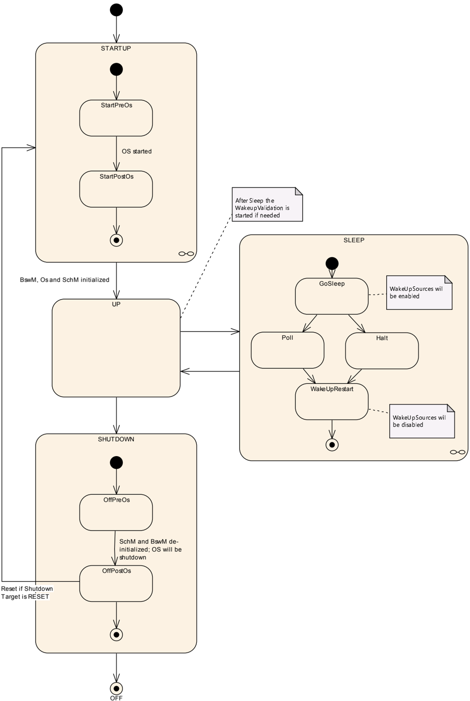


## 7.1.1 STARTUP Phase

The purpose of the STARTUP phase is to initialize the basic software modules to the point where Generic Mode Management facilities are operational. For more details about the initialization see chapter 7.3.

## 7.1.2 UP Phase

Essentially, the UP phase starts when the BSW Scheduler has started and BswM\_-Init has been called. At that point, memory management is not initialized, there are no communication stacks, no SW-C support (RTE) and the SW-Cs have not started. Processing starts in a certain mode (the next one configured after Startup) with corresponding runnables, i.e. the BSW MainFunctions, and continues as an arbitrary combination of mode changes which cause the BswM to execute actions as well as triggering and disabling corresponding runnables.

From the ECU Manager Module perspective, the ECU is "up", however. The BSW Mode Manager Module then starts mode arbitration and all further BSW initialization, starting the RTE and (implicitly) starting SW-Cs becomes code executed in the BswM's action lists or driven by mode-dependent scheduling, effectively under the control of the integrator.

Initializing the NvM and calling NvM\_Readall therefore also becomes integration code. This means that the integrator is responsible for triggering the initialization of Com, DEM and FIM at the end of NvM\_ReadAll. The NvM will notify the BswM when NvM\_ ReadAll has finished.

Note that the RTE can be started after NvM and COM have been initialized. Note also that the communication stack need not be fully initialized before COM can be initialized.

These changes initialize BSW modules as well as starting SW-Cs in arbitrary order until the ECU reaches full capacity and the changes continue to determine the ECU capabilities thereafter as well.

Ultimately mode switches stop SW-Cs and de-initialize the BSW so that the Up phase ends when the ECU reaches a state where it can be powered off.

So, as far as the ECU Manager module is concerned, the BSW and SW-Cs run until they are ready for the ECU to be shut down or put to sleep.

Refer to the Guide to Mode Management [4] for guidance on how to design modedriven ECU management and for configuring the BSW Mode Manager accordingly.


## 7.1.3 SHUTDOWN Phase

[SWS\_EcuM\_03022] glyph[ceilingleft] The SHUTDOWN phase handles the controlled shutdown of basic software modules and finally results in the selected shutdown target OFF or RESET. glyph[floorright] (SRS\_ModeMgm\_09072)

## 7.1.4 SLEEP Phase

The ECU saves energy in the SLEEP phase. Typically, no code is executed but power is still supplied, and if configured accordingly, the ECU is wakeable in this state 1 . The ECU Manager module provides a configurable set of (hardware) sleep modes which typically are a trade off between power consumption and time to restart the ECU.

The ECU Manager module wakes the ECU up in response to intended or unintended wakeup events. Since unintended wakeup events should be ignored, the ECU Manager module provides a protocol to validate wakeup events. The protocol specifies a cooperative process between the driver which handles the wakeup source and the ECU Manager (see section 7.6.4 ).

## 7.1.5 OFF Phase

The ECU enters the OFF state when it is powered down. The ECU may be wakeable in this state but only for wakeup sources with integrated power control. In any case the ECU must be startable (e.g. by reset events).

1 Some ECU designs actually do require code execution to implement a SLEEP state (and the wakeup capability). For these ECUs, the clock speed is typically dramatically reduced. These could be implemented with a small loop inside the SLEEP state.


## 7.2 Structural Description of the ECU Manager

Figure 7.2: ECU Manager Module Relationships

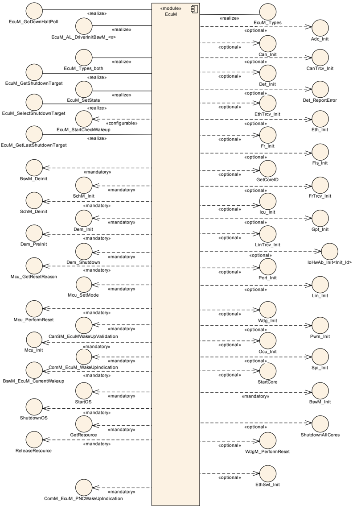

Figure 7.2 illustrates the ECU Manager module's relationship to the interfaces of other BSW modules. In most cases, the ECU Manager module is simply responsible for initialization 2 . There are however some modules that have a functional relationship with the ECU Manager module, which is explained in the following paragraphs.


## 7.2.1 Standardized AUTOSAR Software Modules

Some Basic Software driver modules are initialized, shut down and re-initialized upon wakeup by the ECU Manager module.

The OS is initialized and shut down by the ECU Manager.

After the OS initialization, additional initialization steps are undertaken by the ECU Manager module before passing control to the BswM. The BswM hands execution control back to the ECU Manager module immediately before OS shutdown. Details are provided in the chapters 7.3 STARTUP and 7.4 SHUTDOWN .

## 7.2.2 Software Components

SW-Components contain the AUTOSAR ECU's application code.

A SW-C interacts with the ECU Manager module using AUTOSAR ports.

## 7.3 STARTUP Phase

See Chapter 7.1.1 for an overview description of the STARTUP phase.

2 To be precise, "initialization" could also mean de-initialization.


Figure 7.3: STARTUP Phase

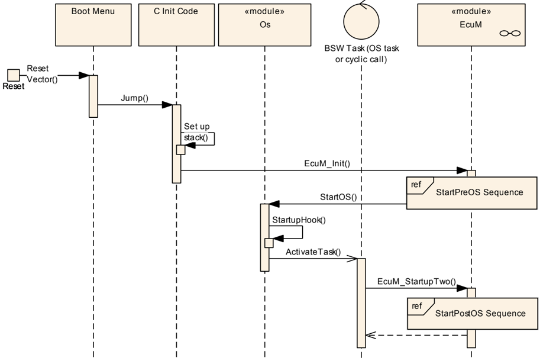

Figure 7.3 shows the startup behavior of the ECU. When invoked through EcuM\_Init , the ECU Manager module takes control of the ECU startup procedure. With the call to StartOS, the ECU Manager module temporarily relinquishes control. To regain control, the Integrator has to implement an OS task that is automatically started and calls EcuM\_StartupTwo as its first action.

## 7.3.1 Activities before EcuM\_Init

The ECU Manager module assumes that before EcuM\_Init (see [SWS\_EcuM\_02811] ) is called a minimal initialization of the MCU has taken place, so that a stack is set up and code can be executed, also that C initialization of variables has been performed.

## 7.3.2 Activities in StartPreOS Sequence

[SWS\_EcuM\_02411] glyph[ceilingleft] Table StartPreOS Sequence shows the activities in StartPre OS Sequence and the order in which they shall be executed in EcuM\_Init (see [SWS\_EcuM\_02811] ). glyph[floorright] (SRS\_BSW\_00101, SRS\_BSW\_00416, SRS\_ModeMgm\_-09113, SRS\_ModeMgm\_09234)


Table 7.1: StartPreOS Sequence

| StartPreOS Sequence                         | StartPreOS Sequence                                                                                                                                                                                                                                                  | StartPreOS Sequence   |
|---------------------------------------------|----------------------------------------------------------------------------------------------------------------------------------------------------------------------------------------------------------------------------------------------------------------------|-----------------------|
| Initialization Activity                     | Comment                                                                                                                                                                                                                                                              | Opt.                  |
| Callout EcuM_AL_SetProgrammableIn- terrupts | On ECUs with programmable interrupt prior- ities, these priorities must be set before the OS is started.                                                                                                                                                             | yes                   |
| Callout EcuM_AL_DriverInitZero              | Init block 0 This callout may only initialize BSW modules that do not use post-build configuration pa- rameters. The callout may not only contain driver initialization but also any kind of pre- OS, low level initialization code. See 7.3.5 Driver Initialization | yes                   |
| Callout EcuM_DeterminePbConfigura- tion     | This callout is expected to return a pointer to a fully initialized EcuM_ConfigType structure containing the post-build configuration data for the ECU Manager module and all other BSW modules.                                                                     | no                    |
| Check consistency of configuration data     | If check fails the EcuM_ErrorHook is called. See 7.3.4 Checking Configuration Consis- tency for details on the consistency check.                                                                                                                                    | no                    |
| Callout EcuM_AL_DriverInitOne               | Init block I The callout may not only contain driver initial- ization but any kind of pre-OS, low level ini- tialization code. See 7.3.5 Driver Initialization                                                                                                       | yes                   |
| Get reset reason                            | The reset reason is derived from a call to Mcu_GetResetReason and the map- ping defined via the EcuMWakeupSource configuration containers. See 8.4.1.1 EcuM_SetWakeupEvent and 8.3.5.4 EcuM_GetValidatedWakeupEvents (see [SWS_EcuM_02830] )                         | no                    |
| Select default shutdown target              | See [SWS_EcuM_02181]                                                                                                                                                                                                                                                 | no                    |
| Callout EcuM_LoopDetection                  | If Loop Detection is enabled, this callout is called on every startup.                                                                                                                                                                                               | yes                   |
| Start OS                                    | Start the AUTOSAR OS, see [SWS_EcuM_02603]                                                                                                                                                                                                                           | no                    |

Note to column Opt. : Optional activities can be switched on or off by configuration. See section 10.1 Common Containers and configuration parameters for details.

[SWS\_EcuM\_02623] glyph[ceilingleft] The ECU Manager module shall remember the wakeup source resulting from the reset reason translation (see table StartPreOS Sequence ). glyph[floorright] (SRS\_-BSW\_00375)

Rationale for [SWS\_EcuM\_02623]: The wakeup sources must be validated by the EcuM\_MainFunction (see section 7.6.4 Activities in the WakeupValidation Sequence).

[SWS\_EcuM\_02684] glyph[ceilingleft] When activated through the EcuM\_Init (see [SWS\_EcuM\_02811] ) function, the ECU Manager module shall perform the actions in the StartPreOS Sequence (see table StartPreOS Sequence ). glyph[floorright] (SRS\_BSW\_00416, SRS\_ModeMgm\_09234)


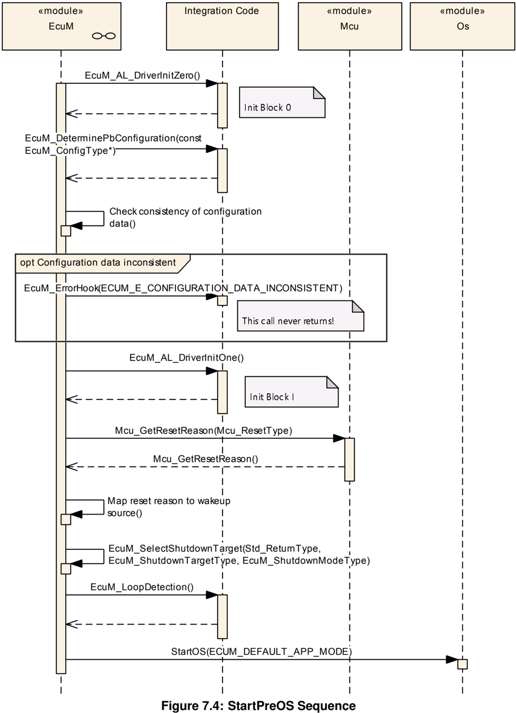


The StartPreOS Sequence is intended to prepare the ECU to initialize the OS and should be kept as short as possible. Drivers should be initialised in the UP phase when possible and the callouts should also be kept short. Interrupts should not be used during this sequence. If interrupts have to be used, only category I interrupts are allowed in the StartPreOS Sequence 1 3 .

Initialization of drivers and hardware abstraction modules is not strictly defined by the ECU Manager. Two callouts EcuM\_AL\_DriverInitZero (see [SWS\_EcuM\_02905] ) and EcuM\_AL\_DriverInitOne (see [SWS\_EcuM\_02907] ) are provided to define the init blocks 0 and I. These blocks contain the initialization activities associated with the StartPreOS sequence.

MCU\_Init does not provide complete MCU initialization. Additionally, hardware dependent steps have to be executed and must be defined at system design time. These steps are supposed to be taken within the EcuM\_AL\_DriverInitZero (see EcuM\_-AL\_DriverInitZero , [SWS\_EcuM\_02905] ) or EcuM\_AL\_DriverInitOne callouts (see EcuM\_AL\_DriverInitOne , [SWS\_EcuM\_02907] ). Details can be found in the Specification of MCU Driver [10].

[SWS\_EcuM\_02181] glyph[ceilingleft] The ECU Manager module shall call EcuM\_GetValidated-WakeupEvents with the configured default shutdown target ( EcuMDefaultShutdownTarget ). glyph[floorright] (SRS\_BSW\_00336, SRS\_ModeMgm\_09128)

See section 7.7 Shutdown Targets.

[SWS\_EcuM\_02603] glyph[ceilingleft] The StartPreOS Sequence shall initialize all basic software modules that are needed to start the OS. glyph[floorright] (SRS\_ModeMgm\_09113, SRS\_ModeMgm\_-09234)

## 7.3.3 Activities in the StartPostOS Sequence

## [SWS\_EcuM\_02934] glyph[ceilingleft]

Table 7.2: StartPostOS Sequence

| StartPostOS Sequence    | StartPostOS Sequence                                                | StartPostOS Sequence   |
|-------------------------|---------------------------------------------------------------------|------------------------|
| Initialization Activity | Comment                                                             | Opt.                   |
| Start BSW Scheduler     |                                                                     | no                     |
| Init BSW Mode Manager   |                                                                     | no                     |
| Init BSW Scheduler      | Initialize the semaphores for critical sections used by BSW modules | no                     |
| Start Scheduler Timing  | Start periodical events for BSW/SWCs                                | no                     |

glyph[floorright] (SRS\_ModeMgm\_09113)

3 Category II interrupts require a running OS while category I interrupts do not. AUTOSAR OS requires each interrupt vector to be exclusively put into one category.


Note to column Opt. : Optional activities can be switched on or off by configuration. See section 10.1 Common Containers and configuration parameters for details.

[SWS\_EcuM\_02932] glyph[ceilingleft] When activated through the EcuM\_StartupTwo (see [SWS\_EcuM\_02838] ) function, the ECU Manager module shall perform the actions in StartPostOS Sequence (see table in [SWS\_EcuM\_02934]). glyph[floorright] (SRS\_ModeMgm\_09113)

Figure 7.5: StartPostOS Sequence

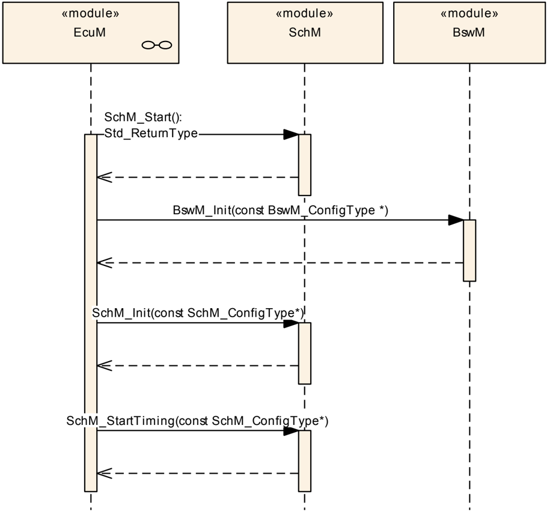

XML

ECU

Configuration ·

Description XML

.obj

## 7.3.4 Checking Configuration Consistency

Parameters

Per BSW Module

.h BSW

Code


/Header BSW

Header

Pre-Compile and Link-Time Part

.obj

Compiled

RTE Code

.obj

Compiled

SWÇ Code

·exe

## 7.3.4.1 The Necessity for Checking Configuration Consistency in the ECU Manager .XML . C .obj and SWCs Image

BSW Link-

Time BSW Link- Time Compile BSW Link-Time Configuration Compiled BSW Link- In an AUTOSAR ECU several configuration parameters are set and put into the ECU at different times. Pre-compile parameters are set, inserted into the generated source code and compiled into object code. When the source code has been compiled, linktime parameters are set, compiled, and linked with the previously configured object code into an image that is put into the ECU. Finally, post-build parameters are set, compiled, linked, and put into the ECU at a different time. All these parameters must match to obtain a stable ECU.

Figure 7.6: BSW Configuration Steps

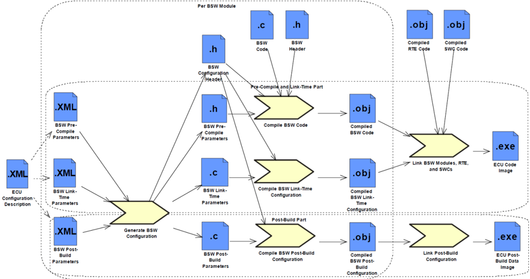

The configuration tool can check the consistency of configuration time parameters itself. The compiler may detect parameter errors at compilation time and the linker may find additional errors at link time. Unfortunately, finding configuration errors in postbuild parameters is very difficult. This can only be achieved by checking that

- the pre-compile and link-time parameter settings used when compiling the code

are exactly the same as

- the pre-compile and link-time parameter settings used when configuring and compiling the post-build parameters.

This can only be done at run-time.

Explanation for [SWS\_EcuM\_02796]: The ECU Manager module checks the consistency once before initializing the first BSW module to avoid multiple checks scattered over the different BSW modules.


This also implies that:

[SWS\_EcuM\_02796] glyph[ceilingleft] The ECU Manager module shall not only check the consistency of its own parameters but of all post-build configurable BSW modules before initializing the first BSW module. glyph[floorright] (SRS\_ModeMgm\_09234)

The ECU Manager Configuration Tool must compute a hash value over all pre-compile and link-time configuration parameters of all BSW modules and store the value in the link-time ECUM\_CONFIGCONSISTENCY\_HASH (see EcuMConfigConsistencyHash ) configuration parameter. The hash value is necessary for two reasons. First, the precompile and link-time parameters are not accessible at run-time. Second, the check must be very efficient at run-time. Comparing hundreds of parameters would cause an unacceptable delay in the ECU startup process.

The ECU Manager module Configuration Tool must in turn put the computed ECUM\_ CONFIGCONSISTENCY\_HASH value into the field in the EcuM\_ConfigType structure which contains the root of all post-build configuration parameters.

[SWS\_EcuM\_02798] glyph[ceilingleft] The ECU Manager module shall check in EcuM\_Init (see [SWS\_EcuM\_02811] ) that the field in the structure is equal to the value of ECUM\_ CONFIGCONSISTENCY\_HASH . glyph[floorright] (SRS\_BSW\_00394)

By computing hash values at configuration time and comparing them at run-time the EcuM code can be very efficient and is furthermore independent of a particular hash computation algorithm. This allows the use of complex hash computation algorithms, e.g. cryptographically strong hash functions.

Note that the same hash algorithm can be used to produce the value for the post-build configuration identifier in the EcuM\_ConfigType structure. Then the hash algorithm is applied to the post-build parameters instead of the pre-compile and link-time parameters.

[SWS\_EcuM\_02799] glyph[ceilingleft] The hash computation algorithm used to compute a hash value over all pre-compile and link-time configuration parameters of all BSW modules shall always produce the same hash value for the same set of configuration data regardless of the order of configuration parameters in the XML files. glyph[floorright] (SRS\_BSW\_00394)

## 7.3.4.2 Example Hash Computation Algorithm

Note: This chapter is not normative. It describes one possible way to compute hash values.

A simple CRC over the values of configuration parameters will not serve as a good hash algorithm. It only detects global changes, e.g. one parameter has changed from 1 to 2. But if another parameter changed from 2 to 1, the CRC might stay the same.

Additionally, not only the values of the configuration parameters but also their names must be taken into account in the hash algorithm. One possibility is to build a text file that contains the names of the configuration parameters and containers, separate them from the values using a delimiter, e.g. a colon, and putting each parameter as a line into a text file.


If there are multiple containers of the same type, each container name can be appended with a number, e.g. "\_0", "\_1" and so on.

To make the hash value independent of the order in which the parameters are written into the text file, the lines in the file must now be sorted lexicographically.

Finally, a cryptographically strong hash function, e.g. MD5, can be run on the text file to produce the hash value. These hash functions produce completely different hash values for slightly changed input files.

## 7.3.5 Driver Initialization

A driver's location in the initialization process depends strongly on its implementation and the target hardware design.

Drivers can be initialized by the ECU Manager module in Init Block 0 or Init Block 1 of the STARTUP phase or re-initialized in the EcuM\_AL\_DriverRestart callout of the WakeupRestart Sequence. Drivers can also be initialized or re-initialized by the BswM during the UP phase.

This chapter applies to those AUTOSAR Basic Software drivers, other than SchM and BswM, whose initialization and re-initialization is handled by the ECU Manager module and not the BswM.

[SWS\_EcuM\_02559] glyph[ceilingleft] The configuration of the ECU Manager module shall specify the order of initialization calls inside init block 0 and init block 1. (see EcuMDriverInitListZero and EcuMDriverInitListOne ). glyph[floorright] (SRS\_BSW\_-00416, SRS\_ModeMgm\_09234)

[SWS\_EcuM\_02730] glyph[ceilingleft] The ECU Manager module shall call each driver's init function with the parameters derived from the driver's EcuMModuleService configuration container. glyph[floorright] (SRS\_ModeMgm\_09234)

[SWS\_EcuM\_02947] glyph[ceilingleft] For re-initialization during WakeupRestart, the integrator shall integrate a restart block into the integration code for EcuM\_AL\_DriverRestart (see [SWS\_EcuM\_02923] ) using the EcuMDriverRestartList . glyph[floorright] (SRS\_ModeMgm\_-09234)

[SWS\_EcuM\_02562] glyph[ceilingleft] EcuMDriverRestartList may contain drivers that serve as wakeup sources. EcuM\_AL\_DriverRestart shall re-arm the trigger mechanism of these drivers' 'wakeup detected' callback. glyph[floorright] (SRS\_ModeMgm\_09097)

See Section 7.5.5 Activities in the WakeupRestart Sequence.

[SWS\_EcuM\_02561] glyph[ceilingleft] The ECU Manager module shall initialize the drivers in Ecu MDriverRestartList in the same order as in the combined list of init block 0 and init block 1. glyph[floorright] (SRS\_ModeMgm\_09113)


Hint for [SWS\_EcuM\_02561]: EcuMDriverRestartList will typically only contain a subset of the combined list of init block 0 and init block 1 drivers.

Table 7.3 shows one possible (and recommended) sequence of activities for the Init Blocks 0 and I. Depending on hardware and software configuration, BSW modules may be added or left out and other sequences may also be possible.

Table 7.3: Driver Initialization Details, Sample Configuration

| Recommended Init Block   | Recommended Init Block                                     | Recommended Init Block                                                                                           |
|--------------------------|------------------------------------------------------------|------------------------------------------------------------------------------------------------------------------|
|                          | Initialization Activity                                    | Comment                                                                                                          |
| Init Block 0 4           | Init Block 0 4                                             | Init Block 0 4                                                                                                   |
|                          | Default Error Tracer                                       | This should always be the first module to be initial- ized, so that other modules can report development errors. |
|                          | Diagnostic Event Manager                                   | Pre-Initialization                                                                                               |
|                          | Any drivers needed to access post-build configuration data | These drivers shall not depend on the post-build configuration or on OS features.                                |
| Init Block I 5           | Init Block I 5                                             | Init Block I 5                                                                                                   |
|                          | MCU Driver                                                 |                                                                                                                  |
|                          | Port Driver                                                |                                                                                                                  |
|                          | General Purpose Timer                                      |                                                                                                                  |
|                          | Watchdog Driver                                            | Internal watchdogs only, external ones may need SPI                                                              |
|                          | Watchdog Manager                                           |                                                                                                                  |
|                          | ADC Driver                                                 |                                                                                                                  |
|                          | ICU Driver                                                 |                                                                                                                  |
|                          | PWM Driver                                                 |                                                                                                                  |
|                          | OCU Driver                                                 |                                                                                                                  |

## 7.3.6 BSW Initialization

The remaining BSW modules are initialized by the BSW Mode Manager, using a configured function of the ECU Manager (EcuMDriverInitCalloutName ECUC\_EcuM\_00227) created from the configured list of init functions ( EcuMDriverInitListBswM ).

[SWS\_EcuM\_04142] glyph[ceilingleft] The configuration of the ECU Manager module shall specify the order of initialization calls inside the BSW initialization (see EcuMDriverInitListBswM ). glyph[floorright] (SRS\_BSW\_00416)

## 7.4 SHUTDOWN Phase

Refer to Section 7.1.3 SHUTDOWN Phase for an overview of the SHUTDOWN phase. EcuM\_GoDownHaltPoll with shutdown target RESET or OFF initiates the SHUTDOWN Phase.

4 Drivers in Init Block 0 are listed in the EcuMDriverInitListZero configuration container.

5 Drivers in Init Block I are listed in the EcuMDriverInitListOne configuration container.


[SWS\_EcuM\_02756] glyph[ceilingleft] When a wakeup event occurs during the shutdown phase, the ECU Manager module shall complete the shutdown and restart immediately thereafter. glyph[floorright] (SRS\_ModeMgm\_09136)

Figure 7.7: SHUTDOWN Phase

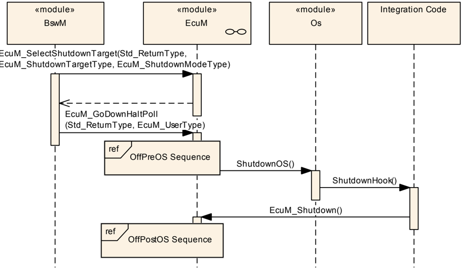

## 7.4.1 Activities in the OffPreOS Sequence

## [SWS\_EcuM\_03021] glyph[ceilingleft]

Table 7.4: OffPreOs Sequence

| OffPreOS Sequence                                                                                                                                                                         | OffPreOS Sequence                                                                                              | OffPreOS Sequence   |
|-------------------------------------------------------------------------------------------------------------------------------------------------------------------------------------------|----------------------------------------------------------------------------------------------------------------|---------------------|
| Shutdown Activity                                                                                                                                                                         | Comment                                                                                                        | Opt.                |
| De-init BSW Mode Manager                                                                                                                                                                  |                                                                                                                | no                  |
| De-init BSW Scheduler                                                                                                                                                                     |                                                                                                                | no                  |
| Check for wakeup events. All pend- ing wakeup events or only wakeup events validated during shutdown are considered depending on the configu- ration of EcuMIgnoreWakeupEvVal- OffPreOS . | Purpose is to detect wakeup events that occurred during shutdown                                               | no                  |
| Set RESET as shutdown target, if wakeup events are pending (default reset mode of EcuMDefaultReset- ModeRef will be used)                                                                 | This action shall only be carried out when pending wakeup events were de- tected to allow an immediate startup | no                  |
| ShutdownOS                                                                                                                                                                                | Last operation in this OS task                                                                                 | no                  |


## glyph[floorright] (SRS\_ModeMgm\_09127)

Note to column Opt. : Optional activities can be switched on or off by configuration. It shall be the system designers choice if a module is compiled in or not for an ECU design. See chapter 10.1 Common Containers and configuration parameters for details.

[SWS\_EcuM\_04151] glyph[ceilingleft] In OffPreOS and configuration parameter EcuMIgnoreWakeupEvValOffPreOS is set to true , only wakeup events which do not need validation shall be considered, all other wakeup events shall be ignored. glyph[floorright] (SRS\_ModeMgm\_-09104)

[SWS\_EcuM\_04152] glyph[ceilingleft] In OffPreOS and configuration parameter EcuMIgnoreWakeupEvValOffPreOS is set to false , wakeup events which do not need validation and pending wakeup events that need validation shall be considered. glyph[floorright] (SRS\_ModeMgm\_-09104)

Note: As the SchM is already de-initalized during the OffPreOS sequence, scheduled functions are not executed therefore validation of wakeups is no longer possible. The wakeup events that will be considered in the OffPreOS depend on the configuration of EcuMIgnoreWakeupEvValOffPreOS

[SWS\_EcuM\_02952] glyph[ceilingleft] As its last activity, the ECU Manager module shall call the ShutdownOS function. glyph[floorright] (SRS\_ModeMgm\_09104)

The OS calls the shutdown hook at the end of its shutdown.

[SWS\_EcuM\_02953] glyph[ceilingleft] The shutdown hook shall call EcuM\_Shutdown (see [SWS\_EcuM\_02812] ) to terminate the shutdown process. EcuM\_Shutdown (see [SWS\_EcuM\_02812] ) shall not return but switch off the ECU or issue a reset. glyph[floorright] (SRS\_-ModeMgm\_09104)


Figure 7.8: OffPreOS Sequence

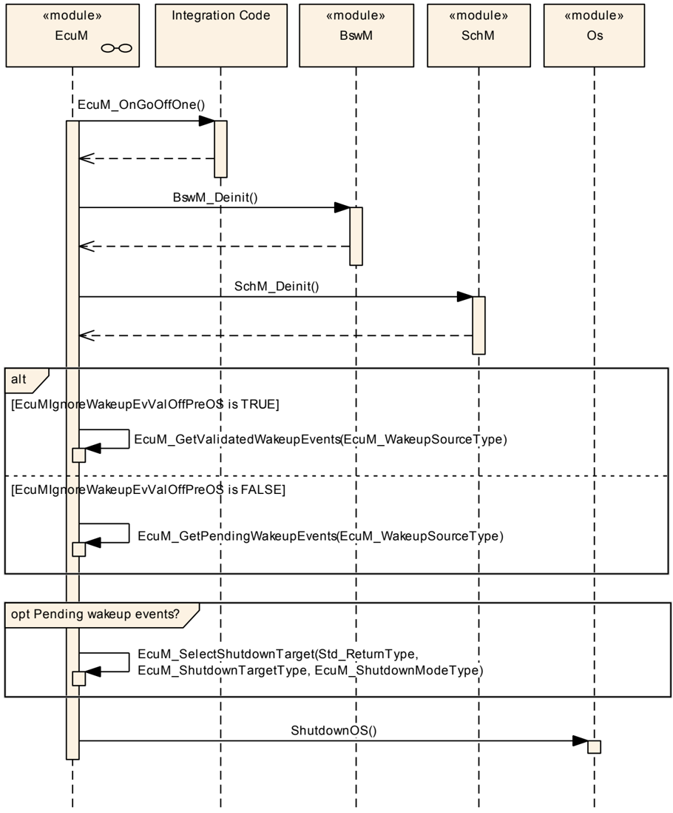


## 7.4.2 Activities in the OffPostOS Sequence

The OffPostOS sequence implements the final steps to reach the shutdown target after the OS has been shut down. EcuM\_Shutdown (see [SWS\_EcuM\_02812] ) initiates the sequence.

The shutdown target can be either ECUM\_SHUTDOWN\_TARGET\_RESET or ECUM\_ SHUTDOWN\_TARGET\_OFF, whereby the specific reset modality is determined by the reset mode. See section 7.7 Shutdown Targets for details.

Table 7.5: OffPostOs Sequence

| OffPostOS Sequence                                                         | OffPostOS Sequence                                       | OffPostOS Sequence   |
|----------------------------------------------------------------------------|----------------------------------------------------------|----------------------|
| Shutdown Activity                                                          | Comment                                                  | Opt.                 |
| Callout EcuM_OnGoOffTwo Callout EcuM_AL_Reset or Callout EcuM_AL_SwitchOff | Depends on the selected shutdown tar- get (RESET or OFF) | no                   |

Note to column Opt. : Optional activities can be switched on or off by configuration. It shall be the system designers choice if a module is compiled in or not for an ECU design. See chapter 10.1 Common Containers and configuration parameters for details.


Figure 7.9: OffPostOS Sequence

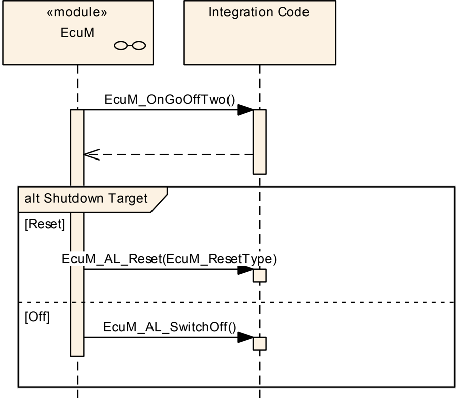

[SWS\_EcuM\_04074] glyph[ceilingleft] When the shutdown target is RESET, the ECU Manager module shall call the EcuM\_AL\_Reset callout. glyph[floorright] (SRS\_BSW\_00336, SRS\_ModeMgm\_09072, SRS\_ModeMgm\_09127, SRS\_ModeMgm\_09128)

See section 8.5.3.4 EcuM\_AL\_Reset ([SWS\_EcuM\_04065] ) for details.

[SWS\_EcuM\_04075] glyph[ceilingleft] When the shutdown target is OFF, the ECU Manager module shall call the EcuM\_AL\_SwitchOff callout. glyph[floorright] (SRS\_BSW\_00336, SRS\_ModeMgm\_-09072, SRS\_ModeMgm\_09127, SRS\_ModeMgm\_09128)

See section 8.5.3.3 EcuM\_AL\_SwitchOff ([SWS\_EcuM\_02920] ) for details.

## 7.5 SLEEP Phase

Refer to Section 7.1.4 SLEEP Phase for an overview of the SLEEP phase. EcuM\_-GoDownHaltPoll with shutdown target SLEEP initiate the SLEEP phase.


EcuM\_GoDownHaltPoll with shutdown target SLEEP initiate two control streams, depending on the sleep mode selected (EcuMSleepModeSuspend parameter), that differ structurally in the mechanisms used to realize sleep. They share the sequences for preparing for and recovering from sleep, however.

Figure 7.10: SLEEP Phase

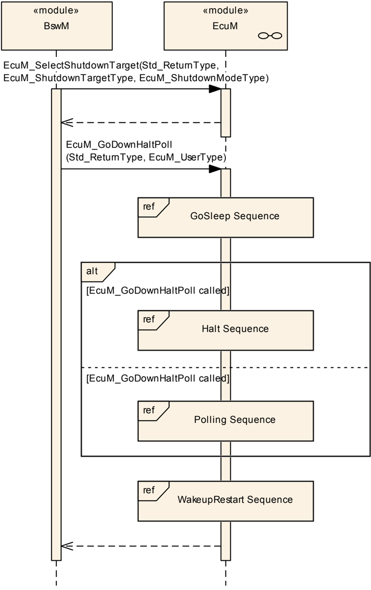


Another module, presumably the BswM, although it could be an SW-C as well, must ensure that an appropriate ECUM\_STATE\_SLEEP shutdown target has been selected before calling EcuM\_GoDownHaltPoll .

## 7.5.1 Activities in the GoSleep Sequence

In the GoSleep sequence the ECU Manager module configures hardware for the upcoming sleep phase and sets the ECU up for the next wakeup event.

[SWS\_EcuM\_02389] glyph[ceilingleft] To set the wakeup sources up for the next sleep mode, the ECU Manager module shall execute the EcuM\_EnableWakeupSources callout (see [SWS\_EcuM\_02546] ) for each wakeup source that is configured in EcuMWakeupSourceMask for the target sleep mode. glyph[floorright] (SRS\_ModeMgm\_09100)

[SWS\_EcuM\_02951] glyph[ceilingleft] In contrast to the SHUTDOWN phase, the ECU Manager module shall not shut down the OS when entering the SLEEP phase. The sleep mode, i.e. combination of the EcuM SLEEP phase and the Mcu Mode, shall be transparent to the OS. glyph[floorright] (SRS\_ModeMgm\_09145)

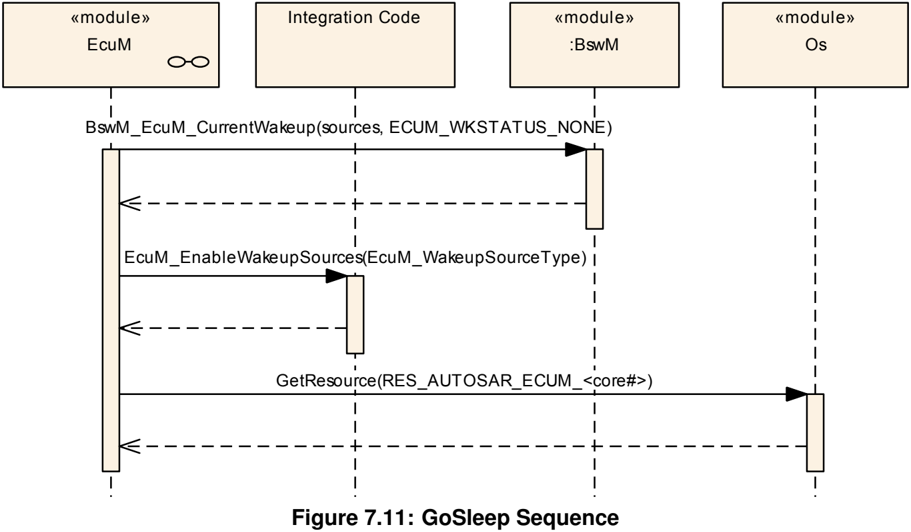

[SWS\_EcuM\_03010] glyph[ceilingleft] When operating on a multicore ECU ECUM shall reserve a dedicated resource (RES\_AUTOSAR\_ECUM) for each core, which is allocated during Go Sleep. glyph[floorright] (SRS\_ModeMgm\_09118)


## 7.5.2 Activities in the Halt Sequence

[SWS\_EcuM\_02960] glyph[ceilingleft] The ECU Manager module shall execute the Halt Sequence in sleep modes that halt the microcontroller. In these sleep modes the ECU Manager module does not execute any code. glyph[floorright] (SRS\_ModeMgm\_09118)

[SWS\_EcuM\_02863] glyph[ceilingleft] The ECU Manager module shall invoke the EcuM\_Generat-eRamHash (see [SWS\_EcuM\_02919] ) callout before halting the microcontroller the EcuM\_CheckRamHash (see [SWS\_EcuM\_02921] ) callout after the processor returns from halt.

In case of applied multi core and existence of "slave" EcuM(s) this check should be executed on the "master" EcuM only. The "master" EcuM generates the hash out of all data that lie within its reach. Private data of "slave" EcuMs are out of scope. glyph[floorright] (SRS\_-ModeMgm\_09234)

Rationale for [SWS\_EcuM\_02863] : Ram memory may become corrupted when an ECU is held in sleep mode for a long time. The RAM memory's integrity should therefore be checked to prevent unforeseen behavior. The system designer may choose an adequate checksum algorithm to perform the check.


Figure 7.12: Halt Sequence

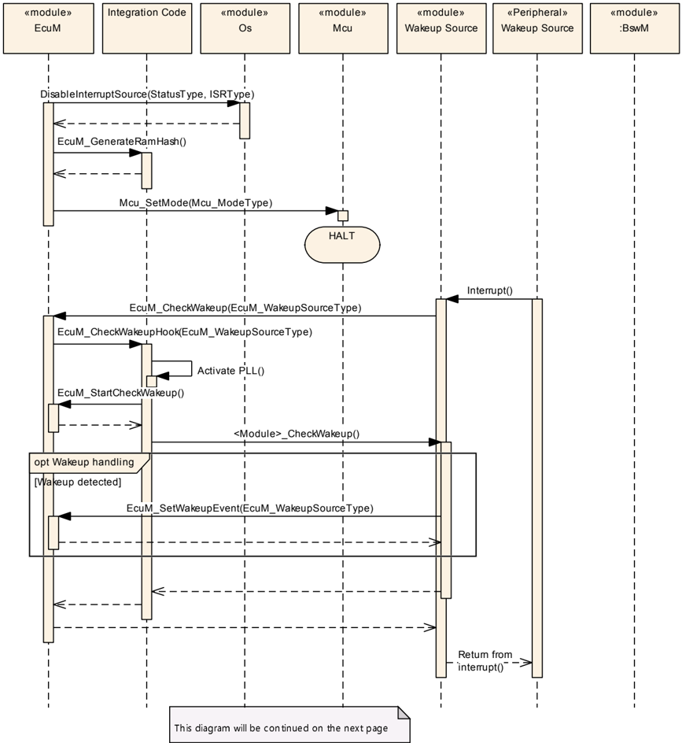

[SWS\_EcuM\_02961] glyph[ceilingleft] The ECU Manager module shall invoke the EcuM\_Generat-eRamHash (see [SWS\_EcuM\_02919] ) where the system designer can place a RAM integrity check. glyph[floorright] ()

## 7.5.3 Activities in the Poll Sequence

The Poll Sequence in sleep modes can be used to check the wakeup sources.

[SWS\_EcuM\_03020] glyph[ceilingleft] In the Poll sequence the EcuM shall call the callouts EcuM\_-SleepActivity and EcuM\_CheckWakeupHook () in a blocking loop (if EcuMWake- upSourcePolling is set to true) until a pending/validated wakeup event is reported. glyph[floorright] (SRS\_ModeMgm\_09145, SRS\_ModeMgm\_09136)


Figure 7.13: Poll Sequence

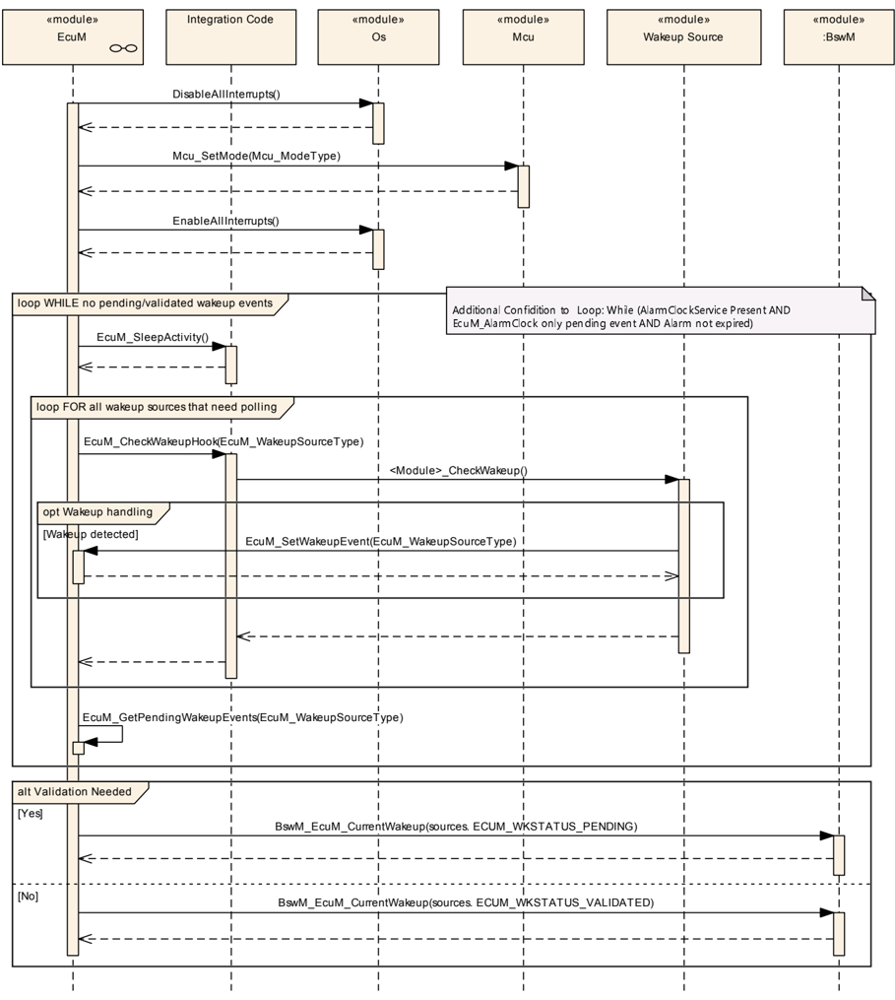

## 7.5.4 Leaving Halt or Poll

[SWS\_EcuM\_02963] glyph[ceilingleft] If a wakeup event (e.g. toggling a wakeup line, communication on a CAN bus etc.) occurs while the ECU is in Halt or Poll, then the ECU Manager module shall regain control and exit the SLEEP phase by executing the WakeupRestart sequence.


An ISR may be invoked to handle the wakeup event, but this depends on the hardware and the driver implementation. glyph[floorright] (SRS\_ModeMgm\_09136, SRS\_BSW\_00164)

See section 7.5.5 Activities in the WakeupRestart Sequence.

[SWS\_EcuM\_04001] glyph[ceilingleft] If irregular events (a hardware reset or a power cycle) occur while the ECU is in Halt or Poll, the ECU Manager module shall restart the ECU in the STARTUP phase. glyph[floorright] (SRS\_ModeMgm\_09136)

## 7.5.5 Activities in the WakeupRestart Sequence

Table 7.6: Wakeup Restart activities

| WakeupRestart 6                     | WakeupRestart 6                                                                                        | WakeupRestart 6   |
|-------------------------------------|--------------------------------------------------------------------------------------------------------|-------------------|
| Wakeup Activity                     | Comment                                                                                                | Opt.              |
| Restore MCU normal mode             | Selected MCU mode is configured in the configuration parameter EcuMNor- malMcuModeRef                  |                   |
| Get the pending wakeup sources      |                                                                                                        |                   |
| Callout EcuM_DisableWakeup- Sources | Disable currently pending wakeup source but leave the others armed so that later wakeups are possible. |                   |
| Callout EcuM_AL_DriverRestart       | Initialize drivers that need restarting                                                                |                   |
| Unlock Scheduler                    | From this point on, all other tasks may run again.                                                     |                   |

The ECU Manager module invokes the EcuM\_AL\_DriverRestart (see [SWS\_EcuM\_02923] ) callout which is intended for re-initializing drivers. Among others, drivers with wakeup sources typically require re-initialization. For more details on driver initialization refer to section 7.3.5 Driver Initialization.

During re-initialization, a driver must check if one of its assigned wakeup sources was the reason for the previous wakeup. If this test is true, the driver must invoke its 'wakeup detected' callback (see the Specification of CAN Transceiver Driver [11] for example), which in turn must call the EcuM\_SetWakeupEvent (see [SWS\_EcuM\_02826] ) function.

The driver implementation should only invoke the wakeup callback once. Thereafter it should not invoke the wakeup callback again until it has been re-armed by an explicit function call. The driver must thus be re-armed to fire the callback again.

[SWS\_EcuM\_02539] glyph[ceilingleft] If the ECU Manager module has a list of wakeup source candidates when the WakeupRestart Sequence has finished, the ECU Manager module shall validate these wakeup source candidates in EcuM\_MainFunction . glyph[floorright] (SRS\_-ModeMgm\_09100, SRS\_BSW\_00373)

See section 7.6.4 Activities in the WakeupValidation Sequence.


## [SWS\_EcuM\_04066] glyph[ceilingleft]glyph[floorright] (SRS\_ModeMgm\_09136)

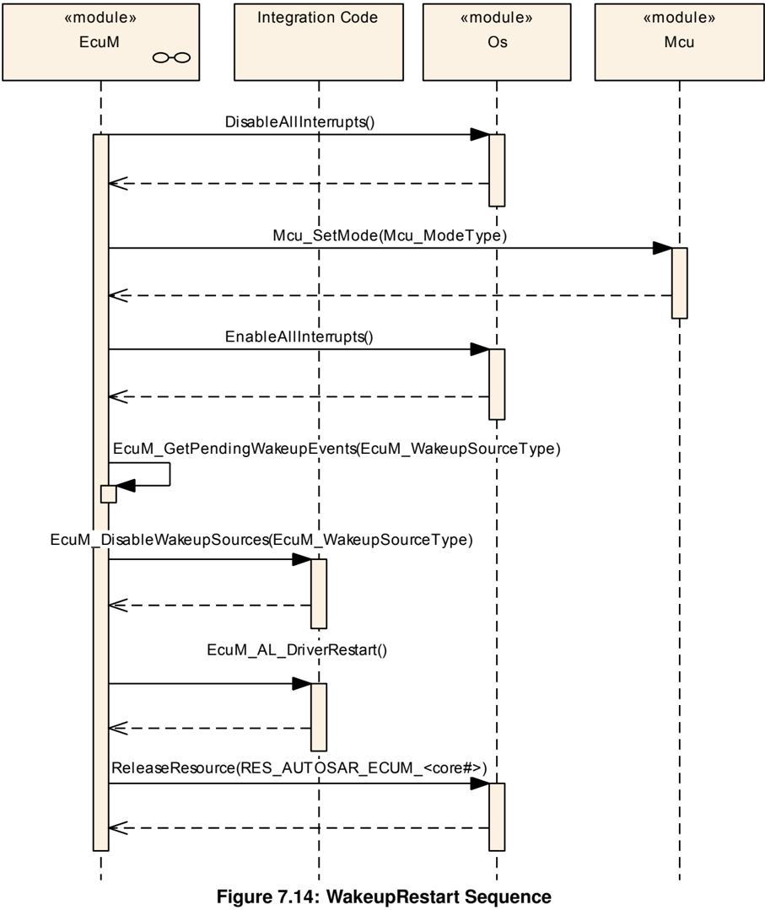

[SWS\_EcuM\_04148] glyph[ceilingleft] If WakeupEvent was reported EcuM shall exit sleep mode. glyph[floorright] (SRS\_ModeMgm\_09136, SRS\_ModeMgm\_09145)

[SWS\_EcuM\_04149] glyph[ceilingleft] If all CheckWakeupTimers for all WakeupSources have been expired, EcuM shall transit to GoSleep state and begin sending EcuM to sleep (halt or polling) again. glyph[floorright] (SRS\_ModeMgm\_09118)


Note: When EcuM was resumed by an asynchronous WakeupSource the EcuM has to execute WakeRestart sequence to re-start the mainfunctions to establish asynchronous communication towards the used hardware (e.g. SPI).

[SWS\_EcuM\_04150] glyph[ceilingleft] EcuM shall report the run-time error ECUM\_E\_WAKEUP\_TIMEOUT if no wake up event was set after a signaled wake up and the corresponding CheckWakeupTimer expires. glyph[floorright] (SRS\_BSW\_00452)

## 7.6 UP Phase

In the UP Phase, the EcuM\_MainFunction is executed regularly and it has three major functions:

- To check if wakeup sources have woken up and to initiate wakeup validation, if necessary (see 7.6.4 Activities in the WakeupValidation Sequence)
- To update the Alarm Clock timer
- Arbitrate RUN and POST\_RUN requests and releases.

## 7.6.1 Alarm Clock Handling

See section 7.8.2 EcuM Clock Time in the UP Phase for implementation details.

[SWS\_EcuM\_04002] glyph[ceilingleft] When the Alarm Clock service is present (see EcuMAlarmClockPresent ) the EcuM\_MainFunction shall update the Alarm Clock Timer glyph[floorright] (SRS\_ModeMgm\_09194)

## 7.6.2 Wakeup Source State Handling

Wakeup source are not only handled during wakeup but continuously, in parallel to all other EcuM activities. This functionality runs in the EcuM\_MainFunction fully decoupled from the rest of ECU management via mode requests.

The wakeup sources can be in the following states:

## [SWS\_EcuM\_04091] glyph[ceilingleft]

| State     | Description                                            |
|-----------|--------------------------------------------------------|
| NONE      | No wakeup event was detected or has been cleared.      |
| PENDING   | A wakeup event was detected but not yet validated.     |
| VALIDATED | A wakeup event was detected and succesfully validated. |


Table 7.7: Wakeup sources

| State   | Description                                        |
|---------|----------------------------------------------------|
| EXPIRED | A wakeup event was detected but validation failed. |

## glyph[floorright] (SRS\_ModeMgm\_09136)

Figure 7.15 illustrates the relationship between the wakeup source states and the conditions functions that evoke state changes. The two super-states Disabled and Validation are only shown here for clarification and better understandability.

Figure 7.15: Wakeup Source States

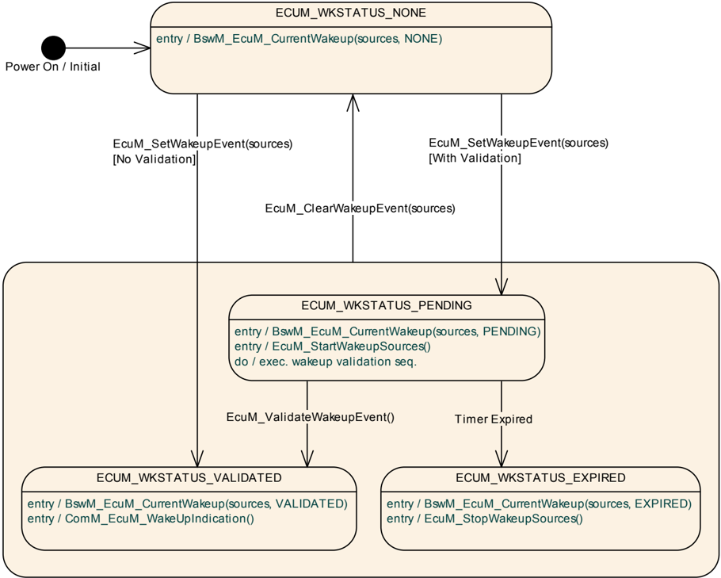

[SWS\_EcuM\_04003] glyph[ceilingleft] When an ECU Manager action causes the state of a wakeup source to change, the ECU Manager module shall issue a mode request to the BswM to change the wakeup source's mode to the new the wakeup source state. glyph[floorright] (SRS\_-BSW\_00375)

For the communication of these wakeup source states the type EcuM\_WakeupSta-tusType (see SWS\_ECUM\_04041) is used.


When the ECU Manager module is in the UP phase, wakeup events do not usually trigger state changes. They trigger the end of the Halt and Poll Sub-Phases, however. The ECU Manager module then executes the WakeupRestart Sequence automatically and returns thereafter to the UP phase.

It is up to the integrator to configure rules in the BswM so that the ECU reacts correctly to the wakeup events, as the reaction depends fully on the current ECU (not ECU Management) state.

If the wakeup source is valid, the BswM returns the ECU to its RUN state. If all wakeup events have gone back to NONE or EXPIRED, the BswM prepares the BSW for SLEEP or OFF again and invokes EcuM\_GoDownHaltPoll .

Summarizing: every pending event is validated independently (if configured) and the EcuM publishes the result as a mode request to the BswM, which in turn can trigger state changes in the EcuM.

## 7.6.3 Internal Representation of Wakeup States

The EcuM manager module offers the following interfaces to ascertain the state of those wakeup sources:

- EcuM\_GetPendingWakeupEvents
- EcuM\_GetValidatedWakeupEvents
- EcuM\_GetExpiredWakeupEvents

and manipulates the state of the wakeup sources through the following interfaces

- EcuM\_ClearWakeupEvent
- EcuM\_SetWakeupEvent
- EcuM\_ValidateWakeupEvent
- EcuM\_CheckWakeup
- EcuM\_DisableWakeupSources
- EcuM\_EnableWakeupSources
- EcuM\_StartWakeupSources
- EcuM\_StopWakeupSources

The ECU Manager module can manage up to 32 wakeup sources. The state of the wakeup sources is typically represented at the EcuM interfaces named above by means of an EcuM\_WakeupSourceType bitmask where the individual wakeup sources correspond to a fixed bit position. There are 5 predefined bit positions and the rest can be assigned by configuration. See section 8.2.3 EcuM\_WakeupSource-Type for details.


On the one hand, the ECU Manager module manages the modes of each wakeup source. On the other hand, the ECU Manager module presupposes that there are "internal variables" (i.e. EcuM\_WakeupSourceType instances) that track which wakeup sources are in a particular state (especially NONE (i.e. cleared), PENDING, VALIDATED and EXPIRED). The ECU Manager module uses these "internal variables" in the respective interface definitions to define the semantics of the interface.

Whether these "internal variables" are indeed implemented is therefore of secondary importance. They are simply used to explain the semantics of the interfaces.

## 7.6.4 Activities in the WakeupValidation Sequence

Since wakeup events can be generated unintentionally (e.g. EVM spike on CAN line), it is necessary to validate wakeups before the ECU resumes full operation.

The validation mechanism is the same for all wakeup sources. When a wakeup event occurs, the ECU is woken up from its SLEEP state and execution resumes within the MCU\_SetMode service of the MCU driver 7 . When the WakeupRestart Sequence has finished, the ECU Manager module will have a list of pending wakeup events to be validated (see [SWS\_EcuM\_02539] ). The ECU Manager module then releases the BSWScheduler and all BSW MainFunctions; most notably in this case, the EcuM Main Function can resume processing.

Implementation hint: Since SchM will be running at the end of the StartPostOS and WakeupRestart sequences, there is the possibility that the EcuM\_MainFunction will initiate validation for a source whose stack has not yet been initialized. The integrator should configure appropriate modes which indicate that the stack is not available and disable the EcuM\_MainFunction accordingly (see [2] ).

7 Actually, the first code to be executed may be an ISR, e.g. a wakeup ISR. However, this is specific to hardware and/or driver implementation.


Figure 7.16: The WakeupValidation Sequence

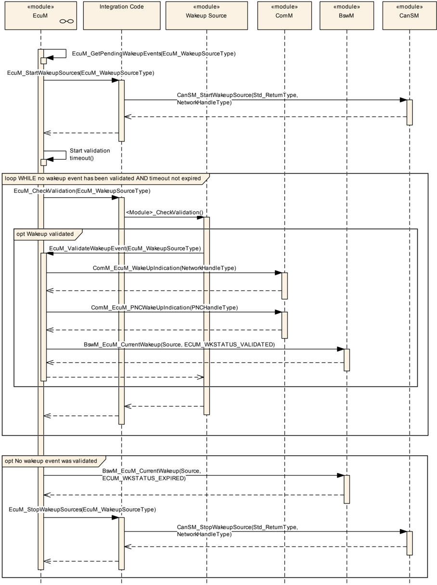

[SWS\_EcuM\_02566] glyph[ceilingleft] The ECU Manager module shall only invoke wakeup validation on those wakeup sources where it is required by configuration. If the validation protocol is not configured (see EcuMValidationTimeout ), then a call to EcuM\_-SetWakeupEvent shall also imply a call to EcuM\_ValidateWakeupEvent . glyph[floorright] (SRS\_-ModeMgm\_09100, SRS\_ModeMgm\_09254)


[SWS\_EcuM\_02565] glyph[ceilingleft] The ECU Manager module shall start a validation timeout for each pending wakeup event that should be validated. The timeout shall be eventspecific (see EcuMValidationTimeout ). glyph[floorright] (SRS\_ModeMgm\_09097)

Implementation hint for [SWS\_EcuM\_02565]: It is sufficient for an implementation to provide only one timer, which is prolonged to the largest timeout when new wakeup events are reported.

[SWS\_EcuM\_04081] glyph[ceilingleft] When the validation timeout expires for a pending wakeup event, the EcuM\_MainFunction sets (OR-operation) set the bit in the internal expired wakeup events variable. glyph[floorright] (SRS\_ModeMgm\_09254)

See also section 7.6.3 Internal Representation of Wakeup States.

[SWS\_EcuM\_04082] glyph[ceilingleft] When the validation timeout expires for a pending wakeup event, the EcuM\_MainFunction shall invoke BswM\_EcuM\_CurrentWakeup with an EcuM\_WakeupSourceType bitmask parameter with the bit corresponding to the wakeup event set and state value parameter set to ECUM\_WKSTATUS\_EXPIRED. glyph[floorright] (SRS\_ModeMgm\_09254)

The BswM will be configured to monitor the wakeup validation through mode switch requests coming from the EcuM as the wakeup sources are validated or the timers expire. If the last validation timeout (see [SWS\_EcuM\_02565] ) expires without validation then the BswM shall consider wakeup validation to have failed. If at least one of the pending events is validated then the entire validation shall have passed.

Pending events are validated with a call of EcuM\_ValidateWakeupEvent (see [SWS\_EcuM\_02829] ). This call must be placed in the driver or the consuming stack on top of the driver (e.g. the handler). The best place to put this depends on hardware and software design. See also section 7.6.4.4 Requirements for Drivers with Wakeup Sources .

## 7.6.4.1 Wakeup of Communication Channels

If a wakeup occurs on a communication channel, the corresponding bus transceiver driver must notify the ECU Manager module by invoking EcuM\_SetWakeupEvent (see [SWS\_EcuM\_02826] ) function. Requirements for this notification are described in section 5.2 Peripherals with Wakeup Capability.

[SWS\_EcuM\_02479] glyph[ceilingleft] The ECU Manager module shall execute the Wakeup Validation Protocol upon the EcuM\_SetWakeupEvent (see [SWS\_EcuM\_02826] ) function call according to Interaction of Wakeup Sources and the ECU Manager later in this chapter. glyph[floorright] (SRS\_ModeMgm\_09254)

See also 7.6.4.2 Interaction of Wakeup Sources and the ECU Manager.


## 7.6.4.2 Interaction of Wakeup Sources and the ECU Manager

The ECU Manager module shall treat all wakeup sources in the same way. The procedure shall be as follows:

When a wakeup event occurs, the corresponding driver shall notify the ECU Manager module of the wakeup. The most likely modalities for this notification are:

- After exiting the Halt or Poll sequences. In this scenario, the ECU Manager module invokes EcuM\_AL\_DriverRestart (see [SWS\_EcuM\_02923] ) to reinitialize of the relevant drivers, which in turn get a chance to scan their hardware e.g. for pending wakeup interrupts.
- If the wakeup source is actually in sleep mode, the driver must scan autonomously for wakeup events; either by polling or by waiting for an interrupt.

[SWS\_EcuM\_02975] glyph[ceilingleft] If a wakeup event requires validation then the ECU Manager module shall invoke the validation protocol glyph[floorright] (SRS\_ModeMgm\_09254)

[SWS\_EcuM\_02976] glyph[ceilingleft] If a wakeup event does not require validation, the ECU Manager module shall issue a mode switch request to set the event's mode to ECUM\_ WKSTATUS\_VALIDATED. glyph[floorright] (SRS\_ModeMgm\_09254)

[SWS\_EcuM\_02496] glyph[ceilingleft] If the wakeup event is validated (either immediately or by the wakeup validation protocol), the ECU Manager module shall make the information that it is a source of the current ECU wakeup through the EcuM\_GetValidat-edWakeupEvents (see [SWS\_EcuM\_02830] ) function. glyph[floorright] (SRS\_BSW\_00375, SRS\_-ModeMgm\_09126, SRS\_ModeMgm\_09098)

## 7.6.4.3 Wakeup Validation Timeout

[SWS\_EcuM\_04004] glyph[ceilingleft] The ECU Manager Module shall either provide a single wakeup validation timeout timer or one timer per wakeup source. glyph[floorright] (SRS\_ModeMgm\_09097)

The following requirements apply:

[SWS\_EcuM\_02709] glyph[ceilingleft] The ECU Manager module shall start the wakeup validation timeout timer when EcuM\_SetWakeupEvent (see [SWS\_EcuM\_02826] ) is called. glyph[floorright] (SRS\_ModeMgm\_09097)

[SWS\_EcuM\_02710] glyph[ceilingleft] EcuM\_ValidateWakeupEvent shall stop the wakeup validation timeout timer (see [SWS\_EcuM\_02829] ). glyph[floorright] (SRS\_ModeMgm\_09254)

[SWS\_EcuM\_02712] glyph[ceilingleft] If EcuM\_SetWakeupEvent (see [SWS\_EcuM\_02826] ) is called subsequently for the same wakeup source, the ECU Manager module shall not restart the wakeup validation timeout. glyph[floorright] (SRS\_ModeMgm\_09189)

If only one timer is used, the following approach is proposed:


If EcuM\_SetWakeupEvent (see [SWS\_EcuM\_02826] ) is called for a wakeup source that did not yet fire during the same wakeup cycle then the ECU Manager module should prolong the validation timeout of that wakeup source.

Wakeup timeouts are defined by configuration (see EcuMValidationTimeout ).

## 7.6.4.4 Requirements for Drivers with Wakeup Sources

The driver must invoke EcuM\_SetWakeupEvent (see [SWS\_EcuM\_02826] ) once when the wakeup event is detected and supply a EcuM\_WakeupSource-Type parameter identifying the source of the wakeup (see [SWS\_EcuM\_02165], [SWS\_EcuM\_02166] ) as specified in the configuration (see EcuMWakeupSourceId ).

[SWS\_EcuM\_02572] glyph[ceilingleft] The ECU Manager module shall detect wakeups that occurr prior to driver initialization, both from Halt/Poll or from OFF . glyph[floorright] (SRS\_ModeMgm\_09136)

The driver must provide an API to configure the wakeup source for the SLEEP state, to enable or disable the wakeup source, and to put the related peripherals to sleep. This requirement only applies if hardware provides these capabilities.

The driver should enable the callback invocation in its initialization function.

[SWS\_EcuM\_04147] glyph[ceilingleft] EcuMWakeupSource partition assignment shall be identified from module configuration, which refers it. glyph[floorright] (SRS\_ModeMgm\_09254)

Note: Wakeup validation call and wakeup callouts (start/enable/disable) of a wakeup source should be executed on that core, which wakeup source is assigned to. (Or in other way around, in execution context of a certain core only those wakeup sources shall be handled, which assigned to partition of that core)

## 7.6.5 Requirements for Wakeup Validation

If the wakeup source requires validation, this may be done by any but only by one appropriate module of the basic software. This may be a driver, an interface, a handler, or a manager.

Validation is done by calling the EcuM\_ValidateWakeupEvent (see [SWS\_EcuM\_02829] ) function.

[SWS\_EcuM\_02601] glyph[ceilingleft] If the EcuM cannot determine the reset reason returned by the Mcu driver, then the EcuM set a wakeup event for default wakeup source ECUM\_ WKSOURCE\_RESET instead. glyph[floorright] (SRS\_ModeMgm\_09254)


## 7.6.6 Wakeup Sources and Reset Reason

The ECU Manager module API only provides one type ( EcuM\_WakeupSourceType , see 8.2.3 EcuM\_WakeupSourceType ), which can describe all reasons why the ECU starts or wakes up.

[SWS\_EcuM\_02625] glyph[ceilingleft] The ECU Manager module shall never invoke validation for the following wakeup sources:

- ECUM\_WKSOURCE\_POWER
- ECUM\_WKSOURCE\_RESET
- ECUM\_WKSOURCE\_INTERNAL\_RESET
- ECUM\_WKSOURCE\_INTERNAL\_WDG
- ECUM\_WKSOURCE\_EXTERNAL\_WDG.

glyph[floorright] (SRS\_ModeMgm\_09254)

## 7.6.7 Wakeup Sources with Integrated Power Control

SLEEP can be realized by a system chip which controls the MCU's power supply. Typical examples are CAN transceivers with integrated power supplies which switch power off at application request and switch power on upon CAN activity.

The consequence is that SLEEP looks like OFF to the ECU Manager module on this type of hardware. This distinction is rather philosophical and not of practical importance.

The practical impact is that a passive wakeup on CAN looks like a power on reset to the ECU. Hence, the ECU will continue with the STARTUP sequence after a wakeup event. Wakeup validation is required nonetheless and the system designer must consider the following topics:

- The CAN transceiver is initialized during one of the driver initialization blocks (under BswM control by default). This is configured or generated code, i.e. code which is under control of the system designer.
- The CAN transceiver driver API provides functions to find out if it was the CAN transceiver which started the ECU due to a passive wakeup. It is the system designer's responsibility to prevent a shutdown of the ECU before the potential wake-up sources has been checked ed by calling EcuM\_StartCheckWakeup (see [SWS\_EcuM\_04096]) and to check the CAN transceiver for wakeup reasons and pass this information on to the ECU Manager module by using the EcuM\_-SetWakeupEvent (see [SWS\_EcuM\_02826] ) and EcuM\_ClearWakeupEvent (see [SWS\_EcuM\_02828] ) functions.


These principles can be applied to all wakeup sources with integrated power control. The CAN transceiver only serves as an example.

## 7.7 Shutdown Targets

"Shutdown Targets" is a descriptive term for all states ECU where no code is executed. They are called shutdown targets because they are the destination states where the state machine will drive to when the UP phase is left. The following states are shutdown targets:

- Off 8
- Sleep
- Reset

Note that the time at which a shutdown target is or can be determined is not necessarily the start of the shutdown. Since the BswM now controls most ECU resources, it will determine the time at which the shutdown target should be set and will set it, either directly or indirectly. The BswM must therefore ensure that, for example, the shutdown target must be changed from its default to ECUM\_STATE\_SLEEP before calling EcuM\_GoDownHaltPoll .

In previous versions of the ECU Manager module, sleep targets were treated specially, as the sleep modes realized in the ECU depended on the capabilities of the ECU. These sleep modes depend on hardware and differ typically in clock settings or other low power features provided by the hardware. These different features are accessible through the MCU driver as so-called MCU modes (see [10] ). There are also various modalities for performing a reset which are controlled, or triggered, by different modules:

- Mcu\_PerformReset
- WdgM\_PerformReset
- Toggle I/O Pin via DIO / SPI

The ECU Manager module offers a facility to manage these reset modalities by to tracking the time and cause of previous resets. The various reset modalities will be treated as reset modes, using the same mode facitlities as sleep.

Refer to section 8.3.4 Shutdown Management for the shutdown management facility's interface definitions.

8 The OFF state requires the capability of the ECU to switch off itself. This is not granted for all hardware designs.


## 7.7.1 Sleep

[SWS\_EcuM\_02188] glyph[ceilingleft] No wakeup event shall be missed in the SLEEP phase. The Halt or Poll Sequences shall not be entered if a wakeup event has occurred in the Go Sleep sequence. glyph[floorright] (SRS\_ModeMgm\_09254, SRS\_ModeMgm\_09136)

[SWS\_EcuM\_02957] glyph[ceilingleft] The ECU Manager module may define a configurable set of sleep modes (see EcuMSleepMode ) where each mode itself is a shutdown target. glyph[floorright] (SRS\_ModeMgm\_09119)

[SWS\_EcuM\_02958] glyph[ceilingleft] The ECU Manager module shall allow mapping the MCU sleep modes to ECU sleep modes and hence allow them to be addressed as shutdown targets. glyph[floorright] (SRS\_ModeMgm\_09119)

[SWS\_EcuM\_04092] glyph[ceilingleft] The ShutdownTarget Sleep shall put the all cores into sleep. glyph[floorright] (SRS\_ModeMgm\_09118)

## 7.7.2 Reset

[SWS\_EcuM\_04005] glyph[ceilingleft] The ECU Manager module shall define a configurable set of reset modes (see EcuMResetMode and EcuM\_ResetType ), where each mode itself is a shutdown target. The set will minimally contain targets for

- Mcu\_PerformReset
- WdgM\_PerformReset
- Toggle I/O Pin via DIO / SPI

glyph[floorright] (SRS\_ModeMgm\_09128)

[SWS\_EcuM\_04006] glyph[ceilingleft] The ECU Manager module shall allow defining aliases for reset targets (See EcuM180\_Conf). glyph[floorright] (SRS\_ModeMgm\_09128)

[SWS\_EcuM\_04007] glyph[ceilingleft] The ECU Manager module shall define a configurable set of reset causes (see EcuMShutdownCause and EcuM\_ShutdownCauseType ). The set shall minimally contain targets for

- ECU state machine entered a shutdown state
- WdgM detected a failure
- DCM requests shutdownI

and the time of the reset. glyph[floorright] (SRS\_ModeMgm\_09128)

[SWS\_EcuM\_04008] glyph[ceilingleft] The ECU Manager Module shall offer facilities to BSW modules and SW-Cs to

- Record a shutdown cause
- Get a set of recent shutdown causes


glyph[floorright] (SRS\_BSW\_00336, SRS\_ModeMgm\_09270, SRS\_ModeMgm\_09271)

See also section 8.3.4 Shutdown Management.

## 7.8 Alarm Clock

The ECU Manager module provides an optional persistent clock service which remains "active" even during sleep. It thus guarantees that an ECU will be woken up at a certain time in the future (assuming that the hardware does not fail) and provides clock services for long-term activities (i.e. measured in hours to days, even years).

Generally, this service will be realized with timers in the ECU that can induce wakeups. In some cases, external devices can also use a regular interrupt line to periodically wake the ECU up, however. Whatever the mechanism used, the service uses one wakeup source privately.

The ECU Manager module maintains a master alarm clock whose value determines the time at which the ECU will be woken up. Moreover the ECU manager manages an internal clock, the EcuM clock, which is used to compare with the master alarm.

Note that the alarm wakeup mechanisms are only relevant to the SLEEP phase. SWCs and BSW modules can set and retrieve alarm values during the UP phase (and only during the UP phase), which will be respected during the SLEEP phase, however.

Compared to other timing/wakeup mechanisms that could be implemented using general ECU Manager module facilities, the Alarm Clock service will not initiate the WakeupRestart Sequence until the timer expires. When the ECU Module detects that its timer has caused a wakeup event, it increments its timer and returns immediately to sleep unless the clock time has exceeded the alarm time.

[SWS\_EcuM\_04069] glyph[ceilingleft] When the Alarm Clock service is present (see EcuMAlarmClockPresent ) the EcuM Manager module shall maintain an EcuM clock whose time shall be the time in seconds since battery connect. glyph[floorright] (SRS\_ModeMgm\_09186)

[SWS\_EcuM\_04086] glyph[ceilingleft] The EcuM clock shall track time in the UP and SLEEP phases. glyph[floorright] (SRS\_ModeMgm\_09185, SRS\_ModeMgm\_09277)

[SWS\_EcuM\_04087] glyph[ceilingleft] Hardware permitting, the EcuM clock time shall not be reset by an ECU reset. glyph[floorright] (SRS\_ModeMgm\_09185)

[SWS\_EcuM\_04088] glyph[ceilingleft] There shall be one and only one wakeup source assigned to the EcuM Clock (see EcuMAlarmWakeupSource ). glyph[floorright] (SRS\_ModeMgm\_09189)

## 7.8.1 Alarm Clocks and Users

SW-Cs and BSW modules can each maintain an alarm clock (user alarm clock). Each user alarm clock (see EcuMAlarmClock ) is associated with an EcuMAlarmClockUser which identifies the respective SW-C or BSW module.


[SWS\_EcuM\_04070] glyph[ceilingleft] Each EcuM User shall have at most one user alarm clock. glyph[floorright] (SRS\_ModeMgm\_09122)

[SWS\_EcuM\_04071] glyph[ceilingleft] An EcuM User shall not be able to set the value of another user's alarm clock. glyph[floorright] (SRS\_ModeMgm\_09122)

[SWS\_EcuM\_04072] glyph[ceilingleft] The ECU Manager module shall set always the master alarm clock value to the value of the earliest user alarm clock value. glyph[floorright] (SRS\_ModeMgm\_-09189)

This means as well that when an EcuM User issues an abort on its alarm clock and that user alarm clock determines the current master alarm clock value, the ECU Manager module shall set the master alarm clock value to the next earliest user alarm clock value.

[SWS\_EcuM\_04073] glyph[ceilingleft] Only authorized EcuM Users can set the EcuM clock time (see EcuMSetClockAllowedUsers ). glyph[floorright] (SRS\_ModeMgm\_09122)

Rationale for [SWS\_EcuM\_04073]: Generally EcuM Users shall not be able to set the EcuM clock time. The EcuM clock time can be set to an arbitrary time to allow testing alarms that take days to expire.

## 7.8.2 EcuM Clock Time

[SWS\_EcuM\_04089] glyph[ceilingleft] If the underlying hardware mechanism is tick based, the ECUM shall "correct" the time accordingly glyph[floorright] (SRS\_BSW\_00343)

## 7.8.2.1 EcuM Clock Time in the UP Phase

The EcuM\_MainFunction increments the EcuM clock during the UP Phase. It uses standard OS mechanisms (alarms / counters) to derive its time. Note the difference in granularity between the counters and EcuM time, which is measured in seconds ([SWS\_EcuM\_04069] ).

## 7.8.2.2 EcuM Clock Time in the Sleep Phase

There are two alternatives to increment the EcuM clock during sleep depending on which sleep mode was selected (EcuMSleepModeSuspend parameter)

Within the Halt Sequence (see 7.5.2 Activities in the Halt Sequence) the GPT Driver must be put in to a GPT\_MODE\_SLEEP to only configure those timer channels required for the time base. It also requires the GPT to enable the timer based wakeup channel using the Gpt\_EnableWakeup API. Preferably the Gpt\_StartTimer API will be set to 1 sec but if this value is not reachable the EcuM will need to be woken up more often to accumulate several timer wakeups until 1 sec has been accumulated to increment the clock value.


Within the Poll Sequence (see 7.5.3 Activities in the Poll Sequence) the EcuM clock can be periodically updated during the EcuM\_SleepActivity function using the EcuM\_-SetClock function, assuming a notion of time is still available. The clock must only be incremented when 1 sec of time has been accumulated.

In both situations after the clock has been incremented during Sleep the ECU Manager module must evaluate if the master alarm has expired. If so the BswM will initiate a full startup or set the ECU in Sleep again.

[SWS\_EcuM\_04009] glyph[ceilingleft] When leaving the Sleep state the ECU Manager Module will abort any active user alarm clock and the master alarm clock. This means that both clock induced and wakeups due to other events will result in clearing all alarms. glyph[floorright] (SRS\_-ModeMgm\_09187)

[SWS\_EcuM\_04010] glyph[ceilingleft] User alarms and the master alarm shall be cancelled during the StartPreOS Sequence, in the WakeupRestart Sequence and the OffPreOS Sequence. glyph[floorright] (SRS\_ModeMgm\_09188)

## 7.9 MultiCore

The distribution of BSW modules onto different partitions was introduced.

A partition can be seen as an independent section that is mapped on one core. So every core (both in single and in multi core architectures) contains at least one but also can contain arbitrary numbers of partitions. But no partition can span over more than one core.

The BSW modules can be distributed over different partitions and therefore over different cores. Some BSW modules as the BswM have to be included into every partition. Other modules like the OS or the EcuM have be included into one partition per core.

An example is shown in Figure 7.17.

Partition 0

BswM

EcuM

OS

Core 0


ECU

Partition 1

Partition 2

Application Layer

RTE

Figure 7.17: Partitions inside an ECU

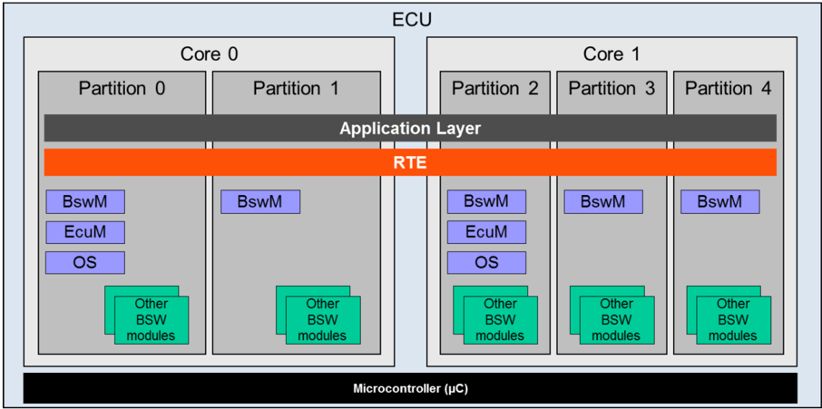

In a multi core architecture the EcuM has to be distributed in a way, that one instance per core exists.

There is one designated master core in which the boot loader starts the master Ecu M via EcuM\_Init . The master EcuM starts some drivers, determines the Post Build configuration and starts all remaining cores with all their satellite EcuMs.

Each EcuM now starts the core local OS and all core local BswMs (in every partition resides exactly one BswM).

If the same image of EcuM is executed on every core of the ECU, the ECU Manager's behavior has to differ on the different cores. This can be accomplished by the ECU Manager by testing first whether it is on a master or a slave core and act appropriately.

The ECU Manager module supports the same phases on a MultiCore ECU as are available on conventional ECUs (i.e. STARTUP , UP , SHUTDOWN and SLEEP).

If safety mechanisms are used, The ECU State Manager has to run with full trust level.

This section uses previous ECU Manager terms for various ECU states, notably Run/ PostRun. With flexible ECU management, the system integrator determines the ECU's states' names and semantics. Methods to ensure a de-initialization phase must be upheld, however. The names used here are therefore not normative.

## 7.9.1 Master Core

There is one explicit master core. Which core the master core is, is determined by the boot loader. The EcuM of the master core gets started as first BSW module and performs initialization actions.

·

Core 1


Then is starts all other cores with all other EcuMs.

When these are started, it initializes together with each satellite EcuM the core local OS and BswM.

## 7.9.2 Slave Core

On every slave core, one satellite EcuM has to run. If a core contains more than one partition, only on EcuM per core has to exist.

## 7.9.3 Master Core - Slave Core Signalling

This section discusses the general mechanisms with which BSW can communicate over cores. It presupposed general knowledge of the SchM, which is described and specified in the RTE.

## 7.9.3.1 BSW Level

The Operating System provides a basic mechanism for synchronizing the starts of the operating systems on the master and slave cores. The Scheduler Manager provides basic mechanisms for communication of BSW modules across partition boundaries. One BSW Mode Manager per core is responsible for starting and stopping the RTE.

Refer to the Guide to Mode Management [23] for a more complete description of the solution approaches and for a discussion of the considerations in choosing between them.

## 7.9.3.2 Example for Shutdown Synchronization

Before calling ShutdownAllCores , the "master" ECU Manager Module must start the shutdown of all "slave" ECU Manager Modules and has to wait until all modules have de-initialized the BSW modules for which they are responsible and successfully shutdown.

Therefore the master ECU Manager Module sets a shutdown flag which can be read by all slave modules. The EcuM activates afterwards tasks for every configured slave core. The slave modules read the flag inside the main routine and shutdown if requested. The task name is "EcuM\_SlaveCore&lt;X&gt;\_Task", where X is a number. The task need to be configured by the integrator. The number of tasks which need to be activated can be calculated by counting the instances of EcuMPartitionRef minus one, because one EcuMFlexPartionRef is used for the master.


Example: Three instances of EcuMPartitionRef are configured. Then during call of EcuM\_GoDownHaltPoll () "EcuM\_SlaveCore1\_Task" and "EcuM\_SlaveCore2\_Task" would be started. The slave modules read the flag inside the main routine and shutdown if requested.

The Operating System extends the OSEK SetEvent function across cores. A task on one core can wait for an event set on another core. Figure 18 illustrates how this applies to the problem of synchronizing the cores before calling ShutdownAllCores (whereby the de-initialization details have been omitted). The Set/WaitEvent functions accept a bitmask which can be used to indicate shutdown-readiness on the individual slave cores. Each SetEvent call from a "slave" ECU Manager module will stop the "master" ECU Manager module's wait. The "master" ECU Manager module must therefore track the state of the individual slave cores and set the wait until all cores have registered their readiness.

The WaitEvent() function can be replaced by a GetEvent() loop if the caller already has taken a resource or spinlock.


Figure 7.18: Master / Slave Core Shutdown Synchronization (this is an example)

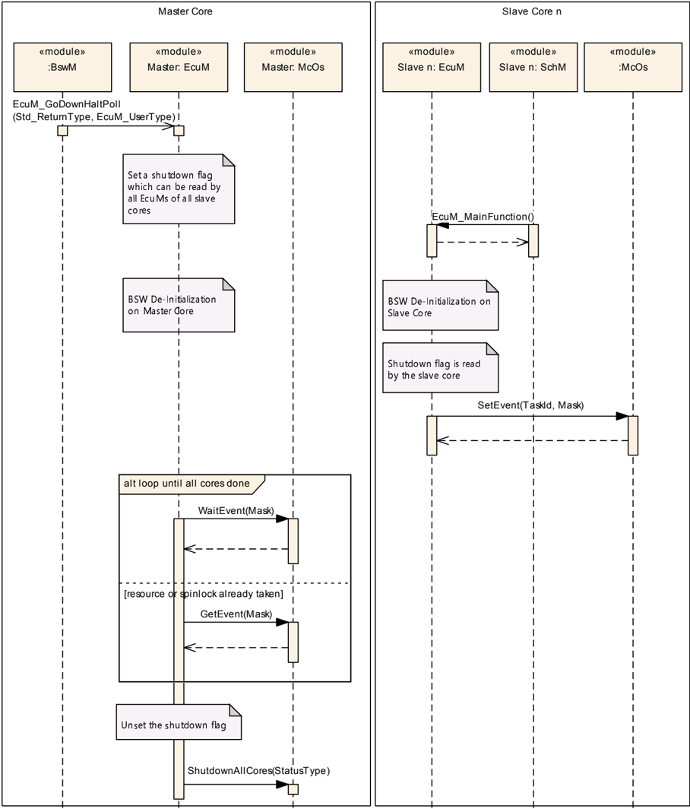

Note: Figure 7.18 is an example of the logical control flow on the master core. The API EcuM\_GoDownHaltPoll needs to be offered on every core managed by the EcuM. The behavior of this function on slave cores is implementation specific.

Integration note: If synchronization between master and slave cores is achieved by means SetEvent/WaitEvent, then EcuM\_GoDownHaltPoll will be called by the BswM


in the context of its main function task (deferred processing of mode arbitration). This additionally requires that the main function task is an extended task.

## 7.9.4 UP Phase

From the hardware perspective, it is possible that wakeup interrupts could occur on all cores. Then the whole ECU gets woken up and the EcuM running on that processes the wakeup event.

[SWS\_EcuM\_04011] glyph[ceilingleft] The EcuM\_MainFunction shall run in all EcuM instances. glyph[floorright] (SRS\_BSW\_00459)

[SWS\_EcuM\_04012] glyph[ceilingleft] Each instance of the ECU Manager module shall process the wakeup events of its core. glyph[floorright] (SRS\_BSW\_00459)

As in the single-core case, the BswM (as configured by the integrator) has the responsibility for controlling ECU resources, establishing that the local core can be powered down or halted as well as de-initializing the appropriate applications and BSW before handing control over to the EcuM of its core.

## 7.9.5 STARTUP Phase

The ECU Manager module functions nearly identically on all cores. That is, as for the single-core case, the ECU Manager module performs the steps specified for Startup; most importantly starting the OS, initializing the SchM and starting the core local BswMs.

The master EcuM activates all slave cores after calling InitBlock 1 and doing the reset / wakeup housekeeping. After being activated, the slave cores execute their startup routines, which call EcuM\_Init on their core.

[SWS\_EcuM\_04146] glyph[ceilingleft] If EcuMEcucCoreDefinitionRef is missing then the initialization call shall only be performed on the master core. glyph[floorright] (SRS\_ModeMgm\_09234)

Note: If you need to initialize a module on multiple cores you have to add the module for each core to the specific initialization list. Please be aware that in such cases the init() function might be called in parallel from different cores and init() functions are normally defined to be non-reentrant.

After each EcuM has called StartOs on its core, the OS synchronizes the cores before executing the core-individual startup hooks and synchronizes the cores again before executing the first tasks on each core.

StartPostOS is executed on each core and the SchM is initialized on each core. All core local BswMs are initialized by each EcuM.

One BswM on every partition has to start the RTE for that core.


[SWS\_EcuM\_04093] glyph[ceilingleft] The ECU Manager module shall start the SchM and the OS on every core. glyph[floorright] (SRS\_ModeMgm\_09234) [SWS\_EcuM\_04014] glyph[ceilingleft] The ECU Manager module shall call BswM\_Init for all core

local BswMs on the master and all slave cores. glyph[floorright] ()

## 7.9.5.1 Master Core STARTUP

## [SWS\_EcuM\_04015] glyph[ceilingleft]glyph[floorright] (SRS\_ModeMgm\_09234)


Figure 7.19: Master Core StartPreOS Sequence

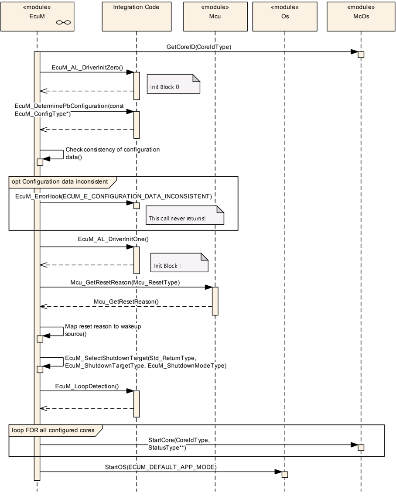

[SWS\_EcuM\_04016] glyph[ceilingleft]glyph[floorright] (SRS\_ModeMgm\_09234)


Figure 7.20: Master Core StartPostOS Sequence

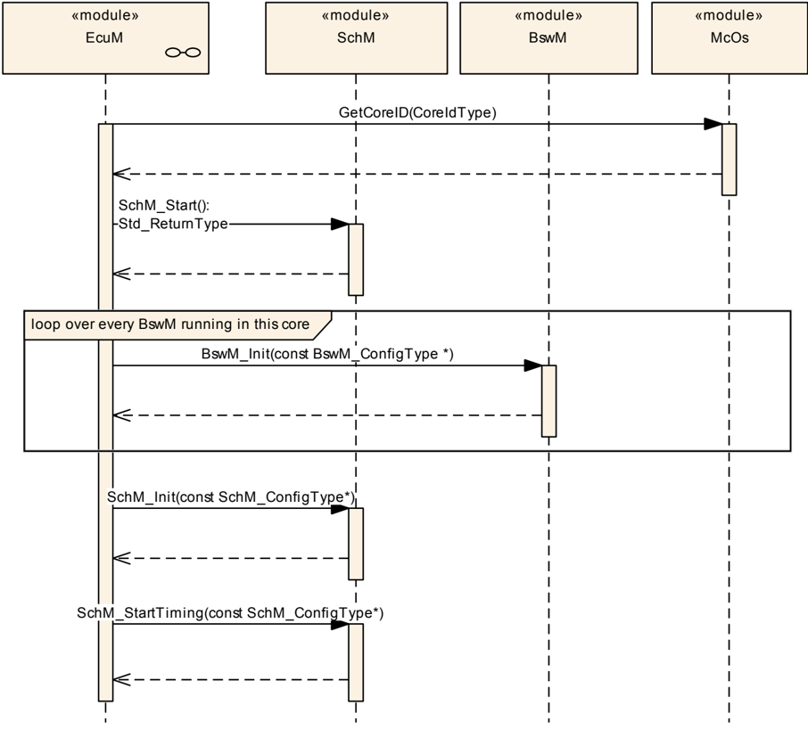

## 7.9.5.2 Slave Core STARTUP

[SWS\_EcuM\_04145] glyph[ceilingleft] The EcuM EcuM\_AL\_DriverInitZero and EcuM\_AL\_-DriverInitOne functions shall be called by the EcuM\_Init function on each core. The implementation of these callout functions shall ensure that only those MCAL modules are initialized that run on the currently active core. glyph[floorright] (SRS\_BSW\_00416)

[SWS\_EcuM\_04017] glyph[ceilingleft]glyph[floorright] (SRS\_ModeMgm\_09234)


Figure 7.21: Slave Core StartPreOS Sequence

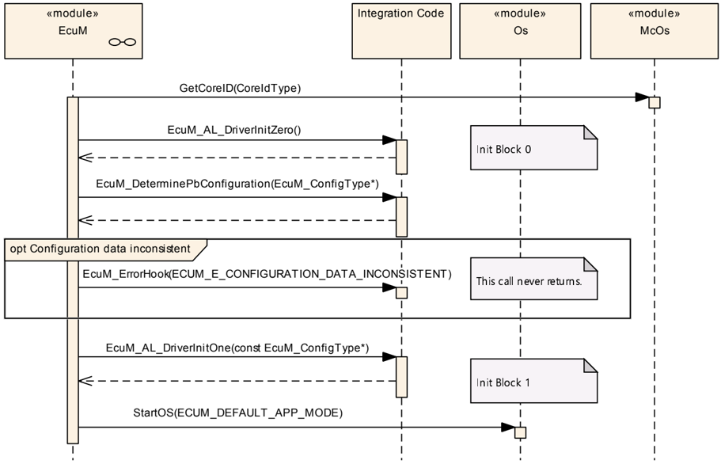

[SWS\_EcuM\_04018] glyph[ceilingleft]glyph[floorright] (SRS\_ModeMgm\_09234)


Figure 7.22: Slave Core StartPostOS Sequence

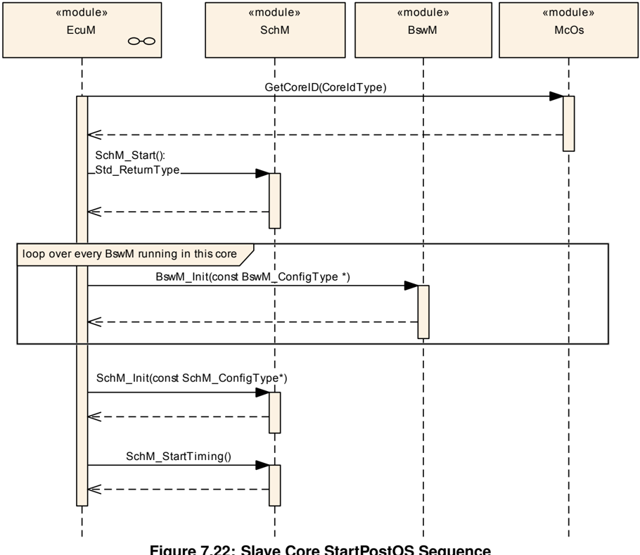

## 7.9.6 SHUTDOWN Phase

Individual core shutdown (i.e. while the rest of the ECU continues to run) is currently not supported. All cores are shut down simultaneously.

When the ECU shall be shut down, the master ECU Manager module calls ShutdownAllCores rather than somehow calling ShutdownOS on the individual cores. The ShutdownAllCores stops the OS on all cores and stops all cores as well.

Since the master core could issue the ShutdownAllCores before all slave cores are finished processing, the cores must be synchronized before entering SHUTDOWN.

The BswM (which is distributed over all partitions) ascertains that the ECU should be shut down and synchronizes with each BwsM in the ECU. All BswMs induce deinitialization of all the partition's BSWs, SWCs and CDDs and send appropriate signals to the other BswMs to indicate their readiness to shut down.


For a shutdown of the ECU, the BswM (which lies in the same partition of the master EcuM) ultimately calls GoOff on the master core which distributes that request to all slave cores. The "master" EcuM de-initializes the BswM, and the SchM. The EcuMs on the slave cores de-initialize their SchM and BswM, check if no wakeup events occurred during shutdown (see [SWS\_EcuM\_04151] and [SWS\_EcuM\_04152]) and then send a signal to indicate that the core is ready for ShutdownOS (again, see section section 7.9.3 Master Core - Slave Core Signalling for details).

The master EcuM waits for the signal from each slave core EcuM and then initiates shutdown as usual on the master core (the master EcuM calls ShutdownAllCores , and the ECU is put to bed with the global shutdown hook)


## 7.9.6.1 Master Core SHUTDOWN

Figure 7.23: Master Core OffPreOS Sequence

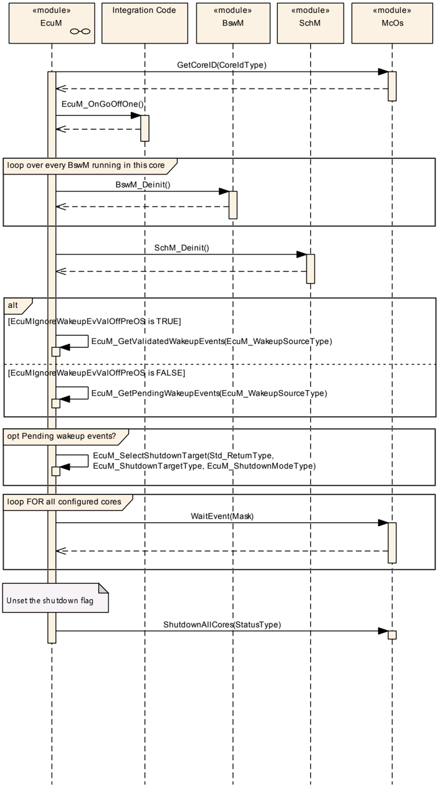


## [SWS\_EcuM\_04020] glyph[ceilingleft]glyph[floorright] (SRS\_ModeMgm\_09104)

Figure 7.24: Master Core OffPostOS Sequence

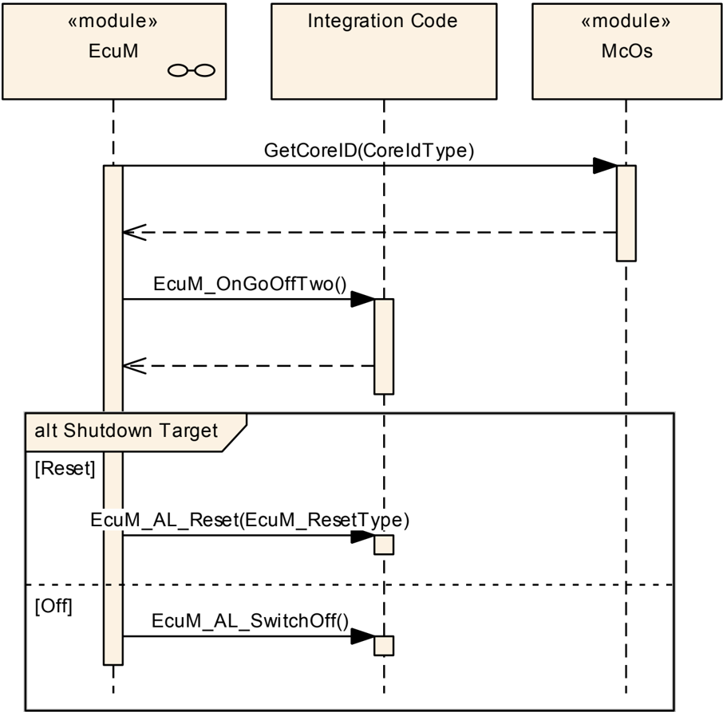


## 7.9.6.2 Slave Core SHUTDOWN

Figure 7.25: Slave Core OffPreOS Sequence

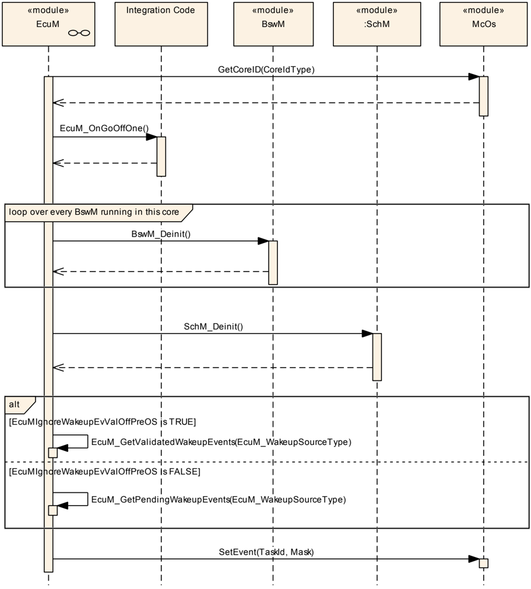

[SWS\_EcuM\_04022] glyph[ceilingleft]glyph[floorright] (SRS\_BSW\_00336, SRS\_ModeMgm\_09072)


Figure 7.26: Slave Core OffPostOS Sequence

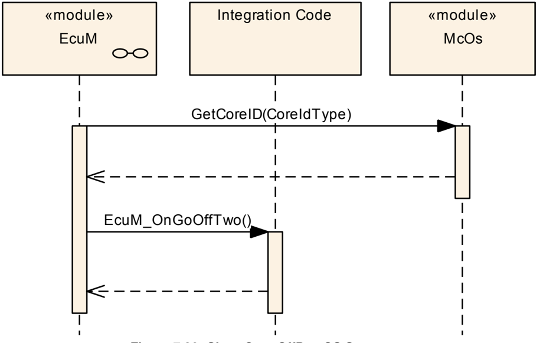

## 7.9.7 SLEEP Phase

When the shutdown target Sleep is requested, all cores are put to sleep simultaneously. The MCU must issue a halt for each core. As task timing and priority are local to a core in the OS, neither the scheduler nor the RTE must be synchronized after a halt. Because the master core could issue the MCU halt before all slave cores are finished processing, the cores must be synchronized before entering GoHalt.

The BswMs ascertain that sleep should be initiated and distribute an appropriate ECU mode to each core. The BSWs, SWCs and CDDs on the slave cores must be informed by their partition local BswM, de-initialize appropriately and send appropriate mode requests to the BswM to indicate their readiness.

If the ECU is put to sleep, the "halt"s must be synchronized so that all slave cores are halted before the master core computes the checksum. The ECU Manager module on the master core uses the same "signal" mechanism as for synchronizing cores on Go Off.

Similarly, the ECU Manager module on the master core must validate the checksum before releasing the slave cores from the "halt" state


## 7.9.7.1 Master Core SLEEP

## [SWS\_EcuM\_04023] glyph[ceilingleft]glyph[floorright] (SRS\_ModeMgm\_09145, SRS\_ModeMgm\_09118)

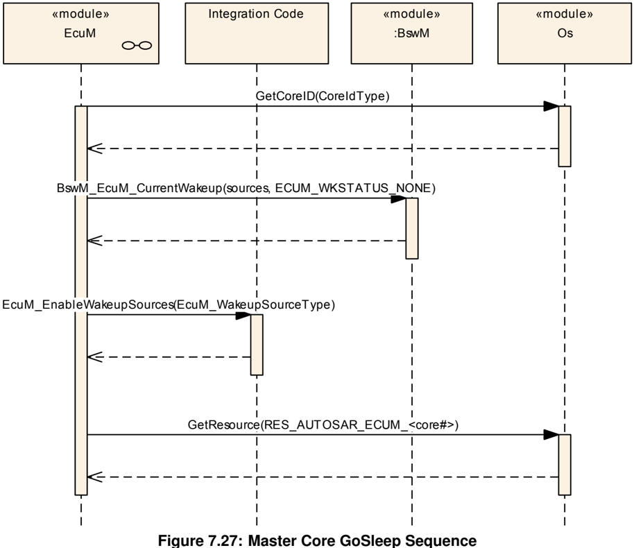

[SWS\_EcuM\_04024] glyph[ceilingleft]glyph[floorright] (SRS\_ModeMgm\_09239)


Figure 7.28: Master Core Halt Sequence

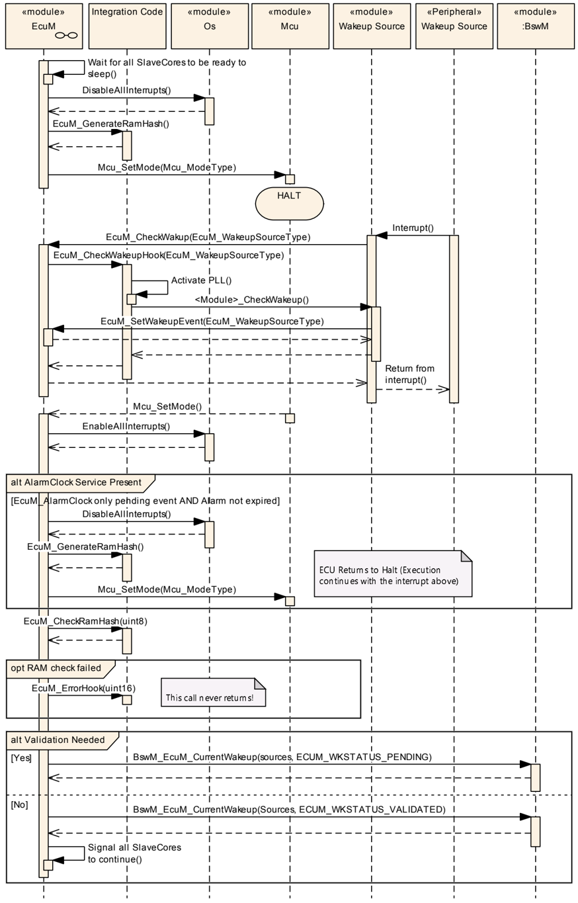


## [SWS\_EcuM\_04025] glyph[ceilingleft]glyph[floorright] (SRS\_ModeMgm\_09145)

Figure 7.29: Master Core Poll Sequence

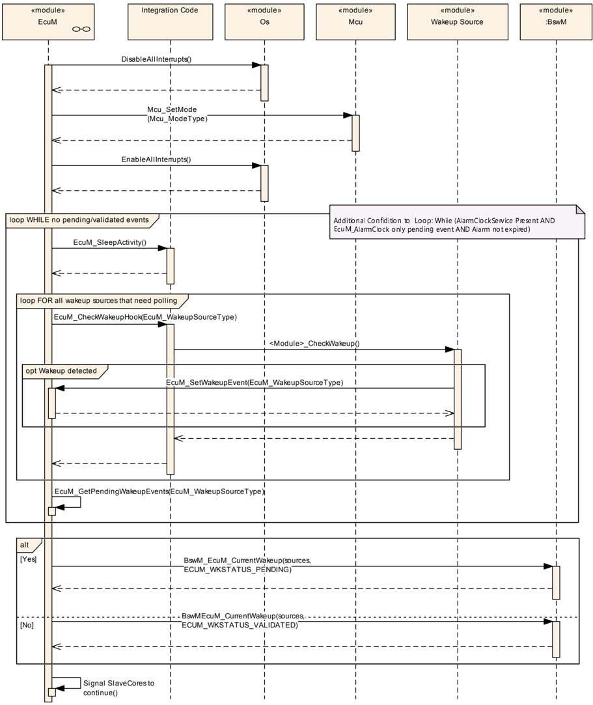

[SWS\_EcuM\_04026] glyph[ceilingleft]glyph[floorright] (SRS\_ModeMgm\_09145)


Figure 7.30: Master Core WakeupRestart Sequence

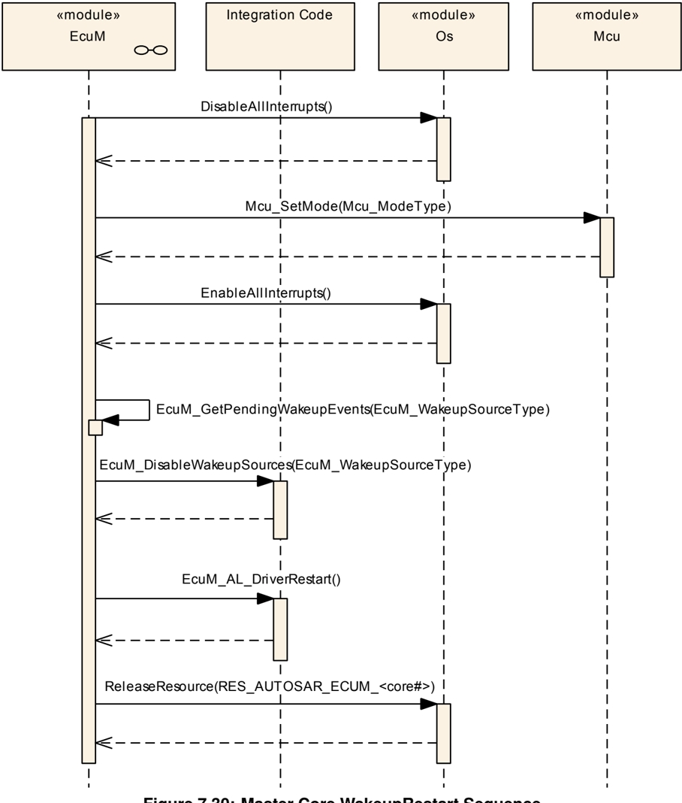

## 7.9.7.2 Slave Core SLEEP

[SWS\_EcuM\_04027] glyph[ceilingleft]glyph[floorright] (SRS\_ModeMgm\_09118)


[SWS\_EcuM\_04028] glyph[ceilingleft]glyph[floorright] (SRS\_ModeMgm\_09118)

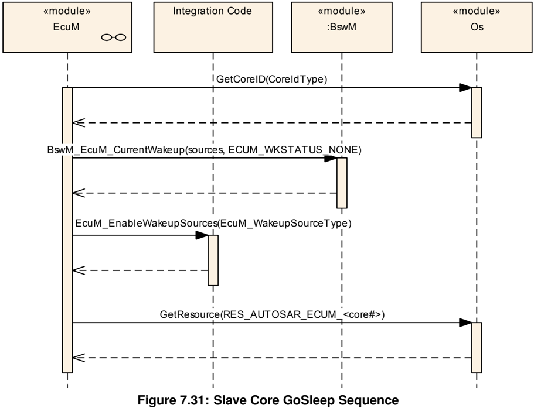


Figure 7.32: Slave Core Halt Sequence

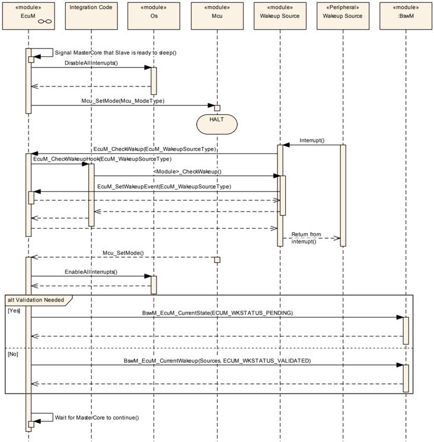

[SWS\_EcuM\_04029] glyph[ceilingleft]glyph[floorright] (SRS\_ModeMgm\_09145)

Figure 7.33: Slave Core Poll Sequence

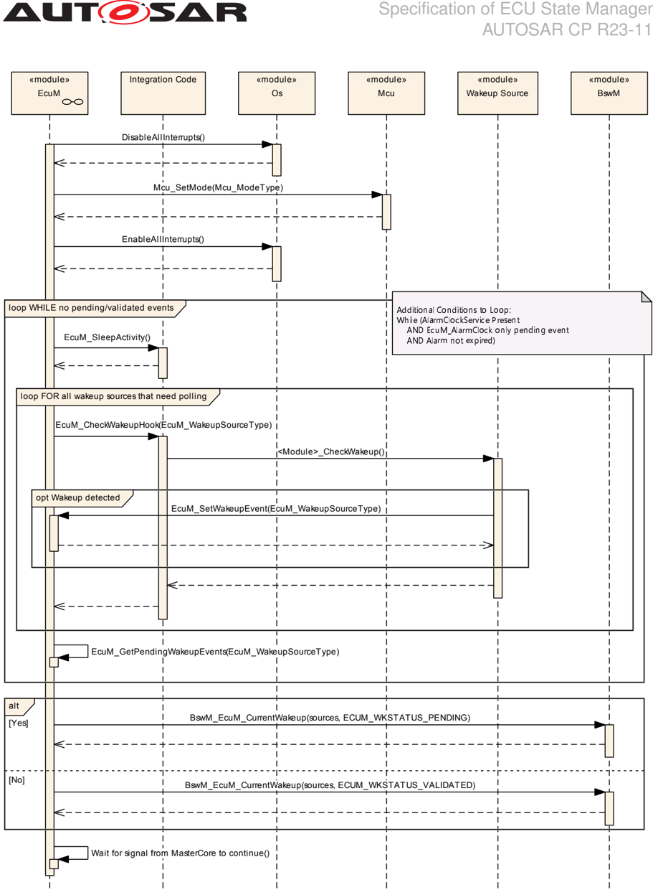

[SWS\_EcuM\_04030] glyph[ceilingleft]glyph[floorright] (SRS\_ModeMgm\_09145)


Figure 7.34: Slave Core WakeupRestart Sequence

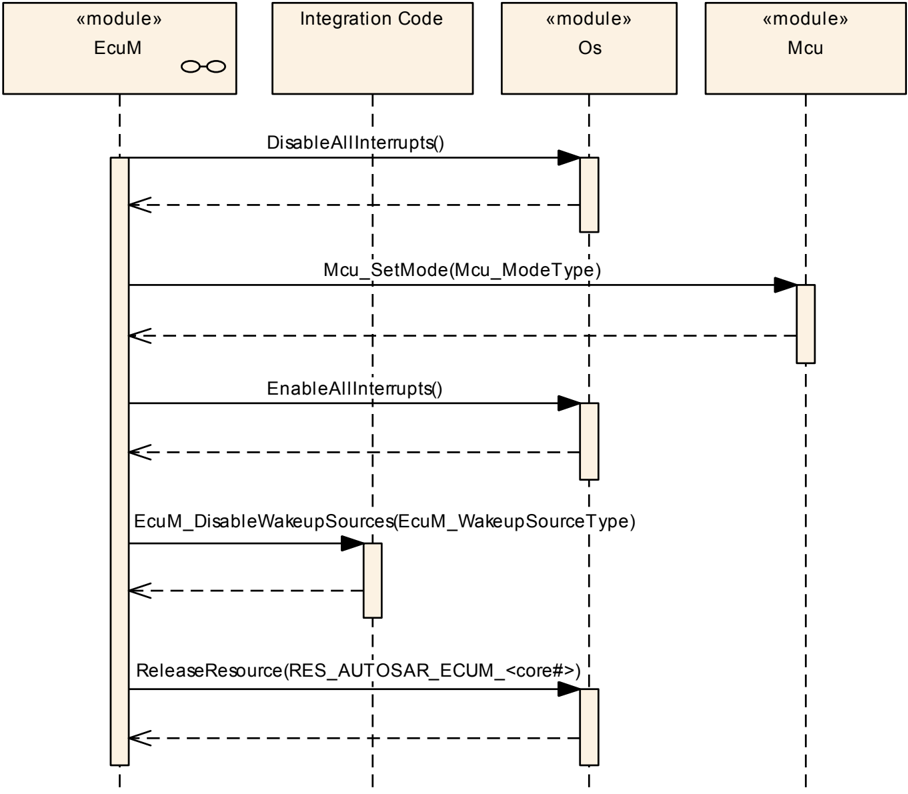

## 7.9.8 Runnables and Entry points

## 7.9.8.1 Internal behavior

[SWS\_EcuM\_03018] glyph[ceilingleft] The definition of the internal behavior of the the ECU Manager module shall be as follows. This detailed description is only needed for the configuration of the local RTE.

```
InternalBehavior EcuStateManager { // Runnable entities of the EcuStateManager RunnableEntity SelectShutdownTarget symbol "EcuM_SelectShutdownTarget" canbeInvokedConcurrently = TRUE RunnableEntity GetShutdownTarget symbol "EcuM_GetShutdownTarget"
```


```
canbeInvokedConcurrently = TRUE RunnableEntity GetLastShutdownTarget symbol "EcuM_GetLastShutdownTarget" canbeInvokedConcurrently = TRUE RunnableEntity SelectShutdownCause symbol "EcuM_SelectShutdownCause" canbeInvokedConcurrently = TRUE RunnableEntity GetShutdownCause symbol "EcuM_GetShutdownCause" canbeInvokedConcurrently = TRUE RunnableEntity SelectBootTarget symbol "EcuM_SelectBootTarget" canbeInvokedConcurrently = TRUE RunnableEntity GetBootTarget symbol "EcuM_GetBootTarget" canbeInvokedConcurrently = TRUE RunnableEntity SetRelWakeupAlarm symbol "EcuM_SetRelWakeupAlarm" canbeInvokedConcurrently = TRUE RunnableEntity SetAbsWakeupAlarm symbol "EcuM_SetAbsWakeupAlarm" canbeInvokedConcurrently = TRUE RunnableEntity AbortWakeupAlarm symbol "EcuM_AbortWakeupAlarm" canbeInvokedConcurrently = TRUE RunnableEntity GetCurrentTime symbol "EcuM_GetCurrentTime" canbeInvokedConcurrently = TRUE RunnableEntity GetWakeupTime symbol "EcuM_GetWakeupTime" canbeInvokedConcurrently = TRUE RunnableEntity SetClock symbol "EcuM_SetClock" canbeInvokedConcurrently = TRUE RunnableEntity RequestRUN symbol "EcuM_RequestRUN" canbeInvokedConcurrently = TRUE RunnableEntity ReleaseRUN symbol "EcuM_ReleaseRUN" canbeInvokedConcurrently = TRUE RunnableEntity RequestPOSTRUN symbol "EcuM_RequestPOST_RUN" canbeInvokedConcurrently = TRUE RunnableEntity ReleasePOSTRUN symbol "EcuM_ReleasePOST_RUN" canbeInvokedConcurrently = TRUE // Port present for each user. There are NU users SR000.RequestRUN -> RequestRUN SR000.ReleaseRUN -> ReleaseRUN SR000.RequestPOSTRUN -> RequestPOSTRUN SR000.ReleasePOSTRUN -> RequestPOSTRUN PortArgument {port=SR000, value.type=EcuM_UserType, value.value=EcuMUser[0].User }
```


```
SRnnn.RequestRUN -> RequestRUN SRnnn.ReleaseRUN -> ReleaseRUN SRnnn.RequestPOSTRUN -> RequestPOSTRUN SRnnn.ReleasePOSTRUN -> RequestPOSTRUN PortArgument {port=SRnnn, value.type=EcuM_UserType, value.value=EcuMUser[nnn].User } shutDownTarget.SelectShutdownTarget -> SelectShutdownTarget shutDownTarget.GetShutdownTarget -> GetShutdownTarget shutDownTarget.GetLastShutdownTarget -> GetLastShutdownTarget shutDownTarget.SelectShutdownCause -> SelectShutdownCause shutDownTarget.GetShutdownCause -> GetShutdownCause bootTarget.SelectBootTarget -> SelectBootTarget bootTarget.GetBootTarget -> GetBootTarget alarmClock.SetRelWakeupAlarm-> SetRelWakeupAlarm alarmClock.SetAbsWakeupAlarm -> SetAbsWakeupAlarm alarmClock.AbortWakeupAlarm -> AbortWakeupAlarm alarmClock.GetCurrentTime -> GetCurrentTime alarmClock.GetWakeupTime -> GetWakeupTime alarmClock.SetClock -> SetClock };
```

glyph[floorright] (SRS\_BSW\_00159)

## 7.10 EcuM Mode Handling

The ECU State Manager provides interfaces for SW-Cs to request and release the modes RUN and POST\_RUN optionally.

EcuMFlex arbitrates the requests and releases made by SW-Cs and propagates the result to BswM. The cooperation between EcuM and BswM is necessary as only the BswM can decide when a transition to a different mode can be made. Due to the fact that the EcuM does not have an own state machine, the EcuM relies on the state transitions made by BswM. Therefore the EcuM does not request a state. Furthermore it notifies the BswM about the current arbitration of all requests. And the BswM is notified when the RTE has executed all Runnables belonging to a certain mode.

ArchitecturalComponentsofECUModeHandling SWC 1

EcuM User

EcuM

RUN

Request

Protocol

1


STARTUP

BswM

Figure 7.35: Architectural Components of ECU Mode Handling

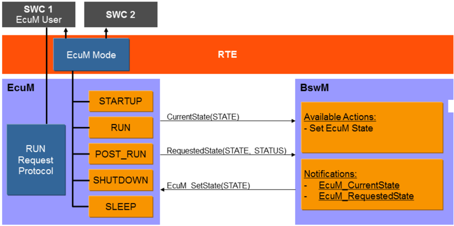

Figure 7.35 illustrates the architectural components of ECU Mode Handling.

[SWS\_EcuM\_04115] glyph[ceilingleft] ECU Mode Handling shall be applied when EcuMModeHandling is configured to true. glyph[floorright] (SRS\_ModeMgm\_09115, SRS\_ModeMgm\_09116)

[SWS\_EcuM\_04116] glyph[ceilingleft] When the BswM sets a state of the EcuM by EcuM\_SetState , the EcuM shall indicate the corresponding mode to the RTE. glyph[floorright] (SRS\_ModeMgm\_09116)

[SWS\_EcuM\_04117] glyph[ceilingleft] When the last RUN request has been released, ECU State Manager module shall indicate this to BswM using the API BswM\_EcuM\_Requested-State(ECUM\_STATE\_RUN, ECUM\_RUNSTATUS\_RELEASED). glyph[floorright] (SRS\_ModeMgm\_-09116)

If a SW-C needs post run activity during POST\_RUN (e.g. shutdown preparation), then it must request POST\_RUN before releasing the RUN request. Otherwise it is not guaranteed that this SW-C will get a chance to run its POST\_RUN code.

[SWS\_EcuM\_04118] glyph[ceilingleft] When the ECU State Manager is not in the state which is requested by a SWC, it shall inform BswM about requested states using the BswM\_-EcuM\_RequestedState API. glyph[floorright] (SRS\_ModeMgm\_09116)

POST\_RUN state provides a post run phase for SW-C's and allows them to save important data or switch off peripherals.

[SWS\_EcuM\_04144] glyph[ceilingleft] When the first RUN or POST\_RUN request has been received, ECU State Manager module shall indicate this to BswM using BswM\_EcuM\_ RequestedState(ECUM\_STATE\_RUN, ECUM\_RUNSTATUS\_REQUESTED). glyph[floorright] (SRS\_-ModeMgm\_09165)

[SWS\_EcuM\_04119] glyph[ceilingleft] When the last POST\_RUN request has been released, ECU State Manager module shall indicate this to BswM using the API BswM\_EcuM\_

SWC 2

RTE


RequestedState(ECUM\_STATE\_POST\_RUN, ECUM\_RUNSTATUS\_RELEASED). glyph[floorright] (SRS\_ModeMgm\_09116)

Hint: To prevent, that the mode machine instance of ECU Mode lags behind and the states EcuM and the RTE get out of phase, the EcuM can use acknowledgement feedback for the mode switch notification.

Note that EcuM only requests Modes from and to RUN and POST\_RUN, the SLEEP Mode has to be set by BswM, as the EcuM has no information about when this Mode can be entered.

Table 7.8: EcuM Modes

| State    | Description                                                                                                           |
|----------|-----------------------------------------------------------------------------------------------------------------------|
| STARTUP  | Initial value. Set by Rte when Rte_Start() has been called.                                                           |
| RUN      | As soon as all necesseray BSW modules are inistialized, BswM switches to this Mode.                                   |
| POST_RUN | EcuM requests POST_RUN, when no RUN requests are available.                                                           |
| SLEEP    | EcuM requests SLEEP Mode when no RUN and POST_RUN requests are available and Shut- down Target is set to SLEEP.       |
| SHUTDOWN | EcuM requests SHUTDOWN Mode when no RUNand POST_ RUN requests are available and Shutdown Target is set to SHUT- DOWN. |

[SWS\_EcuM\_04143] glyph[ceilingleft] EcuM shall notify BswM about the current State by calling the interface BswM\_EcuM\_CurrentState(EcuM\_StateType State). A new state shall be set by EcuM when RTE has given its feedback via the acknowledgement port. glyph[floorright] (SRS\_-ModeMgm\_09115)

## 7.11 Advanced Topics

## 7.11.1 Relation to Bootloader

The Bootloader is not part of AUTOSAR. Still, the application needs an interface to activate the bootloader. For this purpose, two functions are provided: EcuM\_Select-BootTarget and EcuM\_GetBootTarget .


Figure 7.36: Selection of Boot Targets

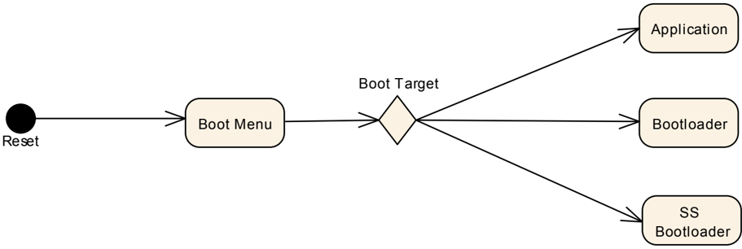

Bootloader, system supplier bootloader and application are separate program images, which in many cases even can be flashed separately. The only way to get from one image to another is through reset. The boot menu will branch into the one or other image depending on the selected boot target.

## 7.11.2 Relation to Complex Drivers

If a complex driver handles a wakeup source, it must follow the protocol for handling wakeup events specified in this document.

## 7.11.3 Handling Errors during Startup and Shutdown

[SWS\_EcuM\_02980] glyph[ceilingleft] The ECU Manager module shall ignore all types of errors that occur during initialization, e.g. values returned by init functions glyph[floorright] (SRS\_BSW\_00386)

Initialization is a configuration issue (see EcuMDriverInitListZero , EcuMDriverInitListOne and EcuMDriverRestartList ) and therefore cannot be standardized.

BSWmodules are responsible themselves for reporting errors occurring during their initialization directly to the DEM module or the DET module, as specified in their SWSs. The ECU Manager module does not report the errors. The BSW module is also responsible for taking any special measures to react to errors occurring during their initialization.

## 7.12 ErrorHook

[SWS\_EcuM\_04033] glyph[ceilingleft] In the unrecoverable error situations defined in the first column in [SWS\_EcuM\_04037], the ECU Manager module shall call the EcuM\_ErrorHook callout with the parameter value set to the corresponding related error code. glyph[floorright] (SRS\_-BSW\_00386)


## [SWS\_EcuM\_04037] glyph[ceilingleft]

Table 7.9: Error Hook Errors

| Error Hook Errors                                       | Error Hook Errors                      | Error Hook Errors            |
|---------------------------------------------------------|----------------------------------------|------------------------------|
| Type of Error                                           | Related Error Code                     | Error Value                  |
| The RAM check during wakeup failed                      | ECUM_E_RAM_CHECK_FAILED                | Assigned by Implementa- tion |
| Postbuild configuration data is inconsistent            | ECUM_E_CONFIGURATION_DATA_INCONSISTENT | Assigned by Implementa- tion |
| Error code which is used to report issues from Os calls | ECUM_E_OS_CALL_FAILED                  | Assigned by Implementa- tion |

## glyph[floorright] (SRS\_BSW\_00385)

Clarification to [SWS\_EcuM\_04033]: EcuM shall assume that the EcuM\_ErrorHook will not return (integrator's code).

Clarification to [SWS\_EcuM\_04033]: In case a Dem error is needed, it is integrator's responsibility to define a strategy to handle it (e.g.: As EcuM does not directly call Dem, set the Dem error after a reset recovery).

[SWS\_EcuM\_04139] glyph[ceilingleft] If an OS function call returns an error code (other than E\_OK), the EcuM shall call EcuM\_ErrorHook with error code ECUM\_E\_OS\_CALL\_FAILED. glyph[floorright] (SRS\_BSW\_00452)

## 7.13 Error classification

Section "Error Handling" of the document [6] describes the error handling of the Basic Software in detail. Above all, it constitutes a classification scheme consisting of five error types which may occur in BSW modules.

Based on this foundation, the following section specifies particular errors arranged in the respective subsections below.

The EcuM has an additional handling of errors (see chapter 7.12 ErrorHook).


## 7.13.1 Development Errors

## [SWS\_EcuM\_04032] Definiton of development errors in module EcuM glyph[ceilingleft]

| Type of error                                                                           | Related error code            | Error value                |
|-----------------------------------------------------------------------------------------|-------------------------------|----------------------------|
| Multiple requests by the same user were detected                                        | ECUM_E_MULTIPLE_RUN_REQUESTS  | Assigned by Implementation |
| A function was called which was disabled by configuration                               | ECUM_E_SERVICE_DISABLED       | Assigned by Implementation |
| A service was called prior to initialization                                            | ECUM_E_UNINIT                 | Assigned by Implementation |
| An unknown wakeup source was passed as a parameter to an API                            | ECUM_E_UNKNOWN_WAKEUP_SOURCE  | Assigned by Implementation |
| The initialization failed                                                               | ECUM_E_INIT_FAILED            | Assigned by Implementation |
| A state, passed as an argument to a service, was out of range (specific parameter test) | ECUM_E_STATE_PAR_OUT_OF_RANGE | Assigned by Implementation |
| A parameter was invalid (unspecific)                                                    | ECUM_E_INVALID_PAR            | Assigned by Implementation |
| A invalid pointer was passed as an argument                                             | ECUM_E_PARAM_POINTER          | Assigned by Implementation |
| A previous matching request for the provided user was not found                         | ECUM_E_MISMATCHED_RUN_RELEASE | Assinged by Implementation |

glyph[floorright] (SRS\_BSW\_00327, SRS\_BSW\_00337, SRS\_BSW\_00350, SRS\_BSW\_00385)

## 7.13.2 Runtime Errors

## [SWS\_EcuM\_91003] Definiton of runtime errors in module EcuM glyph[ceilingleft]

| Type of error                                                                            | Related error code    | Error value                |
|------------------------------------------------------------------------------------------|-----------------------|----------------------------|
| After a wake up, no wake up event was set in the given time (see EcuMCheckWakeupTimeout) | ECUM_E_WAKEUP_TIMEOUT | Assigned by Implementation |

glyph[floorright] ()

## 7.13.3 Transient Faults

There are no transient faults.

## 7.13.4 Production Errors

There are no production errors.


## 7.13.5 Extended Production Errors

There are no extended production errors.


## 8 API specification

## 8.1 Imported Types

This section lists all types imported by the ECU Manager module from the corresponding AUTOSAR modules.

[SWS\_EcuM\_02810] Definition of imported datatypes of module EcuM

glyph[ceilingleft]

| Module         | Header File      | Imported Type              |
|----------------|------------------|----------------------------|
| Adc            | Adc.h            | Adc_ConfigType             |
| BswM           | BswM.h           | BswM_ConfigType            |
| Can            | Can.h            | Can_ConfigType             |
| CanTrcv        | CanTrcv.h        | CanTrcv_ConfigType         |
| ComStack_Types | ComStack_Types.h | NetworkHandleType          |
| ComStack_Types | ComStack_Types.h | PNCHandleType              |
| Dem            | Dem.h            | Dem_ConfigType             |
| Det            | Det.h            | Det_ConfigType             |
| Eth            | Eth.h            | Eth_ConfigType             |
| EthSwt         | EthSwt.h         | EthSwt_ConfigType          |
| EthTrcv        | EthTrcv.h        | EthTrcv_ConfigType         |
| Fls            | Fls.h            | Fls_ConfigType             |
| Fr             | Fr.h             | Fr_ConfigType              |
| FrTrcv         | FrTrcv.h         | FrTrcv_ConfigType          |
| Gpt            | Gpt.h            | Gpt_ConfigType             |
| Icu            | Icu.h            | Icu_ConfigType             |
| IoHwAb         | IoHwAb.h         | IoHwAb{Init_Id}_ConfigType |
| Lin            | Lin.h            | Lin_ConfigType             |
| LinTrcv        | LinTrcv.h        | LinTrcv_ConfigType         |
| McOs           | Os.h             | AppModeType                |
| McOs           | Os.h             | CoreIdType                 |
| Mcu            | Mcu.h            | Mcu_ConfigType             |
| Mcu            | Mcu.h            | Mcu_ModeType               |
| Mcu            | Mcu.h            | Mcu_ResetType              |
| Ocu            | Ocu.h            | Ocu_ConfigType             |
| Os             | Os.h             | StatusType                 |
| Port           | Port.h           | Port_ConfigType            |
| Pwm            | Pwm.h            | Pwm_ConfigType             |
| SchM           | Rte_PBcfg.h      | SchM_ConfigType            |
| Spi            | Spi.h            | Spi_ConfigType             |
| Std            | Std_Types.h      | Std_ReturnType             |
| Std            | Std_Types.h      | Std_VersionInfoType        |
| Wdg            | Wdg.h            | Wdg_ConfigType             |

glyph[floorright] ()

[SWS\_EcuM\_03019] glyph[ceilingleft] ECUM\_E\_EARLIER\_ACTIVE and ECUM\_E\_PAST shall be of type Std\_ReturnType and represent the following values


- ECUM\_E\_EARLIER\_ACTIVE = 3
- ECUM\_E\_PAST = 4

glyph[floorright] ()

## 8.2 Type definitions

## 8.2.1 EcuM\_ConfigType

[SWS\_EcuM\_04038] Definition of datatype EcuM\_ConfigType glyph[ceilingleft]

| Name          | EcuM_ConfigType                                                                                                    | EcuM_ConfigType                                                                                                    |
|---------------|--------------------------------------------------------------------------------------------------------------------|--------------------------------------------------------------------------------------------------------------------|
| Kind          | Structure                                                                                                          | Structure                                                                                                          |
| Elements      | -                                                                                                                  | -                                                                                                                  |
|               | Type                                                                                                               | -                                                                                                                  |
|               | Comment                                                                                                            | The content of this structure depends on the post-build configuration of EcuM.                                     |
| Description   | A pointer to such a structure shall be provided to the ECU State Manager initialization routine for configuration. | A pointer to such a structure shall be provided to the ECU State Manager initialization routine for configuration. |
| Available via | EcuM.h                                                                                                             | EcuM.h                                                                                                             |

glyph[floorright] ()

[SWS\_EcuM\_02801] glyph[ceilingleft] The structure defined by type EcuM\_ConfigType shall hold the post-build configuration parameters for the ECU Manager module as well as pointers to all ConfigType structures of modules that are initialized by the ECU Manager module. glyph[floorright] (SRS\_BSW\_00388, SRS\_BSW\_00390)

The ECU Manager module Configuration Tool must generate the structure defined by the EcuM\_ConfigType type specifically for a given set of basic software modules that comprise the ECU configuration. The set of basic software modules is derived from the corresponding EcuM parameters

[SWS\_EcuM\_02794] glyph[ceilingleft] The structure defined in the EcuM\_ConfigType type shall contain an additional post-build configuration variant identifier (uint8/uint16/uint32 depending on algorithm to compute the identifier). glyph[floorright] (SRS\_BSW\_00394)

See also Chapter 7.3.4 Checking Configuration Consistency.

[SWS\_EcuM\_02795] glyph[ceilingleft] The structure defined by the EcuM\_ConfigType type shall contain an additional hash code that is tested against the configuration parameter EcuMConfigConsistencyHash for checking consistency of the configuration data. glyph[floorright] (SRS\_BSW\_00394)

See also section 7.3.4 Checking Configuration Consistency.

For each given ECU configuration, the ECU Manager module Configuration Tool must generate an instance of this structure that is filled with the post-build configuration parameters of the ECU Manager module as well as pointers to instances of configuration structures for the modules mentioned above. The pointers are derived from the corresponding EcuM parameters.


## 8.2.2 EcuM\_RunStatusType

## [SWS\_EcuM\_04120] Definition of datatype EcuM\_RunStatusType glyph[ceilingleft]

| Name          | EcuM_RunStatusType                              | EcuM_RunStatusType                              | EcuM_RunStatusType                              |
|---------------|-------------------------------------------------|-------------------------------------------------|-------------------------------------------------|
| Kind          | Type                                            | Type                                            | Type                                            |
| Derived from  | uint8                                           | uint8                                           | uint8                                           |
| Range         | ECUM_RUNSTATUS_ UNKNOWN                         | 0                                               | Unknown status. Init Value.                     |
| Range         | ECUM_RUNSTATUS_ REQUESTED                       | 1                                               | Status requested from EcuM                      |
| Range         | ECUM_RUNSTATUS_ RELEASED                        | 2                                               | Status released from EcuM.                      |
| Description   | Result of the Run Request Protocol sent to BswM | Result of the Run Request Protocol sent to BswM | Result of the Run Request Protocol sent to BswM |
| Available via | EcuM.h                                          | EcuM.h                                          | EcuM.h                                          |

glyph[floorright] (SRS\_ModeMgm\_09116)

[SWS\_EcuM\_04121] glyph[ceilingleft] The ECU Manager module shall inform BswM about the state of the Run Request Protocol as listed in the EcuM\_RunStatusType. glyph[floorright] (SRS\_ModeMgm\_-09116)

## 8.2.3 EcuM\_WakeupSourceType

[SWS\_EcuM\_04040] Definition of datatype EcuM\_WakeupSourceType glyph[ceilingleft]

| Name         | EcuM_WakeupSourceType          | EcuM_WakeupSourceType   | EcuM_WakeupSourceType                                                                                                                                                                                                       |
|--------------|--------------------------------|-------------------------|-----------------------------------------------------------------------------------------------------------------------------------------------------------------------------------------------------------------------------|
| Kind         | Type                           | Type                    | Type                                                                                                                                                                                                                        |
| Derived from | uint32                         | uint32                  | uint32                                                                                                                                                                                                                      |
| Range        | ECUM_WKSOURCE_ POWER           | 0x01                    | Power cycle (bit 0)                                                                                                                                                                                                         |
| Range        | ECUM_WKSOURCE_ RESET (default) | 0x02                    | Hardware reset (bit 1). If the Mcu driver cannot distinguish between a power cycle and a reset reason, then this shall be the default wakeup source.                                                                        |
| Range        | ECUM_WKSOURCE_ INTERNAL_RESET  | 0x04                    | Internal reset of µC (bit 2) The internal reset typically only resets the µC core but not peripherals or memory controllers. The exact behavior is hardware specific. This source may also indicate an unhandled exception. |
| Range        | ECUM_WKSOURCE_ INTERNAL_WDG    | 0x08                    | Reset by internal watchdog (bit 3)                                                                                                                                                                                          |


glyph[triangle]

|               | ECUM_WKSOURCE_ EXTERNAL_WDG                                                                                                                                                                                                                                                                                                                             | 0x10                                                                                                                                                                                                                                                                                                                                                    | Reset by external watchdog (bit 4), if detection supported by hardware                                                                                                                                                                                                                                                                                  |
|---------------|---------------------------------------------------------------------------------------------------------------------------------------------------------------------------------------------------------------------------------------------------------------------------------------------------------------------------------------------------------|---------------------------------------------------------------------------------------------------------------------------------------------------------------------------------------------------------------------------------------------------------------------------------------------------------------------------------------------------------|---------------------------------------------------------------------------------------------------------------------------------------------------------------------------------------------------------------------------------------------------------------------------------------------------------------------------------------------------------|
| Description   | EcuM_WakeupSourceType defines a bitfield with 5 pre-defined positions (see Range). The bitfield provides one bit for each wakeup source. In WAKEUP, all bits cleared indicates that no wakeup source is known. In STARTUP, all bits cleared indicates that no reason for restart or reset is known. In this case, ECUM_WKSOURCE_RESET shall be assumed. | EcuM_WakeupSourceType defines a bitfield with 5 pre-defined positions (see Range). The bitfield provides one bit for each wakeup source. In WAKEUP, all bits cleared indicates that no wakeup source is known. In STARTUP, all bits cleared indicates that no reason for restart or reset is known. In this case, ECUM_WKSOURCE_RESET shall be assumed. | EcuM_WakeupSourceType defines a bitfield with 5 pre-defined positions (see Range). The bitfield provides one bit for each wakeup source. In WAKEUP, all bits cleared indicates that no wakeup source is known. In STARTUP, all bits cleared indicates that no reason for restart or reset is known. In this case, ECUM_WKSOURCE_RESET shall be assumed. |
| Available via | EcuM.h                                                                                                                                                                                                                                                                                                                                                  | EcuM.h                                                                                                                                                                                                                                                                                                                                                  | EcuM.h                                                                                                                                                                                                                                                                                                                                                  |

glyph[floorright] ()

[SWS\_EcuM\_02165] glyph[ceilingleft] Additional wakeup sources (to the pre-defined sources) shall be assigned individually to bitfield positions 5 to 31 by configuration. The bit assignment shall be done by the configuration tool. glyph[floorright] (SRS\_ModeMgm\_09100)

[SWS\_EcuM\_02166] glyph[ceilingleft] The EcuMWakeupSourceId (see ECUC\_EcuM\_00151) field in the EcuMWakeupSource container shall define the position corresponding to that wakeup source in all instances the EcuM\_WakeupSourceType bitfield. glyph[floorright] (SRS\_-ModeMgm\_09098)

## 8.2.4 EcuM\_WakeupStatusType

## [SWS\_EcuM\_04041] Definition of datatype EcuM\_WakeupStatusType glyph[ceilingleft]

| Name          | EcuM_WakeupStatusType                                      | EcuM_WakeupStatusType                                      | EcuM_WakeupStatusType                                             |
|---------------|------------------------------------------------------------|------------------------------------------------------------|-------------------------------------------------------------------|
| Kind          | Type                                                       | Type                                                       | Type                                                              |
| Derived from  | uint8                                                      | uint8                                                      | uint8                                                             |
| Range         | ECUM_WKSTATUS_NONE                                         | 0                                                          | No pending wakeup event was detected                              |
| Range         | ECUM_WKSTATUS_ PENDING                                     | 1                                                          | The wakeup event was detected but not yet validated               |
| Range         | ECUM_WKSTATUS_ VALIDATED                                   | 2                                                          | The wakeup event is valid                                         |
| Range         | ECUM_WKSTATUS_ EXPIRED                                     | 3                                                          | The wakeup event has not been validated and has expired therefore |
| Description   | The type describes the possible states of a wakeup source. | The type describes the possible states of a wakeup source. | The type describes the possible states of a wakeup source.        |
| Available via | EcuM.h                                                     | EcuM.h                                                     | EcuM.h                                                            |

- glyph[floorright] () NOTE: This declaration has to be changed to a mode. The name has to be changed.


## 8.2.5 EcuM\_ResetType

## [SWS\_EcuM\_04044] Definition of datatype EcuM\_ResetType glyph[ceilingleft]

| Name          | EcuM_ResetType                                                                                                    | EcuM_ResetType                                                                                                    | EcuM_ResetType                                                                                                    |
|---------------|-------------------------------------------------------------------------------------------------------------------|-------------------------------------------------------------------------------------------------------------------|-------------------------------------------------------------------------------------------------------------------|
| Kind          | Type                                                                                                              | Type                                                                                                              | Type                                                                                                              |
| Derived from  | uint8                                                                                                             | uint8                                                                                                             | uint8                                                                                                             |
| Range         | ECUM_RESET_MCU                                                                                                    | 0                                                                                                                 | Microcontroller reset via Mcu_ PerformReset                                                                       |
| Range         | ECUM_RESET_WDG                                                                                                    | 1                                                                                                                 | Watchdog reset via WdgM_ PerformReset                                                                             |
| Range         | ECUM_RESET_IO                                                                                                     | 2                                                                                                                 | Reset by toggeling an I/O line.                                                                                   |
| Description   | This type describes the reset mechanisms supported by the ECU State Manager. It can be extended by configuration. | This type describes the reset mechanisms supported by the ECU State Manager. It can be extended by configuration. | This type describes the reset mechanisms supported by the ECU State Manager. It can be extended by configuration. |
| Available via | EcuM.h                                                                                                            | EcuM.h                                                                                                            | EcuM.h                                                                                                            |

glyph[floorright] ()

## 8.2.6 EcuM\_StateType

## [SWS\_EcuM\_91005] Definition of datatype EcuM\_StateType glyph[ceilingleft]

| Name          | EcuM_StateType            | EcuM_StateType            | EcuM_StateType            |
|---------------|---------------------------|---------------------------|---------------------------|
| Kind          | Type                      | Type                      | Type                      |
| Derived from  | uint8                     | uint8                     | uint8                     |
| Range         | ECUM_SUBSTATE_MASK        | 0x0f                      | -                         |
|               | ECUM_STATE_STARTUP        | 0x10                      | -                         |
|               | ECUM_STATE_RUN            | 0x32                      | -                         |
|               | ECUM_STATE_POST_RUN       | 0x33                      | -                         |
|               | ECUM_STATE_ SHUTDOWN      | 0x40                      | -                         |
|               | ECUM_STATE_SLEEP          | 0x50                      | -                         |
| Description   | ECU State Manager states. | ECU State Manager states. | ECU State Manager states. |
| Available via | EcuM.h                    | EcuM.h                    | EcuM.h                    |

glyph[floorright] (SRS\_BSW\_00331)

[SWS\_EcuM\_02664] glyph[ceilingleft] The ECU Manager module shall define all states as listed in the EcuM\_StateType. glyph[floorright] (SRS\_BSW\_00331)

## 8.3 Function Definitions

This is a list of functions provided for upper layer modules.


## 8.3.1 General

## 8.3.1.1 EcuM\_GetVersionInfo

## [SWS\_EcuM\_02813] Definition of API function EcuM\_GetVersionInfo

glyph[ceilingleft]

| Service Name       | EcuM_GetVersionInfo                                           | EcuM_GetVersionInfo                                               |
|--------------------|---------------------------------------------------------------|-------------------------------------------------------------------|
| Syntax             | void EcuM_GetVersionInfo ( Std_VersionInfoType* versioninfo ) | void EcuM_GetVersionInfo ( Std_VersionInfoType* versioninfo )     |
| Service ID [hex]   | 0x00                                                          | 0x00                                                              |
| Sync/Async         | Synchronous                                                   | Synchronous                                                       |
| Reentrancy         | Reentrant                                                     | Reentrant                                                         |
| Parameters (in)    | None                                                          | None                                                              |
| Parameters (inout) | None                                                          | None                                                              |
| Parameters (out)   | versioninfo                                                   | Pointer to where to store the version information of this module. |
| Return value       | None                                                          | None                                                              |
| Description        | Returns the version information of this module.               | Returns the version information of this module.                   |
| Available via      | EcuM.h                                                        | EcuM.h                                                            |

glyph[floorright] (SRS\_BSW\_00407, SRS\_BSW\_00411)

## 8.3.2 Initialization and Shutdown Sequences

## 8.3.2.1 EcuM\_GoDownHaltPoll

## [SWS\_EcuM\_91002] Definition of API function EcuM\_GoDownHaltPoll glyph[ceilingleft]

| Service Name       | EcuM_GoDownHaltPoll                                                                                                                | EcuM_GoDownHaltPoll                                                                                                                                                                                                      |
|--------------------|------------------------------------------------------------------------------------------------------------------------------------|--------------------------------------------------------------------------------------------------------------------------------------------------------------------------------------------------------------------------|
| Syntax             | Std_ReturnType EcuM_GoDownHaltPoll ( EcuM_UserType UserID )                                                                        | Std_ReturnType EcuM_GoDownHaltPoll ( EcuM_UserType UserID )                                                                                                                                                              |
| Service ID [hex]   | 0x2c                                                                                                                               | 0x2c                                                                                                                                                                                                                     |
| Sync/Async         | Synchronous                                                                                                                        | Synchronous                                                                                                                                                                                                              |
| Reentrancy         | Reentrant                                                                                                                          | Reentrant                                                                                                                                                                                                                |
| Parameters (in)    | UserID                                                                                                                             | Id of the user calling this API. Only configured users are allowed to call this function.                                                                                                                                |
| Parameters (inout) | None                                                                                                                               | None                                                                                                                                                                                                                     |
| Parameters (out)   | None                                                                                                                               | None                                                                                                                                                                                                                     |
| Return value       | Std_ReturnType                                                                                                                     | E_NOT_OK : The request was not accepted. E_OK : If the ShutdownTargetType is SLEEP the call successfully returns, the ECU has left the sleep again. If the ShutdownTargetType is RESET or OFF this call will not return. |
| Description        | Instructs the ECU State Manager module to go into a sleep mode, Reset or OFF depending on the previously selected shutdown target. | Instructs the ECU State Manager module to go into a sleep mode, Reset or OFF depending on the previously selected shutdown target.                                                                                       |
| Available via      | EcuM.h                                                                                                                             | EcuM.h                                                                                                                                                                                                                   |

glyph[floorright] ()


## 8.3.2.2 EcuM\_Init

## [SWS\_EcuM\_02811] Definition of API function EcuM\_Init glyph[ceilingleft]

| Service Name       | EcuM_Init                                                                                                                  |
|--------------------|----------------------------------------------------------------------------------------------------------------------------|
| Syntax             | void EcuM_Init ( void )                                                                                                    |
| Service ID [hex]   | 0x01                                                                                                                       |
| Sync/Async         | Synchronous                                                                                                                |
| Reentrancy         | Reentrant                                                                                                                  |
| Parameters (in)    | None                                                                                                                       |
| Parameters (inout) | None                                                                                                                       |
| Parameters (out)   | None                                                                                                                       |
| Return value       | None                                                                                                                       |
| Description        | Initializes the ECU state manager and carries out the startup procedure. The function will never return (it calls StartOS) |
| Available via      | EcuM.h                                                                                                                     |

glyph[floorright] (SRS\_BSW\_00358, SRS\_BSW\_00414, SRS\_BSW\_00101)

## 8.3.2.3 EcuM\_StartupTwo

## [SWS\_EcuM\_02838] Definition of API function EcuM\_StartupTwo glyph[ceilingleft]

| Service Name       | EcuM_StartupTwo                                |
|--------------------|------------------------------------------------|
| Syntax             | void EcuM_StartupTwo ( void )                  |
| Service ID [hex]   | 0x1a                                           |
| Sync/Async         | Synchronous                                    |
| Reentrancy         | Non Reentrant                                  |
| Parameters (in)    | None                                           |
| Parameters (inout) | None                                           |
| Parameters (out)   | None                                           |
| Return value       | None                                           |
| Description        | This function implements the STARTUP II state. |
| Available via      | EcuM.h                                         |

glyph[floorright] ()

[SWS\_EcuM\_02806] glyph[ceilingleft] Caveats of EcuM\_StartupTwo: This function must be called from a task, which is started directly as a consequence of StartOS. I.e. either the EcuM\_StartupTwo function must be called from an autostart task or the EcuM\_Startup Two function must be called from a task, which is explicitly started. glyph[floorright] (SRS\_ModeMgm\_-09234)

Clarification to [SWS\_EcuM\_02806] : The OS offers different mechanisms to activate a task on startup. Normally EcuM\_StartupTwo would be configured as an autostart task in the default application mode.


The integrator can configure the OS to activate the EcuM\_StartupTwo task by any mechanism, as long as it is started immediately after StartOS is called. The task can also be activated from within another task and this other task could be an autostart task.

Starting EcuM\_StartupTwo as an autostart task is an implicit activation. The other mechanisms would be an explicit activation.

## 8.3.2.4 EcuM\_Shutdown

## [SWS\_EcuM\_02812] Definition of API function EcuM\_Shutdown glyph[ceilingleft]

| Service Name       | EcuM_Shutdown                                                                                                                |
|--------------------|------------------------------------------------------------------------------------------------------------------------------|
| Syntax             | void EcuM_Shutdown ( void )                                                                                                  |
| Service ID [hex]   | 0x02                                                                                                                         |
| Sync/Async         | Synchronous                                                                                                                  |
| Reentrancy         | Reentrant                                                                                                                    |
| Parameters (in)    | None                                                                                                                         |
| Parameters (inout) | None                                                                                                                         |
| Parameters (out)   | None                                                                                                                         |
| Return value       | None                                                                                                                         |
| Description        | Typically called from the shutdown hook, this function takes over execution control and will carry out GO OFF II activities. |
| Available via      | EcuM.h                                                                                                                       |

glyph[floorright] (SRS\_ModeMgm\_09114)

## 8.3.3 State Management

## 8.3.3.1 EcuM\_SetState

## [SWS\_EcuM\_04122] Definition of API function EcuM\_SetState glyph[ceilingleft]

| Service Name       | EcuM_SetState                               | EcuM_SetState                               |
|--------------------|---------------------------------------------|---------------------------------------------|
| Syntax             | void EcuM_SetState ( EcuM_StateType state ) | void EcuM_SetState ( EcuM_StateType state ) |
| Service ID [hex]   | 0x2b                                        | 0x2b                                        |
| Sync/Async         | Synchronous                                 | Synchronous                                 |
| Reentrancy         | Reentrant                                   | Reentrant                                   |
| Parameters (in)    | state                                       | State indicated by BswM.                    |
| Parameters (inout) | None                                        | None                                        |
| Parameters (out)   | None                                        | None                                        |
| Return value       | None                                        | None                                        |


| Description   | Function called by BswM to notify about State Switch.   |
|---------------|---------------------------------------------------------|
| Available via | EcuM.h                                                  |

glyph[floorright] ()

[SWS\_EcuM\_04123] glyph[ceilingleft] The EcuM\_SetState function shall set the EcuM State to the value of the State parameter.

If the State parameter is not a valid value, the EcuM\_SetState function shall not change the State and if EcuMDevErrorDetect is enabled, the EcuM\_SetState function shall additionally report an ECUM\_E\_STATE\_PAR\_OUT\_OF\_RANGE to Det. glyph[floorright] (SRS\_ModeMgm\_09116)

## 8.3.3.2 EcuM\_RequestRUN

## [SWS\_EcuM\_04124] Definition of API function EcuM\_RequestRUN glyph[ceilingleft]

| Service Name       | EcuM_RequestRUN                                                                                                                 | EcuM_RequestRUN                                                                                                                 |
|--------------------|---------------------------------------------------------------------------------------------------------------------------------|---------------------------------------------------------------------------------------------------------------------------------|
| Syntax             | Std_ReturnType EcuM_RequestRUN ( EcuM_UserType user )                                                                           | Std_ReturnType EcuM_RequestRUN ( EcuM_UserType user )                                                                           |
| Service ID [hex]   | 0x03                                                                                                                            | 0x03                                                                                                                            |
| Sync/Async         | Synchronous                                                                                                                     | Synchronous                                                                                                                     |
| Reentrancy         | Reentrant for different users                                                                                                   | Reentrant for different users                                                                                                   |
| Parameters (in)    | user                                                                                                                            | ID of the entity requesting the RUN state.                                                                                      |
| Parameters (inout) | None                                                                                                                            | None                                                                                                                            |
| Parameters (out)   | None                                                                                                                            | None                                                                                                                            |
| Return value       | Std_ReturnType                                                                                                                  | E_OK : The request was accepted by EcuM. E_NOT_OK : The request was not accepted by EcuM                                        |
| Description        | Places a request for the RUN state. Requests can be placed by every user made known to the state manager at configuration time. | Places a request for the RUN state. Requests can be placed by every user made known to the state manager at configuration time. |
| Available via      | EcuM.h                                                                                                                          | EcuM.h                                                                                                                          |

## glyph[floorright] ()

Requests of EcuM\_RequestRUN cannot be nested, i.e. one user can only place one request but not more.

[SWS\_EcuM\_04126] glyph[ceilingleft] An implementation must track requests for each user known on the ECU. Run requests are specific to the user. glyph[floorright] (SRS\_ModeMgm\_09116)

[SWS\_EcuM\_03024] glyph[ceilingleft] If EcuMDevErrorDetect is enabled and there are multiple requests by the same user detected by EcuM\_RequestRUN the function shall report ECUM\_E\_MULTIPLE\_RUN\_REQUESTS to Det. glyph[floorright] (SRS\_BSW\_00386)


## 8.3.3.3 EcuM\_ReleaseRUN

## [SWS\_EcuM\_04127] Definition of API function EcuM\_ReleaseRUN glyph[ceilingleft]

| Service Name       | EcuM_ReleaseRUN                                                                                                                | EcuM_ReleaseRUN                                                                                                                |
|--------------------|--------------------------------------------------------------------------------------------------------------------------------|--------------------------------------------------------------------------------------------------------------------------------|
| Syntax             | Std_ReturnType EcuM_ReleaseRUN ( EcuM_UserType user )                                                                          | Std_ReturnType EcuM_ReleaseRUN ( EcuM_UserType user )                                                                          |
| Service ID [hex]   | 0x04                                                                                                                           | 0x04                                                                                                                           |
| Sync/Async         | Synchronous                                                                                                                    | Synchronous                                                                                                                    |
| Reentrancy         | Reentrant                                                                                                                      | Reentrant                                                                                                                      |
| Parameters (in)    | user                                                                                                                           | ID of the entity releasing the RUN state.                                                                                      |
| Parameters (inout) | None                                                                                                                           | None                                                                                                                           |
| Parameters (out)   | None                                                                                                                           | None                                                                                                                           |
| Return value       | Std_ReturnType                                                                                                                 | E_OK : The release request was accepted by EcuM E_NOT_OK : The release request was not accepted by EcuM                        |
| Description        | Releases a RUN request previously done with a call to EcuM_RequestRUN. The service is intended for implementing AUTOSAR ports. | Releases a RUN request previously done with a call to EcuM_RequestRUN. The service is intended for implementing AUTOSAR ports. |
| Available via      | EcuM.h                                                                                                                         | EcuM.h                                                                                                                         |

glyph[floorright] (SRS\_ModeMgm\_09116)

[SWS\_EcuM\_03023] glyph[ceilingleft] If EcuMDevErrorDetect is enabled and EcuM\_ReleaseRUN did not find a previous matching request for the provided user, the function shall report ECUM\_E\_MISMATCHED\_RUN\_RELEASE to Det. glyph[floorright] (SRS\_BSW\_00386)

Configuration of EcuM\_ReleaseRUN: Refer to EcuM\_UserType for more information about user IDs and their generation.

## 8.3.3.4 EcuM\_RequestPOST\_RUN

## [SWS\_EcuM\_04128] Definition of API function EcuM\_RequestPOST\_RUN glyph[ceilingleft]

| Service Name       | EcuM_RequestPOST_RUN                                                                                                                                                                                                                                                                                  | EcuM_RequestPOST_RUN                                                                                                                                                                                                                                                                                  |
|--------------------|-------------------------------------------------------------------------------------------------------------------------------------------------------------------------------------------------------------------------------------------------------------------------------------------------------|-------------------------------------------------------------------------------------------------------------------------------------------------------------------------------------------------------------------------------------------------------------------------------------------------------|
| Syntax             | Std_ReturnType EcuM_RequestPOST_RUN ( EcuM_UserType user )                                                                                                                                                                                                                                            | Std_ReturnType EcuM_RequestPOST_RUN ( EcuM_UserType user )                                                                                                                                                                                                                                            |
| Service ID [hex]   | 0x0a                                                                                                                                                                                                                                                                                                  | 0x0a                                                                                                                                                                                                                                                                                                  |
| Sync/Async         | Synchronous                                                                                                                                                                                                                                                                                           | Synchronous                                                                                                                                                                                                                                                                                           |
| Reentrancy         | Reentrant                                                                                                                                                                                                                                                                                             | Reentrant                                                                                                                                                                                                                                                                                             |
| Parameters (in)    | user                                                                                                                                                                                                                                                                                                  | ID of the entity requesting the POST RUN state.                                                                                                                                                                                                                                                       |
| Parameters (inout) | None                                                                                                                                                                                                                                                                                                  | None                                                                                                                                                                                                                                                                                                  |
| Parameters (out)   | None                                                                                                                                                                                                                                                                                                  | None                                                                                                                                                                                                                                                                                                  |
| Return value       | Std_ReturnType                                                                                                                                                                                                                                                                                        | E_OK : The request was accepted by EcuM E_NOT_OK : The request was not accepted by EcuM                                                                                                                                                                                                               |
| Description        | Places a request for the POST RUN state. Requests can be placed by every user made known to the state manager at configuration time. Requests for RUN and POST RUN must be tracked independently (in other words: two independent variables). The service is intended for implementing AUTOSAR ports. | Places a request for the POST RUN state. Requests can be placed by every user made known to the state manager at configuration time. Requests for RUN and POST RUN must be tracked independently (in other words: two independent variables). The service is intended for implementing AUTOSAR ports. |
| Available via      | EcuM.h                                                                                                                                                                                                                                                                                                | EcuM.h                                                                                                                                                                                                                                                                                                |


glyph[floorright] (SRS\_ModeMgm\_09116)

[SWS\_EcuM\_03025] glyph[ceilingleft] If EcuMDevErrorDetect is enabled and there are multiple requests by the same user detected by EcuM\_RequestPOST\_RUN the function shall report ECUM\_E\_MULTIPLE\_RUN\_REQUESTS to Det. glyph[floorright] (SRS\_BSW\_00386)

All requirements of 8.3.3.2 EcuM\_RequestRUN apply accordingly to the function Ecu M\_RequestPOST\_RUN.

Configuration of EcuM\_RequestPOST\_RUN: Refer to EcuM\_UserType for more information about user IDs and their generation.

## 8.3.3.5 EcuM\_ReleasePOST\_RUN

## [SWS\_EcuM\_04129] Definition of API function EcuM\_ReleasePOST\_RUN glyph[ceilingleft]

| Service Name       | EcuM_ReleasePOST_RUN                                                                                                                     | EcuM_ReleasePOST_RUN                                                                                                                     |
|--------------------|------------------------------------------------------------------------------------------------------------------------------------------|------------------------------------------------------------------------------------------------------------------------------------------|
| Syntax             | Std_ReturnType EcuM_ReleasePOST_RUN ( EcuM_UserType user )                                                                               | Std_ReturnType EcuM_ReleasePOST_RUN ( EcuM_UserType user )                                                                               |
| Service ID [hex]   | 0x0b                                                                                                                                     | 0x0b                                                                                                                                     |
| Sync/Async         | Synchronous                                                                                                                              | Synchronous                                                                                                                              |
| Reentrancy         | Reentrant                                                                                                                                | Reentrant                                                                                                                                |
| Parameters (in)    | user                                                                                                                                     | ID of the entity releasing the POST RUN state.                                                                                           |
| Parameters (inout) | None                                                                                                                                     | None                                                                                                                                     |
| Parameters (out)   | None                                                                                                                                     | None                                                                                                                                     |
| Return value       | Std_ReturnType                                                                                                                           | E_OK : The release request was accepted by EcuM E_NOT_OK : The release request was not accepted by EcuM                                  |
| Description        | Releases a POST RUN request previously done with a call to EcuM_RequestPOST_RUN. The service is intended for implementing AUTOSAR ports. | Releases a POST RUN request previously done with a call to EcuM_RequestPOST_RUN. The service is intended for implementing AUTOSAR ports. |
| Available via      | EcuM.h                                                                                                                                   | EcuM.h                                                                                                                                   |

## glyph[floorright] (SRS\_ModeMgm\_09116)

[SWS\_EcuM\_03026] glyph[ceilingleft] If EcuMDevErrorDetect is enabled, and EcuM\_Release-POST\_RUN did not find a previous matching request for the provided user, the function shall report ECUM\_E\_MISMATCHED\_RUN\_RELEASE to Det. glyph[floorright] (SRS\_BSW\_00386)

Configuration of EcuM\_ReleasePOST\_RUN: Refer to EcuM\_UserType for more information about user IDs and their generation.


## 8.3.4 Shutdown Management

## 8.3.4.1 EcuM\_SelectShutdownTarget

[SWS\_EcuM\_02822] Definition of API function EcuM\_SelectShutdownTarget glyph[ceilingleft]

| Service Name       | EcuM_SelectShutdownTarget                                                                                                          | EcuM_SelectShutdownTarget                                                                                                                                             |
|--------------------|------------------------------------------------------------------------------------------------------------------------------------|-----------------------------------------------------------------------------------------------------------------------------------------------------------------------|
| Syntax             | Std_ReturnType EcuM_SelectShutdownTarget ( EcuM_ShutdownTargetType shutdownTarget, EcuM_ShutdownModeType shutdownMode )            | Std_ReturnType EcuM_SelectShutdownTarget ( EcuM_ShutdownTargetType shutdownTarget, EcuM_ShutdownModeType shutdownMode )                                               |
| Service ID [hex]   | 0x06                                                                                                                               | 0x06                                                                                                                                                                  |
| Sync/Async         | Synchronous                                                                                                                        | Synchronous                                                                                                                                                           |
| Reentrancy         | Reentrant                                                                                                                          | Reentrant                                                                                                                                                             |
| Parameters (in)    | shutdownTarget                                                                                                                     | The selected shutdown target.                                                                                                                                         |
| Parameters (in)    | shutdownMode                                                                                                                       | The identfier of a sleep mode (if target is ECUM_SHUTDOWN_ TARGET_SLEEP) or a reset mechanism (if target is ECUM_ SHUTDOWN_TARGET_RESET) as defined by configuration. |
| Parameters (inout) | None                                                                                                                               | None                                                                                                                                                                  |
| Parameters (out)   | None                                                                                                                               | None                                                                                                                                                                  |
| Return value       | Std_ReturnType                                                                                                                     | E_OK : The new shutdown target was set E_NOT_OK : The new shutdown target was not set                                                                                 |
| Description        | EcuM_SelectShutdownTarget selects the shutdown target. EcuM_SelectShutdownTarget is part of the ECU Manager Module port interface. | EcuM_SelectShutdownTarget selects the shutdown target. EcuM_SelectShutdownTarget is part of the ECU Manager Module port interface.                                    |
| Available via      | EcuM.h                                                                                                                             | EcuM.h                                                                                                                                                                |

glyph[floorright] (SRS\_ModeMgm\_09114, SRS\_ModeMgm\_09128, SRS\_ModeMgm\_09235)

[SWS\_EcuM\_00624] glyph[ceilingleft] The EcuM\_SelectShutdownTarget function shall set the shutdown target to the value of the shutdownTarget parameter. glyph[floorright] (SRS\_ModeMgm\_09114, SRS\_ModeMgm\_09235)

[SWS\_EcuM\_02185] glyph[ceilingleft] The parameter mode of the function EcuM\_SelectShutdown Target shall be the identifier of a sleep or reset mode. The mode parameter shall only be used if the target parameter equals ECUM\_SHUTDOWN\_TARGET\_SLEEP or ECUM\_SHUTDOWN\_TARGET\_RESET. In all other cases, it shall be ignored. Only sleep or reset modes that are defined at configuration time and are stored in the Ecu MCommonConfiguration container (see ECUC\_EcuM\_00181) are allowed as parameters. glyph[floorright] (SRS\_ModeMgm\_09114)

[SWS\_EcuM\_02585] glyph[ceilingleft] EcuM\_SelectShutdownTarget shall not initiate any setup activities but only store the value for later use in the SHUTDOWN or SLEEP phase. glyph[floorright] (SRS\_-ModeMgm\_09114)

Implementation hint: The ECU Manager module does not define any mechanism to resolve conflicts arising from requests from different sources. The shutdown target is always the last value set.


## 8.3.4.2 EcuM\_GetShutdownTarget

## [SWS\_EcuM\_02824] Definition of API function EcuM\_GetShutdownTarget glyph[ceilingleft]

| Service Name       | EcuM_GetShutdownTarget                                                                                                                                                    | EcuM_GetShutdownTarget                                                                                                                                                                                                                                                      |
|--------------------|---------------------------------------------------------------------------------------------------------------------------------------------------------------------------|-----------------------------------------------------------------------------------------------------------------------------------------------------------------------------------------------------------------------------------------------------------------------------|
| Syntax             | Std_ReturnType EcuM_GetShutdownTarget ( EcuM_ShutdownTargetType* shutdownTarget, EcuM_ShutdownModeType* shutdownMode )                                                    | Std_ReturnType EcuM_GetShutdownTarget ( EcuM_ShutdownTargetType* shutdownTarget, EcuM_ShutdownModeType* shutdownMode )                                                                                                                                                      |
| Service ID [hex]   | 0x09                                                                                                                                                                      | 0x09                                                                                                                                                                                                                                                                        |
| Sync/Async         | Synchronous                                                                                                                                                               | Synchronous                                                                                                                                                                                                                                                                 |
| Reentrancy         | Reentrant                                                                                                                                                                 | Reentrant                                                                                                                                                                                                                                                                   |
| Parameters (in)    | None                                                                                                                                                                      | None                                                                                                                                                                                                                                                                        |
| Parameters (inout) | None                                                                                                                                                                      | None                                                                                                                                                                                                                                                                        |
| Parameters (out)   | shutdownTarget                                                                                                                                                            | One of these values is returned: ECUM_SHUTDOWN_TARGET_ SLEEP ECUM_SHUTDOWN_TARGET_RESET ECUM_ SHUTDOWN_TARGET_OFF                                                                                                                                                           |
| Parameters (out)   | shutdownMode                                                                                                                                                              | If the out parameter "shutdownTarget" is ECUM_SHUTDOWN_ TARGET_SLEEP, sleepMode tells which of the configured sleep modes was actually chosen. If "shutdownTarget" is ECUM_ SHUTDOWN_TARGET_RESET, sleepMode tells which of the configured reset modes was actually chosen. |
| Return value       | Std_ReturnType                                                                                                                                                            | E_OK : The service has succeeded E_NOT_OK : The service has failed, e.g. due to NULL pointer being passed                                                                                                                                                                   |
| Description        | EcuM_GetShutdownTarget returns the currently selected shutdown target as set by EcuM_ SelectShutdownTarget. EcuM_GetShutdownTarget is part of the ECU Manager Module port | EcuM_GetShutdownTarget returns the currently selected shutdown target as set by EcuM_ SelectShutdownTarget. EcuM_GetShutdownTarget is part of the ECU Manager Module port                                                                                                   |
| Available via      | EcuM.h                                                                                                                                                                    | EcuM.h                                                                                                                                                                                                                                                                      |

glyph[floorright] (SRS\_ModeMgm\_09128, SRS\_ModeMgm\_09235)

[SWS\_EcuM\_02788] glyph[ceilingleft] If the pointer to the shutdownMode parameter is NULL, EcuM\_ GetShutdownTarget shall simply ignore the shutdownMode parameter. If EcuMDevErrorDetect is enabled, EcuM\_GetShutdownTarget shall report the ECUM\_E\_ PARAM\_POINTER to Det. glyph[floorright] (SRS\_BSW\_00386)

## 8.3.4.3 EcuM\_GetLastShutdownTarget

## [SWS\_EcuM\_02825] Definition of API function EcuM\_GetLastShutdownTarget glyph[ceilingleft]

| Service Name       | EcuM_GetLastShutdownTarget                                                                                                 |
|--------------------|----------------------------------------------------------------------------------------------------------------------------|
| Syntax             | Std_ReturnType EcuM_GetLastShutdownTarget ( EcuM_ShutdownTargetType* shutdownTarget, EcuM_ShutdownModeType* shutdownMode ) |
| Service ID [hex]   | 0x08                                                                                                                       |
| Sync/Async         | Synchronous                                                                                                                |
| Reentrancy         | Reentrant                                                                                                                  |
| Parameters (in)    | None                                                                                                                       |
| Parameters (inout) | None                                                                                                                       |

glyph[triangleinv]


## glyph[triangle]

| Parameters (out)   | shutdownTarget                                                                                                                                                        | One of these values is returned: ECUM_SHUTDOWN_TARGET_ SLEEP ECUM_SHUTDOWN_TARGET_RESET ECUM_ SHUTDOWN_TARGET_OFF                                                                                                                                                           |
|--------------------|-----------------------------------------------------------------------------------------------------------------------------------------------------------------------|-----------------------------------------------------------------------------------------------------------------------------------------------------------------------------------------------------------------------------------------------------------------------------|
|                    | shutdownMode                                                                                                                                                          | If the out parameter "shutdownTarget" is ECUM_SHUTDOWN_ TARGET_SLEEP, sleepMode tells which of the configured sleep modes was actually chosen. If "shutdownTarget" is ECUM_ SHUTDOWN_TARGET_RESET, sleepMode tells which of the configured reset modes was actually chosen. |
| Return value       | Std_ReturnType                                                                                                                                                        | E_OK : The service has succeeded E_NOT_OK : The service has failed, e.g. due to NULL pointer being passed                                                                                                                                                                   |
| Description        | EcuM_GetLastShutdownTarget returns the shutdown target of the previous shutdown process. EcuM_GetLastShutdownTarget is part of the ECU Manager Module port interface. | EcuM_GetLastShutdownTarget returns the shutdown target of the previous shutdown process. EcuM_GetLastShutdownTarget is part of the ECU Manager Module port interface.                                                                                                       |
| Available via      | EcuM.h                                                                                                                                                                | EcuM.h                                                                                                                                                                                                                                                                      |

glyph[floorright] (SRS\_ModeMgm\_09128, SRS\_ModeMgm\_09235)

[SWS\_EcuM\_02156] glyph[ceilingleft] EcuM\_GetLastShutdownTarget shall return the ECU state from which the last wakeup or power up occurred in the shutdownTarget parameter. EcuM\_ GetLastShutdownTarget shall always return the same value until the next shutdown. glyph[floorright] (SRS\_ModeMgm\_09235)

[SWS\_EcuM\_02336] glyph[ceilingleft] If the call of GetLastShutdownTarget() passes ECU\_STATE\_ SLEEP in the parameter shutdownTarget, in the parameter shutdownMode it returns which of the configured sleep modes was actually chosen.

If the call of GetLastShutdownTarget() passes ECU\_STATE\_RESET in the parameter shutdownTarget, in the parameter sleepMode it returns which of the configured reset modes was actually chosen. glyph[floorright] (SRS\_BSW\_00403)

[SWS\_EcuM\_02337] glyph[ceilingleft] If the pointer to the shutdownMode parameter is NULL, EcuM\_ GetLastShutdownTarget shall simply ignore the shutdownMode parameter and return the last shutdown target regardless of whether it was SLEEP or not. If EcuMDevErrorDetect is enabled, EcuM\_GetLastShutdownTarget shall report the ECUM\_E\_ PARAM\_POINTER to Det. glyph[floorright] (SRS\_BSW\_00386)

[SWS\_EcuM\_02157] glyph[ceilingleft] EcuM\_GetLastShutdownTarget may return a shutdown target in a STARTUP phase that set late in a previous SHUTDOWN phase. If so, implementation specific limitations shall be clearly documented. glyph[floorright] (SRS\_ModeMgm\_09271)

Rationale for [SWS\_EcuM\_02157]

The EcuM\_GetLastShutdownTarget function is intended primarily for use in the ECU STARTUP or RUN states. To simplify implementation, it is acceptable if the value is set in late shutdown phase for use during the next startup.


## 8.3.4.4 EcuM\_SelectShutdownCause

## [SWS\_EcuM\_04050] Definition of API function EcuM\_SelectShutdownCause glyph[ceilingleft]

| Service Name       | EcuM_SelectShutdownCause                                                                                                             | EcuM_SelectShutdownCause                                                                                                             |
|--------------------|--------------------------------------------------------------------------------------------------------------------------------------|--------------------------------------------------------------------------------------------------------------------------------------|
| Syntax             | Std_ReturnType EcuM_SelectShutdownCause ( EcuM_ShutdownCauseType target )                                                            | Std_ReturnType EcuM_SelectShutdownCause ( EcuM_ShutdownCauseType target )                                                            |
| Service ID [hex]   | 0x1b                                                                                                                                 | 0x1b                                                                                                                                 |
| Sync/Async         | Synchronous                                                                                                                          | Synchronous                                                                                                                          |
| Reentrancy         | Reentrant                                                                                                                            | Reentrant                                                                                                                            |
| Parameters (in)    | target                                                                                                                               | The selected shutdown cause.                                                                                                         |
| Parameters (inout) | None                                                                                                                                 | None                                                                                                                                 |
| Parameters (out)   | None                                                                                                                                 | None                                                                                                                                 |
| Return value       | Std_ReturnType                                                                                                                       | E_OK : The new shutdown cause was set E_NOT_OK : The new shutdown cause was not set                                                  |
| Description        | EcuM_SelectShutdownCause elects the cause for a shutdown. EcuM_SelectShutdownCause is part of the ECU Manager Module port interface. | EcuM_SelectShutdownCause elects the cause for a shutdown. EcuM_SelectShutdownCause is part of the ECU Manager Module port interface. |
| Available via      | EcuM.h                                                                                                                               | EcuM.h                                                                                                                               |

glyph[floorright] ()

## 8.3.4.5 EcuM\_GetShutdownCause

## [SWS\_EcuM\_04051] Definition of API function EcuM\_GetShutdownCause glyph[ceilingleft]

| Service Name       | EcuM_GetShutdownCause                                                                                                                                                  | EcuM_GetShutdownCause                                                                                                                                                  |
|--------------------|------------------------------------------------------------------------------------------------------------------------------------------------------------------------|------------------------------------------------------------------------------------------------------------------------------------------------------------------------|
| Syntax             | Std_ReturnType EcuM_GetShutdownCause ( EcuM_ShutdownCauseType* shutdownCause )                                                                                         | Std_ReturnType EcuM_GetShutdownCause ( EcuM_ShutdownCauseType* shutdownCause )                                                                                         |
| Service ID [hex]   | 0x1c                                                                                                                                                                   | 0x1c                                                                                                                                                                   |
| Sync/Async         | Synchronous                                                                                                                                                            | Synchronous                                                                                                                                                            |
| Reentrancy         | Reentrant                                                                                                                                                              | Reentrant                                                                                                                                                              |
| Parameters (in)    | None                                                                                                                                                                   | None                                                                                                                                                                   |
| Parameters (inout) | None                                                                                                                                                                   | None                                                                                                                                                                   |
| Parameters (out)   | shutdownCause                                                                                                                                                          | The selected cause of the next shutdown.                                                                                                                               |
| Return value       | Std_ReturnType                                                                                                                                                         | E_OK : The service has succeeded E_NOT_OK : The service has failed, e.g. due to NULL pointer being passed                                                              |
| Description        | EcuM_GetShutdownCause returns the selected shutdown cause as set by EcuM_Select ShutdownCause. EcuM_GetShutdownCause is part of the ECU Manager Module port interface. | EcuM_GetShutdownCause returns the selected shutdown cause as set by EcuM_Select ShutdownCause. EcuM_GetShutdownCause is part of the ECU Manager Module port interface. |
| Available via      | EcuM.h                                                                                                                                                                 | EcuM.h                                                                                                                                                                 |

glyph[floorright] ()


## 8.3.5 Wakeup Handling

## 8.3.5.1 EcuM\_CheckWakeup

## [SWS\_EcuM\_91007] Definition of API function EcuM\_CheckWakeup glyph[ceilingleft]

| Service Name       | EcuM_CheckWakeup                                                                                                                                                                                                                                                                            |
|--------------------|---------------------------------------------------------------------------------------------------------------------------------------------------------------------------------------------------------------------------------------------------------------------------------------------|
| Syntax             | void EcuM_CheckWakeup ( EcuM_WakeupSourceType wakeupSource )                                                                                                                                                                                                                                |
| Service ID [hex]   | 0x49                                                                                                                                                                                                                                                                                        |
| Sync/Async         | Synchronous                                                                                                                                                                                                                                                                                 |
| Reentrancy         | Non Reentrant                                                                                                                                                                                                                                                                               |
| Parameters (in)    | wakeupSource -                                                                                                                                                                                                                                                                              |
| Parameters (inout) | None                                                                                                                                                                                                                                                                                        |
| Parameters (out)   | None                                                                                                                                                                                                                                                                                        |
| Return value       | None                                                                                                                                                                                                                                                                                        |
| Description        | This function can be called to check the given wakeup sources. It will pass the argument to the integrator function EcuM_CheckWakeupHook. It can also be called by the ISR of a wakeup source to set up the PLL and check other wakeup sources that may be connected to the same interrupt. |
| Available via      | EcuM.h                                                                                                                                                                                                                                                                                      |

glyph[floorright] ()

## 8.3.5.2 EcuM\_GetPendingWakeupEvents

## [SWS\_EcuM\_02827] Definition of API function EcuM\_GetPendingWakeupEvents glyph[ceilingleft]

| Service Name       | EcuM_GetPendingWakeupEvents                                | EcuM_GetPendingWakeupEvents                                |
|--------------------|------------------------------------------------------------|------------------------------------------------------------|
| Syntax             | EcuM_WakeupSourceType EcuM_GetPendingWakeupEvents ( void ) | EcuM_WakeupSourceType EcuM_GetPendingWakeupEvents ( void ) |
| Service ID [hex]   | 0x0d                                                       | 0x0d                                                       |
| Sync/Async         | Synchronous                                                | Synchronous                                                |
| Reentrancy         | Non-Reentrant, Non-Interruptible                           | Non-Reentrant, Non-Interruptible                           |
| Parameters (in)    | None                                                       | None                                                       |
| Parameters (inout) | None                                                       | None                                                       |
| Parameters (out)   | None                                                       | None                                                       |
| Return value       | EcuM_WakeupSource Type                                     | All wakeup events                                          |
| Description        | Gets pending wakeup events.                                | Gets pending wakeup events.                                |
| Available via      | EcuM.h                                                     | EcuM.h                                                     |

glyph[floorright] (SRS\_ModeMgm\_09126)

[SWS\_EcuM\_01156] glyph[ceilingleft] EcuM\_GetPendingWakeupEvents shall return wakeup events which have been set to pending but not yet validated as bits set in a EcuM\_-WakeupSourceType bitmask. glyph[floorright] (SRS\_ModeMgm\_09254, SRS\_BSW\_00375)


[SWS\_EcuM\_02172] glyph[ceilingleft] EcuM\_GetPendingWakeupEvents shall be callable from interrupt context, from OS context and an OS-free context. glyph[floorright] (SRS\_BSW\_00333)

[SWS\_EcuM\_03003] glyph[ceilingleft] Caveat of EcuM\_GetPendingWakeupEvents : This function only returns the wakeup events with status ECUM\_WKSTATUS\_PENDING. glyph[floorright] (SRS\_-ModeMgm\_09254)

## 8.3.5.3 EcuM\_ClearWakeupEvent

[SWS\_EcuM\_02828] Definition of API function EcuM\_ClearWakeupEvent glyph[ceilingleft]

| Service Name       | EcuM_ClearWakeupEvent                                        | EcuM_ClearWakeupEvent                                        |
|--------------------|--------------------------------------------------------------|--------------------------------------------------------------|
| Syntax             | void EcuM_ClearWakeupEvent ( EcuM_WakeupSourceType sources ) | void EcuM_ClearWakeupEvent ( EcuM_WakeupSourceType sources ) |
| Service ID [hex]   | 0x16                                                         | 0x16                                                         |
| Sync/Async         | Synchronous                                                  | Synchronous                                                  |
| Reentrancy         | Non-Reentrant, Non-Interruptible                             | Non-Reentrant, Non-Interruptible                             |
| Parameters (in)    | sources                                                      | Events to be cleared                                         |
| Parameters (inout) | None                                                         | None                                                         |
| Parameters (out)   | None                                                         | None                                                         |
| Return value       | None                                                         | None                                                         |
| Description        | Clears wakeup events.                                        | Clears wakeup events.                                        |
| Available via      | EcuM.h                                                       | EcuM.h                                                       |

glyph[floorright] (SRS\_ModeMgm\_09126)

[SWS\_EcuM\_02683] glyph[ceilingleft] EcuM\_ClearWakeupEvent clears all pending events passed as a bit set in the sources in parameter (EcuM\_WakeupSourceType bitmask) from the internal pending wakeup events variable, the internal validated events variable and the internal expired events variable. glyph[floorright] (SRS\_ModeMgm\_09254)

See also section 7.6.3 Internal Representation of Wakeup States.

[SWS\_EcuM\_02807] glyph[ceilingleft] EcuM\_ClearWakeupEvent shall be callable from interrupt context, from OS context and an OS-free context. glyph[floorright] (SRS\_BSW\_00333)

Integration note: The clearing of wakeup sources shall take place during ECU shutdown prior to the call of Dem\_Shutdown() and NvM\_WriteAll(). This can be achieved by configuring BswMRules in the BswM module containing BswMActions of type BswMUserCallout with their BswMUserCalloutFunction parameter set to "EcuM\_Clear WakeupEvents(&lt;sources&gt;)". Hereby &lt;sources&gt; needs to be derived from the Ecu MWakeupSourceIds in the EcuM configuration. These BswMRules must then be configured in a way that they get triggered during ECU shutdown prior to the call of Dem\_ Shutdown() and NvM\_WriteAll().


## 8.3.5.4 EcuM\_GetValidatedWakeupEvents

## [SWS\_EcuM\_02830] Definition of API function EcuM\_GetValidatedWakeup Events glyph[ceilingleft]

| Service Name       | EcuM_GetValidatedWakeupEvents                                | EcuM_GetValidatedWakeupEvents                                |
|--------------------|--------------------------------------------------------------|--------------------------------------------------------------|
| Syntax             | EcuM_WakeupSourceType EcuM_GetValidatedWakeupEvents ( void ) | EcuM_WakeupSourceType EcuM_GetValidatedWakeupEvents ( void ) |
| Service ID [hex]   | 0x15                                                         | 0x15                                                         |
| Sync/Async         | Synchronous                                                  | Synchronous                                                  |
| Reentrancy         | Non-Reentrant, Non-Interruptible                             | Non-Reentrant, Non-Interruptible                             |
| Parameters (in)    | None                                                         | None                                                         |
| Parameters (inout) | None                                                         | None                                                         |
| Parameters (out)   | None                                                         | None                                                         |
| Return value       | EcuM_WakeupSource Type                                       | All wakeup events                                            |
| Description        | Gets validated wakeup events.                                | Gets validated wakeup events.                                |
| Available via      | EcuM.h                                                       | EcuM.h                                                       |

glyph[floorright] (SRS\_ModeMgm\_09126)

[SWS\_EcuM\_02533] glyph[ceilingleft] EcuM\_GetValidatedWakeupEvents shall return wakeup events which have been set to validated in the internal validated events variable as bits set in a EcuM\_WakeupSourceType bitmask. glyph[floorright] (SRS\_ModeMgm\_09126)

See also section 7.6.3 Internal Representation of Wakeup States.

[SWS\_EcuM\_02532] glyph[ceilingleft] EcuM\_GetValidatedWakeupEvents shall be callable from interrupt context, from OS context and an OS-free context. glyph[floorright] (SRS\_BSW\_00333)

## 8.3.5.5 EcuM\_GetExpiredWakeupEvents

## [SWS\_EcuM\_02831] Definition of API function EcuM\_GetExpiredWakeupEvents glyph[ceilingleft]

| Service Name       | EcuM_GetExpiredWakeupEvents                                |
|--------------------|------------------------------------------------------------|
| Syntax             | EcuM_WakeupSourceType EcuM_GetExpiredWakeupEvents ( void ) |
| Service ID [hex]   | 0x19                                                       |
| Sync/Async         | Synchronous                                                |
| Reentrancy         | Non-Reentrant, Non-Interruptible                           |
| Parameters (in)    | None                                                       |
| Parameters (inout) | None                                                       |
| Parameters (out)   | None                                                       |

glyph[triangleinv]


glyph[triangle]

| Return value   | EcuM_WakeupSource Type      | All wakeup events: Returns all events that have been set and for which validation has failed. Events which do not need validation must never be reported by this function.   |
|----------------|-----------------------------|------------------------------------------------------------------------------------------------------------------------------------------------------------------------------|
| Description    | Gets expired wakeup events. | Gets expired wakeup events.                                                                                                                                                  |
| Available via  | EcuM.h                      | EcuM.h                                                                                                                                                                       |

glyph[floorright] (SRS\_ModeMgm\_09126)

[SWS\_EcuM\_04076] glyph[ceilingleft] EcuM\_GetExpiredWakeupEvents shall return wakeup events which have been set to validated in the internal expired events variable as bits set in a EcuM\_WakeupSourceType bitmask. glyph[floorright] (SRS\_ModeMgm\_09126)

See also section 7.6.3 Internal Representation of Wakeup States.

[SWS\_EcuM\_02589] glyph[ceilingleft] EcuM\_GetExpiredWakeupEvents shall be callable from interrupt context, from OS context and an OS-free context. glyph[floorright] (SRS\_BSW\_00333)

## 8.3.6 Alarm Clock

## 8.3.6.1 EcuM\_SetRelWakeupAlarm

[SWS\_EcuM\_04054] Definition of API function EcuM\_SetRelWakeupAlarm glyph[ceilingleft]

| Service Name       | EcuM_SetRelWakeupAlarm                                                                                                                                            | EcuM_SetRelWakeupAlarm                                                                                                                                            |
|--------------------|-------------------------------------------------------------------------------------------------------------------------------------------------------------------|-------------------------------------------------------------------------------------------------------------------------------------------------------------------|
| Syntax             | Std_ReturnType EcuM_SetRelWakeupAlarm ( EcuM_UserType user, EcuM_TimeType time )                                                                                  | Std_ReturnType EcuM_SetRelWakeupAlarm ( EcuM_UserType user, EcuM_TimeType time )                                                                                  |
| Service ID [hex]   | 0x22                                                                                                                                                              | 0x22                                                                                                                                                              |
| Sync/Async         | Synchronous                                                                                                                                                       | Synchronous                                                                                                                                                       |
| Reentrancy         | Reentrant                                                                                                                                                         | Reentrant                                                                                                                                                         |
| Parameters (in)    | user                                                                                                                                                              | The user that wants to set the wakeup alarm.                                                                                                                      |
| Parameters (in)    | time                                                                                                                                                              | Relative time from now in seconds.                                                                                                                                |
| Parameters (inout) | None                                                                                                                                                              | None                                                                                                                                                              |
| Parameters (out)   | None                                                                                                                                                              | None                                                                                                                                                              |
| Return value       | Std_ReturnType                                                                                                                                                    | E_OK : The service has succeeded E_NOT_OK : The service failed ECUM_E_EARLIER_ACTIVE : An earlier alarm is already set                                            |
| Description        | EcuM_SetRelWakeupAlarm sets a user's wakeup alarm relative to the current point in time. EcuM_SetRelWakeupAlarm is part of the ECU Manager Module port interface. | EcuM_SetRelWakeupAlarm sets a user's wakeup alarm relative to the current point in time. EcuM_SetRelWakeupAlarm is part of the ECU Manager Module port interface. |
| Available via      | EcuM.h                                                                                                                                                            | EcuM.h                                                                                                                                                            |

glyph[floorright] (SRS\_ModeMgm\_09186, SRS\_ModeMgm\_09190)

[SWS\_EcuM\_04055] glyph[ceilingleft] If the relative time from now is earlier than the current wakeup time, EcuM\_SetRelWakeupAlarm shall update the wakeup time. glyph[floorright] (SRS\_ModeMgm\_-09186)


[SWS\_EcuM\_04056] glyph[ceilingleft] If the relative time from now is later than the current wakeup time, EcuM\_SetRelWakeupAlarm shall not update the wakeup time and shall return ECUM\_E\_EARLIER\_ACTIVE. glyph[floorright] (SRS\_ModeMgm\_09186)

## 8.3.6.2 EcuM\_SetAbsWakeupAlarm

## [SWS\_EcuM\_04057] Definition of API function EcuM\_SetAbsWakeupAlarm glyph[ceilingleft]

| Service Name       | EcuM_SetAbsWakeupAlarm                                                                                                                                      | EcuM_SetAbsWakeupAlarm                                                                                                                                                          |
|--------------------|-------------------------------------------------------------------------------------------------------------------------------------------------------------|---------------------------------------------------------------------------------------------------------------------------------------------------------------------------------|
| Syntax             | Std_ReturnType EcuM_SetAbsWakeupAlarm ( EcuM_UserType user, EcuM_TimeType time )                                                                            | Std_ReturnType EcuM_SetAbsWakeupAlarm ( EcuM_UserType user, EcuM_TimeType time )                                                                                                |
| Service ID [hex]   | 0x23                                                                                                                                                        | 0x23                                                                                                                                                                            |
| Sync/Async         | Synchronous                                                                                                                                                 | Synchronous                                                                                                                                                                     |
| Reentrancy         | Reentrant                                                                                                                                                   | Reentrant                                                                                                                                                                       |
| Parameters (in)    | user                                                                                                                                                        | The user that wants to set the wakeup alarm.                                                                                                                                    |
| Parameters (in)    | time                                                                                                                                                        | Absolute time in seconds. Note that, absolute alarms use knowledge of the current time.                                                                                         |
| Parameters (inout) | None                                                                                                                                                        | None                                                                                                                                                                            |
| Parameters (out)   | None                                                                                                                                                        | None                                                                                                                                                                            |
| Return value       | Std_ReturnType                                                                                                                                              | E_OK : The service has succeeded E_NOT_OK : The service failed ECUM_E_EARLIER_ACTIVE : An earlier alarm is already set ECUM_E_PAST : The given point in time has already passed |
| Description        | EcuM_SetAbsWakeupAlarm sets the user's wakeup alarm to an absolute point in time. EcuM_ SetAbsWakeupAlarm is part of the ECU Manager Module port interface. | EcuM_SetAbsWakeupAlarm sets the user's wakeup alarm to an absolute point in time. EcuM_ SetAbsWakeupAlarm is part of the ECU Manager Module port interface.                     |
| Available via      | EcuM.h                                                                                                                                                      | EcuM.h                                                                                                                                                                          |

glyph[floorright] (SRS\_ModeMgm\_09186, SRS\_ModeMgm\_09199)

[SWS\_EcuM\_04058] glyph[ceilingleft] If the time parameter is earlier than the current wakeup time, EcuM\_SetAbsWakeupAlarm shall update the wakeup time. glyph[floorright] (SRS\_ModeMgm\_-09186)

[SWS\_EcuM\_04059] glyph[ceilingleft] If the time parameter is later than the current wakeup time, EcuM\_SetAbsWakeupAlarm shall not update the wakeup time and shall return ECUM\_E\_EARLIER\_ACTIVE. glyph[floorright] (SRS\_ModeMgm\_09186)

[SWS\_EcuM\_04060] glyph[ceilingleft] If the time parameter is earlier than now, EcuM\_SetAbsWake-upAlarm shall not update the wakeup time and shall return ECUM\_E\_PAST. glyph[floorright] (SRS\_-ModeMgm\_09186)


## 8.3.6.3 EcuM\_AbortWakeupAlarm

## [SWS\_EcuM\_04061] Definition of API function EcuM\_AbortWakeupAlarm glyph[ceilingleft]

| Service Name       | EcuM_AbortWakeupAlarm                                                                                                                               | EcuM_AbortWakeupAlarm                                                                                                                               |
|--------------------|-----------------------------------------------------------------------------------------------------------------------------------------------------|-----------------------------------------------------------------------------------------------------------------------------------------------------|
| Syntax             | Std_ReturnType EcuM_AbortWakeupAlarm ( EcuM_UserType user )                                                                                         | Std_ReturnType EcuM_AbortWakeupAlarm ( EcuM_UserType user )                                                                                         |
| Service ID [hex]   | 0x24                                                                                                                                                | 0x24                                                                                                                                                |
| Sync/Async         | Synchronous                                                                                                                                         | Synchronous                                                                                                                                         |
| Reentrancy         | Reentrant                                                                                                                                           | Reentrant                                                                                                                                           |
| Parameters (in)    | user                                                                                                                                                | The user that wants to cancel the wakeup alarm.                                                                                                     |
| Parameters (inout) | None                                                                                                                                                | None                                                                                                                                                |
| Parameters (out)   | None                                                                                                                                                | None                                                                                                                                                |
| Return value       | Std_ReturnType                                                                                                                                      | E_OK : The service has succeeded E_NOT_OK : The service failed ECUM_E_NOT_ACTIVE : No owned alarm found                                             |
| Description        | Ecum_AbortWakeupAlarm aborts the wakeup alarm previously set by this user. EcuM_Abort WakeupAlarm is part of the ECU Manager Module port interface. | Ecum_AbortWakeupAlarm aborts the wakeup alarm previously set by this user. EcuM_Abort WakeupAlarm is part of the ECU Manager Module port interface. |
| Available via      | EcuM.h                                                                                                                                              | EcuM.h                                                                                                                                              |

glyph[floorright] ()

## 8.3.6.4 EcuM\_GetCurrentTime

## [SWS\_EcuM\_04062] Definition of API function EcuM\_GetCurrentTime glyph[ceilingleft]

| Service Name       | EcuM_GetCurrentTime                                                                                                                                                          | EcuM_GetCurrentTime                                                                                                                                                          |
|--------------------|------------------------------------------------------------------------------------------------------------------------------------------------------------------------------|------------------------------------------------------------------------------------------------------------------------------------------------------------------------------|
| Syntax             | Std_ReturnType EcuM_GetCurrentTime ( EcuM_TimeType* time )                                                                                                                   | Std_ReturnType EcuM_GetCurrentTime ( EcuM_TimeType* time )                                                                                                                   |
| Service ID [hex]   | 0x25                                                                                                                                                                         | 0x25                                                                                                                                                                         |
| Sync/Async         | Synchronous                                                                                                                                                                  | Synchronous                                                                                                                                                                  |
| Reentrancy         | Reentrant                                                                                                                                                                    | Reentrant                                                                                                                                                                    |
| Parameters (in)    | None                                                                                                                                                                         | None                                                                                                                                                                         |
| Parameters (inout) | None                                                                                                                                                                         | None                                                                                                                                                                         |
| Parameters (out)   | time                                                                                                                                                                         | Absolute time in seconds since battery connect.                                                                                                                              |
| Return value       | Std_ReturnType                                                                                                                                                               | E_OK : The service has succeeded E_NOT_OK : time points to NULL or the module is not initialized                                                                             |
| Description        | EcuM_GetCurrentTime returns the current value of the EcuM clock (i.e. the time since battery connect). EcuM_GetCurrentTime is part of the ECU Manager Module port interface. | EcuM_GetCurrentTime returns the current value of the EcuM clock (i.e. the time since battery connect). EcuM_GetCurrentTime is part of the ECU Manager Module port interface. |
| Available via      | EcuM.h                                                                                                                                                                       | EcuM.h                                                                                                                                                                       |

glyph[floorright] ()


## 8.3.6.5 EcuM\_GetWakeupTime

## [SWS\_EcuM\_04063] Definition of API function EcuM\_GetWakeupTime glyph[ceilingleft]

| Service Name       | EcuM_GetWakeupTime                                                                                                                                                                                | EcuM_GetWakeupTime                                                                                                                                                                                |
|--------------------|---------------------------------------------------------------------------------------------------------------------------------------------------------------------------------------------------|---------------------------------------------------------------------------------------------------------------------------------------------------------------------------------------------------|
| Syntax             | Std_ReturnType EcuM_GetWakeupTime ( EcuM_TimeType* time )                                                                                                                                         | Std_ReturnType EcuM_GetWakeupTime ( EcuM_TimeType* time )                                                                                                                                         |
| Service ID [hex]   | 0x26                                                                                                                                                                                              | 0x26                                                                                                                                                                                              |
| Sync/Async         | Synchronous                                                                                                                                                                                       | Synchronous                                                                                                                                                                                       |
| Reentrancy         | Reentrant                                                                                                                                                                                         | Reentrant                                                                                                                                                                                         |
| Parameters (in)    | None                                                                                                                                                                                              | None                                                                                                                                                                                              |
| Parameters (inout) | None                                                                                                                                                                                              | None                                                                                                                                                                                              |
| Parameters (out)   | time                                                                                                                                                                                              | Absolute time in seconds for next wakeup. 0xFFFFFFFF means no active alarm.                                                                                                                       |
| Return value       | Std_ReturnType                                                                                                                                                                                    | E_OK : The service has succeeded E_NOT_OK : time points to NULL or the module is not initialized                                                                                                  |
| Description        | EcuM_GetWakeupTime returns the current value of the master alarm clock (the minimum absolute time of all user alarm clocks). EcuM_GetWakeupTime is part of the ECU Manager Module port interface. | EcuM_GetWakeupTime returns the current value of the master alarm clock (the minimum absolute time of all user alarm clocks). EcuM_GetWakeupTime is part of the ECU Manager Module port interface. |
| Available via      | EcuM.h                                                                                                                                                                                            | EcuM.h                                                                                                                                                                                            |

glyph[floorright] ()

## 8.3.6.6 EcuM\_SetClock

## [SWS\_EcuM\_04064] Definition of API function EcuM\_SetClock glyph[ceilingleft]

| Service Name       | EcuM_SetClock                                                                                                                                                                                                                   | EcuM_SetClock                                                                                                                                                                                                                   |
|--------------------|---------------------------------------------------------------------------------------------------------------------------------------------------------------------------------------------------------------------------------|---------------------------------------------------------------------------------------------------------------------------------------------------------------------------------------------------------------------------------|
| Syntax             | Std_ReturnType EcuM_SetClock ( EcuM_UserType user, EcuM_TimeType time )                                                                                                                                                         | Std_ReturnType EcuM_SetClock ( EcuM_UserType user, EcuM_TimeType time )                                                                                                                                                         |
| Service ID [hex]   | 0x27                                                                                                                                                                                                                            | 0x27                                                                                                                                                                                                                            |
| Sync/Async         | Synchronous                                                                                                                                                                                                                     | Synchronous                                                                                                                                                                                                                     |
| Reentrancy         | Reentrant                                                                                                                                                                                                                       | Reentrant                                                                                                                                                                                                                       |
| Parameters (in)    | user                                                                                                                                                                                                                            | User that wants to set the clock                                                                                                                                                                                                |
| Parameters (in)    | time                                                                                                                                                                                                                            | Absolute time in seconds since battery connect.                                                                                                                                                                                 |
| Parameters (inout) | None                                                                                                                                                                                                                            | None                                                                                                                                                                                                                            |
| Parameters (out)   | None                                                                                                                                                                                                                            | None                                                                                                                                                                                                                            |
| Return value       | Std_ReturnType                                                                                                                                                                                                                  | E_OK : The service has succeeded E_NOT_OK : The service failed                                                                                                                                                                  |
| Description        | EcuM_SetClock sets the EcuM clock time to the provided value. This API is useful for testing the alarm services; Alarms that take days to expire can be tested. EcuM_SetClock is part of the ECU Manager Module port interface. | EcuM_SetClock sets the EcuM clock time to the provided value. This API is useful for testing the alarm services; Alarms that take days to expire can be tested. EcuM_SetClock is part of the ECU Manager Module port interface. |
| Available via      | EcuM.h                                                                                                                                                                                                                          | EcuM.h                                                                                                                                                                                                                          |

glyph[floorright] (SRS\_ModeMgm\_09194)


## 8.3.7 Miscellaneous

## 8.3.7.1 EcuM\_SelectBootTarget

## [SWS\_EcuM\_02835] Definition of API function EcuM\_SelectBootTarget glyph[ceilingleft]

| Service Name       | EcuM_SelectBootTarget                                                                                                | EcuM_SelectBootTarget                                                                                                |
|--------------------|----------------------------------------------------------------------------------------------------------------------|----------------------------------------------------------------------------------------------------------------------|
| Syntax             | Std_ReturnType EcuM_SelectBootTarget ( EcuM_BootTargetType target )                                                  | Std_ReturnType EcuM_SelectBootTarget ( EcuM_BootTargetType target )                                                  |
| Service ID [hex]   | 0x12                                                                                                                 | 0x12                                                                                                                 |
| Sync/Async         | Synchronous                                                                                                          | Synchronous                                                                                                          |
| Reentrancy         | Reentrant                                                                                                            | Reentrant                                                                                                            |
| Parameters (in)    | target                                                                                                               | The selected boot target.                                                                                            |
| Parameters (inout) | None                                                                                                                 | None                                                                                                                 |
| Parameters (out)   | None                                                                                                                 | None                                                                                                                 |
| Return value       | Std_ReturnType                                                                                                       | E_OK : The new boot target was accepted by EcuM E_NOT_OK : The new boot target was not accepted by EcuM              |
| Description        | EcuM_SelectBootTarget selects a boot target. EcuM_SelectBootTarget is part of the ECU Manager Module port interface. | EcuM_SelectBootTarget selects a boot target. EcuM_SelectBootTarget is part of the ECU Manager Module port interface. |
| Available via      | EcuM.h                                                                                                               | EcuM.h                                                                                                               |

## glyph[floorright] ()

[SWS\_EcuM\_02247] glyph[ceilingleft] The service EcuM\_SelectBootTarget shall store the selected target in a way that is compatible with the boot loader. glyph[floorright] (SRS\_ModeMgm\_09276)

Explanation for [SWS\_EcuM\_02247]: This may mean format AND location. The implementer must ensure that the boot target information is placed at a safe location which then can be evaluated by the boot manager after a reset.

[SWS\_EcuM\_03000] glyph[ceilingleft] Caveat for the function EcuM\_SelectBootTarget : This service may depend on the boot loader used. This service is only intended for use by SW-C's related to diagnostics (boot management). glyph[floorright] (SRS\_ModeMgm\_09276)

## 8.3.7.2 EcuM\_GetBootTarget

[SWS\_EcuM\_02836] Definition of API function EcuM\_GetBootTarget glyph[ceilingleft]

| Service Name       | EcuM_GetBootTarget                                                 |
|--------------------|--------------------------------------------------------------------|
| Syntax             | Std_ReturnType EcuM_GetBootTarget ( EcuM_BootTargetType * target ) |
| Service ID [hex]   | 0x13                                                               |
| Sync/Async         | Synchronous                                                        |
| Reentrancy         | Reentrant                                                          |
| Parameters (in)    | None                                                               |
| Parameters (inout) | None                                                               |

glyph[triangleinv]


## glyph[triangle]

| Parameters (out)   | target                                                                                                                                                | The currently selected boot target.                                                                                                                   |
|--------------------|-------------------------------------------------------------------------------------------------------------------------------------------------------|-------------------------------------------------------------------------------------------------------------------------------------------------------|
| Return value       | Std_ReturnType                                                                                                                                        | E_OK : The service always succeeds.                                                                                                                   |
| Description        | EcuM_GetBootTarget returns the current boot target - see EcuM_SelectBootTarget. EcuM_Get BootTarget is part of the ECU Manager Module port interface. | EcuM_GetBootTarget returns the current boot target - see EcuM_SelectBootTarget. EcuM_Get BootTarget is part of the ECU Manager Module port interface. |
| Available via      | EcuM.h                                                                                                                                                | EcuM.h                                                                                                                                                |

glyph[floorright] (SRS\_BSW\_00172)

## 8.4 Callback Definitions

## 8.4.1 Callbacks from Wakeup Sources

## 8.4.1.1 EcuM\_SetWakeupEvent

[SWS\_EcuM\_02826] Definition of callback function EcuM\_SetWakeupEvent glyph[ceilingleft]

| Service Name       | EcuM_SetWakeupEvent                                        | EcuM_SetWakeupEvent                                        |
|--------------------|------------------------------------------------------------|------------------------------------------------------------|
| Syntax             | void EcuM_SetWakeupEvent ( EcuM_WakeupSourceType sources ) | void EcuM_SetWakeupEvent ( EcuM_WakeupSourceType sources ) |
| Service ID [hex]   | 0x0c                                                       | 0x0c                                                       |
| Sync/Async         | Synchronous                                                | Synchronous                                                |
| Reentrancy         | Non-Reentrant, Non-Interruptible                           | Non-Reentrant, Non-Interruptible                           |
| Parameters (in)    | sources                                                    | Value to be set                                            |
| Parameters (inout) | None                                                       | None                                                       |
| Parameters (out)   | None                                                       | None                                                       |
| Return value       | None                                                       | None                                                       |
| Description        | Sets the wakeup event.                                     | Sets the wakeup event.                                     |
| Available via      | EcuM.h                                                     | EcuM.h                                                     |

glyph[floorright] (SRS\_BSW\_00359, SRS\_BSW\_00360, SRS\_BSW\_00440, SRS\_ModeMgm\_-09098)

[SWS\_EcuM\_01117] glyph[ceilingleft] EcuM\_SetWakeupEvent sets (OR-operation) all events passed as a bit set in the sources in parameter ( EcuM\_WakeupSourceType bitmask) in the internal pending wakeup events variable. glyph[floorright] (SRS\_BSW\_00360)

See also section 7.6.3 Internal Representation of Wakeup States.

[SWS\_EcuM\_02707] glyph[ceilingleft] EcuM\_SetWakeupEvent shall start the wakeup validation timeout timer according to Wakeup Validation Timeout . glyph[floorright] (SRS\_ModeMgm\_09097)

See section 7.6.4.3 Wakeup Validation Timeout.

[SWS\_EcuM\_02867] glyph[ceilingleft] If EcuMDevErrorDetect is enabled, and parameter "sources" contains an unknown (unconfigured) wakeup source, EcuM\_SetWakeupEvent shall not update its internal variable and shall report the ECUM\_E\_UNKNOWN\_WAKEUP\_ SOURCE to the Det instead. glyph[floorright] (SRS\_BSW\_00350, SRS\_BSW\_00386)


[SWS\_EcuM\_02171] glyph[ceilingleft] EcuM\_SetWakeupEvent must be callable from interrupt context, from OS context and an OS-free context. glyph[floorright] (SRS\_BSW\_00333)

[SWS\_EcuM\_04138] glyph[ceilingleft] EcuM\_SetWakeupEvent shall ignore all events passed in the sources parameter that are not associated to the selected sleep mode. glyph[floorright] (SRS\_-ModeMgm\_09254)

## 8.4.1.2 EcuM\_ValidateWakeupEvent

## [SWS\_EcuM\_02829] Definition of callback function EcuM\_ValidateWakeupEvent

glyph[ceilingleft]

| Service Name       | EcuM_ValidateWakeupEvent                                                                                                                                                                                                                                                                       | EcuM_ValidateWakeupEvent                                                                                                                                                                                                                                                                       |
|--------------------|------------------------------------------------------------------------------------------------------------------------------------------------------------------------------------------------------------------------------------------------------------------------------------------------|------------------------------------------------------------------------------------------------------------------------------------------------------------------------------------------------------------------------------------------------------------------------------------------------|
| Syntax             | void EcuM_ValidateWakeupEvent ( EcuM_WakeupSourceType sources )                                                                                                                                                                                                                                | void EcuM_ValidateWakeupEvent ( EcuM_WakeupSourceType sources )                                                                                                                                                                                                                                |
| Service ID [hex]   | 0x14                                                                                                                                                                                                                                                                                           | 0x14                                                                                                                                                                                                                                                                                           |
| Sync/Async         | Synchronous                                                                                                                                                                                                                                                                                    | Synchronous                                                                                                                                                                                                                                                                                    |
| Reentrancy         | Reentrant                                                                                                                                                                                                                                                                                      | Reentrant                                                                                                                                                                                                                                                                                      |
| Parameters (in)    | sources                                                                                                                                                                                                                                                                                        | Events that have been validated                                                                                                                                                                                                                                                                |
| Parameters (inout) | None                                                                                                                                                                                                                                                                                           | None                                                                                                                                                                                                                                                                                           |
| Parameters (out)   | None                                                                                                                                                                                                                                                                                           | None                                                                                                                                                                                                                                                                                           |
| Return value       | None                                                                                                                                                                                                                                                                                           | None                                                                                                                                                                                                                                                                                           |
| Description        | After wakeup, the ECU State Manager will stop the process during the WAKEUP VALIDATION state/sequence to wait for validation of the wakeup event.This API service is used to indicate to the ECU Manager module that the wakeup events indicated in the sources parameter have been validated. | After wakeup, the ECU State Manager will stop the process during the WAKEUP VALIDATION state/sequence to wait for validation of the wakeup event.This API service is used to indicate to the ECU Manager module that the wakeup events indicated in the sources parameter have been validated. |
| Available via      | EcuM.h                                                                                                                                                                                                                                                                                         | EcuM.h                                                                                                                                                                                                                                                                                         |

glyph[floorright] (SRS\_BSW\_00359, SRS\_BSW\_00360, SRS\_BSW\_00440)

[SWS\_EcuM\_04078] glyph[ceilingleft] EcuM\_ValidateWakeupEvent sets (OR-operation) all events passed as a bit set in the sources in parameter (EcuM\_WakeupSourceType bitmask) in the internal validated wakeup events variable. glyph[floorright] (SRS\_BSW\_00360)

See also section 7.6.3 Internal Representation of Wakeup States.

[SWS\_EcuM\_04079] glyph[ceilingleft] EcuMValidateWakeupEvent shall invoke BswM\_EcuM\_Current Wakeup with its sources parameter and state value ECUM\_WKSTATUS\_VALIDATED. glyph[floorright] (SRS\_BSW\_00360)

[SWS\_EcuM\_02645] glyph[ceilingleft] EcuM\_ValidateWakeupEvent shall invoke ComM\_EcuM\_ WakeUpIndication for each wakeup event if the EcuMComMChannelRef parameter (see ECUC\_EcuM\_00101) in the EcuMWakeupSource configuration container for the corresponding wakeup source is configured. glyph[floorright] (SRS\_BSW\_00360, SRS\_BSW\_00440)

[SWS\_EcuM\_02868] glyph[ceilingleft] If EcuMDevErrorDetect is enabled and the sources parameter contains an unknown (unconfigured) wakeup source, EcuM\_Validate-WakeupEvent shall ignore the call and report the ECUM\_E\_UNKNOWN\_WAKEUP\_ SOURCE to Det. glyph[floorright] (SRS\_BSW\_00350, SRS\_BSW\_00386)


[SWS\_EcuM\_02345] glyph[ceilingleft] EcuM\_ValidateWakeupEvent shall be callable from interrupt context and task context. glyph[floorright] (SRS\_BSW\_00333)

[SWS\_EcuM\_02790] glyph[ceilingleft] EcuM\_ValidateWakeupEvent shall return without effect for all sources except communication channels when called while the ECU Manager module is in the RUN state. glyph[floorright] (SRS\_ModeMgm\_09145)

[SWS\_EcuM\_02791] glyph[ceilingleft] EcuM\_ValidateWakeupEvent shall have full effect in any ECU Phase for those sources that correspond to a communication channel (see [SWS\_EcuM\_02645]). glyph[floorright] (SRS\_ModeMgm\_09145)

[SWS\_EcuM\_04140] glyph[ceilingleft] EcuM\_ValidateWakeupEvent shall invoke ComM\_EcuM\_ PNCWakeUpIndication for each wakeup event and for every referenced PNC if at least one EcuMComMPNCRef parameter (see ECUC\_EcuM\_00228) in the EcuMWakeup Source configuration container for the corresponding wakeup source is configured. glyph[floorright] (SRS\_ModeMgm\_09244)

## 8.5 Callout Definitions

Callouts are code fragments that must be added to the ECU Manager module during ECU integration. The content of most callouts is hand-written code. The ECU Manager module configuration tool generates a default implementation for some callouts which is edited manually by the integrator. Conceptually, these callouts belong to the ECU integration code.

## 8.5.1 Generic Callouts

## 8.5.1.1 EcuM\_ErrorHook

[SWS\_EcuM\_02904] Definition of configurable interface EcuM\_ErrorHook glyph[ceilingleft]

| Service Name       | EcuM_ErrorHook                                                                                                                                                                                                                                                           | EcuM_ErrorHook                                                                                                                                                                                                                                                           |
|--------------------|--------------------------------------------------------------------------------------------------------------------------------------------------------------------------------------------------------------------------------------------------------------------------|--------------------------------------------------------------------------------------------------------------------------------------------------------------------------------------------------------------------------------------------------------------------------|
| Syntax             | void EcuM_ErrorHook ( uint16 reason )                                                                                                                                                                                                                                    | void EcuM_ErrorHook ( uint16 reason )                                                                                                                                                                                                                                    |
| Service ID [hex]   | 0x30                                                                                                                                                                                                                                                                     | 0x30                                                                                                                                                                                                                                                                     |
| Sync/Async         | Synchronous                                                                                                                                                                                                                                                              | Synchronous                                                                                                                                                                                                                                                              |
| Reentrancy         | Non Reentrant                                                                                                                                                                                                                                                            | Non Reentrant                                                                                                                                                                                                                                                            |
| Parameters (in)    | reason                                                                                                                                                                                                                                                                   | Reason for calling the error hook                                                                                                                                                                                                                                        |
| Parameters (inout) | None                                                                                                                                                                                                                                                                     | None                                                                                                                                                                                                                                                                     |
| Parameters (out)   | None                                                                                                                                                                                                                                                                     | None                                                                                                                                                                                                                                                                     |
| Return value       | None                                                                                                                                                                                                                                                                     | None                                                                                                                                                                                                                                                                     |
| Description        | The ECU State Manager will call the error hook if fatal errors occur. In this situation it is not possible to continue processing and the ECU must be stopped. The integrator may choose the modality how the ECU is stopped, i.e. reset, halt, restart, safe state etc. | The ECU State Manager will call the error hook if fatal errors occur. In this situation it is not possible to continue processing and the ECU must be stopped. The integrator may choose the modality how the ECU is stopped, i.e. reset, halt, restart, safe state etc. |
| Available via      | EcuM_Externals.h                                                                                                                                                                                                                                                         | EcuM_Externals.h                                                                                                                                                                                                                                                         |


Class of EcuM\_ErrorHook : Mandatory

EcuM\_ErrorHook is integration code and the vendor is free to define additional individual error codes to be passed as the reason parameter. These codes shall not conflict with the development and production error codes as defined in Table 7.9.

## 8.5.2 Callouts from the STARTUP Phase

## 8.5.2.1 EcuM\_AL\_SetProgrammableInterrupts

## [SWS\_EcuM\_04085] Definition of configurable interface EcuM\_AL\_SetPro-grammableInterrupts glyph[ceilingleft]

| Service Name       | EcuM_AL_SetProgrammableInterrupts                                                                                                                                                                           |
|--------------------|-------------------------------------------------------------------------------------------------------------------------------------------------------------------------------------------------------------|
| Syntax             | void EcuM_AL_SetProgrammableInterrupts ( void )                                                                                                                                                             |
| Service ID [hex]   | 0x4A                                                                                                                                                                                                        |
| Sync/Async         | Asynchronous                                                                                                                                                                                                |
| Reentrancy         | Non Reentrant                                                                                                                                                                                               |
| Parameters (in)    | None                                                                                                                                                                                                        |
| Parameters (inout) | None                                                                                                                                                                                                        |
| Parameters (out)   | None                                                                                                                                                                                                        |
| Return value       | None                                                                                                                                                                                                        |
| Description        | If the configuration parameter EcuMSetProgrammableInterrupts is set to true, this callout Ecu M_AL_SetProgrammableInterrupts is executed and shall set the interrupts on ECUs with programmable interrupts. |
| Available via      | EcuM_Externals.h                                                                                                                                                                                            |

glyph[floorright] ()

## 8.5.2.2 EcuM\_AL\_DriverInitZero

## [SWS\_EcuM\_02905]Definition of configurable interface EcuM\_AL\_DriverInitZero glyph[ceilingleft]

| Service Name       | EcuM_AL_DriverInitZero             |
|--------------------|------------------------------------|
| Syntax             | void EcuM_AL_DriverInitZero void ) |
| Service ID [hex]   | 0x31                               |
| Sync/Async         | Synchronous                        |
| Reentrancy         | Non Reentrant                      |
| Parameters (in)    | None                               |
| Parameters (inout) | None                               |
| Parameters (out)   | None                               |


glyph[triangle]

| Return value   | None                                                                                                                                                                                                                        |
|----------------|-----------------------------------------------------------------------------------------------------------------------------------------------------------------------------------------------------------------------------|
| Description    | This callout shall provide driver initialization and other hardware-related startup activities for loading the post-build configuration data. Beware: Here only pre-compile and link-time configurable modules may be used. |
| Available via  | EcuM_Externals.h                                                                                                                                                                                                            |

glyph[floorright] () The ECU Manager module invokes EcuM\_AL\_DriverInitZero early in the Pre OS Sequence (see section 7.3.2 Activities in StartPreOS Sequence)

The ECU Manager module configuration tool must generate a default implementation of the EcuM\_AL\_DriverInitZero callout ([SWS\_EcuM\_02905]) from the sequence of modules defined in the EcuMDriverInitListZero configuration container (see ECUC\_ EcuM\_00114). See also [SWS\_EcuM\_02559] and [SWS\_EcuM\_02730].

## 8.5.2.3 EcuM\_DeterminePbConfiguration

## [SWS\_EcuM\_02906]Definition of configurable interface EcuM\_DeterminePbCon-figuration glyph[ceilingleft]

| Service Name       | EcuM_DeterminePbConfiguration                                                                                                                                                                                                                                                                                                                                                                           | EcuM_DeterminePbConfiguration                                                                                                                                                                                                                                                                                                                                                                           |
|--------------------|---------------------------------------------------------------------------------------------------------------------------------------------------------------------------------------------------------------------------------------------------------------------------------------------------------------------------------------------------------------------------------------------------------|---------------------------------------------------------------------------------------------------------------------------------------------------------------------------------------------------------------------------------------------------------------------------------------------------------------------------------------------------------------------------------------------------------|
| Syntax             | const EcuM_ConfigType* EcuM_DeterminePbConfiguration ( void                                                                                                                                                                                                                                                                                                                                             | const EcuM_ConfigType* EcuM_DeterminePbConfiguration ( void                                                                                                                                                                                                                                                                                                                                             |
| Service ID [hex]   | 0x32                                                                                                                                                                                                                                                                                                                                                                                                    | 0x32                                                                                                                                                                                                                                                                                                                                                                                                    |
| Sync/Async         | Synchronous                                                                                                                                                                                                                                                                                                                                                                                             | Synchronous                                                                                                                                                                                                                                                                                                                                                                                             |
| Reentrancy         | Non Reentrant                                                                                                                                                                                                                                                                                                                                                                                           | Non Reentrant                                                                                                                                                                                                                                                                                                                                                                                           |
| Parameters (in)    | None                                                                                                                                                                                                                                                                                                                                                                                                    | None                                                                                                                                                                                                                                                                                                                                                                                                    |
| Parameters (inout) | None                                                                                                                                                                                                                                                                                                                                                                                                    | None                                                                                                                                                                                                                                                                                                                                                                                                    |
| Parameters (out)   | None                                                                                                                                                                                                                                                                                                                                                                                                    | None                                                                                                                                                                                                                                                                                                                                                                                                    |
| Return value       | const EcuM_ConfigType*                                                                                                                                                                                                                                                                                                                                                                                  | Pointer to the EcuM post-build configuration which contains pointers to all other BSW module post-build configurations.                                                                                                                                                                                                                                                                                 |
| Description        | This callout should evaluate some condition, like port pin or NVRAM value, to determine which post-build configuration shall be used in the remainder of the startup process. It shall load this configuration data into a piece of memory that is accessible by all BSW modules and shall return a pointer to the EcuM post-build configuration as a base for all BSW module post-build configrations. | This callout should evaluate some condition, like port pin or NVRAM value, to determine which post-build configuration shall be used in the remainder of the startup process. It shall load this configuration data into a piece of memory that is accessible by all BSW modules and shall return a pointer to the EcuM post-build configuration as a base for all BSW module post-build configrations. |
| Available via      | EcuM_Externals.h                                                                                                                                                                                                                                                                                                                                                                                        | EcuM_Externals.h                                                                                                                                                                                                                                                                                                                                                                                        |

glyph[floorright] ()

The ECU Manager module invokes EcuM\_DeterminePbConfiguration early in the PreOS Sequence (see section 7.3.2 Activities in StartPreOS Sequence)


## 8.5.2.4 EcuM\_AL\_DriverInitOne

## [SWS\_EcuM\_02907] Definition of configurable interface EcuM\_AL\_DriverInitOne glyph[ceilingleft]

| Service Name       | EcuM_AL_DriverInitOne                                                                                                       |
|--------------------|-----------------------------------------------------------------------------------------------------------------------------|
| Syntax             | void EcuM_AL_DriverInitOne ( void )                                                                                         |
| Service ID [hex]   | 0x33                                                                                                                        |
| Sync/Async         | Synchronous                                                                                                                 |
| Reentrancy         | Non Reentrant                                                                                                               |
| Parameters (in)    | None                                                                                                                        |
| Parameters (inout) | None                                                                                                                        |
| Parameters (out)   | None                                                                                                                        |
| Return value       | None                                                                                                                        |
| Description        | This callout shall provide driver initialization and other hardware-related startup activities in case of a power on reset. |
| Available via      | EcuM_Externals.h                                                                                                            |

glyph[floorright] ()

The ECU Manager module invokes EcuM\_AL\_DriverInitOne in the PreOS Sequence (see section 7.3.2 Activities in StartPreOS Sequence)

The ECU Manager module configuration tool must generate a default implementation of the EcuM\_AL\_DriverInitOne callout from the sequence of modules defined in the EcuMDriverInitListOne configuration container (see ECUC\_EcuM\_00111). See also [SWS\_EcuM\_02559] and [SWS\_EcuM\_02730].

Besides driver initialization, the following initialization sequences should be considered in this block: MCU initialization according to AUTOSAR\_SWS\_Mcu\_Driver chapter 9.1.

## 8.5.2.5 EcuM\_LoopDetection

## [SWS\_EcuM\_04137] Definition of configurable interface EcuM\_LoopDetection glyph[ceilingleft]

| Service Name       | EcuM_LoopDetection             |
|--------------------|--------------------------------|
| Syntax             | void EcuM_LoopDetection void ) |
| Service ID [hex]   | 0x4B                           |
| Sync/Async         | Synchronous                    |
| Reentrancy         | Non Reentrant                  |
| Parameters (in)    | None                           |
| Parameters (inout) | None                           |
| Parameters (out)   | None                           |
| Return value       | None                           |


glyph[triangle]

| Description   | If the configuration parameter EcuMResetLoopDetection is set to true, this callout EcuM_Loop Detection is called on every startup.   |
|---------------|--------------------------------------------------------------------------------------------------------------------------------------|
| Available via | EcuM_Externals.h                                                                                                                     |

glyph[floorright] ()

## 8.5.3 Callouts from the SHUTDOWN Phase

## 8.5.3.1 EcuM\_OnGoOffOne

## [SWS\_EcuM\_02916] Definition of configurable interface EcuM\_OnGoOffOne

glyph[ceilingleft]

| Service Name       | EcuM_OnGoOffOne                                                                                |
|--------------------|------------------------------------------------------------------------------------------------|
| Syntax             | void EcuM_OnGoOffOne ( void )                                                                  |
| Service ID [hex]   | 0x3C                                                                                           |
| Sync/Async         | Synchronous                                                                                    |
| Reentrancy         | Non Reentrant                                                                                  |
| Parameters (in)    | None                                                                                           |
| Parameters (inout) | None                                                                                           |
| Parameters (out)   | None                                                                                           |
| Return value       | None                                                                                           |
| Description        | This call allows the system designer to notify that the GO OFF I state is about to be entered. |
| Available via      | EcuM_Externals.h                                                                               |

glyph[floorright] ()

The ECU Manager module invokes EcuM\_OnGoOffOne on entry to the OffPreOS Sequence (see section 7.4.1 Activities in the OffPreOS Sequence).

## 8.5.3.2 EcuM\_OnGoOffTwo

## [SWS\_EcuM\_02917] Definition of configurable interface EcuM\_OnGoOffTwo glyph[ceilingleft]

| Service Name       | EcuM_OnGoOffTwo             |
|--------------------|-----------------------------|
| Syntax             | void EcuM_OnGoOffTwo void ) |
| Service ID [hex]   | 0x3D                        |
| Sync/Async         | Synchronous                 |
| Reentrancy         | Non Reentrant               |
| Parameters (in)    | None                        |
| Parameters (inout) | None                        |
| Parameters (out)   | None                        |


glyph[triangle]

| Return value   | None                                                                                            |
|----------------|-------------------------------------------------------------------------------------------------|
| Description    | This call allows the system designer to notify that the GO OFF II state is about to be entered. |
| Available via  | EcuM_Externals.h                                                                                |

## glyph[floorright] ()

The ECU Manager module invokes EcuM\_OnGoOffTwo on entry to the OffPostOS Sequence (see section 7.4.2 Activities in the OffPostOS Sequence).

## 8.5.3.3 EcuM\_AL\_SwitchOff

## [SWS\_EcuM\_02920] Definition of configurable interface EcuM\_AL\_SwitchOff glyph[ceilingleft]

| Service Name       | EcuM_AL_SwitchOff                                                                                                                                     |
|--------------------|-------------------------------------------------------------------------------------------------------------------------------------------------------|
| Syntax             | void EcuM_AL_SwitchOff ( void )                                                                                                                       |
| Service ID [hex]   | 0x3E                                                                                                                                                  |
| Sync/Async         | Synchronous                                                                                                                                           |
| Reentrancy         | Non Reentrant                                                                                                                                         |
| Parameters (in)    | None                                                                                                                                                  |
| Parameters (inout) | None                                                                                                                                                  |
| Parameters (out)   | None                                                                                                                                                  |
| Return value       | None                                                                                                                                                  |
| Description        | This callout shall take the code for shutting off the power supply of the ECU. If the ECU cannot unpower itself, a reset may be an adequate reaction. |
| Available via      | EcuM_Externals.h                                                                                                                                      |

## glyph[floorright] ()

The ECU Manager module invokes EcuM\_AL\_SwitchOff as the last activity in the Off PostOS Sequence (see section 7.4.2 Activities in the OffPostOS Sequence).

Note: In some cases of HW/SW concurrency, it may happen that during the power down in EcuM\_AL\_SwitchOff (endless loop) some hardware (e.g. a CAN transceiver) switches on the ECU again. In this case the ECU may be in a deadlock until the hardware watchdog resets the ECU. To reduce the time until the hardware watchdog fixes this deadlock, the integrator code in EcuM\_AL\_SwitchOff as last action can limit the endless loop and after a sufficient long time reset the ECU using Mcu\_Perform Reset().


## 8.5.3.4 EcuM\_AL\_Reset

## [SWS\_EcuM\_04065] Definition of configurable interface EcuM\_AL\_Reset glyph[ceilingleft]

| Service Name       | EcuM_AL_Reset                                           | EcuM_AL_Reset                                           |
|--------------------|---------------------------------------------------------|---------------------------------------------------------|
| Syntax             | void EcuM_AL_Reset ( EcuM_ResetType reset )             | void EcuM_AL_Reset ( EcuM_ResetType reset )             |
| Service ID [hex]   | 0x4C                                                    | 0x4C                                                    |
| Sync/Async         | Synchronous                                             | Synchronous                                             |
| Reentrancy         | Non Reentrant                                           | Non Reentrant                                           |
| Parameters (in)    | reset                                                   | Type of reset to be performed.                          |
| Parameters (inout) | None                                                    | None                                                    |
| Parameters (out)   | None                                                    | None                                                    |
| Return value       | None                                                    | None                                                    |
| Description        | This callout shall take the code for resetting the ECU. | This callout shall take the code for resetting the ECU. |
| Available via      | EcuM_Externals.h                                        | EcuM_Externals.h                                        |

glyph[floorright] ()

## 8.5.4 Callouts from the SLEEP Phase

## 8.5.4.1 EcuM\_EnableWakeupSources

## [SWS\_EcuM\_02918] Definition of configurable interface EcuM\_EnableWakeup Sources glyph[ceilingleft]

| Service Name       | EcuM_EnableWakeupSources                                                                                                                                                                                           | EcuM_EnableWakeupSources                                                                                                                                                                                           |
|--------------------|--------------------------------------------------------------------------------------------------------------------------------------------------------------------------------------------------------------------|--------------------------------------------------------------------------------------------------------------------------------------------------------------------------------------------------------------------|
| Syntax             | void EcuM_EnableWakeupSources ( EcuM_WakeupSourceType wakeupSource )                                                                                                                                               | void EcuM_EnableWakeupSources ( EcuM_WakeupSourceType wakeupSource )                                                                                                                                               |
| Service ID [hex]   | 0x3F                                                                                                                                                                                                               | 0x3F                                                                                                                                                                                                               |
| Sync/Async         | Synchronous                                                                                                                                                                                                        | Synchronous                                                                                                                                                                                                        |
| Reentrancy         | Non Reentrant                                                                                                                                                                                                      | Non Reentrant                                                                                                                                                                                                      |
| Parameters (in)    | wakeupSource                                                                                                                                                                                                       | -                                                                                                                                                                                                                  |
| Parameters (inout) | None                                                                                                                                                                                                               | None                                                                                                                                                                                                               |
| Parameters (out)   | None                                                                                                                                                                                                               | None                                                                                                                                                                                                               |
| Return value       | None                                                                                                                                                                                                               | None                                                                                                                                                                                                               |
| Description        | The ECU Manager Module calls EcuM_EnableWakeupSource to allow the system designer to notify wakeup sources defined in the wakeupSource bitfield that SLEEP will be entered and to adjust their source accordingly. | The ECU Manager Module calls EcuM_EnableWakeupSource to allow the system designer to notify wakeup sources defined in the wakeupSource bitfield that SLEEP will be entered and to adjust their source accordingly. |
| Available via      | EcuM_Externals.h                                                                                                                                                                                                   | EcuM_Externals.h                                                                                                                                                                                                   |

glyph[floorright] ()

The ECU Manager module invokes EcuM\_EnableWakeupSources in the GoSleep Sequence (see section 7.5.1 Activities in the GoSleep Sequence)

[SWS\_EcuM\_02546] glyph[ceilingleft] The ECU Manager module shall derive the wakeup sources to be enabled (and used as the wakeupSource parameter) from the EcuMWakeup Source (see ECUC\_EcuM\_00152) bitfield configured for the current sleep mode. glyph[floorright] (SRS\_ModeMgm\_09100)


## 8.5.4.2 EcuM\_GenerateRamHash

## [SWS\_EcuM\_02919] Definition of configurable interface EcuM\_GenerateRam Hash glyph[ceilingleft]

| Service Name       | EcuM_GenerateRamHash             |
|--------------------|----------------------------------|
| Syntax             | void EcuM_GenerateRamHash void ) |
| Service ID [hex]   | 0x40                             |
| Sync/Async         | Synchronous                      |
| Reentrancy         | Non Reentrant                    |
| Parameters (in)    | None                             |
| Parameters (inout) | None                             |
| Parameters (out)   | None                             |
| Return value       | None                             |
| Description        | see EcuM_CheckRamHash            |
| Available via      | EcuM_Externals.h                 |

glyph[floorright] ()

The ECU Manager module invokes EcuM\_GenerateRamHash: in the Halt Sequence just before putting the ECU physically to sleep (see section 7.5.2 Activities in the Halt Sequence).

## 8.5.4.3 EcuM\_SleepActivity

## [SWS\_EcuM\_02928] Definition of configurable interface EcuM\_SleepActivity glyph[ceilingleft]

| Service Name       | EcuM_SleepActivity                                                                                                                                                                                                                                   |
|--------------------|------------------------------------------------------------------------------------------------------------------------------------------------------------------------------------------------------------------------------------------------------|
| Syntax             | void EcuM_SleepActivity ( void )                                                                                                                                                                                                                     |
| Service ID [hex]   | 0x41                                                                                                                                                                                                                                                 |
| Sync/Async         | Synchronous                                                                                                                                                                                                                                          |
| Reentrancy         | Non Reentrant                                                                                                                                                                                                                                        |
| Parameters (in)    | None                                                                                                                                                                                                                                                 |
| Parameters (inout) | None                                                                                                                                                                                                                                                 |
| Parameters (out)   | None                                                                                                                                                                                                                                                 |
| Return value       | None                                                                                                                                                                                                                                                 |
| Description        | This callout is invoked periodically in all reduced clock sleep modes. It is explicitely allowed to poll wakeup sources from this callout and to call wakeup notification functions to indicate the end of the sleep state to the ECU State Manager. |
| Available via      | EcuM_Externals.h                                                                                                                                                                                                                                     |

glyph[floorright] ()


The ECU Manager module invokes EcuM\_SleepActivity periodically during the Poll Sequence (see section 7.5.3 Activities in the Poll Sequence) if the MCU is not halted (i.e. clock is reduced).

Note: If called from the Poll sequence the EcuMcalls this callout functions in a blocking loop at maximum frequency. The callout implementation must ensure by other means if callout code shall be executed with a lower period. The integrator may choose any method to control this, e.g. with the help of OS counters, OS alarms, or Gpt timers.

## 8.5.4.4 EcuM\_StartCheckWakeup

## [SWS\_EcuM\_04096] Definition of configurable interface EcuM\_StartCheck Wakeup glyph[ceilingleft]

| Service Name       | EcuM_StartCheckWakeup                                                                                                                                                                                                                                             | EcuM_StartCheckWakeup                                                                                                                                                                                                                                             |
|--------------------|-------------------------------------------------------------------------------------------------------------------------------------------------------------------------------------------------------------------------------------------------------------------|-------------------------------------------------------------------------------------------------------------------------------------------------------------------------------------------------------------------------------------------------------------------|
| Syntax             | void EcuM_StartCheckWakeup ( EcuM_WakeupSourceType WakeupSource )                                                                                                                                                                                                 | void EcuM_StartCheckWakeup ( EcuM_WakeupSourceType WakeupSource )                                                                                                                                                                                                 |
| Service ID [hex]   | 0x00                                                                                                                                                                                                                                                              | 0x00                                                                                                                                                                                                                                                              |
| Sync/Async         | Synchronous                                                                                                                                                                                                                                                       | Synchronous                                                                                                                                                                                                                                                       |
| Reentrancy         | Non Reentrant                                                                                                                                                                                                                                                     | Non Reentrant                                                                                                                                                                                                                                                     |
| Parameters (in)    | WakeupSource                                                                                                                                                                                                                                                      | For this wakeup source the corresponding CheckWakeupTimer shall be started.                                                                                                                                                                                       |
| Parameters (inout) | None                                                                                                                                                                                                                                                              | None                                                                                                                                                                                                                                                              |
| Parameters (out)   | None                                                                                                                                                                                                                                                              | None                                                                                                                                                                                                                                                              |
| Return value       | None                                                                                                                                                                                                                                                              | None                                                                                                                                                                                                                                                              |
| Description        | This API is called by the ECU Firmware to start the CheckWakeupTimer for the corresponding WakeupSource. If EcuMCheckWakeupTimeout > 0 the CheckWakeupTimer for the Wakeup Source is started. If EcuMCheckWakeupTimeout <= 0 the API call is ignored by the EcuM. | This API is called by the ECU Firmware to start the CheckWakeupTimer for the corresponding WakeupSource. If EcuMCheckWakeupTimeout > 0 the CheckWakeupTimer for the Wakeup Source is started. If EcuMCheckWakeupTimeout <= 0 the API call is ignored by the EcuM. |
| Available via      | EcuM_Externals.h                                                                                                                                                                                                                                                  | EcuM_Externals.h                                                                                                                                                                                                                                                  |

glyph[floorright] ()

## 8.5.4.5 EcuM\_CheckWakeupHook

## [SWS\_EcuM\_91006] Definition of configurable interface EcuM\_CheckWakeup Hook glyph[ceilingleft]

| Service Name     | EcuM_CheckWakeupHook                                             | EcuM_CheckWakeupHook                                             |
|------------------|------------------------------------------------------------------|------------------------------------------------------------------|
| Syntax           | void EcuM_CheckWakeupHook ( EcuM_WakeupSourceType wakeupSource ) | void EcuM_CheckWakeupHook ( EcuM_WakeupSourceType wakeupSource ) |
| Service ID [hex] | 0x42                                                             | 0x42                                                             |
| Sync/Async       | Synchronous                                                      | Synchronous                                                      |
| Reentrancy       | Non Reentrant                                                    | Non Reentrant                                                    |
| Parameters (in)  | wakeupSource                                                     | -                                                                |

glyph[triangleinv]


glyph[triangle]

| Parameters (inout)   | None                                                        |
|----------------------|-------------------------------------------------------------|
| Parameters (out)     | None                                                        |
| Return value         | None                                                        |
| Description          | This callout is called by the EcuM to poll a wakeup source. |
| Available via        | EcuM_Externals.h                                            |

glyph[floorright] ()

Note: The callout function EcuM\_CheckWakeupHook was named EcuM\_CheckWakeup in former specifications of the EcuM (was SWS\_EcuM\_02929). For R21-11 the previous callout EcuM\_CheckWakeup was changed to a real function of the EcuM (with the same name), which now calls the callout EcuM\_CheckWakeupHook .

Note: The EcuM\_CheckWakeupHook function is implemented by the integrator code to call the corresponding &lt;driver module &gt;\_CheckWakeup of the given wakeup source. Within the callout EcuM\_CheckWakeupHook the following functions may be called in the given order:

- Call EcuM\_StartCheckWakeup with the given wakeup source to start the CheckWakeupTimer. A running CheckWakeupTimer shall prevent a shutdown of the ECU before the wakeup sources has been checked by the corresponding driver module (e.g. CanTrcv) for a pending wakeup.
- Call &lt;driver module&gt;\_CheckWakeup of the driver module (e.g. CanTrcv) which is assigned to the given wakeup source

[SWS\_EcuM\_04098] glyph[ceilingleft] If EcuM\_SetWakeupEvent is called by the driver module for the corresponding wakeup source, then the CheckWakeupTimer shall be cancelled. glyph[floorright] (SRS\_ModeMgm\_09187)

## 8.5.4.6 EcuM\_CheckRamHash

## [SWS\_EcuM\_02921] Definition of configurable interface EcuM\_CheckRamHash glyph[ceilingleft]

| Service Name       | EcuM_CheckRamHash                | EcuM_CheckRamHash                                            |
|--------------------|----------------------------------|--------------------------------------------------------------|
| Syntax             | uint8 EcuM_CheckRamHash ( void ) | uint8 EcuM_CheckRamHash ( void )                             |
| Service ID [hex]   | 0x43                             | 0x43                                                         |
| Sync/Async         | Synchronous                      | Synchronous                                                  |
| Reentrancy         | Non Reentrant                    | Non Reentrant                                                |
| Parameters (in)    | None                             | None                                                         |
| Parameters (inout) | None                             | None                                                         |
| Parameters (out)   | None                             | None                                                         |
| Return value       | uint8                            | 0: RAM integrity test failed else: RAM integrity test passed |


## glyph[triangle]

| Description   | This callout is intended to provide a RAM integrity test. The goal of this test is to ensure that after a long SLEEP duration, RAM contents is still consistent. The check does not need to be exhaustive since this would consume quite some processing time during wakeups. A well designed check will execute quickly and detect RAM integrity defects with a sufficient probability. This specification does not make any assumption about the algorithm chosen for a particular ECU. The areas of RAM which will be checked have to be chosen carefully. It depends on the check algorithm itself and the task structure. Stack contents of the task executing the RAM check e.g. very likely cannot be checked. It is good practice to have the hash generation and checking in the same task and that this task is not preemptible and that there is only little activity between hash generation and hash check. The RAM check itself is provided by the system designer. In case of applied multi core and existence of Satellite-Ecu M(s): this API will be called by the Master-EcuM only.   |
|---------------|---------------------------------------------------------------------------------------------------------------------------------------------------------------------------------------------------------------------------------------------------------------------------------------------------------------------------------------------------------------------------------------------------------------------------------------------------------------------------------------------------------------------------------------------------------------------------------------------------------------------------------------------------------------------------------------------------------------------------------------------------------------------------------------------------------------------------------------------------------------------------------------------------------------------------------------------------------------------------------------------------------------------------------------------------------------------------------------------------------|
| Available via | EcuM_Externals.h                                                                                                                                                                                                                                                                                                                                                                                                                                                                                                                                                                                                                                                                                                                                                                                                                                                                                                                                                                                                                                                                                        |

## glyph[floorright] ()

The ECU Manager module invokes EcuM\_CheckRamHash early in the WakeupRestart Sequence (see section 7.5.5 Activities in the WakeupRestart Sequence)

[SWS\_EcuM\_02987] glyph[ceilingleft] When the RAM check fails on wakeup the ECU Manager module shall invoke EcuM\_ErrorHook with the parameter ECUM\_E\_RAM\_CHECK\_FAILED . glyph[floorright] (SRS\_BSW\_00386)

See also section 7.5.2 Activities in the Halt Sequence.

## 8.5.4.7 EcuM\_DisableWakeupSources

## [SWS\_EcuM\_02922] Definition of configurable interface EcuM\_DisableWakeup Sources glyph[ceilingleft]

| Service Name       | EcuM_DisableWakeupSources                                                                                                                                             | EcuM_DisableWakeupSources                                                                                                                                             |
|--------------------|-----------------------------------------------------------------------------------------------------------------------------------------------------------------------|-----------------------------------------------------------------------------------------------------------------------------------------------------------------------|
| Syntax             | void EcuM_DisableWakeupSources ( EcuM_WakeupSourceType wakeupSource )                                                                                                 | void EcuM_DisableWakeupSources ( EcuM_WakeupSourceType wakeupSource )                                                                                                 |
| Service ID [hex]   | 0x44                                                                                                                                                                  | 0x44                                                                                                                                                                  |
| Sync/Async         | Synchronous                                                                                                                                                           | Synchronous                                                                                                                                                           |
| Reentrancy         | Non Reentrant                                                                                                                                                         | Non Reentrant                                                                                                                                                         |
| Parameters (in)    | wakeupSource                                                                                                                                                          | -                                                                                                                                                                     |
| Parameters (inout) | None                                                                                                                                                                  | None                                                                                                                                                                  |
| Parameters (out)   | None                                                                                                                                                                  | None                                                                                                                                                                  |
| Return value       | None                                                                                                                                                                  | None                                                                                                                                                                  |
| Description        | The ECU Manager Module calls EcuM_DisableWakeupSources to set the wakeup source(s) defined in the wakeupSource bitfield so that they are not able to wake the ECU up. | The ECU Manager Module calls EcuM_DisableWakeupSources to set the wakeup source(s) defined in the wakeupSource bitfield so that they are not able to wake the ECU up. |
| Available via      | EcuM_Externals.h                                                                                                                                                      | EcuM_Externals.h                                                                                                                                                      |

## glyph[floorright] ()

The ECU Manager module invokes EcuM\_DisableWakeupSources in the Wakeup Restart Sequence (see section 7.5.5 Activities in the WakeupRestart Sequence)


[SWS\_EcuM\_04084] glyph[ceilingleft] The ECU Manager module shall derive the wakeup sources to be disabled (and used as the wakeupSource parameter) from the internal pending events variable (NOT operation). The integration code used for this callout must determine which wakeup sources must be disabled. glyph[floorright] (SRS\_ModeMgm\_09100)

## 8.5.4.8 EcuM\_AL\_DriverRestart

## [SWS\_EcuM\_02923] Definition of configurable interface EcuM\_AL\_DriverRestart glyph[ceilingleft]

| Service Name       | EcuM_AL_DriverRestart                                                                                              |
|--------------------|--------------------------------------------------------------------------------------------------------------------|
| Syntax             | void EcuM_AL_DriverRestart ( void )                                                                                |
| Service ID [hex]   | 0x45                                                                                                               |
| Sync/Async         | Synchronous                                                                                                        |
| Reentrancy         | Non Reentrant                                                                                                      |
| Parameters (in)    | None                                                                                                               |
| Parameters (inout) | None                                                                                                               |
| Parameters (out)   | None                                                                                                               |
| Return value       | None                                                                                                               |
| Description        | This callout shall provide driver initialization and other hardware-related startup activities in the wakeup case. |
| Available via      | EcuM_Externals.h                                                                                                   |

## glyph[floorright] ()

The ECU Manager module invokes EcuM\_EcuM\_AL\_DriverRestart in the Wakeup Restart Sequence (see section 7.5.5 Activities in the WakeupRestart Sequence)

The ECU Manager module Configuration Tool shall generate a default implementation of the EcuM\_AL\_DriverRestart callout from the sequence of modules defined in the EcuMDriverRestartList configuration container (see ECUC\_EcuM\_00115). See also [SWS\_EcuM\_02561], [SWS\_EcuM\_02559] and [SWS\_EcuM\_02730].


## 8.5.5 Callouts from the UP Phase

## 8.5.5.1 EcuM\_StartWakeupSources

## [SWS\_EcuM\_02924] Definition of configurable interface EcuM\_StartWakeup Sources glyph[ceilingleft]

| Service Name       | EcuM_StartWakeupSources                                                                                 | EcuM_StartWakeupSources                                                                                 |
|--------------------|---------------------------------------------------------------------------------------------------------|---------------------------------------------------------------------------------------------------------|
| Syntax             | void EcuM_StartWakeupSources ( EcuM_WakeupSourceType wakeupSource )                                     | void EcuM_StartWakeupSources ( EcuM_WakeupSourceType wakeupSource )                                     |
| Service ID [hex]   | 0x46                                                                                                    | 0x46                                                                                                    |
| Sync/Async         | Synchronous                                                                                             | Synchronous                                                                                             |
| Reentrancy         | Non Reentrant                                                                                           | Non Reentrant                                                                                           |
| Parameters (in)    | wakeupSource                                                                                            | -                                                                                                       |
| Parameters (inout) | None                                                                                                    | None                                                                                                    |
| Parameters (out)   | None                                                                                                    | None                                                                                                    |
| Return value       | None                                                                                                    | None                                                                                                    |
| Description        | The callout shall start the given wakeup source(s) so that they are ready to perform wakeup validation. | The callout shall start the given wakeup source(s) so that they are ready to perform wakeup validation. |
| Available via      | EcuM_Externals.h                                                                                        | EcuM_Externals.h                                                                                        |

glyph[floorright] ()

The EcuM Manager module invokes EcuM\_StartWakeupSources in the WakeupValidation Sequence (see section 7.6.4 Activities in the WakeupValidation Sequence).

## 8.5.5.2 EcuM\_CheckValidation

## [SWS\_EcuM\_02925] Definition of configurable interface EcuM\_CheckValidation glyph[ceilingleft]

| Service Name       | EcuM_CheckValidation                                                                                                                                              | EcuM_CheckValidation                                                                                                                                              |
|--------------------|-------------------------------------------------------------------------------------------------------------------------------------------------------------------|-------------------------------------------------------------------------------------------------------------------------------------------------------------------|
| Syntax             | void EcuM_CheckValidation ( EcuM_WakeupSourceType wakeupSource )                                                                                                  | void EcuM_CheckValidation ( EcuM_WakeupSourceType wakeupSource )                                                                                                  |
| Service ID [hex]   | 0x47                                                                                                                                                              | 0x47                                                                                                                                                              |
| Sync/Async         | Synchronous                                                                                                                                                       | Synchronous                                                                                                                                                       |
| Reentrancy         | Non Reentrant                                                                                                                                                     | Non Reentrant                                                                                                                                                     |
| Parameters (in)    | wakeupSource                                                                                                                                                      | -                                                                                                                                                                 |
| Parameters (inout) | None                                                                                                                                                              | None                                                                                                                                                              |
| Parameters (out)   | None                                                                                                                                                              | None                                                                                                                                                              |
| Return value       | None                                                                                                                                                              | None                                                                                                                                                              |
| Description        | This callout is called by the EcuM to validate a wakeup source. If a valid wakeup has been detected, it shall be reported to EcuM via EcuM_ValidateWakeupEvent(). | This callout is called by the EcuM to validate a wakeup source. If a valid wakeup has been detected, it shall be reported to EcuM via EcuM_ValidateWakeupEvent(). |
| Available via      | EcuM_Externals.h                                                                                                                                                  | EcuM_Externals.h                                                                                                                                                  |

glyph[floorright] ()


The EcuM Manager module invokes EcuM\_CheckValidation in the WakeupValidation Sequence (see section 7.6.4 Activities in the WakeupValidation Sequence).

## 8.5.5.3 EcuM\_StopWakeupSources

## [SWS\_EcuM\_02926] Definition of configurable interface EcuM\_StopWakeup Sources glyph[ceilingleft]

| Service Name       | EcuM_StopWakeupSources                                                                  | EcuM_StopWakeupSources                                                                  |
|--------------------|-----------------------------------------------------------------------------------------|-----------------------------------------------------------------------------------------|
| Syntax             | void EcuM_StopWakeupSources ( EcuM_WakeupSourceType wakeupSource )                      | void EcuM_StopWakeupSources ( EcuM_WakeupSourceType wakeupSource )                      |
| Service ID [hex]   | 0x48                                                                                    | 0x48                                                                                    |
| Sync/Async         | Synchronous                                                                             | Synchronous                                                                             |
| Reentrancy         | Non Reentrant                                                                           | Non Reentrant                                                                           |
| Parameters (in)    | wakeupSource                                                                            | -                                                                                       |
| Parameters (inout) | None                                                                                    | None                                                                                    |
| Parameters (out)   | None                                                                                    | None                                                                                    |
| Return value       | None                                                                                    | None                                                                                    |
| Description        | The callout shall stop the given wakeup source(s) after unsuccessful wakeup validation. | The callout shall stop the given wakeup source(s) after unsuccessful wakeup validation. |
| Available via      | EcuM_Externals.h                                                                        | EcuM_Externals.h                                                                        |

glyph[floorright] ()

The EcuM Manager module invokes EcuM\_StopWakeupSources in the WakeupValidation Sequence (see section 7.6.4 Activities in the WakeupValidation Sequence).

## 8.6 Scheduled Functions

These functions are directly called by Basic Software Scheduler. The following functions shall have no return value and no parameter. All functions shall be non reentrant.

## 8.6.1 EcuM\_MainFunction

## [SWS\_EcuM\_02837] Definition of scheduled function EcuM\_MainFunction glyph[ceilingleft]

| Service Name     | EcuM_MainFunction                                                                                                   |
|------------------|---------------------------------------------------------------------------------------------------------------------|
| Syntax           | void EcuM_MainFunction ( void )                                                                                     |
| Service ID [hex] | 0x18                                                                                                                |
| Description      | The purpose of this service is to implement all activities of the ECU State Manager while the OS is up and running. |
| Available via    | SchM_EcuM.h                                                                                                         |


glyph[floorright] (SRS\_BSW\_00425, SRS\_BSW\_00373) To determine the period, the system designer should consider:

- The function will perform wakeup validation (see 7.8 Wakeup Validation Protocol). The shortest validation timeout typically should limit the period.
- As a rule of thumb, the period of this function should be approximately half as long as the shortest validation timeout.

EcuM\_MainFunction should not be called from tasks that may invoke runnable entities.

## 8.7 Expected Interfaces

In this chapter all interfaces required from other modules are listed.

This chapter defines all interfaces which are required to fulfill the core functionality of the module.

[SWS\_EcuM\_02858] Definition of mandatory interfaces in module EcuM glyph[ceilingleft]

| API Function                  | Header File   | Description                                                                                                                                                                                                         |
|-------------------------------|---------------|---------------------------------------------------------------------------------------------------------------------------------------------------------------------------------------------------------------------|
| BswM_Deinit                   | BswM.h        | Deinitializes the BSW Mode Manager.                                                                                                                                                                                 |
| BswM_EcuM_CurrentWakeup       | BswM_EcuM.h   | Function called by EcuM to indicate the current state of a wakeup source.                                                                                                                                           |
| BswM_Init                     | BswM.h        | Initializes the BSW Mode Manager.                                                                                                                                                                                   |
| CanSM_StartWakeupSource       | CanSM.h       | This function shall be called by EcuM when a wakeup source shall be started.                                                                                                                                        |
| CanSM_StopWakeupSource        | CanSM.h       | This function shall be called by EcuM when a wakeup source shall be stopped.                                                                                                                                        |
| ComM_EcuM_PNCWakeUpIndication | ComM_EcuM.h   | Notification of a wake up on the corresponding partial network cluster.                                                                                                                                             |
| ComM_EcuM_WakeUpIndication    | ComM_EcuM.h   | Notification of a wake up on the corresponding channel.                                                                                                                                                             |
| Dem_Init                      | Dem.h         | Initializes or reinitializes this module.                                                                                                                                                                           |
| Dem_PreInit                   | Dem.h         | Initializes the internal states necessary to process events reported by BSW-modules.                                                                                                                                |
| Dem_Shutdown                  | Dem.h         | Shuts down this module.                                                                                                                                                                                             |
| GetResource                   | Os.h          | -                                                                                                                                                                                                                   |
| Mcu_GetResetReason            | Mcu.h         | The service reads the reset type from the hardware, if supported.                                                                                                                                                   |
| Mcu_Init                      | Mcu.h         | This service initializes the MCU driver.                                                                                                                                                                            |
| Mcu_PerformReset              | Mcu.h         | The service performs a microcontroller reset.                                                                                                                                                                       |
| Mcu_SetMode                   | Mcu.h         | This service activates the MCU power modes.                                                                                                                                                                         |
| ReleaseResource               | Os.h          | -                                                                                                                                                                                                                   |
| SchM_Deinit                   | Rte_Main.h    | SchM_Deinit is used to finalize Basic Software Scheduler part of the RTE of the core on which it is called. This service releases all system resources allocated by the Basic Software Scheduler part on that core. |

glyph[triangleinv]


## glyph[triangle]

| API Function   | Header File   | Description                                                                                                                                                |
|----------------|---------------|------------------------------------------------------------------------------------------------------------------------------------------------------------|
| SchM_Init      | Rte_Main.h    | SchM_Init is intended to allocate and initialize system resources used by the Basic Software Scheduler part of the RTE for the core on which it is called. |
| ShutdownOS     | Os.h          | -                                                                                                                                                          |
| StartOS        | Os.h          | -                                                                                                                                                          |

glyph[floorright] ()

## 8.7.1 Optional Interfaces

This chapter defines all interfaces which are required to fulfill an optional functionality of the module.

## [SWS\_EcuM\_02859] Definition of optional interfaces in module EcuM

glyph[ceilingleft]

| API Function         | Header File   | Description                                                                                                                                                                                                          |
|----------------------|---------------|----------------------------------------------------------------------------------------------------------------------------------------------------------------------------------------------------------------------|
| Adc_Init             | Adc.h         | Initializes the ADC hardware units and driver.                                                                                                                                                                       |
| Can_Init             | Can.h         | This function initializes the module.                                                                                                                                                                                |
| CanTrcv_Init         | CanTrcv.h     | Initializes the CanTrcv module.                                                                                                                                                                                      |
| Det_Init             | Det.h         | Service to initialize the Default Error Tracer.                                                                                                                                                                      |
| Det_ReportError      | Det.h         | Service to report development errors.                                                                                                                                                                                |
| Eth_Init             | Eth.h         | Initializes the Ethernet Driver                                                                                                                                                                                      |
| EthSwt_Init          | EthSwt.h      | Initializes the Ethernet Switch Driver                                                                                                                                                                               |
| EthTrcv_Init         | EthTrcv.h     | Initializes the Ethernet Transceiver Driver                                                                                                                                                                          |
| Fls_Init             | Fls.h         | Initializes the Flash Driver.                                                                                                                                                                                        |
| Fr_Init              | Fr.h          | Initializes the Fr.                                                                                                                                                                                                  |
| FrTrcv_Init          | FrTrcv.h      | This service initializes the FrTrcv.                                                                                                                                                                                 |
| GetCoreID            | Os.h          | The function returns a unique core identifier.                                                                                                                                                                       |
| Gpt_Init             | Gpt.h         | Initializes the GPT driver.                                                                                                                                                                                          |
| Icu_Init             | Icu.h         | This function initializes the driver.                                                                                                                                                                                |
| IoHwAb_Init<Init_Id> | IoHwAb.h      | Initializes either all the IO Hardware Abstraction software or is a part of the IO Hardware Abstraction.                                                                                                             |
| Lin_Init             | Lin.h         | Initializes the LIN module.                                                                                                                                                                                          |
| LinTrcv_Init         | LinTrcv.h     | Initializes the Lin Transceiver Driver module.                                                                                                                                                                       |
| Ocu_Init             | Ocu.h         | Service for OCU initialization.                                                                                                                                                                                      |
| Port_Init            | Port.h        | Initializes the Port Driver module.                                                                                                                                                                                  |
| Pwm_Init             | Pwm.h         | Service for PWM initialization.                                                                                                                                                                                      |
| ShutdownAllCores     | Os.h          | After this service the OS on all AUTOSAR cores is shut down. Allowed at TASK level and ISR level and also internally by the OS. The function will never return. The function will force other cores into a shutdown. |
| Spi_Init             | Spi.h         | Service for SPI initialization.                                                                                                                                                                                      |

glyph[triangleinv]


## glyph[triangle]

| API Function      | Header File   | Description                                                                                                                                                                                                                                                                                               |
|-------------------|---------------|-----------------------------------------------------------------------------------------------------------------------------------------------------------------------------------------------------------------------------------------------------------------------------------------------------------|
| StartCore         | Os.h          | It is not supported to call this function after Start OS(). The function starts the core specified by the parameter CoreID. The OUT parameter allows the caller to check whether the operation was successful or not. If a core is started by means of this function StartOS shall be called on the core. |
| Wdg_Init          | Wdg.h         | Initializes the module.                                                                                                                                                                                                                                                                                   |
| WdgM_PerformReset | WdgM.h        | Instructs the Watchdog Manager to cause a watchdog reset.                                                                                                                                                                                                                                                 |

glyph[floorright] ()

## 8.7.2 Configurable interfaces

## 8.7.2.1 Callbacks from the STARTUP phase

## [SWS\_EcuM\_91001] Definition of callback function EcuM\_AL\_DriverInitBsw M\_&lt;x&gt; glyph[ceilingleft]

| Service Name       | EcuM_AL_DriverInitBswM_<x>                                                                   |
|--------------------|----------------------------------------------------------------------------------------------|
| Syntax             | void EcuM_AL_DriverInitBswM_<x> ( void )                                                     |
| Service ID [hex]   | 0x28                                                                                         |
| Sync/Async         | Synchronous                                                                                  |
| Reentrancy         | Non Reentrant                                                                                |
| Parameters (in)    | None                                                                                         |
| Parameters (inout) | None                                                                                         |
| Parameters (out)   | None                                                                                         |
| Return value       | None                                                                                         |
| Description        | This callback shall provide BSW module initializations to be called by the BSW Mode Manager. |
| Available via      | EcuM.h                                                                                       |

glyph[floorright] ()

The EcuM\_AL\_DriverInitBswM\_&lt;x&gt; callbacks are called by the BSW Mode Manager during initialization. The ECU Manager module configuration tool must generate a default implementation of the EcuM\_AL\_DriverInitBswM\_&lt;x&gt; callbacks from the sequence of modules defined in the EcuMDriverInitListBswM configuration container (see ECUC\_EcuM\_00226). See also [SWS\_EcuM\_04142].

[SWS\_EcuM\_04114] glyph[ceilingleft] EcuM\_AL\_DriverInitBswM\_&lt;x&gt; is generated for every configured EcuMDriverInitListBswM. The name of the generated functions shall be EcuM\_ AL\_DriverInitBswM\_&lt;x&gt;, where &lt;x&gt; represents the short name of the EcuMDriverInit ListBswM container. glyph[floorright] (SRS\_ModeMgm\_09234)


## 8.8 Specification of the Port Interfaces

This chapter specifies the port interfaces and ports needed to access the ECU Manager module over the VFB.

## 8.8.1 Ports and Port Interface for EcuM\_ShutdownTarget Interface

## 8.8.1.1 General Approach

The EcuM\_ShutdownTarget client-server interface allows an SW-C to select a shutdown target which will be respected during the next shutdown phase. Note that the ECU Manager module does not offer a port interface to allow a SW-C to initiate shutdown, however.

## 8.8.1.2 Service Interfaces

## [SWS\_EcuM\_03011] Definition of ClientServerInterface EcuM\_ShutdownTarget glyph[ceilingleft]

| Name            | EcuM_ShutdownTarget                                      | EcuM_ShutdownTarget                                      |
|-----------------|----------------------------------------------------------|----------------------------------------------------------|
| Comment         | A SW-C can select a shutdown target using this interface | A SW-C can select a shutdown target using this interface |
| IsService       | true                                                     | true                                                     |
| Variation       | -                                                        | -                                                        |
| Possible Errors | 0                                                        | Operation successful                                     |
| Possible Errors | 1                                                        | Operation failed                                         |

| Operation       | GetLastShutdownTarget                                | GetLastShutdownTarget                                                                                                                     |
|-----------------|------------------------------------------------------|-------------------------------------------------------------------------------------------------------------------------------------------|
| Comment         | Returns the shutdown target of the previous shutdown | Returns the shutdown target of the previous shutdown                                                                                      |
| Mapped to API   | EcuM_GetLastShutdownTarget                           | EcuM_GetLastShutdownTarget                                                                                                                |
| Variation       | -                                                    | -                                                                                                                                         |
| Parameters      | shutdownTarget                                       | shutdownTarget                                                                                                                            |
| Parameters      | Type                                                 | EcuM_ShutdownTargetType                                                                                                                   |
| Parameters      | Direction                                            | OUT                                                                                                                                       |
| Parameters      | Comment                                              | The shutdown target of the previous shutdown                                                                                              |
| Parameters      | Variation                                            | -                                                                                                                                         |
| Parameters      | shutdownMode                                         | shutdownMode                                                                                                                              |
| Parameters      | Type                                                 | EcuM_ShutdownModeType                                                                                                                     |
| Parameters      | Direction                                            | OUT                                                                                                                                       |
| Parameters      | Comment                                              | The sleep mode (if target is ECUM_SHUTDOWN_TARGET_SLEEP) or the reset mechanism (if target is ECUM_SHUTDOWN_TARGET_RESET) of the shutdown |
| Parameters      | Variation                                            | -                                                                                                                                         |
| Possible Errors | E_OK E_NOT_OK                                        | E_OK E_NOT_OK                                                                                                                             |


| Operation       | GetShutdownCause                                                                 | GetShutdownCause                                                                 |
|-----------------|----------------------------------------------------------------------------------|----------------------------------------------------------------------------------|
| Comment         | Returns the selected shutdown cause as set by the operation SelectShutdownCause. | Returns the selected shutdown cause as set by the operation SelectShutdownCause. |
| Mapped to API   | EcuM_GetShutdownCause                                                            | EcuM_GetShutdownCause                                                            |
| Variation       | -                                                                                | -                                                                                |
| Parameters      | shutdownCause                                                                    | shutdownCause                                                                    |
| Parameters      | Type                                                                             | EcuM_ShutdownCauseType                                                           |
| Parameters      | Direction                                                                        | OUT                                                                              |
| Parameters      | Comment                                                                          | The selected cause of the next shutdown                                          |
| Parameters      | Variation                                                                        | -                                                                                |
| Possible Errors | E_OK E_NOT_OK                                                                    | E_OK E_NOT_OK                                                                    |

| Operation       | GetShutdownTarget                                                                                                  | GetShutdownTarget                                                                                                                         |
|-----------------|--------------------------------------------------------------------------------------------------------------------|-------------------------------------------------------------------------------------------------------------------------------------------|
| Comment         | Returns the currently selected shutdown target for the next shutdown as set by the operation SelectShutdownTarget. | Returns the currently selected shutdown target for the next shutdown as set by the operation SelectShutdownTarget.                        |
| Mapped to API   | EcuM_GetShutdownTarget                                                                                             | EcuM_GetShutdownTarget                                                                                                                    |
| Variation       | -                                                                                                                  | -                                                                                                                                         |
|                 | shutdownTarget                                                                                                     | shutdownTarget                                                                                                                            |
|                 | Type                                                                                                               | EcuM_ShutdownTargetType                                                                                                                   |
|                 | Direction                                                                                                          | OUT                                                                                                                                       |
|                 | Comment                                                                                                            | The shutdown target of the next shutdown                                                                                                  |
|                 | Variation                                                                                                          | -                                                                                                                                         |
|                 | shutdownMode                                                                                                       | shutdownMode                                                                                                                              |
|                 | Type                                                                                                               | EcuM_ShutdownModeType                                                                                                                     |
|                 | Direction                                                                                                          | OUT                                                                                                                                       |
|                 | Comment                                                                                                            | The sleep mode (if target is ECUM_SHUTDOWN_TARGET_SLEEP) or the reset mechanism (if target is ECUM_SHUTDOWN_TARGET_RESET) of the shutdown |
|                 | Variation                                                                                                          | -                                                                                                                                         |
| Possible Errors | E_OK E_NOT_OK                                                                                                      | E_OK E_NOT_OK                                                                                                                             |

| Operation       | SelectShutdownCause      | SelectShutdownCause         |
|-----------------|--------------------------|-----------------------------|
| Comment         | -                        | -                           |
| Mapped to API   | EcuM_SelectShutdownCause | EcuM_SelectShutdownCause    |
| Variation       | -                        | -                           |
| Parameters      | shutdownCause            | shutdownCause               |
| Parameters      | Type                     | EcuM_ShutdownCauseType      |
| Parameters      | Direction                | IN                          |
| Parameters      | Comment                  | The selected shutdown cause |
| Parameters      | Variation                | -                           |
| Possible Errors | E_OK E_NOT_OK            | E_OK E_NOT_OK               |

| Operation     | SelectShutdownTarget                                                 |
|---------------|----------------------------------------------------------------------|
| Comment       | The SW-C selects the cause corresponding to the next shutdown target |
| Mapped to API | EcuM_SelectShutdownTarget                                            |
| Variation     | -                                                                    |
| Parameters    | shutdownTarget                                                       |


## glyph[triangle]

|                 | Type          | EcuM_ShutdownTargetType                                                                                                                                                               |
|-----------------|---------------|---------------------------------------------------------------------------------------------------------------------------------------------------------------------------------------|
|                 | Direction     | IN                                                                                                                                                                                    |
|                 | Comment       | The selected shutdown cause                                                                                                                                                           |
|                 | Variation     | -                                                                                                                                                                                     |
|                 | shutdownMode  | shutdownMode                                                                                                                                                                          |
|                 | Type          | EcuM_ShutdownModeType                                                                                                                                                                 |
|                 | Direction     | IN                                                                                                                                                                                    |
|                 | Comment       | The identfier of a sleep mode (if shutdownTarget is ECUM_SHUTDOWN_ TARGET_SLEEP) or a reset mechanism (if shutdownTarget is ECUM_ SHUTDOWN_TARGET_RESET) as defined by configuration. |
|                 | Variation     | -                                                                                                                                                                                     |
| Possible Errors | E_OK E_NOT_OK | E_OK E_NOT_OK                                                                                                                                                                         |

glyph[floorright] ()

[SWS\_EcuM\_02979] glyph[ceilingleft] The shutdownMode parameter shall determine the specific sleep or reset mode (see ECUC\_EcuM\_00132) relevant to SelectShutdownTarget, GetShutdownTarget and GetLastShutdownTarget. The ECU Manager module shall only use the shutdownMode parameter is if the shutdownTarget parameter is equal to ECUM\_SHUTDOWN\_TARGET\_SLEEP or ECUM\_SHUTDOWN\_TARGET\_RESET, otherwise it shall be ignored. glyph[floorright] (SRS\_ModeMgm\_09235)

## 8.8.2 Port Interface for EcuM\_BootTarget Interface

## 8.8.2.1 General Approach

A SW-C that wants to select a boot target must require the client-server interface Ecu M\_BootTarget.

## 8.8.2.2 Service Interfaces

## [SWS\_EcuM\_03012] Definition of ClientServerInterface EcuM\_BootTarget glyph[ceilingleft]

| Name            | EcuM_BootTarget                                                                                  | EcuM_BootTarget                                                                                  |
|-----------------|--------------------------------------------------------------------------------------------------|--------------------------------------------------------------------------------------------------|
| Comment         | A SW-C that wants to select a boot target must use the client-server interface EcuM_Boot Target. | A SW-C that wants to select a boot target must use the client-server interface EcuM_Boot Target. |
| IsService       | true                                                                                             | true                                                                                             |
| Variation       | -                                                                                                | -                                                                                                |
| Possible Errors | 0                                                                                                | E_OK Operation successful                                                                        |
| Possible Errors | 1                                                                                                | E_NOT_OK Operation failed                                                                        |


| Operation       | GetBootTarget                   | GetBootTarget                      |
|-----------------|---------------------------------|------------------------------------|
| Comment         | Returns the current boot target | Returns the current boot target    |
| Mapped to API   | EcuM_GetBootTarget              | EcuM_GetBootTarget                 |
| Variation       | -                               | -                                  |
|                 | target                          | target                             |
|                 | Type                            | EcuM_BootTargetType                |
|                 | Direction                       | OUT                                |
|                 | Comment                         | The currently selected boot target |
|                 | Variation                       | -                                  |
| Possible Errors | E_OK                            | E_OK                               |

| Operation       | SelectBootTarget      | SelectBootTarget         |
|-----------------|-----------------------|--------------------------|
| Comment         | Selects a boot target | Selects a boot target    |
| Mapped to API   | EcuM_SelectBootTarget | EcuM_SelectBootTarget    |
| Variation       | -                     | -                        |
| Parameters      | target                | target                   |
| Parameters      | Type                  | EcuM_BootTargetType      |
| Parameters      | Direction             | IN                       |
| Parameters      | Comment               | The selected boot target |
| Parameters      | Variation             | -                        |
| Possible Errors | E_OK E_NOT_OK         | E_OK E_NOT_OK            |

glyph[floorright] ()

## 8.8.3 Port Interface for EcuM\_AlarmClock Interface

## 8.8.3.1 General Approach

A SW-C that wants to use an alarm clock must require the client-server interface Ecu M\_AlarmClock. The EcuM\_AlarmClock interface uses port-defined argument values to identify the user that manages its alarm clock. See [SWS\_Rte\_1350] in the Specification of RTE [2] for a description of port-defined argument values.

## 8.8.3.2 Service Interfaces

## [SWS\_EcuM\_04105] Definition of ClientServerInterface EcuM\_AlarmClock glyph[ceilingleft]

| Name      | EcuM_AlarmClock                                                                                |
|-----------|------------------------------------------------------------------------------------------------|
| Comment   | A SW-C that wants to use an alarm clock must use the client-server interface EcuM_Alarm Clock. |
| IsService | true                                                                                           |
| Variation | {ecuc(EcuM/EcuMFlexGeneral/EcuMAlarmClockPresent)} == True                                     |


## glyph[triangle]

| Possible Errors   |   0 | E_OK                   | Operation successful                         |
|-------------------|-----|------------------------|----------------------------------------------|
|                   |   1 | E_NOT_OK               | Operation failed                             |
|                   |   3 | ECUM_E_EARLIER_ ACTIVE | An earlier alarm is already set              |
|                   |   4 | ECUM_E_PAST            | The desired point in time has already passed |
|                   |   5 | ECUM_E_NOT_ACTIVE      | No active alarm found                        |

| Operation       | AbortWakeupAlarm                                    |
|-----------------|-----------------------------------------------------|
| Comment         | Aborts the wakeup alarm previously set by this user |
| Mapped to API   | EcuM_AbortWakeupAlarm                               |
| Variation       | -                                                   |
| Possible Errors | E_OK E_NOT_OK ECUM_E_NOT_ACTIVE                     |

| Operation       | SetAbsWakeupAlarm                                         | SetAbsWakeupAlarm                                                                      |
|-----------------|-----------------------------------------------------------|----------------------------------------------------------------------------------------|
| Comment         | Sets the user's wakeup alarm to an absolute point in time | Sets the user's wakeup alarm to an absolute point in time                              |
| Mapped to API   | EcuM_SetAbsWakeupAlarm                                    | EcuM_SetAbsWakeupAlarm                                                                 |
| Variation       | -                                                         | -                                                                                      |
| Parameters      | time                                                      | time                                                                                   |
| Parameters      | Type                                                      | EcuM_TimeType                                                                          |
| Parameters      | Direction                                                 | IN                                                                                     |
| Parameters      | Comment                                                   | Absolute time in seconds. Note that, absolute alarms use knowledge of the current time |
| Parameters      | Variation                                                 | -                                                                                      |
| Possible Errors | E_OK E_NOT_OK ECUM_E_EARLIER_ACTIVE ECUM_E_PAST           | E_OK E_NOT_OK ECUM_E_EARLIER_ACTIVE ECUM_E_PAST                                        |

| Operation       | SetClock                                       | SetClock                                       |
|-----------------|------------------------------------------------|------------------------------------------------|
| Comment         | Sets the EcuM clock time to the provided value | Sets the EcuM clock time to the provided value |
| Mapped to API   | EcuM_SetClock                                  | EcuM_SetClock                                  |
| Variation       | -                                              | -                                              |
| Parameters      | time                                           | time                                           |
| Parameters      | Type                                           | EcuM_TimeType                                  |
| Parameters      | Direction                                      | IN                                             |
| Parameters      | Comment                                        | Absolute time in seconds since battery connect |
| Parameters      | Variation                                      | -                                              |
| Possible Errors | E_OK E_NOT_OK                                  | E_OK E_NOT_OK                                  |

| Operation     | SetRelWakeupAlarm                                                | SetRelWakeupAlarm                                                |
|---------------|------------------------------------------------------------------|------------------------------------------------------------------|
| Comment       | Sets a user's wakeup alarm relative to the current point in time | Sets a user's wakeup alarm relative to the current point in time |
| Mapped to API | EcuM_SetRelWakeupAlarm                                           | EcuM_SetRelWakeupAlarm                                           |
| Variation     | -                                                                | -                                                                |
| Parameters    | time                                                             | time                                                             |
| Parameters    | Type                                                             | EcuM_TimeType                                                    |
| Parameters    | Direction                                                        | IN                                                               |

glyph[triangleinv]


glyph[triangle]

|                 | Comment Variation -                 | Relative time from now in seconds   |
|-----------------|-------------------------------------|-------------------------------------|
| Possible Errors | E_OK E_NOT_OK ECUM_E_EARLIER_ACTIVE |                                     |

glyph[floorright] ()

## 8.8.4 Port Interface for EcuM\_Time Interface

## 8.8.4.1 General Approach

A SW-C that wants to use the time functionality of the EucM must require the clientserver interface EcuM\_Time.

## 8.8.4.2 Data Types

The EcuM\_Time service does not have any specific data types.

## 8.8.4.3 Service Interfaces

## [SWS\_EcuM\_04109] Definition of ClientServerInterface EcuM\_Time glyph[ceilingleft]

| Name            | EcuM_Time   | EcuM_Time   | EcuM_Time            |
|-----------------|-------------|-------------|----------------------|
| Comment         | -           | -           | -                    |
| IsService       | true        | true        | true                 |
| Variation       | -           | -           | -                    |
| Possible Errors | 0           | E_OK        | Operation successful |
| Possible Errors | 1           | E_NOT_OK    | Operation failed     |

| Operation       | GetCurrentTime                                                                               | GetCurrentTime                                                                               |
|-----------------|----------------------------------------------------------------------------------------------|----------------------------------------------------------------------------------------------|
| Comment         | Returns the current value of the EcuM clock (i.e. the time in seconds since battery connect) | Returns the current value of the EcuM clock (i.e. the time in seconds since battery connect) |
| Mapped to API   | EcuM_GetCurrentTime                                                                          | EcuM_GetCurrentTime                                                                          |
| Variation       | -                                                                                            | -                                                                                            |
| Parameters      | time                                                                                         | time                                                                                         |
| Parameters      | Type                                                                                         | EcuM_TimeType                                                                                |
| Parameters      | Direction                                                                                    | OUT                                                                                          |
| Parameters      | Comment                                                                                      | Absolute time in seconds since battery connect                                               |
| Parameters      | Variation                                                                                    | -                                                                                            |
| Possible Errors | E_OK E_NOT_OK                                                                                | E_OK E_NOT_OK                                                                                |


| Operation       | GetWakeupTime                                                                                            | GetWakeupTime                                                                                            |
|-----------------|----------------------------------------------------------------------------------------------------------|----------------------------------------------------------------------------------------------------------|
| Comment         | Returns the current value of the master alarm clock (the minimum absolute time of all user alarm clocks) | Returns the current value of the master alarm clock (the minimum absolute time of all user alarm clocks) |
| Mapped to API   | EcuM_GetWakeupTime                                                                                       | EcuM_GetWakeupTime                                                                                       |
| Variation       | -                                                                                                        | -                                                                                                        |
| Parameters      | time                                                                                                     | time                                                                                                     |
| Parameters      | Type                                                                                                     | EcuM_TimeType                                                                                            |
| Parameters      | Direction                                                                                                | OUT                                                                                                      |
| Parameters      | Comment                                                                                                  | Absolute time in seconds for next wakeup. 0xFFFFFFFF means no active alarm.                              |
| Parameters      | Variation                                                                                                | -                                                                                                        |
| Possible Errors | E_OK E_NOT_OK                                                                                            | E_OK E_NOT_OK                                                                                            |

glyph[floorright] ()

## 8.8.5 Port Interface for EcuM\_StateRequest Interface

[SWS\_EcuM\_04130] glyph[ceilingleft] The ECU State Manager module shall provide System Services for the following functionalities when the container EcuMModeHandling (see 10.2.1) is available:

- requesting RUN
- releasing RUN
- requesting POST\_RUN
- releasing POST\_RUN

glyph[floorright] (SRS\_ModeMgm\_09116)

## 8.8.5.1 General Approach

A SW-C which needs to keep the ECU alive or needs to execute any operations before the ECU is shut down shall require the client-server interface EcuM\_StateRequest. This interface uses port-defined argument values to identify the user that requests modes. See [SWS\_Rte\_1350] for a description of port-defined argument values.

## 8.8.5.2 Data Types

No data types are needed for this interface.


## 8.8.5.3 Service Interfaces

## [SWS\_EcuM\_04131] Definition of ClientServerInterface EcuM\_StateRequest glyph[ceilingleft]

| Name            | EcuM_StateRequest                         | EcuM_StateRequest                         |
|-----------------|-------------------------------------------|-------------------------------------------|
| Comment         | Interface to request a specific ECU state | Interface to request a specific ECU state |
| IsService       | true                                      | true                                      |
| Variation       | -                                         | -                                         |
| Possible Errors | 0                                         | Operation successful                      |
| Possible Errors | 1                                         | Operation failed                          |

Operation

Comment

Mapped to API

Variation

Possible Errors

Operation

Comment

Mapped to API

Variation

Possible Errors

Operation

Comment

Mapped to API

Variation

Possible Errors

Operation

Comment

Mapped to API

Variation

Possible Errors

glyph[floorright] ()

## 8.8.6 Port Interface for EcuM\_CurrentMode Interface

## 8.8.6.1 General Approach

[SWS\_EcuM\_04132] glyph[ceilingleft] The mode port of the ECU State Manager module shall declare the following modes:

- STARTUP

ReleasePOSTRUN

-

EcuM\_ReleasePOST\_RUN

-

E\_OK

E\_NOT\_OK

ReleaseRUN

-

EcuM\_ReleaseRUN

-

E\_OK

E\_NOT\_OK

RequestPOSTRUN

-

EcuM\_RequestPOST\_RUN

-

E\_OK

E\_NOT\_OK

RequestRUN

-

EcuM\_RequestRUN

-

E\_OK

E\_NOT\_OK


- RUN
- POST\_RUN
- SLEEP
- SHUTDOWN

## glyph[floorright] (SRS\_ModeMgm\_09116)

This definition is a simplified view of ECU Modes that applications do need to know. It does not restrict or limit in any way how application modes could be defined. Applications modes are completely handled by the application itself.

[SWS\_EcuM\_04133] glyph[ceilingleft] Mode changes shall be notified to SW-Cs through the RTE mode ports when the mode change occurs.

This specification assumes that the port name is currentMode and that the direct API of RTE will be used. Under these conditions mode changes signaled by invoking

Rte\_StatusType Rte\_Switch\_currentMode\_currentMode(

Rte\_ModeType\_EcuM\_Mode mode)

where mode is the new mode to be notified. The value range is specified by the previous requirement. The return value shall be ignored.

A SW-C which wants to be notified of mode changes should require the mode switch interface EcuM\_CurrentMode. glyph[floorright] (SRS\_ModeMgm\_09017, SRS\_ModeMgm\_09238)

## 8.8.6.2 Data Types

The mode declaration group EcuM\_Mode represents the modes of the ECU State Manager module that will be notified to the SW-Cs.

ModeDeclarationGroup EcuM\_Mode {

{ STARTUP, RUN, POST\_RUN, SLEEP, SHUTDOWN }

initialMode = STARTUP

};

## [SWS\_EcuM\_04107] Definition of ModeDeclarationGroup EcuM\_Mode glyph[ceilingleft]

| Name                | EcuM_Mode            | EcuM_Mode            |
|---------------------|----------------------|----------------------|
| Kind                | ModeDeclarationGroup | ModeDeclarationGroup |
| Category            | ALPHABETIC_ORDER     | ALPHABETIC_ORDER     |
| Initial mode        | STARTUP              |                      |
| On transition value | -                    |                      |
| Modes               | POST_RUN             | -                    |

glyph[triangleinv]


glyph[triangle]

|             | RUN      | -   |
|-------------|----------|-----|
|             | SHUTDOWN | -   |
|             | SLEEP    | -   |
|             | STARTUP  | -   |
| Description | -        |     |

glyph[floorright] ()

## 8.8.6.3 Service Interfaces

## [SWS\_EcuM\_04108] Definition of ModeSwitchInterface EcuM\_CurrentMode glyph[ceilingleft]

| Name      | EcuM_CurrentMode                       | EcuM_CurrentMode                       |
|-----------|----------------------------------------|----------------------------------------|
| Comment   | Interface to read the current ECU mode | Interface to read the current ECU mode |
| IsService | true                                   | true                                   |
| Variation | -                                      | -                                      |
| ModeGroup | currentMode                            | EcuM_Mode                              |

glyph[floorright] ()

## 8.8.7 Definition of the ECU Manager Service

This section provides guidance on the definition of the ECU Manager module Service. Note that these definitions can only be completed during ECU configuration (since certain ECU Manager module configuration parameters determine the number of ports provided by the ECU Manager module service). Also note a SW-C's implementation does not depend on these definitions.

In an AUTOSAR system, there are ports both above and below the RTE. The ECU Manager module service description defines ports provided to the RTE and the descriptions of every SW-C that uses this service must contain "service ports" which required these ECU Manager module ports from the RTE.

The EcuM provides the following ports:

## [SWS\_EcuM\_04111] Definition of Port ShutdownTarget\_{UserName} provided by module EcuM glyph[ceilingleft]

| Name        | ShutdownTarget_{UserName}                                                                                   | ShutdownTarget_{UserName}                                                                                   | ShutdownTarget_{UserName}                                                                                   |
|-------------|-------------------------------------------------------------------------------------------------------------|-------------------------------------------------------------------------------------------------------------|-------------------------------------------------------------------------------------------------------------|
| Kind        | ProvidedPort                                                                                                | Interface                                                                                                   | EcuM_ShutdownTarget                                                                                         |
| Description | Provides an interface to SW-Cs to select a new shutdown target and query the current shutdown target.       | Provides an interface to SW-Cs to select a new shutdown target and query the current shutdown target.       | Provides an interface to SW-Cs to select a new shutdown target and query the current shutdown target.       |
| Variation   | UserName = {ecuc(EcuM/EcuMConfiguration/EcuMFlexConfiguration/EcuMFlexUserConfig/Ecu MFlexUser.SHORT-NAME)} | UserName = {ecuc(EcuM/EcuMConfiguration/EcuMFlexConfiguration/EcuMFlexUserConfig/Ecu MFlexUser.SHORT-NAME)} | UserName = {ecuc(EcuM/EcuMConfiguration/EcuMFlexConfiguration/EcuMFlexUserConfig/Ecu MFlexUser.SHORT-NAME)} |

glyph[floorright] ()


## [SWS\_EcuM\_04110]Definition of Port BootTarget\_{UserName} provided by module EcuM glyph[ceilingleft]

| Name        | BootTarget_{UserName}                                                                                       | BootTarget_{UserName}                                                                                       | BootTarget_{UserName}                                                                                       |
|-------------|-------------------------------------------------------------------------------------------------------------|-------------------------------------------------------------------------------------------------------------|-------------------------------------------------------------------------------------------------------------|
| Kind        | ProvidedPort                                                                                                | Interface                                                                                                   | EcuM_BootTarget                                                                                             |
| Description | Provides an interface to SW-Cs to select a new boot target and query the current boot target.               | Provides an interface to SW-Cs to select a new boot target and query the current boot target.               | Provides an interface to SW-Cs to select a new boot target and query the current boot target.               |
| Variation   | UserName = {ecuc(EcuM/EcuMConfiguration/EcuMFlexConfiguration/EcuMFlexUserConfig/Ecu MFlexUser.SHORT-NAME)} | UserName = {ecuc(EcuM/EcuMConfiguration/EcuMFlexConfiguration/EcuMFlexUserConfig/Ecu MFlexUser.SHORT-NAME)} | UserName = {ecuc(EcuM/EcuMConfiguration/EcuMFlexConfiguration/EcuMFlexUserConfig/Ecu MFlexUser.SHORT-NAME)} |

glyph[floorright] ()

## [SWS\_EcuM\_03017] Definition of Port AlarmClock\_{UserName} provided by module EcuM glyph[ceilingleft]

| Name                           | AlarmClock_{UserName}                                                                                                                                 | AlarmClock_{UserName}                                                                                                                                 | AlarmClock_{UserName}                                                                                                                                 |
|--------------------------------|-------------------------------------------------------------------------------------------------------------------------------------------------------|-------------------------------------------------------------------------------------------------------------------------------------------------------|-------------------------------------------------------------------------------------------------------------------------------------------------------|
| Kind                           | ProvidedPort                                                                                                                                          | Interface                                                                                                                                             | EcuM_AlarmClock                                                                                                                                       |
| Description                    | Provides to SW-Cs an alarm clock. The EcuM_AlarmClock port uses port-defined argument values to identify the user that manages its alarm clock.       | Provides to SW-Cs an alarm clock. The EcuM_AlarmClock port uses port-defined argument values to identify the user that manages its alarm clock.       | Provides to SW-Cs an alarm clock. The EcuM_AlarmClock port uses port-defined argument values to identify the user that manages its alarm clock.       |
| Port Defined Argument Value(s) | Type                                                                                                                                                  | EcuM_UserType                                                                                                                                         | EcuM_UserType                                                                                                                                         |
| Port Defined Argument Value(s) | Value                                                                                                                                                 | {ecuc(EcuM/EcuMConfiguration/EcuMFlexConfiguration/EcuMFlexUser Config/EcuMFlexUser.value)}                                                           | {ecuc(EcuM/EcuMConfiguration/EcuMFlexConfiguration/EcuMFlexUser Config/EcuMFlexUser.value)}                                                           |
| Variation                      | {ecuc(EcuM/EcuMFlexGeneral/EcuMAlarmClockPresent)} == true UserName = {ecuc(EcuM/EcuMConfiguration/EcuMFlexConfiguration/EcuMAlarm Clock.SHORT-NAME)} | {ecuc(EcuM/EcuMFlexGeneral/EcuMAlarmClockPresent)} == true UserName = {ecuc(EcuM/EcuMConfiguration/EcuMFlexConfiguration/EcuMAlarm Clock.SHORT-NAME)} | {ecuc(EcuM/EcuMFlexGeneral/EcuMAlarmClockPresent)} == true UserName = {ecuc(EcuM/EcuMConfiguration/EcuMFlexConfiguration/EcuMAlarm Clock.SHORT-NAME)} |

glyph[floorright] ()

## [SWS\_EcuM\_04113] Definition of Port time provided by module EcuM glyph[ceilingleft]

| Name        | time                                     | time                                     | time                                     |
|-------------|------------------------------------------|------------------------------------------|------------------------------------------|
| Kind        | ProvidedPort                             | Interface                                | EcuM_Time                                |
| Description | Provides the EcuM's time service to SWCs | Provides the EcuM's time service to SWCs | Provides the EcuM's time service to SWCs |
| Variation   | -                                        | -                                        | -                                        |

glyph[floorright] ()

## [SWS\_EcuM\_04135] Definition of Port StateRequest\_{UserName} provided by module EcuM glyph[ceilingleft]

| Name                           | StateRequest_{UserName}                                                                                                                    | StateRequest_{UserName}                                                                                                                    | StateRequest_{UserName}                                                                                                                    |
|--------------------------------|--------------------------------------------------------------------------------------------------------------------------------------------|--------------------------------------------------------------------------------------------------------------------------------------------|--------------------------------------------------------------------------------------------------------------------------------------------|
| Kind                           | ProvidedPort                                                                                                                               | Interface                                                                                                                                  | EcuM_StateRequest                                                                                                                          |
| Description                    | Provides an interface to SW-Cs to request state changes of the ECU state. The port uses port-defined argument values to identify the user. | Provides an interface to SW-Cs to request state changes of the ECU state. The port uses port-defined argument values to identify the user. | Provides an interface to SW-Cs to request state changes of the ECU state. The port uses port-defined argument values to identify the user. |
| Port Defined Argument Value(s) | Type                                                                                                                                       | EcuM_UserType                                                                                                                              | EcuM_UserType                                                                                                                              |
| Port Defined Argument Value(s) | Value                                                                                                                                      | {ecuc(EcuM/EcuMConfiguration/EcuMFlexConfiguration/EcuMFlexUser Config/EcuMFlexUser.value)}                                                | {ecuc(EcuM/EcuMConfiguration/EcuMFlexConfiguration/EcuMFlexUser Config/EcuMFlexUser.value)}                                                |
| Variation                      | UserName = {ecuc(EcuM/EcuMConfiguration/EcuMFlexConfiguration/EcuMFlexUserConfig/Ecu MFlexUser.SHORT-NAME)}                                | UserName = {ecuc(EcuM/EcuMConfiguration/EcuMFlexConfiguration/EcuMFlexUserConfig/Ecu MFlexUser.SHORT-NAME)}                                | UserName = {ecuc(EcuM/EcuMConfiguration/EcuMFlexConfiguration/EcuMFlexUserConfig/Ecu MFlexUser.SHORT-NAME)}                                |

glyph[floorright] ()


## [SWS\_EcuM\_04112] Definition of Port currentMode provided by module EcuM glyph[ceilingleft]

| Name        | currentMode   | currentMode   | currentMode      |
|-------------|---------------|---------------|------------------|
| Kind        | ProvidedPort  | Interface     | EcuM_CurrentMode |
| Description | -             | -             | -                |
| Variation   | -             | -             | -                |

## glyph[floorright] ()

The EcuM provides the following types:

## [SWS\_EcuM\_91004] Definition of ImplementationDataType EcuM\_UserType glyph[ceilingleft]

| Name          | EcuM_UserType               |
|---------------|-----------------------------|
| Kind          | Type                        |
| Derived from  | uint8                       |
| Description   | Unique value for each user. |
| Variation     | -                           |
| Available via | Rte_EcuM_Type.h             |

## glyph[floorright] ()

## [SWS\_EcuM\_04102] Definition of ImplementationDataType EcuM\_TimeType glyph[ceilingleft]

| Name          | EcuM_TimeType                                                 |
|---------------|---------------------------------------------------------------|
| Kind          | Type                                                          |
| Derived from  | uint32                                                        |
| Description   | This data type represents the time of the ECU Manager module. |
| Variation     | -                                                             |
| Available via | Rte_EcuM_Type.h                                               |

## glyph[floorright] ()

## [SWS\_EcuM\_91008] Definition of ImplementationDataType EcuM\_BootTarget Type glyph[ceilingleft]

| Name          | EcuM_BootTargetType                                                                                                                              | EcuM_BootTargetType                                                                                                                              | EcuM_BootTargetType                                                                                                                              |
|---------------|--------------------------------------------------------------------------------------------------------------------------------------------------|--------------------------------------------------------------------------------------------------------------------------------------------------|--------------------------------------------------------------------------------------------------------------------------------------------------|
| Kind          | Type                                                                                                                                             | Type                                                                                                                                             | Type                                                                                                                                             |
| Derived from  | uint8                                                                                                                                            | uint8                                                                                                                                            | uint8                                                                                                                                            |
| Range         | ECUM_BOOT_TARGET_ APP                                                                                                                            | 0                                                                                                                                                | The ECU will boot into the application                                                                                                           |
| Range         | ECUM_BOOT_TARGET_ OEM_BOOTLOADER                                                                                                                 | 1                                                                                                                                                | The ECU will boot into the OEM bootloader                                                                                                        |
| Range         | ECUM_BOOT_TARGET_ SYS_BOOTLOADER                                                                                                                 | 2                                                                                                                                                | The ECU will boot into the system supplier bootloader                                                                                            |
| Description   | This type represents the boot targets the ECU Manager module can be configured with. The default boot target is ECUM_BOOT_TARGET_OEM_BOOTLOADER. | This type represents the boot targets the ECU Manager module can be configured with. The default boot target is ECUM_BOOT_TARGET_OEM_BOOTLOADER. | This type represents the boot targets the ECU Manager module can be configured with. The default boot target is ECUM_BOOT_TARGET_OEM_BOOTLOADER. |
| Variation     | -                                                                                                                                                | -                                                                                                                                                | -                                                                                                                                                |
| Available via | Rte_EcuM_Type.h                                                                                                                                  | Rte_EcuM_Type.h                                                                                                                                  | Rte_EcuM_Type.h                                                                                                                                  |

glyph[floorright] ()


## [SWS\_EcuM\_04045] Definition of ImplementationDataType EcuM\_Shutdown CauseType glyph[ceilingleft]

| Name          | EcuM_ShutdownCauseType                                                                                      | EcuM_ShutdownCauseType                                                                                      | EcuM_ShutdownCauseType                                                                                      |
|---------------|-------------------------------------------------------------------------------------------------------------|-------------------------------------------------------------------------------------------------------------|-------------------------------------------------------------------------------------------------------------|
| Kind          | Type                                                                                                        | Type                                                                                                        | Type                                                                                                        |
| Derived from  | uint8                                                                                                       | uint8                                                                                                       | uint8                                                                                                       |
| Range         | ECUM_CAUSE_ UNKNOWN                                                                                         | 0                                                                                                           | No cause was set.                                                                                           |
| Range         | ECUM_CAUSE_ECU_ STATE                                                                                       | 1                                                                                                           | ECU state machine entered a state for shutdown                                                              |
| Range         | ECUM_CAUSE_WDGM                                                                                             | 2                                                                                                           | Watchdog Manager detected a failure                                                                         |
| Range         | ECUM_CAUSE_DCM                                                                                              | 3                                                                                                           | Diagnostic Communication Manager requests a shutdown due to a service request                               |
| Description   | This type describes the cause for a shutdown by the ECU State Manager. It can be extended by configuration. | This type describes the cause for a shutdown by the ECU State Manager. It can be extended by configuration. | This type describes the cause for a shutdown by the ECU State Manager. It can be extended by configuration. |
| Variation     | -                                                                                                           | -                                                                                                           | -                                                                                                           |
| Available via | Rte_EcuM_Type.h                                                                                             | Rte_EcuM_Type.h                                                                                             | Rte_EcuM_Type.h                                                                                             |

## glyph[floorright] ()

## [SWS\_EcuM\_04101] Definition of ImplementationDataType EcuM\_Shutdown ModeType glyph[ceilingleft]

| Name          | EcuM_ShutdownModeType                                                               | EcuM_ShutdownModeType                                                                       | EcuM_ShutdownModeType                                          |
|---------------|-------------------------------------------------------------------------------------|---------------------------------------------------------------------------------------------|----------------------------------------------------------------|
| Kind          | Type                                                                                | Type                                                                                        | Type                                                           |
| Derived from  | uint16                                                                              | uint16                                                                                      | uint16                                                         |
| Range         | {ecuc(EcuM/Ecu MConfiguration/EcuMFlex Configuration/EcuMReset Mode.SHORT-NAME)}    | {256 + ecuc(EcuM/Ecu MConfiguration/EcuMFlex Configuration/EcuMReset Mode.EcuMResetModeId)} | Configured Reset Modes                                         |
| Range         | {ecuc(EcuM/Ecu MConfiguration/Ecu MCommonConfiguration/ EcuMSleep Mode.SHORT-NAME)} | {ecuc(EcuM/ Ecu MConfiguration/Ecu MCommonConfiguration/ EcuMSleepMode.Ecu MSleepModeId)}   | Configured Sleep Modes                                         |
| Description   | This data type represents the modes of the ECU Manager module.                      | This data type represents the modes of the ECU Manager module.                              | This data type represents the modes of the ECU Manager module. |
| Variation     | -                                                                                   | -                                                                                           | -                                                              |
| Available via | Rte_EcuM_Type.h                                                                     | Rte_EcuM_Type.h                                                                             | Rte_EcuM_Type.h                                                |

## [SWS\_EcuM\_04136] Definition of ImplementationDataType EcuM\_ShutdownTar-

## glyph[floorright] () getType glyph[ceilingleft]

| Name         | EcuM_ShutdownTargetType     | EcuM_ShutdownTargetType   | EcuM_ShutdownTargetType   |
|--------------|-----------------------------|---------------------------|---------------------------|
| Kind         | Type                        | Type                      | Type                      |
| Derived from | uint8                       | uint8                     | uint8                     |
| Range        | ECUM_SHUTDOWN_ TARGET_SLEEP | 0x0                       | -                         |

glyph[triangleinv]


## glyph[triangle]

|               | ECUM_SHUTDOWN_ TARGET_RESET   | 0x1             | -               |
|---------------|-------------------------------|-----------------|-----------------|
|               | ECUM_SHUTDOWN_ TARGET_OFF     | 0x2             | -               |
| Description   | -                             | -               | -               |
| Variation     | -                             | -               | -               |
| Available via | Rte_EcuM_Type.h               | Rte_EcuM_Type.h | Rte_EcuM_Type.h |

## glyph[floorright] ()

[SWS\_EcuM\_04094] glyph[ceilingleft] In the case of a MultiCore ECU, the EcuM AUTOSAR service (Standardized AUTOSAR Interfaces) may be offered on one or more cores. glyph[floorright] (SRS\_-BSW\_00459)

Although the EcuM service interfaces are available on every core (see section 7.9 Multi Core for details), the EcuC allows the provided ports to be bound to the interface on a particular partition, and therefore to a particular core (see the Specification of ECU Configuration [5]) and only that port will be visible to the VFB. In the case of Multi-Core, this should be bound to the master core. SW-Cs and CDDs on the ECU that need to access EcuM Services can access the master core via the IOC as generated by the RTE.

[SWS\_EcuM\_04095] glyph[ceilingleft] In the case of a MultiCore ECU, the EcuM C-API Interfaces (Standardized Interfaces) which are used by other BSW modules shall be offered in every partition a EcuM runs in. glyph[floorright] (SRS\_BSW\_00459)

The C-API interfaces which are used by other BSW module to communicate with the EcuM are offered by every EcuM instance because every EcuM instance can do some independent actions. If BSW modules want to use the EcuM but are inside partitions that contain no own EcuM instance. These modules can use the SchM functions to cross partition boundaries.


## 9 Sequence Charts

## 9.1 State Sequences

Sequence charts showing the behavior of the ECU Manager module in various states are contained in the flow of the specification text. The following list shows all sequence charts presented in this specification.

- Figure 7.3 - STARTUP Phase
- Figure 7.4 - StartPreOS Sequence
- Figure 7.5 - StartPostOS Sequence
- Figure 7.7 - SHUTDOWN Phase
- Figure 7.8 - OffPreOS Sequence
- Figure 7.9 - OffPostOS Sequence
- Figure 7.10 - SLEEP Phase
- Figure 7.11 - GoSleep Sequence
- Figure 7.12 - Halt Sequence
- Figure 7.13 - Poll Sequence
- Figure 7.14 - WakeupRestart Sequence
- Figure 7.16 - The WakeupValidation Sequence

## 9.2 Wakeup Sequences

The Wake-up Sequences show how a number of modules cooperate to put the ECU into a sleep state to be able to wake up and startup the ECU when a wake up event has occurred.

## 9.2.1 GPT Wakeup Sequences

The General Purpose Timer (GPT) is one of the possible wake up sources. Usually the GPT is started before the ECU is put to sleep and the hardware timer causes an interrupt when it expires. The interrupt wakes the microcontroller, and executes the interrupt handler in the GPT module. It informs the ECU State Manager module that a GPT wake up has occurred. In order to distinguish different GPT channels that caused the wake up, the integrator can assign a different wake up source identifier to each GPT channel. Figure 9.1 shows the corresponding sequence of calls.


Figure 9.1: GPT wake up by interrupt

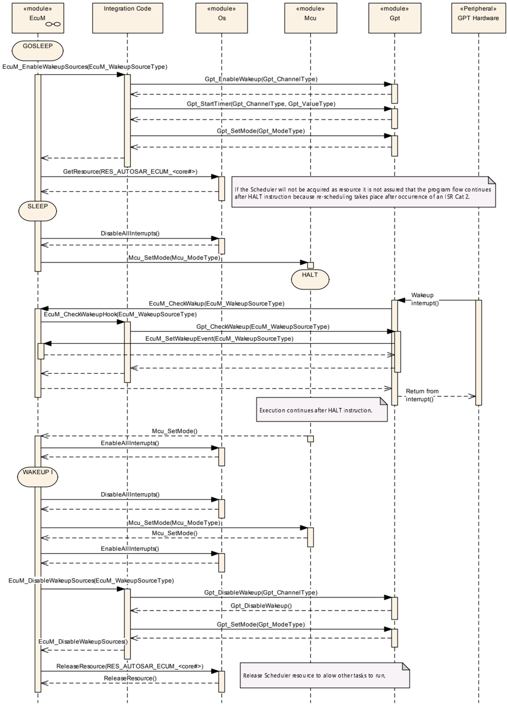

If the GPT hardware is capable of latching timer overruns, it is also possible to poll the GPT for wake ups as shown in Figure 9.2 .


Figure 9.2: GPT wake up by polling


## 9.2.2 ICU Wakeup Sequences

The Input Capture Unit (ICU) is another wake up source. In contrast to GPT, the ICU driver is not itself the wake up source. It is just the module that processes the wake up interrupt. Therefore, only the driver of the wake up source can tell if it was responsible for that wake up. This makes it necessary for EcuM\_CheckWakeupHook to ask the module that is the actual wake up source. In order to know which module to ask, the ICU has to pass the identifier of the wake up source to EcuM\_CheckWakeup . For shared interrupts the integration code may have to check multiple wake up sources within EcuM\_CheckWakeupHook . To this end, the ICU has to pass the identifiers of all wake up sources that may have caused this interrupt to EcuM\_CheckWakeup . Note that, EcuM\_WakeupSourceType (see 8.2.3 EcuM\_WakeupSourceType) contains one bit for each wake up source, so that multiple wake up sources can be passed in one call. Figure 9.3 shows the resulting sequence of calls. Since the ICU is only responsible for processing the wake up interrupt, polling the ICU is not sensible. For polling the wake up sources have to be checked directly as shown in Figure 38.


## Specification of ECU State Manager AUTOSAR CP R23-11

Figure 9.3: ICU wake up by interrupt

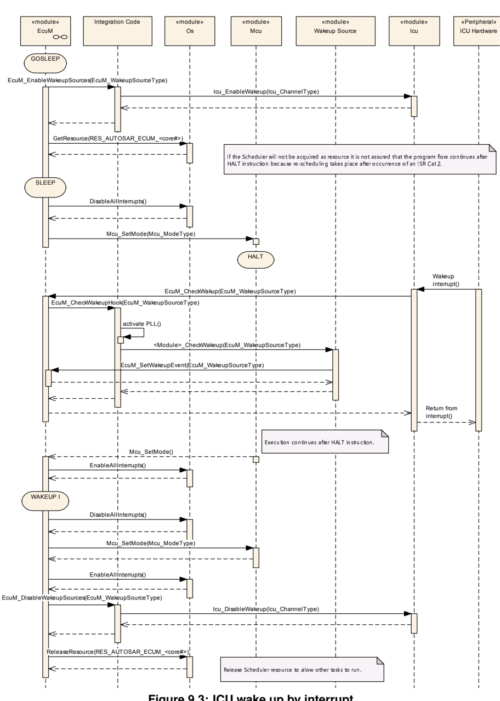


## 9.2.3 CAN Wakeup Sequences

On CAN a wake up can be detected by the transceiver or the communication controller using either an interrupt or polling. Wake up source identifiers should be shared between transceiver and controller as the ECU State Manager module only needs to know the network that has woken up and passes that on to the Communication Manager module.

In interrupt case or in shared interrupt case it is not clear which specific wake up source (CAN controller, CAN transceiver, LIN controller etc.) detected the wake up. Therefore the integrator has to assign the derived wakeupSource of EcuM\_ CheckWakeup(wakeupSource), which could stand for a shared interrupt or just for an interrupt channel, to specific wake up sources which are passed to CanIf\_Check Wakeup(WakeupSource). So here the parameters wakeupSource from EcuM\_Check Wakeup() could be different to WakeupSource of CanIf\_CheckWakeup or they could equal. It depends on the hardware topology and the implementation in the integrator code of EcuM\_CheckWakeupHook .

During CanIf\_CheckWakeup(WakeupSource) the CAN Interface module (CanIf) will check if any device (CAN communication controller or transceiver) is configured with the value of "WakeupSource". If this is the case, the device is checked for wake up via the corresponding device driver module. If the device detected a wake up, the device driver informs EcuM via EcuM\_SetWakeupEvent(sources). The parameter "sources" is set to the configured value at the device. Thus it is set to the value CanIf\_Check Wakeup() was called with.

Multiple devices might be configured with the same wake up source value. But if devices are connected to different bus medium and they are wake-able, it makes sense to configure them with different wake up sources.

The following CAN Wake-up Sequences are partly optional, because there is no specification for the "Integration Code". Thus it is implementation specific if e.g. during Ecu M\_CheckWakeup() the CanIf is called to check the wake up source.


Figure 9.4: CAN transceiver wake up by interrupt

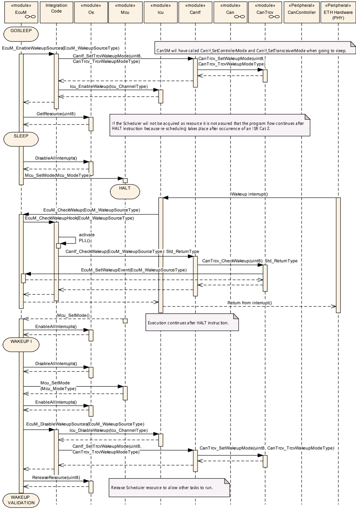


Figure 9.4 shows the CAN transceiver wakeup via interrupt. The interrupt is usually handled by the ICU Driver as described in Chapter 9.2.2.

A CAN controller wakeup by interrupt works similar to the GPT wakeup. Here the interrupt handler and the CheckWakeup functionality are both encapsulated in the CAN Driver module, as shown in Figure 9.5 .


Wake up by polling is possible both for CAN transceiver and controller. The ECU State Manager module will regularly check the CAN Interface module, which in turn asks either the CAN Driver module or the CAN Transceiver Driver module depending on the wake up source parameter passed to the CAN Interface module, as shown in Figure 9.6 .


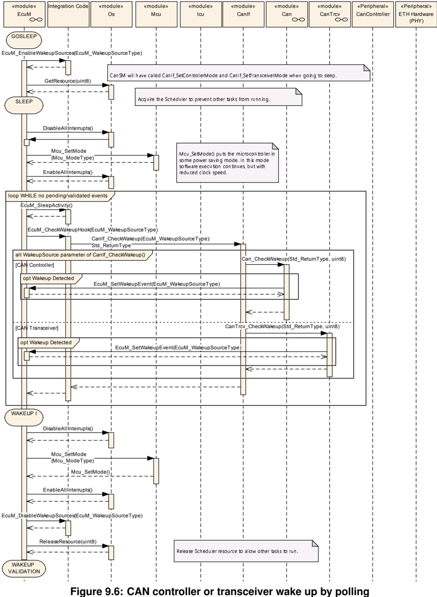

After the detection of a wake up event from the CAN transceiver or controller by either interrupt or polling, the wake up event can be validated (see [SWS\_EcuM\_02566]).


This is done by switching on the corresponding CAN transceiver and controller in EcuM\_StartWakeupSources (see [SWS\_EcuM\_02924]). It depends on the used CAN transceivers and controllers, which function calls in Integrator Code EcuM\_Start WakeupSource are necessary. In Figure 9.7 e.g. the needed function calls to start and stop the wake up sources from CAN state manager module are mentioned.

Note that, although controller and transceiver are switched on, no CAN message will be forwarded by the CAN interface module (CanIf) to any upper layer module.

Only when the corresponding PDU channel modes of the CanIf are set to "Online", it will forward CAN messages.

The CanIf recognizes the successful reception of at least one message and records it as a successful validation. During validation the ECU State Manager module regularly checks the CanIf in Integrator Code EcuM\_CheckValidation (see [SWS\_EcuM\_02925]).

The ECU State Manager module will, after successful validation, continue the normal startup of the CAN network via the Communication Manager module.

Otherwise, it will shutdown the CAN controller and transceiver in EcuM\_StopWakeup Sources (see [SWS\_EcuM\_02926]) and go back to sleep.

The resulting sequence is shown in Figure 9.7 .


Figure 9.7: CAN wake up validation

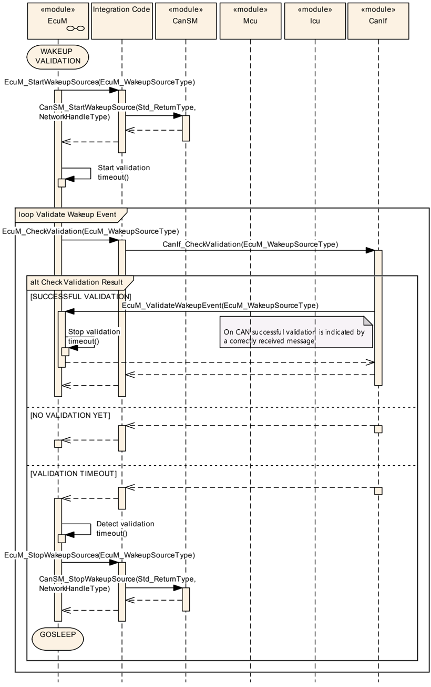


## 9.2.4 LIN Wakeup Sequences

Figure 9.8 shows the LIN transceiver wakeup via interrupt. The interrupt is usually handled by the ICU Driver as described in Chapter 9.2.2 .


Figure 9.8: LIN transceiver wake up by interrupt


As shown in Figure 9.9 , the LIN controller wake up by interrupt works similar to the CAN controller wake up by interrupt. In both cases the Driver module encapsulates the interrupt handler.


Figure 9.9: LIN controller wake up by interrupt

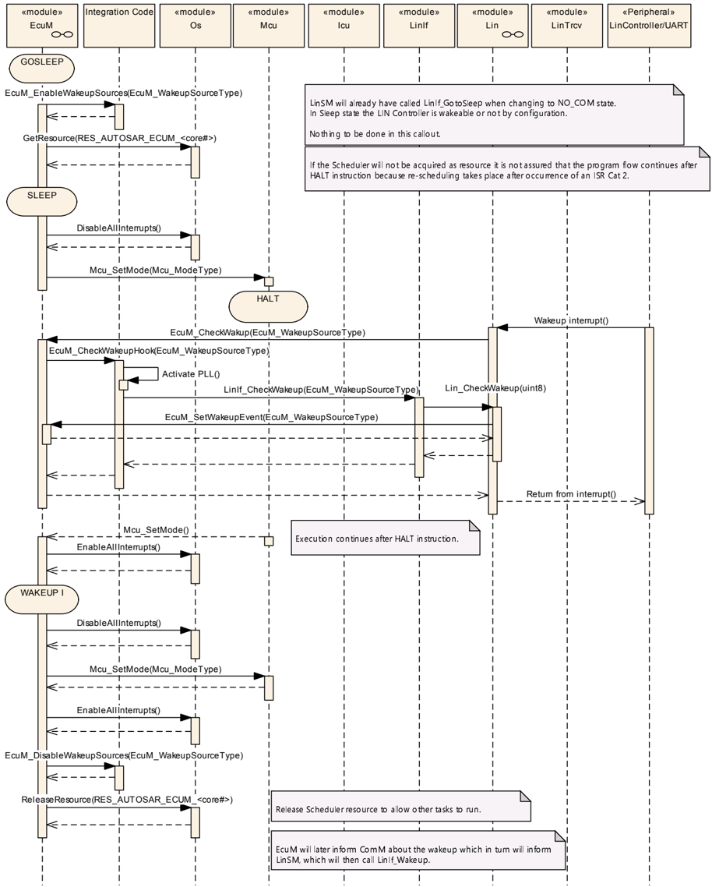

Wake up by polling is possible for LIN transceiver and controller. The ECU State Manager module will regularly check the LIN Interface module, which in turn asks either the LIN Driver module or the LIN Transceiver Driver module, as shown in Figure 9.10 .


Figure 9.10: LIN controller or transceiver wake up by polling


Note that LIN does not require wakeup validation.

## 9.2.5 FlexRay Wakeup Sequences

For FlexRay a wake up is only possible via the FlexRay transceivers. There are two transceivers for the two different channels in a FlexRay cluster. They are treated as belonging to one network and thus, there should be only one wake up source identifier configured for both channels. Figure 9.11 shows the FlexRay transceiver wakeup via Specification of ECU State Manager AUTOSAR CP R23-11


interrupt. The interrupt is usually handled by the ICU Driver as described in Chapter 9.2.2.

174 of 217

Document ID 78: AUTOSAR\_CP\_SWS\_ECUStateManager Note that in EcuM\_CheckWakeupHook there need to be two separate calls to FrIf\_ WakeupByTransceiver, one for each FlexRay channel.


## 9.2.6 Ethernet Wakeup Sequence

On a Ethernet switched network with OA TC10 compliant Ethernet hardware a wake up can be detected by the used Ethernet hardware (PHY). For Ethernet ECUs which maintain a Ethernet Switch (host ECU), it is recommended to use polling on demand to check a wake-up notified by the Ethernet hardware. Because checking all affected EthSwtPort could be time comsuming and not acceptable for a check within the interrupt. Thus, an interrupt signals that at least one of the Ethernet switch ports detect an wake-up. In the context of the interrupt the affected EthTrcv are signaled to be checked asynchronously in the EthTrcv\_MainFunction .

Each EthTrcv should have its own wakeup source to distinguish on which EthSwtPort the wakeup arrived. Wakeup sources could be shared if the EthSwtPort are e.g. assigned to the same PNCs

The following Ethernet Wake-up Sequences are partly optional, because there is no specification for the "Integration Code". Thus it is implementation specific if e.g. during EcuM\_CheckWakeupHook the EthIf is called to check the wake up source.


Figure 9.13: Passive wakeup of a host ecu (ECU that maintain a Ethernet switch) (part 1)

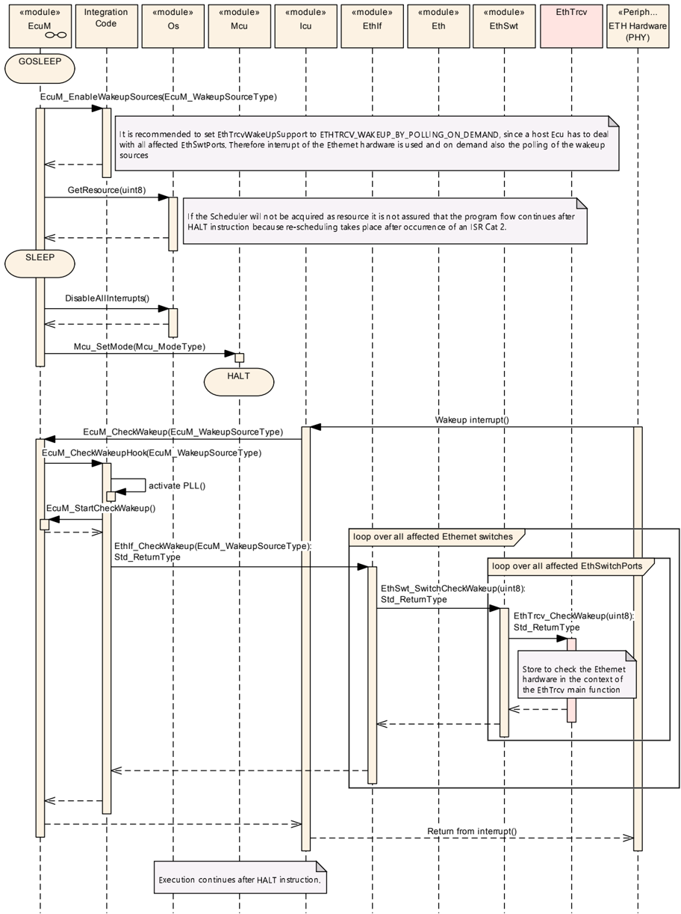


Figure 9.14: Passive wakeup of a host ecu (ECU that maintain a Ethernet switch) (part 2)


A single Ethernet ECU (ECU which do NOT maintain a Ethernet switch) could choose how to detect a wakeup either by interrupt or by polling. The difference to a host ECU is, that not the high amount of Ethernet switch ports has to be checked.


Figure 9.15: Passive wakeup of a single ECU (ECU which do not maintain a Ethernet switch) (part 1)


Figure 9.16: Passive wakeup of a single ECU (ECU which do not maintain a Ethernet switch) (part 2)

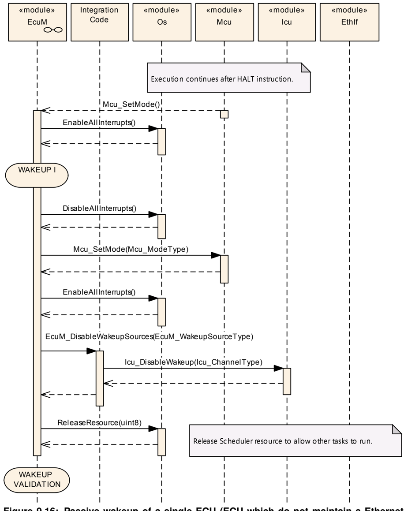


## 10 Configuration specification

In general, this chapter defines configuration parameters and their clustering into containers.

Chapters 10.1 and 10.2 specify the structure (containers) and the parameters of the module ECU Manager.

Chapter 10.3 specifies published information of the module ECU State Manager.

## 10.1 Common Containers and configuration parameters

The following chapters summarize all configuration parameters. The detailed meanings of the parameters describe Chapters 7 and Chapter 8.

The following containers contain various references to initialization structures of BSW modules. NULL shall be a valid reference meaning 'no configuration data available' but only if the implementation of the initialized BSW module supports this.


## 10.1.1 EcuM

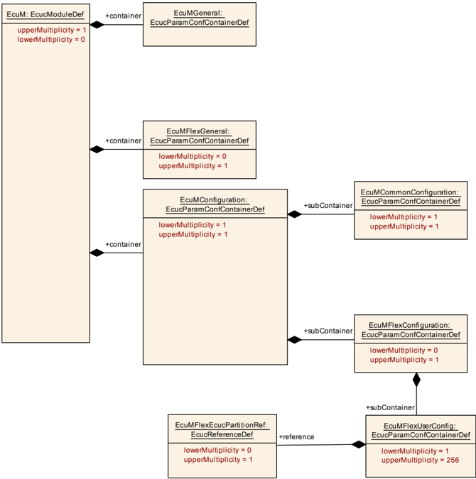

Figure 10.1: EcuM configuration overview

| SWS Item                   | [ECUC_EcuM_00225]                                     |
|----------------------------|-------------------------------------------------------|
| Module Name                | EcuM                                                  |
| Description                | Configuration of the EcuM (ECU State Manager) module. |
| Post-Build Variant Support | true                                                  |
| Supported Config Variants  | VARIANT-POST-BUILD, VARIANT-PRE-COMPILE               |

| Included Containers   | Included Containers   | Included Containers                                                                                                                  |
|-----------------------|-----------------------|--------------------------------------------------------------------------------------------------------------------------------------|
| Container Name        | Multiplicity          | Scope / Dependency                                                                                                                   |
| EcuMConfiguration     | 1                     | This container contains the configuration (parameters) of the ECU State Manager.                                                     |
| EcuMFlexGeneral       | 0..1                  | This container holds the general, pre-compile configuration parameters for the EcuMFlex. Only applicable if EcuMFlex is implemented. |
| EcuMGeneral           | 1                     | This container holds the general, pre-compile configuration parameters.                                                              |


## 10.1.2 EcuMGeneral

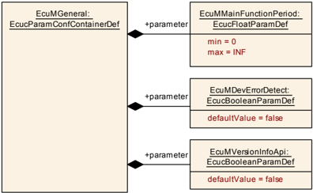

Figure 10.2: EcuMGeneral configuration overview

| SWS Item                 | [ECUC_EcuM_00116]                                                       |
|--------------------------|-------------------------------------------------------------------------|
| Container Name           | EcuMGeneral                                                             |
| Parent Container         | EcuM                                                                    |
| Description              | This container holds the general, pre-compile configuration parameters. |
| Configuration Parameters | Configuration Parameters                                                |

| SWS Item                  | [ECUC_EcuM_00108]                                                                                                                                                    | [ECUC_EcuM_00108]                                                                                                                                                    | [ECUC_EcuM_00108]                                                                                                                                                    |
|---------------------------|----------------------------------------------------------------------------------------------------------------------------------------------------------------------|----------------------------------------------------------------------------------------------------------------------------------------------------------------------|----------------------------------------------------------------------------------------------------------------------------------------------------------------------|
| Parameter Name            | EcuMDevErrorDetect                                                                                                                                                   | EcuMDevErrorDetect                                                                                                                                                   | EcuMDevErrorDetect                                                                                                                                                   |
| Parent Container          | EcuMGeneral                                                                                                                                                          | EcuMGeneral                                                                                                                                                          | EcuMGeneral                                                                                                                                                          |
| Description               | Switches the development error detection and notification on or off. • true: detection and notification is enabled. • false: detection and notification is disabled. | Switches the development error detection and notification on or off. • true: detection and notification is enabled. • false: detection and notification is disabled. | Switches the development error detection and notification on or off. • true: detection and notification is enabled. • false: detection and notification is disabled. |
| Multiplicity              | 1                                                                                                                                                                    | 1                                                                                                                                                                    | 1                                                                                                                                                                    |
| Type                      | EcucBooleanParamDef                                                                                                                                                  | EcucBooleanParamDef                                                                                                                                                  | EcucBooleanParamDef                                                                                                                                                  |
| Default value             | false                                                                                                                                                                | false                                                                                                                                                                | false                                                                                                                                                                |
| Post-Build Variant Value  | false                                                                                                                                                                | false                                                                                                                                                                | false                                                                                                                                                                |
| Value Configuration Class | Pre-compile time                                                                                                                                                     | X                                                                                                                                                                    | All Variants                                                                                                                                                         |
| Value Configuration Class | Link time                                                                                                                                                            | -                                                                                                                                                                    |                                                                                                                                                                      |
| Value Configuration Class | Post-build time                                                                                                                                                      | -                                                                                                                                                                    |                                                                                                                                                                      |
| Scope / Dependency        | scope: local                                                                                                                                                         | scope: local                                                                                                                                                         | scope: local                                                                                                                                                         |

| SWS Item                  | [ECUC_EcuM_00121]                                                          | [ECUC_EcuM_00121]                                                          | [ECUC_EcuM_00121]                                                          |
|---------------------------|----------------------------------------------------------------------------|----------------------------------------------------------------------------|----------------------------------------------------------------------------|
| Parameter Name            | EcuMMainFunctionPeriod                                                     | EcuMMainFunctionPeriod                                                     | EcuMMainFunctionPeriod                                                     |
| Parent Container          | EcuMGeneral                                                                | EcuMGeneral                                                                | EcuMGeneral                                                                |
| Description               | This parameter defines the schedule period of EcuM_MainFunction. Unit: [s] | This parameter defines the schedule period of EcuM_MainFunction. Unit: [s] | This parameter defines the schedule period of EcuM_MainFunction. Unit: [s] |
| Multiplicity              | 1                                                                          | 1                                                                          | 1                                                                          |
| Type                      | EcucFloatParamDef                                                          | EcucFloatParamDef                                                          | EcucFloatParamDef                                                          |
| Range                     | ]0 .. INF[                                                                 |                                                                            |                                                                            |
| Default value             | -                                                                          | -                                                                          | -                                                                          |
| Post-Build Variant Value  | false                                                                      | false                                                                      | false                                                                      |
| Value Configuration Class | Pre-compile time                                                           | X                                                                          | All Variants                                                               |
| Value Configuration Class | Link time                                                                  | -                                                                          |                                                                            |
| Value Configuration Class | Post-build time                                                            | -                                                                          |                                                                            |

glyph[triangleinv]


| Scope / Dependency   | scope: ECU   |
|----------------------|--------------|

| SWS Item                  | [ECUC_EcuM_00149]                       | [ECUC_EcuM_00149]                       | [ECUC_EcuM_00149]                       |
|---------------------------|-----------------------------------------|-----------------------------------------|-----------------------------------------|
| Parameter Name            | EcuMVersionInfoApi                      | EcuMVersionInfoApi                      | EcuMVersionInfoApi                      |
| Parent Container          | EcuMGeneral                             | EcuMGeneral                             | EcuMGeneral                             |
| Description               | Switches the version info API on or off | Switches the version info API on or off | Switches the version info API on or off |
| Multiplicity              | 1                                       | 1                                       | 1                                       |
| Type                      | EcucBooleanParamDef                     | EcucBooleanParamDef                     | EcucBooleanParamDef                     |
| Default value             | false                                   | false                                   | false                                   |
| Post-Build Variant Value  | false                                   | false                                   | false                                   |
| Value Configuration Class | Pre-compile time                        | X                                       | All Variants                            |
| Value Configuration Class | Link time                               | -                                       |                                         |
| Value Configuration Class | Post-build time                         | -                                       |                                         |
| Scope / Dependency        | scope: local                            | scope: local                            | scope: local                            |

| No Included Containers   |
|--------------------------|


## 10.1.3 EcuMConfiguration

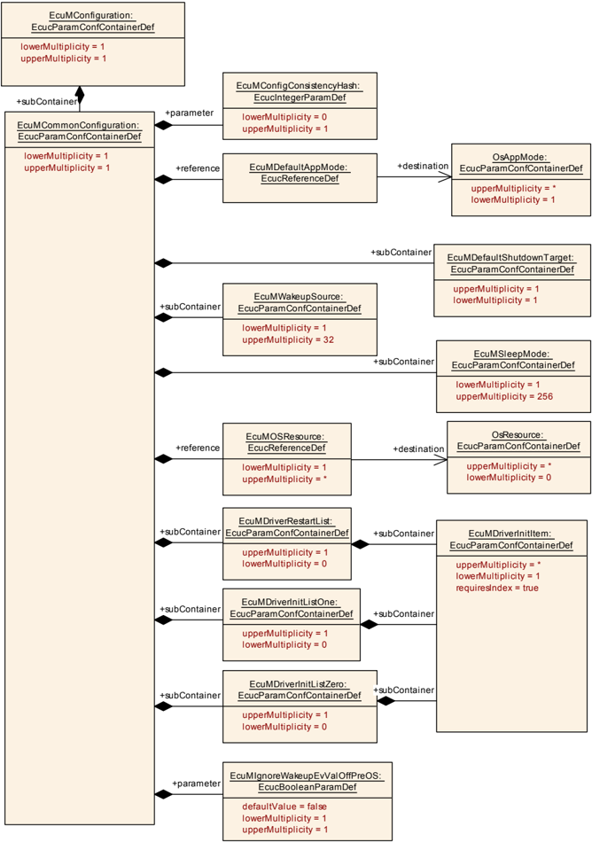

Figure 10.3: EcuMConfiguration configuration overview

| SWS Item                 | [ECUC_EcuM_00103]                                                                |
|--------------------------|----------------------------------------------------------------------------------|
| Container Name           | EcuMConfiguration                                                                |
| Parent Container         | EcuM                                                                             |
| Description              | This container contains the configuration (parameters) of the ECU State Manager. |
| Configuration Parameters | Configuration Parameters                                                         |


| Included Containers     | Included Containers   | Included Containers                                                                                                  |
|-------------------------|-----------------------|----------------------------------------------------------------------------------------------------------------------|
| Container Name          | Multiplicity          | Scope / Dependency                                                                                                   |
| EcuMCommonConfiguration | 1                     | This container contains the common configuration (parameters) of the ECU State Manager.                              |
| EcuMFlexConfiguration   | 0..1                  | This container contains the configuration (parameters) of the Ecu MFlex. Only applicable if EcuMFlex is implemented. |

## 10.1.4 EcuMCommonConfiguration

| SWS Item                 | [ECUC_EcuM_00181]                                                                       |
|--------------------------|-----------------------------------------------------------------------------------------|
| Container Name           | EcuMCommonConfiguration                                                                 |
| Parent Container         | EcuMConfiguration                                                                       |
| Description              | This container contains the common configuration (parameters) of the ECU State Manager. |
| Configuration Parameters | Configuration Parameters                                                                |

| SWS Item                         | [ECUC_EcuM_00102]                                                                                                                                                                                                                                                                                                                                                                                                                                                                                                                                                                                                           | [ECUC_EcuM_00102]                                                                                                                                                                                                                                                                                                                                                                                                                                                                                                                                                                                                           | [ECUC_EcuM_00102]                                                                                                                                                                                                                                                                                                                                                                                                                                                                                                                                                                                                           |
|----------------------------------|-----------------------------------------------------------------------------------------------------------------------------------------------------------------------------------------------------------------------------------------------------------------------------------------------------------------------------------------------------------------------------------------------------------------------------------------------------------------------------------------------------------------------------------------------------------------------------------------------------------------------------|-----------------------------------------------------------------------------------------------------------------------------------------------------------------------------------------------------------------------------------------------------------------------------------------------------------------------------------------------------------------------------------------------------------------------------------------------------------------------------------------------------------------------------------------------------------------------------------------------------------------------------|-----------------------------------------------------------------------------------------------------------------------------------------------------------------------------------------------------------------------------------------------------------------------------------------------------------------------------------------------------------------------------------------------------------------------------------------------------------------------------------------------------------------------------------------------------------------------------------------------------------------------------|
| Parameter Name                   | EcuMConfigConsistencyHash                                                                                                                                                                                                                                                                                                                                                                                                                                                                                                                                                                                                   | EcuMConfigConsistencyHash                                                                                                                                                                                                                                                                                                                                                                                                                                                                                                                                                                                                   | EcuMConfigConsistencyHash                                                                                                                                                                                                                                                                                                                                                                                                                                                                                                                                                                                                   |
| Parent Container                 | EcuMCommonConfiguration                                                                                                                                                                                                                                                                                                                                                                                                                                                                                                                                                                                                     | EcuMCommonConfiguration                                                                                                                                                                                                                                                                                                                                                                                                                                                                                                                                                                                                     | EcuMCommonConfiguration                                                                                                                                                                                                                                                                                                                                                                                                                                                                                                                                                                                                     |
| Description                      | In the pre-compile and link-time configuration phase a hash value is generated across all pre-compile and link-time parameters of all BSW modules. In the post-build phase a hash value is generated across all pre-compile and link-time parameters, except for parameters located in EcucParamConfContainerDef instances or subContainers which have been introduced at post-build configuration time. This hash value is compared against each other and allows checking the consistency of the entire configuration. Note: In systems which do not make use of post-build configurations this parameter can be omitted. | In the pre-compile and link-time configuration phase a hash value is generated across all pre-compile and link-time parameters of all BSW modules. In the post-build phase a hash value is generated across all pre-compile and link-time parameters, except for parameters located in EcucParamConfContainerDef instances or subContainers which have been introduced at post-build configuration time. This hash value is compared against each other and allows checking the consistency of the entire configuration. Note: In systems which do not make use of post-build configurations this parameter can be omitted. | In the pre-compile and link-time configuration phase a hash value is generated across all pre-compile and link-time parameters of all BSW modules. In the post-build phase a hash value is generated across all pre-compile and link-time parameters, except for parameters located in EcucParamConfContainerDef instances or subContainers which have been introduced at post-build configuration time. This hash value is compared against each other and allows checking the consistency of the entire configuration. Note: In systems which do not make use of post-build configurations this parameter can be omitted. |
| Multiplicity                     | 0..1                                                                                                                                                                                                                                                                                                                                                                                                                                                                                                                                                                                                                        | 0..1                                                                                                                                                                                                                                                                                                                                                                                                                                                                                                                                                                                                                        | 0..1                                                                                                                                                                                                                                                                                                                                                                                                                                                                                                                                                                                                                        |
| Type                             | EcucIntegerParamDef                                                                                                                                                                                                                                                                                                                                                                                                                                                                                                                                                                                                         | EcucIntegerParamDef                                                                                                                                                                                                                                                                                                                                                                                                                                                                                                                                                                                                         | EcucIntegerParamDef                                                                                                                                                                                                                                                                                                                                                                                                                                                                                                                                                                                                         |
| Range                            | 0 .. 18446744073709551615                                                                                                                                                                                                                                                                                                                                                                                                                                                                                                                                                                                                   | 0 .. 18446744073709551615                                                                                                                                                                                                                                                                                                                                                                                                                                                                                                                                                                                                   | 0 .. 18446744073709551615                                                                                                                                                                                                                                                                                                                                                                                                                                                                                                                                                                                                   |
| Default value                    | -                                                                                                                                                                                                                                                                                                                                                                                                                                                                                                                                                                                                                           | -                                                                                                                                                                                                                                                                                                                                                                                                                                                                                                                                                                                                                           | -                                                                                                                                                                                                                                                                                                                                                                                                                                                                                                                                                                                                                           |
| Post-Build Variant Multiplicity  | false                                                                                                                                                                                                                                                                                                                                                                                                                                                                                                                                                                                                                       | false                                                                                                                                                                                                                                                                                                                                                                                                                                                                                                                                                                                                                       | false                                                                                                                                                                                                                                                                                                                                                                                                                                                                                                                                                                                                                       |
| Post-Build Variant Value         | false                                                                                                                                                                                                                                                                                                                                                                                                                                                                                                                                                                                                                       | false                                                                                                                                                                                                                                                                                                                                                                                                                                                                                                                                                                                                                       | false                                                                                                                                                                                                                                                                                                                                                                                                                                                                                                                                                                                                                       |
| Multiplicity Configuration Class | Pre-compile time                                                                                                                                                                                                                                                                                                                                                                                                                                                                                                                                                                                                            | X                                                                                                                                                                                                                                                                                                                                                                                                                                                                                                                                                                                                                           | All Variants                                                                                                                                                                                                                                                                                                                                                                                                                                                                                                                                                                                                                |
| Multiplicity Configuration Class | Link time                                                                                                                                                                                                                                                                                                                                                                                                                                                                                                                                                                                                                   | -                                                                                                                                                                                                                                                                                                                                                                                                                                                                                                                                                                                                                           |                                                                                                                                                                                                                                                                                                                                                                                                                                                                                                                                                                                                                             |
| Multiplicity Configuration Class | Post-build time                                                                                                                                                                                                                                                                                                                                                                                                                                                                                                                                                                                                             | -                                                                                                                                                                                                                                                                                                                                                                                                                                                                                                                                                                                                                           |                                                                                                                                                                                                                                                                                                                                                                                                                                                                                                                                                                                                                             |
| Value Configuration Class        | Pre-compile time                                                                                                                                                                                                                                                                                                                                                                                                                                                                                                                                                                                                            | X                                                                                                                                                                                                                                                                                                                                                                                                                                                                                                                                                                                                                           | VARIANT-PRE-COMPILE                                                                                                                                                                                                                                                                                                                                                                                                                                                                                                                                                                                                         |
| Value Configuration Class        | Link time                                                                                                                                                                                                                                                                                                                                                                                                                                                                                                                                                                                                                   | -                                                                                                                                                                                                                                                                                                                                                                                                                                                                                                                                                                                                                           |                                                                                                                                                                                                                                                                                                                                                                                                                                                                                                                                                                                                                             |
| Value Configuration Class        | Post-build time                                                                                                                                                                                                                                                                                                                                                                                                                                                                                                                                                                                                             | X                                                                                                                                                                                                                                                                                                                                                                                                                                                                                                                                                                                                                           | VARIANT-POST-BUILD                                                                                                                                                                                                                                                                                                                                                                                                                                                                                                                                                                                                          |
| Scope / Dependency               | scope: local                                                                                                                                                                                                                                                                                                                                                                                                                                                                                                                                                                                                                | scope: local                                                                                                                                                                                                                                                                                                                                                                                                                                                                                                                                                                                                                | scope: local                                                                                                                                                                                                                                                                                                                                                                                                                                                                                                                                                                                                                |

| SWS Item         | [ECUC_EcuM_00230]             |
|------------------|-------------------------------|
| Parameter Name   | EcuMIgnoreWakeupEvValOffPreOS |
| Parent Container | EcuMCommonConfiguration       |

glyph[triangleinv]


## glyph[triangle]

| Description               | Defines the wakeup events that must be considered in OffPreOS true: only wakeup events which do not need validation shall be considered false: wakeup events which do not need validation and pending wakeup events   | Defines the wakeup events that must be considered in OffPreOS true: only wakeup events which do not need validation shall be considered false: wakeup events which do not need validation and pending wakeup events   | Defines the wakeup events that must be considered in OffPreOS true: only wakeup events which do not need validation shall be considered false: wakeup events which do not need validation and pending wakeup events   |
|---------------------------|-----------------------------------------------------------------------------------------------------------------------------------------------------------------------------------------------------------------------|-----------------------------------------------------------------------------------------------------------------------------------------------------------------------------------------------------------------------|-----------------------------------------------------------------------------------------------------------------------------------------------------------------------------------------------------------------------|
| Multiplicity              | 1                                                                                                                                                                                                                     | 1                                                                                                                                                                                                                     | 1                                                                                                                                                                                                                     |
| Type                      | EcucBooleanParamDef                                                                                                                                                                                                   | EcucBooleanParamDef                                                                                                                                                                                                   | EcucBooleanParamDef                                                                                                                                                                                                   |
| Default value             | false                                                                                                                                                                                                                 | false                                                                                                                                                                                                                 | false                                                                                                                                                                                                                 |
| Post-Build Variant Value  | false                                                                                                                                                                                                                 | false                                                                                                                                                                                                                 | false                                                                                                                                                                                                                 |
| Value Configuration Class | Pre-compile time                                                                                                                                                                                                      | X                                                                                                                                                                                                                     | All Variants                                                                                                                                                                                                          |
| Value Configuration Class | Link time                                                                                                                                                                                                             | -                                                                                                                                                                                                                     |                                                                                                                                                                                                                       |
| Value Configuration Class | Post-build time                                                                                                                                                                                                       | -                                                                                                                                                                                                                     |                                                                                                                                                                                                                       |
| Scope / Dependency        | scope: local                                                                                                                                                                                                          | scope: local                                                                                                                                                                                                          | scope: local                                                                                                                                                                                                          |

| SWS Item                  | [ECUC_EcuM_00104]                                                    | [ECUC_EcuM_00104]                                                    | [ECUC_EcuM_00104]                                                    |
|---------------------------|----------------------------------------------------------------------|----------------------------------------------------------------------|----------------------------------------------------------------------|
| Parameter Name            | EcuMDefaultAppMode                                                   | EcuMDefaultAppMode                                                   | EcuMDefaultAppMode                                                   |
| Parent Container          | EcuMCommonConfiguration                                              | EcuMCommonConfiguration                                              | EcuMCommonConfiguration                                              |
| Description               | The default application mode loaded when the ECU comes out of reset. | The default application mode loaded when the ECU comes out of reset. | The default application mode loaded when the ECU comes out of reset. |
| Multiplicity              | 1                                                                    | 1                                                                    | 1                                                                    |
| Type                      | Reference to OsAppMode                                               | Reference to OsAppMode                                               | Reference to OsAppMode                                               |
| Post-Build Variant Value  | true                                                                 | true                                                                 | true                                                                 |
| Value Configuration Class | Pre-compile time                                                     | X                                                                    | VARIANT-PRE-COMPILE                                                  |
| Value Configuration Class | Link time                                                            | -                                                                    |                                                                      |
| Value Configuration Class | Post-build time                                                      | X                                                                    | VARIANT-POST-BUILD                                                   |
| Scope / Dependency        | scope: local                                                         | scope: local                                                         | scope: local                                                         |

| SWS Item                         | [ECUC_EcuM_00183]                                                                                                                                            | [ECUC_EcuM_00183]                                                                                                                                            | [ECUC_EcuM_00183]                                                                                                                                            |
|----------------------------------|--------------------------------------------------------------------------------------------------------------------------------------------------------------|--------------------------------------------------------------------------------------------------------------------------------------------------------------|--------------------------------------------------------------------------------------------------------------------------------------------------------------|
| Parameter Name                   | EcuMOSResource                                                                                                                                               | EcuMOSResource                                                                                                                                               | EcuMOSResource                                                                                                                                               |
| Parent Container                 | EcuMCommonConfiguration                                                                                                                                      | EcuMCommonConfiguration                                                                                                                                      | EcuMCommonConfiguration                                                                                                                                      |
| Description                      | This parameter is a reference to a OS resource which is used to bring the ECU into sleep mode. In case of multi core each core shall have an own OsResource. | This parameter is a reference to a OS resource which is used to bring the ECU into sleep mode. In case of multi core each core shall have an own OsResource. | This parameter is a reference to a OS resource which is used to bring the ECU into sleep mode. In case of multi core each core shall have an own OsResource. |
| Multiplicity                     | 1..*                                                                                                                                                         | 1..*                                                                                                                                                         | 1..*                                                                                                                                                         |
| Type                             | Reference to OsResource                                                                                                                                      | Reference to OsResource                                                                                                                                      | Reference to OsResource                                                                                                                                      |
| Post-Build Variant Multiplicity  | false                                                                                                                                                        | false                                                                                                                                                        | false                                                                                                                                                        |
| Post-Build Variant Value         | false                                                                                                                                                        | false                                                                                                                                                        | false                                                                                                                                                        |
| Multiplicity Configuration Class | Pre-compile time                                                                                                                                             | X                                                                                                                                                            |                                                                                                                                                              |
| Multiplicity Configuration Class | Link time                                                                                                                                                    | -                                                                                                                                                            |                                                                                                                                                              |
| Multiplicity Configuration Class | Post-build time                                                                                                                                              | -                                                                                                                                                            |                                                                                                                                                              |
| Value Configuration Class        | Pre-compile time                                                                                                                                             | X                                                                                                                                                            |                                                                                                                                                              |
| Value Configuration Class        | Link time                                                                                                                                                    | -                                                                                                                                                            |                                                                                                                                                              |
| Value Configuration Class        | Post-build time                                                                                                                                              | -                                                                                                                                                            |                                                                                                                                                              |
| Scope / Dependency               | scope: local                                                                                                                                                 | scope: local                                                                                                                                                 | scope: local                                                                                                                                                 |

| Included Containers       | Included Containers   | Included Containers                                                                                                                                                 |
|---------------------------|-----------------------|---------------------------------------------------------------------------------------------------------------------------------------------------------------------|
| Container Name            | Multiplicity          | Scope / Dependency                                                                                                                                                  |
| EcuMDefaultShutdownTarget | 1                     | This container describes the default shutdown target to be selected by EcuM. The actual shutdown target may be overridden by the EcuM_SelectShutdownTarget service. |


glyph[triangle]

| Included Containers    | Included Containers   | Included Containers                                                                                                                                                                                                                                                                                                                                       |
|------------------------|-----------------------|-----------------------------------------------------------------------------------------------------------------------------------------------------------------------------------------------------------------------------------------------------------------------------------------------------------------------------------------------------------|
| Container Name         | Multiplicity          | Scope / Dependency                                                                                                                                                                                                                                                                                                                                        |
| EcuMDriverInitListOne  | 0..1                  | Container for Init Block I. This container holds a list of modules to be initialized. Each module in the list will be called for initialization in the list order. All modules in this list are initialized before the OS is started and so these modules require no OS support.                                                                          |
| EcuMDriverInitListZero | 0..1                  | Container for Init Block 0. This container holds a list of modules to be initialized. Each module in the list will be called for initialization in the list order. All modules in this list are initialized before the post-build configuration has been loaded and the OS is initialized. Therefore, these modules may not use post-build configuration. |
| EcuMDriverRestartList  | 0..1                  | List of modules to be initialized.                                                                                                                                                                                                                                                                                                                        |
| EcuMSleepMode          | 1..256                | These containers describe the configured sleep modes. The names of these containers specify the symbolic names of the different sleep modes.                                                                                                                                                                                                              |
| EcuMWakeupSource       | 1..32                 | These containers describe the configured wakeup sources.                                                                                                                                                                                                                                                                                                  |

## 10.1.5 EcuMDefaultShutdownTarget

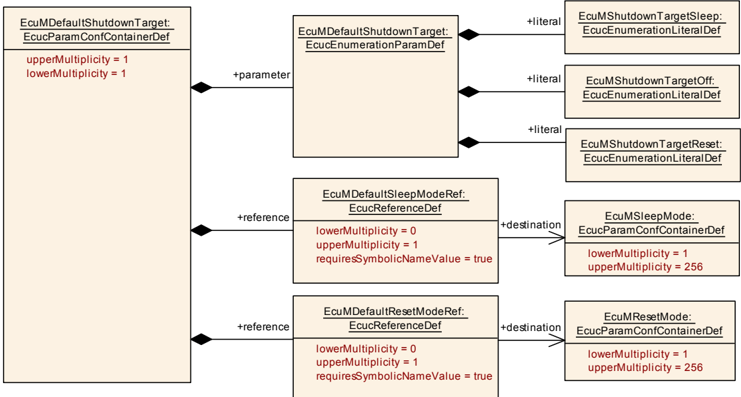

Figure 10.4: EcuMDefaultShutdownTarget configuration overview

| SWS Item                 | [ECUC_EcuM_00105]                                                                                                                                                   |
|--------------------------|---------------------------------------------------------------------------------------------------------------------------------------------------------------------|
| Container Name           | EcuMDefaultShutdownTarget                                                                                                                                           |
| Parent Container         | EcuMCommonConfiguration                                                                                                                                             |
| Description              | This container describes the default shutdown target to be selected by EcuM. The actual shutdown target may be overridden by the EcuM_SelectShutdownTarget service. |
| Configuration Parameters | Configuration Parameters                                                                                                                                            |


| SWS Item                  | [ECUC_EcuM_00107]                                                                                                                                                                                                               | [ECUC_EcuM_00107]                                                                                                                                                                                                               | [ECUC_EcuM_00107]                                                                                                                                                                                                               |
|---------------------------|---------------------------------------------------------------------------------------------------------------------------------------------------------------------------------------------------------------------------------|---------------------------------------------------------------------------------------------------------------------------------------------------------------------------------------------------------------------------------|---------------------------------------------------------------------------------------------------------------------------------------------------------------------------------------------------------------------------------|
| Parameter Name            | EcuMDefaultShutdownTarget                                                                                                                                                                                                       | EcuMDefaultShutdownTarget                                                                                                                                                                                                       | EcuMDefaultShutdownTarget                                                                                                                                                                                                       |
| Parent Container          | EcuMDefaultShutdownTarget                                                                                                                                                                                                       | EcuMDefaultShutdownTarget                                                                                                                                                                                                       | EcuMDefaultShutdownTarget                                                                                                                                                                                                       |
| Description               | This parameter describes the state part of the default shutdown target selected when the ECU comes out of reset. If EcuMShutdownTargetSleep is selected, the parameter EcuMDefaultSleepModeRef selects the specific sleep mode. | This parameter describes the state part of the default shutdown target selected when the ECU comes out of reset. If EcuMShutdownTargetSleep is selected, the parameter EcuMDefaultSleepModeRef selects the specific sleep mode. | This parameter describes the state part of the default shutdown target selected when the ECU comes out of reset. If EcuMShutdownTargetSleep is selected, the parameter EcuMDefaultSleepModeRef selects the specific sleep mode. |
| Multiplicity              | 1                                                                                                                                                                                                                               | 1                                                                                                                                                                                                                               | 1                                                                                                                                                                                                                               |
| Type                      | EcucEnumerationParamDef                                                                                                                                                                                                         | EcucEnumerationParamDef                                                                                                                                                                                                         | EcucEnumerationParamDef                                                                                                                                                                                                         |
| Range                     | EcuMShutdownTargetOff                                                                                                                                                                                                           | Corresponds to ECUM_SHUTDOWN_TARGET_ OFF in EcuM_ShutdownTargetType.                                                                                                                                                            | Corresponds to ECUM_SHUTDOWN_TARGET_ OFF in EcuM_ShutdownTargetType.                                                                                                                                                            |
| Range                     | EcuMShutdownTargetReset                                                                                                                                                                                                         | Corresponds to ECUM_SHUTDOWN_TARGET_ RESET in EcuM_ShutdownTargetType. This literal is only be applicable for EcuMFlex.                                                                                                         | Corresponds to ECUM_SHUTDOWN_TARGET_ RESET in EcuM_ShutdownTargetType. This literal is only be applicable for EcuMFlex.                                                                                                         |
| Range                     | EcuMShutdownTargetSleep                                                                                                                                                                                                         | Corresponds to ECUM_SHUTDOWN_TARGET_ SLEEP in EcuM_ShutdownTargetType.                                                                                                                                                          | Corresponds to ECUM_SHUTDOWN_TARGET_ SLEEP in EcuM_ShutdownTargetType.                                                                                                                                                          |
| Post-Build Variant Value  | true                                                                                                                                                                                                                            | true                                                                                                                                                                                                                            | true                                                                                                                                                                                                                            |
| Value Configuration Class | Pre-compile time                                                                                                                                                                                                                | X                                                                                                                                                                                                                               | VARIANT-PRE-COMPILE                                                                                                                                                                                                             |
| Value Configuration Class | Link time                                                                                                                                                                                                                       | -                                                                                                                                                                                                                               |                                                                                                                                                                                                                                 |
| Value Configuration Class | Post-build time                                                                                                                                                                                                                 | X                                                                                                                                                                                                                               | VARIANT-POST-BUILD                                                                                                                                                                                                              |
| Scope / Dependency        | scope: local                                                                                                                                                                                                                    | scope: local                                                                                                                                                                                                                    | scope: local                                                                                                                                                                                                                    |

| SWS Item                         | [ECUC_EcuM_00205]                                                                                                                                | [ECUC_EcuM_00205]                                                                                                                                | [ECUC_EcuM_00205]                                                                                                                                |
|----------------------------------|--------------------------------------------------------------------------------------------------------------------------------------------------|--------------------------------------------------------------------------------------------------------------------------------------------------|--------------------------------------------------------------------------------------------------------------------------------------------------|
| Parameter Name                   | EcuMDefaultResetModeRef                                                                                                                          | EcuMDefaultResetModeRef                                                                                                                          | EcuMDefaultResetModeRef                                                                                                                          |
| Parent Container                 | EcuMDefaultShutdownTarget                                                                                                                        | EcuMDefaultShutdownTarget                                                                                                                        | EcuMDefaultShutdownTarget                                                                                                                        |
| Description                      | If EcuMDefaultShutdownTarget is EcuMShutdownTargetReset, this parameter selects the default reset mode. Otherwise this parameter may be ignored. | If EcuMDefaultShutdownTarget is EcuMShutdownTargetReset, this parameter selects the default reset mode. Otherwise this parameter may be ignored. | If EcuMDefaultShutdownTarget is EcuMShutdownTargetReset, this parameter selects the default reset mode. Otherwise this parameter may be ignored. |
| Multiplicity                     | 0..1                                                                                                                                             | 0..1                                                                                                                                             | 0..1                                                                                                                                             |
| Type                             | Symbolic name reference to EcuMResetMode                                                                                                         | Symbolic name reference to EcuMResetMode                                                                                                         | Symbolic name reference to EcuMResetMode                                                                                                         |
| Post-Build Variant Multiplicity  | true                                                                                                                                             | true                                                                                                                                             | true                                                                                                                                             |
| Post-Build Variant Value         | true                                                                                                                                             | true                                                                                                                                             | true                                                                                                                                             |
| Multiplicity Configuration Class | Pre-compile time                                                                                                                                 | X                                                                                                                                                | VARIANT-PRE-COMPILE                                                                                                                              |
| Multiplicity Configuration Class | Link time                                                                                                                                        | -                                                                                                                                                |                                                                                                                                                  |
| Multiplicity Configuration Class | Post-build time                                                                                                                                  | X                                                                                                                                                | VARIANT-POST-BUILD                                                                                                                               |
| Value Configuration Class        | Pre-compile time                                                                                                                                 | X                                                                                                                                                | VARIANT-PRE-COMPILE                                                                                                                              |
| Value Configuration Class        | Link time                                                                                                                                        | -                                                                                                                                                |                                                                                                                                                  |
| Value Configuration Class        | Post-build time                                                                                                                                  | X                                                                                                                                                | VARIANT-POST-BUILD                                                                                                                               |
| Scope / Dependency               | scope: local                                                                                                                                     | scope: local                                                                                                                                     | scope: local                                                                                                                                     |

| SWS Item                         | [ECUC_EcuM_00106]                                                                                                                                | [ECUC_EcuM_00106]                                                                                                                                | [ECUC_EcuM_00106]                                                                                                                                |
|----------------------------------|--------------------------------------------------------------------------------------------------------------------------------------------------|--------------------------------------------------------------------------------------------------------------------------------------------------|--------------------------------------------------------------------------------------------------------------------------------------------------|
| Parameter Name                   | EcuMDefaultSleepModeRef                                                                                                                          | EcuMDefaultSleepModeRef                                                                                                                          | EcuMDefaultSleepModeRef                                                                                                                          |
| Parent Container                 | EcuMDefaultShutdownTarget                                                                                                                        | EcuMDefaultShutdownTarget                                                                                                                        | EcuMDefaultShutdownTarget                                                                                                                        |
| Description                      | If EcuMDefaultShutdownTarget is EcuMShutdownTargetSleep, this parameter selects the default sleep mode. Otherwise this parameter may be ignored. | If EcuMDefaultShutdownTarget is EcuMShutdownTargetSleep, this parameter selects the default sleep mode. Otherwise this parameter may be ignored. | If EcuMDefaultShutdownTarget is EcuMShutdownTargetSleep, this parameter selects the default sleep mode. Otherwise this parameter may be ignored. |
| Multiplicity                     | 0..1                                                                                                                                             | 0..1                                                                                                                                             | 0..1                                                                                                                                             |
| Type                             | Symbolic name reference to EcuMSleepMode                                                                                                         | Symbolic name reference to EcuMSleepMode                                                                                                         | Symbolic name reference to EcuMSleepMode                                                                                                         |
| Post-Build Variant Multiplicity  | true                                                                                                                                             | true                                                                                                                                             | true                                                                                                                                             |
| Post-Build Variant Value         | true                                                                                                                                             | true                                                                                                                                             | true                                                                                                                                             |
| Multiplicity Configuration Class | Pre-compile time                                                                                                                                 | X                                                                                                                                                | VARIANT-PRE-COMPILE                                                                                                                              |
| Multiplicity Configuration Class | Link time                                                                                                                                        | -                                                                                                                                                |                                                                                                                                                  |

glyph[triangleinv]


glyph[triangle]

|                           | Post-build time   | X            | VARIANT-POST-BUILD   |
|---------------------------|-------------------|--------------|----------------------|
| Value Configuration Class | Pre-compile time  | X            | VARIANT-PRE-COMPILE  |
| Value Configuration Class | Link time         | -            |                      |
| Value Configuration Class | Post-build time   | X            | VARIANT-POST-BUILD   |
| Scope / Dependency        | scope: local      | scope: local | scope: local         |

| No Included Containers   |
|--------------------------|

## 10.1.6 EcuMDriverInitListOne

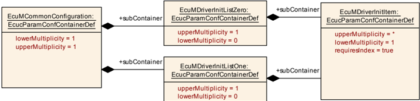

Figure 10.5: EcuMInitLists configuration overview

| SWS Item                         | [ECUC_EcuM_00111]                                                                                                                                                                                                                                                                | [ECUC_EcuM_00111]                                                                                                                                                                                                                                                                | [ECUC_EcuM_00111]                                                                                                                                                                                                                                                                |
|----------------------------------|----------------------------------------------------------------------------------------------------------------------------------------------------------------------------------------------------------------------------------------------------------------------------------|----------------------------------------------------------------------------------------------------------------------------------------------------------------------------------------------------------------------------------------------------------------------------------|----------------------------------------------------------------------------------------------------------------------------------------------------------------------------------------------------------------------------------------------------------------------------------|
| Container Name                   | EcuMDriverInitListOne                                                                                                                                                                                                                                                            | EcuMDriverInitListOne                                                                                                                                                                                                                                                            | EcuMDriverInitListOne                                                                                                                                                                                                                                                            |
| Parent Container                 | EcuMCommonConfiguration                                                                                                                                                                                                                                                          | EcuMCommonConfiguration                                                                                                                                                                                                                                                          | EcuMCommonConfiguration                                                                                                                                                                                                                                                          |
| Description                      | Container for Init Block I. This container holds a list of modules to be initialized. Each module in the list will be called for initialization in the list order. All modules in this list are initialized before the OS is started and so these modules require no OS support. | Container for Init Block I. This container holds a list of modules to be initialized. Each module in the list will be called for initialization in the list order. All modules in this list are initialized before the OS is started and so these modules require no OS support. | Container for Init Block I. This container holds a list of modules to be initialized. Each module in the list will be called for initialization in the list order. All modules in this list are initialized before the OS is started and so these modules require no OS support. |
| Post-Build Variant Multiplicity  | false                                                                                                                                                                                                                                                                            | false                                                                                                                                                                                                                                                                            | false                                                                                                                                                                                                                                                                            |
| Multiplicity Configuration Class | Pre-compile time                                                                                                                                                                                                                                                                 | X                                                                                                                                                                                                                                                                                | All Variants                                                                                                                                                                                                                                                                     |
| Multiplicity Configuration Class | Link time                                                                                                                                                                                                                                                                        | -                                                                                                                                                                                                                                                                                |                                                                                                                                                                                                                                                                                  |
| Multiplicity Configuration Class | Post-build time                                                                                                                                                                                                                                                                  | -                                                                                                                                                                                                                                                                                |                                                                                                                                                                                                                                                                                  |
| Configuration Parameters         | Configuration Parameters                                                                                                                                                                                                                                                         | Configuration Parameters                                                                                                                                                                                                                                                         | Configuration Parameters                                                                                                                                                                                                                                                         |

| Included Containers   |      | Scope / Dependency                                           |
|-----------------------|------|--------------------------------------------------------------|
| EcuMDriverInitItem    | 1..* | These containers describe the entries in a driver init list. |

## 10.1.7 EcuMDriverInitListZero

| SWS Item         | [ECUC_EcuM_00114]       |
|------------------|-------------------------|
| Container Name   | EcuMDriverInitListZero  |
| Parent Container | EcuMCommonConfiguration |


## glyph[triangle]

| Description                      | Container for Init Block 0. This container holds a list of modules to be initialized. Each module in the list will be called for initialization in the list order. All modules in this list are initialized before the post-build configuration has been loaded and the OS is initialized. Therefore, these modules may not use post-build configuration.   | Container for Init Block 0. This container holds a list of modules to be initialized. Each module in the list will be called for initialization in the list order. All modules in this list are initialized before the post-build configuration has been loaded and the OS is initialized. Therefore, these modules may not use post-build configuration.   | Container for Init Block 0. This container holds a list of modules to be initialized. Each module in the list will be called for initialization in the list order. All modules in this list are initialized before the post-build configuration has been loaded and the OS is initialized. Therefore, these modules may not use post-build configuration.   |
|----------------------------------|-------------------------------------------------------------------------------------------------------------------------------------------------------------------------------------------------------------------------------------------------------------------------------------------------------------------------------------------------------------|-------------------------------------------------------------------------------------------------------------------------------------------------------------------------------------------------------------------------------------------------------------------------------------------------------------------------------------------------------------|-------------------------------------------------------------------------------------------------------------------------------------------------------------------------------------------------------------------------------------------------------------------------------------------------------------------------------------------------------------|
| Post-Build Variant Multiplicity  | false                                                                                                                                                                                                                                                                                                                                                       | false                                                                                                                                                                                                                                                                                                                                                       | false                                                                                                                                                                                                                                                                                                                                                       |
| Multiplicity Configuration Class | Pre-compile time                                                                                                                                                                                                                                                                                                                                            | X                                                                                                                                                                                                                                                                                                                                                           | All Variants                                                                                                                                                                                                                                                                                                                                                |
| Multiplicity Configuration Class | Link time                                                                                                                                                                                                                                                                                                                                                   | -                                                                                                                                                                                                                                                                                                                                                           |                                                                                                                                                                                                                                                                                                                                                             |
| Multiplicity Configuration Class | Post-build time                                                                                                                                                                                                                                                                                                                                             | -                                                                                                                                                                                                                                                                                                                                                           |                                                                                                                                                                                                                                                                                                                                                             |
| Configuration Parameters         | Configuration Parameters                                                                                                                                                                                                                                                                                                                                    | Configuration Parameters                                                                                                                                                                                                                                                                                                                                    | Configuration Parameters                                                                                                                                                                                                                                                                                                                                    |

| Included Containers   | Multiplicity   | Scope / Dependency                                           |
|-----------------------|----------------|--------------------------------------------------------------|
| EcuMDriverInitItem    | 1..*           | These containers describe the entries in a driver init list. |

## 10.1.8 EcuMDriverRestartList

| SWS Item                         | [ECUC_EcuM_00115]                  | [ECUC_EcuM_00115]                  | [ECUC_EcuM_00115]                  |
|----------------------------------|------------------------------------|------------------------------------|------------------------------------|
| Container Name                   | EcuMDriverRestartList              | EcuMDriverRestartList              | EcuMDriverRestartList              |
| Parent Container                 | EcuMCommonConfiguration            | EcuMCommonConfiguration            | EcuMCommonConfiguration            |
| Description                      | List of modules to be initialized. | List of modules to be initialized. | List of modules to be initialized. |
| Post-Build Variant Multiplicity  | false                              | false                              | false                              |
| Multiplicity Configuration Class | Pre-compile time                   | X                                  | All Variants                       |
| Multiplicity Configuration Class | Link time                          | -                                  |                                    |
| Multiplicity Configuration Class | Post-build time                    | -                                  |                                    |
| Configuration Parameters         | Configuration Parameters           | Configuration Parameters           | Configuration Parameters           |

| Included Containers   |      | Scope / Dependency                                           |
|-----------------------|------|--------------------------------------------------------------|
| EcuMDriverInitItem    | 1..* | These containers describe the entries in a driver init list. |


## 10.1.9 EcuMDriverInitItem

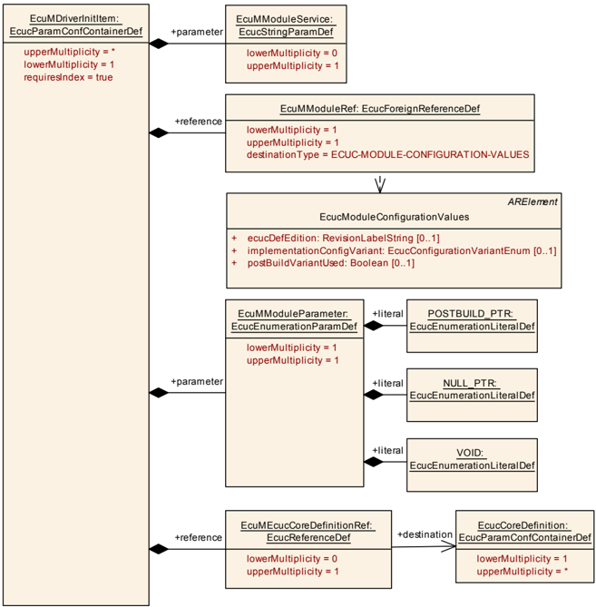

Figure 10.6: EcuMDriverInitItem configuration overview

| SWS Item                         | [ECUC_EcuM_00110]                                                                             | [ECUC_EcuM_00110]                                                                             | [ECUC_EcuM_00110]                                                                             |
|----------------------------------|-----------------------------------------------------------------------------------------------|-----------------------------------------------------------------------------------------------|-----------------------------------------------------------------------------------------------|
| Container Name                   | EcuMDriverInitItem                                                                            | EcuMDriverInitItem                                                                            | EcuMDriverInitItem                                                                            |
| Parent Container                 | EcuMDriverInitListBswM, EcuMDriverInitListOne, EcuMDriverInitListZero, EcuMDriver RestartList | EcuMDriverInitListBswM, EcuMDriverInitListOne, EcuMDriverInitListZero, EcuMDriver RestartList | EcuMDriverInitListBswM, EcuMDriverInitListOne, EcuMDriverInitListZero, EcuMDriver RestartList |
| Description                      | These containers describe the entries in a driver init list. Attributes: requiresIndex=true   | These containers describe the entries in a driver init list. Attributes: requiresIndex=true   | These containers describe the entries in a driver init list. Attributes: requiresIndex=true   |
| Post-Build Variant Multiplicity  | false                                                                                         | false                                                                                         | false                                                                                         |
| Multiplicity Configuration Class | Pre-compile time                                                                              | X                                                                                             | All Variants                                                                                  |
| Multiplicity Configuration Class | Link time                                                                                     | -                                                                                             |                                                                                               |
| Multiplicity Configuration Class | Post-build time                                                                               | -                                                                                             |                                                                                               |
| Configuration Parameters         | Configuration Parameters                                                                      | Configuration Parameters                                                                      | Configuration Parameters                                                                      |

| SWS Item         | [ECUC_EcuM_00224]                                                              |
|------------------|--------------------------------------------------------------------------------|
| Parameter Name   | EcuMModuleParameter                                                            |
| Parent Container | EcuMDriverInitItem                                                             |
| Description      | Definition of the function prototype and the parameter passed to the function. |
| Multiplicity     | 1                                                                              |
| Type             | EcucEnumerationParamDef                                                        |


## glyph[triangle]

| Range                     | NULL_PTR         | If NULL_PTR is configured EcuM expects as prototype: void <Mip>_<EcuMModule Service>(const <Mip>_ConfigType* <Mip>_ Config). EcuM shall call this function with NULL Pointer: <Mip>_<EcuMModuleService>(NULL).        | If NULL_PTR is configured EcuM expects as prototype: void <Mip>_<EcuMModule Service>(const <Mip>_ConfigType* <Mip>_ Config). EcuM shall call this function with NULL Pointer: <Mip>_<EcuMModuleService>(NULL).        |
|---------------------------|------------------|-----------------------------------------------------------------------------------------------------------------------------------------------------------------------------------------------------------------------|-----------------------------------------------------------------------------------------------------------------------------------------------------------------------------------------------------------------------|
| Range                     | POSTBUILD_PTR    | If POSTBUILD_PTR is configured EcuM expects as prototype: void <Mip>_<EcuMModule Service>(const <Mip>_ConfigType* <Mip>_ Config). EcuM shall call this function with a valid pointer, see TPS_ECUC_08011 for details. | If POSTBUILD_PTR is configured EcuM expects as prototype: void <Mip>_<EcuMModule Service>(const <Mip>_ConfigType* <Mip>_ Config). EcuM shall call this function with a valid pointer, see TPS_ECUC_08011 for details. |
| Range                     | VOID             | If VOID is configured EcuM expects as prototype: void <Mip>_<EcuMModuleService>(void). EcuM will call <Mip>_<EcuMModuleService>().                                                                                    | If VOID is configured EcuM expects as prototype: void <Mip>_<EcuMModuleService>(void). EcuM will call <Mip>_<EcuMModuleService>().                                                                                    |
| Post-Build Variant Value  | false            |                                                                                                                                                                                                                       |                                                                                                                                                                                                                       |
| Value Configuration Class | Pre-compile time | X                                                                                                                                                                                                                     | All Variants                                                                                                                                                                                                          |
| Value Configuration Class | Link time        | -                                                                                                                                                                                                                     |                                                                                                                                                                                                                       |
| Value Configuration Class | Post-build time  | -                                                                                                                                                                                                                     |                                                                                                                                                                                                                       |
| Scope / Dependency        | scope: local     | scope: local                                                                                                                                                                                                          | scope: local                                                                                                                                                                                                          |

| SWS Item                         | [ECUC_EcuM_00124]                                                                                                                    | [ECUC_EcuM_00124]                                                                                                                    | [ECUC_EcuM_00124]                                                                                                                    |
|----------------------------------|--------------------------------------------------------------------------------------------------------------------------------------|--------------------------------------------------------------------------------------------------------------------------------------|--------------------------------------------------------------------------------------------------------------------------------------|
| Parameter Name                   | EcuMModuleService                                                                                                                    | EcuMModuleService                                                                                                                    | EcuMModuleService                                                                                                                    |
| Parent Container                 | EcuMDriverInitItem                                                                                                                   | EcuMDriverInitItem                                                                                                                   | EcuMDriverInitItem                                                                                                                   |
| Description                      | The service to be called to initialize that module, e.g. Init, PreInit, Start etc. If nothing is defined "Init" is taken by default. | The service to be called to initialize that module, e.g. Init, PreInit, Start etc. If nothing is defined "Init" is taken by default. | The service to be called to initialize that module, e.g. Init, PreInit, Start etc. If nothing is defined "Init" is taken by default. |
| Multiplicity                     | 0..1                                                                                                                                 | 0..1                                                                                                                                 | 0..1                                                                                                                                 |
| Type                             | EcucStringParamDef                                                                                                                   | EcucStringParamDef                                                                                                                   | EcucStringParamDef                                                                                                                   |
| Default value                    | -                                                                                                                                    | -                                                                                                                                    | -                                                                                                                                    |
| Regular Expression               | -                                                                                                                                    | -                                                                                                                                    | -                                                                                                                                    |
| Post-Build Variant Multiplicity  | false                                                                                                                                | false                                                                                                                                | false                                                                                                                                |
| Post-Build Variant Value         | false                                                                                                                                | false                                                                                                                                | false                                                                                                                                |
| Multiplicity Configuration Class | Pre-compile time                                                                                                                     | X                                                                                                                                    |                                                                                                                                      |
| Multiplicity Configuration Class | Link time                                                                                                                            | -                                                                                                                                    |                                                                                                                                      |
| Multiplicity Configuration Class | Post-build time                                                                                                                      | -                                                                                                                                    |                                                                                                                                      |
| Value Configuration Class        | Pre-compile time                                                                                                                     | X                                                                                                                                    |                                                                                                                                      |
| Value Configuration Class        | Link time                                                                                                                            | -                                                                                                                                    |                                                                                                                                      |
| Value Configuration Class        | Post-build time                                                                                                                      | -                                                                                                                                    |                                                                                                                                      |
| Scope / Dependency               | scope: local                                                                                                                         | scope: local                                                                                                                         | scope: local                                                                                                                         |

| SWS Item                         | [ECUC_EcuM_00229]                                                         | [ECUC_EcuM_00229]                                                         | [ECUC_EcuM_00229]                                                         |
|----------------------------------|---------------------------------------------------------------------------|---------------------------------------------------------------------------|---------------------------------------------------------------------------|
| Parameter Name                   | EcuMEcucCoreDefinitionRef                                                 | EcuMEcucCoreDefinitionRef                                                 | EcuMEcucCoreDefinitionRef                                                 |
| Parent Container                 | EcuMDriverInitItem                                                        | EcuMDriverInitItem                                                        | EcuMDriverInitItem                                                        |
| Description                      | Reference denotes the core the EcuM AUTOSAR services shall be offered on. | Reference denotes the core the EcuM AUTOSAR services shall be offered on. | Reference denotes the core the EcuM AUTOSAR services shall be offered on. |
| Multiplicity                     | 0..1                                                                      | 0..1                                                                      | 0..1                                                                      |
| Type                             | Reference to EcucCoreDefinition                                           | Reference to EcucCoreDefinition                                           | Reference to EcucCoreDefinition                                           |
| Post-Build Variant Multiplicity  | false                                                                     | false                                                                     | false                                                                     |
| Post-Build Variant Value         | false                                                                     | false                                                                     | false                                                                     |
| Multiplicity Configuration Class | Pre-compile time                                                          | X                                                                         | All Variants                                                              |
| Multiplicity Configuration Class | Link time                                                                 | -                                                                         |                                                                           |
| Multiplicity Configuration Class | Post-build time                                                           | -                                                                         |                                                                           |
| Value Configuration Class        | Pre-compile time                                                          | X                                                                         | All Variants                                                              |


glyph[triangle]

|                    | Link time       | -            |              |
|--------------------|-----------------|--------------|--------------|
|                    | Post-build time | -            |              |
| Scope / Dependency | scope: local    | scope: local | scope: local |

| SWS Item                  | [ECUC_EcuM_00223]                                                                              | [ECUC_EcuM_00223]                                                                              | [ECUC_EcuM_00223]                                                                              |
|---------------------------|------------------------------------------------------------------------------------------------|------------------------------------------------------------------------------------------------|------------------------------------------------------------------------------------------------|
| Parameter Name            | EcuMModuleRef                                                                                  | EcuMModuleRef                                                                                  | EcuMModuleRef                                                                                  |
| Parent Container          | EcuMDriverInitItem                                                                             | EcuMDriverInitItem                                                                             | EcuMDriverInitItem                                                                             |
| Description               | Foreign reference to the configuration of a module instance which shall be initialized by EcuM | Foreign reference to the configuration of a module instance which shall be initialized by EcuM | Foreign reference to the configuration of a module instance which shall be initialized by EcuM |
| Multiplicity              | 1                                                                                              | 1                                                                                              | 1                                                                                              |
| Type                      | Foreign reference to ECUC-MODULE-CONFIGURATION-VALUES                                          | Foreign reference to ECUC-MODULE-CONFIGURATION-VALUES                                          | Foreign reference to ECUC-MODULE-CONFIGURATION-VALUES                                          |
| Post-Build Variant Value  | false                                                                                          | false                                                                                          | false                                                                                          |
| Value Configuration Class | Pre-compile time                                                                               | X                                                                                              | All Variants                                                                                   |
| Value Configuration Class | Link time                                                                                      | -                                                                                              |                                                                                                |
| Value Configuration Class | Post-build time                                                                                | -                                                                                              |                                                                                                |
| Scope / Dependency        | scope: local                                                                                   | scope: local                                                                                   | scope: local                                                                                   |

No Included Containers

## 10.1.10 EcuMSleepMode


Figure 10.7: EcuMSleepMode configuration overview

| SWS Item                         | [ECUC_EcuM_00131]                                     | [ECUC_EcuM_00131]                                     | [ECUC_EcuM_00131]                                     |
|----------------------------------|-------------------------------------------------------|-------------------------------------------------------|-------------------------------------------------------|
| Container Name                   | EcuMSleepMode                                         | EcuMSleepMode                                         | EcuMSleepMode                                         |
| Parent Container                 | EcuMCommonConfiguration                               | EcuMCommonConfiguration                               | EcuMCommonConfiguration                               |
| Description                      | These containers describe the configured sleep modes. | These containers describe the configured sleep modes. | These containers describe the configured sleep modes. |
| Post-Build Variant Multiplicity  | false                                                 | false                                                 | false                                                 |
| Multiplicity Configuration Class | Pre-compile time                                      | X                                                     | All Variants                                          |

glyph[triangleinv]


## glyph[triangle]

|                          | Link time       | -   |
|--------------------------|-----------------|-----|
|                          | Post-build time | -   |
| Configuration Parameters |                 |     |

| SWS Item                  | [ECUC_EcuM_00132]                                                              | [ECUC_EcuM_00132]                                                              | [ECUC_EcuM_00132]                                                              |
|---------------------------|--------------------------------------------------------------------------------|--------------------------------------------------------------------------------|--------------------------------------------------------------------------------|
| Parameter Name            | EcuMSleepModeId                                                                | EcuMSleepModeId                                                                | EcuMSleepModeId                                                                |
| Parent Container          | EcuMSleepMode                                                                  | EcuMSleepMode                                                                  | EcuMSleepMode                                                                  |
| Description               | This ID identifies this sleep mode in services like EcuM_SelectShutdownTarget. | This ID identifies this sleep mode in services like EcuM_SelectShutdownTarget. | This ID identifies this sleep mode in services like EcuM_SelectShutdownTarget. |
| Multiplicity              | 1                                                                              | 1                                                                              | 1                                                                              |
| Type                      | EcucIntegerParamDef (Symbolic Name generated for this parameter)               | EcucIntegerParamDef (Symbolic Name generated for this parameter)               | EcucIntegerParamDef (Symbolic Name generated for this parameter)               |
| Range                     | 0 .. 255                                                                       |                                                                                |                                                                                |
| Default value             | -                                                                              | -                                                                              | -                                                                              |
| Post-Build Variant Value  | false                                                                          | false                                                                          | false                                                                          |
| Value Configuration Class | Pre-compile time                                                               | X                                                                              | All Variants                                                                   |
| Value Configuration Class | Link time                                                                      | -                                                                              |                                                                                |
| Value Configuration Class | Post-build time                                                                | -                                                                              |                                                                                |
| Scope / Dependency        | scope: ECU                                                                     | scope: ECU                                                                     | scope: ECU                                                                     |

| SWS Item                  | [ECUC_EcuM_00136]                                                                                                                                                             | [ECUC_EcuM_00136]                                                                                                                                                             | [ECUC_EcuM_00136]                                                                                                                                                             |
|---------------------------|-------------------------------------------------------------------------------------------------------------------------------------------------------------------------------|-------------------------------------------------------------------------------------------------------------------------------------------------------------------------------|-------------------------------------------------------------------------------------------------------------------------------------------------------------------------------|
| Parameter Name            | EcuMSleepModeSuspend                                                                                                                                                          | EcuMSleepModeSuspend                                                                                                                                                          | EcuMSleepModeSuspend                                                                                                                                                          |
| Parent Container          | EcuMSleepMode                                                                                                                                                                 | EcuMSleepMode                                                                                                                                                                 | EcuMSleepMode                                                                                                                                                                 |
| Description               | Flag, which is set true, if the CPU is suspended, halted, or powered off in the sleep mode. If the CPU keeps running in this sleep mode, then this flag must be set to false. | Flag, which is set true, if the CPU is suspended, halted, or powered off in the sleep mode. If the CPU keeps running in this sleep mode, then this flag must be set to false. | Flag, which is set true, if the CPU is suspended, halted, or powered off in the sleep mode. If the CPU keeps running in this sleep mode, then this flag must be set to false. |
| Multiplicity              | 1                                                                                                                                                                             | 1                                                                                                                                                                             | 1                                                                                                                                                                             |
| Type                      | EcucBooleanParamDef                                                                                                                                                           | EcucBooleanParamDef                                                                                                                                                           | EcucBooleanParamDef                                                                                                                                                           |
| Default value             | -                                                                                                                                                                             | -                                                                                                                                                                             | -                                                                                                                                                                             |
| Post-Build Variant Value  | false                                                                                                                                                                         | false                                                                                                                                                                         | false                                                                                                                                                                         |
| Value Configuration Class | Pre-compile time                                                                                                                                                              | X                                                                                                                                                                             | All Variants                                                                                                                                                                  |
| Value Configuration Class | Link time                                                                                                                                                                     | -                                                                                                                                                                             |                                                                                                                                                                               |
| Value Configuration Class | Post-build time                                                                                                                                                               | -                                                                                                                                                                             |                                                                                                                                                                               |
| Scope / Dependency        | scope: local                                                                                                                                                                  | scope: local                                                                                                                                                                  | scope: local                                                                                                                                                                  |

| SWS Item                  | [ECUC_EcuM_00133]                                                                | [ECUC_EcuM_00133]                                                                | [ECUC_EcuM_00133]                                                                |
|---------------------------|----------------------------------------------------------------------------------|----------------------------------------------------------------------------------|----------------------------------------------------------------------------------|
| Parameter Name            | EcuMSleepModeMcuModeRef                                                          | EcuMSleepModeMcuModeRef                                                          | EcuMSleepModeMcuModeRef                                                          |
| Parent Container          | EcuMSleepMode                                                                    | EcuMSleepMode                                                                    | EcuMSleepMode                                                                    |
| Description               | This parameter is a reference to the corresponding MCU mode for this sleep mode. | This parameter is a reference to the corresponding MCU mode for this sleep mode. | This parameter is a reference to the corresponding MCU mode for this sleep mode. |
| Multiplicity              | 1                                                                                | 1                                                                                | 1                                                                                |
| Type                      | Symbolic name reference to McuModeSettingConf                                    | Symbolic name reference to McuModeSettingConf                                    | Symbolic name reference to McuModeSettingConf                                    |
| Post-Build Variant Value  | false                                                                            | false                                                                            | false                                                                            |
| Value Configuration Class | Pre-compile time                                                                 | X                                                                                | All Variants                                                                     |
| Value Configuration Class | Link time                                                                        | -                                                                                |                                                                                  |
| Value Configuration Class | Post-build time                                                                  | -                                                                                |                                                                                  |
| Scope / Dependency        | scope: local                                                                     | scope: local                                                                     | scope: local                                                                     |


| SWS Item                         | [ECUC_EcuM_00152]                                                                                | [ECUC_EcuM_00152]                                                                                | [ECUC_EcuM_00152]                                                                                |
|----------------------------------|--------------------------------------------------------------------------------------------------|--------------------------------------------------------------------------------------------------|--------------------------------------------------------------------------------------------------|
| Parameter Name                   | EcuMWakeupSourceMask                                                                             | EcuMWakeupSourceMask                                                                             | EcuMWakeupSourceMask                                                                             |
| Parent Container                 | EcuMSleepMode                                                                                    | EcuMSleepMode                                                                                    | EcuMSleepMode                                                                                    |
| Description                      | These parameters are references to the wakeup sources that shall be enabled for this sleep mode. | These parameters are references to the wakeup sources that shall be enabled for this sleep mode. | These parameters are references to the wakeup sources that shall be enabled for this sleep mode. |
| Multiplicity                     | 1..*                                                                                             | 1..*                                                                                             | 1..*                                                                                             |
| Type                             | Symbolic name reference to EcuMWakeupSource                                                      | Symbolic name reference to EcuMWakeupSource                                                      | Symbolic name reference to EcuMWakeupSource                                                      |
| Post-Build Variant Multiplicity  | false                                                                                            | false                                                                                            | false                                                                                            |
| Post-Build Variant Value         | false                                                                                            | false                                                                                            | false                                                                                            |
| Multiplicity Configuration Class | Pre-compile time                                                                                 | X                                                                                                |                                                                                                  |
| Multiplicity Configuration Class | Link time                                                                                        | -                                                                                                |                                                                                                  |
| Multiplicity Configuration Class | Post-build time                                                                                  | -                                                                                                |                                                                                                  |
| Value Configuration Class        | Pre-compile time                                                                                 | X                                                                                                |                                                                                                  |
| Value Configuration Class        | Link time                                                                                        | -                                                                                                |                                                                                                  |
| Value Configuration Class        | Post-build time                                                                                  | -                                                                                                |                                                                                                  |
| Scope / Dependency               | scope: local                                                                                     | scope: local                                                                                     | scope: local                                                                                     |

| No Included Containers   |
|--------------------------|


## 10.1.11 EcuMWakeupSource


Figure 10.8: EcuMWakeupSource configuration overview

| SWS Item                         | [ECUC_EcuM_00150]                                        | [ECUC_EcuM_00150]                                        | [ECUC_EcuM_00150]                                        |
|----------------------------------|----------------------------------------------------------|----------------------------------------------------------|----------------------------------------------------------|
| Container Name                   | EcuMWakeupSource                                         | EcuMWakeupSource                                         | EcuMWakeupSource                                         |
| Parent Container                 | EcuMCommonConfiguration                                  | EcuMCommonConfiguration                                  | EcuMCommonConfiguration                                  |
| Description                      | These containers describe the configured wakeup sources. | These containers describe the configured wakeup sources. | These containers describe the configured wakeup sources. |
| Post-Build Variant Multiplicity  | true                                                     | true                                                     | true                                                     |
| Multiplicity Configuration Class | Pre-compile time                                         | X                                                        | VARIANT-PRE-COMPILE                                      |
| Multiplicity Configuration Class | Link time                                                | -                                                        |                                                          |
| Multiplicity Configuration Class | Post-build time                                          | X                                                        | VARIANT-POST-BUILD                                       |
| Configuration Parameters         | Configuration Parameters                                 | Configuration Parameters                                 | Configuration Parameters                                 |

| SWS Item         | [ECUC_EcuM_00208]      |
|------------------|------------------------|
| Parameter Name   | EcuMCheckWakeupTimeout |
| Parent Container | EcuMWakeupSource       |


## glyph[triangle]

| Description                      | This Parameter is the initial Value for the Time of the EcuM to delay shut down of the ECU if the check of the Wakeup Source is done asynchronously (CheckWakeupTimer). The unit is in seconds.   | This Parameter is the initial Value for the Time of the EcuM to delay shut down of the ECU if the check of the Wakeup Source is done asynchronously (CheckWakeupTimer). The unit is in seconds.   | This Parameter is the initial Value for the Time of the EcuM to delay shut down of the ECU if the check of the Wakeup Source is done asynchronously (CheckWakeupTimer). The unit is in seconds.   |
|----------------------------------|---------------------------------------------------------------------------------------------------------------------------------------------------------------------------------------------------|---------------------------------------------------------------------------------------------------------------------------------------------------------------------------------------------------|---------------------------------------------------------------------------------------------------------------------------------------------------------------------------------------------------|
| Multiplicity                     | 0..1                                                                                                                                                                                              | 0..1                                                                                                                                                                                              | 0..1                                                                                                                                                                                              |
| Type                             | EcucFloatParamDef                                                                                                                                                                                 | EcucFloatParamDef                                                                                                                                                                                 | EcucFloatParamDef                                                                                                                                                                                 |
| Range                            | [0 .. 10]                                                                                                                                                                                         |                                                                                                                                                                                                   |                                                                                                                                                                                                   |
| Default value                    | 0                                                                                                                                                                                                 | 0                                                                                                                                                                                                 | 0                                                                                                                                                                                                 |
| Post-Build Variant Multiplicity  | false                                                                                                                                                                                             | false                                                                                                                                                                                             | false                                                                                                                                                                                             |
| Post-Build Variant Value         | false                                                                                                                                                                                             | false                                                                                                                                                                                             | false                                                                                                                                                                                             |
| Multiplicity Configuration Class | Pre-compile time                                                                                                                                                                                  | All Variants                                                                                                                                                                                      |                                                                                                                                                                                                   |
| Multiplicity Configuration Class | Link time                                                                                                                                                                                         | -                                                                                                                                                                                                 |                                                                                                                                                                                                   |
| Multiplicity Configuration Class | Post-build time                                                                                                                                                                                   | -                                                                                                                                                                                                 |                                                                                                                                                                                                   |
| Value Configuration Class        | Pre-compile time                                                                                                                                                                                  | All Variants                                                                                                                                                                                      |                                                                                                                                                                                                   |
| Value Configuration Class        | Link time                                                                                                                                                                                         | -                                                                                                                                                                                                 |                                                                                                                                                                                                   |
| Value Configuration Class        | Post-build time                                                                                                                                                                                   | -                                                                                                                                                                                                 |                                                                                                                                                                                                   |
| Scope / Dependency               | scope: local                                                                                                                                                                                      | scope: local                                                                                                                                                                                      | scope: local                                                                                                                                                                                      |

| SWS Item                         | [ECUC_EcuM_00148]                                                                                                                                                                                                                                                                                                                       | [ECUC_EcuM_00148]                                                                                                                                                                                                                                                                                                                       | [ECUC_EcuM_00148]                                                                                                                                                                                                                                                                                                                       |
|----------------------------------|-----------------------------------------------------------------------------------------------------------------------------------------------------------------------------------------------------------------------------------------------------------------------------------------------------------------------------------------|-----------------------------------------------------------------------------------------------------------------------------------------------------------------------------------------------------------------------------------------------------------------------------------------------------------------------------------------|-----------------------------------------------------------------------------------------------------------------------------------------------------------------------------------------------------------------------------------------------------------------------------------------------------------------------------------------|
| Parameter Name                   | EcuMValidationTimeout                                                                                                                                                                                                                                                                                                                   | EcuMValidationTimeout                                                                                                                                                                                                                                                                                                                   | EcuMValidationTimeout                                                                                                                                                                                                                                                                                                                   |
| Parent Container                 | EcuMWakeupSource                                                                                                                                                                                                                                                                                                                        | EcuMWakeupSource                                                                                                                                                                                                                                                                                                                        | EcuMWakeupSource                                                                                                                                                                                                                                                                                                                        |
| Description                      | The validation timeout (period for which the ECU State Manager will wait for the validation of a wakeup event) can be defined for each wakeup source independently. The timeout is specified in seconds. When the timeout is not instantiated, there is no validation routine and the ECU Manager shall not validate the wakeup source. | The validation timeout (period for which the ECU State Manager will wait for the validation of a wakeup event) can be defined for each wakeup source independently. The timeout is specified in seconds. When the timeout is not instantiated, there is no validation routine and the ECU Manager shall not validate the wakeup source. | The validation timeout (period for which the ECU State Manager will wait for the validation of a wakeup event) can be defined for each wakeup source independently. The timeout is specified in seconds. When the timeout is not instantiated, there is no validation routine and the ECU Manager shall not validate the wakeup source. |
| Multiplicity                     | 0..1                                                                                                                                                                                                                                                                                                                                    | 0..1                                                                                                                                                                                                                                                                                                                                    | 0..1                                                                                                                                                                                                                                                                                                                                    |
| Type                             | EcucFloatParamDef                                                                                                                                                                                                                                                                                                                       | EcucFloatParamDef                                                                                                                                                                                                                                                                                                                       | EcucFloatParamDef                                                                                                                                                                                                                                                                                                                       |
| Range                            | [0 .. INF]                                                                                                                                                                                                                                                                                                                              | [0 .. INF]                                                                                                                                                                                                                                                                                                                              | [0 .. INF]                                                                                                                                                                                                                                                                                                                              |
| Default value                    | -                                                                                                                                                                                                                                                                                                                                       | -                                                                                                                                                                                                                                                                                                                                       | -                                                                                                                                                                                                                                                                                                                                       |
| Post-Build Variant Multiplicity  | false                                                                                                                                                                                                                                                                                                                                   | false                                                                                                                                                                                                                                                                                                                                   | false                                                                                                                                                                                                                                                                                                                                   |
| Post-Build Variant Value         | false                                                                                                                                                                                                                                                                                                                                   | false                                                                                                                                                                                                                                                                                                                                   | false                                                                                                                                                                                                                                                                                                                                   |
| Multiplicity Configuration Class | Pre-compile time                                                                                                                                                                                                                                                                                                                        | X                                                                                                                                                                                                                                                                                                                                       | All Variants                                                                                                                                                                                                                                                                                                                            |
| Multiplicity Configuration Class | Link time                                                                                                                                                                                                                                                                                                                               | -                                                                                                                                                                                                                                                                                                                                       |                                                                                                                                                                                                                                                                                                                                         |
| Multiplicity Configuration Class | Post-build time                                                                                                                                                                                                                                                                                                                         | -                                                                                                                                                                                                                                                                                                                                       |                                                                                                                                                                                                                                                                                                                                         |
| Value Configuration Class        | Pre-compile time                                                                                                                                                                                                                                                                                                                        | X                                                                                                                                                                                                                                                                                                                                       | All Variants                                                                                                                                                                                                                                                                                                                            |
| Value Configuration Class        | Link time                                                                                                                                                                                                                                                                                                                               | -                                                                                                                                                                                                                                                                                                                                       |                                                                                                                                                                                                                                                                                                                                         |
| Value Configuration Class        | Post-build time                                                                                                                                                                                                                                                                                                                         | -                                                                                                                                                                                                                                                                                                                                       |                                                                                                                                                                                                                                                                                                                                         |
| Scope / Dependency               | scope: local                                                                                                                                                                                                                                                                                                                            | scope: local                                                                                                                                                                                                                                                                                                                            | scope: local                                                                                                                                                                                                                                                                                                                            |

| SWS Item         | [ECUC_EcuM_00151]                                                                                                                    |
|------------------|--------------------------------------------------------------------------------------------------------------------------------------|
| Parameter Name   | EcuMWakeupSourceId                                                                                                                   |
| Parent Container | EcuMWakeupSource                                                                                                                     |
| Description      | This parameter defines the identifier of this wakeup source. The first five bits are reserved values from the EcuM_WakeupSourceType. |
| Multiplicity     | 1                                                                                                                                    |
| Type             | EcucIntegerParamDef (Symbolic Name generated for this parameter)                                                                     |
| Range            | 5 .. 31                                                                                                                              |
| Default value    | -                                                                                                                                    |


## glyph[triangle]

| Post-Build Variant Value   | false            | false      | false        |
|----------------------------|------------------|------------|--------------|
| Value Configuration Class  | Pre-compile time | X          | All Variants |
| Value Configuration Class  | Link time        | -          |              |
| Value Configuration Class  | Post-build time  | -          |              |
| Scope / Dependency         | scope: ECU       | scope: ECU | scope: ECU   |

| SWS Item                  | [ECUC_EcuM_00153]                                            | [ECUC_EcuM_00153]                                            | [ECUC_EcuM_00153]                                            |
|---------------------------|--------------------------------------------------------------|--------------------------------------------------------------|--------------------------------------------------------------|
| Parameter Name            | EcuMWakeupSourcePolling                                      | EcuMWakeupSourcePolling                                      | EcuMWakeupSourcePolling                                      |
| Parent Container          | EcuMWakeupSource                                             | EcuMWakeupSource                                             | EcuMWakeupSource                                             |
| Description               | This parameter describes if the wakeup source needs polling. | This parameter describes if the wakeup source needs polling. | This parameter describes if the wakeup source needs polling. |
| Multiplicity              | 1                                                            | 1                                                            | 1                                                            |
| Type                      | EcucBooleanParamDef                                          | EcucBooleanParamDef                                          | EcucBooleanParamDef                                          |
| Default value             | -                                                            | -                                                            | -                                                            |
| Post-Build Variant Value  | false                                                        | false                                                        | false                                                        |
| Value Configuration Class | Pre-compile time                                             | X                                                            | All Variants                                                 |
| Value Configuration Class | Link time                                                    | -                                                            |                                                              |
| Value Configuration Class | Post-build time                                              | -                                                            |                                                              |
| Scope / Dependency        | scope: local                                                 | scope: local                                                 | scope: local                                                 |

| SWS Item                         | [ECUC_EcuM_00101]                                                                                                                                                               | [ECUC_EcuM_00101]                                                                                                                                                               | [ECUC_EcuM_00101]                                                                                                                                                               |
|----------------------------------|---------------------------------------------------------------------------------------------------------------------------------------------------------------------------------|---------------------------------------------------------------------------------------------------------------------------------------------------------------------------------|---------------------------------------------------------------------------------------------------------------------------------------------------------------------------------|
| Parameter Name                   | EcuMComMChannelRef                                                                                                                                                              | EcuMComMChannelRef                                                                                                                                                              | EcuMComMChannelRef                                                                                                                                                              |
| Parent Container                 | EcuMWakeupSource                                                                                                                                                                | EcuMWakeupSource                                                                                                                                                                | EcuMWakeupSource                                                                                                                                                                |
| Description                      | This parameter could reference multiple Networks (channels) defined in the Communication Manager. No reference indicates that the wakeup source is not a communication channel. | This parameter could reference multiple Networks (channels) defined in the Communication Manager. No reference indicates that the wakeup source is not a communication channel. | This parameter could reference multiple Networks (channels) defined in the Communication Manager. No reference indicates that the wakeup source is not a communication channel. |
| Multiplicity                     | 0..*                                                                                                                                                                            | 0..*                                                                                                                                                                            | 0..*                                                                                                                                                                            |
| Type                             | Symbolic name reference to ComMChannel                                                                                                                                          | Symbolic name reference to ComMChannel                                                                                                                                          | Symbolic name reference to ComMChannel                                                                                                                                          |
| Post-Build Variant Multiplicity  | false                                                                                                                                                                           | false                                                                                                                                                                           | false                                                                                                                                                                           |
| Post-Build Variant Value         | false                                                                                                                                                                           | false                                                                                                                                                                           | false                                                                                                                                                                           |
| Multiplicity Configuration Class | Pre-compile time                                                                                                                                                                | X                                                                                                                                                                               |                                                                                                                                                                                 |
| Multiplicity Configuration Class | Link time                                                                                                                                                                       | -                                                                                                                                                                               |                                                                                                                                                                                 |
| Multiplicity Configuration Class | Post-build time                                                                                                                                                                 | -                                                                                                                                                                               |                                                                                                                                                                                 |
| Value Configuration Class        | Pre-compile time                                                                                                                                                                | X                                                                                                                                                                               |                                                                                                                                                                                 |
| Value Configuration Class        | Link time                                                                                                                                                                       | -                                                                                                                                                                               |                                                                                                                                                                                 |
| Value Configuration Class        | Post-build time                                                                                                                                                                 | -                                                                                                                                                                               |                                                                                                                                                                                 |
| Scope / Dependency               | scope: local                                                                                                                                                                    | scope: local                                                                                                                                                                    | scope: local                                                                                                                                                                    |

| SWS Item                         | [ECUC_EcuM_00228]                                                                                                                                                    | [ECUC_EcuM_00228]                                                                                                                                                    | [ECUC_EcuM_00228]                                                                                                                                                    |
|----------------------------------|----------------------------------------------------------------------------------------------------------------------------------------------------------------------|----------------------------------------------------------------------------------------------------------------------------------------------------------------------|----------------------------------------------------------------------------------------------------------------------------------------------------------------------|
| Parameter Name                   | EcuMComMPNCRef                                                                                                                                                       | EcuMComMPNCRef                                                                                                                                                       | EcuMComMPNCRef                                                                                                                                                       |
| Parent Container                 | EcuMWakeupSource                                                                                                                                                     | EcuMWakeupSource                                                                                                                                                     | EcuMWakeupSource                                                                                                                                                     |
| Description                      | This is a reference to a one or more PNC's defined in the Communication Manager. No reference indicates that the wakeup source is not assigned to a partial network. | This is a reference to a one or more PNC's defined in the Communication Manager. No reference indicates that the wakeup source is not assigned to a partial network. | This is a reference to a one or more PNC's defined in the Communication Manager. No reference indicates that the wakeup source is not assigned to a partial network. |
| Multiplicity                     | 0..*                                                                                                                                                                 | 0..*                                                                                                                                                                 | 0..*                                                                                                                                                                 |
| Type                             | Symbolic name reference to ComMPnc                                                                                                                                   | Symbolic name reference to ComMPnc                                                                                                                                   | Symbolic name reference to ComMPnc                                                                                                                                   |
| Post-Build Variant Multiplicity  | true                                                                                                                                                                 | true                                                                                                                                                                 | true                                                                                                                                                                 |
| Post-Build Variant Value         | false                                                                                                                                                                | false                                                                                                                                                                | false                                                                                                                                                                |
| Multiplicity Configuration Class | Pre-compile time                                                                                                                                                     | X                                                                                                                                                                    | All Variants                                                                                                                                                         |


## glyph[triangle]

|                           | Link time        | -            |              |
|---------------------------|------------------|--------------|--------------|
|                           | Post-build time  | -            |              |
| Value Configuration Class | Pre-compile time | X            | All Variants |
| Value Configuration Class | Link time        | -            |              |
| Value Configuration Class | Post-build time  | -            |              |
| Scope / Dependency        | scope: local     | scope: local | scope: local |

| SWS Item                         | [ECUC_EcuM_00128]                                                                                     | [ECUC_EcuM_00128]                                                                                     | [ECUC_EcuM_00128]                                                                                     |
|----------------------------------|-------------------------------------------------------------------------------------------------------|-------------------------------------------------------------------------------------------------------|-------------------------------------------------------------------------------------------------------|
| Parameter Name                   | EcuMResetReasonRef                                                                                    | EcuMResetReasonRef                                                                                    | EcuMResetReasonRef                                                                                    |
| Parent Container                 | EcuMWakeupSource                                                                                      | EcuMWakeupSource                                                                                      | EcuMWakeupSource                                                                                      |
| Description                      | This parameter describes the mapping of reset reasons detected by the MCU driver into wakeup sources. | This parameter describes the mapping of reset reasons detected by the MCU driver into wakeup sources. | This parameter describes the mapping of reset reasons detected by the MCU driver into wakeup sources. |
| Multiplicity                     | 0..*                                                                                                  | 0..*                                                                                                  | 0..*                                                                                                  |
| Type                             | Symbolic name reference to McuResetReasonConf                                                         | Symbolic name reference to McuResetReasonConf                                                         | Symbolic name reference to McuResetReasonConf                                                         |
| Post-Build Variant Multiplicity  | false                                                                                                 | false                                                                                                 | false                                                                                                 |
| Post-Build Variant Value         | false                                                                                                 | false                                                                                                 | false                                                                                                 |
| Multiplicity Configuration Class | Pre-compile time                                                                                      | All Variants                                                                                          |                                                                                                       |
| Multiplicity Configuration Class | Link time                                                                                             | -                                                                                                     |                                                                                                       |
| Multiplicity Configuration Class | Post-build time                                                                                       | -                                                                                                     |                                                                                                       |
| Value Configuration Class        | Pre-compile time                                                                                      | All Variants                                                                                          |                                                                                                       |
| Value Configuration Class        | Link time                                                                                             | -                                                                                                     |                                                                                                       |
| Value Configuration Class        | Post-build time                                                                                       | -                                                                                                     |                                                                                                       |
| Scope / Dependency               | scope: local                                                                                          | scope: local                                                                                          | scope: local                                                                                          |

No Included Containers

## 10.2 EcuM-Flex Containers and configuration parameters

Figure 10.9: EcuMFlex configuration overview


## 10.2.1 EcuMFlexGeneral


Figure 10.10: EcuMFlexGeneral configuration overview

| SWS Item                         | [ECUC_EcuM_00168]                                                                                                                     | [ECUC_EcuM_00168]                                                                                                                     | [ECUC_EcuM_00168]                                                                                                                     |
|----------------------------------|---------------------------------------------------------------------------------------------------------------------------------------|---------------------------------------------------------------------------------------------------------------------------------------|---------------------------------------------------------------------------------------------------------------------------------------|
| Container Name                   | EcuMFlexGeneral                                                                                                                       | EcuMFlexGeneral                                                                                                                       | EcuMFlexGeneral                                                                                                                       |
| Parent Container                 | EcuM                                                                                                                                  | EcuM                                                                                                                                  | EcuM                                                                                                                                  |
| Description                      | This container holds the general, pre-compile configuration parameters for the Ecu MFlex. Only applicable if EcuMFlex is implemented. | This container holds the general, pre-compile configuration parameters for the Ecu MFlex. Only applicable if EcuMFlex is implemented. | This container holds the general, pre-compile configuration parameters for the Ecu MFlex. Only applicable if EcuMFlex is implemented. |
| Post-Build Variant Multiplicity  | false                                                                                                                                 | false                                                                                                                                 | false                                                                                                                                 |
| Multiplicity Configuration Class | Pre-compile time                                                                                                                      | X                                                                                                                                     | All Variants                                                                                                                          |
| Multiplicity Configuration Class | Link time                                                                                                                             | -                                                                                                                                     |                                                                                                                                       |
| Multiplicity Configuration Class | Post-build time                                                                                                                       | -                                                                                                                                     |                                                                                                                                       |
| Configuration Parameters         | Configuration Parameters                                                                                                              | Configuration Parameters                                                                                                              | Configuration Parameters                                                                                                              |

| SWS Item                  | [ECUC_EcuM_00199]                                                       | [ECUC_EcuM_00199]                                                       | [ECUC_EcuM_00199]                                                       |
|---------------------------|-------------------------------------------------------------------------|-------------------------------------------------------------------------|-------------------------------------------------------------------------|
| Parameter Name            | EcuMAlarmClockPresent                                                   | EcuMAlarmClockPresent                                                   | EcuMAlarmClockPresent                                                   |
| Parent Container          | EcuMFlexGeneral                                                         | EcuMFlexGeneral                                                         | EcuMFlexGeneral                                                         |
| Description               | This flag indicates whether the optional AlarmClock feature is present. | This flag indicates whether the optional AlarmClock feature is present. | This flag indicates whether the optional AlarmClock feature is present. |
| Multiplicity              | 1                                                                       | 1                                                                       | 1                                                                       |
| Type                      | EcucBooleanParamDef                                                     | EcucBooleanParamDef                                                     | EcucBooleanParamDef                                                     |
| Default value             | -                                                                       | -                                                                       | -                                                                       |
| Post-Build Variant Value  | false                                                                   | false                                                                   | false                                                                   |
| Value Configuration Class | Pre-compile time                                                        | X                                                                       | All Variants                                                            |
| Value Configuration Class | Link time                                                               | -                                                                       |                                                                         |
| Value Configuration Class | Post-build time                                                         | -                                                                       |                                                                         |
| Scope / Dependency        | scope: local                                                            | scope: local                                                            | scope: local                                                            |


| SWS Item                         | [ECUC_EcuM_00221]                                | [ECUC_EcuM_00221]                                | [ECUC_EcuM_00221]                                |
|----------------------------------|--------------------------------------------------|--------------------------------------------------|--------------------------------------------------|
| Parameter Name                   | EcuMModeHandling                                 | EcuMModeHandling                                 | EcuMModeHandling                                 |
| Parent Container                 | EcuMFlexGeneral                                  | EcuMFlexGeneral                                  | EcuMFlexGeneral                                  |
| Description                      | If false, Run Request Protocol is not performed. | If false, Run Request Protocol is not performed. | If false, Run Request Protocol is not performed. |
| Multiplicity                     | 0..1                                             | 0..1                                             | 0..1                                             |
| Type                             | EcucBooleanParamDef                              | EcucBooleanParamDef                              | EcucBooleanParamDef                              |
| Default value                    | -                                                | -                                                | -                                                |
| Post-Build Variant Multiplicity  | false                                            | false                                            | false                                            |
| Post-Build Variant Value         | false                                            | false                                            | false                                            |
| Multiplicity Configuration Class | Pre-compile time                                 | X                                                |                                                  |
| Multiplicity Configuration Class | Link time                                        | -                                                |                                                  |
| Multiplicity Configuration Class | Post-build time                                  | -                                                |                                                  |
| Value Configuration Class        | Pre-compile time                                 | X                                                |                                                  |
| Value Configuration Class        | Link time                                        | -                                                |                                                  |
| Value Configuration Class        | Post-build time                                  | -                                                |                                                  |
| Scope / Dependency               | scope: local                                     | scope: local                                     | scope: local                                     |

| SWS Item                         | [ECUC_EcuM_00171]                                                                                                                                                                                 | [ECUC_EcuM_00171]                                                                                                                                                                                 | [ECUC_EcuM_00171]                                                                                                                                                                                 |
|----------------------------------|---------------------------------------------------------------------------------------------------------------------------------------------------------------------------------------------------|---------------------------------------------------------------------------------------------------------------------------------------------------------------------------------------------------|---------------------------------------------------------------------------------------------------------------------------------------------------------------------------------------------------|
| Parameter Name                   | EcuMResetLoopDetection                                                                                                                                                                            | EcuMResetLoopDetection                                                                                                                                                                            | EcuMResetLoopDetection                                                                                                                                                                            |
| Parent Container                 | EcuMFlexGeneral                                                                                                                                                                                   | EcuMFlexGeneral                                                                                                                                                                                   | EcuMFlexGeneral                                                                                                                                                                                   |
| Description                      | If false, no reset loop detection is performed. If this configuration parameter exists and is set to true, the callout "EcuM_LoopDetection" is called during startup of EcuM (during StartPreOS). | If false, no reset loop detection is performed. If this configuration parameter exists and is set to true, the callout "EcuM_LoopDetection" is called during startup of EcuM (during StartPreOS). | If false, no reset loop detection is performed. If this configuration parameter exists and is set to true, the callout "EcuM_LoopDetection" is called during startup of EcuM (during StartPreOS). |
| Multiplicity                     | 0..1                                                                                                                                                                                              | 0..1                                                                                                                                                                                              | 0..1                                                                                                                                                                                              |
| Type                             | EcucBooleanParamDef                                                                                                                                                                               | EcucBooleanParamDef                                                                                                                                                                               | EcucBooleanParamDef                                                                                                                                                                               |
| Default value                    | -                                                                                                                                                                                                 | -                                                                                                                                                                                                 | -                                                                                                                                                                                                 |
| Post-Build Variant Multiplicity  | false                                                                                                                                                                                             | false                                                                                                                                                                                             | false                                                                                                                                                                                             |
| Post-Build Variant Value         | false                                                                                                                                                                                             | false                                                                                                                                                                                             | false                                                                                                                                                                                             |
| Multiplicity Configuration Class | Pre-compile time                                                                                                                                                                                  | X                                                                                                                                                                                                 |                                                                                                                                                                                                   |
| Multiplicity Configuration Class | Link time                                                                                                                                                                                         | -                                                                                                                                                                                                 |                                                                                                                                                                                                   |
| Multiplicity Configuration Class | Post-build time                                                                                                                                                                                   | -                                                                                                                                                                                                 |                                                                                                                                                                                                   |
| Value Configuration Class        | Pre-compile time                                                                                                                                                                                  | X                                                                                                                                                                                                 |                                                                                                                                                                                                   |
| Value Configuration Class        | Link time                                                                                                                                                                                         | -                                                                                                                                                                                                 |                                                                                                                                                                                                   |
| Value Configuration Class        | Post-build time                                                                                                                                                                                   | -                                                                                                                                                                                                 |                                                                                                                                                                                                   |
| Scope / Dependency               | scope: local                                                                                                                                                                                      | scope: local                                                                                                                                                                                      | scope: local                                                                                                                                                                                      |

| SWS Item                         | [ECUC_EcuM_00210]                                                                                                                                             | [ECUC_EcuM_00210]                                                                                                                                             | [ECUC_EcuM_00210]                                                                                                                                             |
|----------------------------------|---------------------------------------------------------------------------------------------------------------------------------------------------------------|---------------------------------------------------------------------------------------------------------------------------------------------------------------|---------------------------------------------------------------------------------------------------------------------------------------------------------------|
| Parameter Name                   | EcuMSetProgrammableInterrupts                                                                                                                                 | EcuMSetProgrammableInterrupts                                                                                                                                 | EcuMSetProgrammableInterrupts                                                                                                                                 |
| Parent Container                 | EcuMFlexGeneral                                                                                                                                               | EcuMFlexGeneral                                                                                                                                               | EcuMFlexGeneral                                                                                                                                               |
| Description                      | If this configuration parameter exists and is to true, the callout "EcuM_AL_Set ProgrammableInterrupts" is called during startup of EcuM (during StartPreOS). | If this configuration parameter exists and is to true, the callout "EcuM_AL_Set ProgrammableInterrupts" is called during startup of EcuM (during StartPreOS). | If this configuration parameter exists and is to true, the callout "EcuM_AL_Set ProgrammableInterrupts" is called during startup of EcuM (during StartPreOS). |
| Multiplicity                     | 0..1                                                                                                                                                          | 0..1                                                                                                                                                          | 0..1                                                                                                                                                          |
| Type                             | EcucBooleanParamDef                                                                                                                                           | EcucBooleanParamDef                                                                                                                                           | EcucBooleanParamDef                                                                                                                                           |
| Default value                    | -                                                                                                                                                             | -                                                                                                                                                             | -                                                                                                                                                             |
| Post-Build Variant Multiplicity  | false                                                                                                                                                         | false                                                                                                                                                         | false                                                                                                                                                         |
| Post-Build Variant Value         | false                                                                                                                                                         | false                                                                                                                                                         | false                                                                                                                                                         |
| Multiplicity Configuration Class | Pre-compile time                                                                                                                                              | X                                                                                                                                                             | All Variants                                                                                                                                                  |
| Multiplicity Configuration Class | Link time                                                                                                                                                     | -                                                                                                                                                             |                                                                                                                                                               |

glyph[triangleinv]


## glyph[triangle]

|                           | Post-build time   | -            |              |
|---------------------------|-------------------|--------------|--------------|
| Value Configuration Class | Pre-compile time  | X            | All Variants |
| Value Configuration Class | Link time         | -            |              |
| Value Configuration Class | Post-build time   | -            |              |
| Scope / Dependency        | scope: local      | scope: local | scope: local |

| SWS Item                         | [ECUC_EcuM_00200]                                                                                  | [ECUC_EcuM_00200]                                                                                  | [ECUC_EcuM_00200]                                                                                  |
|----------------------------------|----------------------------------------------------------------------------------------------------|----------------------------------------------------------------------------------------------------|----------------------------------------------------------------------------------------------------|
| Parameter Name                   | EcuMAlarmWakeupSource                                                                              | EcuMAlarmWakeupSource                                                                              | EcuMAlarmWakeupSource                                                                              |
| Parent Container                 | EcuMFlexGeneral                                                                                    | EcuMFlexGeneral                                                                                    | EcuMFlexGeneral                                                                                    |
| Description                      | This parameter describes the reference to the EcuMWakeupSource being used for the EcuM AlarmClock. | This parameter describes the reference to the EcuMWakeupSource being used for the EcuM AlarmClock. | This parameter describes the reference to the EcuMWakeupSource being used for the EcuM AlarmClock. |
| Multiplicity                     | 0..1                                                                                               | 0..1                                                                                               | 0..1                                                                                               |
| Type                             | Symbolic name reference to EcuMWakeupSource                                                        | Symbolic name reference to EcuMWakeupSource                                                        | Symbolic name reference to EcuMWakeupSource                                                        |
| Post-Build Variant Multiplicity  | false                                                                                              | false                                                                                              | false                                                                                              |
| Post-Build Variant Value         | false                                                                                              | false                                                                                              | false                                                                                              |
| Multiplicity Configuration Class | Pre-compile time                                                                                   | All Variants                                                                                       |                                                                                                    |
| Multiplicity Configuration Class | Link time                                                                                          | -                                                                                                  |                                                                                                    |
| Multiplicity Configuration Class | Post-build time                                                                                    | -                                                                                                  |                                                                                                    |
| Value Configuration Class        | Pre-compile time                                                                                   | All Variants                                                                                       |                                                                                                    |
| Value Configuration Class        | Link time                                                                                          | -                                                                                                  |                                                                                                    |
| Value Configuration Class        | Post-build time                                                                                    | -                                                                                                  |                                                                                                    |
| Scope / Dependency               | scope: local                                                                                       | scope: local                                                                                       | scope: local                                                                                       |

| No Included Containers   |
|--------------------------|


## 10.2.2 EcuMFlexConfiguration


Figure 10.11: EcuMFlexConfiguration configuration overview

| SWS Item         | [ECUC_EcuM_00167]     |
|------------------|-----------------------|
| Container Name   | EcuMFlexConfiguration |
| Parent Container | EcuMConfiguration     |

glyph[triangleinv]


## glyph[triangle]

| Description                      | This container contains the configuration (parameters) of the EcuMFlex. Only applicable if EcuMFlex is implemented.   | This container contains the configuration (parameters) of the EcuMFlex. Only applicable if EcuMFlex is implemented.   | This container contains the configuration (parameters) of the EcuMFlex. Only applicable if EcuMFlex is implemented.   |
|----------------------------------|-----------------------------------------------------------------------------------------------------------------------|-----------------------------------------------------------------------------------------------------------------------|-----------------------------------------------------------------------------------------------------------------------|
| Post-Build Variant Multiplicity  | false                                                                                                                 | false                                                                                                                 | false                                                                                                                 |
| Multiplicity Configuration Class | Pre-compile time                                                                                                      | X                                                                                                                     | All Variants                                                                                                          |
| Multiplicity Configuration Class | Link time                                                                                                             | -                                                                                                                     |                                                                                                                       |
| Multiplicity Configuration Class | Post-build time                                                                                                       | -                                                                                                                     |                                                                                                                       |
| Configuration Parameters         | Configuration Parameters                                                                                              | Configuration Parameters                                                                                              | Configuration Parameters                                                                                              |

| SWS Item                  | [ECUC_EcuM_00204]                                                                  | [ECUC_EcuM_00204]                                                                  | [ECUC_EcuM_00204]                                                                  |
|---------------------------|------------------------------------------------------------------------------------|------------------------------------------------------------------------------------|------------------------------------------------------------------------------------|
| Parameter Name            | EcuMNormalMcuModeRef                                                               | EcuMNormalMcuModeRef                                                               | EcuMNormalMcuModeRef                                                               |
| Parent Container          | EcuMFlexConfiguration                                                              | EcuMFlexConfiguration                                                              | EcuMFlexConfiguration                                                              |
| Description               | This parameter is a reference to the normal MCU mode to be restored after a sleep. | This parameter is a reference to the normal MCU mode to be restored after a sleep. | This parameter is a reference to the normal MCU mode to be restored after a sleep. |
| Multiplicity              | 1                                                                                  | 1                                                                                  | 1                                                                                  |
| Type                      | Symbolic name reference to McuModeSettingConf                                      | Symbolic name reference to McuModeSettingConf                                      | Symbolic name reference to McuModeSettingConf                                      |
| Post-Build Variant Value  | false                                                                              | false                                                                              | false                                                                              |
| Value Configuration Class | Pre-compile time                                                                   | X                                                                                  | All Variants                                                                       |
| Value Configuration Class | Link time                                                                          | -                                                                                  |                                                                                    |
| Value Configuration Class | Post-build time                                                                    | -                                                                                  |                                                                                    |
| Scope / Dependency        | scope: local                                                                       | scope: local                                                                       | scope: local                                                                       |

| SWS Item                         | [ECUC_EcuM_00217]                                                                                                                 | [ECUC_EcuM_00217]                                                                                                                 | [ECUC_EcuM_00217]                                                                                                                 |
|----------------------------------|-----------------------------------------------------------------------------------------------------------------------------------|-----------------------------------------------------------------------------------------------------------------------------------|-----------------------------------------------------------------------------------------------------------------------------------|
| Parameter Name                   | EcuMPartitionRef                                                                                                                  | EcuMPartitionRef                                                                                                                  | EcuMPartitionRef                                                                                                                  |
| Parent Container                 | EcuMFlexConfiguration                                                                                                             | EcuMFlexConfiguration                                                                                                             | EcuMFlexConfiguration                                                                                                             |
| Description                      | Reference denotes the partition a EcuM shall run inside. Please note that in case of a multicore ECU this reference is mandatory. | Reference denotes the partition a EcuM shall run inside. Please note that in case of a multicore ECU this reference is mandatory. | Reference denotes the partition a EcuM shall run inside. Please note that in case of a multicore ECU this reference is mandatory. |
| Multiplicity                     | 0..*                                                                                                                              | 0..*                                                                                                                              | 0..*                                                                                                                              |
| Type                             | Reference to EcucPartition                                                                                                        | Reference to EcucPartition                                                                                                        | Reference to EcucPartition                                                                                                        |
| Post-Build Variant Multiplicity  | false                                                                                                                             | false                                                                                                                             | false                                                                                                                             |
| Post-Build Variant Value         | false                                                                                                                             | false                                                                                                                             | false                                                                                                                             |
| Multiplicity Configuration Class | Pre-compile time                                                                                                                  | All Variants                                                                                                                      |                                                                                                                                   |
| Multiplicity Configuration Class | Link time                                                                                                                         | -                                                                                                                                 |                                                                                                                                   |
| Multiplicity Configuration Class | Post-build time                                                                                                                   | -                                                                                                                                 |                                                                                                                                   |
| Value Configuration Class        | Pre-compile time                                                                                                                  | All Variants                                                                                                                      |                                                                                                                                   |
| Value Configuration Class        | Link time                                                                                                                         | -                                                                                                                                 |                                                                                                                                   |
| Value Configuration Class        | Post-build time                                                                                                                   | -                                                                                                                                 |                                                                                                                                   |
| Scope / Dependency               | scope: local                                                                                                                      | scope: local                                                                                                                      | scope: local                                                                                                                      |

| Included Containers    | Included Containers   | Included Containers                                                                                                                                                        |
|------------------------|-----------------------|----------------------------------------------------------------------------------------------------------------------------------------------------------------------------|
| Container Name         | Multiplicity          | Scope / Dependency                                                                                                                                                         |
| EcuMAlarmClock         | 0..*                  | These containers describe the configured alarm clocks. The name of these conatiners allows giving a symbolic name to one alarm clock.                                      |
| EcuMDriverInitListBswM | 0..*                  | This container holds a list of modules to be initialized by the Bsw M.                                                                                                     |
| EcuMFlexUserConfig     | 1..256                | These containers describe the identifiers that are needed to refer to a software component or another appropriate entity in the system which uses the EcuMFlex Interfaces. |

glyph[triangleinv]


## glyph[triangle]

| Included Containers      | Included Containers   | Included Containers                                                                                                                                                                                                                                                                                                                                                                                              |
|--------------------------|-----------------------|------------------------------------------------------------------------------------------------------------------------------------------------------------------------------------------------------------------------------------------------------------------------------------------------------------------------------------------------------------------------------------------------------------------|
| Container Name           | Multiplicity          | Scope / Dependency                                                                                                                                                                                                                                                                                                                                                                                               |
| EcuMGoDownAllowedUsers   | 0..1                  | This container describes the collection of allowed users which are allowed to call the EcuM_GoDownHaltPoll API (only applies in the case that the previously set shutdown target is TARGET_ RESET or TARGET_OFF).                                                                                                                                                                                                |
| EcuMResetMode            | 1..256                | These containers describe the configured reset modes. The name of these containers allows one of the following symbolic names to be given to the different reset modes: • ECUM_RESET_MCU • ECUM_RESET_WDG • ECUM_RESET_IO.                                                                                                                                                                                       |
| EcuMSetClockAllowedUsers | 0..1                  | This container describes the collection of allowed users which are allowed to call the EcuM_SetClock API.                                                                                                                                                                                                                                                                                                        |
| EcuMShutdownCause        | 1..256                | These containers describe the configured shut down or reset causes. The name of these containers allows to give one of the following symbolic names to the different shut down causes: • ECUM_CAUSE_ECU_STATE - ECU state machine entered a state for shutdown, • ECUM_CAUSE_WDGM - WdgM detected failure, • ECUM_CAUSE_DCM - Dcm requests shutdown (split into UDS services?), • and values from configuration. |

## 10.2.3 EcuMAlarmClock

| SWS Item                         | [ECUC_EcuM_00184]                                                                                                                     | [ECUC_EcuM_00184]                                                                                                                     | [ECUC_EcuM_00184]                                                                                                                     |
|----------------------------------|---------------------------------------------------------------------------------------------------------------------------------------|---------------------------------------------------------------------------------------------------------------------------------------|---------------------------------------------------------------------------------------------------------------------------------------|
| Container Name                   | EcuMAlarmClock                                                                                                                        | EcuMAlarmClock                                                                                                                        | EcuMAlarmClock                                                                                                                        |
| Parent Container                 | EcuMFlexConfiguration                                                                                                                 | EcuMFlexConfiguration                                                                                                                 | EcuMFlexConfiguration                                                                                                                 |
| Description                      | These containers describe the configured alarm clocks. The name of these conatiners allows giving a symbolic name to one alarm clock. | These containers describe the configured alarm clocks. The name of these conatiners allows giving a symbolic name to one alarm clock. | These containers describe the configured alarm clocks. The name of these conatiners allows giving a symbolic name to one alarm clock. |
| Post-Build Variant Multiplicity  | false                                                                                                                                 | false                                                                                                                                 | false                                                                                                                                 |
| Multiplicity Configuration Class | Pre-compile time                                                                                                                      | X                                                                                                                                     | All Variants                                                                                                                          |
| Multiplicity Configuration Class | Link time                                                                                                                             | -                                                                                                                                     |                                                                                                                                       |
| Multiplicity Configuration Class | Post-build time                                                                                                                       | -                                                                                                                                     |                                                                                                                                       |
| Configuration Parameters         | Configuration Parameters                                                                                                              | Configuration Parameters                                                                                                              | Configuration Parameters                                                                                                              |

| SWS Item                 | [ECUC_EcuM_00186]                                                |
|--------------------------|------------------------------------------------------------------|
| Parameter Name           | EcuMAlarmClockId                                                 |
| Parent Container         | EcuMAlarmClock                                                   |
| Description              | This ID identifies this alarmclock.                              |
| Multiplicity             | 1                                                                |
| Type                     | EcucIntegerParamDef (Symbolic Name generated for this parameter) |
| Range                    | 0 .. 255                                                         |
| Default value            | -                                                                |
| Post-Build Variant Value | false                                                            |


## glyph[triangle]

| Value Configuration Class   | Pre-compile time   | X            | All Variants   |
|-----------------------------|--------------------|--------------|----------------|
| Value Configuration Class   | Link time          | -            |                |
| Value Configuration Class   | Post-build time    | -            |                |
| Scope / Dependency          | scope: local       | scope: local | scope: local   |

| SWS Item                  | [ECUC_EcuM_00188]                                               | [ECUC_EcuM_00188]                                               | [ECUC_EcuM_00188]                                               |
|---------------------------|-----------------------------------------------------------------|-----------------------------------------------------------------|-----------------------------------------------------------------|
| Parameter Name            | EcuMAlarmClockTimeOut                                           | EcuMAlarmClockTimeOut                                           | EcuMAlarmClockTimeOut                                           |
| Parent Container          | EcuMAlarmClock                                                  | EcuMAlarmClock                                                  | EcuMAlarmClock                                                  |
| Description               | This parameter allows to define a timeout for this alarm clock. | This parameter allows to define a timeout for this alarm clock. | This parameter allows to define a timeout for this alarm clock. |
| Multiplicity              | 1                                                               | 1                                                               | 1                                                               |
| Type                      | EcucFloatParamDef                                               | EcucFloatParamDef                                               | EcucFloatParamDef                                               |
| Range                     | [0 ..                                                           | INF]                                                            | INF]                                                            |
| Default value             | -                                                               | -                                                               | -                                                               |
| Post-Build Variant Value  | false                                                           | false                                                           | false                                                           |
| Value Configuration Class | Pre-compile time                                                | X                                                               | All Variants                                                    |
| Value Configuration Class | Link time                                                       | -                                                               |                                                                 |
| Value Configuration Class | Post-build time                                                 | -                                                               |                                                                 |
| Scope / Dependency        | scope: local                                                    | scope: local                                                    | scope: local                                                    |

| SWS Item                  | [ECUC_EcuM_00195]                                        | [ECUC_EcuM_00195]                                        | [ECUC_EcuM_00195]                                        |
|---------------------------|----------------------------------------------------------|----------------------------------------------------------|----------------------------------------------------------|
| Parameter Name            | EcuMAlarmClockUser                                       | EcuMAlarmClockUser                                       | EcuMAlarmClockUser                                       |
| Parent Container          | EcuMAlarmClock                                           | EcuMAlarmClock                                           | EcuMAlarmClock                                           |
| Description               | This parameter allows an alarm to be assigned to a user. | This parameter allows an alarm to be assigned to a user. | This parameter allows an alarm to be assigned to a user. |
| Multiplicity              | 1                                                        | 1                                                        | 1                                                        |
| Type                      | Symbolic name reference to EcuMFlexUserConfig            | Symbolic name reference to EcuMFlexUserConfig            | Symbolic name reference to EcuMFlexUserConfig            |
| Post-Build Variant Value  | false                                                    | false                                                    | false                                                    |
| Value Configuration Class | Pre-compile time                                         | X                                                        | All Variants                                             |
| Value Configuration Class | Link time                                                | -                                                        |                                                          |
| Value Configuration Class | Post-build time                                          | -                                                        |                                                          |
| Scope / Dependency        | scope: local                                             | scope: local                                             | scope: local                                             |

No Included Containers

## 10.2.4 EcuMDriverInitListBswM

Figure 10.12: EcuMFlexUserConfig configuration overview


| SWS Item                         | [ECUC_EcuM_00201]                                                                                                                                                          | [ECUC_EcuM_00201]                                                                                                                                                          | [ECUC_EcuM_00201]                                                                                                                                                          |
|----------------------------------|----------------------------------------------------------------------------------------------------------------------------------------------------------------------------|----------------------------------------------------------------------------------------------------------------------------------------------------------------------------|----------------------------------------------------------------------------------------------------------------------------------------------------------------------------|
| Container Name                   | EcuMFlexUserConfig                                                                                                                                                         | EcuMFlexUserConfig                                                                                                                                                         | EcuMFlexUserConfig                                                                                                                                                         |
| Parent Container                 | EcuMFlexConfiguration                                                                                                                                                      | EcuMFlexConfiguration                                                                                                                                                      | EcuMFlexConfiguration                                                                                                                                                      |
| Description                      | These containers describe the identifiers that are needed to refer to a software component or another appropriate entity in the system which uses the EcuMFlex Interfaces. | These containers describe the identifiers that are needed to refer to a software component or another appropriate entity in the system which uses the EcuMFlex Interfaces. | These containers describe the identifiers that are needed to refer to a software component or another appropriate entity in the system which uses the EcuMFlex Interfaces. |
| Post-Build Variant Multiplicity  | false                                                                                                                                                                      | false                                                                                                                                                                      | false                                                                                                                                                                      |
| Multiplicity Configuration Class | Pre-compile time                                                                                                                                                           | X                                                                                                                                                                          | All Variants                                                                                                                                                               |
| Multiplicity Configuration Class | Link time                                                                                                                                                                  | -                                                                                                                                                                          |                                                                                                                                                                            |
| Multiplicity Configuration Class | Post-build time                                                                                                                                                            | -                                                                                                                                                                          |                                                                                                                                                                            |
| Configuration Parameters         | Configuration Parameters                                                                                                                                                   | Configuration Parameters                                                                                                                                                   | Configuration Parameters                                                                                                                                                   |

| SWS Item                  | [ECUC_EcuM_00146]                                                | [ECUC_EcuM_00146]                                                | [ECUC_EcuM_00146]                                                |
|---------------------------|------------------------------------------------------------------|------------------------------------------------------------------|------------------------------------------------------------------|
| Parameter Name            | EcuMFlexUser                                                     | EcuMFlexUser                                                     | EcuMFlexUser                                                     |
| Parent Container          | EcuMFlexUserConfig                                               | EcuMFlexUserConfig                                               | EcuMFlexUserConfig                                               |
| Description               | Parameter used to identify one user.                             | Parameter used to identify one user.                             | Parameter used to identify one user.                             |
| Multiplicity              | 1                                                                | 1                                                                | 1                                                                |
| Type                      | EcucIntegerParamDef (Symbolic Name generated for this parameter) | EcucIntegerParamDef (Symbolic Name generated for this parameter) | EcucIntegerParamDef (Symbolic Name generated for this parameter) |
| Range                     | 0 .. 255                                                         |                                                                  |                                                                  |
| Default value             | -                                                                | -                                                                | -                                                                |
| Post-Build Variant Value  | false                                                            | false                                                            | false                                                            |
| Value Configuration Class | Pre-compile time                                                 | X                                                                | All Variants                                                     |
| Value Configuration Class | Link time                                                        | -                                                                |                                                                  |
| Value Configuration Class | Post-build time                                                  | -                                                                |                                                                  |
| Scope / Dependency        | scope: local                                                     | scope: local                                                     | scope: local                                                     |

| SWS Item                         | [ECUC_EcuM_00203]                                                  | [ECUC_EcuM_00203]                                                  | [ECUC_EcuM_00203]                                                  |
|----------------------------------|--------------------------------------------------------------------|--------------------------------------------------------------------|--------------------------------------------------------------------|
| Parameter Name                   | EcuMFlexEcucPartitionRef                                           | EcuMFlexEcucPartitionRef                                           | EcuMFlexEcucPartitionRef                                           |
| Parent Container                 | EcuMFlexUserConfig                                                 | EcuMFlexUserConfig                                                 | EcuMFlexUserConfig                                                 |
| Description                      | Denotes in which "EcucPartition" the user of the EcuM is executed. | Denotes in which "EcucPartition" the user of the EcuM is executed. | Denotes in which "EcucPartition" the user of the EcuM is executed. |
| Multiplicity                     | 0..1                                                               | 0..1                                                               | 0..1                                                               |
| Type                             | Reference to EcucPartition                                         | Reference to EcucPartition                                         | Reference to EcucPartition                                         |
| Post-Build Variant Multiplicity  | false                                                              | false                                                              | false                                                              |
| Post-Build Variant Value         | false                                                              | false                                                              | false                                                              |
| Multiplicity Configuration Class | Pre-compile time                                                   | All Variants                                                       |                                                                    |
| Multiplicity Configuration Class | Link time                                                          | -                                                                  |                                                                    |
| Multiplicity Configuration Class | Post-build time                                                    | -                                                                  |                                                                    |
| Value Configuration Class        | Pre-compile time                                                   | All Variants                                                       |                                                                    |
| Value Configuration Class        | Link time                                                          | -                                                                  |                                                                    |
| Value Configuration Class        | Post-build time                                                    | -                                                                  |                                                                    |
| Scope / Dependency               | scope: local                                                       | scope: local                                                       | scope: local                                                       |

| No Included Containers   |
|--------------------------|


Figure 10.13: EcuMFlexDriverInitListBswM configuration overview

| SWS Item                         | [ECUC_EcuM_00226]                                                     | [ECUC_EcuM_00226]                                                     | [ECUC_EcuM_00226]                                                     |
|----------------------------------|-----------------------------------------------------------------------|-----------------------------------------------------------------------|-----------------------------------------------------------------------|
| Container Name                   | EcuMDriverInitListBswM                                                | EcuMDriverInitListBswM                                                | EcuMDriverInitListBswM                                                |
| Parent Container                 | EcuMFlexConfiguration                                                 | EcuMFlexConfiguration                                                 | EcuMFlexConfiguration                                                 |
| Description                      | This container holds a list of modules to be initialized by the BswM. | This container holds a list of modules to be initialized by the BswM. | This container holds a list of modules to be initialized by the BswM. |
| Post-Build Variant Multiplicity  | false                                                                 | false                                                                 | false                                                                 |
| Multiplicity Configuration Class | Pre-compile time                                                      | X                                                                     | All Variants                                                          |
| Multiplicity Configuration Class | Link time                                                             | -                                                                     |                                                                       |
| Multiplicity Configuration Class | Post-build time                                                       | -                                                                     |                                                                       |
| Configuration Parameters         | Configuration Parameters                                              | Configuration Parameters                                              | Configuration Parameters                                              |

| Included Containers   | Multiplicity   | Scope / Dependency                                           |
|-----------------------|----------------|--------------------------------------------------------------|
| EcuMDriverInitItem    | 1..*           | These containers describe the entries in a driver init list. |

## 10.2.5 EcuMGoDownAllowedUsers

| SWS Item         | [ECUC_EcuM_00206]      |
|------------------|------------------------|
| Container Name   | EcuMGoDownAllowedUsers |
| Parent Container | EcuMFlexConfiguration  |

glyph[triangleinv]


## glyph[triangle]

| Description                      | This container describes the collection of allowed users which are allowed to call the EcuM_GoDownHaltPoll API (only applies in the case that the previously set shutdown target is TARGET_RESET or TARGET_OFF).   | This container describes the collection of allowed users which are allowed to call the EcuM_GoDownHaltPoll API (only applies in the case that the previously set shutdown target is TARGET_RESET or TARGET_OFF).   | This container describes the collection of allowed users which are allowed to call the EcuM_GoDownHaltPoll API (only applies in the case that the previously set shutdown target is TARGET_RESET or TARGET_OFF).   |
|----------------------------------|--------------------------------------------------------------------------------------------------------------------------------------------------------------------------------------------------------------------|--------------------------------------------------------------------------------------------------------------------------------------------------------------------------------------------------------------------|--------------------------------------------------------------------------------------------------------------------------------------------------------------------------------------------------------------------|
| Post-Build Variant Multiplicity  | false                                                                                                                                                                                                              | false                                                                                                                                                                                                              | false                                                                                                                                                                                                              |
| Multiplicity Configuration Class | Pre-compile time                                                                                                                                                                                                   | X                                                                                                                                                                                                                  | All Variants                                                                                                                                                                                                       |
| Multiplicity Configuration Class | Link time                                                                                                                                                                                                          | -                                                                                                                                                                                                                  |                                                                                                                                                                                                                    |
| Multiplicity Configuration Class | Post-build time                                                                                                                                                                                                    | -                                                                                                                                                                                                                  |                                                                                                                                                                                                                    |
| Configuration Parameters         | Configuration Parameters                                                                                                                                                                                           | Configuration Parameters                                                                                                                                                                                           | Configuration Parameters                                                                                                                                                                                           |

| SWS Item                         | [ECUC_EcuM_00207]                             | [ECUC_EcuM_00207]                             | [ECUC_EcuM_00207]                             |
|----------------------------------|-----------------------------------------------|-----------------------------------------------|-----------------------------------------------|
| Parameter Name                   | EcuMGoDownAllowedUserRef                      | EcuMGoDownAllowedUserRef                      | EcuMGoDownAllowedUserRef                      |
| Parent Container                 | EcuMGoDownAllowedUsers                        | EcuMGoDownAllowedUsers                        | EcuMGoDownAllowedUsers                        |
| Description                      | This references an allowed user.              | This references an allowed user.              | This references an allowed user.              |
| Multiplicity                     | 1..*                                          | 1..*                                          | 1..*                                          |
| Type                             | Symbolic name reference to EcuMFlexUserConfig | Symbolic name reference to EcuMFlexUserConfig | Symbolic name reference to EcuMFlexUserConfig |
| Post-Build Variant Multiplicity  | false                                         | false                                         | false                                         |
| Post-Build Variant Value         | false                                         | false                                         | false                                         |
| Multiplicity Configuration Class | Pre-compile time                              | X                                             |                                               |
| Multiplicity Configuration Class | Link time                                     | -                                             |                                               |
| Multiplicity Configuration Class | Post-build time                               | -                                             |                                               |
| Value Configuration Class        | Pre-compile time                              | X                                             |                                               |
| Value Configuration Class        | Link time                                     | -                                             |                                               |
| Value Configuration Class        | Post-build time                               | -                                             |                                               |
| Scope / Dependency               | scope: local                                  | scope: local                                  | scope: local                                  |

No Included Containers

## 10.2.6 EcuMResetMode

| SWS Item                         | [ECUC_EcuM_00172]                                                                                                                                                                                                          | [ECUC_EcuM_00172]                                                                                                                                                                                                          | [ECUC_EcuM_00172]                                                                                                                                                                                                          |
|----------------------------------|----------------------------------------------------------------------------------------------------------------------------------------------------------------------------------------------------------------------------|----------------------------------------------------------------------------------------------------------------------------------------------------------------------------------------------------------------------------|----------------------------------------------------------------------------------------------------------------------------------------------------------------------------------------------------------------------------|
| Container Name                   | EcuMResetMode                                                                                                                                                                                                              | EcuMResetMode                                                                                                                                                                                                              | EcuMResetMode                                                                                                                                                                                                              |
| Parent Container                 | EcuMFlexConfiguration                                                                                                                                                                                                      | EcuMFlexConfiguration                                                                                                                                                                                                      | EcuMFlexConfiguration                                                                                                                                                                                                      |
| Description                      | These containers describe the configured reset modes. The name of these containers allows one of the following symbolic names to be given to the different reset modes: • ECUM_RESET_MCU • ECUM_RESET_WDG • ECUM_RESET_IO. | These containers describe the configured reset modes. The name of these containers allows one of the following symbolic names to be given to the different reset modes: • ECUM_RESET_MCU • ECUM_RESET_WDG • ECUM_RESET_IO. | These containers describe the configured reset modes. The name of these containers allows one of the following symbolic names to be given to the different reset modes: • ECUM_RESET_MCU • ECUM_RESET_WDG • ECUM_RESET_IO. |
| Post-Build Variant Multiplicity  | false                                                                                                                                                                                                                      | false                                                                                                                                                                                                                      | false                                                                                                                                                                                                                      |
| Multiplicity Configuration Class | Pre-compile time                                                                                                                                                                                                           | X                                                                                                                                                                                                                          | All Variants                                                                                                                                                                                                               |
| Multiplicity Configuration Class | Link time                                                                                                                                                                                                                  | -                                                                                                                                                                                                                          |                                                                                                                                                                                                                            |
| Multiplicity Configuration Class | Post-build time                                                                                                                                                                                                            | -                                                                                                                                                                                                                          |                                                                                                                                                                                                                            |
| Configuration Parameters         | Configuration Parameters                                                                                                                                                                                                   | Configuration Parameters                                                                                                                                                                                                   | Configuration Parameters                                                                                                                                                                                                   |


| SWS Item                  | [ECUC_EcuM_00173]                                                              | [ECUC_EcuM_00173]                                                              | [ECUC_EcuM_00173]                                                              |
|---------------------------|--------------------------------------------------------------------------------|--------------------------------------------------------------------------------|--------------------------------------------------------------------------------|
| Parameter Name            | EcuMResetModeId                                                                | EcuMResetModeId                                                                | EcuMResetModeId                                                                |
| Parent Container          | EcuMResetMode                                                                  | EcuMResetMode                                                                  | EcuMResetMode                                                                  |
| Description               | This ID identifies this reset mode in services like EcuM_SelectShutdownTarget. | This ID identifies this reset mode in services like EcuM_SelectShutdownTarget. | This ID identifies this reset mode in services like EcuM_SelectShutdownTarget. |
| Multiplicity              | 1                                                                              | 1                                                                              | 1                                                                              |
| Type                      | EcucIntegerParamDef (Symbolic Name generated for this parameter)               | EcucIntegerParamDef (Symbolic Name generated for this parameter)               | EcucIntegerParamDef (Symbolic Name generated for this parameter)               |
| Range                     | 0 .. 255                                                                       |                                                                                |                                                                                |
| Default value             | -                                                                              | -                                                                              | -                                                                              |
| Post-Build Variant Value  | false                                                                          | false                                                                          | false                                                                          |
| Value Configuration Class | Pre-compile time                                                               | X                                                                              | All Variants                                                                   |
| Value Configuration Class | Link time                                                                      | -                                                                              |                                                                                |
| Value Configuration Class | Post-build time                                                                | -                                                                              |                                                                                |
| Scope / Dependency        | scope: local                                                                   | scope: local                                                                   | scope: local                                                                   |

No Included Containers

## 10.2.7 EcuMSetClockAllowedUsers

| SWS Item                         | [ECUC_EcuM_00175]                                                                                                                                                                                                                                                                                                                                                                                                | [ECUC_EcuM_00175]                                                                                                                                                                                                                                                                                                                                                                                                | [ECUC_EcuM_00175]                                                                                                                                                                                                                                                                                                                                                                                                |
|----------------------------------|------------------------------------------------------------------------------------------------------------------------------------------------------------------------------------------------------------------------------------------------------------------------------------------------------------------------------------------------------------------------------------------------------------------|------------------------------------------------------------------------------------------------------------------------------------------------------------------------------------------------------------------------------------------------------------------------------------------------------------------------------------------------------------------------------------------------------------------|------------------------------------------------------------------------------------------------------------------------------------------------------------------------------------------------------------------------------------------------------------------------------------------------------------------------------------------------------------------------------------------------------------------|
| Container Name                   | EcuMShutdownCause                                                                                                                                                                                                                                                                                                                                                                                                | EcuMShutdownCause                                                                                                                                                                                                                                                                                                                                                                                                | EcuMShutdownCause                                                                                                                                                                                                                                                                                                                                                                                                |
| Parent Container                 | EcuMFlexConfiguration                                                                                                                                                                                                                                                                                                                                                                                            | EcuMFlexConfiguration                                                                                                                                                                                                                                                                                                                                                                                            | EcuMFlexConfiguration                                                                                                                                                                                                                                                                                                                                                                                            |
| Description                      | These containers describe the configured shut down or reset causes. The name of these containers allows to give one of the following symbolic names to the different shut down causes: • ECUM_CAUSE_ECU_STATE - ECU state machine entered a state for shutdown, • ECUM_CAUSE_WDGM - WdgM detected failure, • ECUM_CAUSE_DCM - Dcm requests shutdown (split into UDS services?), • and values from configuration. | These containers describe the configured shut down or reset causes. The name of these containers allows to give one of the following symbolic names to the different shut down causes: • ECUM_CAUSE_ECU_STATE - ECU state machine entered a state for shutdown, • ECUM_CAUSE_WDGM - WdgM detected failure, • ECUM_CAUSE_DCM - Dcm requests shutdown (split into UDS services?), • and values from configuration. | These containers describe the configured shut down or reset causes. The name of these containers allows to give one of the following symbolic names to the different shut down causes: • ECUM_CAUSE_ECU_STATE - ECU state machine entered a state for shutdown, • ECUM_CAUSE_WDGM - WdgM detected failure, • ECUM_CAUSE_DCM - Dcm requests shutdown (split into UDS services?), • and values from configuration. |
| Post-Build Variant Multiplicity  | false                                                                                                                                                                                                                                                                                                                                                                                                            | false                                                                                                                                                                                                                                                                                                                                                                                                            | false                                                                                                                                                                                                                                                                                                                                                                                                            |
| Multiplicity Configuration Class | Pre-compile time                                                                                                                                                                                                                                                                                                                                                                                                 | X                                                                                                                                                                                                                                                                                                                                                                                                                | All Variants                                                                                                                                                                                                                                                                                                                                                                                                     |
| Multiplicity Configuration Class | Link time                                                                                                                                                                                                                                                                                                                                                                                                        | -                                                                                                                                                                                                                                                                                                                                                                                                                |                                                                                                                                                                                                                                                                                                                                                                                                                  |
| Multiplicity Configuration Class | Post-build time                                                                                                                                                                                                                                                                                                                                                                                                  | -                                                                                                                                                                                                                                                                                                                                                                                                                |                                                                                                                                                                                                                                                                                                                                                                                                                  |
| Configuration Parameters         | Configuration Parameters                                                                                                                                                                                                                                                                                                                                                                                         | Configuration Parameters                                                                                                                                                                                                                                                                                                                                                                                         | Configuration Parameters                                                                                                                                                                                                                                                                                                                                                                                         |

| SWS Item                  | [ECUC_EcuM_00176]                                                | [ECUC_EcuM_00176]                                                | [ECUC_EcuM_00176]                                                |
|---------------------------|------------------------------------------------------------------|------------------------------------------------------------------|------------------------------------------------------------------|
| Parameter Name            | EcuMShutdownCauseId                                              | EcuMShutdownCauseId                                              | EcuMShutdownCauseId                                              |
| Parent Container          | EcuMShutdownCause                                                | EcuMShutdownCause                                                | EcuMShutdownCause                                                |
| Description               | This ID identifies this shut down cause.                         | This ID identifies this shut down cause.                         | This ID identifies this shut down cause.                         |
| Multiplicity              | 1                                                                | 1                                                                | 1                                                                |
| Type                      | EcucIntegerParamDef (Symbolic Name generated for this parameter) | EcucIntegerParamDef (Symbolic Name generated for this parameter) | EcucIntegerParamDef (Symbolic Name generated for this parameter) |
| Range                     | 0 .. 255                                                         |                                                                  |                                                                  |
| Default value             | -                                                                | -                                                                | -                                                                |
| Post-Build Variant Value  | false                                                            | false                                                            | false                                                            |
| Value Configuration Class | Pre-compile time                                                 | X                                                                | All Variants                                                     |
| Value Configuration Class | Link time                                                        | -                                                                |                                                                  |

glyph[triangleinv]


glyph[triangle]

|                    | Post-build time   | -   |
|--------------------|-------------------|-----|
| Scope / Dependency | scope: local      |     |

| No Included Containers   |
|--------------------------|

| SWS Item                         | [ECUC_EcuM_00197]                                                                                         | [ECUC_EcuM_00197]                                                                                         | [ECUC_EcuM_00197]                                                                                         |
|----------------------------------|-----------------------------------------------------------------------------------------------------------|-----------------------------------------------------------------------------------------------------------|-----------------------------------------------------------------------------------------------------------|
| Container Name                   | EcuMSetClockAllowedUsers                                                                                  | EcuMSetClockAllowedUsers                                                                                  | EcuMSetClockAllowedUsers                                                                                  |
| Parent Container                 | EcuMFlexConfiguration                                                                                     | EcuMFlexConfiguration                                                                                     | EcuMFlexConfiguration                                                                                     |
| Description                      | This container describes the collection of allowed users which are allowed to call the EcuM_SetClock API. | This container describes the collection of allowed users which are allowed to call the EcuM_SetClock API. | This container describes the collection of allowed users which are allowed to call the EcuM_SetClock API. |
| Post-Build Variant Multiplicity  | false                                                                                                     | false                                                                                                     | false                                                                                                     |
| Multiplicity Configuration Class | Pre-compile time                                                                                          | X                                                                                                         | All Variants                                                                                              |
| Multiplicity Configuration Class | Link time                                                                                                 | -                                                                                                         |                                                                                                           |
| Multiplicity Configuration Class | Post-build time                                                                                           | -                                                                                                         |                                                                                                           |
| Configuration Parameters         | Configuration Parameters                                                                                  | Configuration Parameters                                                                                  | Configuration Parameters                                                                                  |

| SWS Item                         | [ECUC_EcuM_00198]                                                                                      | [ECUC_EcuM_00198]                                                                                      | [ECUC_EcuM_00198]                                                                                      |
|----------------------------------|--------------------------------------------------------------------------------------------------------|--------------------------------------------------------------------------------------------------------|--------------------------------------------------------------------------------------------------------|
| Parameter Name                   | EcuMSetClockAllowedUserRef                                                                             | EcuMSetClockAllowedUserRef                                                                             | EcuMSetClockAllowedUserRef                                                                             |
| Parent Container                 | EcuMSetClockAllowedUsers                                                                               | EcuMSetClockAllowedUsers                                                                               | EcuMSetClockAllowedUsers                                                                               |
| Description                      | These parameters describe the references to the users which are allowed to call the EcuM_SetClock API. | These parameters describe the references to the users which are allowed to call the EcuM_SetClock API. | These parameters describe the references to the users which are allowed to call the EcuM_SetClock API. |
| Multiplicity                     | 1..*                                                                                                   | 1..*                                                                                                   | 1..*                                                                                                   |
| Type                             | Symbolic name reference to EcuMFlexUserConfig                                                          | Symbolic name reference to EcuMFlexUserConfig                                                          | Symbolic name reference to EcuMFlexUserConfig                                                          |
| Post-Build Variant Multiplicity  | false                                                                                                  | false                                                                                                  | false                                                                                                  |
| Post-Build Variant Value         | false                                                                                                  | false                                                                                                  | false                                                                                                  |
| Multiplicity Configuration Class | Pre-compile time                                                                                       | X                                                                                                      |                                                                                                        |
| Multiplicity Configuration Class | Link time                                                                                              | -                                                                                                      |                                                                                                        |
| Multiplicity Configuration Class | Post-build time                                                                                        | -                                                                                                      |                                                                                                        |
| Value Configuration Class        | Pre-compile time                                                                                       | X                                                                                                      |                                                                                                        |
| Value Configuration Class        | Link time                                                                                              | -                                                                                                      |                                                                                                        |
| Value Configuration Class        | Post-build time                                                                                        | -                                                                                                      |                                                                                                        |
| Scope / Dependency               | scope: local                                                                                           | scope: local                                                                                           | scope: local                                                                                           |

No Included Containers

## 10.3 Published Information

Currently there exists no published information except the ones specified in SWS BSW General.


## A Not applicable requirements

[SWS\_EcuM\_NA\_00000] glyph[ceilingleft] These requirements are not applicable to this specification. glyph[floorright] (SRS\_BSW\_00167, SRS\_BSW\_00406, SRS\_BSW\_00437, SRS\_BSW\_00168, SRS\_BSW\_00427, SRS\_BSW\_00432, SRS\_BSW\_00417, SRS\_BSW\_00422, SRS\_BSW\_00161, SRS\_BSW\_00162, SRS\_BSW\_00005, SRS\_BSW\_00415, SRS\_BSW\_00325, SRS\_BSW\_00160, SRS\_BSW\_00453, SRS\_BSW\_00413, SRS\_BSW\_00347, SRS\_BSW\_00450, SRS\_BSW\_00410, SRS\_BSW\_00314, SRS\_BSW\_00348, SRS\_BSW\_00449, SRS\_BSW\_00308, SRS\_BSW\_00309, SRS\_BSW\_00330, SRS\_BSW\_00010, SRS\_BSW\_00341, SRS\_BSW\_00334, SRS\_BSW\_00170, SRS\_BSW\_00312, SRS\_BSW\_00345, SRS\_BSW\_00351, SRS\_BSW\_00357, SRS\_BSW\_00369, SRS\_BSW\_00383, SRS\_BSW\_00384, SRS\_BSW\_00389, SRS\_BSW\_00392, SRS\_BSW\_00393, SRS\_BSW\_00395, SRS\_BSW\_00396, SRS\_BSW\_00399, SRS\_BSW\_00401, SRS\_BSW\_00419, SRS\_BSW\_00448, SRS\_BSW\_00454, SRS\_BSW\_00456, SRS\_BSW\_00457, SRS\_BSW\_00460, SRS\_BSW\_00461, SRS\_BSW\_00462, SRS\_BSW\_00466, SRS\_BSW\_00469, SRS\_BSW\_00471, SRS\_BSW\_00472, SRS\_BSW\_00473, SRS\_BSW\_00477, SRS\_BSW\_00478, SRS\_BSW\_00479, SRS\_BSW\_00480, SRS\_BSW\_00481, SRS\_BSW\_00482, SRS\_BSW\_00483, SRS\_BSW\_00484, SRS\_BSW\_00485, SRS\_BSW\_00486, SRS\_BSW\_00487, SRS\_BSW\_00490,

214 of 217

Document ID 78: AUTOSAR\_CP\_SWS\_ECUStateManager SRS\_BSW\_00492, SRS\_BSW\_00494, SRS\_ModeMgm\_00049, SRS\_ModeMgm\_-09001, SRS\_ModeMgm\_09009, SRS\_ModeMgm\_09028, SRS\_ModeMgm\_-09071, SRS\_ModeMgm\_09078, SRS\_ModeMgm\_09080, SRS\_ModeMgm\_-09081, SRS\_ModeMgm\_09083, SRS\_ModeMgm\_09084, SRS\_ModeMgm\_-09085, SRS\_ModeMgm\_09087, SRS\_ModeMgm\_09089, SRS\_ModeMgm\_-09090, SRS\_ModeMgm\_09102, SRS\_ModeMgm\_09106, SRS\_ModeMgm\_-09107, SRS\_ModeMgm\_09109, SRS\_ModeMgm\_09110, SRS\_ModeMgm\_-09112, SRS\_ModeMgm\_09120, SRS\_ModeMgm\_09125, SRS\_ModeMgm\_-09132, SRS\_ModeMgm\_09133, SRS\_ModeMgm\_09141, SRS\_ModeMgm\_-09143, SRS\_ModeMgm\_09146, SRS\_ModeMgm\_09147, SRS\_ModeMgm\_-09149, SRS\_ModeMgm\_09155, SRS\_ModeMgm\_09156, SRS\_ModeMgm\_-09157, SRS\_ModeMgm\_09158, SRS\_ModeMgm\_09159, SRS\_ModeMgm\_-09160, SRS\_ModeMgm\_09161, SRS\_ModeMgm\_09162, SRS\_ModeMgm\_-09163, SRS\_ModeMgm\_09164, SRS\_ModeMgm\_09166, SRS\_ModeMgm\_-09168, SRS\_ModeMgm\_09169, SRS\_ModeMgm\_09172, SRS\_ModeMgm\_-09173, SRS\_ModeMgm\_09174, SRS\_ModeMgm\_09175, SRS\_ModeMgm\_-09176, SRS\_ModeMgm\_09177, SRS\_ModeMgm\_09178, SRS\_ModeMgm\_-09179, SRS\_ModeMgm\_09180, SRS\_ModeMgm\_09182, SRS\_ModeMgm\_-09183, SRS\_ModeMgm\_09184, SRS\_ModeMgm\_09207, SRS\_ModeMgm\_-09220, SRS\_ModeMgm\_09221, SRS\_ModeMgm\_09222, SRS\_ModeMgm\_-09223, SRS\_ModeMgm\_09225, SRS\_ModeMgm\_09226, SRS\_ModeMgm\_-09228, SRS\_ModeMgm\_09229, SRS\_ModeMgm\_09230, SRS\_ModeMgm\_-09231, SRS\_ModeMgm\_09232, SRS\_ModeMgm\_09233, SRS\_ModeMgm\_-09236, SRS\_ModeMgm\_09237, SRS\_ModeMgm\_09240, SRS\_ModeMgm\_-09241, SRS\_ModeMgm\_09243, SRS\_ModeMgm\_09245, SRS\_ModeMgm\_-09246, SRS\_ModeMgm\_09247, SRS\_ModeMgm\_09248, SRS\_ModeMgm\_-09249, SRS\_ModeMgm\_09250, SRS\_ModeMgm\_09251, SRS\_ModeMgm\_-09253, SRS\_ModeMgm\_09255, SRS\_ModeMgm\_09256, SRS\_ModeMgm\_-09257, SRS\_ModeMgm\_09258, SRS\_ModeMgm\_09259, SRS\_ModeMgm\_-09260, SRS\_ModeMgm\_09261, SRS\_ModeMgm\_09262, SRS\_ModeMgm\_-09263, SRS\_ModeMgm\_09264, SRS\_ModeMgm\_09265, SRS\_ModeMgm\_-09266, SRS\_ModeMgm\_09267, SRS\_ModeMgm\_09268, SRS\_ModeMgm\_09269, SRS\_ModeMgm\_09272, SRS\_ModeMgm\_09274, SRS\_ModeMgm\_09275, SRS\_-ModeMgm\_09278, SRS\_ModeMgm\_09279, SRS\_ModeMgm\_09280)


## B Change history of AUTOSAR traceable items

## B.1 Traceable item history of this document according to AUTOSAR Release R21-11

## B.1.1 Added Specification Items in R21-11

```
[SWS_EcuM_04148] [SWS_EcuM_04149] [SWS_EcuM_04150] [SWS_EcuM_04151] [SWS_EcuM_04152] [SWS_EcuM_91006] [SWS_EcuM_91007]
```

## B.1.2 Changed Specification Items in R21-11

```
[SWS_EcuM_02337] [SWS_EcuM_02788] [SWS_EcuM_02810] [SWS_EcuM_02858] [SWS_EcuM_02867] [SWS_EcuM_02868] [SWS_EcuM_02904] [SWS_EcuM_02987] [SWS_EcuM_03011] [SWS_EcuM_03012] [SWS_EcuM_03020] [SWS_EcuM_03023] [SWS_EcuM_03024] [SWS_EcuM_03025] [SWS_EcuM_03026] [SWS_EcuM_04033] [SWS_EcuM_04091] [SWS_EcuM_04098] [SWS_EcuM_04105] [SWS_EcuM_04109] [SWS_EcuM_04117] [SWS_EcuM_04119] [SWS_EcuM_04123] [SWS_EcuM_04124] [SWS_EcuM_04131] [SWS_EcuM_04139] [SWS_EcuM_04144] [SWS_EcuM_91003]
```

## B.1.3 Deleted Specification Items in R21-11

```
[SWS_EcuM_02927] [SWS_EcuM_02929] [SWS_EcuM_03009] [SWS_EcuM_04080] [SWS_EcuM_04125]
```

## B.2 Traceable item history of this document according to AUTOSAR Release R22-11

## B.2.1 Added Specification Items in R22-11

none

## B.2.2 Changed Specification Items in R22-11

```
[SWS_EcuM_02810] [SWS_EcuM_02811] [SWS_EcuM_02812] [SWS_EcuM_02813] [SWS_EcuM_02822] [SWS_EcuM_02824] [SWS_EcuM_02825] [SWS_EcuM_02826] [SWS_EcuM_02827] [SWS_EcuM_02828] [SWS_EcuM_02829] [SWS_EcuM_02830] [SWS_EcuM_02831] [SWS_EcuM_02835] [SWS_EcuM_02836] [SWS_EcuM_02837] [SWS_EcuM_02838] [SWS_EcuM_02858] [SWS_EcuM_02859] [SWS_EcuM_02904] [SWS_EcuM_02905] [SWS_EcuM_02906] [SWS_EcuM_02907] [SWS_EcuM_02916]
```


[SWS\_EcuM\_02917] [SWS\_EcuM\_02918] [SWS\_EcuM\_02919] [SWS\_EcuM\_02920] [SWS\_EcuM\_02921] [SWS\_EcuM\_02922] [SWS\_EcuM\_02923] [SWS\_EcuM\_02924] [SWS\_EcuM\_02925] [SWS\_EcuM\_02926] [SWS\_EcuM\_02928] [SWS\_EcuM\_03011] [SWS\_EcuM\_03012] [SWS\_EcuM\_03017] [SWS\_EcuM\_04032] [SWS\_EcuM\_04038] [SWS\_EcuM\_04040] [SWS\_EcuM\_04041] [SWS\_EcuM\_04044] [SWS\_EcuM\_04045] [SWS\_EcuM\_04050] [SWS\_EcuM\_04051] [SWS\_EcuM\_04054] [SWS\_EcuM\_04057] [SWS\_EcuM\_04061] [SWS\_EcuM\_04062] [SWS\_EcuM\_04063] [SWS\_EcuM\_04064] [SWS\_EcuM\_04065] [SWS\_EcuM\_04085] [SWS\_EcuM\_04091] [SWS\_EcuM\_04096] [SWS\_EcuM\_04101] [SWS\_EcuM\_04102] [SWS\_EcuM\_04105] [SWS\_EcuM\_04107] [SWS\_EcuM\_04108] [SWS\_EcuM\_04109] [SWS\_EcuM\_04110] [SWS\_EcuM\_04111] [SWS\_EcuM\_04112] [SWS\_EcuM\_04113] [SWS\_EcuM\_04120] [SWS\_EcuM\_04122] [SWS\_EcuM\_04124] [SWS\_EcuM\_04127] [SWS\_EcuM\_04128] [SWS\_EcuM\_04129] [SWS\_EcuM\_04131] [SWS\_EcuM\_04135] [SWS\_EcuM\_04136] [SWS\_EcuM\_04137] [SWS\_EcuM\_91001] [SWS\_EcuM\_91002] [SWS\_EcuM\_91003] [SWS\_EcuM\_91004] [SWS\_EcuM\_91005] [SWS\_EcuM\_91006] [SWS\_EcuM\_91007] [SWS\_EcuM\_91008] [SWS\_EcuM\_NA\_00000]

## B.2.3 Deleted Specification Items in R22-11

none

## B.3 Traceable item history of this document according to AUTOSAR Release R23-11

- B.3.1 Added Specification Items in R23-11

[SWS\_EcuM\_02934] [SWS\_EcuM\_04037]

- B.3.2 Changed Specification Items in R23-11

[SWS\_EcuM\_02932] [SWS\_EcuM\_03021] [SWS\_EcuM\_04033]

- B.3.3 Deleted Specification Items in R23-11

none